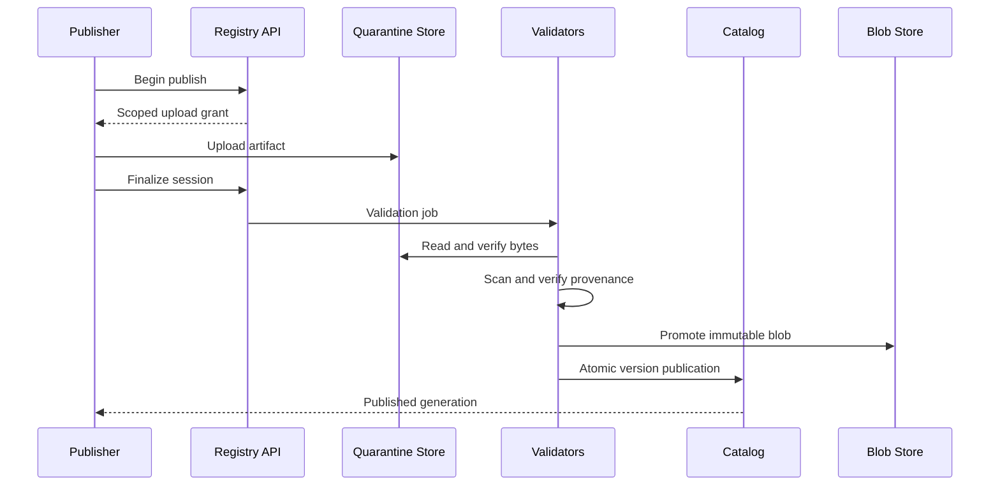
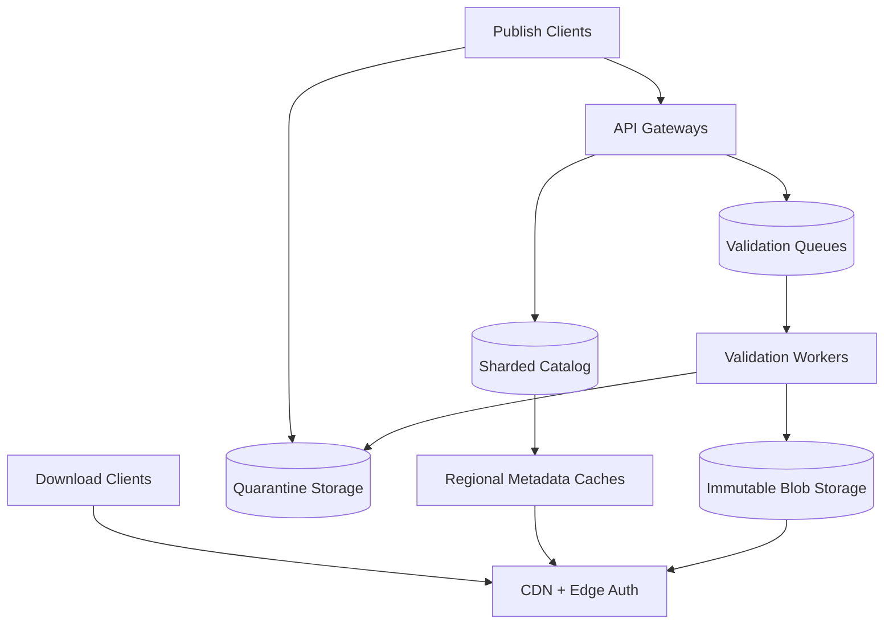

# Design a Global Multi-Tenant Software Package Registry

**Difficulty:** Senior / Staff  
**Primary themes:** immutable artifacts, transactional metadata, CDN caching, queues, consistency, software supply-chain security, multi-tenant isolation

## Interview prompt

> Design a global package registry similar to npm or an enterprise artifact service. Developers should be able to publish immutable package versions, assign mutable release tags such as `latest` or `beta`, resolve package metadata, and download artifacts globally. Support public and private namespaces, provenance and malware checks, revocation, and high availability.

The interesting part is not storing tarballs. It is creating one trustworthy meaning for “package X, version Y,” serving that meaning through aggressive caches, and responding safely when a release is compromised.

## Targeted clarifying questions and assumed answers

**Candidate:** Which package ecosystem and artifact format should I support?

**Interviewer:** Design one generic registry with npm-like package names, semantic versions, dependency metadata, and tarball artifacts. We can discuss adapters for other ecosystems later.

**Candidate:** Are package versions mutable?

**Interviewer:** No. Once `@scope/name@1.4.2` is published, its artifact and canonical manifest never change, and that name-version pair is never reused. Mutable tags such as `latest` may point to different immutable versions.

**Candidate:** Are both public and private packages required?

**Interviewer:** Yes. A namespace belongs to a user or organization. Public packages are readable by everyone; private package metadata and artifacts require authorization.

**Candidate:** What scale should I design for?

**Interviewer:** Assume 50 million package versions, 2 billion artifact downloads per day, 300,000 peak download requests per second, 2,000 peak publishes per second, and 5 PB of stored package data. A normal artifact is 2 MB; the maximum is 5 GB.

**Candidate:** What latency and availability matter?

**Interviewer:** Public metadata reads should be p95 below 100 ms, and cached artifact downloads should begin within 200 ms in major regions. Downloads need 99.99% availability. Publishing can take several seconds because security checks run first, but its final result must be unambiguous.

**Candidate:** Who resolves dependency ranges?

**Interviewer:** The client package manager chooses a concrete dependency graph using registry metadata and a lockfile. The registry returns consistent package/version metadata; it does not solve every user's dependency graph on the server.

**Candidate:** What security checks are in scope?

**Interviewer:** Verify checksums and publisher authorization, support signed build provenance, scan for malware and policy violations, produce an audit trail, and allow emergency quarantine or revocation.

**Candidate:** Can maintainers delete packages?

**Interviewer:** Normal deletion is a reversible “yank”: stop new resolution but preserve existing locked builds and incident evidence. Hard erasure is exceptional—for legal or malware reasons—and must never permit version reuse.

**Candidate:** Should a registry outage prevent users from building with already cached packages?

**Interviewer:** No. Clients should verify content digests and use local caches and lockfiles. The registry should favor immutable, content-addressed downloads.

### What I would say aloud

> “I’ll separate an immutable artifact plane from a small mutable metadata plane. Publishing is a staged workflow: authorize, upload to quarantine, verify digest and provenance, scan, then atomically publish the version record. Downloads use immutable digest URLs behind a CDN. Mutable tags and yanks are strongly ordered per package and versioned so caches cannot silently reinterpret a locked build. I’ll deep-dive on atomic publication, cache consistency at 300,000 requests per second, and supply-chain compromise and revocation.”

## Interview time budget versus this walkthrough

In a 45-minute interview, spend roughly 5 minutes on requirements, 2 on entities, 5 on interfaces, 10–15 on a complete baseline, and 10–15 on the most important deep dives. That sequence follows the public [Hello Interview System Design Delivery Framework](https://www.hellointerview.com/learn/system-design/in-a-hurry/delivery): define the contract, identify entities and interfaces, build a working design, and then harden it around non-functional requirements.

This educational walkthrough is intentionally more complete. In the interview, state decisions and invariants first, draw only the main flows, and expand where the interviewer probes.

---

## 1. Requirements (~5 minutes)

### Core functional requirements

1. **Publish an immutable package version.** An authorized publisher uploads an artifact and manifest; the service verifies, scans, records provenance, and atomically makes the version discoverable.
2. **Resolve and download packages globally.** Clients fetch package/version metadata and download the exact artifact by immutable digest with integrity verification.
3. **Manage release state safely.** Authorized maintainers update mutable tags, yank or quarantine versions, manage visibility and membership, and inspect audit/security evidence.

### Out of scope

- Building packages or executing arbitrary user build steps
- A universal server-side dependency solver
- Source-code hosting
- CI orchestration
- Container image layer semantics
- Billing implementation
- IDE search ranking beyond simple package search

### Quantified non-functional requirements

| Requirement | Target | Design consequence |
|---|---:|---|
| Artifact downloads | 300,000 requests/s peak; 2B/day | CDN and immutable URLs; origins are not on the common path |
| Metadata latency | p95 < 100 ms globally | Regional read caches and replicas |
| Cached artifact start | p95 < 200 ms in major regions | Edge presence, origin shielding, range requests |
| Download availability | 99.99% monthly | Multi-region metadata reads and replicated object storage |
| Publish throughput | 2,000 versions/s peak | Direct uploads, asynchronous validation queues, partitioned catalog |
| Publish correctness | No partial or conflicting version publication | Transactional publish boundary and uniqueness constraint |
| Integrity | Every accepted download verifiable by digest | Content-addressed blobs, signed metadata, client verification |
| Private isolation | No unauthorized metadata existence or byte disclosure | Auth-derived tenant, opaque errors, tenant-scoped grants |
| Revocation propagation | Emergency block at registry edge within 60 s | Short-lived policy epoch, push invalidation, denylist at download authorization |

### Consistency and availability contract

Different fields need different contracts.

**Strong per-package consistency**

- A name-version pair is created at most once.
- Ownership and namespace membership changes are serialized.
- Tag updates use compare-and-swap against a package metadata generation.
- Yank, quarantine, and legal-erasure state is authoritative for new registry responses.

**Immutable artifact consistency**

- A published version permanently binds to one canonical manifest digest and one artifact digest.
- Artifact URLs contain the digest and are cacheable for a year because their bytes never change.
- If a version is yanked, already obtained bytes still verify; the registry changes resolution policy, not history.

**Highly available reads**

- Public immutable metadata and blobs can be served from replicas and caches.
- Mutable tags may be briefly stale under the normal availability target, but responses include a generation and short cache TTL.
- Security quarantine is different: the system prioritizes safety, and edges fail closed when their revocation policy is too stale.

**Private packages**

- Metadata and download authorization require a fresh-enough entitlement view.
- A cached private artifact is never publicly addressable merely because its digest is known.

### Decision-changing scale estimates

Two billion downloads per day average:

\[
2{,}000{,}000{,}000 \div 86{,}400 \approx 23{,}100\ \text{downloads/s}
\]

The stated peak of 300,000/s is about 13× average. If the mean artifact is 2 MB, peak egress before edge-cache savings is:

\[
300{,}000 \times 2\ \text{MB} = 600\ \text{GB/s}
\]

Even an 80% CDN hit ratio leaves 120 GB/s at origin, still large. Popular immutable packages should achieve well above 95% edge hit rate, and origin shields should collapse concurrent misses.

Fifty million versions at an average compressed artifact size of 100 MB would be 5 PB, matching the prompt. Metadata at 10 KB per version is about 500 GB before indexes and replicas. That fits a sharded transactional catalog; artifacts clearly belong in object storage.

At 2,000 publishes/s and an average 100 MB artifact, worst-case incoming data is 200 GB/s. Publishers must upload directly to quarantine object storage with short-lived scoped grants. API servers should handle control metadata, not artifact bodies.

If 0.01% of daily downloads miss the CDN due to unique/private artifacts, that is still 200,000 origin downloads/day. Origin capacity and private-package caching need explicit design even with an excellent public hit ratio.

### What I would say aloud

> “The traffic arithmetic makes the split clear: the catalog stores a few hundred gigabytes of indexed metadata, while five petabytes of immutable artifacts live in object storage and are delivered through a CDN. Publication needs strong per-package serialization, but global downloads should avoid coordination and verify immutable digests locally.”

---

## 2. Core entities (~2 minutes)

| Entity | Important fields |
|---|---|
| `Namespace` | namespace ID, owner organization, visibility defaults, policy generation |
| `Package` | package ID, namespace/name, owners, visibility, metadata generation, state |
| `PackageVersion` | package ID, semantic version, manifest digest, artifact digest, state, published time |
| `ArtifactBlob` | digest, byte size, media type, object version, encryption scope, replication state |
| `CanonicalManifest` | dependencies, engines/platforms, entry points, license metadata, normalized digest |
| `ReleaseTag` | package ID, tag, target version, tag generation |
| `PublishSession` | session ID, publisher identity, requested version, expected digest/size, state, expiry |
| `Attestation` | artifact digest, predicate type, signer/build identity, signature, verification result |
| `ScanResult` | scanner/version, findings, policy decision, completed time |
| `Revocation` | scope, reason, severity, policy epoch, effective time, appeal state |
| `AuditEvent` | actor, action, resource, request ID, before/after digest, time |
| `PackageTombstone` | reserved name-version, prior digest, reason, permanent non-reuse marker |

The artifact digest is a content identity, but it is not authorization. A private tenant's object reference remains protected by catalog entitlement and scoped delivery grants.

### What I would say aloud

> “The package version is the trust anchor: a name and semantic version permanently bind to one manifest and artifact digest. Tags are separate mutable pointers. A tombstone preserves non-reuse even after exceptional erasure.”

---

## 3. API and system interface (~5 minutes)

Identity comes from authentication. The server derives `principal_id`, organization memberships, namespace roles, and tenant scope; the caller cannot assert them in a request body.

### Begin publication

```http
POST /v1/packages/@acme/telemetry/publish-sessions
Authorization: Bearer <publisher-token>
Idempotency-Key: acme-telemetry-1.4.2
Content-Type: application/json

{
  "version": "1.4.2",
  "artifact": {
    "size_bytes": 1842331,
    "sha256": "8a1f..."
  },
  "manifest": {
    "name": "@acme/telemetry",
    "version": "1.4.2",
    "dependencies": {
      "@acme/core": "^3.1.0"
    }
  },
  "provenance_digest": "sha256:73be..."
}
```

```json
{
  "publish_session_id": "pub_72...",
  "state": "AWAITING_UPLOAD",
  "upload": {
    "url": "https://quarantine.registry.example/upload/...",
    "headers": {
      "x-required-sha256": "8a1f..."
    },
    "expires_at": "2026-10-17T15:15:00Z"
  }
}
```

The service reserves neither the version nor a public catalog entry yet. It records an expiring session tied to the publisher, package, requested version, expected size, and digest.

### Finalize publication

```http
POST /v1/publish-sessions/pub_72:finalize
Idempotency-Key: acme-telemetry-1.4.2-finalize
```

```json
{
  "operation_id": "op_981...",
  "state": "VALIDATING"
}
```

The operation progresses through `VALIDATING`, `SCANNING`, `VERIFYING_PROVENANCE`, and either `PUBLISHED` or `REJECTED`.

```http
GET /v1/operations/op_981
```

```json
{
  "state": "PUBLISHED",
  "package": "@acme/telemetry",
  "version": "1.4.2",
  "manifest_digest": "sha256:12cd...",
  "artifact_digest": "sha256:8a1f...",
  "metadata_generation": 418
}
```

### Read package metadata

```http
GET /v1/packages/@acme/telemetry
If-None-Match: "pkggen-417"
```

```json
{
  "name": "@acme/telemetry",
  "metadata_generation": 418,
  "dist_tags": {
    "latest": "1.4.2",
    "beta": "1.5.0-beta.3"
  },
  "versions": {
    "1.4.2": {
      "state": "ACTIVE",
      "manifest_digest": "sha256:12cd...",
      "artifact_digest": "sha256:8a1f...",
      "integrity": "sha512-...",
      "dependencies": {
        "@acme/core": "^3.1.0"
      },
      "provenance": {
        "status": "VERIFIED",
        "builder_identity": "https://ci.acme.example/release"
      }
    }
  }
}
```

Large packages use paginated version listings or a compact index plus per-version endpoint. Returning every historical version indefinitely would create a hot oversized record.

### Download an exact version

```http
GET /v1/packages/@acme/telemetry/versions/1.4.2/download
Authorization: Bearer <optional-for-public>
```

```http
HTTP/1.1 302 Found
Location: https://cdn.registry.example/blobs/sha256/8a/8a1f...?grant=...
Digest: sha-256=ih8...
Cache-Control: private, no-store
```

For public artifacts, the canonical digest URL needs no per-user secret and can be cached publicly. For private artifacts, the redirect contains a short-lived signed grant bound to tenant, blob digest, and permitted byte range. The CDN cache key excludes the signature only if the CDN performs authorization before cache lookup.

Clients must validate the digest after download. A lockfile records the exact version, resolved digest, and optionally provenance requirements.

### Update a mutable release tag

```http
PUT /v1/packages/@acme/telemetry/tags/latest
If-Match: "pkggen-418"

{
  "version": "1.4.3"
}
```

On success, the server returns metadata generation 419. On concurrent change, it returns `409 GENERATION_CONFLICT` with the current generation.

### Yank or quarantine

```http
POST /v1/packages/@acme/telemetry/versions/1.4.2:yank
{
  "reason": "Critical runtime defect; use 1.4.3"
}
```

Maintainers may yank. Registry security may quarantine:

```http
POST /internal/v1/revocations
{
  "package": "@acme/telemetry",
  "version": "1.4.2",
  "severity": "CRITICAL",
  "action": "BLOCK_DOWNLOAD",
  "reason_code": "MALWARE_CONFIRMED"
}
```

Yank removes a version from new range resolution but can preserve exact-version downloads. Quarantine can block new downloads immediately. These are deliberately different actions.

---

## 4. Data flow

Publication is a pipeline, so showing the stages clarifies the trust boundary.



Download flow:

1. Client reads package metadata from the nearest region or edge cache.
2. It resolves a semantic version range or reads an exact version from its lockfile.
3. Registry authorizes private access and checks revocation state.
4. Client downloads by immutable digest through the CDN.
5. Client verifies the digest and optional provenance policy before installation.

---

## 5. High-level design (~10–15 minutes)

### Compact architecture



The architecture separates:

- a **strong metadata control plane** for namespaces, ownership, versions, tags, and revocations;
- a **staged publication pipeline** for untrusted uploads;
- an **immutable artifact plane** using object storage and CDN;
- a **regional read plane** for low-latency metadata.

### Operation 1: Create a package and authorize the publisher

The first publish creates the package if the namespace policy permits it.

1. API validates syntax, normalized name, semantic version, size limits, and manifest schema.
2. Authorization reads namespace ownership and role generation from the strongly consistent catalog.
3. Rate limits apply by identity, namespace, IP risk, and requested bytes.
4. The API creates an expiring `PublishSession` with request digest and audit event.
5. A scoped upload grant permits one object under the session's quarantine prefix, with exact maximum size and expected checksum.

Package names are normalized once and uniqueness is enforced on the canonical form. This prevents case-folding or Unicode lookalike inconsistencies across clients.

The session is idempotent. Repeating the same idempotency key and request digest returns the existing session; changing the request under the same key returns a conflict.

### Operation 2: Upload into quarantine

The publisher sends bytes directly to regional quarantine object storage using multipart upload.

- Quarantine is not readable through the public download domain.
- The upload identity cannot publish metadata or promote objects.
- Object completion records actual length, checksum, storage version, and session ID.
- Incomplete multipart uploads expire automatically.
- Maximum compression expansion and file-count limits protect validators from archive bombs.

An object-store completion event enters a durable queue, but finalization also performs a read-after-write metadata check. Periodic reconciliation finds objects whose completion events were lost.

### Operation 3: Validate and scan

Workers are isolated because package contents are untrusted.

Validation includes:

1. recompute the whole-artifact digest and compare it with the declared value;
2. unpack within CPU, memory, file-count, path-depth, and expanded-byte limits;
3. reject path traversal, device files, malformed archives, duplicate normalized paths, and forbidden scripts according to policy;
4. normalize the manifest and compute its canonical digest;
5. verify that manifest name/version equal the requested package/version;
6. run malware, secret, license, and policy scanners;
7. verify signatures and optional build provenance;
8. record every scanner name, ruleset version, result, and evidence digest.

Scanners produce findings; a versioned policy engine produces the publish decision. Keeping those separate lets the registry re-evaluate old artifacts when threat intelligence or policy changes.

[SLSA provenance](https://slsa.dev/spec/v1.2/provenance) models a claim tying an artifact to the build platform, build definition, and inputs. The registry stores such attestations by artifact digest and verifies them against namespace policy. Provenance raises confidence but does not prove the source or build was benign, so it complements rather than replaces scanning.

### Operation 4: Atomically publish the version

After all required validations pass:

1. Promote or server-side-copy the verified bytes into immutable blob storage under the content digest.
2. Confirm the destination object's digest, size, encryption scope, and required regional durability.
3. Begin a catalog transaction on the package's home shard.
4. Lock or compare-and-swap the package metadata generation.
5. Assert that neither a live `PackageVersion` nor a `PackageTombstone` exists for the normalized version.
6. Insert the immutable version record, canonical manifest, artifact reference, attestations, scan decision, and audit event.
7. Optionally update a requested tag such as `latest` in the same transaction.
8. Increment the package metadata generation and append an outbox event.
9. Commit. Only now is the version published.

The transaction is the publication point. Before it, the promoted blob is unreachable garbage; after it, the catalog refers only to a verified durable object.

The transactional outbox asynchronously drives:

- regional metadata replication;
- cache invalidation;
- search indexing;
- download popularity counters;
- transparency-log submission;
- webhook notifications.

If an event is lost or duplicated, consumers reconcile by package generation and process idempotently.

### Operation 5: Resolve metadata

Public reads use this hierarchy:

1. CDN/edge metadata cache for hot package/version responses;
2. regional in-memory cache;
3. regional read replica or materialized package view;
4. home catalog shard on miss or strong-read request.

Cache keys include package ID and representation type. Values include `metadata_generation`, `ETag`, visibility, tags, active versions, and revocation policy epoch.

Immutable per-version metadata can use a long TTL. Mutable package summaries and tags use a short TTL plus push invalidation. Clients send `If-None-Match` to avoid redownloading unchanged metadata.

Dependency resolution remains a client responsibility:

- fetch metadata for each referenced package;
- apply semantic-version and platform rules;
- choose versions;
- write exact versions and digests into a lockfile;
- use the lockfile for reproducible future installs.

The registry provides a consistent version document, not an atomic snapshot spanning every package in the world. A lockfile is the application-level snapshot.

### Operation 6: Download artifact bytes

For an exact version:

1. Registry resolves version to immutable artifact digest.
2. It checks version state and current revocation policy.
3. For private data, it validates tenant entitlement using a recent policy generation.
4. It returns or internally routes to a digest-based CDN URL.
5. CDN serves from edge, then regional shield, then immutable object origin.
6. Client checks length and digest before install.

Support HTTP range requests for large artifacts and resumable downloads. The digest covers the complete artifact, while per-chunk transport checksums detect corrupted ranges early.

Popularity-weighted prewarming is useful after major releases, but request coalescing at the shield is essential: a million clients asking for a newly tagged release should cause one or a few origin fetches, not a million.

### Operation 7: Update tags

Tags are mutable convenience pointers, never artifact identities.

The write path uses `If-Match` or explicit expected generation:

1. authorize a maintainer against current ownership generation;
2. ensure the target immutable version is active and permitted;
3. compare expected package generation;
4. update tag, increment package generation, append audit/outbox;
5. publish invalidations.

Readers may see a prior tag for a few seconds, so CI requiring reproducibility must pin versions and digests. The API exposes generation and update time, making staleness visible.

### Operation 8: Yank, quarantine, and erase

These states have different semantics:

| State/action | New range resolution | Exact-version metadata | Download | Version reusable |
|---|---|---|---|---|
| Active | Yes | Yes | Yes | Never |
| Yanked | No | Yes, with warning | Usually yes | Never |
| Quarantined | No | Yes to authorized incident roles | Blocked or gated | Never |
| Legally erased | No | Tombstone only | No | Never |

Yank is a package-maintainer workflow for mistakes. Quarantine is a security action and increments a global or regional revocation policy epoch. Hard erasure deletes bytes only after legal/security approval, evidence preservation where permitted, cache purge, replica confirmation, and a permanent tombstone.

### Baseline failure handling

| Failure | Response |
|---|---|
| Publisher retries begin/finalize | Idempotency record returns existing session/operation |
| Upload succeeds but completion event is lost | Finalize check and reconciler rediscover the object |
| Validator dies | Queue lease expires; another isolated worker restarts |
| Scanner times out | Bounded retries; publish remains non-visible |
| Blob promotion succeeds but catalog transaction fails | Unreachable blob is garbage-collected after safety delay |
| Catalog commit succeeds but invalidation is lost | Outbox replay and generation reconciliation repair caches |
| CDN corrupts a response | Client digest fails; retry another edge/origin and alert |
| Home metadata region fails | Regional replicas serve immutable and bounded-stale public reads; strong mutations pause/fail over |
| Revocation service is unreachable | Edge uses unexpired signed policy; fails closed when policy freshness exceeds limit |

### What I would say aloud

> “The publish transaction never includes the artifact upload. Bytes first reach quarantine, are validated, and are promoted under an immutable digest. A small catalog transaction then binds package name and version to that digest and emits an outbox event. This avoids distributed transactions while ensuring no catalog entry points to unverified or missing bytes.”

---

## 6. Deep dives (~10–15 minutes)

### Deep dive A: Atomic publication and version immutability

#### Where the baseline breaks

A naïve `POST /packages` that uploads bytes and writes a database row has ambiguous failure windows:

- the connection drops after bytes arrive but before the client sees success;
- two maintainers race to publish the same version;
- the database row commits before the artifact is durable;
- a scanner passes one byte sequence but the final object contains another;
- a deleted version is later republished with different bytes;
- a tag update becomes visible before the version it references.

Users need one permanent answer for `name@version`.

#### Plausible approaches

| Approach | Advantage | Problem |
|---|---|---|
| Distributed transaction across DB and object store | Conceptually atomic | Object stores generally do not participate; operationally brittle |
| Write DB row first, repair object later | Simple API | Readers can observe broken versions |
| Upload first, catalog commit last | No broken published references | May leave harmless orphan blobs |
| Serialize every publish globally | Easy ordering | Unnecessary bottleneck and poor availability |

#### Selected design

Use **upload first, validate, promote, then atomically commit metadata**, serialized only per package shard.

The correctness boundary is:

[
Published(name, version, digest) iff CatalogCommit(name, version, digest, evidence)
]

The catalog enforces:

- unique canonical package name;
- unique package/version;
- tombstone exclusion;
- immutable artifact and manifest digests;
- monotonically increasing package generation.

The blob object key includes its digest, and promotion uses a conditional create. If the key already exists, the service checks its size and checksum rather than overwriting it.

#### Ambiguous client results

If the client times out during finalize, it polls by idempotency key or operation ID. It must not start a second semantic publication attempt with a different artifact. The idempotency table stores:

- tenant/package;
- idempotency key;
- canonical request hash;
- operation ID;
- terminal result;
- expiry longer than the maximum publish workflow.

#### Tag atomicity

If the publisher requests `latest -> 1.4.2`, create the version and move the tag in the same package-shard transaction. If the version is published without a tag request, later tag movement is a separate compare-and-swap write.

Cross-package publication is not atomic. A monorepo releasing ten packages uses a release manifest or staging channel and then moves tags one package at a time. If the product requires all-or-nothing multi-package visibility, add a versioned release-set pointer rather than a distributed transaction across shards.

#### Deletion and non-reuse

Never remove the uniqueness memory. A hard deletion leaves `PackageTombstone(package_id, version, prior_digest, reason)`. Otherwise, an old lockfile could request `1.4.2` years later and receive unrelated bytes.

The public npm documentation similarly states that an unpublished name-version combination cannot be reused: [npm unpublish command](https://docs.npmjs.com/cli/v11/commands/npm-unpublish/). This walkthrough uses that principle while defining its own registry behavior.

#### Observability

Track:

- publish latency by phase;
- duplicate and conflicting idempotency requests;
- version uniqueness conflicts;
- promoted-but-unreferenced blob bytes;
- catalog entries whose blob verification probe fails;
- outbox age by package shard;
- tag compare-and-swap conflicts;
- scanner decision distributions by ruleset version.

Continuously run canary publishes that intentionally retry across every failure boundary, then verify that exactly one immutable version exists.

#### What I would say aloud

> “I accept orphaned immutable blobs as the safe failure mode. They can be collected later. What I never accept is a published row pointing to absent or unverified bytes, or the same name-version resolving to two digests. A catalog uniqueness constraint and tombstone make that invariant durable.”

### Deep dive B: Global caching, hot releases, and revocation consistency

#### Where the baseline breaks

At 300,000 downloads/s, origin delivery is impossible. But aggressive caching introduces correctness problems:

- `latest` changes while edges hold old metadata;
- an emergency malware block must override year-long blob caching;
- cache-key mistakes can leak private artifacts;
- a newly popular version causes a thundering herd on cold edges;
- a region may serve package metadata from before an ownership or visibility change.

#### Separate immutable and mutable URLs

Do not serve artifact bytes at a mutable path such as:

```text
/packages/@acme/telemetry/latest.tgz
```

Instead resolve metadata, then download:

```text
/blobs/sha256/8a/8a1f...
```

The blob response can use:

```http
Cache-Control: public, max-age=31536000, immutable
ETag: "sha256:8a1f..."
```

Mutable package summaries use short TTLs, ETags, and stale-while-revalidate only when policy allows.

#### Approaches to tag consistency

| Approach | Read latency | Freshness | Cost |
|---|---:|---:|---:|
| Always read home leader | Highest globally | Strong | High coordination and lower availability |
| TTL-only edge cache | Lowest | Unbounded until TTL | Simple |
| Versioned metadata + invalidation + TTL backstop | Low | Seconds normally, bounded by TTL | Moderate |
| Globally synchronous invalidation before write returns | Higher write latency | Stronger | Complex and fragile |

Select versioned metadata with asynchronous invalidation and a short TTL backstop. Tag updates are not a safe reproducibility primitive; exact versions and digests are.

Each response carries:

- `metadata_generation`;
- `served_at`;
- `home_commit_time`;
- security `policy_epoch`;
- ETag over canonical metadata.

Clients can request a strong read for administrative confirmation, but ordinary installs use regional availability.

#### Revocation is not ordinary cache invalidation

A digest URL can be cached for a year, so deleting it from origin does not block edge copies. Put an authorization/policy gate in front of delivery:

- public non-revoked blobs use a compact signed allow/block policy at the edge;
- private blobs additionally require a signed short-lived entitlement;
- emergency revocation increments a monotonic policy epoch and pushes the digest/package deny entry;
- the edge refuses sensitive downloads if its signed policy expires or falls too far behind the advertised epoch;
- background purge removes cached bytes, but blocking does not wait for purge.

For public availability, the edge can continue serving when the policy is fresh even if the home control plane is unavailable. Safety and availability are balanced through a short signed policy lifetime, for example 2 minutes, and a 60-second revocation propagation SLO.

#### Thundering-herd protection

For a new major release:

- regional shields coalesce identical digest misses;
- edges use request collapsing;
- origin grants bandwidth fairly across digest keys;
- publishers may prewarm selected regions after publication;
- negative caching is brief and generation-aware so a pre-publication 404 does not outlive the release;
- popular blobs replicate proactively based on request velocity.

Use consistent hashing across shield nodes but replicate hot keys; pure single-owner hashing would overload one shield for a viral artifact.

#### Private cache safety

Two acceptable patterns:

1. cache ciphertext encrypted with tenant-specific keys, authorize before key release;
2. use a CDN feature that authorizes the signed tenant grant before serving a shared cache entry.

Never include a bearer token directly in a cache key that logs secrets, and never let one tenant's successful fill turn a private digest URL into a public object.

Return indistinguishable `404` responses for unauthorized private package names when existence itself is sensitive.

#### Observability

Measure:

- edge, shield, and origin hit ratio by public/private class;
- origin egress and request amplification;
- tag invalidation propagation p50/p99/max;
- metadata generation skew by region;
- revocation policy age and epoch skew at every edge;
- denied downloads after quarantine;
- cache-key authorization violations—target zero;
- request-coalescing fan-in for hot digests;
- digest mismatch rates by edge and ISP.

#### What I would say aloud

> “I cache immutable bytes for a year, but I never put mutable meaning into the blob URL. Tags are short-lived, generation-stamped metadata. Emergency revocation is a separate signed deny policy enforced before edge delivery, so safety does not depend on purging every cached copy first.”

### Deep dive C: Supply-chain trust, compromise, and recovery

#### Where the baseline breaks

Checksum validation proves that downloaded bytes match published bytes. It does not prove:

- the maintainer account was not hijacked;
- the package was built from the claimed source;
- the build worker was trustworthy;
- scanners knew about today's malware;
- the registry is not serving an old but valid vulnerable version;
- signing keys were not compromised.

A registry must preserve evidence and support new decisions over old immutable artifacts.

#### Layered trust model

1. **Publisher identity:** phishing-resistant MFA, short-lived tokens, scoped automation identities, organization policy, and protected owner changes.
2. **Artifact integrity:** server-computed digest, immutable object, client verification.
3. **Provenance:** signed attestation tying artifact digest to builder, inputs, and build definition.
4. **Transparency:** append publication and ownership/security events to an externally monitorable append-only log.
5. **Scanning:** sandboxed static/dynamic scanners with versioned evidence.
6. **Policy:** namespace and consumer rules decide whether verified evidence is sufficient.
7. **Response:** yank, quarantine, revoke credentials, re-evaluate dependent packages, and notify consumers.

[Sigstore](https://docs.sigstore.dev/) documents a model using signed artifacts, short-lived identity certificates, and a transparency log. The registry can accept Sigstore bundles or equivalent attestations; it must verify signatures, certificate identity, inclusion evidence, and the binding to the exact artifact digest.

[The Update Framework](https://theupdateframework.io/docs/overview/) describes signed, versioned, expiring metadata and separate trust roles to address repository compromise, rollback, and freeze attacks. We can adopt the principles without claiming to implement TUF wholesale:

- clients bootstrap trusted registry roots;
- security metadata is versioned and expires;
- root/ownership/security roles have separate keys;
- clients reject rollback to lower trusted generations;
- timestamp freshness prevents indefinite freeze;
- metadata snapshots prevent mix-and-match views.

#### Scanner evolution

Store scanner evidence separately from immutable version identity. When a new detection rule arrives:

1. threat-intelligence service finds candidate artifacts using hashes, extracted indicators, behaviors, or dependency metadata;
2. queue priority favors popular and high-risk packages;
3. workers rescan the original immutable bytes;
4. policy engine evaluates findings under a new policy version;
5. critical decisions produce a revocation with a new policy epoch;
6. caches and clients receive security notifications;
7. audit/transparency logs preserve who decided what and from which evidence.

The artifact digest never changes; its registry state and security assessment can.

#### Account takeover

Owner or token changes are high-risk mutations:

- require recent strong authentication;
- support organization-enforced MFA and hardware-backed credentials;
- notify existing owners out of band;
- apply a cooling-off period to adding a new owner who can publish popular packages;
- make automation tokens package-scoped, version-limited where possible, non-interactive, and short-lived;
- anomaly-detect new geography, sudden publish cadence, unusual file contents, and dependency changes;
- preserve emergency security authority separate from package owners.

Do not let the same compromised maintainer instantly add an owner, disable provenance policy, publish, and erase audit history.

#### Rollback and freeze protection

Clients persist the highest seen signed metadata/policy generations. A mirror or malicious network cannot convince them to accept a lower generation. Security/timestamp metadata has an expiry, so a mirror cannot indefinitely freeze clients on an old view.

Lockfiles intentionally pin older artifacts for reproducibility, so a client policy decides whether a critical revocation overrides the lock. A secure enterprise mode should fail builds for blocked digests and provide the exact advisory and remediation.

#### Blast-radius control

- Catalog shards limit write failures by namespace/package.
- Object storage keys use digest prefixes, but security policies index by package and digest.
- Tenant encryption scopes prevent a private tenant compromise from exposing another.
- Signing roots and online timestamp keys use separate roles; root keys stay offline or threshold-controlled.
- A registry security action requires dual control for ecosystem-wide blocks or legal erasure.
- Transparency monitors alert on unexpected owner changes, signing events, and root rotation.

#### Recovery from registry compromise

Assume an attacker modifies online metadata but cannot break hashes.

1. Freeze publishing and tag/ownership mutation.
2. Rotate online credentials and establish a higher signed root/policy generation through offline threshold keys.
3. Compare the catalog event log, transparency log, object manifests, and regional replicas.
4. Reconstruct an accepted package-generation history.
5. Quarantine disputed versions and owner changes.
6. Republish signed snapshot/timestamp metadata.
7. Require clients to advance from their last trusted generation without accepting rollback.
8. Communicate affected digests, not just package names.

#### Observability and audit

Track:

- percentage of downloads with verified digest and provenance;
- packages violating namespace provenance policy;
- owner/MFA/token-risk events;
- scanner backlog and time since last scan by popularity;
- signature or transparency inclusion failures;
- metadata rollback/freeze detections by clients;
- time from confirmed malicious digest to edge block;
- downloads attempted after revocation;
- root, policy, and signing-key rotation health.

#### What I would say aloud

> “Digest immutability gives integrity, not trust. I layer publisher identity, provenance, transparency, rescannable evidence, and revocation. Security metadata is signed, versioned, and expiring so a compromised mirror cannot roll clients back or freeze them forever. When a threat rule changes, I re-evaluate the same immutable digest and update policy state rather than rewriting history.”

---

## Reliability, data model, and operations

### Sharding the catalog

Partition by stable `package_id`, derived after name reservation. All versions, tags, owners, tombstones, and package audit-outbox rows for one package live on one logical shard, enabling local transactions.

Namespace membership may live on a namespace shard and be cached with a generation. Sensitive writes revalidate against the authoritative namespace generation. A package-move operation is a rare saga that freezes publication, copies state, changes routing, and leaves a redirect/tombstone.

Avoid one database row containing every version. Use:

- `packages(package_id, namespace, name, generation, state, visibility)`;
- `package_versions(package_id, version_sort_key, digests, state, published_at)`;
- `release_tags(package_id, tag, target_version, generation)`;
- `package_owners(package_id, principal_id, role, generation)`;
- immutable manifest/attestation references;
- denormalized regional package views for common reads.

### Multi-region strategy

Use a home region per package for strong writes. The home region runs a multi-AZ transactional shard. Metadata changes replicate to regional read stores; immutable artifacts replicate asynchronously or on demand behind a global object namespace.

Why not multi-leader writes everywhere?

- Publication and ownership changes are rare relative to downloads.
- Per-package single-home serialization makes name-version uniqueness and tag CAS simple.
- Global multi-leader conflict resolution would add risk to supply-chain authority for little read benefit.

If a home region fails:

- public immutable reads continue from regional replicas and edge caches;
- private reads continue while entitlement/policy freshness remains valid;
- publishes and ownership/tag mutations pause or fail over after a fenced home-epoch election;
- the new leader must prove catalog and outbox replication through a committed generation before accepting writes.

### Garbage collection

Blob deduplication by content digest can save space, but reference counting must not be the only deletion guard.

Maintain:

- approximate online reference count for fast decisions;
- immutable version/tombstone reachability;
- quarantine/session leases;
- legal/security evidence retention;
- replica and cache-purge state.

A periodic mark-and-sweep builds the authoritative live digest set from published versions and evidence obligations. Candidates wait through a grace period, are rechecked against a newer catalog generation, and are then deleted from every storage replica. Prefer leaked bytes over deleting a live artifact.

Private cross-tenant deduplication can reveal content membership. Either scope deduplication to a tenant or store globally shared public blobs separately from tenant-encrypted private blobs.

### Failure-domain checklist

- API and catalog quorum span at least three availability zones.
- Validation queues and workers are isolated by region and tenant quotas.
- Quarantine and published storage use different credentials and access policies.
- Metadata backups, signing roots, transparency checkpoints, and key material are restore-tested.
- CDN origin access uses signed service identity, not public bucket access.
- Search and analytics are derived systems; they cannot publish or authorize downloads.
- Audit export goes to a separately administered append-only destination.

### Operational dashboards

**Publish:** sessions, upload bytes, validation queue age, phase latency, rejection reasons, orphan blobs, shard conflicts.

**Read/download:** metadata p50/p95/p99, edge/shield hit rate, origin egress, range retries, digest mismatch, regional generation lag.

**Security:** provenance coverage, scanner freshness, revocation propagation, stale policy edges, ownership anomalies, blocked-download attempts.

**Reliability:** catalog quorum, replication lag, outbox age, object-replica health, CDN origin errors, KMS/signing dependencies.

### Core invariants

1. One canonical package name-version maps to at most one artifact and manifest digest forever.
2. A published catalog record references a verified, durable immutable blob.
3. A tombstoned name-version is never reused.
4. A tag points only to an existing permitted immutable version.
5. Private blob knowledge is not private blob authorization.
6. A security edge does not serve when its revocation policy is beyond the allowed staleness bound.
7. Client installation succeeds only after digest verification.

---

## 7. Concise final design

> “The registry has a strongly consistent per-package catalog and an immutable object/CDN data plane. An authenticated publisher starts an idempotent session and uploads directly to quarantine. Isolated workers recompute the digest, safely unpack, scan, normalize the manifest, and verify provenance. They promote the bytes under a content digest, then a single catalog transaction permanently binds package name and version to artifact and manifest digests, optionally moves a tag, increments the package generation, and emits an outbox event.
>
> “Clients fetch generation-stamped metadata from regional caches, resolve ranges locally, and record exact versions and digests in lockfiles. Artifact downloads use immutable digest URLs through CDN edges and shields; clients verify bytes. Tags use compare-and-swap and short cache lifetimes. Yank preserves history while excluding new resolution; security quarantine updates a signed revocation policy enforced before edge delivery, so blocking does not depend on cache purge. Publisher identity, provenance, transparency, rescanning, tombstones, tenant isolation, and signed versioned security metadata protect the software supply chain.”

## Requirements check

| Requirement | Design |
|---|---|
| Publish immutable versions | Staged session, quarantine, validation, blob promotion, atomic catalog commit |
| Resolve metadata | Regional generation-stamped cache and per-version documents |
| Global downloads | Digest URLs, CDN edges, origin shields, range/resume support |
| Mutable release tags | Per-package CAS and invalidation; tags never identify bytes |
| Public/private packages | Auth-derived namespace roles and authorization before private cache delivery |
| Integrity | Server-computed digest, immutable blobs, client digest verification |
| Provenance and malware checks | Signed attestations, isolated scanners, versioned evidence and policy |
| Safe removal | Yank, quarantine, exceptional erasure, permanent tombstone |
| 300K peak downloads/s | High immutable cache hit rate, request collapse, hot-key replication |
| Publish correctness | Unique package/version, no reuse, manifest published only after durable bytes |
| Regional resilience | Single-home writes with fenced failover; replicated reads and blobs |
| Emergency response | Signed revocation epoch, edge enforcement, purge as cleanup |

---

## Realistic interviewer follow-up questions with strong sample answers

### 1. Why not use the semantic version in the artifact URL?

> “A semantic version is immutable by contract, so it could be cached, but a digest URL makes integrity and deduplication explicit and lets the same verified bytes be referenced safely. The metadata maps name-version to digest; the client verifies the digest. Mutable tags such as `latest` never appear in canonical blob URLs.”

### 2. What if two maintainers publish version 1.4.2 simultaneously?

> “Both may upload and validate, but the package-shard uniqueness constraint allows only one catalog transaction to create 1.4.2. If the losing request has the identical canonical artifact and manifest, the API can return the existing result only when policy permits; if digests differ, it returns a permanent version conflict. The losing promoted blob is unreferenced and collected later.”

### 3. Can an object-store checksum replace client verification?

> “No. Storage checksums help inside the service, but the client needs end-to-end verification of the bytes it received through CDN and network layers against the digest bound in trusted metadata or its lockfile.”

### 4. How does a lockfile improve reproducibility?

> “A dependency range like `^3.1.0` can resolve differently tomorrow. The lockfile records each exact version and integrity digest, producing an application-level snapshot across packages. The registry itself does not promise a globally atomic dependency-resolution snapshot.”

### 5. Why allow exact downloads of a yanked version?

> “Yank is for accidental or discouraged releases, not confirmed malware. Preserving exact digest downloads lets existing lockfiles reproduce and supports incident analysis. A quarantine is stronger and can block downloads. The product should make the difference explicit rather than treating every maintainer mistake like a security emergency.”

### 6. How do you stop a compromised CDN from serving an older vulnerable release?

> “The client verifies signed, versioned, expiring metadata and remembers the highest trusted generation. It rejects rollback and expired security metadata. A lockfile may intentionally pin old content, so enterprise policy separately checks whether its digest is revoked.”

### 7. How do private packages use the same CDN safely?

> “Authorization happens before cache delivery. The client receives a short-lived tenant- and digest-bound grant. The CDN validates it before looking up a cache entry. The signature is not part of the shared cache key, but a validated tenant/encryption scope is. Alternatively, cache tenant-encrypted ciphertext and release keys only after authorization.”

### 8. Why not synchronously wait for every global cache invalidation?

> “It would make tag and policy writes depend on thousands of edge nodes and lower availability. For ordinary tag changes, generation plus short TTL and push invalidation is enough because reproducible clients pin digests. Critical revocation uses a separate signed short-lived policy that fails closed when stale.”

### 9. How do you handle a 5 GB package?

> “Use multipart upload, resumable digest computation, streaming-safe validation, and explicit expanded-size limits. Download supports HTTP ranges and resume. The registry may require a tree or chunk manifest so clients verify ranges incrementally, while still verifying the final whole-artifact digest before install.”

### 10. Does global content-addressed deduplication leak private information?

> “Potentially. A malicious tenant could test whether known bytes already exist or observe timing. I separate public globally shareable blobs from private storage and scope private dedupe and encryption to a tenant unless the tenant explicitly opts into a trusted shared domain.”

### 11. What if a scanner later discovers malware in a popular package?

> “The immutable bytes remain evidence. A new scan result feeds the policy engine, which creates a critical revocation and increments the signed policy epoch. Edges block before cache delivery, metadata marks the version quarantined, dependency indexes identify affected consumers, and notifications include the exact digest and remediation. Purging cached bytes happens in parallel.”

### 12. What is the consistency unit?

> “One package is the unit. Versions, tags, owners, tombstones, and generation share a home shard, so their writes are transactional. Cross-package dependency graphs are not globally transactional; lockfiles provide reproducibility across those independently changing packages.”

### 13. How would you support delegated organizations and teams?

> “Namespace membership is authoritative on a namespace shard with a generation. Package roles may reference teams. Reads can cache memberships, but publish, ownership, visibility, and token issuance revalidate a fresh generation. High-risk changes require strong authentication and audit.”

### 14. What would you do during a home-region outage?

> “Downloads and bounded-stale metadata reads continue from other regions. Publishing and ownership/tag writes pause initially. If the outage persists, a controlled failover elects a new home epoch after proving replicated catalog generation and fencing the old writer. Immutable CDN traffic is unaffected.”

### 15. Why not make the package registry itself build every package?

> “That expands scope into a remote build service and exposes the registry to arbitrary execution. I accept signed provenance from trusted builders and validate it. A tightly integrated build service can be added, but it should remain a separate security boundary and produce the same artifact/attestation interface.”

---

## Common pitfalls

1. Storing artifacts in the relational metadata database.
2. Proxying publish and download bodies through API servers.
3. Making package versions mutable.
4. Allowing a deleted name-version to be reused.
5. Treating a mutable tag as an artifact identity.
6. Publishing the catalog row before verifying durable artifact bytes.
7. Trying to use a distributed transaction with object storage.
8. Omitting idempotency around ambiguous publish timeouts.
9. Trusting a publisher-supplied digest without recomputing it.
10. Unpacking untrusted archives without sandbox and expansion limits.
11. Assuming a valid checksum proves a package is safe.
12. Treating provenance as a malware verdict.
13. Returning every historical version in one ever-growing metadata document.
14. Resolving all dependency graphs on the registry server without need.
15. Ignoring lockfiles when discussing reproducibility.
16. Using long TTLs for mutable tags without generations or invalidation.
17. Depending on CDN purge alone for emergency revocation.
18. Caching private bytes without authorization in front of cache lookup.
19. Globally deduplicating private tenant content without discussing leakage.
20. Letting one compromised maintainer erase audit history or disable all security policy.
21. Copying blobs cross-region but omitting catalog, signing, and revocation state.
22. Promising multi-region strong writes when per-package home-region serialization is enough.
23. Treating search or analytics indexes as authoritative package metadata.
24. Garbage-collecting solely from fragile reference counts.
25. Failing to measure scanner freshness and edge policy staleness.

## Closing perspective

The design becomes much clearer after separating three concepts:

1. **Identity:** one package name-version permanently maps to one manifest and artifact digest.
2. **Distribution:** immutable digest-addressed bytes can be cached globally with almost no coordination.
3. **Trust policy:** ownership, tags, provenance assessment, yanks, and revocations can evolve without rewriting artifact history.

That separation gives fast global delivery, reproducible builds, and a credible response to compromise without forcing every download through a globally coordinated database.

## Public references

- [Hello Interview: System Design Delivery Framework](https://www.hellointerview.com/learn/system-design/in-a-hurry/delivery)
- [npm: Registry concepts](https://docs.npmjs.com/cli/v11/using-npm/registry/)
- [npm: Unpublishing packages](https://docs.npmjs.com/unpublishing-packages-from-the-registry/)
- [npm: package-lock.json](https://docs.npmjs.com/files/package-lock.json/)
- [SLSA v1.2: Provenance](https://slsa.dev/spec/v1.2/provenance)
- [Sigstore documentation](https://docs.sigstore.dev/)
- [The Update Framework: Overview](https://theupdateframework.io/docs/overview/)
