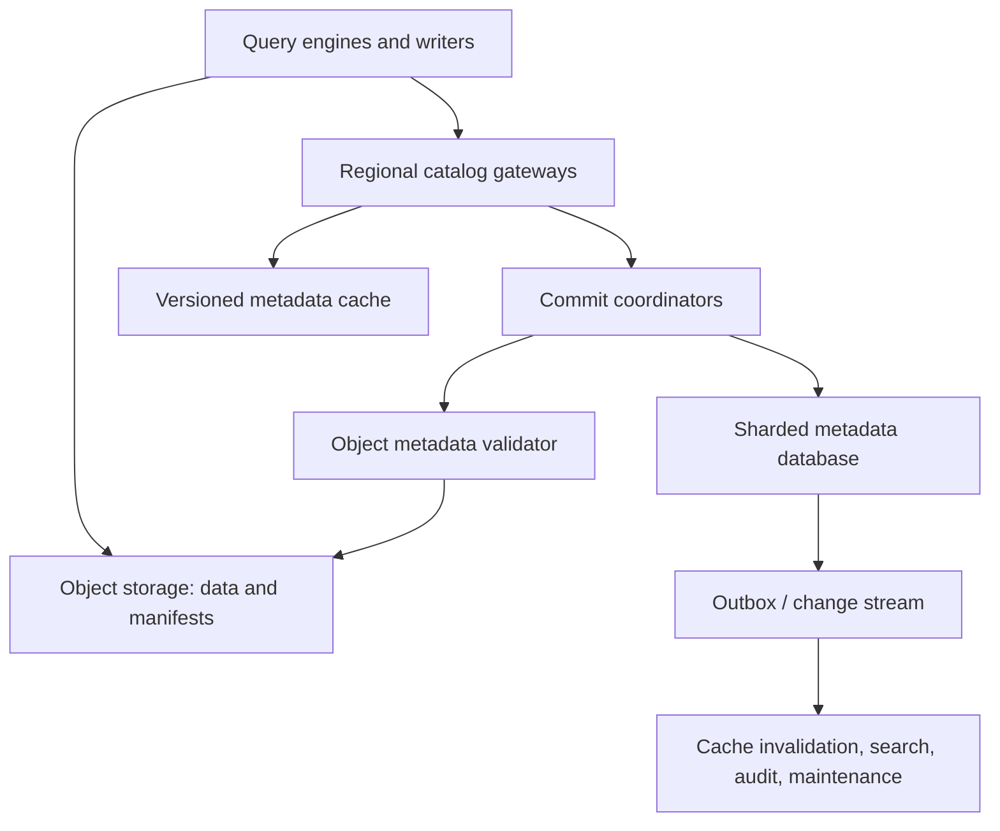
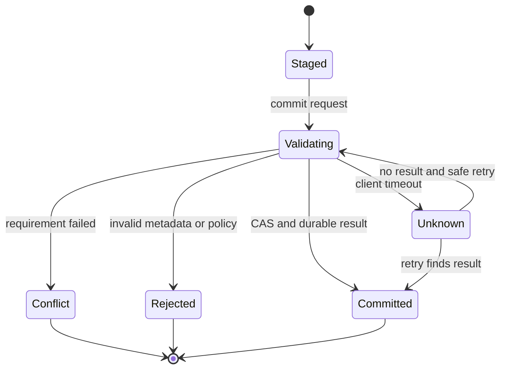

# Design a Lakehouse Catalog and Transaction Service

**Difficulty:** Senior / Staff  
**Primary themes:** metadata control planes, optimistic concurrency, immutable snapshots, object storage, caching, multi-table transactions, garbage collection, authorization

## How to use this walkthrough

In a 45-minute interview, target roughly 5 minutes for requirements, 2 for entities, 5 for interfaces, 10–15 for a complete high-level design, and 10–15 for selected deep dives. This document is longer than a spoken answer because it explains the reasoning that supports the concise interview version.

The organization follows Hello Interview's public delivery framework: clarify requirements, identify core entities, define the system interface, build the simplest design that satisfies the functional requirements, and then harden it against the important non-functional requirements ([Hello Interview delivery framework](https://www.hellointerview.com/learn/system-design/in-a-hurry/delivery)).

---

## Interviewer prompt

> Design a multi-tenant catalog and transaction service for a data lakehouse. Query engines and data pipelines store large Parquet data files in object storage. The catalog must let them create and discover tables, atomically commit new table snapshots, support concurrent writers and time travel, enforce access control, and scale to millions of tables without putting the catalog in the data path.

## Targeted clarifying questions and assumed answers

**Candidate:** Are we designing the query engine and object store as well?

**Interviewer:** No. Engines create/read data and metadata files; an S3-like object store durably stores them. Design the catalog, transaction boundary, and supporting metadata services.

**Candidate:** What table format should I assume?

**Interviewer:** Use an Iceberg-like model: immutable data files, manifests, manifest lists, and table metadata files. The catalog owns the authoritative pointer to the current table metadata.

**Candidate:** Which operations are core?

**Interviewer:** Create/list/load tables, commit a new snapshot with optimistic concurrency, read historical snapshots, manage branches/tags, rename/drop tables, and perform optional atomic commits across a small number of tables.

**Candidate:** What scale should I design for?

**Interviewer:** Ten thousand tenants, 100 million tables, 5 million catalog reads per second at peak, 100,000 single-table commit attempts per second, and 1,000 multi-table transactions per second. A table may reference millions of files, but the catalog must not enumerate them on ordinary reads or commits.

**Candidate:** What latency targets matter?

**Interviewer:** Cached table loads should be under 20 ms p99 within a region. Uncached loads should be under 100 ms p99. Successful single-table commits should be under 500 ms p99 excluding the writer's creation of data and metadata files.

**Candidate:** What consistency contract is expected?

**Interviewer:** Strong consistency for namespace/table identity and the current metadata pointer. A successful commit must be immediately visible to subsequent strongly consistent loads. Readers pin immutable snapshots. Listing and search may be eventually consistent.

**Candidate:** How should concurrent writers behave?

**Interviewer:** Compatible operations should retry against the latest snapshot; conflicting operations should fail with enough information for the engine to re-plan. Do not serialize every data-writing job behind a long lock.

**Candidate:** What happens to files uploaded by a writer that loses a commit race?

**Interviewer:** They are uncommitted orphans. The system must eventually remove them without deleting files still reachable from any live snapshot, branch, tag, or in-progress transaction.

**Candidate:** Do we need exactly-once streaming commits?

**Interviewer:** Support idempotent commit tokens so a streaming job can retry an ambiguous catalog response and learn the original result.

**Candidate:** How is authorization handled?

**Interviewer:** Identity comes from workload authentication. Enforce tenant, namespace, table, branch, and operation policies. Prefer short-lived scoped object-store credentials or remote signing rather than returning permanent storage keys.

**Candidate:** Is cross-region active-active required?

**Interviewer:** Reads should be local in several regions. Each catalog object has one write home at a time. Explain disaster recovery and how you prevent split-brain commits.

**Candidate:** How long are snapshots retained?

**Interviewer:** Default 30 days, configurable with minimum legal and operational protections. Named tags may retain snapshots longer.

**Candidate, summarizing aloud:** “I’ll keep bulk data and immutable metadata in object storage, while the catalog stores small authoritative identities and metadata pointers. Commits are short compare-and-swap transactions; readers pin snapshots, and background services handle indexing, retention, and orphan cleanup.”

---

## 1. Requirements (~5 minutes)

### Core functional requirements

Prioritize three end-to-end capabilities:

1. **Manage and discover catalog objects.** Authenticated engines create, load, list, rename, and drop namespaces and tables, with authorization and auditable history.
2. **Commit and read immutable table snapshots.** Writers propose changes relative to a base version; the service validates assumptions and atomically advances the current metadata pointer. Readers load and pin a committed snapshot for repeatable planning.
3. **Manage history and coordinated changes.** Users time-travel, create branches/tags, expire old snapshots safely, retry commits idempotently, and optionally commit changes to a small set of tables atomically.

Out of scope for the core design: SQL parsing, query execution, Parquet encoding, object-store implementation, row-level lock management, arbitrary cross-service distributed transactions, and a full data-governance product.

### Quantified non-functional requirements

| Concern | Contract |
|---|---|
| Scale | 100M tables; 5M reads/s; 100K single-table commit attempts/s; 1K small multi-table transactions/s |
| Load latency | Under 20 ms p99 cached and under 100 ms p99 uncached within a region |
| Commit latency | Under 500 ms p99 after immutable files already exist |
| Availability | 99.99% reads; 99.95% commits; survive a zonal failure without acknowledged-commit loss |
| Consistency | Linearizable current-pointer and name operations within a table's write home; snapshot reads are immutable |
| Durability | No acknowledged namespace, pointer, branch, policy, or transaction outcome may be lost |
| Isolation | Tenant-scoped metadata, authorization, credentials, quotas, audit logs, and encryption |
| Retention | 30-day default snapshot history; configurable tags and protected references |

### Consistency and availability contract

- **Table load:** a strongly consistent load returns one committed metadata location and catalog version. All files reachable from it are immutable.
- **Commit:** success means the authoritative pointer advanced exactly once and the outcome is durably recorded. A response timeout is ambiguous; retry with the same idempotency token.
- **Concurrency:** compare-and-swap rejects stale base versions. The server may safely rebase declared changes when their assumptions still hold; otherwise it returns a conflict.
- **Read isolation:** a query pins a snapshot ID at planning time. Later commits do not change that query's file set.
- **Listing/search:** namespace listings and text/tag search may lag a few seconds because they use secondary indexes. Direct lookup by canonical name is strongly consistent.
- **Drop:** dropping removes the live name immediately but does not synchronously delete objects. Retention and garbage collection determine physical deletion.
- **Cross-region:** reads may use regional replicas with bounded staleness when explicitly requested. Strong commits route to the object's current write home.

**What to say aloud:** “The commit unit is not millions of data files. Writers build an immutable metadata tree off-path, and the catalog transaction atomically swaps one small root pointer after validating the base version.”

### Scale estimates that change the design

Five million table loads per second cannot all hit the primary metadata database. If a load response is 2 KB, edge and regional caches serve roughly 10 GB/s of metadata responses at peak. Use versioned cache entries and push invalidation or short TTLs, while strongly consistent reads can bypass or validate the cache.

The catalog cannot store one row per data file in its transaction database. If 100 million tables average 100,000 live files, that would be (10^{13}) file records. Instead, object storage holds hierarchical manifests; the catalog stores a few hundred bytes of authoritative root state per table.

At 100,000 commit attempts/s, even a 1% retry/conflict rate creates 1,000 extra attempts/s. Hot streaming tables may individually receive hundreds of commits per second, so partitioning only by tenant is insufficient. Shard by stable table ID and explicitly handle hot-table contention.

Suppose one metadata version plus branch and policy state averages 2 KB in the transaction store. Current state for 100 million tables is around 200 GB before indexes and replication—manageable when sharded. Historical metadata belongs in the immutable object graph and compact audit log rather than in wide mutable rows.

---

## 2. Core entities (~2 minutes)

| Entity | Purpose |
|---|---|
| `Tenant` | Ownership, quota, billing, encryption, and authorization boundary |
| `Namespace` | Hierarchical logical container and policy inheritance point |
| `Table` | Stable table identity, canonical name, storage root, state, and current catalog version |
| `TableMetadata` | Immutable schema, partition specs, properties, snapshot graph, and current snapshot reference |
| `Snapshot` | Immutable logical table version referring to manifest lists and summary metadata |
| `Reference` | Named branch or tag pointing to a snapshot with retention policy |
| `CommitRequest` | Base version, requirements, changes, new metadata digest/location, and idempotency token |
| `Transaction` | Optional atomic group of compare-and-swap changes across a small table set |
| `Grant` | Principal, resource scope, actions, conditions, and policy version |
| `Lease` | Short-lived protection for staged files or in-progress transaction cleanup—not a writer lock |

Avoid designing the entire physical schema here. Introduce fields when a component needs them.

**What to say aloud:** “`Table` is the small mutable catalog record. `TableMetadata` and `Snapshot` are immutable blobs. A `Reference` names history, and a `CommitRequest` declares both the change and the assumptions that make it safe.”

---

## 3. API or system interface (~5 minutes)

Clients authenticate with workload identity, OAuth, or scoped service tokens. `tenant_id` and principal come from authentication, never from an untrusted request body.

### Create a table

```http
POST /v1/namespaces/analytics/tables
Authorization: Bearer <workload-token>
Idempotency-Key: create-orders-v1
Content-Type: application/json

{
  "name": "orders",
  "location": "s3://tenant-a-lake/warehouse/analytics/orders",
  "schema": {
    "fields": [
      {"id": 1, "name": "order_id", "type": "long", "required": true},
      {"id": 2, "name": "created_at", "type": "timestamp", "required": true}
    ]
  },
  "partition_spec": [{"source_id": 2, "transform": "day", "name": "created_day"}],
  "properties": {"write.format.default": "parquet"}
}
```

```json
{
  "table_id": "tbl_01K...",
  "catalog_version": 1,
  "metadata_location": "s3://.../metadata/00001-a91c.metadata.json",
  "current_snapshot_id": null
}
```

The service validates name uniqueness and storage policy, writes the initial immutable metadata file through a privileged writer or accepts a staged digest, then commits the table identity and pointer atomically.

### Load a table

```http
GET /v1/namespaces/analytics/tables/orders?consistency=strong
Authorization: Bearer <workload-token>
```

```json
{
  "table_id": "tbl_01K...",
  "catalog_version": 4821,
  "metadata_location": "s3://.../metadata/04821-c83e.metadata.json",
  "metadata_sha256": "c83e...",
  "current_snapshot_id": 928441,
  "storage_access": {
    "credential_token": "scoped-short-lived-token",
    "expires_at": "2026-10-17T10:20:00Z"
  }
}
```

The credential permits only the authorized prefixes and operations for this table and branch. An alternative is remote request signing so raw cloud credentials never reach the engine.

### Commit a snapshot

The writer first uploads data files, manifests, a manifest list, and a proposed table metadata file. Then it asks the catalog to publish the new root.

```http
POST /v1/namespaces/analytics/tables/orders/commits
Authorization: Bearer <workload-token>
Idempotency-Key: job-77-checkpoint-381
Content-Type: application/json

{
  "base_catalog_version": 4821,
  "base_metadata_location": "s3://.../04821-c83e.metadata.json",
  "requirements": [
    {"type": "assert-current-snapshot", "snapshot_id": 928441},
    {"type": "assert-schema-id", "schema_id": 14}
  ],
  "changes": [
    {"type": "append-files", "manifest": "s3://.../m-381.avro"},
    {"type": "set-snapshot", "snapshot_id": 928442}
  ],
  "new_metadata_location": "s3://.../04822-f03a.metadata.json",
  "new_metadata_sha256": "f03a..."
}
```

```json
{
  "status": "committed",
  "table_id": "tbl_01K...",
  "catalog_version": 4822,
  "current_snapshot_id": 928442,
  "metadata_location": "s3://.../04822-f03a.metadata.json"
}
```

Possible errors:

- `409 STALE_BASE` with the current catalog version;
- `409 VALIDATION_FAILED` when assumptions no longer hold;
- `422 INVALID_METADATA` for a digest, schema, or location violation;
- `429` for quota or hot-table protection.

The Apache Iceberg reliability documentation describes this optimistic pattern: writers build new metadata, attempt an atomic swap, and after a conflicting commit validate whether their changes can be safely reapplied ([Iceberg reliability](https://iceberg.apache.org/docs/1.4.3/reliability/)).

### Read a historical snapshot or branch

```http
GET /v1/namespaces/analytics/tables/orders/refs/month_end
Authorization: Bearer <workload-token>
```

```json
{
  "ref": "month_end",
  "type": "tag",
  "snapshot_id": 927100,
  "metadata_location": "s3://.../04702-b12d.metadata.json",
  "retention": {"expire_at": "2027-10-01T00:00:00Z"}
}
```

### Commit a small multi-table transaction

```http
POST /v1/transactions/commits
Authorization: Bearer <workload-token>
Idempotency-Key: publish-run-8841
Content-Type: application/json

{
  "commits": [
    {
      "table_id": "tbl_orders",
      "base_catalog_version": 4821,
      "new_metadata_location": "s3://.../orders/04822.json",
      "requirements": [{"type": "assert-current-snapshot", "snapshot_id": 928441}]
    },
    {
      "table_id": "tbl_order_items",
      "base_catalog_version": 9102,
      "new_metadata_location": "s3://.../items/09103.json",
      "requirements": [{"type": "assert-current-snapshot", "snapshot_id": 881020}]
    }
  ]
}
```

Return one durable `committed` or `aborted` outcome; never expose a partial set.

### Rename a table

```http
POST /v1/tables/tbl_01K.../rename
Authorization: Bearer <workload-token>
Idempotency-Key: rename-orders-v2
Content-Type: application/json

{
  "from": "analytics.orders",
  "to": "commerce.orders",
  "expected_name_version": 17
}
```

Identity remains `table_id`; only the name binding changes. Clients should not treat an object-store path as table identity.

The public Iceberg REST catalog specification similarly places table metadata operations behind a common API and supports change-based commits and optional multi-table transactions ([Iceberg REST catalog specification](https://iceberg.apache.org/rest-catalog-spec/)). This walkthrough designs the backing service rather than reproducing that protocol verbatim.

---

## 4. Data flow

### Write and commit flow

1. An engine strongly loads the current table pointer and pins `base_catalog_version` plus snapshot.
2. Distributed tasks write immutable Parquet data and delete files directly to the table's authorized object-store prefix.
3. The engine builds manifests, a manifest list, and a proposed immutable table metadata file.
4. It submits a commit with an idempotency token, base version, requirements, changes, location, and digest.
5. The catalog authenticates and authorizes, validates location/digest and requirements, then compare-and-swaps the root pointer in a short transaction.
6. A successful transaction records the result and appends an outbox event before replying.
7. Cache invalidation, search indexing, audit export, lineage, and maintenance scheduling occur asynchronously.
8. If the response is lost, the writer repeats the same token and receives the recorded outcome.

### Read flow

1. The engine resolves a canonical name to `table_id` and root pointer through a regional catalog endpoint.
2. It fetches the immutable metadata file, follows the selected snapshot to manifest lists and manifests, and prunes files in distributed planning.
3. The query retains the snapshot ID. Later commits cannot change its planned view.
4. Data files are read directly from object storage; the catalog is not involved per file or per row group.

---

## 5. High-level design (~10–15 minutes)

### Compact architecture



The catalog stays on the control path for discovery and commits, but never on the bulk data path.

### Operation 1: create and discover a table

Canonical names are normalized according to a strict namespace policy. Avoid case-folding surprises by making rules explicit at catalog creation.

The metadata database stores small current-state records:

```text
Table(
  tenant_id, table_id,
  namespace_id, canonical_name, name_version,
  state, storage_root,
  catalog_version,
  current_metadata_location, current_metadata_sha256,
  current_snapshot_id,
  policy_version, write_home_region,
  created_at, updated_at
)
```

Use two transactional indexes:

- `(tenant_id, namespace_id, canonical_name) -> table_id` for uniqueness and direct lookup;
- `table_id -> current state` for stable identity and sharding.

Create performs a transaction that reserves the canonical name, allocates the stable table ID, records the storage root, and installs metadata version 1. If the service writes the root file, it does so before publishing the pointer. An unpublished file is merely an orphan; a published pointer to a missing file is corruption.

Listing all 100 million tables from the primary database is not acceptable. Maintain a paginated secondary listing index by namespace and name. Direct lookup is strongly consistent; list results expose an index watermark and may lag briefly.

**What to say aloud:** “I separate stable identity from the human-readable name. Renames update a unique name binding, while snapshots, grants, audit records, and jobs continue to refer to `table_id`.”

### Operation 2: load a table at read scale

Regional gateways cache:

```text
cache key: (tenant_id, table_id or canonical_name, requested_ref)
cache value: (catalog_version, metadata_location, digest, snapshot_id, policy_version)
```

The current pointer is tiny but mutable. Use a layered cache:

1. process-local cache for hottest entries;
2. regional distributed cache;
3. regional read replica or leader-routed metadata store.

Commit outbox events publish `(table_id, new_catalog_version)` invalidations. Caches replace an entry only with a higher version, making out-of-order invalidations harmless. A short TTL repairs missed events.

Consistency modes:

- `strong`: gateway reads/validates against the write-home leader or a linearizable replica;
- `session`: client supplies `min_catalog_version`; a replica may serve only after reaching it;
- `bounded`: regional cache may serve within a declared staleness window.

Never let an unversioned invalidation delete a newer cache value.

The response vends a short-lived storage credential scoped to the table's prefixes and allowed actions. Cache table metadata separately from credentials; credentials have shorter lifetimes and principal-specific policy.

### Operation 3: commit a new snapshot

The writer's expensive work occurs before the catalog call. The commit coordinator performs only bounded work:

1. authenticate the principal and authorize `TABLE_COMMIT` on the table/ref;
2. look up the idempotency record;
3. load the current table row with linearizable semantics;
4. verify base version and declared requirements;
5. validate that the proposed metadata object exists, matches its digest, is under an authorized prefix, uses a supported format, and references an allowed table UUID;
6. in one database transaction, compare current `catalog_version`, update the root pointer and snapshot ID, insert the commit result/audit row, and write an outbox event;
7. return the committed version.

```text
CommitResult(
  tenant_id, principal_id, idempotency_key,
  request_hash, table_id,
  outcome, committed_catalog_version,
  committed_metadata_location,
  conflict_details,
  expires_at, created_at
)
```

The idempotency uniqueness scope includes tenant and principal or job identity. Reusing a token with the same request hash returns the original outcome; using it with a different request returns `409 IDEMPOTENCY_MISMATCH`.

#### Requirements and changes

A generic compare-and-swap detects that the base moved but does not say whether the operation remains safe. Structure commits as:

- **requirements:** facts assumed about current state;
- **changes:** logical actions to apply if those facts hold.

Examples:

- append requirement: table UUID and schema compatibility still hold;
- overwrite requirement: no concurrent file was added that matches the overwritten predicate;
- compaction requirement: every input file being replaced remains live;
- schema update requirement: target field IDs and current schema version match expectations.

The server can deconflict simple declarative changes. Complex engines may refresh and build a new metadata file themselves. The catalog never silently merges operations whose semantics it cannot prove.

### Operation 4: time travel, branches, and tags

Each committed metadata tree contains a snapshot graph. The catalog also stores current reference heads for efficient authorization and lifecycle decisions:

```text
Reference(
  table_id, ref_name, ref_type,
  snapshot_id, ref_version,
  max_ref_age_ms, min_snapshots_to_keep,
  max_snapshot_age_ms,
  protected, updated_at
)
```

A branch head can advance with compare-and-swap. A tag is immutable by default. Reads resolve a reference to a snapshot and then use immutable metadata.

Branch commits on the same table may share data files. Physical deletion therefore operates on reachability across **all** live references, not only `main`.

Snapshot expiration is a metadata commit that removes expired snapshot references according to policy. It does not immediately issue millions of synchronous deletes. Instead it emits candidate file sets for a garbage-collection pipeline.

### Operation 5: atomic commits across a few tables

Multi-table atomicity is useful when publishing coordinated facts such as `orders` and `order_items`, but arbitrary large transactions would make the catalog a distributed database coordinator for the entire lake.

Scope it deliberately:

- maximum 20 tables;
- all tables must be in the same catalog write-home region or transaction group;
- metadata files already exist;
- transaction timeout under a few seconds;
- deterministic table lock/order to avoid deadlocks;
- no bulk object writes inside the transaction.

For colocated shards, use one database transaction if supported. Otherwise use a transaction record plus prepared table intents:

```text
Transaction(
  transaction_id, tenant_id, idempotency_key,
  participant_tables, request_hash,
  state, decision_epoch, expires_at, created_at
)
```

Flow:

1. sort participant table IDs;
2. validate all base versions and requirements;
3. write durable prepared intents tied to the transaction;
4. durably record one `COMMIT` or `ABORT` decision;
5. make participant pointers visible under that decision;
6. let reconciliation finish any participant after coordinator failure.

Readers must not observe prepared pointers before the commit decision. A metadata database that offers serializable transactions across the participant set is far simpler and should be preferred before inventing two-phase commit.

### Operation 6: rename and drop safely

Rename atomically removes the old name binding and installs the new one while preserving `table_id`. Short-lived negative caches are versioned by namespace epoch so a just-created or renamed table is not hidden for long.

Drop transitions the table to a tombstoned state and removes the active name binding. Keep the tombstone through:

- the undrop grace period;
- maximum cache TTL;
- cross-region replication delay;
- active transaction and query lease horizon.

Only a later purge job removes metadata and schedules unreachable object deletion. Reusing a human-readable name creates a new table ID, preventing old caches and credentials from being mistaken for the new table.

---

## 6. Deep dives (~10–15 minutes)

Choose two in a normal interview. These three cover commit correctness, read scaling/hot tables, and safe lifecycle/security.

### Deep dive A: optimistic concurrency and ambiguous commits

#### Where the baseline breaks

A naïve service might lock a table for the entire distributed write job. Jobs can run for minutes or hours, so crashed writers hold locks, unrelated appends serialize, and throughput collapses. Conversely, blindly replacing the pointer loses concurrent changes.

#### Options

| Approach | Benefit | Failure/tradeoff |
|---|---|---|
| Long pessimistic writer lock | Simple mental model | Low concurrency, failure recovery, lock fencing required |
| Last write wins | Fast | Silently loses committed data or schema changes |
| Append-only central transaction log with one sequencer | Clear order | Hot bottleneck if all table traffic shares it |
| Per-table optimistic compare-and-swap | Short transaction, high concurrency | Writers must validate/rebase conflicts |

#### Choice

Use per-table optimistic concurrency with immutable staging:

- writers read version `V`;
- write data and metadata without holding a catalog lock;
- commit only if requirements still hold at the current version;
- compatible appends can reuse their data and manifest work when rebasing;
- conflicting overwrite, delete, schema, or compaction operations fail for re-planning.

The Apache Iceberg specification describes serializable snapshot reads and optimistic commits in which the current metadata version is atomically replaced ([Iceberg table specification](https://iceberg.apache.org/spec/)).

#### Commit state machine



`Unknown` is a client observation, not an authoritative database state. The client resolves it by repeating the idempotency token.

#### Why idempotency alone is not enough

An idempotency key prevents duplicate publication of the same request. It does not make a stale overwrite safe. We need both:

- idempotency for retrying an ambiguous network outcome;
- requirements/CAS for concurrency correctness.

#### Hot streaming table

A table receiving 500 micro-batch commits/s may spend most effort conflicting. Options:

1. increase batch size and reduce commit frequency;
2. give each ingestion partition its own branch, then merge/publish periodically;
3. use a per-table commit queue/sequencer for simple appends;
4. partition one logical dataset into multiple physical tables and expose a view;
5. server-side combine compatible append intents.

Choose adaptive append combining for known-compatible appends and recommend larger checkpoints. Do not coalesce overwrites or deletes without predicate-level validation.

#### Fencing write homes

Each table record includes `write_home_region` and `home_epoch`. A regional commit coordinator must present the current epoch. After failover, the metadata store rejects commits from the former home even if it later reconnects. Consensus-backed region ownership or the primary database lease controls the epoch; wall-clock TTL alone is insufficient.

**Interviewer:** What if the catalog commits but the writer times out?

**Candidate:** “The writer retries the identical request and idempotency token. The catalog returns the durable result if it committed. It must not invent a new metadata file or snapshot ID on each retry. If the request body differs, the service rejects token reuse.”

### Deep dive B: five million reads per second, invalidation, and hot metadata

#### Where the baseline breaks

Strongly reading the leader for every query-planning request overwhelms the metadata database. Caching forever serves stale pointers. Unversioned invalidation races can delete a newer entry after an older commit event arrives late.

#### Options

| Approach | Benefit | Weakness |
|---|---|---|
| No cache | Simple consistency | Database cannot handle 5M reads/s economically |
| TTL-only cache | Simple and self-healing | Freshness depends on TTL; stampedes on expiry |
| Push invalidation | Fast freshness | Events can be delayed, duplicated, or missed |
| Versioned cache + invalidation + TTL | Fast, ordered repair semantics | More version bookkeeping |

#### Choice

Use versioned immutable cache values, change-stream invalidation, and TTL repair.

Rules:

- cache entries carry `catalog_version`;
- an update/invalidation with version `N` cannot overwrite or delete version greater than `N`;
- negative name lookups carry `namespace_epoch` and a short TTL;
- a strong read validates against a linearizable source;
- a session read includes `min_catalog_version`;
- cache keys include tenant and policy-relevant scope;
- credentials are never shared through a principal-agnostic pointer cache.

#### Stampede control

When a hot cache entry expires:

- one request gets a short refill lease;
- others may use a briefly stale value only if their requested consistency permits it;
- strong waiters coalesce behind the refill within a deadline;
- backoff and jitter protect the database when it is unhealthy.

A cache lease suppresses duplicate work; it is not correctness authority. The metadata store version remains authoritative.

#### Immutable metadata caching

Root pointers are mutable and need invalidation. Objects addressed by cryptographic digest are immutable and can be cached for much longer at engines, gateways, or CDNs. Split caches accordingly:

- short-lived current pointer by table/ref;
- long-lived metadata JSON by digest/location;
- long-lived manifest and manifest-list files;
- policy/credential response by principal and short expiration.

This turns many table loads into one small pointer lookup followed by cacheable immutable reads.

#### Protecting the database

- shard by stable `table_id` hash;
- use regional read replicas for bounded/session reads;
- isolate commit capacity from list/search traffic;
- enforce tenant read and commit quotas;
- limit page sizes and ban unbounded namespace scans;
- keep search and lineage on asynchronous indexes;
- use deadline-aware queues and shed best-effort reads before commit traffic.

#### Observability

Track:

- load QPS and latency by consistency mode;
- pointer-cache and immutable-object-cache hit rate;
- invalidation lag and stale-event discard count;
- strong-read leader load;
- negative-cache hit and false-stale duration;
- refill singleflight waiters;
- per-shard hot-key distribution;
- commit-to-regional-visibility lag;
- search/list index watermark.

**What to say aloud:** “The mutable thing is only the root pointer. I cache it with a version and short repair TTL, then cache the immutable metadata tree aggressively by digest. That preserves freshness without routing millions of planning calls to the leader.”

### Deep dive C: retention, orphan cleanup, and storage security

#### Where the baseline breaks

Writers upload before committing. Failed jobs, lost races, and abandoned transactions leave objects behind. At the same time, snapshots, branches, tags, in-flight queries, and disaster-recovery lag may still reference old files. Deleting based only on age or a current-table listing can corrupt time travel.

#### Classify files before deleting

1. **Committed and reachable:** referenced by a live snapshot/ref; never delete.
2. **Committed but expired:** no longer reachable after a successful expiration commit; candidate after safety delay.
3. **Staged with active lease:** writer may still commit; protect temporarily.
4. **Orphaned staged:** never committed and beyond lease/grace period; delete.
5. **Unknown:** inventory is incomplete or metadata cannot be read; fail closed.

#### Approaches

| Approach | Benefit | Risk |
|---|---|---|
| List object store and delete old files | Easy to explain | Listing inconsistency/cost; may delete live files |
| Central registry row for every file | Precise | Catalog becomes enormous data-file index |
| Reachability scan from metadata roots | Correct with immutable graph | Expensive without partitioning and checkpoints |
| Writer inventory + reachability validation | Scalable compromise | Requires reliable inventory and conservative grace periods |

#### Choice

Use immutable metadata reachability as authority, aided by writer inventories and lifecycle prefixes.

1. Snapshot-expiration commit removes old roots only after checking branches, tags, and minimum retention.
2. The outbox emits old/new root digests.
3. Distributed workers traverse metadata graphs and calculate files no longer reachable from any protected root.
4. Candidates enter a deletion journal with `not_before`, reason, root-watermark, and object version.
5. A second worker revalidates against current protected roots and active leases before deleting.
6. Object versioning or trash retention permits operational recovery.

For abandoned writes, issue a `staging_id` and scoped prefix or inventory manifest. The writer renews a bounded lease while running. Cleanup never relies on the writer's local clock.

#### Race with a slow commit

A writer may stage files, pause, then commit while GC considers them old. Prevent this with:

- active staging lease recorded in catalog time;
- proposed metadata object registered before final commit;
- GC grace period longer than maximum allowed lease/transaction duration;
- commit validation that rejects expired staging IDs;
- deletion journal recheck just before delete.

#### Storage credential vending

Permanent tenant cloud keys are dangerous and hard to revoke. On table load or write planning, issue a short-lived credential restricted to:

- tenant and table storage root;
- read or write operation;
- allowed object prefixes and encryption key;
- maximum object size/request rate if supported;
- expiration and session identity.

Alternatively, route object requests through a remote signer. The signer validates tenant, table, operation, path normalization, and current policy before signing one request.

Prevent path confusion:

- canonicalize URI scheme, bucket, account, and path once;
- reject `..`, alternate encodings, and cross-bucket redirects;
- bind table UUID into metadata and validate it;
- never trust a writer-supplied metadata location outside the registered storage root;
- log digests and opaque IDs rather than credentials or sensitive paths.

#### Audit and compliance

Commit, grant, rename, drop, tag, retention, credential-vending, and emergency actions emit immutable audit records. The commit transaction writes an outbox row atomically; external audit delivery is asynchronous and reconciled. Highly regulated deployments may require write-once audit storage and tenant-managed encryption keys.

**Interviewer:** Why not delete every file older than 30 days?

**Candidate:** “Age is not reachability. A tag may intentionally retain a year-old snapshot, and a slow query may still hold a protected snapshot. I expire metadata references transactionally, compute unreachable candidates, wait through a safety window, and revalidate before physical deletion.”

---

## Reliability, failure modes, and operations

### Failure modes

| Failure | Expected behavior |
|---|---|
| Writer dies before commit | Staged files remain invisible; lease expiry makes them orphan candidates |
| Catalog rejects stale base | Writer refreshes and revalidates/replans; committed state is unchanged |
| Commit database succeeds but response is lost | Retry with same token returns durable result |
| Commit service dies before database commit | No pointer change; retry can attempt safely |
| Outbox publication is delayed | Pointer is correct; caches may use TTL/strong validation; publisher retries |
| Cache invalidations arrive out of order | Catalog-version comparison discards stale events |
| Metadata object missing or digest mismatch | Reject commit; never publish pointer |
| Object store temporarily unavailable | Existing cached metadata may serve reads; new validation/commits pause or retry |
| Regional gateway fails | Clients use another gateway; write-home fencing remains unchanged |
| Former write region returns after failover | Stale `home_epoch` prevents split-brain commit |
| GC worker crashes | Deletion journal resumes idempotently; no live root changes |
| Multi-table coordinator crashes after decision | Reconciler applies durable decision to remaining participants |

### Reconciliation loops

Production correctness needs repair loops for:

- table pointers whose metadata digest cannot be verified;
- committed outbox rows not published;
- regional caches/indexes below a version watermark;
- prepared multi-table intents without a completed participant;
- active staging leases past hard maximum;
- deletion-journal candidates awaiting revalidation;
- tombstoned tables past purge policy;
- references pointing to expired or missing snapshots;
- storage credentials issued under revoked policy versions.

Reconcilers scan bounded key ranges with checkpoints, use idempotent transitions, and publish metrics for repair age rather than repeatedly scanning the whole catalog.

### Multi-zone and disaster recovery

Within a write-home region, replicate the metadata database across three zones and require quorum/transaction durability before acknowledging. Gateways and coordinators are stateless across zones.

Replicate immutable object metadata and the catalog change log to a secondary region. Each table or shard has one active write-home epoch. Regional failover requires consensus/control-plane promotion that increments the epoch and fences the old region.

Reasonable targets:

- RPO 0 for acknowledged catalog commits when synchronous cross-region metadata replication is purchased; otherwise disclose a small RPO;
- RTO under 15 minutes for write-home failover;
- reads continue from cached/replicated committed snapshots during failover.

Disaster-recovery drills must load actual metadata trees and verify object-store access, encryption keys, manifests, and rollback history—not only database row counts.

### SLOs and alerts

Track user-visible correctness and latency:

- strong/cached load availability and p99 latency;
- commit success, conflict, validation failure, and ambiguous-response rates;
- idempotency replay and mismatch rate;
- per-table contention and retry depth;
- commit-to-cache/index visibility lag;
- metadata-object validation latency/failure;
- outbox oldest unpublished age;
- snapshot/reference count growth;
- staged/orphan bytes and deletion-journal age;
- multi-table transactions stuck prepared;
- write-home epoch rejection count;
- authorization and credential-vending denials;
- audit export lag.

Conflict is often an application concurrency outcome, not platform downtime. A platform error is inability to evaluate or durably publish a valid commit according to contract.

---

## 7. Concise final design

The service keeps bulk data, manifests, and complete table metadata as immutable objects, while a sharded transactional database stores stable table identity, canonical name, authorization state, references, and one authoritative versioned metadata pointer. Regional gateways serve versioned pointer caches and aggressively cache immutable metadata by digest; strong and session reads can validate against the write home. Writers stage files without locks, then submit a bounded commit containing a base version, requirements, logical changes, a proposed metadata location/digest, and an idempotency token. A coordinator validates authorization and object integrity, then compare-and-swaps the table pointer while atomically recording the outcome, audit record, and outbox event. Compatible appends can rebase; unsafe overwrites, deletes, schema changes, or compactions conflict. Small multi-table transactions use a serializable colocated transaction where possible and a durable decision plus prepared intents otherwise. Snapshot retention operates on reachability across all branches and tags; staged-file leases, deletion journals, safety windows, and revalidation prevent garbage collection from deleting live data. Short-lived scoped credentials keep engines off the catalog data path without exposing permanent storage keys.

### Requirements check

| Requirement | Where it is met |
|---|---|
| Create/discover/rename/drop | Stable table IDs, unique name bindings, listing index, tombstones |
| Atomic snapshot commit | Versioned root pointer, requirements, compare-and-swap transaction |
| Concurrent writers | Optimistic validation, safe rebase, conflict details, hot-append combining |
| Time travel and branches | Immutable snapshot graph plus versioned references and retention policies |
| Idempotent streaming commits | Durable request hash and outcome keyed by job token |
| 5M reads/s | Layered versioned pointer caches and immutable metadata caching |
| 100K commit attempts/s | Table-ID sharding, bounded coordinator work, isolated commit capacity |
| Small multi-table atomicity | Serializable colocated transaction or durable prepare/decision protocol |
| Tenant security | Auth-derived identity, policy enforcement, scoped credential vending, audit |
| Safe cleanup | Reachability, staging leases, deletion journal, grace period, revalidation |
| Regional resilience | Multi-zone database, regional gateways, write-home epochs, DR replication |

---

## Realistic interviewer follow-ups with strong sample answers

### 1. Why not store every data file in the catalog database?

**Candidate:** “At 100 million tables and potentially trillions of files, that turns the catalog into the lake's largest index and puts it on the query data path. Hierarchical immutable manifests live in object storage; the catalog transaction only publishes a small root pointer.”

### 2. How does a query get a consistent view while writes continue?

**Candidate:** “Planning resolves one committed snapshot ID and reads its immutable manifest tree. Later commits publish new roots but cannot mutate the pinned snapshot. The query may protect that snapshot with a lease if retention could expire it during a long run.”

### 3. Why not hold a distributed lock during a write job?

**Candidate:** “The expensive work may take hours and mostly creates new immutable files, so a long lock destroys concurrency and requires fencing after failures. I use a short compare-and-swap only when publishing the new root, then validate or rebase against concurrent commits.”

### 4. Can two append jobs both succeed?

**Candidate:** “Yes, if the table format and requirements say their additions are compatible. One commits first; the other refreshes, adds its already-written manifest to the latest metadata tree, and retries. Its data files do not need to be rewritten.”

### 5. When must a commit fail instead of rebase?

**Candidate:** “When its assumptions no longer hold—for example, compaction input was removed, an overwrite predicate overlaps a concurrent append under serializable isolation, a schema field changed incompatibly, or the branch head moved contrary to policy. The catalog never guesses.”

### 6. How do you handle a timeout after commit?

**Candidate:** “The client repeats the same idempotency token and request hash. The catalog returns the recorded committed or rejected outcome. A different body with the same token is rejected, which prevents two logical checkpoints from collapsing into one.”

### 7. How do you keep caches consistent?

**Candidate:** “Every pointer value and invalidation carries a monotonic catalog version. Old events cannot remove newer values. Change-stream invalidation gives fast freshness, a short TTL repairs missed messages, and strong or session reads validate against an authoritative version.”

### 8. Why can list be eventual while direct lookup is strong?

**Candidate:** “Uniqueness and commit correctness use the transactional name/table indexes. Listing and search are discovery features backed by asynchronous indexes. Returning an index watermark makes the lag visible without putting broad scans on the commit database.”

### 9. How do you prevent a stale region from committing after failover?

**Candidate:** “Each shard or table has a write-home epoch checked by the metadata transaction. Promotion increments the epoch through a consensus-backed authority. Coordinators from the old region are rejected even if their old lease has not expired locally.”

### 10. Why validate the metadata object before swapping the pointer?

**Candidate:** “A committed pointer to a missing, corrupted, cross-tenant, or incompatible object makes the table unreadable. I verify existence, digest, table UUID, supported format, and authorized prefix before publication. The object is immutable afterward.”

### 11. How do you secure object storage access?

**Candidate:** “The catalog vends a short-lived credential scoped to the authorized table prefix and action, or remotely signs individual requests. It canonicalizes paths and binds access to tenant, table, principal, branch, policy version, and expiration. Permanent cloud keys are never returned.”

### 12. What keeps garbage collection from deleting a tagged snapshot?

**Candidate:** “The reachability root set includes current heads, every live branch and tag, protected query leases, prepared transactions, and the DR safety watermark. A candidate is journaled, delayed, and revalidated against current roots before physical deletion.”

### 13. What if a writer pauses beyond its staging lease?

**Candidate:** “The files eventually become orphan candidates. A later commit with the expired staging ID is rejected, so it cannot publish objects concurrently being deleted. The writer must reacquire a lease and verify or restage its objects.”

### 14. How would you support a table with 500 commits per second?

**Candidate:** “First reduce tiny checkpoints. For simple appends, use a per-table append combiner or short sequencer that batches compatible intents. Otherwise shard ingestion across branches or physical tables and publish periodically. I do not serialize arbitrary overwrite semantics as if they were appends.”

### 15. Is a multi-table transaction worth the complexity?

**Candidate:** “Only with a narrow scope. I cap participants and require metadata files to be staged already. If the database can transact across those rows, use it. Otherwise a durable decision and prepared intents work, but I would not turn the catalog into a general distributed transaction manager.”

### 16. What happens if a tag retains data forever?

**Candidate:** “That is an explicit storage-retention choice subject to quota and policy. The catalog shows retained bytes and reference ownership, can require approval for permanent tags, and never silently deletes data reachable from a valid protected tag.”

### 17. How does schema evolution remain safe?

**Candidate:** “Columns have stable field IDs rather than relying only on names or positions. A schema commit declares the current schema requirement and an evolution action. Concurrent incompatible changes conflict; readers use the schema recorded in their pinned snapshot.”

### 18. What would you put in the audit log?

**Candidate:** “Principal and workload identity, tenant, table ID, operation, old/new catalog versions, snapshot and metadata digests, policy decision/version, idempotency token hash, region, trace ID, outcome, and timestamp. I exclude raw credentials and unnecessary sensitive data.”

---

## Common pitfalls

1. Putting data-file enumeration inside ordinary catalog load or commit calls.
2. Treating the object-store directory as the authoritative table state.
3. Using human-readable path or name as permanent table identity.
4. Mutating metadata files after publication.
5. Holding a lock for the duration of a distributed write job.
6. Using last-write-wins for concurrent commits.
7. Retrying a stale overwrite as though it were a safe append.
8. Conflating idempotency with concurrency validation.
9. Generating a new idempotency token after an ambiguous response.
10. Publishing a pointer before validating object existence and digest.
11. Caching current pointers without catalog versions.
12. Letting an old invalidation remove a newer cache value.
13. Caching principal-specific credentials in a shared table cache.
14. Routing all five million reads per second to the write leader.
15. Making list/search strongly consistent by scanning the primary transaction store.
16. Ignoring hot tables even when overall sharding is balanced.
17. Claiming all concurrent changes can be merged automatically.
18. Exposing prepared multi-table pointers before the durable commit decision.
19. Supporting unbounded participant counts in catalog transactions.
20. Deleting files solely because they are old.
21. Considering only the `main` branch during reachability analysis.
22. Forgetting long queries, tags, prepared transactions, and DR lag during cleanup.
23. Trusting a writer-provided storage path without canonicalization and prefix policy.
24. Returning permanent object-store credentials to query engines.
25. Reusing dropped names without a new stable table identity and cache safeguards.
26. Letting both regions accept commits during write-home failover.
27. Treating expected optimistic conflicts as platform downtime.
28. Emitting audit events after commit with no transactional outbox or reconciliation.
29. Expiring metadata references and deleting millions of objects synchronously.
30. Designing the full query engine instead of tracing create, load, commit, and snapshot read.

---

## A polished 90-second closing answer

> “I keep the catalog small by storing bulk data and complete metadata trees as immutable objects. The transactional database holds stable table identity, unique name bindings, policies, references, a monotonic catalog version, and one authoritative metadata root. Regional gateways serve versioned pointer caches, while engines and CDNs cache immutable metadata by digest. Writers stage files without locks, then submit their base version, requirements, logical changes, metadata digest, and idempotency token. A commit coordinator verifies authorization and object integrity and compare-and-swaps the root in the same transaction that records the outcome, audit event, and outbox. Compatible appends can rebase; unsafe overwrites or schema changes conflict. Queries pin immutable snapshots, so concurrent writes do not change their view. Small multi-table transactions are deliberately bounded. Finally, branches, tags, query leases, staging leases, reachability analysis, deletion journals, and revalidation make retention and orphan cleanup safe, while scoped short-lived credentials let engines access storage without putting the catalog in the data path.”

## Public references

- [Hello Interview — System Design Delivery Framework](https://www.hellointerview.com/learn/system-design/in-a-hurry/delivery)
- [Apache Iceberg — REST Catalog Specification](https://iceberg.apache.org/rest-catalog-spec/)
- [Apache Iceberg — Reliability and concurrent writes](https://iceberg.apache.org/docs/1.4.3/reliability/)
- [Apache Iceberg — Table format specification](https://iceberg.apache.org/spec/)
- [Apache Iceberg — Branching and tagging](https://iceberg.apache.org/docs/latest/branching/)
- [Delta Lake — Transaction log overview](https://delta.io/blog/delta-kernel/)

