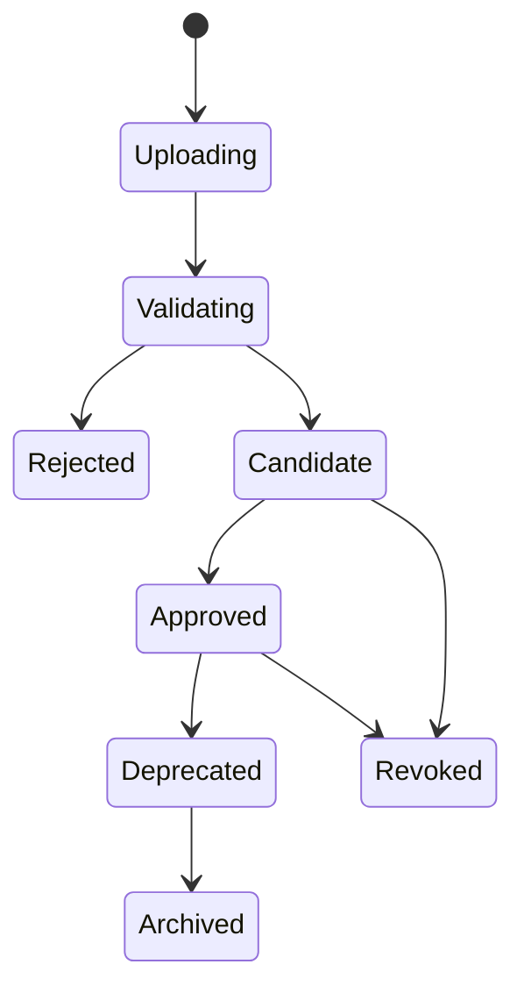
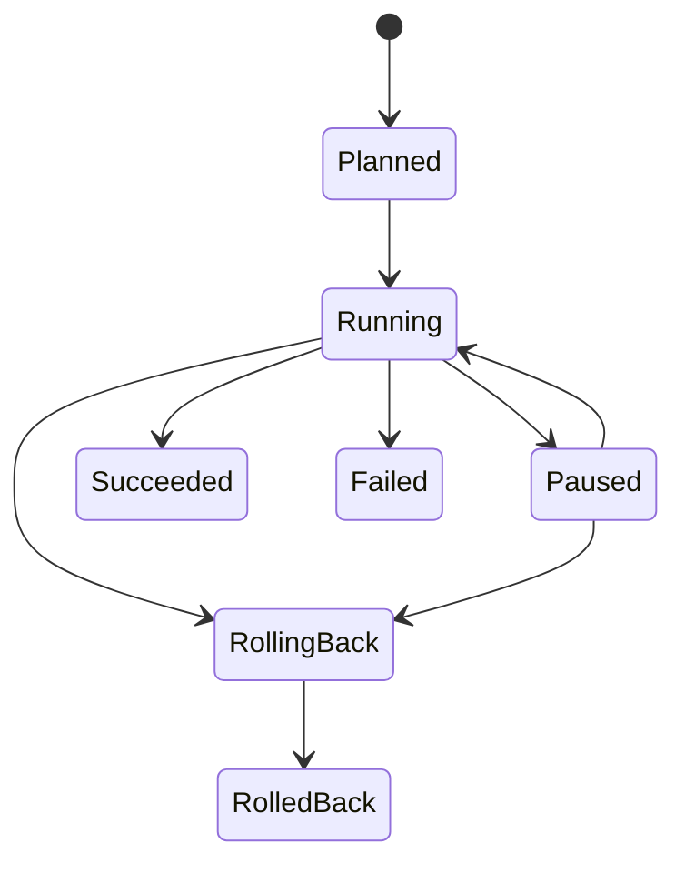
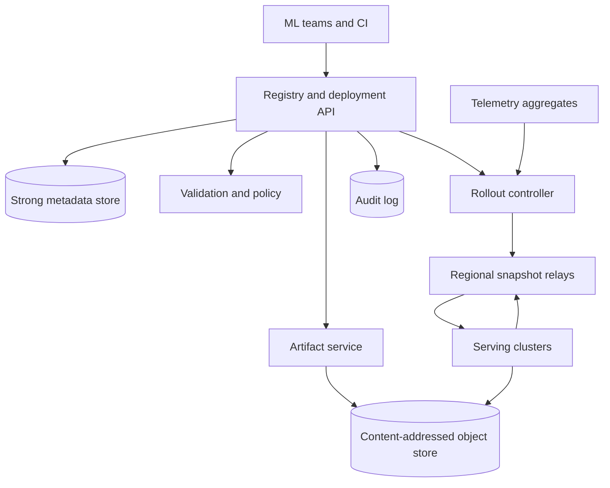
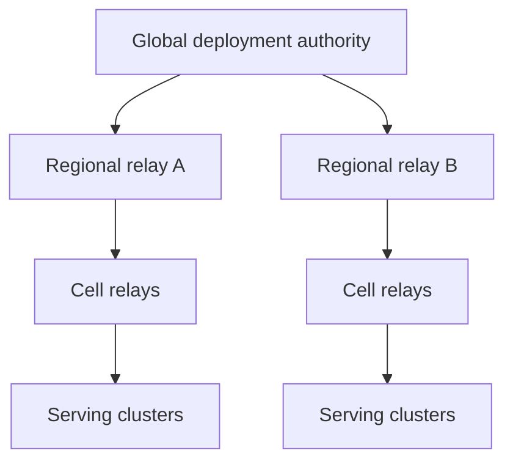

# Design an ML Model Registry and Safe Deployment Control Plane

**Difficulty:** Hard  
**Primary themes:** AI platform infrastructure, immutable artifacts, rollout orchestration, consistency, queues, caching, observability, rollback, multi-region reliability

## How to use this walkthrough

The interview itself is roughly 45 minutes: requirements (5), entities (2), interfaces (5), high-level design (10–15), deep dives (10–15), and a short wrap-up. This educational version is intentionally longer. In the interview, state the invariant first, connect it to a requirement, and go deep only where the interviewer shows interest.

The delivery order follows the public [Hello Interview system-design delivery framework](https://www.hellointerview.com/learn/system-design/in-a-hurry/delivery): establish requirements, name core entities, define interfaces, build a minimal working system, then use non-functional requirements to drive deep dives. The design and dialogue below are original.

---

## Interviewer prompt

> Design a multi-tenant platform where machine-learning teams register model artifacts, validate them, promote approved versions, and deploy them safely to inference fleets across regions. The platform should support canaries, shadow traffic, automatic rollback, auditability, and recovery from regional or control-plane failures. It manages deployment; it does not execute inference itself.

## Targeted clarifying questions with assumed interviewer answers

**Candidate:** Are we building training or inference serving?  
**Interviewer:** Neither. Training systems publish candidates, and serving platforms consume deployment snapshots. Design the registry and deployment control plane between them.

**Candidate:** What model types and artifact sizes should we support?  
**Interviewer:** Framework-neutral packages from 10 MB to 500 GB: weights, tokenizer, runtime/container digest, inference configuration, and metadata. A version may target CPU, GPU, or accelerator-specific variants.

**Candidate:** What scale should I assume?  
**Interviewer:** 50,000 tenants, 5 million registered models, 200 million immutable versions, 100,000 artifact publications/day, and 20,000 deployments/day. The data plane contains 500,000 serving clusters and up to 10 million model replicas.

**Candidate:** What rollout strategies are required?  
**Interviewer:** Immediate, rolling, canary, and shadow. A rollout can advance in stages such as 1%, 5%, 25%, 50%, and 100%, with bake times and metric gates.

**Candidate:** What latency matters?  
**Interviewer:** Registry reads p99 under 200 ms. After approval, 99% of reachable clusters should receive desired state within 60 seconds. Artifact download may take longer, but control-plane propagation must be fast.

**Candidate:** What availability and safety target do we have?  
**Interviewer:** Registry reads and existing serving must survive a control-plane outage. No unapproved model may become production desired state. Rollout commands need 99.99% availability, and acknowledged metadata must not be lost.

**Candidate:** Do all regions need an atomic cutover?  
**Interviewer:** No. A deployment progresses by region and cell. Existing sessions may remain pinned to their original version; new requests follow the latest locally committed routing snapshot.

**Candidate:** Who decides whether a canary is healthy?  
**Interviewer:** The deployment declares metric gates—errors, latency, resource use, and optional quality/business metrics. A telemetry service supplies aggregates. The control plane evaluates gates but does not collect raw inference traces.

**Candidate:** How are approvals handled?  
**Interviewer:** Policies may require signatures, security scans, evaluation thresholds, and one or more human approvals. Production promotion must be strongly auditable.

**Candidate:** Should mutable tags such as `champion` or `production` be supported?  
**Interviewer:** Yes for user convenience, but deployments must resolve them to immutable version and artifact digests before execution.

**Candidate:** Are models private?  
**Interviewer:** Yes. Tenant isolation, residency, encryption, and least privilege are required. Some models cannot leave a specified geography.

### Scope

In scope:

- model/version registration;
- artifact upload and integrity verification;
- validation, approval, aliases, and lineage;
- rollout planning and desired-state distribution;
- canary/shadow gates, pause, resume, rollback, and audit;
- regional caching and disconnected data-plane behavior.

Out of scope:

- training jobs and hyperparameter search;
- inference request scheduling, batching, or kernel optimization;
- metric-pipeline implementation;
- model evaluation algorithm design;
- cluster autoscaling internals.

> **What I would say aloud:** “I’ll separate immutable model supply-chain state from mutable rollout intent. The registry proves exactly what bytes were approved; the deployment controller safely converges serving clusters to a pinned desired state.”

---

# 1. Requirements (~5 minutes)

## Core functional requirements

1. **Register and validate immutable model versions.** Upload or reference content-addressed artifacts, record lineage, run required checks, and move an approved version through a policy-governed lifecycle.
2. **Create and execute safe deployments.** Resolve an alias to a version, generate a staged plan, distribute desired state, and advance only after readiness and metric gates pass.
3. **Operate and recover rollouts.** Expose status, pause/resume/cancel, automatically or manually roll back, and preserve an immutable audit trail.

Secondary features include search, comments, compare views, artifact garbage collection, cost estimation, and notification integrations.

## Quantified non-functional requirements

| Dimension | Target | Consequence |
|---|---:|---|
| Metadata scale | 5M models; 200M versions | Sharded metadata and secondary search index |
| Write rate | 100K publications/day; 20K deployments/day | Moderate control-plane writes; correctness dominates raw QPS |
| Fleet scale | 500K clusters; 10M replicas | Push snapshots through hierarchical fan-out, not direct RPC fan-out |
| Propagation | 99% reachable clusters receive intent within 60 s | Regional relays, versioned snapshots, acknowledgements |
| Registry latency | p99 under 200 ms | Cache immutable metadata and aliases with revisions |
| Availability | 99.99% control API; existing inference survives outage | Data plane uses last-known-good local snapshot |
| Durability | RPO 0 for acknowledged metadata in a home region | Multi-AZ quorum metadata and immutable artifact storage |
| Safety | no unapproved production deployment; deterministic rollback | Policy checks in transaction and immutable version pinning |
| Isolation | tenant-scoped auth, keys, quotas, and residency | Auth-derived identity and regional placement |

## Scale estimates tied to decisions

### Artifact traffic

If 100,000 versions/day average 5 GB, logical ingestion is:

\[
100{,}000 \times 5\text{ GB} = 500\text{ TB/day}
\]

If every serving cluster downloaded directly from one origin, a popular 100 GB model deployed to 100,000 clusters would generate 10 PB of origin egress. Therefore artifacts are content-addressed, deduplicated, replicated to regional caches, and fetched peer/cell-locally where allowed.

### Desired-state fan-out

Twenty thousand deployments/day is less than one new deployment per second on average, but one global deployment can target 500,000 clusters. Direct synchronous fan-out would make API latency and controller recovery proportional to fleet size. Instead, one deployment publishes a compact versioned snapshot per cohort; regional relays fan it out and clusters pull/watch by cursor.

### Metadata

At 200 million versions and roughly 4 KB of indexed metadata per version, the hot logical metadata is about 800 GB before replicas and indexes. A sharded relational/distributed SQL store is reasonable: writes require transactions and conditional updates, while immutable rows cache well.

> **What I would say aloud:** “The average command QPS is not the hard part. A single rollout fans out to half a million clusters, and one model may represent petabytes of aggregate download. That drives hierarchical snapshot distribution and regional artifact caching.”

## Consistency and availability contract

- **Version identity:** immutable. A version points to exact artifact, runtime, configuration, schema, and evaluation digests.
- **Aliases:** strongly consistent per model and updated with compare-and-swap. They are convenience pointers, not deployment identities.
- **Approval and production promotion:** serializable per version/deployment. Policy revision and approval evidence are pinned.
- **Rollout state:** one authoritative, monotonic state machine per deployment. Commands use optimistic concurrency.
- **Desired state:** versioned and eventually delivered. Each cluster applies only a snapshot newer than its committed generation.
- **Serving during partitions:** availability wins for already installed, last-known-good versions. A disconnected cluster does not invent new state.
- **Rollback:** strongly committed as new desired state, then eventually converges across the fleet. It is not a global instantaneous transaction.
- **Status:** eventually consistent aggregation with `observed_at`, generation, and missing-cohort counts.

### Model lifecycle



### Deployment lifecycle



---

# 2. Core entities (~2 minutes)

| Entity | Purpose |
|---|---|
| `RegisteredModel` | Tenant-scoped logical model and ownership policy |
| `ModelVersion` | Immutable version manifest with artifact/runtime/config/schema digests |
| `Artifact` | Content-addressed blob plus size, media type, residency, and replication state |
| `ValidationRun` | Security, compatibility, performance, and quality check results |
| `Approval` | Signed actor/policy decision over an exact version digest |
| `Alias` | Mutable name such as `champion` pointing to one version with a revision |
| `Environment` | Production/staging boundary, regions, clusters, and policy |
| `Deployment` | User intent pinned to version, target, strategy, and policy revision |
| `RolloutStage` | Cohort, traffic weight, bake time, gates, state, and generation |
| `ClusterObservation` | Applied generation, readiness, health, and artifact status |
| `RoutingSnapshot` | Immutable desired state consumed by a serving cluster |
| `AuditEvent` | Append-only actor, command, prior/new state digest, and timestamp |

> **What I would say aloud:** “The important separation is ModelVersion versus Alias, and Deployment versus RoutingSnapshot. Mutable names are resolved before rollout; clusters consume immutable snapshots rather than interpreting user intent.”

---

# 3. API and system interface (~5 minutes)

Tenant and actor identity come from the authenticated principal. The request body cannot select another tenant.

## 3.1 Begin artifact publication

```http
POST /v1/models/fraud-ranker/versions
Idempotency-Key: train-run-781-output

{
  "manifest": {
    "weights": {"digest": "sha256:ab12...", "size_bytes": 8589934592},
    "runtime": {"digest": "sha256:cd34...", "type": "oci"},
    "tokenizer": {"digest": "sha256:ef56..."},
    "input_schema_digest": "sha256:9911...",
    "inference_config_digest": "sha256:8822..."
  },
  "lineage": {"training_run_id": "tr_781", "dataset_snapshot": "ds_42"}
}
```

```json
{
  "version_id": "mv_01JAG...",
  "version_number": 184,
  "state": "UPLOADING",
  "missing_artifacts": ["sha256:ab12...", "sha256:ef56..."],
  "upload_sessions": [
    {"digest": "sha256:ab12...", "upload_id": "up_91", "part_size": 67108864}
  ]
}
```

The client uploads parts directly to regional object storage using short-lived URLs. The service never trusts a client-supplied digest without recomputing it at finalize time.

## 3.2 Finalize and validate

```http
POST /v1/models/fraud-ranker/versions/184:finalize
If-Match: "version-revision-3"
```

```json
{
  "version_id": "mv_01JAG...",
  "state": "VALIDATING",
  "validation_run_id": "vr_5501"
}
```

## 3.3 Approve a version

```http
POST /v1/models/fraud-ranker/versions/184:approve
If-Match: "version-revision-7"

{
  "environment": "production",
  "validation_run_id": "vr_5501",
  "reason": "Passed offline and load gates"
}
```

Approval signs the exact `version_manifest_digest`, environment, validation results, and policy revision.

## 3.4 Move an alias

```http
PUT /v1/models/fraud-ranker/aliases/champion
If-Match: "alias-revision-48"

{"version": 184}
```

Aliases resemble the version aliases documented by [MLflow's model registry](https://www.mlflow.org/docs/latest/registry/), but the deployment service resolves the alias to version 184 and stores that immutable identity.

## 3.5 Create a deployment

```http
POST /v1/deployments
Idempotency-Key: prod-fraud-ranker-184

{
  "model": "fraud-ranker",
  "version_or_alias": "champion",
  "environment": "production",
  "targets": {"regions": ["us-east", "us-west", "eu-west"]},
  "strategy": {
    "type": "CANARY",
    "stages": [
      {"traffic_percent": 1, "bake_minutes": 15},
      {"traffic_percent": 5, "bake_minutes": 30},
      {"traffic_percent": 25, "bake_minutes": 60},
      {"traffic_percent": 100, "bake_minutes": 60}
    ]
  },
  "gates": [
    {"metric": "error_rate", "operator": "<=", "value": 0.005},
    {"metric": "p99_latency_ms_delta", "operator": "<=", "value": 10},
    {"metric": "quality_score_delta", "operator": ">=", "value": -0.002}
  ],
  "auto_rollback": true
}
```

```json
{
  "deployment_id": "dep_01JAH...",
  "resolved_version": 184,
  "version_manifest_digest": "sha256:7711...",
  "state": "PLANNED",
  "revision": 1
}
```

## 3.6 Operate a deployment

```http
POST /v1/deployments/dep_01JAH...:pause
If-Match: "deployment-revision-12"
```

The same pattern supports `:resume`, `:cancel`, and `:rollback`. Commands are idempotent and conditional on the current revision.

## 3.7 Data-plane watch

```protobuf
rpc WatchDesiredState(WatchRequest) returns (stream SnapshotEnvelope);
rpc ReportObservation(ClusterObservation) returns (Ack);

message WatchRequest {
  string cluster_id = 1;
  int64 last_committed_generation = 2;
}
```

The gateway authenticates the cluster and derives tenant, region, environment, and allowed model scopes from its workload identity.

---

# 4. Data flow

## Publication path

1. Client creates a version manifest.
2. Registry returns multipart sessions only for missing digests.
3. Client uploads blobs directly to object storage.
4. Finalizer verifies digest, size, malware/signature policy, and manifest closure.
5. Validators run framework loading, schema, security, performance, and quality checks.
6. Policy engine marks the version candidate or rejected.
7. Authorized approval creates signed evidence over the immutable digest.

## Deployment path

1. Deployment API resolves aliases and pins the exact version.
2. Planner checks approval, compatibility, capacity, residency, and target inventory.
3. Controller creates rollout stages and a generation-1 desired snapshot.
4. Regional relays distribute the snapshot; clusters fetch artifacts and report readiness.
5. Traffic manager activates the canary only after readiness quorum.
6. Gate evaluator compares canary with a concurrent baseline.
7. Controller advances, pauses, or commits rollback as a new generation.
8. Completion requires stage gates plus an explicit observation quorum; unreachable targets remain visible.

---

# 5. High-level design (~10–15 minutes)



## Operation 1: publish an immutable version

The registry first reserves `(tenant_id, model_id, version_number)` and stores a draft manifest. Blobs are addressed by digest. The upload service checks whether an authorized, residency-compatible blob already exists and creates multipart upload sessions for missing content.

At finalize time:

1. lock or conditionally update the draft revision;
2. verify every referenced artifact exists in an allowed region;
3. recompute digest and size from committed multipart content;
4. ensure the manifest contains all dependencies;
5. write an immutable `ModelVersion` row and an outbox event;
6. transition to `VALIDATING`.

Content addressability means identical bytes share storage safely inside an allowed security boundary. The OCI descriptor specification similarly treats a digest as a content identifier and requires consumers to verify content against digest and size; see the [OCI descriptor specification](https://specs.opencontainers.org/image-spec/descriptor/).

The immutable identity is a digest over a canonical manifest, not merely the weight file. Changing tokenizer, runtime, schema, or inference configuration creates a different version.

## Operation 2: validate and approve

An outbox relay publishes `VersionFinalized`. A workflow engine creates validation tasks:

- artifact and signature verification;
- dependency/license and vulnerability scan;
- framework load and smoke inference;
- input/output schema compatibility;
- hardware compatibility matrix;
- deterministic golden tests;
- optional accuracy, bias, load, and cost tests.

Tasks are at-least-once and idempotent by `(validation_run_id, check_name, check_version)`. Large reports live in object storage; metadata stores status, summary, and report digest.

The policy engine evaluates a versioned rule set. A human approval cannot bypass a mandatory failed rule unless the policy defines an auditable exception workflow. Approval writes the version state, signed evidence, and audit outbox in one transaction.

## Operation 3: create the simplest working deployment

Start with a one-region rolling deployment:

1. resolve alias to immutable version;
2. verify production approval and target compatibility;
3. freeze target inventory at a revision;
4. create a deployment and stage;
5. publish a desired snapshot generation;
6. clusters download and verify artifacts, start replicas, and report ready;
7. traffic manager routes new requests to ready replicas;
8. controller marks success after the required observation quorum.

Important deployment fields appear only now:

```text
Deployment {
  deployment_id, tenant_id, environment_id,
  model_version_id, manifest_digest, policy_revision,
  target_inventory_revision, strategy, state, revision,
  last_good_snapshot, current_generation
}
```

## Operation 4: distribute desired state

The controller does not RPC every cluster. It publishes compact, immutable `RoutingSnapshot` objects to a durable log keyed by region/cell. Regional relays:

- cache snapshots;
- maintain long-lived watch streams;
- serve pull-based recovery by generation;
- aggregate acknowledgements;
- enforce tenant and region authorization.

A snapshot includes exact artifact digests, replica/routing weights, runtime settings, health policy, and a monotonically increasing generation. A cluster writes the new snapshot to local durable storage, verifies it, prepares resources, and atomically advances its local committed pointer. After restart or disconnection it serves the last committed snapshot.

## Operation 5: fetch artifacts without melting the origin

The snapshot supplies digests and authorized regional endpoints. Each cluster checks its node/cell cache, then regional cache, then origin. Downloads are chunked, resumable, checksummed, and rate limited. The final artifact is visible to the runtime only after all chunks and the manifest digest verify.

Use single-flight deduplication: concurrent replicas requesting the same digest share one download. Admission control reserves disk and accelerator memory before download. Regional prewarming begins before traffic weight changes.

Artifact garbage collection is mark-and-sweep with a grace period. Roots include registered versions under retention, active/pending snapshots, rollback history, validation jobs, and legal holds. Never delete a blob based only on mutable alias reachability.

## Operation 6: add canary and shadow rollout

The planner maps stages onto stable cohorts. Cohort selection hashes a stable cluster or request key, producing repeatable membership and avoiding selection bias. A stage proceeds:

1. prewarm candidate replicas;
2. reach readiness quorum;
3. publish candidate traffic weight;
4. wait for propagation acknowledgement;
5. start the bake window;
6. evaluate gates against concurrent baseline;
7. advance or roll back.

Shadow traffic duplicates privacy-approved requests to the candidate, discards its response, and records aggregates. It detects crashes, latency, and output drift without user impact, but it doubles some compute and cannot validate real downstream behavior.

## Operation 7: pause and rollback

Pause prevents future advancement but does not necessarily undo the current stage. Rollback creates a higher generation that restores `last_good_snapshot`; clusters never accept a generation decrease.

This matters because delayed messages are normal. If generation 42 is bad and rollback produces generation 43 pointing to the old model, a late generation-42 message is ignored.

New requests switch according to generation 43. In-flight streams remain pinned when terminating them would be worse than completing on the old version. A revoked version is different: security policy may require forced termination.

## Operation 8: expose status honestly

Regional relays aggregate cluster observations into cohort counters:

- target, reached, downloaded, ready, routing, failed, unreachable;
- minimum/maximum applied generation;
- observation timestamp and telemetry window completeness.

The status API clearly separates:

- desired state committed by the controller;
- distribution progress;
- runtime readiness;
- traffic activation;
- metric-gate decision.

“Deployment succeeded” means the declared quorum applied the target, traffic is active, all required gates passed, and missing targets are below policy threshold—not merely that the command was published.

---

# 6. Deep dives (~10–15 minutes)

## Deep dive A: immutable artifacts, mutable aliases, and supply-chain integrity

### Where the baseline breaks

If `production` or `latest` is resolved by each cluster independently, clusters may download different bytes. If an artifact path is overwritten, approval evidence no longer describes what runs. If weights are pinned but runtime or tokenizer is mutable, behavior still changes.

### Options

| Design | Benefit | Problem |
|---|---|---|
| Mutable files and tags | Simple UX | Cannot reproduce or audit deployments |
| Version ID for weights only | Better lineage | Runtime/config drift remains |
| Canonical manifest with content digests | Exact, deduplicated, verifiable | Requires immutable packaging discipline |

Choose the canonical manifest. A deployment resolves a mutable alias exactly once, then stores:

```text
(model_version_id, manifest_digest, approval_digest, policy_revision)
```

Every boundary verifies digest and authorization: upload finalizer, regional replication, cluster download, and runtime activation.

### Signing and provenance

The platform records:

- trainer/workflow identity;
- source revision and training-run ID;
- dataset snapshot reference;
- builder identity;
- artifact and manifest signatures;
- validator versions and results;
- approvals and exceptions.

Signing alone does not make a model safe; it proves provenance. Validation and policy still decide whether the signed artifact may run.

### Cache correctness

Immutable manifests and artifacts may be cached indefinitely by digest. Aliases use short TTLs plus revisioned invalidation. The create-deployment transaction rereads the alias authoritatively and records its resolved version; it never trusts a stale edge cache for production intent.

### Failure modes

- digest mismatch: quarantine upload and revoke session;
- missing dependent blob: refuse finalize;
- compromised signer: revoke identity, find dependent versions, stop new rollouts, optionally force rollback;
- replicated blob corruption: detect on read, repair from verified replica;
- garbage collector race: generation mark plus grace period and recheck before deletion.

> **What I would say aloud:** “Approval attaches to a digest closure over weights, runtime, tokenizer, schema, and configuration. Aliases remain convenient, but no serving cluster ever deploys an unresolved alias.”

## Deep dive B: rollout state, races, and deterministic rollback

### Where the baseline breaks

Multiple operators may pause, resume, edit, or roll back concurrently. Controllers can retry after losing responses. Metrics arrive late. Regional relays can replay stale snapshots. A simple mutable row plus best-effort commands can skip stages or resurrect a bad version.

### Serialization choices

| Approach | Strength | Weakness |
|---|---|---|
| Global distributed lock | Intuitive | Broad failure domain and unnecessary contention |
| Per-deployment leader/actor | Natural serialization | Requires ownership and failover machinery |
| Optimistic concurrency + durable workflow | Simple database invariant, easy recovery | Clients handle conflicts |

Choose optimistic concurrency for commands and one leased workflow owner per deployment. The metadata transaction checks `expected_revision`, applies a legal state transition, increments the revision, and writes an outbox event.

Workflow timers are durable, not in-process sleeps. On failover, the new owner rebuilds state from metadata and observations. Every side effect has an idempotency key `(deployment_id, stage_id, generation, action)`.

### Gate evaluation

A canary gate requires:

- candidate and baseline cohorts over the same time window;
- minimum sample size;
- telemetry completeness threshold;
- metric-specific direction and confidence policy;
- no outstanding readiness regression;
- a maximum decision deadline.

Missing telemetry must not equal success. The policy chooses pause, extend, or rollback. Quality metrics may arrive minutes later than infrastructure metrics, so advancement waits for the slowest required gate.

### Rollback invariant

Rollback is a forward-moving state transition:

```text
bad desired generation 42
rollback desired generation 43 -> last_good manifest
```

Thus stale messages cannot undo rollback. `last_good_snapshot` changes only after a stage completes its bake and required gates—not when the first candidate replica becomes ready.

Kubernetes similarly maintains rollout revisions and supports rollback; its documentation also distinguishes rollout progress from readiness. The general control-plane lesson is to retain a known-good revision and make progress observable: [Kubernetes Deployments](https://kubernetes.io/docs/concepts/workloads/controllers/deployment/).

### Operator command races

- Pause versus automatic advance: conditional revision allows one to win; loser rereads.
- Manual rollback versus auto rollback: both target the same last-good state; idempotency coalesces them.
- Cancel after traffic starts: defined as rollback, not deletion of history.
- New deployment to same model/environment: acquire a logical environment/model rollout lease or queue it; do not interleave weights from two plans.

> **What I would say aloud:** “Rollback is not generation minus one. It is a new, higher generation pointing to the last known-good snapshot. That makes late delivery harmless and preserves monotonic cluster state.”

## Deep dive C: multi-region distribution and disconnected operation

### Where the baseline breaks

A global controller directly connected to every cluster creates a huge failure domain. A regional network partition could stop serving, while a thundering herd after recovery could overload metadata and artifact origins.

### Selected hierarchy



The global authority commits deployment intent. Regional relays persist authorized snapshots and fan them to cells. Clusters maintain local durable last-known-good state.

### Partition behavior

- Existing inference continues on the committed local snapshot.
- A cluster may finish preparing a previously authorized artifact.
- It does not advance traffic without a valid, signed snapshot generation.
- Short-lived credentials renew from regional services; grace behavior is policy-bound.
- The controller shows the region as stale/unreachable and does not claim global completion.
- Rollout policy may continue in healthy regions or pause globally, depending on blast-radius settings.

### Recovery without storms

On reconnection:

1. cluster reports last committed generation and cached digests;
2. relay sends only the newest applicable snapshot, not every intermediate update;
3. downloads use jitter, quotas, and single-flight caches;
4. observations aggregate hierarchically;
5. controller reconciles desired versus observed state.

Compaction is safe because snapshots represent desired state, not imperative steps. If stages require a historical audit, history remains in the control plane even though a disconnected cluster only needs the latest authorized snapshot.

### Multi-region metadata

Give each tenant/model a home region for writes, synchronously replicated across availability zones. Global reads use replicas and immutable caches. Disaster recovery promotes a secondary with a fenced epoch; old leaders cannot publish accepted snapshots after promotion. Residency-restricted artifacts remain in allowed regions even if control metadata fails over.

### Observability

- snapshot publish-to-receive and receive-to-commit latency;
- relay/cluster cursor lag;
- clusters by applied generation;
- stale observation age;
- artifact cache hit rate and origin egress;
- reconnect concurrency and throttling;
- region-specific rollout/error differences.

> **What I would say aloud:** “Inference must not depend on control-plane reachability. Clusters serve last-known-good state, while versioned desired snapshots and hierarchical relays make convergence efficient and measurable.”

## Deep dive D: compatibility and capacity safety

A model can be correct yet undeployable: wrong accelerator architecture, insufficient memory, unsupported runtime ABI, tokenizer mismatch, or excessive cold-start time.

The planner joins version requirements with a versioned cluster capability inventory:

- device type and compute capability;
- runtime/driver versions;
- memory and disk headroom;
- supported package formats;
- residency and security labels;
- current reserved capacity.

It generates compatible cohorts and rejects uncovered targets before rollout. Capacity reservations prevent two deployments from both assuming the same headroom. A reservation has TTL and is converted to allocation as replicas become ready.

Readiness means more than process alive: artifact verified, model loaded, warm-up passed, health probes passed, and the runtime reports the expected manifest digest. Synthetic inference catches silent loader/config mismatches.

## Deep dive E: multi-tenant security and fairness

- Authenticated context supplies tenant and actor; request bodies cannot override them.
- Metadata rows, object prefixes, encryption keys, caches, and audit views are tenant-scoped.
- Artifact access uses short-lived digest-specific grants.
- Production approvals and policy exceptions require separate roles; sensitive environments can require two-person control.
- Queue scheduling uses tenant weights and per-target limits.
- Huge artifact replication cannot starve small urgent rollbacks.
- Audit logs exclude model inputs, outputs, secrets, and raw evaluation samples.
- Rate limits account for work: bytes uploaded, validation accelerator-seconds, target clusters, and rollout observations—not just request count.

---

# Reliability and observability

## Failure-mode table

| Failure | Detection | Safe behavior | Recovery |
|---|---|---|---|
| API commits but event publish fails | outbox lag | metadata remains authoritative | relay retries outbox |
| Client retries version creation | idempotency lookup | return original version | resume missing uploads |
| Validator runs twice | unique check key | same canonical result | discard duplicate |
| Controller dies during bake | lease expiry | stage stays at current weight | new owner restores timer/state |
| Snapshot delivered twice | generation comparison | no-op | acknowledge committed generation |
| Stale snapshot arrives after rollback | lower generation | reject | retain generation 43 |
| Regional relay fails | watch disconnect | serve last-known-good | reconnect to replacement relay |
| Artifact origin is overloaded | latency/cache metrics | pause prewarming, never shift traffic | regional cache and jittered retry |
| Telemetry is missing | completeness gate | pause or rollback by policy | extend window after recovery |
| Cluster cannot load model | readiness failure | no traffic to that replica | retry, replace, or roll back |
| Metadata region fails | quorum/health | existing serving unaffected | fenced regional failover |

## Important SLOs

Control plane:

- create/read API availability and latency;
- outbox age and workflow scheduling delay;
- approval-policy evaluation failures;
- deployment command conflict rate.

Distribution:

- p50/p95/p99 snapshot propagation;
- percent of reachable targets on desired generation;
- artifact replication/download time and checksum failures;
- regional relay lag and reconnect rate.

Rollout outcomes:

- time to readiness and stage completion;
- automatic rollback rate and reason;
- gate sample size/completeness;
- candidate versus baseline error, latency, resource, quality, and cost deltas;
- unreachable or incompatible target count.

Audit:

- unsigned/unverified manifests;
- approval exceptions;
- revoked signer or artifact dependencies;
- snapshot-to-runtime digest mismatches.

---

# 7. Final design

## Concise final architecture

1. A sharded strongly consistent metadata store manages models, versions, aliases, approvals, deployments, and workflow state.
2. A content-addressed, multi-region object store holds artifacts; multipart upload, digest verification, regional caches, and single-flight downloads control integrity and cost.
3. Validation workflows run idempotent checks and a versioned policy engine produces signed approval evidence.
4. Deployment creation resolves aliases to immutable manifest digests and freezes policy, target inventory, strategy, and gates.
5. A durable rollout controller publishes monotonically versioned desired snapshots through regional and cell relays.
6. Serving clusters persist and apply snapshots atomically, verify artifact digests, report observations, and continue with last-known-good state during partitions.
7. Canary stages wait for readiness, propagation, bake time, telemetry completeness, and health/quality gates.
8. Rollback publishes a higher generation pointing to the last-known-good snapshot.
9. Reconciliation compares desired and observed generations; append-only audit records every state transition and actor.

## Requirements check

| Requirement | Design element |
|---|---|
| Register immutable versions | Canonical manifest and content-addressed artifacts |
| Validate and approve | Idempotent workflow, versioned policy, signed evidence |
| Safe deployment | Frozen plan, staged rollout, readiness and metric gates |
| Canary and shadow | Stable cohorts, traffic weights, baseline comparison |
| Fast propagation | Hierarchical versioned snapshot relays |
| Control-plane outage survival | Local durable last-known-good snapshot |
| Deterministic rollback | Higher generation targeting last-good digest |
| Artifact scale | Regional caches, resumable chunks, single-flight |
| Auditability | Immutable versions and append-only transition log |
| Isolation/residency | Auth-derived tenancy, scoped grants, regional placement |

## Principal tradeoffs

- Strong consistency protects low-volume intent; eventual consistency distributes it at fleet scale.
- Aliases improve usability, but deployments pin immutable versions.
- Existing inference favors availability during partitions; new rollout progress pauses when authorization or evidence is uncertain.
- Hierarchical aggregation scales, but status is slightly stale and must expose observation timestamps.
- Shadowing reduces user risk but costs compute and cannot validate downstream user effects.
- Retaining rollback artifacts costs storage but materially improves recovery time.

---

# Realistic interviewer follow-ups with strong sample answers

## 1. Why not let each cluster resolve the `champion` alias?

**Strong answer:** “Alias reads may race with an update, so clusters could deploy different versions under the same deployment. I resolve the alias once in the strongly consistent create-deployment transaction and distribute the immutable version and manifest digest.”

## 2. Is a model version just a weight-file hash?

**Strong answer:** “No. Behavior also depends on tokenizer, runtime, input schema, custom code, and inference configuration. The version identity is a canonical manifest digest over all required components.”

## 3. Why use at-least-once workflows?

**Strong answer:** “Workers and networks fail, so retry is unavoidable. Each validation and rollout action has a deterministic idempotency key. That gives reliable progress without pretending a queue can make external effects exactly once.”

## 4. What happens when rollback and a late advance race?

**Strong answer:** “Both conditionally update the deployment revision, so only one commits. Rollback produces a higher desired-state generation. Clusters reject any late snapshot with a lower generation.”

## 5. How do you avoid a false healthy canary?

**Strong answer:** “Use a concurrent baseline, stable representative cohorting, minimum sample sizes, telemetry-completeness gates, and bake time. Missing data pauses or fails according to policy; it never silently passes.”

## 6. What if only one region is unhealthy?

**Strong answer:** “Health is evaluated by region and globally. Policy may pause that region and continue elsewhere, or roll back globally for a common model defect. The decision and blast-radius strategy are frozen in the deployment plan.”

## 7. How do clusters work during a control-plane outage?

**Strong answer:** “They persist the last verified routing snapshot locally and continue serving it. They cannot accept unsigned or lower-generation state. Status becomes stale, but inference remains available.”

## 8. How do you deploy a 500 GB model quickly?

**Strong answer:** “Pre-replicate content-addressed chunks to regional/cell caches, use resumable parallel downloads with checksums and single-flight, reserve disk/device memory first, and prewarm before shifting traffic. Propagation of intent is fast even if preparation takes longer.”

## 9. How do you garbage-collect artifacts safely?

**Strong answer:** “Use mark-and-sweep with versioned roots: retained versions, active and pending snapshots, rollback history, validation jobs, and holds. Add a grace period and recheck reachability immediately before deletion.”

## 10. Can approval be revoked after deployment?

**Strong answer:** “Yes. Revocation blocks new deployments immediately and finds active dependents. Policy decides whether to alert, gracefully roll back, or force termination for a critical security issue. The old evidence remains in the audit log.”

## 11. Why not rely only on Kubernetes Deployments?

**Strong answer:** “Kubernetes can roll out containers within a cluster, but this platform adds model artifact identity, validation and approval, cross-cluster targeting, metric gates, global propagation, lineage, residency, and fleet-wide evidence. Kubernetes may be one regional executor.”

## 12. How do you avoid noisy tenants?

**Strong answer:** “Quota actual work—artifact bytes, validation compute, target count, and concurrent rollouts. Use weighted fair queues and reserve capacity for rollback, which must not wait behind bulk uploads.”

## 13. Why is status eventually consistent?

**Strong answer:** “Ten million replicas cannot synchronously update one transaction. Relays aggregate observations. The API exposes generation, observation time, missing targets, and quorum so users know exactly what the summary means.”

## 14. What would you test in a disaster drill?

**Strong answer:** “Fail a controller during bake, lose a relay region, corrupt an artifact cache entry, revoke a signer, restore metadata from backup, and verify clusters continue on last-known-good state while a fenced controller resumes without double advancement.”

---

# Common pitfalls

1. Treating a mutable alias as a deployable identity.
2. Hashing weights but not tokenizer, runtime, schema, or configuration.
3. Proxying hundreds of gigabytes through the metadata API.
4. Trusting client-supplied hashes without server-side verification.
5. Calling every cluster synchronously from one controller.
6. Making inference depend on control-plane availability.
7. Using in-memory timers for bake windows.
8. Treating process health as model readiness.
9. Moving traffic before artifact verification and warm-up.
10. Passing a canary when telemetry is missing.
11. Comparing a canary only with a historical baseline.
12. Selecting a biased or constantly changing canary cohort.
13. Rolling back by decrementing a version number.
14. Allowing stale snapshots to overwrite rollback.
15. Reporting success after publish rather than observation quorum.
16. Ignoring unreachable clusters in the status summary.
17. Letting large downloads starve emergency rollback.
18. Deleting old artifacts as soon as an alias moves.
19. Allowing concurrent rollouts to the same model/environment to interleave.
20. Assuming a signature proves quality rather than provenance.
21. Logging model inputs or evaluation samples in the control-plane audit trail.
22. Ignoring hardware/runtime compatibility until replicas crash.

---

# A polished 90-second closing statement

> “I separated immutable model supply-chain state from mutable deployment intent. A model version is a canonical digest over weights, runtime, tokenizer, schema, and configuration. Validation workflows produce signed evidence, and production approval is a strongly consistent policy transition. Deployment creation resolves aliases once and freezes the exact version, target inventory, rollout stages, and gates. A durable controller publishes monotonically versioned desired snapshots through regional relays rather than calling every cluster. Clusters verify artifacts, atomically commit snapshots, report observations, and continue serving last-known-good state during control-plane outages. Canary stages advance only after readiness, propagation, bake time, telemetry completeness, and metric gates. Rollback is a new higher generation pointing to the last-known-good digest, so late messages are harmless. Content-addressed regional caches control petabyte-scale aggregate downloads, while reconciliation and append-only audit make rollout state recoverable and explainable.”

# Public references

- [Hello Interview: System Design Delivery Framework](https://www.hellointerview.com/learn/system-design/in-a-hurry/delivery) — used for the delivery sequence.
- [MLflow Model Registry](https://www.mlflow.org/docs/latest/registry/) — background on registered models, versions, and aliases.
- [Kubernetes Deployments](https://kubernetes.io/docs/concepts/workloads/controllers/deployment/) — background on rollout revisions, readiness, progress, pause, and rollback.
- [Open Container Initiative Descriptor Specification](https://specs.opencontainers.org/image-spec/descriptor/) — background on digest-addressed content and integrity verification.
