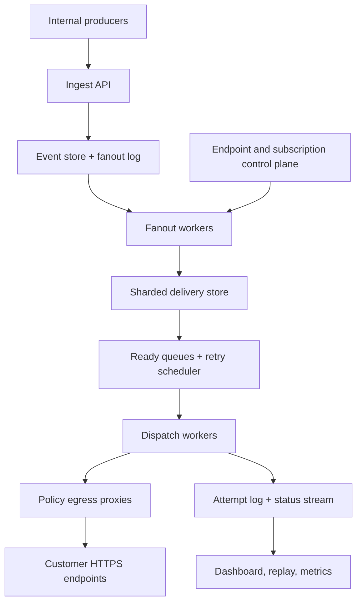
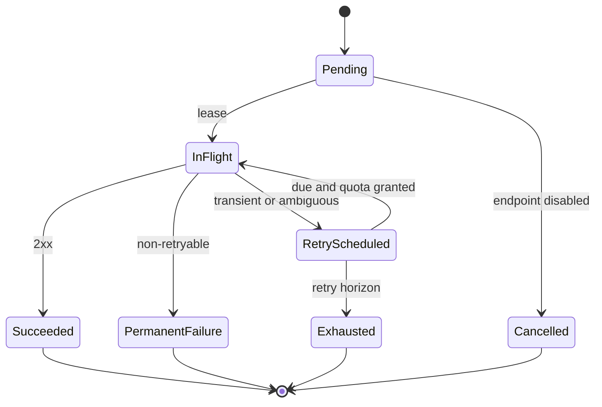

# Design a Large-Scale Webhook Delivery Platform

**Difficulty:** Senior / Staff  
**Primary themes:** durable queues, retry scheduling, at-least-once delivery, ordering, backpressure, tenant isolation, SSRF defense, observability

## How to use this walkthrough

In a 45-minute interview, aim for roughly 5 minutes on requirements, 2 on entities, 5 on the interface, 10–15 on the high-level design, and the remaining 10–15 on the most important deep dives. This document is intentionally more detailed than what you would say in real time: it teaches the reasoning behind the compressed interview version.

The organization follows Hello Interview's public delivery framework: establish requirements, name core entities, define the API, build the simplest complete design, and then harden it in deep dives. The especially useful idea is to keep the initial design tied to the functional requirements and postpone most non-functional complexity until the baseline works ([Hello Interview delivery framework](https://www.hellointerview.com/learn/system-design/in-a-hurry/delivery)).

---

## Interviewer prompt

> Design a multi-tenant webhook delivery platform. Internal product teams publish events such as `invoice.paid` or `deployment.failed`. Customers register HTTPS endpoints and subscribe to event types. The platform must deliver matching events reliably, retry failures, let customers inspect delivery history, and support manual replay.

### Targeted clarifying questions and assumed answers

**Candidate:** Are we building both the event-producing business systems and the outbound delivery platform?

**Interviewer:** Only the outbound platform. Treat event producers as authenticated internal clients.

**Candidate:** What delivery guarantee should customers receive?

**Interviewer:** At least once. Duplicates are possible, and we must give customers a stable event identifier for deduplication. Do not claim exactly once over HTTP.

**Candidate:** Must events arrive in creation order?

**Interviewer:** Unordered delivery is the default. Some customers pay for ordering by endpoint and ordering key, such as account ID. Explain the cost of that option.

**Candidate:** What scale should I design for?

**Interviewer:** At peak, producers publish 1 million source events per second. Each event matches three subscriptions on average, so peak delivery creation is about 3 million per second. The average payload is 2 KB and the maximum is 256 KB. There are 10 million configured endpoints.

**Candidate:** What latency and reliability targets matter?

**Interviewer:** Durably accept 99.99% of valid publish requests. For healthy destinations, start 99% of initial attempts within 10 seconds. Preserve accepted events and delivery intent across a zonal failure. Keep attempt history for 30 days and event payloads replayable for seven days.

**Candidate:** What counts as success, and for how long do we retry?

**Interviewer:** Any `2xx` response is success. Retry timeouts, transport errors, `408`, `429`, and most `5xx` responses for up to three days with exponential backoff and jitter. Most other `4xx` responses are permanent failures. Honor a reasonable `Retry-After` value.

**Candidate:** Do we need endpoint creation, event filters, secret rotation, a delivery dashboard, and manual replay?

**Interviewer:** Yes. Filters can initially be exact event types plus a few indexed attributes. Support overlapping signing secrets during rotation.

**Candidate:** May customers register arbitrary URLs?

**Interviewer:** Public HTTPS URLs only. The service must prevent server-side request forgery, including DNS rebinding and redirects to private addresses.

**Candidate:** Is cross-region active-active required?

**Interviewer:** Multi-zone operation in one primary region is required. Describe a disaster-recovery extension, but do not spend the whole interview on it.

**Candidate, summarizing aloud:** “I’ll design an at-least-once outbound platform with durable acceptance, unordered delivery by default, optional key ordering, bounded retries, replay, signed requests, and strong protection around arbitrary customer destinations.”

---

## 1. Requirements (~5 minutes)

### Core functional requirements

Prioritize three end-to-end capabilities:

1. **Manage endpoints and subscriptions.** A tenant can register, verify, disable, and rotate secrets for an HTTPS endpoint, then subscribe it to selected event types and filters.
2. **Publish and deliver events.** An authenticated producer can publish an immutable event; the platform durably finds matching subscriptions, creates delivery intents, signs requests, and sends them to customer endpoints.
3. **Recover and inspect.** The platform retries transient failures, exposes event/attempt status, and lets an authorized tenant replay a failed or previously delivered event.

Useful but out of scope for the core design: transforming arbitrary payloads, billing, a no-code workflow builder, arbitrary customer code, inbound webhooks, and global active-active writes.

### Quantified non-functional requirements

| Concern | Contract |
|---|---|
| Scale | 1M source events/s peak; average fanout 3; 3M delivery intents/s peak; 10M endpoints |
| Acceptance durability | 99.99% of valid publishes accepted; acknowledge only after replicated durable storage |
| Initial latency | For healthy endpoints, 99% of first attempts begin within 10 seconds |
| Availability | Publishing remains available through a single-zone failure; delivery drains after recovery |
| Retention | Payload replay for 7 days; delivery/attempt metadata for 30 days |
| Security | Tenant isolation, HTTPS, request signing, encrypted secrets, SSRF-safe egress |
| Semantics | At least once; unordered by default; optional ordering per `(endpoint_id, ordering_key)` |

### Consistency and availability contract

- **Publish:** a successful response means the immutable event is durably stored and its fanout obligation is recorded. It does not mean every individual delivery row already exists.
- **Subscription snapshot:** an event matches the subscription configuration captured at acceptance time. Later filter changes do not silently alter that event's recipients.
- **Delivery:** at least once. A timeout is ambiguous: the destination might have committed the event while the response was lost, so the platform retries with the same `event_id` and `delivery_id`.
- **Disable:** after a control-plane change propagates, no new network attempts should start. Allow up to 30 seconds for propagation, but check authoritative endpoint state before dispatch.
- **History:** attempt history may lag live delivery state by a few seconds. The current delivery state is strongly consistent within its home shard.
- **Availability choice:** during a storage partition, reject or delay acknowledgement rather than acknowledge an event that could be lost. Once accepted, favor durable eventual delivery over immediate freshness.

**What to say aloud:** “The most important contract is the acknowledgement boundary. I return success only after the event and a durable obligation to fan it out exist. Downstream fanout and HTTP delivery can then be asynchronous without risking silent loss.”

### Scale estimates that change the design

Peak fanout is:

\[
1{,}000{,}000\ \text{events/s} \times 3\ \text{subscriptions/event}
= 3{,}000{,}000\ \text{deliveries/s}.
\]

If every delivery copied the average 2 KB payload, peak writes would be about 6 GB/s before replication, plus index overhead. Instead, store the payload **once per event** in an append-oriented event store/object store and let delivery intents reference `event_id`.

If an attempt record averages 400 bytes, 3M attempts/s would be 1.2 GB/s at peak. At a more realistic average of 600K attempts/s, that is about 20.7 TB/day before compression. This rules out one monolithic relational table with many secondary indexes. Use partitioned append storage, keep only hot state in the transactional delivery store, and compact older attempt history into analytical/object storage.

A 1% transient-failure rate at peak creates 30K retries/s. More importantly, a popular customer's one-hour outage can create millions of due retries at once. Retry scheduling and tenant fairness are first-class design problems, not a background cron job.

---

## 2. Core entities (~2 minutes)

Name the nouns before designing tables:

| Entity | Purpose |
|---|---|
| `Tenant` | Ownership, plan, quotas, and authorization boundary |
| `Endpoint` | Destination URL, lifecycle state, concurrency/rate policy, health, signing-secret versions |
| `Subscription` | Event types, indexed filters, endpoint, version, and enabled state |
| `Event` | Immutable producer event, tenant/source, type, payload reference, timestamp, optional ordering key |
| `FanoutTask` | Durable obligation to evaluate a captured subscription version/range for an event |
| `Delivery` | One event-to-endpoint intent and its current state, attempt count, next attempt, ordering metadata |
| `Attempt` | Immutable record of one HTTP try: timing, outcome class, status code, and safe diagnostics |
| `ReplayRequest` | Audited request to create another delivery generation for one or more retained events |

Avoid listing every column now. Introduce fields when a component needs them.

**What to say aloud:** “`Event` is the immutable fact; `Delivery` is the durable obligation to one endpoint; `Attempt` is one network try. Separating those lets me retain a single payload, retry safely, and preserve an audit trail.”

---

## 3. API or system interface (~5 minutes)

All public control-plane calls use OAuth or an API key. `tenant_id` and actor identity come from the authenticated principal; clients never choose another tenant in the body. Internal producers use workload identity and are authorized for specific event sources.

### Register an endpoint

```http
POST /v1/endpoints
Authorization: Bearer <tenant-token>
Idempotency-Key: 8a9560...
Content-Type: application/json

{
  "url": "https://hooks.example.com/billing",
  "description": "Production billing events",
  "max_concurrency": 50,
  "ordered": false
}
```

```json
{
  "endpoint_id": "ep_42",
  "status": "pending_verification",
  "signing_secret": "whsec_shown_once",
  "verification_expires_at": "2026-10-17T08:15:00Z"
}
```

The plaintext secret is returned once. Its encrypted form is stored under a key-encryption key. A verification challenge proves control of the URL before normal traffic begins.

### Create a subscription

```http
POST /v1/subscriptions
Authorization: Bearer <tenant-token>
Idempotency-Key: 19e7c1...
Content-Type: application/json

{
  "endpoint_id": "ep_42",
  "event_types": ["invoice.paid", "invoice.payment_failed"],
  "filter": {"account_region": ["us", "ca"]},
  "ordering": {"mode": "by_key", "field": "account_id"}
}
```

```json
{
  "subscription_id": "sub_91",
  "version": 1,
  "status": "active"
}
```

### Publish an event

This is an internal interface, not a customer-supplied tenant impersonation mechanism.

```http
POST /internal/v1/events
Authorization: Bearer <workload-identity>
Idempotency-Key: order-8841-paid-v3
Content-Type: application/json

{
  "source": "billing/payments",
  "type": "invoice.paid",
  "subject": "invoice/in_8841",
  "occurred_at": "2026-10-17T08:04:12Z",
  "ordering_key": "acct_73",
  "attributes": {"account_region": "us"},
  "data": {"invoice_id": "in_8841", "amount_cents": 4200}
}
```

```json
{
  "event_id": "evt_01J...",
  "accepted_at": "2026-10-17T08:04:12.041Z"
}
```

Return `202 Accepted` only after replicated event storage and a durable fanout record commit. Reusing the same idempotency key with the same request returns the original event; a different body returns `409 Conflict`.

The envelope borrows a useful interoperability idea from CloudEvents: the tuple `source` plus `id` uniquely identifies an event, while `type` describes it ([CloudEvents specification](https://github.com/cloudevents/spec/blob/main/cloudevents/spec.md)). We need not expose every CloudEvents feature to gain stable identity.

### Inspect deliveries

```http
GET /v1/deliveries?endpoint_id=ep_42&event_id=evt_01J...
Authorization: Bearer <tenant-token>
```

```json
{
  "items": [{
    "delivery_id": "del_7",
    "event_id": "evt_01J...",
    "status": "retry_scheduled",
    "attempt_count": 2,
    "next_attempt_at": "2026-10-17T08:06:19Z",
    "last_result": {"class": "timeout", "duration_ms": 5000}
  }]
}
```

### Replay a delivery

```http
POST /v1/deliveries/del_7/replays
Authorization: Bearer <tenant-token>
Idempotency-Key: support-ticket-123
Content-Type: application/json

{"reason": "customer fixed endpoint"}
```

```json
{
  "replay_id": "rpl_18",
  "delivery_id": "del_7",
  "generation": 2,
  "status": "queued"
}
```

A replay uses the original `event_id` but a new delivery generation. The receiver can distinguish a replay while still deduplicating the business event.

### Outbound request

```http
POST /billing HTTP/1.1
Host: hooks.example.com
Content-Type: application/json
Webhook-Event-Id: evt_01J...
Webhook-Delivery-Id: del_7
Webhook-Attempt: 3
Webhook-Timestamp: 1792224379
Webhook-Signature: v1=<hmac_sha256(timestamp + "." + raw_body)>

{"id":"evt_01J...","type":"invoice.paid","created_at":"...","data":{...}}
```

The signature covers the exact bytes sent. The receiver checks the HMAC with the shared secret, rejects timestamps outside a replay window, and deduplicates by stable event or delivery ID.

---

## 4. Data flow

1. A producer authenticates and publishes with an idempotency key.
2. Ingestion validates size and schema, assigns `event_id`, stores the payload once, and atomically appends a fanout obligation.
3. Fanout workers read the captured subscription index version, find matches, and create idempotent delivery intents.
4. Ready-queue builders route each delivery to a partition based on endpoint and, when ordered, ordering key.
5. A dispatcher acquires a short lease, checks endpoint state and quota, resolves a safe destination, signs the immutable payload, and sends through an egress proxy.
6. It records an immutable attempt and transitions the delivery to `succeeded`, `permanent_failure`, or `retry_scheduled`.
7. The retry scheduler promotes due deliveries back to ready queues. After the retry horizon, it marks them exhausted.
8. History events feed the tenant dashboard, SLO metrics, and replay service asynchronously.

---

## 5. High-level design (~10–15 minutes)

### Compact architecture



This separates the **control plane**—endpoints, subscriptions, keys, quotas—from the **data plane**—events, fanout, scheduling, and network delivery. A control-plane outage should not stop already-queued delivery; dispatchers use a bounded-stale cache plus a fail-closed check for sensitive changes.

### Operation 1: register and verify an endpoint

The endpoint service writes:

```text
Endpoint(
  endpoint_id, tenant_id, url, status,
  secret_versions[{id, encrypted_secret, active_from, expires_at}],
  max_concurrency, requests_per_second,
  health_state, config_version, updated_at
)
```

Registration performs syntax checks and rejects embedded credentials, non-HTTPS schemes, disallowed ports, IP literals, localhost-like names, and obvious private network targets. A verifier resolves the name using the platform resolver, checks every returned address against the public-address policy, connects through the same controlled egress path used for delivery, and sends a short-lived challenge.

Verification does not permanently bless an IP. DNS can change, so the egress proxy re-resolves and validates at connection time. Redirects are disabled by default; if enabled later, every hop must repeat the policy check.

Secret rotation adds `secret_version = v2` while retaining `v1` for an overlap window. During overlap, requests can include two versioned signatures. No delivery worker receives raw key-encryption keys; it asks a key service for a short-lived decryption result or signing operation.

**What to say aloud:** “Endpoint setup is not just CRUD because the server will later connect to a user-chosen URL. I verify ownership and route every connection through an egress policy boundary that rechecks the resolved IP.”

### Operation 2: accept an event without losing its fanout obligation

The naïve version writes the event, returns success, and then publishes to a queue. A crash between those steps loses the event's deliveries.

Use either:

- one replicated log where the event record itself is the fanout input, or
- an event database transaction that writes both `Event` and an outbox/fanout row.

At this scale, an append log plus object/blob payload storage is a natural choice:

```text
Event(
  event_id, producer_id, source, type, subject,
  occurred_at, accepted_at, attributes,
  payload_ref, payload_hash, ordering_key,
  subscription_snapshot_version
)
```

The ingest service validates the producer's source authorization, canonicalizes only envelope metadata, stores the raw payload bytes, appends the event record to a quorum-replicated partition, and then returns `202`.

Partition by a hash of `producer_id` plus event ID for even write distribution. If producer order is important, include its ordering key in the partition key. Do not globally order unrelated tenants.

The subscription service maintains a versioned index from `(tenant/event type, indexed attributes)` to subscription IDs. Fanout workers consume an event and its `subscription_snapshot_version`, query the corresponding immutable index snapshot, and write deterministic delivery IDs such as:

```text
delivery_id = hash(event_id, subscription_id, subscription_version, generation=1)
```

That makes fanout idempotent. If a worker crashes after writing half the matches, replay recreates the same IDs; conditional inserts ignore duplicates.

For extremely large fanout, create range tasks:

```text
FanoutTask(event_id, snapshot_version, subscription_range, cursor, status)
```

Workers checkpoint ranges, so one celebrity-like event does not form a single enormous transaction.

### Operation 3: schedule and deliver an initial attempt

The delivery store owns current state:

```text
Delivery(
  delivery_id, tenant_id, endpoint_id, event_id,
  subscription_id, generation,
  status, attempt_count, next_attempt_at,
  ordering_key, sequence,
  lease_owner, lease_expires_at,
  last_result_class, created_at, expires_at, version
)
```

Shard by `endpoint_id` hash. This colocates endpoint concurrency accounting and optional per-endpoint ordering. A hot endpoint can be salted across subshards when unordered; ordered traffic uses `(endpoint_id, ordering_key)` as the logical lane.

Creation emits an outbox record to a partitioned ready queue. A dispatcher:

1. consumes a delivery reference;
2. conditionally transitions `ready -> in_flight` and obtains a lease;
3. checks endpoint status, per-endpoint concurrency, tenant quota, and circuit state;
4. loads the event payload by `payload_ref`;
5. asks the signing service to sign `timestamp.raw_body` using active secret versions;
6. sends through the egress proxy with strict connect, TLS, first-byte, and total timeouts;
7. records an `Attempt`; and
8. uses an optimistic version check to transition the delivery state.

```text
Attempt(
  delivery_id, attempt_no, started_at, finished_at,
  destination_ip_class, response_code, result_class,
  duration_ms, response_body_digest, worker_region,
  trace_id
)
```

Store only a small, redacted response preview or digest. Arbitrary response bodies may contain secrets or personal data.

Lease expiry handles worker death. A replacement may retry after the original request actually succeeded, which is why the public contract is at least once.

### Outcome classification

| Outcome | Action |
|---|---|
| `2xx` | Mark succeeded |
| DNS/connect/TLS timeout, reset | Retry with backoff |
| Read timeout after request sent | Ambiguous; retry with same IDs |
| `408`, `429` | Retry; honor bounded `Retry-After` |
| `500`, `502`, `503`, `504` | Retry |
| Most other `4xx` | Permanent failure |
| Endpoint disabled or deleted | Cancel pending attempts |
| Retry horizon exceeded | Mark exhausted; retain for inspection/replay |

Real webhook consumers are often advised to acknowledge quickly and process asynchronously. GitHub's current public guidance, for example, recommends a `2xx` response within 10 seconds and queueing work for later ([GitHub webhook best practices](https://docs.github.com/en/webhooks/using-webhooks/best-practices-for-using-webhooks)). Our sender uses a stricter timeout chosen by product policy rather than assuming all providers behave identically.

### Operation 4: retry without scanning the database

A periodic query like `WHERE next_attempt_at <= now()` over billions of rows creates hot indexes and polling load. Instead, the state transition to `retry_scheduled` writes an outbox record into a distributed time scheduler.

Use hierarchical time buckets:

- near-term buckets per second for the next few minutes;
- minute buckets for the next several hours;
- hour buckets for the remainder of the three-day window.

Each record contains only `delivery_id`, `due_at`, and a schedule generation. Bucket consumers promote due IDs to ready queues. On dequeue, the dispatcher compares the record's generation with the authoritative delivery row, so stale schedule entries are harmless.

Backoff could be:

\[
delay_n = \min(cap, base \times 2^n) + uniform(0, jitter).
\]

Full jitter prevents many endpoints recovering at once from producing a synchronized retry wave. Cap `Retry-After` at the remaining retention/retry horizon and reject malformed or absurd values.

### Operation 5: inspect and replay

Current status reads the delivery shard. Search across date ranges and attempt history reads a secondary analytical index populated from the status stream. This index is eventually consistent and not part of delivery correctness.

Replay authorization verifies tenant ownership and payload retention. It creates a new `ReplayRequest` and a new delivery `generation`, but retains the original `event_id`. A deterministic replay ID based on the request idempotency key prevents repeated button clicks from creating repeated generations.

Bulk replay is always asynchronous, rate limited, and subject to the same fairness controls as ordinary traffic. Otherwise, recovery tooling can become the outage.

---

## 6. Deep dives (~10–15 minutes)

Choose two in a normal interview; use the third if the interviewer steers there.

### Deep dive A: delivery semantics, duplicates, and ordering

#### Where the baseline breaks

An HTTP timeout cannot distinguish these cases:

1. the request never reached the customer;
2. the customer received it but failed before committing;
3. the customer committed it but the response was lost;
4. the platform received the response but crashed before recording success.

If we never retry, cases 1 and 2 lose events. If we retry, cases 3 and 4 duplicate them. No database transaction spans our store and an arbitrary customer server, so exactly-once side effects are impossible to guarantee.

#### Options

| Approach | Benefit | Failure/tradeoff |
|---|---|---|
| At most once | No platform-generated duplicate retries | Silent loss on ambiguity |
| At least once + stable ID | No silent loss after durable acceptance | Receiver must deduplicate |
| “Exactly once” claim | Attractive marketing | False across HTTP without receiver cooperation |
| Receiver handshake/transaction protocol | Stronger for controlled participants | Not workable for arbitrary endpoints |

#### Choice

Use **at least once with stable identifiers and idempotent state transitions**:

- The event keeps the same `event_id` across all endpoints and replays.
- A delivery keeps the same `delivery_id` across automatic attempts.
- A manual replay increments `generation` and gets a new delivery identifier.
- Fanout insert, queue promotion, and state transitions are conditional/idempotent.
- Customer guidance says: verify signature, insert `event_id` into a dedup table with a unique constraint in the same transaction as the business effect, then return `2xx`.

Example consumer transaction:

```sql
BEGIN;
INSERT INTO processed_webhook(event_id, processed_at)
VALUES (:event_id, now())
ON CONFLICT DO NOTHING;

-- Only apply the business change if the insert affected one row.
UPDATE invoices SET paid = true WHERE invoice_id = :invoice_id;
COMMIT;
```

In real code, the business update must be conditional on winning the dedup insert. A TTL-only cache is insufficient because eviction can re-admit an old replay.

#### Ordering choices

Global order is both unnecessary and damaging. A single failing event would block the world.

Offer three explicit modes:

1. **Unordered default:** maximum throughput; retries can overtake earlier events.
2. **Ordered by key:** events sharing `(endpoint_id, ordering_key)` get monotonically increasing `sequence`; different keys proceed independently.
3. **Strict endpoint order:** one logical lane per endpoint; simple but vulnerable to head-of-line blocking and lower throughput.

For ordered-by-key delivery, a lane worker delivers only the smallest unfinished sequence. A transient failure blocks that key until success, expiry, or an explicit skip policy. Store a small lane cursor, not an unbounded in-memory list. Partition all events for the same lane to one logical owner and use a fencing token when ownership changes.

**Interviewer:** What if sequence 41 is permanently invalid?

**Candidate:** “The product contract must define that. I would mark 41 permanently failed after classification and let 42 proceed, while exposing a visible sequence gap. For workflows that require no gaps, I would pause the lane and require operator or customer action. I would never silently pretend 41 succeeded.”

#### State machine



Only conditional transitions from the expected version are valid. A late response from an expired lease carries an old fencing token and cannot overwrite a newer terminal state.

### Deep dive B: retry storms, backpressure, and fairness

#### Where the baseline breaks

Suppose an endpoint normally receives 20K requests/s and is down for an hour. It accumulates 72 million failed or pending deliveries. When it recovers, sending the entire backlog at once can knock it down again, monopolize workers, and delay healthy tenants. Exponential backoff alone does not provide global fairness or endpoint protection.

#### Plausible approaches

| Approach | Good at | Weakness |
|---|---|---|
| One global FIFO | Simple | Large tenant or retry wave starves everyone |
| Queue per endpoint | Isolation | 10M endpoints makes queue management expensive |
| Queue per tenant | Tenant fairness | One bad endpoint can consume its tenant's capacity |
| Partitioned queues + hierarchical scheduler | Scalable and policy-aware | More scheduler state and operational complexity |

#### Choice: hierarchical admission and fair scheduling

Use partitioned physical queues, but make admission decisions at several logical levels:

1. global regional capacity;
2. tenant token bucket and reserved minimum share;
3. endpoint token bucket and concurrency semaphore;
4. priority class: initial attempts before most retries, with a retry floor to prevent starvation;
5. ordered-lane eligibility.

A **token bucket** accumulates tokens at a configured rate up to a burst limit; each attempt consumes one. It permits small bursts while enforcing a long-term rate. A concurrency semaphore limits simultaneous in-flight calls even when responses are slow.

Weighted deficit round robin is a good scheduler abstraction: each active tenant gains service credit proportional to its plan; attempts spend that credit. It approximates fairness without maintaining a perfectly sorted global queue.

#### Circuit breaker and adaptive recovery

Track an exponentially weighted error rate per endpoint. If a statistically meaningful window crosses a threshold, open the circuit:

- stop most real attempts;
- schedule sparse probes;
- continue accumulating durable deliveries;
- on successful probes, enter half-open state and ramp concurrency gradually.

Do not open a circuit after one error; low-volume endpoints need a minimum sample count. Treat `429` and explicit `Retry-After` as destination backpressure, not as platform errors.

Use additive increase/multiplicative decrease for adaptive endpoint concurrency:

- on sustained low latency and success, slowly add concurrency;
- on timeouts, `429`, or latency inflation, reduce sharply;
- always respect the customer's configured maximum.

#### Retry budget

Reserve capacity, for example:

- 70% for initial attempts;
- 20% for automatic retries;
- 10% for replays and operational work.

Let unused capacity borrow across classes. This is more robust than a strict priority queue, where retries might starve forever, or an undifferentiated queue, where a backlog can violate new-event latency.

#### Load shedding

Accepted events must not disappear, so shedding happens before or after the durable boundary with honest semantics:

- before acceptance: return `429` to producers that exceed quotas;
- after acceptance: preserve delivery intents but delay low-priority attempts;
- reject bulk replays when backlog age exceeds a threshold;
- never drop a durable delivery merely to improve a latency graph.

#### Observability for scheduler health

Queue depth alone is misleading. Track:

- oldest eligible delivery age by tenant and priority;
- initial-attempt and retry scheduling delay percentiles;
- due-but-not-enqueued count;
- endpoint circuit states and half-open success;
- attempts/s by outcome class;
- quota denials and fairness share;
- retry amplification: total attempts / original deliveries;
- scheduler bucket lag and stale-generation discard rate.

**What to say aloud:** “The dangerous unit is not the total queue; it is age and fairness within each failure domain. I gate at tenant and endpoint levels, protect initial delivery capacity, and ramp recovered destinations instead of releasing the backlog as a thundering herd.”

### Deep dive C: secure multi-tenant egress

#### Where the baseline breaks

A webhook service is an internet-facing proxy controlled by user input. An attacker may register URLs that target:

- `127.0.0.1`, link-local metadata services, or RFC1918 addresses;
- internal DNS names;
- a public hostname that later resolves to a private address;
- a redirect from a public URL to a private service;
- a huge or slow response that ties up workers;
- another tenant's shared endpoint to infer behavior.

This is server-side request forgery (SSRF): the attacker tricks our server into reaching something the attacker cannot reach directly.

#### Defense in depth

**At registration**

- allow only `https` and approved ports;
- normalize and parse with a single well-tested URL library;
- reject userinfo, ambiguous encodings, IP literals, and disallowed host suffixes;
- resolve all A/AAAA records and reject any non-public address;
- verify ownership with a random challenge.

**At every connection**

- use a controlled resolver;
- validate every returned IP after resolution;
- pin the validated address for that connection so the HTTP client does not resolve again;
- send the original hostname for TLS SNI and certificate validation;
- block private, loopback, link-local, multicast, reserved, and platform metadata ranges;
- disable redirects, or revalidate every redirect hop;
- route through dedicated egress proxies with network ACLs that physically cannot reach control-plane or metadata networks.

**At the HTTP layer**

- cap request and response sizes;
- use connect, TLS, header, idle, and total deadlines;
- cap redirects at zero by default;
- strip platform credentials and hop-by-hop headers;
- never expose internal error bodies;
- isolate connection pools by destination and tenant policy.

**For authenticity and replay defense**

- use HMAC-SHA-256 over timestamp plus exact body bytes;
- include a version prefix so algorithms can rotate;
- support two secrets during a bounded rotation overlap;
- use constant-time comparison in receiver examples;
- document a receiver timestamp tolerance;
- encrypt secrets with envelope encryption and audit decrypt/sign operations.

GitHub's public webhook documentation similarly recommends a secret and a signature header so receivers can validate origin ([validating webhook deliveries](https://docs.github.com/en/webhooks/using-webhooks/validating-webhook-deliveries)). Our platform adds tenant-scoped key management and rotation because it serves many independent customers.

#### Tenant isolation

- Every row key starts with or is validated against `tenant_id`.
- Authorization derives tenant identity from the token.
- Cache keys include tenant and config version.
- Per-tenant encryption keys can be added for regulated plans.
- No dashboard search is allowed to fan out across tenants without an internal audited role.
- Log payloads only by opaque ID and digest; payload inspection is an explicit privileged action.
- Rate limits, concurrency, circuit state, and metrics labels are tenant-safe.

Avoid high-cardinality metrics labels such as raw endpoint URL or event ID. Put those in traces/logs with access controls, while metrics use hashed endpoint buckets or bounded outcome classes.

**Interviewer:** Is checking the URL once at creation sufficient?

**Candidate:** “No. DNS can change after validation, and redirects can change the target. I re-resolve through a controlled resolver, validate every address at connect time, pin that validated address for the connection, and put the client behind an egress network boundary that cannot route to private services.”

---

## Reliability, recovery, and operations

### Failure modes

| Failure | Expected behavior |
|---|---|
| Ingest process dies before durable append | Client receives no success and retries with same idempotency key |
| Ingest dies after append before response | Retry returns original `event_id` |
| Fanout worker dies midway | Range task resumes; deterministic delivery IDs suppress duplicates |
| Queue publishes a duplicate | Conditional lease/state transition makes it harmless |
| Dispatcher dies before send | Lease expires; another worker attempts |
| Dispatcher dies after customer commits | Retry may duplicate; stable IDs let customer deduplicate |
| Retry bucket consumer dies | Another consumer takes bucket lease; reconciliation finds overdue rows |
| Delivery store shard unavailable | Queue consumption pauses for that shard; no state guessed |
| Subscription service unavailable | Use versioned cached snapshots; pause fanout if required snapshot is unavailable |
| Secret service unavailable | Do not send unsigned events; backpressure queues |
| One endpoint fails at scale | Endpoint circuit opens; tenant/endpoint quotas isolate blast radius |
| One availability zone fails | Replicated log/store elects healthy leaders; workers reschedule leases |

### Reconciliation loops

Queues and outboxes reduce loss, but production systems also need repair loops:

- accepted events with incomplete fanout tasks;
- `pending` deliveries lacking ready or scheduled records;
- expired `in_flight` leases;
- `retry_scheduled` deliveries overdue beyond tolerance;
- terminal deliveries that still appear in queues;
- payloads approaching deletion while live deliveries still reference them.

Reconciliation uses bounded partitions and checkpointed cursors, not an unbounded full-table scan. Repair operations are idempotent and emit audit events.

### Multi-zone and disaster recovery

Within the primary region, replicate the event log and delivery state across three zones and require quorum acknowledgement. Stateless services span zones. Queue partitions and scheduler buckets have leases with fencing tokens.

For regional disaster recovery, asynchronously replicate immutable event payloads, event log segments, endpoint configuration, encrypted secret material, and delivery snapshots to a secondary region. A conservative failover target might be RPO under five minutes and RTO under thirty minutes. Because replication is asynchronous, failover can repeat some deliveries; at-least-once semantics already permit this. Use one active region per tenant or endpoint to avoid two regions dispatching the same lane concurrently.

### SLOs and alerts

Measure the user-visible pipeline, not just component uptime:

- publish acceptance success and latency;
- accepted events with fanout incomplete after 60 seconds;
- first-attempt start latency for healthy endpoints;
- terminal success rate excluding customer-caused permanent failures;
- retry backlog age by plan and region;
- delivery state transition conflicts;
- event-to-delivery cardinality anomalies;
- egress policy rejection counts;
- signature/key-service error rate;
- reconciliation repair rate;
- payload/store and queue capacity forecasts.

Distinguish **platform failure** from **destination failure**. A customer's `500` is not platform downtime, but excessive scheduling delay or failure to attempt is.

Use a trace rooted at `event_id`, with sampled spans for fanout, scheduling, signing, DNS policy, connection, and result classification. Never put signing secrets or full payloads into traces.

---

## 7. Concise final design

An authenticated ingestion service writes each immutable event once to a quorum-replicated log/payload store and atomically records a fanout obligation before returning `202`. Versioned subscription indexes let idempotent fanout workers create deterministic delivery intents without copying payloads. A sharded delivery store holds current state; outboxes feed partitioned ready queues and a bucketed retry scheduler. Dispatchers acquire fenced leases, apply global/tenant/endpoint quotas, retrieve and sign the exact payload, and connect through SSRF-safe egress proxies. Outcomes drive a conditional state machine and immutable attempt log. At-least-once delivery uses stable IDs; optional keyed ordering deliberately accepts head-of-line blocking within a key. Circuit breakers, adaptive concurrency, retry budgets, and fair scheduling isolate broken endpoints. Reconciliation repairs missing queue/schedule artifacts, while analytical indexes power history and replay without entering the correctness path.

### Requirements check

| Requirement | Where it is met |
|---|---|
| Endpoint/subscription management | Versioned control plane, verification, secret rotation |
| Publish and match | Replicated event log, captured subscription snapshot, idempotent fanout |
| Reliable delivery | Durable intents, leases, signed HTTP, at-least-once retries |
| Inspect and replay | Current-state API, attempt log, analytical index, replay generations |
| 3M deliveries/s peak | Partitioned log, fanout ranges, sharded delivery state and queues |
| 99% first attempt within 10s | Reserved initial capacity, scheduler-age SLO, autoscaled workers |
| Zone-failure durability | Three-zone quorum storage and lease reassignment |
| Ordering contract | Unordered default; optional `(endpoint, key)` lanes |
| Tenant isolation and security | Auth-derived tenant, quotas, key service, policy egress proxy |
| Retention | Payload lifecycle for 7 days; compacted attempt history for 30 days |

---

## Realistic interviewer follow-ups with strong sample answers

### 1. Why not put the payload directly in every queue message?

**Candidate:** “At peak, three deliveries per 2 KB event would copy about 6 GB/s before replication and retries would copy it again. I store the immutable payload once and queue a small delivery reference. The cost is an extra payload read, which I mitigate with a bounded content-addressed cache near dispatchers.”

### 2. What if the payload store is slow?

**Candidate:** “Dispatchers backpressure rather than send incomplete data. I cache immutable payloads by hash, monitor payload-read latency separately, and replicate hot objects across zones. Since queue entries are references, a store outage increases delivery age but does not corrupt state.”

### 3. Can you guarantee no duplicate business effect?

**Candidate:** “Not unilaterally across arbitrary HTTP servers. I guarantee stable IDs and at-least-once attempts. The receiver can obtain effectively-once business processing by recording the event ID with a unique constraint in the same local transaction as its business update.”

### 4. Why capture a subscription snapshot?

**Candidate:** “Without a snapshot, a slow fanout may see a filter changed halfway through and produce a recipient set that never existed. The version gives deterministic replay and auditability. New configuration affects newly accepted events after propagation.”

### 5. How do you prevent duplicate delivery rows during fanout replay?

**Candidate:** “The delivery ID is a deterministic hash of event, subscription version, and generation. Conditional insert makes replay idempotent. Range tasks checkpoint progress only as an optimization; correctness does not depend on the checkpoint being perfectly current.”

### 6. How do you honor `Retry-After` safely?

**Candidate:** “I parse either supported form, clamp it between a minimum delay and the remaining retry horizon, add small jitter, and store the resulting due time. A malicious endpoint cannot schedule work past retention or force a tight loop.”

### 7. How would you support payload transformations?

**Candidate:** “I would add versioned, declarative templates evaluated before signing, with strict CPU/output limits and deterministic inputs. I would store the transformation version on the delivery so retries produce identical bytes. Arbitrary customer code would require a separate sandbox and is not part of the initial design.”

### 8. What happens when a customer disables an endpoint during an in-flight request?

**Candidate:** “We cannot unsend bytes already on the wire. Disable stops newly admitted attempts after bounded propagation. The dispatcher checks a versioned status immediately before send; any in-flight call may finish, and the API documents that boundary.”

### 9. How do you avoid a hot partition for one giant endpoint?

**Candidate:** “Unordered traffic can shard by `(endpoint_id, subshard)` while a distributed endpoint limiter coordinates aggregate rate. Ordered traffic can shard by ordering key, preserving only the order the customer requested. Strict endpoint-wide order necessarily caps parallelism, so I expose that as an explicit tradeoff.”

### 10. Would you retry every `5xx` forever?

**Candidate:** “No. I retry within a three-day horizon using jittered backoff, a circuit breaker, and a retry budget. After exhaustion, the delivery remains inspectable and manually replayable. Permanent application errors can be classified earlier if the product defines them.”

### 11. How does manual replay interact with deduplication?

**Candidate:** “A replay keeps the business `event_id` but creates a new delivery generation and delivery ID. That lets customers choose: deduplicate by event ID to prevent repeating the business effect, or inspect the replay generation when reprocessing is intentional.”

### 12. Why not use a database query for due retries?

**Candidate:** “Billions of scheduled rows make a global due-time index hot and require constant polling. Bucketed scheduling converts time into partitioned sequential work. The authoritative row still verifies state and generation, so duplicate or stale timer entries are safe.”

### 13. What if the event producer itself retries with a changed body?

**Candidate:** “The idempotency record stores a request hash. The same key and same hash returns the original event; the same key with a different hash returns conflict. Silently accepting both would make producer recovery nondeterministic.”

### 14. What data would you avoid putting in metrics?

**Candidate:** “Raw URLs, event IDs, tenant IDs at unbounded cardinality, payload fields, headers, and response bodies. Metrics use bounded classes; protected logs and traces carry opaque IDs for investigation, with payload access separated and audited.”

### 15. How would you test ambiguous failures?

**Candidate:** “Use a destination that commits then drops the connection, a proxy that resets after reading the body, delayed responses beyond the timeout, dispatcher crashes at each state transition, duplicate queue records, stale timer generations, and zonal failover. Assertions focus on no lost accepted intent, allowed duplicates, and legal state transitions.”

---

## Common pitfalls

1. Claiming exactly-once delivery over arbitrary HTTP.
2. Returning success before both the event and fanout obligation are durable.
3. Copying the payload into every delivery and retry record.
4. Making the queue the sole source of truth without durable delivery state.
5. Using a database-wide `next_attempt_at` scan as the retry scheduler.
6. Retrying immediately without exponential backoff and jitter.
7. Treating queue depth as sufficient without measuring oldest eligible age.
8. Allowing a failed tenant or endpoint to monopolize dispatch capacity.
9. Giving retries strict priority over new events, or starving retries entirely.
10. Assuming a timeout means the receiver did nothing.
11. Generating a new event ID on every retry.
12. Failing to make fanout idempotent.
13. Promising global ordering when only keyed order is needed.
14. Ignoring head-of-line blocking in ordered lanes.
15. Checking an endpoint's IP only at registration time.
16. Following redirects without repeating SSRF checks.
17. Letting webhook workers reach cloud metadata or internal control planes.
18. Signing parsed/re-serialized JSON rather than the exact transmitted bytes.
19. Rotating secrets with no overlap window or version marker.
20. Logging full payloads, credentials, or arbitrary response bodies.
21. Letting manual replay bypass quotas and circuit breakers.
22. Deleting payloads while live deliveries still reference them.
23. Treating customer `5xx` responses as platform availability failures.
24. Omitting reconciliation because “the queue is durable.”
25. Designing every feature before tracing one complete event from acceptance to terminal state.

---

## A polished 90-second closing answer

> “I separate immutable events from per-endpoint delivery state. Ingestion stores each payload once in replicated storage and records a durable fanout obligation before acknowledging. Versioned subscription snapshots make recipient selection deterministic, and fanout workers create idempotent delivery IDs. Deliveries live in sharded state storage; ready queues and a bucketed timer system drive initial attempts and retries. Dispatchers use leases and fencing, enforce tenant and endpoint fairness, sign the exact body, and connect only through an SSRF-safe egress proxy. The contract is at least once with stable IDs, unordered by default and optionally ordered per endpoint key. Because failures can create enormous retry waves, circuit breakers, adaptive concurrency, retry budgets, and oldest-age SLOs are central. Finally, immutable attempts, reconciliation, and audited replay make the system operable without putting analytics in the correctness path.”

