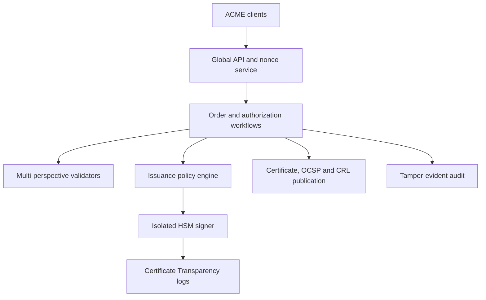
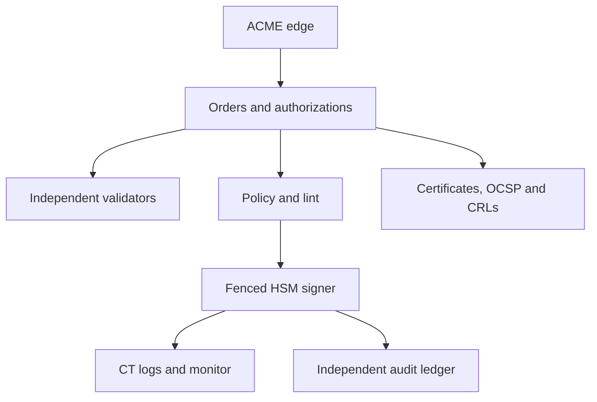

# Design an Automated Public Certificate Authority

**Difficulty:** Staff / Senior Staff  
**Primary themes:** PKI, ACME workflows, domain validation, HSM-backed signing, Certificate Transparency, revocation, auditability, security boundaries  
**Interview time budget:** about 45 minutes  
**Educational walkthrough:** intentionally more detailed than what you would say in a 45-minute interview

## Interviewer prompt

> Design an automated public certificate authority similar in product shape to Let's Encrypt. Domain owners should prove control of DNS names, request and renew short-lived TLS certificates through an ACME-compatible API, and revoke certificates. Browsers and servers must be able to verify certificate status, issuance must be publicly auditable, and compromise of an internet-facing service must not expose the CA signing keys.

Assume major browser and operating-system trust stores already include our root certificate. Design the online issuance, validation, signing, transparency, revocation, and operational safety systems; do not design the politics of obtaining root-store inclusion.

## Targeted clarifying questions with assumed answers

**Candidate:** Are we issuing public TLS certificates or private enterprise certificates?

**Interviewer:** Public domain-validated TLS certificates. Support DNS names, including wildcards through DNS validation. Organization validation and code signing are out of scope.

**Candidate:** Which client protocol should we support?

**Interviewer:** ACME-compatible accounts, orders, authorizations, challenges, finalization, certificate retrieval, renewal, and revocation.

**Candidate:** Which validation methods are required?

**Interviewer:** HTTP-01 and DNS-01. TLS-ALPN-01 is a useful extension. Validation must be checked from multiple independent network perspectives to reduce route-hijack and localized-cache risk.

**Candidate:** Who generates and stores the subscriber's private key?

**Interviewer:** The subscriber generates it. The CA receives a certificate signing request containing the public key and never receives the subscriber's private key.

**Candidate:** How long are certificates valid?

**Interviewer:** Ninety days. Clients should renew around day 60. The system must handle large synchronized renewal waves without weakening validation.

**Candidate:** What scale should I assume?

**Interviewer:** Five billion active certificates, 80 million successful issuances or renewals per day, 200,000 issuance requests per second at renewal peaks, and global OCSP/CRL traffic that can reach several million requests per second.

**Candidate:** What correctness and availability targets matter?

**Interviewer:** Never issue without fresh valid authorization, never sign a malformed or policy-violating certificate, and never reuse a serial number under an issuer. Target 99.99% issuance API availability, but prefer denying or delaying issuance over issuing incorrectly. Certificate status and certificate downloads should reach 99.999% availability through caches and CDNs.

**Candidate:** Must every certificate be logged publicly?

**Interviewer:** Yes. Obtain Signed Certificate Timestamps from approved Certificate Transparency logs before returning a usable certificate. Discuss what happens if logs are unavailable or inconsistent.

**Candidate:** How quickly must revocation propagate?

**Interviewer:** Accept an authorized revocation immediately, publish an updated status within 60 seconds, and distribute updated CRL material within 15 minutes. Existing browser behavior varies, so short certificate lifetime remains part of the risk strategy.

**Candidate:** Is multi-region active-active issuance required?

**Interviewer:** Internet-facing API and validation may be active-active. The signing boundary may be more conservative. Explain how to avoid duplicate or conflicting issuance when regions fail or partition.

## How to frame the interview

This walkthrough follows [Hello Interview's public delivery framework](https://www.hellointerview.com/learn/system-design/in-a-hurry/delivery): requirements, entities, interface, high-level design, and deep dives. The key is to define the authorization and signing invariants before drawing queues and databases.

What to say aloud:

> “I’ll separate an internet-facing ACME and validation plane from a tightly isolated signing plane. I’ll first create an account and order, prove control of one domain, finalize a CSR, log a precertificate, and return a certificate. Then I’ll harden the design around multi-perspective validation, HSM authorization, idempotent workflows, transparency failures, revocation, and renewal spikes. Availability matters, but incorrect issuance is the catastrophic failure, so ambiguous authority fails closed.”

---

## 1. Requirements (~5 minutes)

### Core functional requirements

1. **Automate authorization and issuance.** Let an authenticated ACME account create an order, prove control of every requested DNS identifier, submit a CSR, and retrieve a valid certificate chain.
2. **Renew and revoke safely.** Support idempotent high-volume renewals, account-key rollover, and authorized revocation by the account key or certificate private key.
3. **Publish verifiable evidence.** Submit every issuance to approved Certificate Transparency logs, serve certificate status through OCSP and CRLs, and retain tamper-evident audit trails.

### Out of scope

- gaining or maintaining browser root-program membership;
- organization-validated and extended-validation identity proofing;
- code-signing, document-signing, email, or client certificates;
- subscriber private-key generation, storage, and deployment;
- TLS termination on subscriber servers;
- browser-specific revocation policy implementation;
- implementing the HSM hardware or DNS system itself.

### Quantified non-functional requirements

| Requirement | Target | Design consequence |
|---|---:|---|
| Issuance volume | 80M/day; 200k requests/s peak | Asynchronous order state machine, queues, idempotency and renewal spreading |
| Correctness | Zero unauthorized or policy-invalid issuance | Fail closed, fresh validation evidence, independent policy checks, isolated signer |
| Issuance availability | 99.99% API; delayed signing acceptable during ambiguity | Active-active edge, durable workflows, conservative signing authority |
| Read availability | 99.999% certificate/status reads | CDN-backed immutable certificates, signed OCSP responses, partitioned CRLs |
| Latency | Routine non-wildcard order under 30 s p95 when challenges are already provisioned | Parallel validation perspectives and asynchronous CT submission |
| Revocation | Status visible within 60 s; CRL within 15 min | Strong revocation commit, push invalidation and streaming status builders |
| Auditability | Every security-sensitive transition durably attributable | Append-only signed audit events and independent archival sink |
| Key protection | Online service compromise cannot extract CA keys | Offline root, HSM-held intermediates, narrow signing protocol and quorum controls |

### Scale estimates that change the design

Eighty million certificates per day averages:

\[
80{,}000{,}000 / 86{,}400 \approx 926\ \text{certificates/s}
\]

The stated 200,000 request/s peak is over 200 times the average because one certificate order requires several protocol requests and renewals can synchronize. Provisioning only for average issuance would fail exactly when a popular client version or outage causes retry waves. The API, challenge scheduler, and queues need burst buffering plus client backoff.

If each certificate, chain, metadata record, authorization evidence, CT proof, and audit pointer consumes an illustrative 12 KiB:

\[
80{,}000{,}000 \times 12\ \text{KiB} \approx 983\ \text{GB/day}
\]

Long-term evidence and audit storage reaches hundreds of terabytes yearly before indexes and replicas. Immutable certificate objects belong in content-addressed object storage; the transactional database stores compact workflow and authority state.

Suppose five billion active certificates each receive only two status checks per day:

\[
10{,}000{,}000{,}000 / 86{,}400 \approx 116{,}000\ \text{checks/s average}
\]

Real peaks and automated scanners can be far higher. OCSP signing cannot synchronously hit the issuance database or primary HSM for every request. Pre-sign/cache responses where protocol freshness permits, distribute through edge caches, and partition CRLs.

What to say aloud:

> “The average signing rate is modest compared with protocol and retry peaks, so I’ll buffer workflows and spread renewal. Status traffic is read-dominated and untrusted, so it gets a separate CDN-backed architecture. I will keep authoritative issuance state small and put immutable artifacts and evidence in append-only storage.”

### Consistency and availability contract

- Account creation, key rollover, order transitions, authorization binding, serial allocation, revocation, and final certificate publication are strongly consistent within an issuer.
- An authorization is valid only for a specific normalized identifier, account, validation method, policy version, evidence digest, and bounded expiry.
- A certificate is signed only if all identifiers have current valid authorization, the CSR public key and requested names match the order, policy checks pass, and the signing request is unique.
- Every issued certificate has a unique serial number within the issuer and one immutable record. Retries return the prior result rather than create a second logical issuance.
- Validation and CT calls are asynchronous and at-least-once; their effects are idempotent. Network delivery is not assumed exactly once.
- Incorrect issuance risk outranks availability. During policy, authorization, clock, serial-allocation, or signer-authority uncertainty, new signing stops.
- Certificate downloads and status reads may serve signed immutable or bounded-stale artifacts from caches. Revocation commits may not be lost or overwritten.
- During a control-plane outage, already-issued certificates remain usable. New issuance may pause; the CA must never create a certificate from incomplete local state.

---

## 2. Core entities (~2 minutes)

| Entity | Purpose |
|---|---|
| `Account` | Subscriber identity anchored in an ACME account key and contact metadata |
| `Order` | Requested DNS identifiers, lifecycle state, expiry, CSR and certificate result |
| `Authorization` | Account's bounded proof of control for one normalized identifier |
| `Challenge` | HTTP-01, DNS-01, or TLS-ALPN-01 token and validation state |
| `ValidationObservation` | One perspective's fetched value, network evidence, time and result |
| `CSR` | Subscriber public key, requested names, signature and extensions |
| `Certificate` | Serial, issuer, validity, SANs, public key, SCTs and object location |
| `Issuer` | Intermediate CA identity, policy, serial namespace and HSM key reference |
| `SigningRequest` | Fully policy-checked immutable input authorized for one HSM signature |
| `CTSubmission` | Precertificate, chosen log, SCT and inclusion-monitoring state |
| `Revocation` | Certificate serial, reason, authority, effective time and publication state |
| `OCSPRecord` | Signed status response and `thisUpdate`/`nextUpdate` freshness window |
| `CRLShard` | Signed partition of revoked serials with version and publication URL |
| `AuditEvent` | Append-only actor, action, resource, policy, evidence digest and outcome |

Keep `Authorization` separate from `Order`. A still-valid domain authorization can be reused for a later order by the same account if policy permits, while an order is a single requested certificate workflow.

What to say aloud:

> “The order is orchestration; the authorization is bounded proof; the CSR supplies the subscriber key; and the signing request is the narrow, immutable object allowed to cross into the HSM boundary. Separating them prevents a retry or reused challenge from silently changing what gets signed.”

---

## 3. API and system interface (~5 minutes)

ACME uses signed requests. A JSON Web Signature proves possession of the account key; after account creation, the account URL identifies the caller. Nonces protect replay. The examples are simplified for interview readability.

### 3.1 Create an account

```http
POST /acme/new-account
Replay-Nonce: nonce_N91...
Content-Type: application/jose+json

{
  "protected": "<base64url: alg, jwk, nonce, url>",
  "payload": "<base64url: contacts and termsOfServiceAgreed>",
  "signature": "<base64url signature>"
}
```

```http
HTTP/1.1 201 Created
Location: /acme/accounts/acct_7H2...
Replay-Nonce: nonce_P33...
```

The service derives identity from the verified account key, not from an `account_id` supplied in a payload.

### 3.2 Create a certificate order

```http
POST /acme/new-order
Content-Type: application/jose+json

{
  "protected": "<signed account URL, nonce and endpoint>",
  "payload": "<base64url of identifiers>",
  "signature": "<account-key signature>"
}
```

Decoded payload:

```json
{
  "identifiers": [
    {"type":"dns","value":"example.com"},
    {"type":"dns","value":"www.example.com"}
  ]
}
```

```json
{
  "status":"pending",
  "expires":"2026-10-25T12:00:00Z",
  "authorizations":[
    "/acme/authz/auth_1...",
    "/acme/authz/auth_2..."
  ],
  "finalize":"/acme/orders/ord_9K4.../finalize"
}
```

### 3.3 Fetch a challenge

```http
POST /acme/authz/auth_1...
Content-Type: application/jose+json

<POST-as-GET signed request>
```

```json
{
  "identifier":{"type":"dns","value":"example.com"},
  "status":"pending",
  "expires":"2026-10-25T12:00:00Z",
  "challenges":[
    {"type":"http-01","url":"/acme/challenges/ch_71...","token":"j13..."},
    {"type":"dns-01","url":"/acme/challenges/ch_72...","token":"p89..."}
  ]
}
```

For HTTP-01, the client serves a key-authorization value under `/.well-known/acme-challenge/{token}`. For DNS-01, it publishes a derived value in `_acme-challenge.example.com` TXT records. Wildcards require DNS-01.

### 3.4 Request validation

```http
POST /acme/challenges/ch_71...
Content-Type: application/jose+json

<signed empty object acknowledging challenge readiness>
```

```json
{"status":"processing"}
```

This call schedules validation and returns quickly. Repeated readiness requests deduplicate against the challenge generation.

### 3.5 Finalize with a CSR

```http
POST /acme/orders/ord_9K4.../finalize
Content-Type: application/jose+json

<signed payload containing base64url DER PKCS#10 CSR>
```

```json
{
  "status":"processing",
  "certificate":null
}
```

Once complete, polling the order returns:

```json
{
  "status":"valid",
  "certificate":"/acme/certificates/cert_44A..."
}
```

### 3.6 Revoke a certificate

```http
POST /acme/revoke-cert
Content-Type: application/jose+json

{
  "protected":"<account-key or certificate-key signed header>",
  "payload":"<certificate DER and reason>",
  "signature":"<proof of authorized key possession>"
}
```

The server verifies that the requester is the issuing account or proves possession of the certificate private key, then commits one immutable revocation fact. A repeated identical request succeeds idempotently.

### 3.7 Internal interfaces

```protobuf
rpc ValidateChallenge(ValidationJob) returns (ValidationResult);
rpc EvaluateIssuance(IssuanceCandidate) returns (PolicyDecision);
rpc SignPrecertificate(AuthorizedTbsCertificate) returns (SignedPrecertificate);
rpc SubmitPrecertificate(CTJob) returns (SCTBundle);
rpc SignFinalCertificate(AuthorizedFinalTbs) returns (SignedCertificate);
rpc PublishRevocation(RevocationEvent) returns (PublicationAck);
```

The signer accepts no arbitrary certificate template. It accepts a canonical, policy-authorized `to-be-signed` structure plus a short-lived authorization token bound to its digest, issuer, serial, validity, and policy version.

---

## 4. Data flow

### Issuance flow

1. The client creates an order through a nonce-protected account-key signature.
2. The order service normalizes identifiers, checks account and domain rate limits, and creates one authorization per name.
3. The client provisions a selected challenge and signals readiness.
4. The validation scheduler assigns the challenge to several independent perspectives.
5. Perspectives resolve DNS independently, fetch the challenge through controlled networks, and return signed observations.
6. The authorization service validates quorum, freshness, CAA policy, redirects, address restrictions, and evidence consistency; it marks authorization valid with an expiry.
7. The client submits a CSR. The policy engine verifies its signature, key parameters, SAN equality, extensions, order state, authorization freshness, and rate limits.
8. The serial service allocates a unique unpredictable serial. The signer HSM signs a precertificate after rechecking the authorized digest.
9. CT workers submit the precertificate to approved logs and collect enough valid Signed Certificate Timestamps.
10. The policy engine verifies the SCT bundle. The HSM signs the final certificate containing the SCT extension.
11. The certificate and chain are stored immutably, the order atomically becomes `valid`, and the client retrieves it.
12. Audit and monitoring pipelines independently confirm the issued certificate matches the order, policy, CT entries, and public publication.

### Revocation flow

1. The caller proves authority and submits the certificate serial and reason.
2. A strongly consistent transaction records the earliest effective revocation and an outbox event.
3. OCSP builders generate signed `revoked` responses; cache invalidation prioritizes the affected serial.
4. CRL builders add the serial to its issuer shard and publish a new signed version.
5. Independent monitors query public endpoints until propagation SLOs are satisfied or page operators.

---

## 5. High-level design (~10–15 minutes)



### Operation 1: create an account and replay-safe order

The global API terminates TLS, validates request size, parses the JWS, verifies the signature, checks the nonce and endpoint binding, and enforces rate limits. A nonce is single-use, short-lived, and scoped to the ACME service. Replay protection is not a substitute for idempotent state transitions: clients retry after ambiguous responses.

```text
Account(
  account_id, jwk_thumbprint, public_key,
  status, contacts, terms_version,
  created_at, key_generation
)

Order(
  order_id, account_id, normalized_identifiers_hash,
  state, expires_at, csr_digest,
  policy_version, issuer_id, serial,
  certificate_object_id, generation,
  created_at, updated_at
)
```

Partition account and order state by stable IDs in a strongly consistent regional database. Global routing sends an account to a home authority region; another region can proxy or perform controlled failover rather than concurrently mutate the same order.

The order state machine is monotonic:

```text
PENDING -> READY -> PROCESSING -> VALID
    |         |          |
    +---------+----------+-> INVALID
```

Workers use conditional transitions on `(order_id, generation, expected_state)`. An outbox in the same transaction emits work. At-least-once consumers may repeat validation, policy, CT, or publication steps, but each step records an input digest and returns its prior output.

### Operation 2: prove domain control

For each normalized DNS identifier, generate high-entropy challenge tokens and bind them to:

```text
Challenge(
  challenge_id, authorization_id, account_id,
  identifier, type, token_hash,
  state, attempt_generation,
  ready_at, validated_at, expires_at
)
```

Never let the client choose validation destinations. The validator derives the domain and expected path/record from authoritative order state. This limits server-side request forgery.

HTTP validation resolves A/AAAA records through controlled resolvers, rejects forbidden internal or metadata-service ranges, applies strict redirect limits, fetches the exact challenge path, and compares the key-authorization value. DNS validation walks the appropriate records and DNSSEC state if policy uses it. CNAME delegation may be allowed under explicit rules.

Run validation from several perspectives with independent resolvers and network paths. Each emits a signed observation containing resolved addresses, answer/fetch digest, redirect chain digest, time, perspective identity, and policy checks. A validation coordinator requires a configured quorum and no disqualifying contradiction.

```text
Authorization(
  authorization_id, account_id, identifier,
  status, method, valid_from, valid_until,
  evidence_bundle_digest, validation_policy_version,
  challenge_generation
)
```

Authorization reuse is bounded. A wildcard authorization is distinct from its base name. Identifier normalization lowercases DNS names, handles internationalized names through a single canonical profile, rejects ambiguous encodings, and never treats lookalike names as equal.

### Operation 3: evaluate a CSR and issuance policy

Once every authorization is valid, the order becomes `READY`. Finalization verifies:

- PKCS#10 signature proves possession of the requested public key;
- SANs exactly equal the normalized order identifiers;
- subject and extensions contain only permitted fields;
- key type, size, curve, and signature algorithms meet policy;
- no forbidden internal name, malformed wildcard, null byte, duplicate extension, or critical unknown extension exists;
- all authorizations are fresh and belong to this account/order;
- CAA and other required domain policy are fresh;
- account, registered-domain, identifier-set, and failure rate limits pass;
- requested validity lies inside subscriber, issuer, and policy limits.

Use multiple independently implemented checks where practical: a primary policy engine plus a certificate linter. Both operate on canonical bytes. Any disagreement fails closed and pages the security team.

The decision is immutable:

```text
IssuanceDecision(
  decision_id, order_id, csr_digest,
  canonical_tbs_digest, identifier_set_digest,
  authorization_evidence_digest,
  policy_version, lint_version,
  issuer_id, serial, not_before, not_after,
  result, decided_at
)
```

### Operation 4: allocate serials without collision

X.509 serials must be unique per issuer. A single database counter is easy but becomes a hot availability dependency and reveals issuance volume. Prefer large unpredictable serials generated with a cryptographic RNG, plus a unique constraint in the authoritative issuance database. Collision probability is negligible, and the database guard makes the invariant explicit.

Allocate and durably reserve the serial before signing. A retry reuses the reservation tied to `(order_id, issuance_generation)`. Never allocate a new serial merely because an HSM response timed out; query the signed-artifact ledger using the request digest first.

### Operation 5: cross the signing boundary

Keep the root CA offline. It signs a small number of intermediate certificates during controlled ceremonies. Online issuance intermediates live in certified HSM clusters isolated behind a narrow signing service. Internet-facing systems cannot export key material or invoke a generic signing primitive.

The signer validates:

1. mutual workload identity and caller allowlist;
2. short-lived authorization token from the policy authority;
3. exact hash of canonical to-be-signed bytes;
4. issuer and active key generation;
5. serial reservation and validity bounds;
6. authorization token expiry and one-time request ID;
7. signer-side emergency blocks and issuance rate ceilings.

```text
SigningRequest(
  signing_request_id, order_id, issuer_id,
  phase, serial, tbs_digest,
  policy_decision_id, authorization_token_digest,
  created_at, expires_at
)
```

HSM clusters are replicated across secure facilities, but one issuer generation has a clear active signing authority. Quorum-controlled activation prevents two partitions from independently exceeding policy or losing revocation control. It is acceptable for issuance to pause during signer ambiguity.

### Operation 6: obtain Certificate Transparency evidence

Public TLS issuance uses a two-step pattern:

1. sign a precertificate containing a poison marker;
2. submit it to several independent CT logs;
3. verify returned SCT signatures and policy diversity;
4. embed the SCT list into the final certificate;
5. sign the final certificate.

```text
CTSubmission(
  submission_id, order_id, precert_digest,
  log_id, state, attempt_count,
  sct_timestamp, sct_bytes, sct_signature_valid,
  inclusion_deadline, last_error
)
```

CT calls are retried with stable precertificate bytes. Select logs from independent operators and enforce browser-policy requirements. If one log fails, use another approved log. If the required number/diversity is unavailable, pause final issuance rather than return a certificate that relying clients may reject.

After issuance, a CT monitor checks inclusion proofs and watches all logs for certificates claiming our issuer. It detects a compromised signer or unauthorized issuance even if the internal database was bypassed. Certificate Transparency is public accountability, not permission to issue.

### Operation 7: publish certificate and chain

Store DER and PEM artifacts in immutable object storage keyed by issuer and serial or content hash. Publication metadata is committed only after final signature verification:

```text
Certificate(
  issuer_id, serial, order_id, account_id,
  fingerprint, spki_digest, sans_digest,
  not_before, not_after, certificate_object_id,
  chain_version, sct_bundle_digest,
  status, issued_at
)
```

The order becomes `VALID` in the same transaction that references the immutable object and emits publication/audit events. The client fetches from a stateless API or CDN using an unguessable capability URL scoped to the account. Public certificate contents are not secret, but account inventory and operational metadata are.

### Operation 8: renew at scale

Renewal is a new order, not an in-place extension. It gets a new serial and certificate, and may reuse sufficiently fresh authorizations under current policy. Existing and renewed certificates overlap so deployment can finish safely.

Avoid synchronized expiration cliffs:

- recommend a renewal window rather than one instant;
- clients pick stable jitter derived from certificate identity;
- the API returns `Retry-After` during overload;
- prioritize certificates nearest expiry;
- maintain emergency capacity above normal peaks;
- provide an asynchronous renewal-information endpoint when ecosystem support exists.

Rate limits use registered domain, exact identifier set, account, source risk, and failed-validation dimensions. Do not key only by IP: large hosting providers share addresses, while attackers distribute traffic.

### Operation 9: revoke and publish status

Revocation is monotonic. Once a serial is revoked, no later write can return it to good status. The transaction records caller proof, reason, earliest effective time, certificate fingerprint, and audit event.

```text
Revocation(
  issuer_id, serial, certificate_fingerprint,
  reason, effective_at, requested_at,
  requester_type, requester_key_digest,
  request_evidence_digest, publication_version
)
```

OCSP responders serve signed status for a certificate without requiring clients to download a full revocation list. CRLs are signed lists of revoked serials. Both are derived views of the authoritative revocation log.

For scale:

- stream revocation events to OCSP pre-signing workers;
- cache signed responses at edge locations until `nextUpdate`;
- use short freshness windows for recently changed certificates;
- partition CRLs by issuer and serial range;
- publish immutable CRL versions through a CDN;
- maintain a small manifest pointing to current shards;
- monitor public reachability and freshness from outside networks.

If publication lags, issuance may continue only within a tightly defined risk budget; sustained inability to publish revocation status stops new signing for the affected issuer.

---

## 6. Deep dives (~10–15 minutes)

### Deep dive A: preventing unauthorized issuance

#### Where the baseline breaks

A single HTTP fetch from one data center can be fooled by BGP hijacking, DNS poisoning, a compromised CDN edge, or a stale resolver. A valid challenge from yesterday may no longer reflect control today. A policy-service bug may authorize names that the CSR quietly changes. Finally, compromise of the API must not grant unrestricted signing.

#### Validation approaches

| Approach | Advantage | Weakness |
|---|---|---|
| One HTTP fetch | Fast and simple | One network-path failure can misissue |
| Several fetches in one region | Reduces transient errors | Shares routing and resolver fate |
| Multi-perspective validation | Independent routing and DNS evidence | More latency and operational complexity |
| Manual approval | Strong for rare high-assurance cases | Cannot scale to automated public DV issuance |

Choose multi-perspective automated validation with a quorum and contradiction rules. Perspective diversity matters more than raw count; three validators behind one resolver or transit provider are not independent.

#### Fresh evidence and rebinding defense

For every attempt:

1. resolve authoritative DNS through approved recursive paths;
2. record the full relevant answer and TTLs;
3. block loopback, private, link-local, metadata, and CA-internal ranges;
4. connect only to the validated address set;
5. recheck destination after each bounded redirect;
6. fetch a small response with tight time and size limits;
7. compare exact expected key authorization;
8. sign the observation and expire it quickly.

DNS answers can change between validation and issuance. Bind authorization to a short expiry, and repeat CAA/policy checks near signing. Do not let cached success live for months.

#### CAA and policy

CAA DNS records can restrict which CA may issue. Evaluate them with well-defined alias traversal, freshness, and failure behavior. A timeout or malformed security-relevant response should not silently become permission.

Maintain an emergency deny list for identifiers, accounts, keys, and issuers. The signer receives a rapidly updated signed block snapshot and also enforces a maximum authorization-token lifetime, bounding damage if distribution is delayed.

#### Defense in depth at signing

The HSM boundary cannot redo internet validation, but it can enforce structural facts:

- certificate names and validity are inside the signed policy authorization;
- issuer generation and algorithms are allowed;
- serial is reserved;
- request is fresh and unique;
- issuance rate is inside a safety envelope;
- emergency stop is not active.

Two-person approval is inappropriate for every certificate, but appropriate for root ceremonies, intermediate activation, policy overrides, bulk revocation, and emergency recovery.

What to say aloud:

> “I will not treat one network fetch as proof of global domain control. Independent perspectives produce signed, short-lived evidence; the policy engine binds that evidence to the exact identifier set and CSR; and the signer only accepts a digest-authorized template. Compromising the ACME API still does not expose a generic CA signing oracle.”

### Deep dive B: exactly-once effect across queues, CT, and HSMs

#### Where the baseline breaks

The signer may complete a signature while its response is lost. A worker retry could allocate a second serial, submit a different precertificate, or publish two certificates. CT logs and HSMs are external systems that cannot participate in one database transaction. Claiming “exactly once” network execution is not credible.

#### Options

| Approach | Advantage | Weakness |
|---|---|---|
| Distributed transaction across all systems | Simple mental model | HSMs and CT logs do not join; poor availability |
| At-most-once delivery | Avoids duplicates | Loses work after crash or ambiguous response |
| At-least-once plus idempotent effects | Survives failure | Requires stable IDs and result ledgers |
| Reconcile after arbitrary duplicates | Flexible | Dangerous if signed bytes differ |

Choose at-least-once workflow execution with exactly-once logical effects.

#### Stable identity at every step

Derive or persist identifiers before side effects:

- `order_id` from the create transaction;
- `attempt_generation` for each challenge readiness cycle;
- `decision_id` from order generation and CSR digest;
- serial reservation from order and issuance generation;
- precertificate bytes frozen before CT submission;
- `signing_request_id` bound to phase and TBS digest;
- final certificate object keyed by issuer and serial;
- revocation keyed by issuer and serial.

Each worker follows:

1. load authoritative expected state;
2. claim a lease with an epoch;
3. compute or fetch frozen input;
4. call the external dependency with a stable request identity where supported;
5. record the exact response digest;
6. conditionally advance state;
7. on ambiguity, query the result ledger before retrying.

#### Signer result ledger

Inside the secure boundary, store an append-only mapping from `signing_request_id` and `tbs_digest` to signature digest and signed bytes reference. The same ID and digest returns the old result. The same ID with another digest is an alarm and hard failure.

The result ledger must be at least as durable as issuance metadata. Otherwise a signed certificate could exist without an accountable record. Independent audit streams receive signer sequence numbers and periodically reconcile gaps.

#### CT retry behavior

Resubmit the identical precertificate to alternate approved logs if needed. Multiple SCTs are fine; a different precertificate for the same intended certificate is not. Freeze issuer, serial, validity, names, key, and extensions before the first CT call.

#### Recovery reconciliation

Periodic reconcilers compare:

- orders in `PROCESSING` against signer results;
- signer results against published certificates;
- published certificates against CT submissions;
- CT-observed issuer certificates against internal issuance records;
- revocations against OCSP and CRL versions.

Unknown signed material or an unexplained sequence gap is a security incident, not ordinary eventual consistency.

What to say aloud:

> “I am not promising exactly-once delivery. I freeze bytes, assign stable operation IDs, make the signer return the prior signature for the same digest, and reconcile every boundary. A timeout becomes a lookup problem, not permission to create a different certificate.”

### Deep dive C: key hierarchy, signer compromise, and disaster recovery

#### Where the baseline breaks

Putting the root key online makes one compromise ecosystem-wide. Sharing one intermediate key across all regions expands the blast radius. Independent active signers can exceed global policy during a partition. Backing up extractable keys creates another theft path, while having no recovery plan can end the business after HSM loss.

#### Key hierarchy

Use:

1. **Offline root:** stored in geographically separated HSMs, activated only during audited ceremonies.
2. **Shorter-lived intermediates:** signed by the root and scoped by certificate policy, algorithms, name constraints where applicable, and operational epoch.
3. **Online HSM signer clusters:** intermediate keys are generated in HSMs, non-exportable, and replicated only through supported secure HSM backup/cluster mechanisms.
4. **OCSP/CRL signing keys:** separated from certificate-issuance keys and limited to status artifacts.
5. **Audit signing keys:** separate again, so an issuance compromise cannot rewrite history.

Limit blast radius with several intermediates segmented by time, product, geography, or capacity. More intermediates complicate chains and status distribution, so segmentation should follow meaningful containment boundaries.

#### Signing authority during partitions

Options:

| Model | Availability | Safety/complexity |
|---|---:|---|
| One active secure region | Lower | Clear authority and simplest audit |
| Active-passive signer facilities | High with controlled promotion | Requires fencing and tested failover |
| Active-active shared issuer | Highest nominal | Global limits, serials, audit and split-brain are hard |
| Separate issuer per region | High and contained | More intermediates and client-chain operations |

Choose active-passive per intermediate or separate intermediates per region. Internet-facing order and validation services remain active-active, but final signing routes to the issuer authority. Promotion requires quorum approval and fencing evidence that the old site cannot sign.

#### Compromise response

Prepare for:

- account-key compromise: deactivate account, revoke affected certificates, require key rollover;
- validator compromise: remove perspective, invalidate its evidence, revalidate suspicious orders;
- policy-engine compromise: stop signing, compare decisions with independent logs;
- intermediate-key compromise: stop signer, revoke intermediate if ecosystem response permits, switch to a pre-staged clean intermediate, mass-revoke/reissue descendants, and communicate publicly;
- root compromise: invoke the root-program incident plan; technical automation alone cannot repair trust.

Emergency controls must be operable without the normal control plane but require authenticated multi-party approval, immutable logging, scoped actions, and automatic expiry.

#### Disaster recovery

Back up databases, immutable certificate objects, audit logs, revocation logs, policy versions, CT receipts, and HSM cluster metadata. Test restore in an isolated environment. A restored database is not automatically authorized to sign: signer activation requires a fresh authority epoch and reconciliation to the latest audit/CT state.

Recovery order:

1. serve existing certificates and status artifacts from durable caches;
2. restore authoritative revocation and audit state;
3. verify serial high-water marks or reservation sets;
4. reconcile CT and signer ledgers;
5. activate one fenced issuer authority;
6. resume validation and signing gradually with low rate ceilings.

What to say aloud:

> “The root stays offline, online intermediates are non-exportable in HSMs, and signing authority has a fenced epoch. I would rather pause issuance than let two partitions sign without shared limits. Disaster recovery restores evidence and revocation before it restores the ability to mint new trust.”

### Deep dive D: revocation freshness and read availability

#### Where the baseline breaks

Serving OCSP by querying the primary certificate database creates a global availability dependency and leaks traffic patterns. Generating one huge CRL makes every client download an enormous file. Caching improves scale but can continue serving `good` after revocation.

#### Derived signed artifacts

Treat the revocation log as authoritative and OCSP/CRL as signed materialized views. Use monotonic publication versions and explicit freshness:

- `thisUpdate`: when status was produced;
- `nextUpdate`: maximum cache lifetime;
- revocation event version included in build metadata;
- edge purge keyed by issuer and serial for urgent transitions;
- periodic full rebuild to repair lost events.

Pre-sign `good` OCSP responses for issued certificates with bounded lifetime, and generate `revoked` responses immediately on events. Keep responder signing keys online but separate and limited. A compromised responder key can lie about status but cannot issue a TLS certificate; separation reduces damage.

Partition large CRLs by serial prefix or numbered shard. Certificates or a small manifest indicate how clients locate the appropriate distribution point. Publish new immutable objects first, verify them globally, then atomically advance the current manifest.

#### Failure policy

If the authoritative revocation database is unavailable, edge caches may serve still-valid signed responses. Builders stop producing new `good` responses when they cannot prove current status. After freshness expires, clients decide according to their ecosystem policy; the CA must not fabricate availability.

Short certificate validity limits the maximum exposure when revocation checking is inconsistent, but it does not eliminate revocation. Key compromise at day one still needs an immediate signal.

#### Privacy and abuse

Direct OCSP queries can reveal which site a client visits. Encourage OCSP stapling and privacy-preserving ecosystem mechanisms where available. Rate-limit scanners, cache by full request identity, and never vary signed status based on requester.

What to say aloud:

> “Revocation is one strong monotonic fact; OCSP and CRLs are cached signed projections. I push revoked status immediately, bound the lifetime of cached good responses, shard CRLs, and let immutable artifacts scale through CDNs without making the issuance database a global read path.”

### Observability and operational invariants

#### Issuance metrics

- orders, authorizations, challenge attempts, finalizations and certificates by outcome;
- end-to-end issuance latency and time in each state;
- validation disagreement by perspective, resolver, ASN and geography;
- CAA failures, redirect rejections, forbidden-address blocks and lint failures;
- signing requests, HSM latency, rate ceilings, rejected authorization tokens and ledger gaps;
- CT latency, invalid SCTs, log diversity and missed inclusion deadlines;
- renewal age distribution and certificates approaching expiration.

#### Revocation and read metrics

- revocation commit-to-OCSP and commit-to-CRL propagation time;
- OCSP cache hit ratio, response age, signer latency and status mismatch;
- CRL shard size, build lag, CDN freshness and manifest version spread;
- external reachability from many networks;
- certificates seen in CT but absent internally;
- certificate-download and chain errors by client ecosystem.

#### Security invariants

- every final certificate maps to exactly one valid order and policy decision;
- every SAN maps to fresh authorization evidence for the issuing account;
- CSR identifier set equals certificate identifier set;
- serials are unique within an issuer;
- no final certificate exists without required valid SCTs;
- every HSM signature has an immutable authorized request and audit event;
- signer IDs never accept two digests for one request ID;
- revoked status never transitions back to good;
- root keys never appear in online inventory;
- no signer authority epoch is active in two partitioned facilities;
- every CT-observed certificate from our issuer exists in the internal ledger.

Alert on invariant violations immediately, even if customer traffic is unaffected. Security telemetry must go to an independent account and storage domain so a compromised issuance environment cannot erase it.

---

## 7. Final design

### Concise final architecture

1. Global stateless ACME edges verify nonces, JWS signatures, account identity, request shape and quotas.
2. A strongly consistent order service owns monotonic account, authorization, order, serial, certificate and revocation state.
3. Durable outbox events drive idempotent at-least-once workflow workers.
4. Multi-perspective validators independently resolve and fetch HTTP/DNS challenges, producing signed short-lived evidence.
5. A versioned policy engine binds exact identifiers, CSR digest, authorization evidence, CAA result, issuer, validity and serial into one immutable decision.
6. The offline root signs segmented intermediate issuers during audited ceremonies; online intermediate keys remain non-exportable inside HSM clusters.
7. The signer exposes only a narrow digest-authorized API, enforces authority epochs and emergency limits, and keeps a durable result ledger.
8. Precertificates go to diverse approved CT logs; verified SCTs are embedded before final signing.
9. Final certificates and chains are immutable objects, atomically referenced by valid orders and distributed through stateless APIs/CDNs.
10. Renewal creates a new jittered order and overlaps the prior certificate; rate limits and priority prevent synchronized waves from exhausting issuance.
11. Revocation is a strongly committed monotonic event that asynchronously builds signed OCSP responses and sharded CRLs.
12. Independent audit and CT monitors reconcile every signer result, published certificate, CT entry and revocation projection.

### Final architecture diagram



### Requirements check

| Requirement | Design response |
|---|---|
| Automated issuance | ACME account, order, authorization, challenge and finalize state machine |
| Domain control | HTTP-01/DNS-01 with multi-perspective signed evidence |
| Subscriber key safety | CSR contains only public key; private key never reaches CA |
| No unauthorized signing | Exact evidence-to-CSR policy binding and narrow HSM authorization |
| Unique issuance | Reserved unpredictable serials and signer idempotency ledger |
| Public auditability | Diverse CT SCTs before final signing plus independent inclusion monitor |
| High-volume renewals | Jittered renewal windows, durable queues, retry guidance and rate limits |
| Key protection | Offline root, segmented HSM-held intermediates and fenced authority epochs |
| Revocation | Strong monotonic record, sub-minute OCSP update and sharded CRLs |
| Highly available reads | Immutable certificate objects and signed status through global caches |
| Disaster recovery | Evidence-first restore, signer/CT reconciliation and controlled activation |
| Tamper evidence | Append-only signed audit sequence in an independent security domain |

### Principal tradeoffs

- Multi-perspective validation reduces hijack risk but adds cost and issuance latency.
- Authorization reuse improves renewal availability but lengthens the window in which old proof remains valuable.
- A conservative active-passive signer reduces split-brain risk but may pause issuance during failover.
- Regional intermediates contain compromise but increase chain, revocation and operational complexity.
- Certificate Transparency exposes issuance for audit but leaks public certificate metadata by design.
- Pre-signed OCSP responses scale reads but impose a bounded stale-good window after revocation.
- Short-lived certificates reduce long-term exposure but increase renewal load and outage sensitivity.
- Fail-closed policy protects the trust ecosystem at the cost of delayed certificates during dependency failures.

---

## Realistic interviewer follow-ups with strong sample answers

### 1. Why does the subscriber generate the private key?

**Strong answer:** “The CA only needs the public key and proof of possession in the CSR. If the CA generated or transported subscriber private keys, compromise or logging errors would expose every site's TLS identity and create unnecessary custody obligations.”

### 2. Why use an account key as well as the certificate key?

**Strong answer:** “The account key owns ACME state, authorizations and orders across renewals. The certificate key is scoped to one certificate and deployment. Separating them allows certificate-key rotation without losing the account and permits revocation using either appropriate authority.”

### 3. What exactly does HTTP-01 prove?

**Strong answer:** “It proves that the requester can make a token-derived value available at a defined HTTP path for the DNS identifier, as observed by the CA. It is bounded evidence of domain control, not proof of legal identity.”

### 4. Why require DNS-01 for wildcard certificates?

**Strong answer:** “A wildcard covers arbitrary first-level labels, so proving control of one HTTP host is insufficient. Publishing the challenge under the base domain's designated DNS name demonstrates control of the namespace used for the wildcard.”

### 5. Why validate from multiple perspectives?

**Strong answer:** “A route hijack or poisoned resolver may fool one location. Perspectives with independent network paths and resolvers make localized manipulation less likely to reach quorum. I also treat contradictory observations as stronger evidence than a simple majority success.”

### 6. Can validation be cached for renewal?

**Strong answer:** “Yes, for the same normalized identifier and account, within a short policy-controlled authorization lifetime. I still repeat time-sensitive policy such as CAA near issuance. Security incidents or account changes can revoke cached authorization.”

### 7. Why not put the root key in a highly available HSM cluster?

**Strong answer:** “The root is rarely needed but has ecosystem-wide impact. Keeping it offline dramatically reduces exposure. Online HSMs hold shorter-lived intermediates whose compromise has a smaller, operationally recoverable blast radius.”

### 8. What if the HSM signed but the worker timed out?

**Strong answer:** “Retry with the same signing request ID and TBS digest. The secure signer ledger returns the existing signed result. It must reject the same ID with different bytes. I never allocate a new serial just because the response was ambiguous.”

### 9. Why are there two signatures around Certificate Transparency?

**Strong answer:** “First we sign a poisoned precertificate that logs the intended issuance without being usable as an ordinary certificate. CT logs return SCTs. We embed those SCTs into the final certificate and sign the changed final bytes.”

### 10. What if all CT logs are down?

**Strong answer:** “If required SCT diversity cannot be met, final issuance pauses. Returning a certificate clients reject is not useful, and bypassing transparency violates the contract. Existing certificates and status services continue operating.”

### 11. Is CT enough to prevent misissuance?

**Strong answer:** “No. CT makes issuance publicly observable and logs auditable; it does not authorize a certificate. Validation, policy and signer controls prevent misissuance, while CT monitors detect anything that bypasses them.”

### 12. Why not query the main database for every OCSP request?

**Strong answer:** “Status traffic can dwarf issuance, and the primary database must not become a global availability or privacy bottleneck. Signed OCSP responses are derived, bounded-freshness artifacts that can be cached globally.”

### 13. Can a revoked certificate become good again?

**Strong answer:** “No. Revocation is monotonic for that issuer and serial. If the revocation was erroneous, issue a new certificate after fresh authorization; do not rewrite history.”

### 14. Why keep CRLs if OCSP exists?

**Strong answer:** “Different relying parties and ecosystems use different mechanisms, and CRLs support offline or bulk status consumption. I shard them to avoid forcing every client to download the entire issuer's history.”

### 15. How do you handle 200,000 requests per second during renewals?

**Strong answer:** “Stateless edges scale horizontally; durable queues absorb workflow bursts; clients use stable jitter and `Retry-After`; valid authorizations may be safely reused; and priority goes to certificates nearest expiry. HSM capacity is provisioned for certificates, not every polling request.”

### 16. How do rate limits avoid hurting shared hosting providers?

**Strong answer:** “Do not use source IP alone. Combine account, registered domain, exact identifier set, failed validations and risk signals. Limits need explicit exceptions and observability because one bad tenant may share infrastructure with many legitimate ones.”

### 17. What changes for a private enterprise CA?

**Strong answer:** “Replace public domain validation and public CT policy with enterprise identity, workload attestation and internal transparency. Trust roots are distributed by device management, names may be internal, and issuance can use shorter-lived workload certificates at much higher rate.”

### 18. What is the most important disaster-recovery invariant?

**Strong answer:** “Restoring data does not automatically restore signing authority. I must reconcile serials, signer results, revocations, audit sequence and CT observations, then activate exactly one fenced authority epoch before issuing again.”

---

## Common pitfalls

1. Treating certificate issuance as a single synchronous API call.
2. Letting the client specify arbitrary URLs for validation and creating SSRF.
3. Performing validation from one region or one resolver.
4. Caching domain validation indefinitely.
5. Failing to normalize internationalized and wildcard DNS names consistently.
6. Allowing CSR SANs that differ from the authorized order.
7. Accepting malformed, duplicate or unknown critical X.509 extensions.
8. Placing the root key online.
9. Giving the internet-facing service a generic HSM signing API.
10. Saying “the key is in an HSM” without defining signer authorization and fencing.
11. Using independent active signers without global serial, policy and audit coordination.
12. Retrying an ambiguous signing call with a new serial or changed bytes.
13. Claiming exactly-once queue delivery instead of idempotent effects.
14. Returning a final certificate before required SCTs are verified.
15. Treating Certificate Transparency as authorization rather than detection.
16. Querying the primary issuance database on every OCSP request.
17. Serving cached `good` status without a bounded freshness window.
18. Building one unbounded CRL for billions of certificates.
19. Allowing revocation to transition back to good.
20. Renewing every certificate at the same fixed age without jitter.
21. Rate-limiting solely by source IP.
22. Logging challenge tokens, contact data or private operational details carelessly.
23. Restoring a backup and immediately enabling all signers.
24. Monitoring only internal services instead of public CT and status endpoints.

## A polished 90-second closing

> “The design separates an active-active ACME and validation plane from a tightly isolated signing authority. Signed, nonce-protected requests create durable orders and per-name authorizations. HTTP or DNS challenges are checked from independent network perspectives, producing short-lived evidence. Finalization verifies the CSR signature, exact SAN set, fresh authorization, CAA, rate limits and X.509 policy, then freezes an immutable issuance decision and unique serial. The offline root signs segmented intermediate issuers; online intermediate keys are non-exportable in HSMs. The signer exposes only a digest-authorized API, enforces a fenced authority epoch, and records idempotent results so timeouts cannot create different certificates. A precertificate is logged to diverse Certificate Transparency logs, verified SCTs are embedded, and only then is the final certificate signed and published immutably. Renewal is a new jittered order. Revocation is one strongly committed monotonic fact projected into cached signed OCSP responses and sharded CRLs. Independent audit and CT monitors reconcile every certificate and signature. The central tradeoff is deliberately pausing new issuance during authorization, policy, transparency, or signer ambiguity to protect the public trust contract, while keeping existing certificate and status reads globally available.”

## Public references

- [Hello Interview: System Design Delivery Framework](https://www.hellointerview.com/learn/system-design/in-a-hurry/delivery) — used for the interview sequence and approximate pacing.
- [RFC 8555: Automatic Certificate Management Environment](https://www.rfc-editor.org/rfc/rfc8555.html) — primary protocol reference for accounts, orders, authorizations, challenges, finalization and revocation.
- [RFC 9162: Certificate Transparency Version 2.0](https://www.rfc-editor.org/rfc/rfc9162.html) — primary reference for publicly auditable certificate logs and Signed Certificate Timestamps.
- [RFC 6960: Online Certificate Status Protocol](https://www.rfc-editor.org/rfc/rfc6960.html) — primary reference for online certificate-status responses.
- [Let's Encrypt: How It Works](https://letsencrypt.org/how-it-works/) — public overview of automated domain validation, CSR submission, issuance and renewal.
- [Let's Encrypt / ISRG CP-CPS](https://letsencrypt.org/repository/) — public operational policy and certification-practice reference.
- [Let's Encrypt: An Automated Certificate Authority to Encrypt the Entire Web](https://www.isrg.org/documents/letsencryptCCS2019.pdf) — public paper describing a production automated CA and its security architecture.
- [Boulder](https://github.com/letsencrypt/boulder) — open-source ACME-based CA implementation used as a real-world architectural reference.

The walkthrough is original. These sources support the public protocol semantics and selected operational mechanisms rather than supplying the design.
