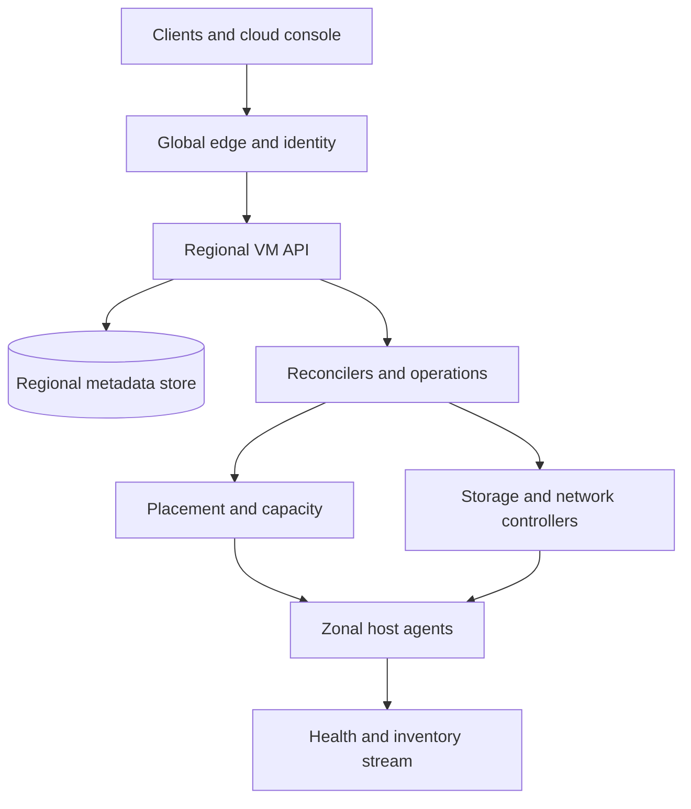
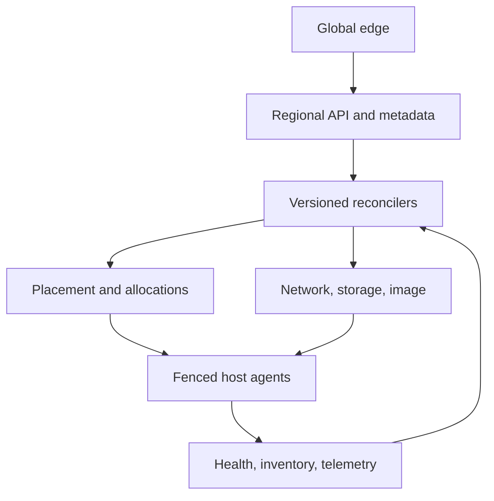

# Design a Multi-Tenant Cloud Virtual Machine Control Plane

**Difficulty:** Senior / Staff  
**Primary themes:** durable workflows, desired-state reconciliation, capacity placement, idempotency, failure recovery, multi-tenant isolation  
**Interview time budget:** about 45 minutes  
**Educational walkthrough:** intentionally more detailed than what you would present within the interview timebox

## Interviewer prompt

> Design the control plane for a cloud virtual-machine service. Customers should be able to create, inspect, start, stop, and delete VMs; attach boot volumes and network interfaces; choose a region or zone; and receive asynchronous operation status. The platform must serve many tenants across multiple regions, place VMs efficiently on physical hosts, survive partial failures, and avoid leaking or double-allocating scarce capacity.

The focus is the control plane and its interaction with regional compute hosts. Implementing a hypervisor, block-storage system, virtual network dataplane, image registry, or billing engine from scratch is out of scope.

## Targeted clarifying questions with assumed answers

**Candidate:** Is `CreateVM` synchronous?

**Interviewer:** The API should durably accept or reject the request quickly and return an operation ID. Provisioning usually completes within two minutes but can take longer during image transfer or recovery.

**Candidate:** What resources are part of creation?

**Interviewer:** One VM, one boot volume, at least one virtual network interface, an internal IP, metadata, and firewall/security-group references. Public IPs and extra disks are optional.

**Candidate:** Do we support arbitrary machine shapes?

**Interviewer:** Support predefined and custom CPU/memory shapes, GPU or accelerator requests, host traits, affinity and anti-affinity, spot capacity, dedicated hosts, and reservations.

**Candidate:** How many regions and instances?

**Interviewer:** Assume 30 regions, three or more zones per region, 100 million registered VMs, 20 million running VMs, and peaks of 100,000 mutating requests per second globally.

**Candidate:** What durability and availability do customers expect?

**Interviewer:** Accepted desired state must not be lost. Regional mutation APIs target 99.99% availability. A single host or availability-zone failure must not corrupt control-plane state. Existing VMs should keep running if the control plane is unavailable.

**Candidate:** What consistency should reads provide?

**Interviewer:** A successful mutation acknowledgement must be immediately visible through the authoritative regional API. Fleet-listing and monitoring views may lag by seconds. Physical status is inherently observed asynchronously.

**Candidate:** Can the service silently move a VM between zones?

**Interviewer:** No. A VM's zone is part of its identity because networking and storage are zonal. Live migration may move it between hosts within the same zone when supported.

**Candidate:** What happens after a physical host dies?

**Interviewer:** Local-memory state is lost. Depending on customer policy and storage availability, automatically restart the VM on another host in the same zone or leave it stopped and report the fault.

**Candidate:** Should we guarantee exactly one physical VM for every create request?

**Interviewer:** Yes from the customer's perspective. Network retries must not create duplicates. Internally, individual steps may retry.

## How to frame the interview

The structure follows [Hello Interview's public delivery framework](https://www.hellointerview.com/learn/system-design/in-a-hurry/delivery): clarify requirements, name the core entities, define the interface, build the simplest complete design, and then deepen it around the hardest requirements. The central idea is to establish the user-visible contract before introducing components.

What to say aloud:

> “I’ll separate the globally routed API, the regional authoritative control plane, and the zonal data plane. I’ll treat create and delete as durable workflows driven by desired state, because networking, storage, placement, and hypervisor operations cannot be one distributed transaction. My deep dives will be capacity placement, reconciliation after partial failure, and host or zone failure.”

---

## 1. Requirements (~5 minutes)

### Core functional requirements

1. **Create a VM asynchronously.** Resolve an image and machine shape, allocate zonal capacity, create or attach a boot volume and network interface, boot the guest, and expose operation progress.
2. **Manage VM lifecycle.** Read status; start, stop, reboot, resize where supported, and delete a VM without duplicate effects under retries.
3. **Place and recover VMs safely.** Honor zone, capacity, hardware traits, quotas, reservations, affinity policies, and maintenance/recovery policy while reacting to failed hosts.

### Out of scope

- hypervisor implementation and guest CPU emulation;
- internals of virtual switches, block replication, or image storage;
- operating-system configuration beyond metadata/bootstrap delivery;
- autoscaling groups, containers, serverless functions, and managed databases;
- detailed pricing, invoicing, and marketplace licensing;
- cross-region VM migration.

### Quantified non-functional requirements

| Requirement | Target | Design consequence |
|---|---:|---|
| Scale | 100M VM records; 20M running VMs; 100k mutation requests/s globally | Partition authoritative metadata and regionalize writes |
| API availability | 99.99% per region for create/read/lifecycle APIs | Multi-zone control plane with no single scheduler or database leader process |
| Durability | RPO 0 for acknowledged desired state and resource allocations | Quorum metadata commit before returning `202 Accepted` |
| Create latency | p95 under 2 minutes when capacity and dependencies are healthy | Parallelizable preparation plus measured stage deadlines |
| Read latency | p99 under 200 ms for `GetVM`; fleet search may be eventually consistent | Point reads hit authoritative store; list/search uses materialized indexes |
| Correctness | No duplicate VM from client retries; no double allocation of the same exclusive resource | Idempotency keys, conditional writes, and capacity-allocation leases |
| Isolation | Per-tenant quota, authorization, keys, rate limits, and noisy-neighbor protection | Tenant-aware partitions, admission, and fair work queues |
| Recovery | Detect failed host within 30 seconds; begin eligible VM recovery within 60 seconds | Hierarchical health signals and fenced host epochs |

### Scale estimates that change design choices

The average mutation rate is much lower than the stated 100,000/s peak, but control planes experience correlated bursts after deployments and zonal incidents. Design for the peak rather than averaging it away.

At 100 million VM records and roughly 5 KB of authoritative metadata per VM—including desired state, bindings, generations, operation references, and indexes—the primary logical dataset is about:

\[
100{,}000{,}000 \times 5\ \text{KB} \approx 500\ \text{GB}
\]

Replication, indexes, operation history, audit records, and tombstones may increase this by 10–20×. The result is still manageable for a distributed relational or strongly consistent key-value store, but too large and write-heavy for one database node.

Assume each of 20 million running VMs emits a small 500-byte host-status summary every 10 seconds:

\[
20{,}000{,}000 / 10 = 2{,}000{,}000\ \text{updates/s}
\]

Writing every heartbeat into the authoritative VM row would overwhelm the transaction path and create needless contention. Hosts instead publish batched health and inventory streams; the authoritative store records only coarse observed-state transitions, host epochs, and binding changes. Metrics go to a time-series system.

If 100,000 creates/s each trigger eight internal steps, the workflow layer may process 800,000 step transitions/s during a burst. Partition workflows by region and resource ID, and avoid polling every VM from a central coordinator.

What to say aloud:

> “The heartbeat arithmetic changes the design: telemetry cannot share the authoritative mutation path. The metadata store holds durable intent and coarse state transitions, while high-frequency liveness flows through a separate regional stream.”

### Consistency and availability contract

- A successful mutation first commits desired state and an operation record to a strongly consistent regional store.
- The API is idempotent by `(tenant_id, idempotency_key, operation_kind)`. Reusing the key with different parameters returns a conflict.
- `GetVM` reads authoritative desired state and the most recent durable observed state. Search and fleet inventory may lag.
- Physical convergence is asynchronous. The response distinguishes `desired_state`, `observed_state`, `generation`, and `observed_generation`.
- Exclusive resources—host slots, GPUs, dedicated cores, IPs, and reservations—are claimed with conditional allocation records before use.
- Existing hosts and VMs continue operating during control-plane outages, but new lifecycle transitions may pause.
- During a regional metadata partition, minority replicas do not accept conflicting mutations. Availability is sacrificed locally to prevent split-brain allocation.

---

## 2. Core entities (~2 minutes)

| Entity | Role |
|---|---|
| `VMInstance` | Customer-visible desired configuration and coarse observed state |
| `Operation` | Durable asynchronous mutation with steps, progress, and terminal result |
| `MachineType` | CPU, memory, architecture, and allowed virtualization traits |
| `ImageVersion` | Immutable boot-image digest and regional replicas |
| `Host` | Physical server inventory, traits, capacity, health, and fencing epoch |
| `ResourceProvider` | Hierarchical capacity owner: host, NUMA node, GPU, dedicated device, or pool |
| `Allocation` | Durable claim of capacity by a VM or reservation |
| `VolumeAttachment` | Boot/data-volume intent and provider attachment identity |
| `NetworkInterface` | Subnet, IP, MAC, policy references, and dataplane binding |
| `PlacementPolicy` | Zone, affinity, anti-affinity, dedicated host, spot, and maintenance requirements |
| `Reservation` | Capacity held for a tenant or future VM |
| `HostLease` | Proof that one host agent epoch may act for a physical server |

The important split is desired versus observed state. `VMInstance.spec` expresses what the user wants; `VMInstance.status` records the last confirmed physical state. The operation bridges them.

What to say aloud:

> “I need an allocation separate from the host's reported free capacity. Host telemetry is an observation; an allocation is the authoritative claim that prevents two schedulers from assigning the same GPU or memory.”

---

## 3. API and system interface (~5 minutes)

External APIs use REST or gRPC-transcoded REST. Authentication determines account, project, principal, and allowed regions. The client never submits a trusted `tenant_id`.

### 3.1 Create a VM

```http
POST /v1/projects/{project_id}/regions/us-east1/vms
Authorization: Bearer <token>
Idempotency-Key: launch-checkout-blue-17
Content-Type: application/json

{
  "name": "checkout-blue-17",
  "zone": "ANY",
  "machine": {
    "vcpus": 16,
    "memory_gib": 64,
    "architecture": "x86_64",
    "accelerators": []
  },
  "image": "images/ubuntu-2604@sha256:6a9f...",
  "boot_volume": {"size_gib": 200, "class": "balanced", "encrypted": true},
  "network_interfaces": [
    {"subnet_id": "subnet_prod_a", "security_groups": ["sg_web"]}
  ],
  "placement": {
    "anti_affinity_group": "checkout-replicas",
    "capacity_reservation_id": null,
    "market": "ON_DEMAND"
  },
  "maintenance_policy": "LIVE_MIGRATE_IF_SUPPORTED",
  "recovery_policy": "RESTART_IN_ZONE"
}
```

```http
HTTP/1.1 202 Accepted
Location: /v1/operations/op_01K...
```

```json
{
  "operation_id": "op_01K...",
  "vm_id": "vm_8BW...",
  "state": "ACCEPTED"
}
```

The response means the desired state is durable, not that a VM is running. Region-local idempotency is similar to the client-token pattern documented for [Amazon EC2 API requests](https://docs.aws.amazon.com/ec2/latest/devguide/ec2-api-idempotency.html).

### 3.2 Observe an operation

```http
GET /v1/operations/op_01K...
```

```json
{
  "operation_id": "op_01K...",
  "resource_id": "vm_8BW...",
  "state": "RUNNING",
  "step": "BOOT_GUEST",
  "progress_percent": 82,
  "started_at": "2026-10-18T06:01:02Z",
  "last_transition_at": "2026-10-18T06:01:41Z",
  "error": null
}
```

Clients may poll, subscribe to operation events, or provide a callback topic. Polling remains the correctness baseline.

### 3.3 Read the VM

```http
GET /v1/projects/{project_id}/zones/us-east1-b/vms/vm_8BW...
```

```json
{
  "vm_id": "vm_8BW...",
  "name": "checkout-blue-17",
  "zone": "us-east1-b",
  "desired_state": "RUNNING",
  "observed_state": "RUNNING",
  "generation": 3,
  "observed_generation": 3,
  "host_visibility": "REDACTED",
  "network_interfaces": [{"id": "nic_71...", "private_ip": "10.20.4.17"}],
  "boot_volume_id": "vol_93...",
  "created_at": "2026-10-18T06:01:02Z"
}
```

Host identity is hidden from ordinary tenants to reduce information leakage and keep migration implementation-independent.

### 3.4 Change lifecycle state

```http
POST /v1/vms/vm_8BW...:stop
Authorization: Bearer <token>
Idempotency-Key: stop-maintenance-42
If-Match: "generation-3"

{
  "mode": "GRACEFUL",
  "grace_period_seconds": 90
}
```

The generation precondition prevents a stale automation from stopping a VM that has since been replaced or reconfigured. `start`, `reboot`, and supported `resize` follow the same pattern.

### 3.5 Delete a VM

```http
DELETE /v1/vms/vm_8BW...
Authorization: Bearer <token>
Idempotency-Key: delete-checkout-blue-17
If-Match: "generation-4"
```

Deletion writes a tombstone and returns an operation. The API does not wait for guest shutdown, detach, network cleanup, or storage retention policy.

### 3.6 Internal host interface

```protobuf
rpc RegisterHost(RegisterHostRequest) returns (HostLease);
rpc Heartbeat(stream HostReport) returns (stream HostDirective);
rpc PrepareVM(PrepareVMRequest) returns (PreparedVM);
rpc StartVM(StartVMRequest) returns (VMObservation);
rpc StopVM(StopVMRequest) returns (VMObservation);
rpc DestroyVM(DestroyVMRequest) returns (VMObservation);
```

Every directive includes `host_id`, `host_epoch`, `vm_id`, `desired_generation`, and a unique step token. The host agent persists completed step tokens locally so retries return the prior result.

---

## 4. Provisioning data flow

1. The global edge authenticates and routes the request to the selected region; it does not own VM state.
2. The regional API validates quota, policy, image access, subnet access, machine shape, and idempotency.
3. In one transaction it creates `VMInstance(spec, generation=1, state=PENDING)`, an `Operation`, and an outbox event.
4. A reconciler consumes the event and asks the placement service for candidates matching quantitative resources and qualitative traits.
5. Placement conditionally claims capacity by creating an `Allocation` on the chosen host or reservation.
6. Storage and network controllers create the boot volume, allocate an IP/MAC, program virtual-network intent, and return immutable provider IDs.
7. The image service ensures the image digest is available near the host; preparation may happen in parallel with network/storage setup.
8. The host controller sends a fenced, idempotent prepare directive, then a start directive.
9. The host agent creates the guest and reports observed state with the same VM generation.
10. The reconciler transactionally marks the VM `RUNNING`, completes the operation, and emits audit and usage events.

If any step times out, the workflow re-observes actual state before retrying. It never assumes a timeout means failure.

---

## 5. High-level design (~10–15 minutes)



### Operation 1: durably accept a VM create

The global edge terminates TLS, authenticates the principal, applies broad abuse limits, and routes by explicit region. It does not proxy a regional mutation to a different region after an ambiguous timeout because that could create duplicate regional resources.

The regional API performs:

- authorization against project and image;
- schema and policy validation;
- quota reservation for vCPU, RAM, VM count, disks, IPs, and accelerators;
- idempotency lookup;
- transaction creating the VM, operation, quota hold, and outbox event.

```text
VMInstance(
  vm_id, tenant_id, project_id, region, zone,
  spec, spec_digest, generation, desired_state,
  observed_state, observed_generation, host_id,
  host_epoch, operation_id, deletion_timestamp,
  created_at, updated_at
)

Operation(
  operation_id, tenant_id, resource_id, kind,
  request_digest, idempotency_key, state, current_step,
  workflow_version, retry_at, error_code,
  created_at, updated_at
)
```

The database transaction is the acceptance boundary. The outbox makes the transition from database to workflow event retryable: if the API crashes after commit, a relay still publishes the work.

### Operation 2: select a zone and host

If the user selects `zone=ANY`, a regional admission service first chooses a zone using:

- machine/accelerator availability;
- subnet and boot-image availability;
- reservation scope;
- tenant quota;
- recent placement-failure rate;
- anti-affinity spread;
- zonal health and risk budget.

After zone selection, the choice becomes durable and does not silently change. A zonal placement service queries resource-provider summaries. This resembles the separation in [OpenStack Nova scheduling](https://docs.openstack.org/nova/2024.1/reference/scheduling.html), where the scheduler requests candidates and an allocation request claims resources.

Use a filter-then-score pipeline:

1. **Filter hard constraints:** free allocatable CPU/RAM, architecture, NUMA topology, GPU type/count, dedicated-host rule, image compatibility, network reachability, maintenance state, reservation eligibility.
2. **Score soft preferences:** bin packing, energy/cost, cached image, failure-domain spread, network/storage locality, thermal headroom, fragmentation, and tenant affinity.
3. **Claim conditionally:** create the allocation only if the host inventory generation and remaining capacity still satisfy the request.

```text
Host(
  host_id, zone, rack_id, power_domain, host_epoch,
  health_state, maintenance_state, inventory_generation,
  total_resources, allocation_ratios, traits,
  last_durable_observation_at
)

Allocation(
  allocation_id, consumer_vm_id, provider_id,
  resources, traits, reservation_id,
  state, inventory_generation, expires_at
)
```

Candidates are hints; the conditional allocation is authoritative. Two schedulers may select the same host, but only claims that fit after serialization succeed. Losers choose another candidate.

### Operation 3: provision dependencies through a durable workflow

A naive synchronous chain—allocate host, create disk, allocate IP, boot VM—fails when the API process crashes halfway. A distributed transaction spanning independent services would be fragile and unavailable. Instead use a persisted saga coordinated by reconcilers.

Each step has:

- a stable idempotency token derived from operation and step;
- a desired resource specification;
- a query/reconcile method;
- a retry policy and deadline;
- an explicit compensation or retention policy.

The workflow DAG can parallelize volume creation, network-interface creation, and image prewarming after placement. Boot waits on all three.

Example step states:

```text
VALIDATE -> PLACE -> PREPARE_VOLUME ┐
                  -> PREPARE_NIC    ├-> PREPARE_HOST -> BOOT -> VERIFY -> DONE
                  -> PREWARM_IMAGE  ┘
```

The workflow engine persists only transition decisions and external resource IDs. A step retries by first reading the dependency using its idempotency token. If volume creation succeeded but the response was lost, the controller discovers the existing volume instead of creating another.

### Operation 4: reconcile desired and observed state

Events accelerate work, but periodic reconciliation guarantees eventual progress if events are lost or duplicated. A sharded reconciler owns VM ranges using leases. For each VM it compares:

```text
desired_state, generation
observed_state, observed_generation
bound host and dependencies
active operation and retry deadline
```

If desired is `RUNNING` but observed is `STOPPED`, it resumes the current workflow or creates a repair operation. If observed generation is behind, it applies missing configuration. If the VM is already running on the correct host and generation, the action is a no-op.

This is the standard controller pattern: observe actual state, compare it with desired state, and take a bounded idempotent action. [Kubernetes controllers](https://kubernetes.io/docs/concepts/architecture/controller/) publicly document the same general reconciliation model.

Do not scan all 100 million VMs every few seconds. Use:

- partitioned change streams for immediate reconciliation;
- a durable `retry_at` index for timers;
- host-failure fan-out indexed by `host_id`;
- slow anti-entropy scans over shards to catch anomalies.

### Operation 5: stop, start, and reboot

For stop:

1. commit `desired_state=STOPPED`, increment generation, and create operation;
2. send a graceful shutdown directive to the currently fenced host agent;
3. after the grace period, force-stop if policy permits;
4. detach ephemeral runtime bindings while preserving boot volume and NIC identity;
5. decide whether to release host capacity based on suspended-instance semantics;
6. commit observed `STOPPED`.

For start, placement may select a new host in the same zone if the prior allocation was released. The stable VM ID, volume, NIC, and IP remain unchanged. Reboot normally stays on the same host and does not release allocation.

Every directive is conditional on VM generation and host epoch. A delayed `StopVM(generation=4)` cannot stop a guest already restarted as generation 5.

### Operation 6: delete safely

Delete sets a tombstone and terminal desired state. New updates are rejected. Cleanup proceeds in dependency-safe order:

1. stop and destroy the guest;
2. fence its runtime identity;
3. detach volumes;
4. delete or retain the boot volume according to policy;
5. release public and private network resources where policy allows;
6. release capacity and quota holds;
7. mark deletion complete while retaining a tombstone for audit and idempotent retries.

Deletion uses finalizers: each owning subsystem records completion. The VM row is not physically removed until mandatory finalizers succeed or an operator applies an audited override. This prevents freeing an IP or disk while an old guest can still use it.

---

## 6. Deep dives (~10–15 minutes)

### Deep dive A: correct, efficient placement under concurrency

#### Where the baseline breaks

A scheduler that reads `free_cpu=64`, chooses a host, and later writes an assignment races with other schedulers. Ten concurrent creates may all select the same last GPU. Pure bin packing also creates fragmented hosts—for example, free CPU on one server and free RAM on another—while aggressive spreading wastes energy and cached images.

#### Approaches

| Approach | Advantages | Weaknesses |
|---|---|---|
| Central scheduler with locks | Simple ordering | Throughput and availability bottleneck |
| Optimistic distributed schedulers | Scales horizontally | Candidate conflicts and retries |
| Prepartition capacity into static pools | Low contention | Stranded capacity and inflexibility |
| Hierarchical candidate service plus atomic claims | Scalable and expressive | More metadata and reconciliation |

Choose hierarchical providers with optimistic schedulers and transactional claims. Hosts report inventory and traits, but the placement database subtracts durable allocations to compute availability.

#### Allocation invariants

For every exclusive provider and resource class:

\[
\sum \text{active allocations} \leq \text{allocatable inventory}
\]

The claim transaction verifies provider generation, capacity, reservation ownership, and allocation uniqueness. A VM may have allocations across a tree: host CPU/RAM, a NUMA node, GPU devices, and a network bandwidth provider. Either the compound claim commits atomically or none of it does.

CPU may be safely overcommitted for eligible general-purpose shapes; RAM, huge pages, GPUs, and dedicated cores normally are not. The policy must distinguish physical total, reserved overhead, allocation ratio, and currently measured pressure. Measured utilization informs scoring, never replaces durable allocation accounting.

#### Placement policy tradeoffs

- **Bin pack** frees whole hosts for maintenance and power savings but increases correlated blast radius.
- **Spread** improves fault isolation but can fragment accelerators and NUMA capacity.
- **Image locality** reduces boot time but can overload popular cache hosts.
- **Storage/network locality** reduces traffic but may couple compute availability to one subsystem.
- **Reservations** guarantee customer capacity but can strand resources.

Use policy-specific weighted scoring plus hard spread constraints. Maintain a random component among near-equal candidates to prevent a thundering herd toward one “best” host.

#### Stale inventory and ghost allocations

Host reports are advisory and versioned. Allocations have states `HELD`, `BOUND`, `RELEASING`, and `RELEASED`. A short hold protects provisioning; once a host confirms preparation it becomes bound. Expired holds are reclaimed only if no workflow or host observation proves the VM exists. A sweeper reconciles claims against VM and host state before release.

What to say aloud:

> “Candidate selection can be stale; correctness comes from the atomic allocation claim. I’ll scale reads and scoring horizontally, serialize only the scarce-resource claim, and reconcile leaked holds conservatively.”

### Deep dive B: partial failure, idempotency, and reconciliation

#### Where the baseline breaks

Provisioning crosses the VM database, placement, volume, network, image, and host systems. Any call can succeed while its response is lost. The coordinator can restart on a new software version. Compensation can also fail. A simple retry loop creates duplicate volumes, IPs, or guests.

#### Why not one distributed transaction?

Two-phase commit across every subsystem would hold locks through slow image transfer and host boot, couple availability to all participants, and still not cleanly cover physical side effects. The correct model is a saga plus continuous reconciliation.

#### Idempotency layers

1. **Client request:** map idempotency key to request digest, VM ID, and operation ID.
2. **Workflow step:** derive a stable step token and store the dependency's provider ID.
3. **Host action:** identify by VM ID, desired generation, host epoch, and step token.
4. **State transition:** compare-and-swap expected generation/state.
5. **Events:** consumers deduplicate by event ID and resource generation.

If the same client key is reused with a different image or shape, return `409 IDEMPOTENT_PARAMETER_MISMATCH`, not the old result.

#### Workflow versioning

Operations store `workflow_version`. Deployed code must still interpret older in-flight workflows, or a migration must explicitly transform their state. Never let a new controller reinterpret `step=4` with different semantics.

Each step writes a structured outcome:

```text
StepResult(
  operation_id, step_name, attempt,
  idempotency_token, state,
  provider_resource_id, observed_digest,
  started_at, completed_at, next_retry_at,
  failure_class
)
```

#### Retry classification

- transient dependency timeout: re-observe, then exponential backoff with jitter;
- quota or policy failure: terminal before physical work;
- insufficient capacity: release hold and try bounded alternative candidates;
- deterministic image/shape incompatibility: terminal with actionable error;
- host loss during prepare: fence the host epoch, reconcile possible guest, then re-place;
- unknown/ambiguous result: never compensate until observation establishes actual state.

#### Compensation

Creation failure does not blindly reverse in request order. The workflow first fences any possible guest, then releases network and volume resources according to ownership and retention policy, then capacity and quota. Cleanup failure leaves the operation `FAILED_CLEANUP_PENDING`; background reconciliation continues. Customers receive the primary error plus cleanup status.

#### Split-brain prevention

The most dangerous event is the same persistent disk booted writable by two guests after a partition. Use fencing tokens:

- host registration increments `host_epoch`;
- placement binding has a monotonically increasing attachment generation;
- storage accepts writes only from the current attachment fence;
- network bindings similarly reject stale generation updates.

An old host may keep executing temporarily, but it cannot attach current storage or advertise the current network identity once fenced.

What to say aloud:

> “Timeout is an unknown result, not a failed result. Every retry begins by observing through the same idempotency token. Generations and fencing tokens make stale controllers and stale hosts harmless.”

### Deep dive C: host failure, maintenance, and zonal incidents

#### Where the baseline breaks

One missed heartbeat does not prove a host is dead; a network partition can isolate a healthy host. Immediately restarting all its VMs risks duplicate guests. Waiting too long harms availability. A zone failure may generate millions of simultaneous recovery workflows and overwhelm storage, networks, and remaining capacity.

#### Hierarchical health detection

Combine independent signals:

- host-agent heartbeat through multiple network paths;
- rack switch and power-domain telemetry;
- hypervisor watchdog;
- storage and virtual-network reachability;
- neighbor host observations;
- explicit maintenance and fencing actions.

States progress through `HEALTHY -> SUSPECT -> FENCED -> FAILED` rather than binary alive/dead. A regional failure detector owns transitions in the metadata store. Recovery begins only after fencing succeeds or the old host is proven unable to access storage/network identities.

#### Recovery policy

For an eligible VM with durable boot storage:

1. mark observed state `HOST_UNREACHABLE`;
2. fence the old host epoch and attachments;
3. create a recovery operation with the VM's next generation;
4. allocate a new host in the same zone;
5. attach the existing volume and NIC with new fencing generations;
6. boot and verify;
7. update observed state and release stale allocation.

Local SSD or in-memory data may be lost. The API exposes a termination reason and does not pretend live memory survived.

#### Planned maintenance

For supported guests, live migration copies memory while the VM runs, briefly pauses to transfer final dirty pages and device state, then switches network routing. Public documentation for [Google Compute Engine live migration](https://cloud.google.com/compute/docs/instances/live-migration-process) illustrates the product-level goal: preserve VM properties during host maintenance.

Compare choices:

| Strategy | Best for | Tradeoff |
|---|---|---|
| Live migration | Long-running, supported on-demand VMs | Network/memory overhead; complex device compatibility |
| Stop and restart | Unsupported devices or low-priority VMs | Guest-visible downtime |
| Evict with notice | Spot/preemptible workloads | Lowest provider obligation |
| No automatic action | Dedicated or customer-managed hosts | Customer owns recovery |

Maintenance is rate-limited by rack, network link, storage backend, and dirty-page bandwidth. A host drain controller does not evacuate an entire rack simultaneously.

#### Zonal failure and recovery storms

A VM is zonal, so do not silently recreate it in another zone with incompatible IPs or disks. For a full zone outage:

- mark status with explicit zonal impairment;
- preserve desired state and operations;
- prioritize control-plane and dependency recovery;
- rate-limit automatic same-zone restarts until infrastructure is trustworthy;
- require a higher-level multi-zone service or an explicit customer failover plan for cross-zone recovery.

Within a damaged but functioning zone, admission control protects recovery capacity. Queues prioritize fencing and recovery of existing VMs ahead of new best-effort creates. Bulk operations use token buckets so one tenant cannot monopolize restoration.

What to say aloud:

> “Failure detection and fencing are separate. I will not restart elsewhere merely because heartbeats stopped. First revoke the old host's authority to storage and networking; only then create the replacement.”

### Reliability and observability

#### Control-plane SLOs

- API availability, latency, and error rate by region and operation;
- idempotency-hit and parameter-mismatch rate;
- accepted-to-reconciler lag;
- operation duration by step, machine type, zone, and outcome;
- reconciliation queue age and retry distribution;
- stuck operations and cleanup-pending age;
- database quorum health and outbox lag.

#### Placement signals

- placement success and retry count;
- candidate count by shape and zone;
- allocation conflicts;
- capacity by physical, allocatable, held, bound, and reserved amounts;
- fragmentation for CPU/RAM/NUMA/GPU combinations;
- reservation utilization;
- boot latency with and without image cache hits.

#### Host and recovery signals

- heartbeat delay by rack and path;
- suspect/fenced/failed hosts;
- stale-epoch directive rejections;
- VM generation divergence;
- recovery time objective by policy;
- live-migration duration, dirty-page rate, and failure;
- duplicate attachment or network-binding attempts;
- orphan guests detected by inventory reconciliation.

Trace every mutation with `request_id`, `operation_id`, `vm_id`, `generation`, `host_id`, `host_epoch`, and dependency resource IDs. Audit logs store who changed desired state and the authorization decision, but not secrets or guest metadata contents.

Use invariants as alerts, not only dashboards:

- one active host binding per VM generation;
- one VM consumer per exclusive allocation;
- allocation sums never exceed provider inventory;
- a deleted VM has no active guest or attachment after the cleanup deadline;
- `observed_generation` never exceeds desired `generation`;
- no stale host epoch successfully mutates storage or network state.

---

## 7. Final design

### Concise architecture

1. A global edge authenticates and routes each request to the authoritative region.
2. The regional API validates policy and quota, deduplicates by idempotency key, and transactionally writes desired VM state, an operation, quota holds, and an outbox event.
3. Sharded reconcilers drive versioned sagas and periodically compare desired with observed state.
4. Zone selection becomes durable; the placement service filters and scores candidate resource-provider trees.
5. Conditional allocation transactions—not candidate reads—prevent overbooking of exclusive capacity.
6. Network, storage, and image controllers create dependencies with stable step tokens.
7. Fenced host agents execute idempotent directives keyed by VM generation and host epoch.
8. Batched inventory and health streams remain separate from authoritative metadata writes.
9. Lifecycle and deletion use generation preconditions, finalizers, and conservative cleanup ordering.
10. Host recovery fences old authority before re-placement; live migration handles supported planned maintenance.
11. Point reads use the regional source of truth, while global fleet search and telemetry are asynchronous materialized views.
12. Invariant monitoring and anti-entropy scans detect stuck workflows, orphan guests, leaked allocations, and generation divergence.

### Final architecture diagram



### Requirements check

| Requirement | Design response |
|---|---|
| Create VM | Durable asynchronous operation and saga across placement, storage, network, image, and host |
| Lifecycle actions | Desired-state generations, idempotent host directives, operation resources |
| Safe placement | Filter/score candidates followed by conditional compound allocation |
| 100M VMs / 100k mutations/s | Regional authority, sharded metadata, partitioned reconcilers, separate telemetry |
| No lost accepted intent | Quorum metadata transaction before acknowledgement plus transactional outbox |
| No duplicates on retry | Request digest and idempotency key return the same VM and operation |
| High availability | Multi-zone control plane; running VMs do not depend on synchronous control plane |
| Host recovery | Hierarchical detection, fencing, same-zone re-placement, policy-aware restart |
| Tenant isolation | IAM, quotas, fair queues, scoped capacity, encryption, audit |
| Eventual convergence | Change-driven plus periodic anti-entropy reconciliation |

### Principal tradeoffs

- Strong regional allocation consistency sacrifices mutation availability during metadata partitions.
- Asynchronous operations make partial failure manageable but require honest progress and error states.
- Bin packing improves utilization while spreading improves fault isolation; policy and workload class choose the balance.
- Host telemetry is intentionally eventually consistent; durable allocations remain authoritative.
- Automatic restart improves VM availability but cannot preserve memory or local ephemeral data.
- Live migration reduces planned downtime at the cost of implementation complexity and temporary resource overhead.
- Finalizers prevent unsafe deletion but can leave resources visibly stuck until repair succeeds.

---

## Realistic interviewer follow-ups with strong sample answers

### 1. Why return `202` instead of waiting until the VM boots?

**Strong answer:** “Provisioning crosses several slow failure domains. The API can durably accept intent within a database transaction, but it cannot atomically guarantee that a host boots within an HTTP deadline. Returning an operation separates acceptance from convergence and makes retries and progress explicit.”

### 2. What prevents duplicate VMs when the create response is lost?

**Strong answer:** “The client retries with the same idempotency key. The regional transaction maps tenant, operation kind, and key to the request digest, VM ID, and operation ID. An identical request returns the existing result; different parameters return a conflict.”

### 3. Why do you need both desired and observed state?

**Strong answer:** “The database can commit that a VM should run before the physical host does it. Keeping both states exposes convergence honestly, supports reconciliation after lost events, and prevents a transient host report from overwriting user intent.”

### 4. Can two schedulers choose the same host?

**Strong answer:** “They may choose it as a candidate, which is harmless. Each must transactionally claim capacity against the latest provider generation. If both cannot fit, one claim fails and retries elsewhere. Correctness lives in allocation, not scoring.”

### 5. How do you handle a timeout from `CreateVolume`?

**Strong answer:** “Timeout is ambiguous. The retry queries the volume service by the stable workflow-step token. If the volume exists, it records that ID and continues; otherwise it safely retries creation. It does not issue a new uncorrelated request.”

### 6. Why not store host heartbeats in the VM database?

**Strong answer:** “At 20 million running VMs, even ten-second summaries produce about two million updates per second. That would contend with lifecycle state. I batch host inventory into a stream and metrics store, persisting only coarse health transitions, host epochs, and binding changes in the authoritative database.”

### 7. What if a host is partitioned but still running guests?

**Strong answer:** “I mark it suspect, then fence its host epoch and storage/network attachment generations before restarting guests. The isolated host may continue computing briefly, but it loses authority to current disks and network identity. Recovery begins only after fencing.”

### 8. How do you avoid leaking capacity after failed creates?

**Strong answer:** “Allocations and dependency resources are indexed by VM and operation. Failed workflows enter cleanup-pending and remain reconciled until finalizers finish. Expired holds are not blindly deleted; a sweeper checks VM, workflow, and host observations first.”

### 9. How do reservations change placement?

**Strong answer:** “A reservation is itself an allocation scoped by tenant, shape, zone, and optionally host. Eligible VMs consume it atomically. General workloads cannot use guaranteed reservation capacity unless policy allows lending, and lending must remain reclaimable before the reservation deadline.”

### 10. Would you use one global database?

**Strong answer:** “VMs, disks, networks, and capacity are region-scoped, so regional write authority limits latency and blast radius. A global catalog maps resource IDs to home regions and receives asynchronous summaries. Cross-region operations are explicit workflows, not transparent database transactions.”

### 11. How would resize work?

**Strong answer:** “For in-place-supported changes, increment generation and apply them on the same host if capacity can be extended atomically. Otherwise stop or live-migrate according to policy, claim a destination matching the new shape, rebind the volume and NIC with new fences, boot, verify, then release the source.”

### 12. How do spot VMs differ?

**Strong answer:** “They use revocable capacity, lower scheduling priority, and an explicit interruption contract. The control plane sends notice when possible, fences at the deadline, and does not automatically restart unless policy says so. Durable resources follow normal retention rules.”

### 13. How do you deploy a new workflow version safely?

**Strong answer:** “Every operation records its workflow version. New workers can interpret old state, or a tested migration transforms it. I canary by region and operation type, shadow reconciliation decisions, and roll back without changing the semantics of in-flight steps.”

### 14. What is the hardest invariant to preserve?

**Strong answer:** “Preventing two active guests from owning the same persistent identity—especially a writable boot disk and IP—after partitions. That is why host epochs, VM generations, attachment fencing, and conservative recovery ordering are central.”

### 15. What would you simplify at a smaller scale?

**Strong answer:** “I would keep one regional relational database, a managed durable workflow engine, one placement service, and host agents. I would still preserve idempotency, desired versus observed state, conditional allocations, and fencing because those are correctness requirements, not hyperscale features.”

---

## Common pitfalls

1. Treating VM creation as one synchronous HTTP transaction.
2. Returning success before desired state is durably committed.
3. Retrying a timed-out dependency call without an idempotency token.
4. Confusing host-reported free capacity with authoritative allocatable capacity.
5. Scoring a host without conditionally claiming its resources.
6. Tracking CPU but ignoring RAM, NUMA, GPU, huge-page, network, or dedicated-device constraints.
7. Storing every heartbeat in the authoritative VM table.
8. Assuming event delivery alone guarantees reconciliation.
9. Letting a stale host act without a fencing epoch.
10. Restarting a VM before revoking the old guest's disk and network authority.
11. Allowing a stop for an old generation to affect a newer VM incarnation.
12. Deleting the VM row before storage, network, and guest cleanup complete.
13. Blindly expiring placement holds while a guest may exist.
14. Silently moving a zonal VM to another zone.
15. Hiding cleanup-pending or degraded states behind a generic failure.
16. Forgetting workflow-version compatibility during deployments.
17. Using global locks or one central scheduler for all regions.
18. Allowing recovery storms to starve fencing and control-plane traffic.
19. Optimizing only utilization and ignoring fault-domain spread.
20. Logging secrets or guest bootstrap data in audit and workflow events.

## A polished 90-second closing

> “The design makes each region authoritative for its VMs and treats creation as a durable desired-state workflow. The API validates policy and quota, deduplicates with a client key, and atomically writes the VM, operation, quota hold, and outbox record before returning `202`. Reconcilers then select a durable zone, ask a hierarchical placement service for candidates, and transactionally claim host, NUMA, GPU, reservation, and other capacity. Network, storage, and image steps run with stable idempotency tokens; fenced host agents execute directives keyed by VM generation and host epoch. Change streams drive fast convergence, while timer indexes and anti-entropy scans repair lost events. High-volume health telemetry stays off the transactional path. Lifecycle and deletion use generation checks and finalizers. On host failure, the platform distinguishes suspicion from proof, fences storage and network authority, and only then restarts eligible VMs in the same zone. The key tradeoff is accepting asynchronous convergence and temporarily reducing availability during metadata partitions in exchange for never double-allocating scarce hardware or duplicating a VM's persistent identity.”

## Public references

- [Hello Interview: System Design Delivery Framework](https://www.hellointerview.com/learn/system-design/in-a-hurry/delivery) — used for the delivery sequence and approximate interview pacing.
- [Amazon EC2: Ensuring idempotency in API requests](https://docs.aws.amazon.com/ec2/latest/devguide/ec2-api-idempotency.html) — public reference for client-token request idempotency.
- [OpenStack Nova: Scheduling](https://docs.openstack.org/nova/2024.1/reference/scheduling.html) — public reference for candidate selection and resource allocation claims.
- [OpenStack Placement: Usage](https://docs.openstack.org/placement/latest/user/) — public reference for resource-provider inventory, traits, and allocations.
- [Kubernetes: Controllers](https://kubernetes.io/docs/concepts/architecture/controller/) — public reference for desired-state reconciliation.
- [Google Compute Engine: Live migration process](https://cloud.google.com/compute/docs/instances/live-migration-process) — public reference for VM behavior during supported planned maintenance.

The walkthrough is original. The references support the interview structure and selected real-world control-plane concepts rather than supplying the design.
