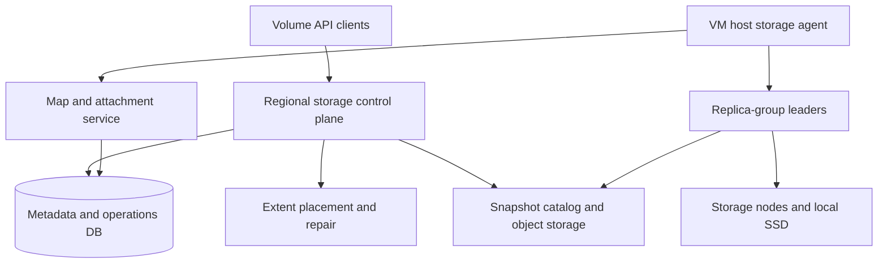
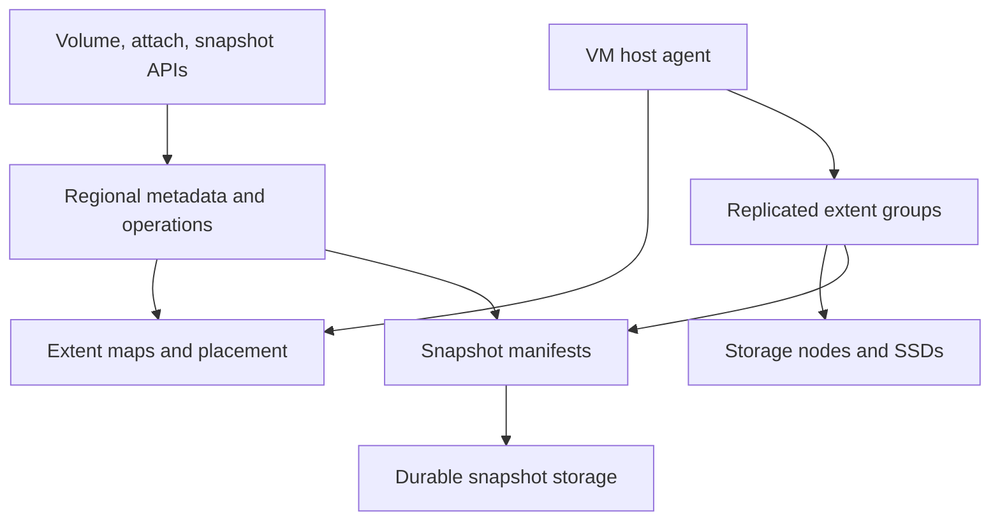

# Design a Distributed Virtual Block Storage Service

**Difficulty:** Senior / Staff  
**Primary themes:** replicated storage, linearizable writes, attachment fencing, snapshots and clones, rebuilds, failure domains, performance isolation  
**Interview time budget:** about 45 minutes  
**Educational walkthrough:** intentionally more detailed than what you would say in a 45-minute interview

## Interviewer prompt

> Design a managed block-storage service for cloud virtual machines, similar in product shape to a virtual persistent disk. Customers can create encrypted volumes, attach them to VMs, issue random block reads and writes, resize them, and create snapshots or clones. Volumes must survive storage-node failures, provide predictable latency and throughput, and recover without corrupting acknowledged writes.

The service exposes a raw block device. Filesystems, databases, and application-level consistency are the customer's responsibility. The VM compute control plane, object store, key-management service, and network fabric already exist and can be called as dependencies.

## Targeted clarifying questions with assumed answers

**Candidate:** Is this zonal or regional storage?

**Interviewer:** Design zonal volumes first, synchronously replicated across three independent storage fault domains within a zone. Then explain how a regional class changes the design by placing replicas across zones.

**Candidate:** What consistency does a VM expect?

**Interviewer:** For one attached writer, completed writes must be durable and later reads must observe them. Preserve write barriers and flush semantics so guest filesystems can recover after a crash.

**Candidate:** Can multiple VMs write the same volume?

**Interviewer:** Single-writer attachment is the default. Optional multi-attach is allowed only for customers using a cluster-aware filesystem or application. The storage service must fence stale writers but does not provide distributed filesystem cache coherence.

**Candidate:** What are the size and performance ranges?

**Interviewer:** Volumes range from 1 GiB to 64 TiB. A volume may provision from 3,000 to 256,000 IOPS and 125 MB/s to 8 GB/s. Individual I/O requests range from 4 KiB to 1 MiB.

**Candidate:** What platform scale should I assume?

**Interviewer:** Across 30 regions, assume 100 million volumes, 20 million attached volumes, 400 million IOPS at peak, and several exabytes of logical capacity. Capacity is thin-provisioned, so physical allocation grows as blocks are written.

**Candidate:** What durability and availability targets matter?

**Interviewer:** Acknowledged writes must survive one storage-node failure without data loss. Target at least 99.99% volume availability and annual durability of eleven nines for committed blocks. A simultaneous correlated fault may put a volume into a read-only or unavailable state rather than risk divergent writes.

**Candidate:** What snapshot semantics are required?

**Interviewer:** Single-volume snapshots are point-in-time and crash-consistent. Coordinated multi-volume snapshots should be possible. Application-consistent snapshots require the customer or guest agent to quiesce the application.

**Candidate:** Are snapshots full copies?

**Interviewer:** No. They should be incremental and support fast clones. Snapshot creation should complete quickly even for large volumes, while background upload or materialization may continue.

**Candidate:** Is cross-region disaster recovery required?

**Interviewer:** Discuss asynchronous snapshot or journal replication as an extension. Do not place cross-region round trips on every zonal write.

## How to frame the interview

This walkthrough uses [Hello Interview's public delivery framework](https://www.hellointerview.com/learn/system-design/in-a-hurry/delivery): requirements, entities, interface, high-level design, and deep dives. The useful discipline is to define the block-device contract before drawing storage nodes.

What to say aloud:

> “I’ll split the system into a strongly consistent control plane for volume metadata and attachments, and a partitioned data plane for block I/O. I’ll first make one attached volume work end to end, then add replication, snapshots, rebuilds, and multi-tenant performance isolation. The hardest invariants are that an acknowledged write survives failover and that a stale VM can never keep writing after attachment ownership changes.”

---

## 1. Requirements (~5 minutes)

### Core functional requirements

1. **Manage volumes and attachments.** Create, resize, attach, detach, and delete encrypted block volumes with idempotent asynchronous APIs.
2. **Serve block reads, writes, flushes, and barriers.** Present a low-latency virtual block device whose completed writes remain durable through a replica failure.
3. **Create snapshots and clones.** Produce crash-consistent point-in-time snapshots, coordinated snapshot sets, incremental backups, and fast copy-on-write clones.

### Out of scope

- guest filesystems and filesystem repair;
- database transaction semantics;
- VM scheduling and hypervisor implementation;
- object-store internals;
- a general shared filesystem or object-storage API;
- automatic application quiescing without a guest agent;
- synchronous cross-region replication for the baseline.

### Quantified non-functional requirements

| Requirement | Target | Design consequence |
|---|---:|---|
| Scale | 100M volumes, 20M attached, 400M peak IOPS | Partition metadata and I/O by volume and extent; no central data-path proxy |
| Latency | p99 under 2 ms for 4 KiB cached reads and under 5 ms for replicated writes within a healthy zone | Direct host-to-replica path, batching without long queues, fast local media |
| Throughput | Up to 256k IOPS and 8 GB/s per volume | Stripe large volumes across several replica groups |
| Availability | 99.99% volume availability | Three replicas, quorum writes, multi-zone control plane, automated failover |
| Durability | No loss of acknowledged writes after one replica failure; eleven nines annual committed-block durability target | Checksums, quorum commit, scrubbing, repair, failure-domain placement |
| Consistency | Linearizable single-writer block operations; ordered flush/barrier semantics | Per-extent write sequencing and fenced attachment generations |
| Snapshot RTO | Snapshot API accepted in under 2 seconds regardless of volume size | Metadata checkpoint and copy-on-write, not a synchronous full copy |
| Isolation | Provisioned IOPS/throughput with bounded noisy-neighbor impact | Per-volume admission, device queues, network and rebuild throttling |

### Scale estimates that drive architecture

At 400 million IOPS and an illustrative average request size of 16 KiB, logical client traffic is:

\[
400{,}000{,}000 \times 16\ \text{KiB} \approx 6.55\ \text{TB/s}
\]

With three-way replication, write-heavy workloads can multiply network and media traffic substantially. Even if reads are served from one replica, the fleet moves many terabytes per second. A central gateway cannot sit on the data path. VM hosts obtain short-lived attachment credentials and talk directly to the assigned storage replicas.

A 64 TiB volume with 4 MiB extent-map entries has:

\[
64\ \text{TiB} / 4\ \text{MiB} = 16{,}777{,}216\ \text{entries}
\]

Keeping a fully expanded map in the control-plane database for every snapshot is wasteful. Use a persistent sparse tree or immutable manifest pages with structural sharing.

Suppose a 16 TiB replica fails and rebuild copies at an average 500 MB/s:

\[
16\ \text{TiB} / 500\ \text{MB/s} \approx 9.3\ \text{hours}
\]

That exposure window is too long if rebuilds are serial. Data must be divided into smaller extents or chunks and repaired in parallel to many replacement nodes, while throttling so recovery does not destroy foreground latency.

What to say aloud:

> “The IOPS arithmetic eliminates a central I/O gateway, and the rebuild arithmetic eliminates whole-disk replication to one replacement server. The data plane must be direct and partitioned, with repair parallelized at extent granularity.”

### Consistency and availability contract

- Control-plane mutations such as create, attach, detach, resize, and snapshot are strongly consistent and idempotent.
- Single-writer attachment is protected by a monotonically increasing attachment generation and fencing token.
- A write is acknowledged only after a quorum durably records the data and sequence metadata required for recovery.
- Reads observe the latest committed write for that logical block. A replica that cannot prove it is current does not serve the read.
- `FLUSH` completes only when all prior writes in the attachment's ordering domain are durable. Write barriers preserve the guest-visible ordering contract.
- During ambiguous leadership or attachment ownership, the volume becomes temporarily unavailable rather than accept split-brain writes.
- Snapshots are crash-consistent at a committed write sequence. Application consistency requires quiescing buffers and filesystems above the block layer.
- Usage metrics and list/search indexes may be eventually consistent; attachment authority and extent ownership may not.

---

## 2. Core entities (~2 minutes)

| Entity | Purpose |
|---|---|
| `Volume` | Customer-visible size, class, encryption, desired state, and current generation |
| `Attachment` | Binding between volume and VM host, mode, generation, and fencing token |
| `Extent` | Fixed logical block range used for placement, replication, snapshots, and repair |
| `ReplicaGroup` | Ordered replica membership, leader/primary epoch, and commit state for one or more extents |
| `Replica` | Physical copy on a storage node and device |
| `StorageNode` | Media inventory, health, fault-domain labels, load, and node epoch |
| `Snapshot` | Immutable point-in-time volume root at a committed sequence |
| `SnapshotSet` | Coordinated point across several volumes |
| `Clone` | Writable volume whose initial root references a snapshot |
| `ManifestPage` | Immutable sparse mapping from logical extents to physical data versions |
| `RepairTask` | Idempotent copy/scrub/rebuild unit with source and target generations |
| `EncryptionKeyVersion` | Wrapped data-encryption-key version and access policy reference |

Do not confuse a customer volume with one physical disk. A volume is a logical address space whose extents may be placed across many replica groups and storage nodes.

What to say aloud:

> “The volume is metadata; extents carry placement. Snapshots point to immutable manifest roots, and clones initially share those roots. Physical replicas can move during repair without changing the guest's logical block addresses.”

---

## 3. API and system interface (~5 minutes)

Management APIs are asynchronous REST calls. Authentication derives tenant, project, region access, and encryption permissions. The block protocol between a VM host and storage replicas is internal and optimized separately.

### 3.1 Create a volume

```http
POST /v1/projects/{project_id}/zones/us-east1-b/volumes
Authorization: Bearer <token>
Idempotency-Key: orders-db-data-01
Content-Type: application/json

{
  "name": "orders-db-data-01",
  "size_gib": 4096,
  "class": "PROVISIONED_SSD",
  "provisioned_iops": 80000,
  "throughput_mib_per_s": 2000,
  "replication": {"mode": "ZONAL", "replicas": 3},
  "encryption": {"kms_key": "projects/p1/keys/storage-prod"},
  "source_snapshot_id": null
}
```

```http
HTTP/1.1 202 Accepted
Location: /v1/operations/op_7G2...
```

```json
{
  "operation_id": "op_7G2...",
  "volume_id": "vol_81F...",
  "state": "CREATING"
}
```

The API durably reserves quota and creates logical metadata. Thin provisioning means it need not allocate 4 TiB of physical media immediately, though it reserves enough fleet headroom to honor the service class.

### 3.2 Attach the volume

```http
POST /v1/volumes/vol_81F...:attach
Authorization: Bearer <token>
Idempotency-Key: attach-orders-db-a
Content-Type: application/json

{
  "vm_id": "vm_A12...",
  "mode": "READ_WRITE",
  "device_name": "/dev/vdb"
}
```

```json
{
  "operation_id": "op_8H4...",
  "attachment_id": "att_19D...",
  "state": "ATTACHING"
}
```

The compute service proves the VM's current host identity. When the operation completes, that host receives a short-lived capability containing `volume_id`, `attachment_generation`, allowed mode and ranges, endpoint set, expiry, and a signature. The tenant never receives storage-node credentials.

### 3.3 Resize a volume

```http
POST /v1/volumes/vol_81F...:resize
Authorization: Bearer <token>
Idempotency-Key: grow-orders-db-6tib
If-Match: "volume-generation-12"

{
  "new_size_gib": 6144,
  "provisioned_iops": 120000,
  "throughput_mib_per_s": 3000
}
```

The service may grow a volume online. It never silently shrinks because blocks beyond the new end could contain live filesystem data. The guest must separately expand its partition and filesystem.

### 3.4 Create a snapshot

```http
POST /v1/volumes/vol_81F.../snapshots
Authorization: Bearer <token>
Idempotency-Key: orders-before-migration

{
  "name": "orders-before-migration",
  "consistency": "CRASH_CONSISTENT",
  "retention_days": 30
}
```

```json
{
  "operation_id": "op_9S1...",
  "snapshot_id": "snap_44C...",
  "state": "CAPTURING"
}
```

`CAPTURING` means the point-in-time root is durable, but background transfer to long-term snapshot storage may still be running. Restore availability can depend on snapshot state or lazy hydration policy.

### 3.5 Create a coordinated snapshot set

```http
POST /v1/snapshot-sets
Authorization: Bearer <token>
Idempotency-Key: checkout-db-consistent-20261018

{
  "volume_ids": ["vol_81F...", "vol_A90...", "vol_B11..."],
  "consistency": "CRASH_CONSISTENT",
  "guest_quiesce_token": null
}
```

For application-consistent mode, an authorized guest agent freezes application writes and flushes filesystems before the storage service establishes the common point.

### 3.6 Clone from a snapshot

```http
POST /v1/projects/{project_id}/zones/us-east1-b/volumes
Idempotency-Key: clone-orders-staging

{
  "name": "orders-staging",
  "size_gib": 6144,
  "source_snapshot_id": "snap_44C...",
  "class": "PROVISIONED_SSD",
  "provisioned_iops": 20000
}
```

The clone is quickly usable because its root initially references snapshot extents. New writes allocate private extents through copy-on-write.

### 3.7 Internal block protocol

```protobuf
rpc Read(ReadRequest) returns (ReadResponse);
rpc Write(WriteRequest) returns (WriteResponse);
rpc Flush(FlushRequest) returns (FlushResponse);
rpc Trim(TrimRequest) returns (TrimResponse);
rpc GetReplicaMap(MapRequest) returns (ReplicaMap);
```

A request includes `volume_id`, `extent_id`, logical offset, length, request ID, attachment generation, replica-group epoch, write sequence, checksum, and signed capability. Retries reuse the request ID so the replica group can return the prior committed result.

---

## 4. Data flow

### Write path

1. The guest issues a block write through its virtual device driver.
2. The hypervisor or host storage agent splits the request at extent boundaries and verifies local QoS tokens.
3. It refreshes the volume's replica map if the cached epoch is stale.
4. For each extent, it sends the write to the replica-group leader with the attachment generation and request ID.
5. The leader validates the capability and fencing token, assigns a monotonically increasing write sequence, appends data plus checksum to local durable media, and replicates it.
6. A quorum durably records the write. The leader advances the commit index and acknowledges the host.
7. The host acknowledges the guest only after every subrequest completes under the requested ordering semantics.

### Read path

1. The host selects a healthy current replica using locality, load, and verified commit position.
2. The replica validates the attachment capability and reads the block.
3. It verifies checksum before returning data.
4. If the replica is stale or corrupt, the host retries another current replica and reports the bad copy for repair.

### Snapshot path

1. The snapshot controller establishes a committed sequence boundary for every extent.
2. It writes an immutable snapshot manifest root referencing the corresponding data versions.
3. New writes proceed through copy-on-write or log-structured versioning.
4. A background exporter copies previously unprotected unique blocks to durable snapshot/object storage and updates materialization status.

---

## 5. High-level design (~10–15 minutes)



### Operation 1: create a logical volume

The regional volume API authenticates, validates limits, reserves logical and performance quota, deduplicates the idempotency key, and transactionally creates:

```text
Volume(
  volume_id, tenant_id, project_id, zone,
  size_bytes, block_size, class, provisioned_iops,
  provisioned_throughput, replication_policy,
  encryption_key_version, state, generation,
  root_manifest_id, created_at, deletion_timestamp
)

Operation(
  operation_id, resource_id, kind, request_digest,
  idempotency_key, state, current_step,
  retry_at, error_code, created_at, updated_at
)
```

The outbox pattern starts asynchronous provisioning after the transaction commits. For a blank thin-provisioned volume, the manifest can represent all-zero blocks without allocating physical data. The service only creates initial replica groups or extent placements as needed for performance readiness.

The control plane spans multiple availability zones so a zonal storage product does not lose management metadata when one storage rack or node fails. The volume's data replicas obey a separate placement policy.

### Operation 2: attach and establish one writer

Attach is a distributed safety boundary involving the volume service, compute host, and I/O replicas. The controller:

1. verifies the VM and host lease with the compute service;
2. checks that no incompatible active attachment exists;
3. increments `attachment_generation` transactionally;
4. creates an `ATTACHING` record and signed capability template;
5. asks the host agent to connect and prove reachability to replica groups;
6. distributes the new minimum generation to replica-group leaders;
7. marks attachment `ATTACHED` only after fencing is effective.

```text
Attachment(
  attachment_id, volume_id, vm_id, host_id,
  mode, state, generation, capability_epoch,
  compute_host_epoch, created_at, expires_at
)
```

Every data-plane request carries the generation. Replicas reject any generation lower than their durable minimum. On forced detach or host failure, the controller first advances the minimum generation, then grants a new writer. This prevents the previous VM from continuing to write during a network partition.

For multi-attach, each writer has a membership and reservation identity, but the customer must use SCSI persistent reservations or an equivalent cluster protocol. The block service fences access; it does not coordinate filesystem caches.

### Operation 3: map logical blocks to replica groups

Divide a volume into logical extents, for example 4–64 MiB depending on workload and metadata tradeoffs. A persistent tree maps logical extent ranges to immutable data-version or current replica-group descriptors.

```text
ExtentDescriptor(
  volume_id, extent_index, logical_generation,
  replica_group_id, replica_group_epoch,
  allocated_bytes, snapshot_parent_ref,
  checksum_root, manifest_page_id
)

ReplicaGroup(
  replica_group_id, epoch, leader_replica_id,
  replica_ids, commit_index, placement_policy,
  health_state
)
```

The host caches the map under a volume-map version. A response with `STALE_EPOCH` triggers a targeted refresh. Do not fetch a 16-million-entry map before first I/O; use range-addressed manifest pages and cache hot portions.

Blank and trimmed ranges resolve to a shared zero extent. Thin allocation creates a new physical version on first write. Sequential neighboring extents may share a replica group to reduce metadata, while hot extents can be split and moved independently.

### Operation 4: replicate writes

For each replica group, use a consensus-like ordered log or primary-with-quorum protocol. The leader assigns a sequence and replicates to two followers placed across independent rack and power domains.

Acknowledgement rule:

- write data and metadata to durable local media;
- receive durable confirmation from at least one follower, giving a majority of two out of three;
- record or infer the committed sequence;
- then acknowledge the client.

If the leader fails after follower durability but before the response, the client retries with the same request ID. The new leader either finds the committed write and returns success or safely appends it once. Request-result deduplication is retained long enough to cover maximum retry duration; sequence and block-version checks protect later retries.

`Flush(sequence=N)` cannot complete until every preceding write through N is durably committed under the volume ordering domain. Guest systems depend on this contract for journal recovery.

For large sequential writes, pipeline and batch replication, but cap queueing delay so small synchronous writes are not trapped behind megabytes of bulk traffic.

### Operation 5: serve reads efficiently

Reads need not always go through the leader. A follower can serve if it proves it has applied at least the attachment's required commit index or a read lease tied to the current group epoch. Otherwise route to the leader/current replica.

The host agent maintains:

- replica endpoints and epochs;
- recent committed sequence after its own writes;
- latency and failure estimates;
- a small read cache only when coherent with guest semantics;
- retry budgets and checksum verification state.

Write-back caching at the host is unsafe unless battery-backed or synchronously replicated and integrated with flush semantics. Prefer write-through for the baseline. Storage nodes may use protected DRAM/NVRAM journals before compacting to SSD segments.

### Operation 6: snapshot and clone

Snapshot creation establishes a stable committed point, then writes a new immutable manifest root. Existing data blocks do not move synchronously. Subsequent writes create new versions, leaving snapshot-referenced versions immutable.

```text
Snapshot(
  snapshot_id, source_volume_id, state,
  source_generation, root_manifest_id,
  extent_sequence_vector_digest,
  consistency_type, materialization_state,
  encryption_key_version, created_at, retention_policy
)
```

For one volume, briefly establish a write barrier, capture each extent group's committed sequence, and publish the root. The barrier need not wait for all referenced blocks to upload to object storage; it waits only for a durable snapshot root and protection from garbage collection.

A clone creates a new writable volume root pointing to the snapshot root. On first write to an extent, it allocates a private version. Reads walk the clone map and then its parent. To avoid deep chains, background flattening rewrites shared references or adds indirection summaries.

Incremental snapshot storage follows reachability: only newly referenced unique block versions absent from prior retained snapshots need export. Public EBS documentation similarly describes snapshots as incremental, while [Ceph RBD layering](https://docs.ceph.com/en/latest/dev/rbd-layering/) provides a public example of clones based on read-only snapshots.

### Operation 7: detach and delete

Graceful detach asks the guest to flush, stops new I/O, waits for outstanding operations, advances the fence, and removes the device. Forced detach cannot trust the old host, so it first increments the attachment generation durably and pushes the fence to a quorum of every active replica group.

Delete sets a tombstone and blocks new attachments. It then:

1. fences all attachment generations;
2. waits for or forces detach according to policy;
3. removes the live volume root;
4. decrements manifest/block references;
5. releases unique physical blocks only when no snapshot or clone reaches them;
6. retains audit and idempotency tombstones for a safety window.

Garbage collection is asynchronous mark-and-sweep or reference-count assisted. A zero reference count is not enough by itself if snapshot publication and deletion can race; use transactional root updates plus epochs and delayed reclamation.

---

## 6. Deep dives (~10–15 minutes)

### Deep dive A: replication, failover, and attachment fencing

#### Where the baseline breaks

Simply writing to three nodes and waiting for any two is incomplete. Concurrent leaders can accept different writes during a partition; stale hosts can write after reattachment; a leader can acknowledge data that followers have not durably persisted; and reads can hit a lagging replica.

#### Replication options

| Approach | Advantages | Weaknesses |
|---|---|---|
| Primary plus asynchronous followers | Low write latency | Acknowledged data may be lost on primary failure |
| Synchronous chain replication | Simple ordered pipeline and strong reads at tail | Tail latency and reconfiguration complexity |
| Majority quorum with elected leader | Clear failover and commit rule | Consensus overhead per replica group |
| Erasure coding on hot writes | Better capacity efficiency | Expensive small writes and recovery complexity |

Choose leader-based majority replication for active extents. Three replicas tolerate one unavailable node while maintaining a majority. Use erasure coding later for cold snapshot chunks, not latency-sensitive 4 KiB overwrites.

#### Write lifecycle

1. Validate attachment and group epochs.
2. Deduplicate the request ID.
3. Assign sequence `s`.
4. Append data, logical offset, checksum, request ID, and prior-version relation to protected local storage.
5. Replicate to followers.
6. After a durable majority, mark `s` committed.
7. Reply with `s` and group epoch.

Media completion must mean power-loss durability appropriate to the product. SSD volatile caches require protection or explicit flushes. Checksums cover data and addressing metadata so a misplaced write is detected, not merely a bit flip.

#### Leader failover

A replacement leader must be elected only by a majority in a newer group epoch. It reconciles the longest safe committed prefix. A replica outside the majority may be stale and must catch up before serving current reads.

If only one of three replicas remains, the service ordinarily freezes writes because it cannot distinguish a partition from failure and cannot preserve the one-failure durability contract. An explicitly configured emergency mode may accept reduced redundancy with a visible risk state, but never silently.

#### Attachment fencing

Replica leadership protects storage-node concurrency; attachment generation protects client concurrency. Both are necessary.

Every replica persists `minimum_attachment_generation`. Before granting a new writer, the control plane writes generation `g+1` to a quorum for every extent group or to an authoritative volume-fence service consulted by groups. Old requests with `g` fail even if signed credentials have not expired.

For millions of extents, updating every group synchronously is expensive. Use a hierarchical volume fence:

- a strongly consistent fence service owns the current volume generation;
- short-lived signed capabilities embed that generation;
- replica groups cache the current value but must refresh on expiry or conflicting requests;
- revocation pushes invalidate hot groups;
- new-writer activation waits until the old capability's maximum lease expires or targeted group fencing completes.

This trades a bounded failover delay for scalable safety.

#### Read consistency

After a client observes write sequence `s`, its subsequent reads include a minimum sequence. A follower that has applied less than `s` declines or catches up. New clients obtain an attachment checkpoint from the control plane or leader. Background analytical reads may opt into bounded staleness, but the VM block-device contract defaults to current committed data.

What to say aloud:

> “There are two independent epochs: replica-group epoch prevents two storage leaders, and attachment generation prevents two VM writers. Quorum durability alone does not fence an old client.”

### Deep dive B: snapshots, clones, and crash consistency

#### Where the baseline breaks

Copying a 64 TiB volume during the snapshot call would take hours. Merely saving the current extent map can race in-flight writes and produce a root that never represented one committed point. Across several volumes, independently selected points may violate database ordering.

#### Snapshot strategies

| Approach | Creation latency | Read/write impact | Complexity |
|---|---:|---|---|
| Full synchronous copy | Very high | Heavy bandwidth | Low conceptual complexity |
| Copy-on-write extent map | Very low | First-write amplification | Reference tracking |
| Redirect-on-write log-structured versions | Very low | Background compaction | More read indirection |
| Continuous journal snapshot | Low | Journal retention pressure | Replay and checkpoint management |

Choose immutable manifest roots plus redirect-on-write. A new write creates a new block version and atomically advances the live root; snapshot roots retain old versions.

#### Establishing a single-volume point

The snapshot coordinator obtains a volume snapshot epoch and requests a barrier from each active extent group. Each group commits all writes before the barrier and returns its stable sequence. The coordinator creates a manifest root that resolves every extent at or before its returned sequence, then publishes the snapshot transactionally.

Writes after the barrier may proceed before background materialization finishes because old versions are pinned. Snapshot state separates:

- `CAPTURED`: durable root exists and blocks are protected;
- `MATERIALIZING`: unique blocks are copying to backup/object storage;
- `READY`: restore contract is fully available;
- `ERROR`: root remains for retry or explicit failure handling.

#### Multi-volume crash consistency

For volumes attached to one VM, the coordinator creates a group epoch:

1. optionally ask the guest agent to quiesce applications and flush filesystems;
2. issue a common barrier to all relevant attachments;
3. capture each volume after prior writes commit;
4. publish the entire `SnapshotSet` atomically or publish none;
5. unfreeze the guest.

Without guest quiescing, the result is crash-consistent: equivalent to disks after sudden power loss. It is not guaranteed application-consistent. AWS documents point-in-time crash-consistent multi-volume snapshots as a real product behavior in [CreateSnapshots](https://docs.aws.amazon.com/AWSEC2/latest/APIReference/API_CreateSnapshots.html).

#### Clone chain management

Repeated snapshot-and-clone operations can produce long ancestry chains and random read amplification. Bound lookup depth by:

- persistent-tree structural sharing rather than whole parent walks;
- cached resolved manifest pages;
- background flattening of hot clones;
- promoting frequently read parent extents into the child;
- refusing deletion of parent data while reachable.

#### Encryption and snapshots

Data blocks use per-volume or per-data-domain encryption keys wrapped by a KMS key. Snapshot manifests record key versions. Clones under another authorized key can either share ciphertext with wrapped-key grants or lazily re-encrypt on copy. Revoking a customer KMS key makes data inaccessible but does not instantly erase every physical block; cryptographic erasure and physical GC are separate lifecycle states.

What to say aloud:

> “The snapshot call freezes metadata, not terabytes of data. I publish an immutable root at committed extent sequences, pin all reachable versions, and materialize unique blocks later. Crash consistency and application consistency are different contracts.”

### Deep dive C: rebuilds, corruption, and performance isolation

#### Where the baseline breaks

A failed 16 TiB node takes hours to copy serially. Rebuild traffic can saturate disks and networks, causing latency SLO violations and cascading timeouts. Latent corruption may remain invisible until another replica fails. Thin provisioning can also turn logical success into physical exhaustion.

#### Failure detection and repair units

Storage nodes emit health, device SMART/media signals, checksums, latency, and inventory through several paths. A missing heartbeat first marks a node suspect. Replica groups reconfigure only after a newer epoch is committed; they do not accept two simultaneous membership histories.

Repair operates on small extents or chunks:

```text
RepairTask(
  task_id, replica_group_id, extent_range,
  source_replica_ids, target_node_id,
  expected_group_epoch, source_version,
  state, copied_bytes, checksum_root,
  priority, retry_at
)
```

The placement service chooses targets in independent failure domains with enough capacity and compatible media. Many nodes copy different extents concurrently. A target verifies checksums, catches up writes after its copy checkpoint, and joins only through a committed membership change.

#### Repair prioritization

Prioritize by risk, not FIFO:

1. volumes with only one current replica;
2. groups with two replicas and high write rate;
3. correlated rack/device warnings;
4. customer service class and active attachment;
5. ordinary rebalancing and capacity optimization.

Maintain per-device, per-node, per-rack, per-volume, and per-tenant bandwidth budgets. Foreground I/O has reserved queue depth and network bandwidth. Repairs use slack and speed up only while p99 latency remains within guardrails.

#### Checksums and scrubbing

Store end-to-end checksums covering tenant block contents plus logical address and version. Verify on every read or at media boundaries. Background scrubbing compares replicas and manifest checksum roots.

When copies disagree:

- choose data only from a replica that proves membership in the committed history and has a valid checksum;
- never use majority bytes alone if the same corruption could be replicated;
- repair the bad copy from an authenticated current source;
- surface `DATA_LOSS` if no valid committed copy exists rather than returning silent corruption.

#### Capacity management

Thin provisioning improves utilization but creates overcommit risk. Track:

- raw physical bytes;
- usable bytes after replication and reserved rebuild headroom;
- allocated live unique bytes;
- snapshot/clone retained bytes;
- logical provisioned bytes;
- predicted growth and trim rate.

Admission reserves safety headroom so the fleet can rebuild after its largest modeled failure domain. As thresholds rise, stop optional rebalancing, accelerate snapshot export/GC, reject new thin allocations, and finally make affected volumes read-only before physical exhaustion corrupts writes.

#### QoS and noisy neighbors

Enforce tokens at both host and storage node for IOPS and bytes. The host shapes requests early; nodes enforce authoritative ceilings and fair scheduling. Separate queues for latency-sensitive small I/O, throughput traffic, snapshot export, scrubbing, and rebuild.

Use weighted fair queueing with per-volume burst credits. Limit outstanding requests so one volume cannot create seconds of queueing. Account for write amplification: a 4 KiB random overwrite may cause journal, replication, checksum, and compaction work. Provisioned IOPS alone is insufficient without throughput and outstanding-I/O limits.

Hot volumes can be restriped across more replica groups, but changing the map uses epochs and incremental migration. Old and new placements must not both accept writes. Reads may temporarily consult a migration descriptor until the target catches up and the map atomically flips.

What to say aloud:

> “Recovery is a workload, not free background magic. I’ll repair at small granularity across many targets, prioritize the most under-replicated data, and reserve foreground queue depth and rebuild headroom so healing does not trigger a second failure.”

### Regional replication extension

A regional volume places synchronous replicas in at least two zones. Every write crosses zones before acknowledgement, increasing latency and consuming inter-zone bandwidth. Quorum membership must tolerate losing one zone without accepting two primaries.

For cross-region disaster recovery, prefer asynchronous replication of committed journal segments or periodic snapshot deltas. Expose replication lag and a recovery point. Promotion requires fencing the source region or an explicit disaster declaration; otherwise both regions may accept writes and diverge.

Public Google Cloud documentation describes synchronous replication for regional disks and separately documents asynchronous replication for disaster recovery. That distinction reflects the same latency-versus-RPO tradeoff used here: [regional disk replication](https://cloud.google.com/compute/docs/disks/about-regional-persistent-disk) and [asynchronous replication](https://cloud.google.com/compute/docs/disks/async-pd/about).

### Observability and operational invariants

#### Data-path metrics

- read/write/flush p50, p95, and p99 by volume class and request size;
- queueing versus device versus network latency;
- IOPS, throughput, outstanding depth, throttling, and burst-credit consumption;
- leader changes, stale-epoch rejections, retries, and request dedup hits;
- checksum failures and alternate-replica reads;
- cache hit rate and manifest-map refreshes.

#### Durability and repair metrics

- replica groups by healthy, degraded, read-only, and unavailable state;
- under-replicated bytes and oldest exposure age;
- time to detect and time to restore redundancy;
- rebuild/scrub bandwidth and foreground SLO impact;
- corrupt blocks detected, repaired, and unrecoverable;
- physical free space, rebuild reserve, thin-provision ratio, and GC backlog.

#### Snapshot metrics

- barrier time and guest-freeze duration;
- capture-to-ready lag;
- unique bytes exported and dedup ratio;
- clone lookup depth and flattening backlog;
- snapshot/clone reachability anomalies;
- restore first-read latency and hydration progress.

Alert on invariants:

- no two valid read-write attachments share a volume generation unless explicit multi-attach is enabled;
- acknowledged sequence never exceeds durable quorum sequence;
- a serving replica's applied sequence meets its read lease;
- replica members span required failure domains;
- every manifest-referenced block is protected from GC;
- every physically deleted block is unreachable from all live roots;
- allocation plus rebuild reserve never exceeds usable fleet capacity;
- old attachment generations never successfully write.

Trace control-plane operations end to end, but sample ordinary I/O traces. Always retain traces for slow flushes, failed writes, failovers, checksum errors, and fencing rejections. Never put raw customer block data in logs.

---

## 7. Final design

### Concise final architecture

1. A multi-zone regional control plane owns volume metadata, operations, quota, attachments, snapshot roots, and extent-map generations.
2. Blank volumes are thin-provisioned logical address spaces represented by sparse immutable manifests.
3. Attach increments a durable generation and gives the current VM host a short-lived signed capability; replica groups reject stale generations.
4. VM host agents cache range-addressed extent maps and send I/O directly to storage replica groups.
5. Each active extent group uses a leader and three fault-domain-separated replicas; writes acknowledge after durable majority commit.
6. Reads come from a replica that proves a sufficient committed sequence and verifies end-to-end checksum.
7. Flushes and barriers preserve guest write ordering needed for filesystem and database crash recovery.
8. Snapshot capture publishes an immutable manifest root at committed extent sequences; background export materializes unique blocks later.
9. Clones structurally share snapshot data and use copy-on-write, with flattening to bound ancestry cost.
10. Repair tasks copy small ranges in parallel, commit membership changes by epoch, and throttle against foreground latency.
11. Scrubbing detects latent corruption; checksum-authenticated current replicas repair bad copies.
12. Thin-provision admission retains rebuild headroom, while layered QoS isolates volumes, tenants, and maintenance traffic.
13. Regional storage extends synchronous placement across zones; cross-region DR uses asynchronous journals or snapshot deltas with explicit lag.

### Final architecture diagram



### Requirements check

| Requirement | Design response |
|---|---|
| Create/manage volumes | Idempotent asynchronous control-plane operations and sparse volume roots |
| Attach safely | Generation-based capabilities and durable fencing before writer transfer |
| Serve low-latency I/O | Direct host-to-replica path, cached extent maps, local SSD/NVRAM |
| Survive one replica loss | Three replicas and durable majority acknowledgement |
| Current reads | Commit-index/read-lease validation and minimum-sequence reads |
| Flush/barrier semantics | Ordered per-attachment sequences and quorum-durable flush boundary |
| Fast snapshots | Immutable metadata root, version pinning, background materialization |
| Fast clones | Structural sharing plus redirect/copy-on-write and flattening |
| Repair safely | Epoch-protected small-range rebuilds, checksums, risk-based priority |
| Performance isolation | IOPS/byte tokens, fair queues, bounded depth, maintenance throttles |
| Multi-region DR | Asynchronous committed-journal or snapshot-delta replication with visible RPO |

### Principal tradeoffs

- Synchronous quorum replication protects acknowledged writes but adds write latency and 3× raw-copy cost.
- Direct I/O avoids gateway bottlenecks but makes capability distribution, fencing, and map invalidation harder.
- Smaller extents improve repair and balancing granularity but enlarge metadata.
- Snapshot structural sharing makes capture fast but complicates garbage collection and clone ancestry.
- Follower reads scale throughput but require proof that the replica is sufficiently current.
- Thin provisioning raises utilization but requires conservative headroom and firm exhaustion behavior.
- Aggressive rebuild reduces durability exposure but competes with customer latency.
- Regional synchronous replication improves zone resilience but increases latency; asynchronous cross-region replication exposes nonzero RPO.

---

## Realistic interviewer follow-ups with strong sample answers

### 1. Why is block storage harder than object storage?

**Strong answer:** “The guest expects low-latency random overwrites, stable logical offsets, current reads, and flush ordering. Object storage can publish whole immutable objects and tolerate higher latency. Block storage therefore needs fine-grained mapping, write sequencing, fencing, and crash semantics on every I/O.”

### 2. Why not route every request through the control plane?

**Strong answer:** “At hundreds of millions of IOPS, that would be a bandwidth, latency, and availability bottleneck. The control plane distributes maps and capabilities; the host sends data directly to replicas. Storage nodes still enforce authorization and fencing.”

### 3. When exactly is a write acknowledged?

**Strong answer:** “After the current leader and a majority of the three replicas durably persist the write and its sequence metadata. The acknowledgement includes the committed sequence. Memory buffering without protected durability is not sufficient.”

### 4. What if the response is lost after commit?

**Strong answer:** “The host retries with the same request ID and attachment generation. The leader or its successor finds the committed result and returns it. Sequence and version checks prevent applying the same logical write twice.”

### 5. Why do you need an attachment generation if the replica group already has a leader epoch?

**Strong answer:** “They fence different actors. The leader epoch prevents two storage primaries. The attachment generation prevents an old VM or host from writing after the volume is reattached elsewhere.”

### 6. Can you serve reads from any replica?

**Strong answer:** “Only if it proves it has applied the required committed sequence under the current group epoch. Otherwise it declines, catches up, or the host reads from the leader. Blind nearest-replica reads could return stale blocks.”

### 7. How can a 64 TiB snapshot finish in seconds?

**Strong answer:** “The call captures and publishes an immutable manifest root at stable extent sequences. It does not copy 64 TiB synchronously. Old versions are pinned, and unique blocks materialize to snapshot storage in the background.”

### 8. Is that snapshot application-consistent?

**Strong answer:** “Not by default. It is crash-consistent, like sudden power loss after acknowledged writes and flushes. Application consistency requires a guest agent or customer workflow to freeze the database and filesystem around the barrier.”

### 9. How do you delete a snapshot shared by clones?

**Strong answer:** “Remove its catalog root transactionally, but keep every block reachable from another snapshot, clone, or live volume. Delayed reachability-based GC reclaims only unreferenced versions after publication and deletion races are impossible.”

### 10. How do you avoid rebuild storms?

**Strong answer:** “Repair small extents across many targets, prioritize the most under-replicated data, and enforce budgets per device, rack, volume, and tenant. Foreground I/O gets reserved queue depth. Rebuild accelerates only while latency guardrails hold.”

### 11. What happens when the fleet is nearly full?

**Strong answer:** “Protect rebuild headroom first. Throttle optional work, accelerate safe GC, reject new provisioning or expansion, and expose capacity alarms. If necessary, transition affected volumes read-only before accepting writes that cannot be replicated safely.”

### 12. Would you use erasure coding?

**Strong answer:** “For cold immutable snapshot chunks, yes, because capacity efficiency matters more than overwrite latency. For hot 4 KiB random writes, three-way replication is simpler and faster; erasure coding creates read-modify-write and reconstruction overhead.”

### 13. How does online migration of a hot extent work?

**Strong answer:** “Create a target replica set in a newer migration epoch, bulk-copy a checkpoint, stream subsequent committed writes, verify checksums, then atomically flip the extent-map generation. Old replicas become read-only and are removed after clients refresh.”

### 14. Can the service guarantee eleven nines of durability?

**Strong answer:** “That is an SLO backed by a fault model, not a mathematical promise for every correlated disaster. I would model device, node, rack, software, and operator failures; place replicas independently; retain rebuild headroom; scrub continuously; test restores; and measure under-replication exposure.”

### 15. What would you simplify at smaller scale?

**Strong answer:** “Use fewer, larger extent groups and a managed strongly consistent metadata store, but retain quorum durability, checksums, attachment fencing, immutable snapshot roots, and throttled repair. Those protect correctness even before hyperscale.”

---

## Common pitfalls

1. Treating a logical volume as one physical server or disk.
2. Putting the control plane or one gateway on every I/O path.
3. Acknowledging after only the primary's volatile cache.
4. Saying “three copies” without defining commit, leadership, and failover.
5. Using replica quorum without fencing stale VM attachments.
6. Serving reads from lagging followers without a sequence requirement.
7. Ignoring `FLUSH`, barriers, and guest crash-recovery expectations.
8. Claiming exactly-once network delivery instead of idempotent request effects.
9. Copying the full volume synchronously for snapshots.
10. Calling a crash-consistent snapshot application-consistent.
11. Forgetting snapshot and clone references during garbage collection.
12. Allowing unbounded clone ancestry to slow reads.
13. Rebuilding an entire failed node to one replacement node serially.
14. Letting repair traffic consume all disk or network queue depth.
15. Detecting bit corruption only when another replica is already lost.
16. Checksumming data without including logical address/version metadata.
17. Overcommitting thin storage without reserved rebuild capacity.
18. Measuring IOPS while ignoring throughput, queue depth, and write amplification.
19. Silently accepting reduced redundancy during a partition.
20. Promoting an asynchronous DR secondary without fencing the old primary.
21. Logging customer block contents or encryption material.

## A polished 90-second closing

> “The design separates a strongly consistent regional control plane from a direct, partitioned I/O plane. A volume is a thin-provisioned logical address space described by sparse immutable manifest pages. Attach advances a durable generation and gives the current VM host a short-lived capability; replica groups reject stale generations. The host caches extent maps and sends I/O directly to three fault-domain-separated replicas. A leader orders writes and acknowledges only after a durable majority, while reads require a replica current through the necessary commit sequence. Flushes preserve guest write ordering. Snapshots publish immutable roots at committed extent boundaries in seconds, then materialize unique blocks asynchronously; clones share those roots through copy-on-write. Repairs operate on small ranges across many targets, use end-to-end checksums, and are prioritized by durability risk while foreground queues retain reserved capacity. Thin-provision admission preserves rebuild headroom. Regional storage moves synchronous replicas across zones, while cross-region DR uses asynchronous journal or snapshot deltas with explicit lag. The key tradeoff is paying replication cost and quorum latency to make acknowledged writes and attachment ownership unambiguous through failures.”

## Public references

- [Hello Interview: System Design Delivery Framework](https://www.hellointerview.com/learn/system-design/in-a-hurry/delivery) — used for the interview sequence and approximate pacing.
- [Hello Interview: API Design](https://www.hellointerview.com/learn/system-design/core-concepts/api-design) — background for defining a compact user-facing contract before implementation details.
- [Amazon EC2 CreateSnapshots](https://docs.aws.amazon.com/AWSEC2/latest/APIReference/API_CreateSnapshots.html) — public reference for point-in-time crash-consistent multi-volume snapshots.
- [Amazon EBS features](https://docs.aws.amazon.com/ebs/latest/userguide/EBSFeatures.html) — public reference for incremental snapshots and virtual block-volume capabilities.
- [Ceph RBD layering](https://docs.ceph.com/en/latest/dev/rbd-layering/) — public reference for read-only snapshots and clone layering.
- [Ceph clients and block devices](https://docs.ceph.com/en/latest/architecture/ceph-clients/) — public reference for striped block devices accessed by VM hypervisors.
- [Google Cloud regional disk replication](https://cloud.google.com/compute/docs/disks/about-regional-persistent-disk) — public reference for synchronously replicated regional disks.
- [Google Cloud asynchronous disk replication](https://cloud.google.com/compute/docs/disks/async-pd/about) — public reference for asynchronous disaster-recovery replication and consistency groups.

The walkthrough is original. These sources support selected public product semantics and the delivery structure rather than supplying the design.
