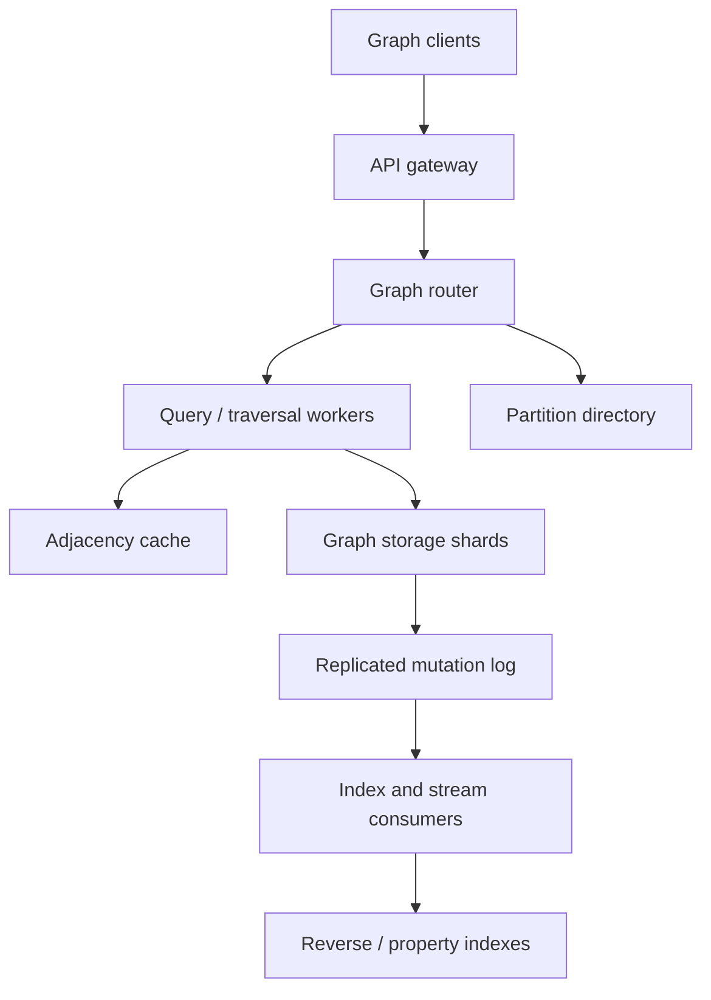

# Design a Distributed Graph Database for a Social Network

**Difficulty:** Senior / Staff

**Primary themes:** graph data modeling, partitioning, supernodes, consistency, caching, distributed traversal, queues, failure handling

**Interview time budget:** about 45 minutes
**Educational walkthrough:** intentionally more detailed than what you would say in 45 minutes

This walkthrough follows the sequence advocated by Hello Interview: establish requirements, name the core entities, define the interface, build the simplest complete design one operation at a time, and then spend most of the remaining time on the few constraints that force the architecture to evolve. The design and dialogue are original.

## Interviewer prompt

> Design a multi-tenant distributed graph database for a global social network. Applications must store users and other objects as vertices, create typed relationships as edges, list a vertex's neighbors, and execute short interactive traversals such as mutual friends. The database must support billions of vertices, trillions of edges, highly skewed degrees, and global traffic.

## Targeted clarifying questions

**Candidate:** Are we building a general graph database, or optimizing for known social-network access patterns?

**Interviewer:** Optimize for point reads, adjacency lists, and bounded interactive traversals. Arbitrary analytical graph jobs can be out of scope.

**Candidate:** Which mutations matter, and are relationships directional?

**Interviewer:** Support vertex CRUD and typed edges with properties. `FOLLOWS` is directional. `FRIEND` is symmetric and must never be visible in only one direction after a successful response.

**Candidate:** What consistency does a caller expect after a write?

**Interviewer:** A successful edge mutation must be durable and immediately visible to that caller. Direct edge lookups and friendship state should be strongly consistent. Derived inbound indexes and remote-region replicas may converge within two seconds.

**Candidate:** How expressive should traversal be?

**Interviewer:** Support a safe subset: at most three hops, typed edge filters, simple property predicates, deduplication, ordering, and a result limit. Enforce a server-side work budget.

**Candidate:** What scale and latency should I target?

**Interviewer:** Assume 10 billion vertices, 1 trillion directed edge records, 5 million edge writes per second at peak, 200 million adjacency-page reads per second, and 5 million bounded traversals per second. Regional p99 should be under 20 ms for a vertex or direct-edge read, 50 ms for the first neighbor page, and 200 ms for a typical two-hop traversal.

**Candidate:** Do we need cross-tenant edges, full-text search, recommendations, access-control policy evaluation, and bulk analytics?

**Interviewer:** No cross-tenant edges. Basic indexed property filtering is enough. Recommendation models, full-text search, and bulk analytics are downstream systems.

**Candidate:** Then I will design a graph-shaped OLTP store, not a universal graph-compute engine. I will make the common one-hop path cheap, keep friendship atomic, and put explicit limits around multi-hop work.

## 1. Requirements (~5 minutes)

### Functional requirements

1. **Mutate vertices and typed edges.** Create, update, and delete vertices; create or delete directional and symmetric edges; attach small typed properties; make retries idempotent.
2. **Read a vertex, an edge, or a paginated adjacency list.** List outgoing or incoming neighbors by edge type, with stable cursor pagination and simple indexed filters.
3. **Execute bounded interactive traversals.** Support one to three hops, edge-type constraints, simple property predicates, deduplication, ordering, result caps, deadlines, and explicit work budgets.

Useful but out of the core path: change streams for search, recommendations, analytics, and cache invalidation; schema administration; bulk import.

### Quantified non-functional requirements

| Requirement | Target | Design consequence |
|---|---:|---|
| Scale | 10B vertices, 1T directed edge records | Partition everything; no global joins on the request path |
| Peak traffic | 5M edge writes/s, 200M neighbor-page reads/s, 5M traversals/s | Read-optimized adjacency storage, aggressive caching, admission control |
| Latency | p99 <20 ms point read, <50 ms first neighbor page, <200 ms typical two-hop query | Region-local reads, partition-aware routing, batched frontier fetches |
| Availability | 99.99% writes, 99.999% reads | Multi-AZ quorum storage; stale remote reads are preferable to total read failure |
| Freshness | local read-your-writes; derived views and remote replicas converge within 2 s | Session token plus asynchronous change streams |
| Durability | acknowledged mutation survives AZ loss | Quorum commit and replicated log before acknowledgement |

### Consistency and availability contract

- A successful **directed edge** write is linearizable at its authoritative key. The writer receives a commit token and can immediately read its write in any API call that supplies that token.
- A successful **friendship** mutation is all-or-none: both adjacency directions become visible at the same commit timestamp.
- A neighbor page is a snapshot of the authoritative outgoing adjacency. A cursor continues the same snapshot; it does not silently mix old and new pages.
- Incoming adjacency, property indexes, counts, recommendation feeds, and remote replicas are derived views. They may lag by up to two seconds and expose a `view_timestamp`.
- During a network partition, an isolated replica may serve explicitly stale reads, but it cannot acknowledge authoritative writes without a quorum. The API returns a freshness marker instead of pretending the result is current.

> **What I would say aloud:** “I am choosing strong consistency for the narrow facts users act on—does this edge exist and are we friends—while allowing asynchronous derived indexes. That keeps the contract understandable without forcing every read path into a global transaction.”

### Scope exclusions

- Unbounded Gremlin-style programs on the synchronous API
- PageRank, connected components, and other whole-graph analytics
- Large blobs as properties
- Cross-tenant relationships
- Full-text search and ML recommendation ranking

## 2. Core entities (~2 minutes)

Start with concepts, not a premature schema.

| Entity | Purpose |
|---|---|
| `GraphNamespace` | Tenant boundary, quotas, schema, placement policy |
| `Vertex` | User, page, post, group, or other object |
| `Edge` | Typed directed relationship from a source vertex to a destination |
| `EdgeType` | Directionality, symmetric rule, allowed endpoints, indexed properties |
| `AdjacencyShard` | Physical slice of one vertex's neighbors for one edge type |
| `Mutation` | Idempotent requested state change and commit metadata |
| `Snapshot` | MVCC timestamp used for stable pages and traversals |
| `Cursor` | Opaque continuation containing snapshot and per-shard positions |
| `ChangeEvent` | Durable event feeding derived indexes, caches, and analytics |

An edge's logical identity is `(namespace_id, source_id, edge_type, destination_id)`. For a symmetric friendship, canonicalize the pair as `(min(a,b), max(a,b), FRIEND)` so concurrent requests cannot create two competing relationships.

> **What I would say aloud:** “The key modeling distinction is between the logical edge and its physical adjacency entries. The edge is the fact; adjacency shards are read-optimized representations of that fact.”

## 3. API / system interface (~5 minutes)

Authentication establishes `principal_id`, `namespace_id`, roles, and quotas. Clients never choose a tenant in the body, preventing confused-deputy and cross-tenant access bugs.

### Create or update a vertex

```http
PUT /v1/vertices/usr_812
Authorization: Bearer <token>
Idempotency-Key: vtx-20261018-01

{
  "label": "USER",
  "properties": {"display_name": "Asha", "country": "US"}
}
```

```json
{
  "vertex_id": "usr_812",
  "version": 14,
  "commit_token": "ct_9H...",
  "committed_at": "2026-10-18T13:57:04.381Z"
}
```

`If-Match: 13` can request optimistic concurrency. A repeated idempotency key with the same payload returns the original result; reuse with a different payload is rejected.

### Put an edge

```http
PUT /v1/vertices/usr_812/edges/FOLLOWS/usr_991
Idempotency-Key: edge-7fa2

{"properties": {"source": "profile", "created_by": "user"}}
```

```json
{
  "source_id": "usr_812",
  "edge_type": "FOLLOWS",
  "destination_id": "usr_991",
  "version": 3,
  "commit_token": "ct_A2..."
}
```

For `FRIEND`, the service canonicalizes the pair and atomically installs both adjacency directions. `DELETE` accepts the same idempotency mechanism and leaves an MVCC tombstone.

### Read an adjacency page

```http
GET /v1/vertices/usr_812/neighbors?edge_type=FOLLOWS&direction=OUT&limit=50&after=eyJz...
Consistency-Token: ct_A2...
```

```json
{
  "neighbors": [
    {"vertex_id": "usr_991", "edge_version": 3, "edge_properties": {"source": "profile"}}
  ],
  "next_cursor": "eyJzbmFwc2hvdCI6...",
  "snapshot_timestamp": "2026-10-18T13:57:05.002Z",
  "freshness": "authoritative"
}
```

The cursor is signed and contains the snapshot timestamp, adjacency-directory version, query hash, and a continuation position per physical shard. It is not a numeric offset: offsets become slow and unstable under concurrent insertion.

### Run a bounded traversal

```http
POST /v1/traversals
Request-Deadline-Ms: 200

{
  "start": ["usr_812"],
  "steps": [
    {"direction": "OUT", "edge_type": "FRIEND", "limit_per_vertex": 5000},
    {"direction": "OUT", "edge_type": "FRIEND", "limit_per_vertex": 5000}
  ],
  "exclude_start": true,
  "deduplicate": true,
  "order_by": "shared_path_count_desc",
  "result_limit": 100,
  "work_budget": {"edge_reads": 200000, "partitions": 2000}
}
```

```json
{
  "results": [{"vertex_id": "usr_177", "shared_path_count": 42}],
  "snapshot_timestamp": "2026-10-18T13:57:05.002Z",
  "partial": false,
  "work_used": {"edge_reads": 71420, "partitions": 318}
}
```

An unsupported or predictably excessive query is rejected before execution. If a deadline or budget is exhausted, the caller gets `partial: true`, a reason, and a resumable token only when the query has a deterministic order.

### API-to-requirement mapping

| Requirement | Interface |
|---|---|
| Vertex and edge mutation | `PUT/DELETE /vertices`, `PUT/DELETE /vertices/{id}/edges/...` |
| Point and adjacency reads | `GET /vertices/{id}`, `GET /vertices/{id}/edges/...`, `GET .../neighbors` |
| Bounded traversal | `POST /traversals` |

## 4. Data flow

There are two planes:

1. **Online graph plane:** validate, route, commit, read adjacency, and execute bounded traversals.
2. **Derived-data plane:** consume ordered change events to build incoming adjacency, secondary property indexes, degree counters, search/ML feeds, and cache invalidations.

A transactional outbox is written in the same commit as the authoritative mutation. A log publisher drains it into a partitioned event stream. This avoids the dual-write failure where the edge commits but its event disappears.

Each consumer records `(source_partition, log_offset)` and applies events idempotently using edge version. Delivery is at least once; effects are effectively once because older or duplicate versions are ignored.

## 5. High-level design (~10–15 minutes)

### Compact architecture



The gateway authenticates, derives the namespace, enforces request-size and tenant limits, and passes a deadline. The stateless graph router resolves logical keys through the partition directory. Query workers batch storage requests. Storage shards use a replicated write-ahead log and an LSM-based MVCC engine. The cache holds vertices, edge existence, hot adjacency pages, and directory entries—not entire celebrity lists.

### Physical records introduced when needed

```text
VertexRow
  key: (namespace_id, vertex_id)
  value: label, properties, schema_version, version, commit_ts, tombstone

EdgeRow
  key: (namespace_id, canonical_edge_key)
  value: source_id, destination_id, edge_type, properties,
         state, version, commit_ts, tombstone

AdjacencyEntry
  key: (namespace_id, owner_vertex_id, edge_type, direction,
        adjacency_shard_id, sort_key, neighbor_id)
  value: edge_key, edge_version, selected_properties, commit_ts, tombstone

AdjacencyDirectory
  key: (namespace_id, owner_vertex_id, edge_type, direction)
  value: layout_version, shard_boundaries, generation, degree_estimate

OutboxEvent
  key: (storage_partition, commit_lsn)
  value: mutation_id, edge_key, old_version, new_version, commit_ts, payload
```

Small selected properties are denormalized into adjacency entries so listing 50 neighbors does not cause 50 random reads. Full vertex or edge properties remain authoritative in their rows.

### Operation 1: create a vertex

1. Gateway authenticates and validates the label/properties against cached namespace schema.
2. Router hashes `(namespace_id, vertex_id)` to a home partition.
3. The leader checks the idempotency record and optional expected version.
4. It appends `VertexRow`, idempotency result, and outbox record in one replicated transaction.
5. After quorum commit it returns a version and commit token. Cache invalidation is asynchronous, but the token forces a version at least as new as the commit.

This is a conventional key-value mutation. Do not introduce graph traversal machinery here.

### Operation 2: create a directional `FOLLOWS` edge

The authoritative edge and **outgoing** adjacency share a source-owned transaction boundary.

1. Router looks up the source adjacency layout and chooses a shard using `hash(destination_id)`.
2. One storage transaction writes the canonical `EdgeRow`, outgoing `AdjacencyEntry`, idempotency result, and outbox event.
3. The leader replicates the transaction to a quorum and acknowledges.
4. An asynchronous consumer builds the destination's incoming `FOLLOWED_BY` adjacency and updates counts/indexes within two seconds.

Why source ownership? Most social reads ask “whom does this vertex follow?” Co-locating that adjacency gives one-hop reads a single logical home. Making incoming adjacency asynchronous avoids a distributed transaction for every directional edge.

### Operation 3: create a symmetric `FRIEND` edge

A friendship has a stronger contract. The coordinator routes the canonical pair key to a transaction coordinator and performs a two-partition transaction:

1. Lock or validate the canonical `EdgeRow(min,max,FRIEND)`.
2. Prepare adjacency entry `a → b` on `a`'s shard and `b → a` on `b`'s shard at the same proposed commit timestamp.
3. Replicate both prepares; commit only if both quorums respond.
4. Persist the coordinator decision, then expose both entries at the shared MVCC timestamp.

The number of participants is fixed at two, so two-phase commit is bounded. In-doubt participants consult the replicated coordinator record. A timeout is not reported as success; an idempotent retry discovers the existing transaction outcome.

> **What I would say aloud:** “I would not pay a distributed-transaction cost for every directional follow, but the product contract explicitly requires atomic friendship. That narrower use of two-phase commit is justified and bounded to two adjacency owners.”

### Operation 4: read a neighbor page

1. Router fetches `AdjacencyDirectory` from its local cache and selects a snapshot timestamp. With a consistency token, the selected replica must have applied at least that commit.
2. For an ordinary vertex, one adjacency shard range-scans entries after the cursor.
3. For a split high-degree vertex, the query worker issues parallel range reads and performs a bounded k-way merge by `sort_key`.
4. Tombstones and versions newer than the snapshot are filtered by MVCC.
5. The worker returns results plus a signed cursor containing each shard's continuation.

Cache keys include `(namespace, vertex, edge_type, direction, layout_version, snapshot_bucket, page_start)`. Short TTLs and event-driven invalidation bound staleness. Singleflight request coalescing prevents a popular expired page from stampeding storage.

### Operation 5: run a two-hop traversal

For “friends of my friends”:

1. Parser validates the safe traversal grammar and the planner estimates work from degree sketches.
2. Coordinator fixes an MVCC snapshot and reads the first-hop adjacency.
3. It groups the frontier by storage partition and sends batched multi-get/range requests rather than one RPC per vertex.
4. Workers expand their local vertices, apply edge filters early, and stream compact `(neighbor_id, path_count)` partials.
5. Coordinator deduplicates IDs, aggregates path counts, excludes the start/direct friends if requested, maintains a top-100 heap, and cancels remaining work once the result or work budget is satisfied.

The traversal service is stateless between requests except for short-lived resumable state in a TTL store. Every internal RPC carries the client deadline and cancellation token.

### Why not one graph server or one relational cluster?

A single graph server gives excellent pointer locality but cannot hold 1T edges or survive regional traffic. A sharded relational design can model edges, but cross-shard recursive joins obscure the same problems we must solve explicitly: partition routing, fan-out, skew, and work limits. The chosen store exposes narrow graph primitives over distributed sorted key ranges.

## 6. Deep dives (~10–15 minutes)

### Deep dive A: partitioning and the supernode problem

#### Where the baseline breaks

Hashing solely by `source_id` keeps one vertex's adjacency local, but a celebrity with 100 million followers or followees becomes a huge hot partition. At even 32 bytes of compact adjacency data, that list is about 3.2 GB before indexes, MVCC history, and replication. More importantly, one source shard would absorb every write and page read for that vertex.

#### Plausible approaches

| Approach | Strength | Failure mode |
|---|---|---|
| Source-owned single partition | Fast one-hop reads, simple pagination | Supernodes overload one shard |
| Hash every edge globally | Even write distribution | Every adjacency read scatters across the cluster |
| Community-based graph partitioning | Good locality for some traversals | Expensive and unstable as the graph evolves |
| Hybrid vertex-cut | Normal vertices stay local; supernodes split | Directory and merge complexity |

#### Choice: adaptive vertex-cut

Keep an ordinary `(vertex, edge_type, direction)` adjacency on one shard. When size, write QPS, or read QPS crosses a threshold, create a new immutable directory generation with `N` logical buckets. Map a neighbor to `hash(neighbor_id) mod N`, then map buckets to physical partitions. New writes use the new generation; a background migrator copies older entries and advances a per-bucket watermark.

During migration, readers consult both generations and deduplicate by `(neighbor_id, edge_version)`. After all watermarks pass the cutover snapshot and old cursors expire, retire the old generation. Directory generations make resharding online and cursors unambiguous.

For an ordering such as newest-first, hash buckets destroy global order. Each shard stores a local `(created_at desc, neighbor_id)` index, and the query worker performs a k-way merge. The cursor carries one position per contributing shard. Cap the number of active buckets—say 128—and use hierarchical directories if a pathological vertex grows further.

#### Hot-read protections

- Cache only the first few popular pages, not the full adjacency.
- Replicate immutable or cold adjacency ranges to extra read followers.
- Coalesce identical cache misses.
- Apply per-vertex and per-tenant admission control so one celebrity or abusive tenant cannot consume every worker.
- Separate background resharding I/O from foreground capacity.

#### Failure modes and observability

If directory service is unavailable, routers use a signed cached generation until its lease expires. If a migration worker fails, dual-generation reads remain correct and a new worker resumes from watermarks. Alert on shard QPS skew, top-key share, migration age, directory-cache miss rate, k-way merge fan-out, and p99 by degree bucket.

> **What I would say aloud:** “I will preserve source locality for the common case and pay scatter/gather only for supernodes. A directory generation lets me split one vertex without moving unrelated vertices or invalidating every cursor.”

### Deep dive B: edge consistency, derived views, and retries

#### Where the baseline breaks

Writing an edge, two adjacency directions, an incoming index, degree counters, a cache invalidation, and an event bus synchronously creates a wide, fragile distributed transaction. Writing them independently creates partial state: the edge may exist while neighbor listing misses it, or a retry may double-increment a counter.

#### Compare the options

1. **One global transaction for everything:** clearest consistency, worst latency and availability, too many participants.
2. **Dual writes with repair:** fast initially, but silent loss and ambiguous retries are difficult to prove correct.
3. **Small authoritative transaction plus outbox:** strong core fact, async derived views, replayable recovery.

Choose option 3. The authoritative transaction contains only what the contract requires immediately. For `FOLLOWS`, that is the canonical edge plus source adjacency. For `FRIEND`, it is the canonical pair plus both adjacency directions. Everything else comes from the durable outbox.

#### Idempotency and versioning

Store `(namespace_id, principal_id, idempotency_key) → request_hash, outcome, expires_at` in the same transaction. A retry with the same request hash returns the prior outcome. Every edge has a monotonically increasing version; consumers apply an event only if `event.version > stored.version`. Deletes are versioned tombstones, so an old create event cannot resurrect a relationship.

The commit token contains the authoritative partition and commit LSN/timestamp, signed by the service. A read with the token is routed to a replica whose applied watermark is high enough; otherwise it waits briefly or falls back to the leader. This provides session read-your-writes without making every global replica synchronous.

#### Friendship transaction failure cases

- **Failure before prepare:** nothing is visible; retry starts again.
- **One participant prepares, coordinator times out:** prepared data remains invisible. Participant queries the replicated decision record; a sweeper resolves old transactions.
- **Commit decision durable, response lost:** retry finds the committed idempotency record and returns success.
- **One adjacency cache remains stale:** cache entries carry edge version and commit token reads bypass or refresh insufficient versions.

The coordinator record must be replicated before telling participants to commit. Participants never guess “abort” after they have learned of a commit.

#### Index lag and reconciliation

Outbox consumers expose high-watermarks. A periodic anti-entropy job compares hash summaries of authoritative edge ranges with derived adjacency/index ranges and repairs discrepancies. Degree is treated as an estimate unless fetched with an exact expensive query. Alert on oldest unprocessed event, p99 end-to-end index lag, duplicate rate, dead-letter volume, transaction-resolution age, token wait time, and reconciliation mismatches.

#### Availability tradeoff

If the source partition loses quorum, the system rejects writes rather than fork edge history. Region-local reads can continue from a replica with a visible `as_of` timestamp. This is an explicit CP choice for authoritative mutation and an AP choice for declared-stale derived reads.

### Deep dive C: bounded traversal without cluster meltdown

#### Scale estimate that changes the design

An average degree of 100 makes a naive two-hop expansion touch roughly `100 × 100 = 10,000` edges. At 5 million traversals per second that is 50 billion edge visits per second. Degree is heavy-tailed, so one path through a supernode could expand to millions. “Only two hops” is not a sufficient safety boundary.

Therefore work budgets are part of the public contract, not an implementation detail.

#### Planning and execution

The planner uses per-vertex degree estimates, per-edge-type histograms, predicate selectivity sketches, and cache locality to estimate cost. It pushes selective filters and limits before expansion. If a first hop contains a supernode and no selective constraint, it rejects the query or requires an approximate/sampled mode.

Execution uses bulk-synchronous frontiers:

1. Partition and deduplicate the current frontier.
2. Batch all vertices for one storage partition into a single request.
3. Expand locally under per-worker edge and byte budgets.
4. Apply predicates at the storage node when they use denormalized properties.
5. Stream bounded partial aggregates to the coordinator.
6. Stop on result cap, edge budget, partition budget, memory cap, or deadline.

For mutual friends, an even better physical plan often avoids materializing all second-hop results: read both friend sets and intersect the smaller sorted or compressed set against the larger one. Roaring bitmaps can accelerate dense integer-ID sets, while sorted lists are better for sparse sets. Choose by degree and encoding cost.

#### Snapshot semantics

The coordinator chooses one MVCC read timestamp. Storage nodes either serve that snapshot or return `SNAPSHOT_TOO_OLD`. Holding history forever is impossible, so cursor/traversal snapshots expire after, for example, five minutes. A client can restart rather than pin compaction indefinitely.

A global timestamp service need not serialize data writes; it assigns or validates commit timestamps and publishes a safe-read watermark. Region-local bounded-staleness traversals may choose a slightly older safe timestamp to avoid waiting for lagging partitions.

#### Backpressure and fairness

Use hierarchical token buckets:

- global traversal edge-read capacity,
- per-tenant capacity,
- per-query budget,
- per-storage-shard concurrency.

Queues are deadline-aware; work unlikely to finish before its deadline is rejected early. Interactive traffic has reserved capacity separate from bulk import, migration, and analytics. Hedged reads are allowed only for small idempotent requests after a latency threshold; uncontrolled hedging would double load during an incident.

#### Partial results and correctness

Do not silently return an incomplete set as complete. Response metadata reports whether the result is complete, the exhausted constraint, snapshot, and work used. Top-K early termination is valid only when the planner can prove unseen partitions cannot beat the current threshold; otherwise it must mark the result partial.

#### Failure handling and observability

If a worker fails, the coordinator retries its idempotent partition task against another replica using the same snapshot and task ID. Late duplicate results are discarded. Cancellation propagates to storage scans.

Trace a sampled query across plan, partition batches, storage scans, aggregation, and cancellation. Key metrics include estimated-versus-actual edge reads, frontier size per hop, partitions touched, coordinator memory, cache hit rate by hop, rejected-budget rate, partial-result rate, cancellation lag, and p50/p99 by query shape.

> **What I would say aloud:** “My protection is not merely a three-hop limit. It is a costed query plan with edge, partition, memory, result, and time budgets, plus early filter pushdown and cancellation.”

### Deep dive D: cache correctness and regional resilience

The workload is extremely read-heavy: at 200 million adjacency pages per second, even a compact 50-entry page averaging 1.5 KB produces about 300 GB/s before protocol overhead. A high hit rate changes required storage fleet size, but caching cannot weaken the stated contract.

Use layered caches:

- in-process cache for schemas, partition-directory entries, and tiny hot vertices;
- distributed regional cache for vertex rows, direct-edge existence, and adjacency pages;
- storage-engine block cache for immutable SSTable blocks.

Keys include namespace, logical key, schema/layout version, and relevant snapshot/version. Negative edge lookups get very short TTLs to avoid hiding new relationships. Event-driven invalidation accelerates freshness, while version checks and TTLs protect against lost invalidations.

Regional deployment uses one authoritative home region per namespace or key range for writes, with asynchronous log shipping to remote read regions. A routing layer sends mutations home and keeps most reads local. If the home region fails, failover requires fencing the old writer, promoting a replica only after it has the committed log, and advancing an epoch. Every mutation includes the epoch so an old leader cannot continue accepting writes after isolation.

For a regional disaster, the two-second replication window defines the potential recovery-point objective for derived remote data; authoritative logs should replicate more aggressively if the product requires near-zero RPO. State the distinction rather than claiming both low latency and synchronous global durability for free.

## 7. Final design

### Concise final architecture

- Stateless authenticated gateways and partition-aware graph routers
- Namespace-isolated schemas, quotas, and placement
- Replicated MVCC/LSM storage shards containing authoritative vertices, edges, adjacency entries, idempotency records, and transactional outboxes
- Source-local adjacency for ordinary vertices, adaptive vertex-cut plus versioned directories for supernodes
- Strong local edge facts; bounded two-partition transactions for symmetric friendships
- Event stream for incoming adjacency, secondary indexes, counters, search/ML feeds, and cache invalidation
- Layered caches with versioned keys, request coalescing, and commit-token bypass
- Distributed traversal workers with cost planning, batched frontier expansion, snapshot reads, strict budgets, and cancellation
- Multi-AZ quorum writes; region-local reads; epoch-fenced regional failover
- Reconciliation, lag watermarks, tracing, and per-tenant fairness controls

### Requirements check

| Requirement | How it is met |
|---|---|
| Vertex and edge CRUD | Versioned authoritative rows, idempotency records, quorum commit |
| Atomic friendship | Canonical pair plus bounded two-partition transaction |
| Paginated neighbors | Sorted adjacency shards, MVCC snapshot, signed per-shard cursor |
| Bounded traversal | Planned scatter/gather with budgets, batching, dedupe, partial-result contract |
| 1T edges and skew | Partitioning plus adaptive vertex-cut for supernodes |
| Low read latency | Source locality, regional replicas, layered caches, batched storage calls |
| Read-your-writes | Commit tokens and replica applied-watermarks |
| High availability | Multi-AZ quorum, declared-stale remote reads, epoch-fenced failover |
| Derived view freshness | Transactional outbox, stream high-watermarks, replay and reconciliation |

## Realistic interviewer follow-ups with strong sample answers

### 1. Why not make the incoming adjacency strongly consistent too?

**Answer:** “I could, but every directional edge would then require a transaction across source and destination owners, increasing latency and reducing write availability. The prompt only requires strong direct-edge state and immediate writer visibility. I keep outgoing adjacency authoritative, expose inbound view freshness, and reserve the two-owner transaction for symmetric friendship where one-sided visibility violates product semantics.”

### 2. How do you delete a high-degree vertex?

**Answer:** “I first tombstone the vertex and bump its generation so new reads and mutations fail immediately. I emit a deletion workflow that scans its adjacency shards in resumable chunks, writes edge tombstones idempotently, and lets outbox consumers remove reverse views. Physical deletion waits for snapshot retention and compliance policy. I rate-limit the workflow so deleting a celebrity cannot overload foreground traffic.”

### 3. What if a traversal touches a celebrity?

**Answer:** “The planner sees the degree estimate before expansion. It pushes filters and caps first; otherwise it rejects, samples, or returns a bounded partial result according to the API mode. It never blindly fans out. Per-vertex admission control also prevents many concurrent queries from turning the same supernode into a hotspot.”

### 4. How would you support ordering by interaction score?

**Answer:** “I would not reorder a huge adjacency synchronously for each interaction. A stream processor maintains a materialized ranked index with score version and freshness watermark. Exact edge existence remains authoritative; ranked pages are explicitly eventual. For a user needing read-your-write, I can merge a small session delta overlay into the materialized page.”

### 5. Could consistent hashing replace the partition directory?

**Answer:** “It works for normal key placement, but not by itself for a single logical adjacency split across changing shard counts. I still need metadata describing directory generation, bucket boundaries, migration watermarks, and cursor interpretation. Consistent hashing can place the physical buckets underneath that directory.”

### 6. How do you run PageRank?

**Answer:** “I keep it off the interactive service. The change stream or periodic snapshot feeds an object-store graph snapshot, and a bulk graph engine runs iterative computation there. Results return as versioned vertex properties or a recommendation index. That isolates long scans and synchronization barriers from OLTP latency.”

### 7. What is the hardest invariant to test?

**Answer:** “The friendship invariant across failure boundaries: after an acknowledged mutation, both directions are visible at the same snapshot; after an abort, neither is. I would use deterministic fault injection around prepare, decision persistence, participant commit, response loss, retries, leader changes, and cache invalidation, then verify the canonical edge and both adjacency entries across snapshots.”

### 8. Would you expose a standard graph language?

**Answer:** “I may accept a safe subset or compile a builder API into an internal plan. Apache TinkerPop separates traversal expression from execution and optimization, which is a useful model, but this service must reject unbounded constructs. Compatibility is secondary to predictable resource usage in a multi-tenant OLTP system.”

## Common pitfalls

1. Saying “use a graph database” without defining physical partition keys or the supernode strategy.
2. Treating all edges as identical even though `FOLLOWS` and `FRIEND` need different consistency.
3. Assuming a hop limit alone controls work; degree skew makes two hops dangerous.
4. Updating an edge, reverse adjacency, counters, caches, and a queue with uncoordinated dual writes.
5. Using offset pagination on a mutable, sharded adjacency list.
6. Caching entire celebrity adjacency lists or omitting stampede protection.
7. Claiming exactly-once delivery instead of designing idempotent, version-aware consumers.
8. Returning partial traversal results without marking them partial.
9. Resharding without directory generations, migration watermarks, or cursor semantics.
10. Drawing many boxes but never tracing a mutation, page read, and traversal end to end.

## A polished 90-second closing summary

> “I designed a multi-tenant graph OLTP store around three primitives: durable vertex and edge mutation, paginated adjacency reads, and bounded interactive traversal. Vertices and canonical edges live in quorum-replicated MVCC storage. Ordinary adjacency is source-local for fast one-hop access, while high-degree vertices are adaptively split through a versioned directory and merged at read time. Directional follows commit with their outgoing adjacency and derive inbound views asynchronously; symmetric friendships use a bounded two-partition transaction because the product requires all-or-none visibility.
>
> “A transactional outbox feeds reverse indexes, counters, cache invalidations, analytics, and repairable change streams. Commit tokens provide session read-your-writes while remote replicas and derived views expose freshness. Traversals are planned and executed as batched partition frontiers at one snapshot, with edge, partition, memory, result, and deadline budgets to contain supernode fan-out. Layered caches, multi-AZ replication, epoch-fenced regional failover, reconciliation, and detailed skew/lag/query-shape metrics complete the reliability story. The key tradeoff is strong consistency for narrow user-visible graph facts and bounded eventual consistency for scalable derived views.”

## Public references

- [Hello Interview — System Design Delivery Framework](https://www.hellointerview.com/learn/system-design/in-a-hurry/delivery): the requirements → entities → API → high-level design → deep-dives delivery sequence used here.
- [Bronson et al., “TAO: Facebook's Distributed Data Store for the Social Graph,” USENIX ATC 2013](https://www.usenix.org/conference/atc13/technical-sessions/presentation/bronson): a production reference for graph objects, associations, geographically distributed reads, fixed access patterns, and cache-heavy social-graph serving.
- [Apache TinkerPop — Gremlin](https://tinkerpop.apache.org/gremlin.html): a reference for expressing graph traversals separately from engine-specific optimization and execution.
- [Shi et al., “FlightTracker: Consistency across Read-Optimized Online Stores at Facebook,” OSDI 2020](https://www.usenix.org/conference/osdi20/presentation/shi): context for consistency challenges across asynchronous caches, replicas, and customized indexes.

These sources inform the vocabulary and tradeoff discussion; the interview problem, requirements, API, calculations, architecture, and dialogue above are original.
