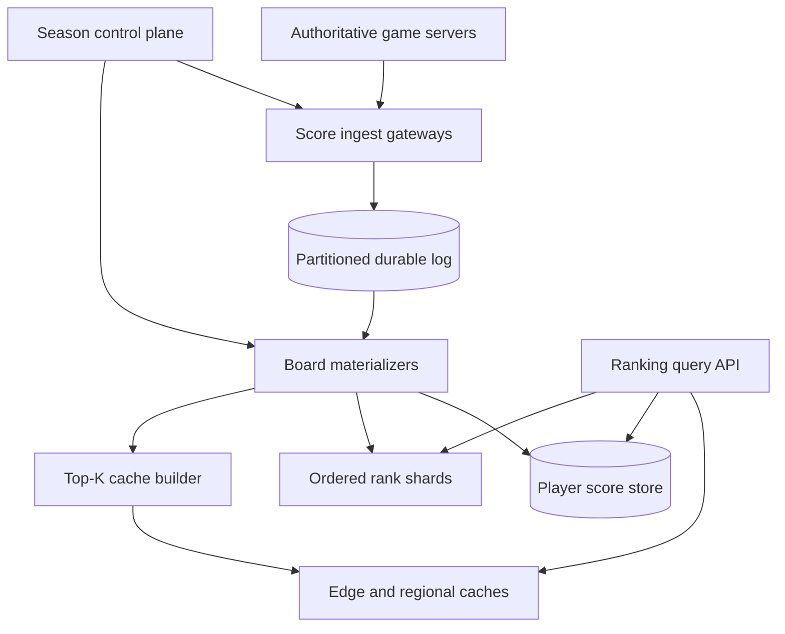

# Design a Global Gaming Leaderboard

**Difficulty:** Senior / Staff

**Primary themes:** ordered indexes, sharding, exact rank, top-K caching, event streams, idempotency, seasonal resets, hot keys, reconciliation

**Interview time budget:** about 45 minutes

**Educational walkthrough:** intentionally more detailed than what you would say in the interview

This original walkthrough follows the Hello Interview delivery sequence: establish the product and consistency contract, identify the minimum entities, define interfaces, build a complete baseline one operation at a time, and then deepen the constraints that force architectural changes. Interview timings guide delivery; this study version intentionally contains more detail.

## Interviewer prompt

> Design a global leaderboard service for a large online game. Players earn score through completed matches. The service must show global and regional top players, a player’s exact rank and nearby competitors, friend leaderboards, and seasonal results. Scores arrive continuously at very high volume, and popular leaderboards receive enormous read traffic.

## Targeted clarifying questions

**Candidate:** Who may submit scores—the game client or an authoritative game server?

**Interviewer:** Only authenticated game servers submit match results. Clients can read but cannot write scores directly.

**Candidate:** Is the score additive, or does each match replace a rating?

**Interviewer:** Support both through a board rule: additive points and replace-if-newer ratings. A match result must affect each board exactly once despite retries.

**Candidate:** How are ties ordered?

**Interviewer:** Higher score wins. For equal scores, the player who reached the score earlier ranks first; player ID is the final deterministic tiebreaker.

**Candidate:** Which answers must be exact?

**Interviewer:** Match acknowledgement and a player’s official final seasonal rank must be exact. Live top-K and nearby-rank views may lag accepted score updates by up to two seconds. A read-your-writes option should show a player their new score immediately.

**Candidate:** What scale should I target?

**Interviewer:** Assume 500 million registered players, 50 million active in a large season, 5 million score events per second at peak, 2 million rank/top-K reads per second, 100,000 concurrently active boards across game modes, regions, skill tiers, and seasons, and unusually hot world-final boards.

**Candidate:** What latency and availability targets matter?

**Interviewer:** Score ingestion p99 under 100 ms, cached top-K p99 under 30 ms, player-rank p99 under 150 ms, 99.99% write availability, and 99.999% read availability. Do not lose an acknowledged score.

**Candidate:** What happens at season rollover or after cheating is detected?

**Interviewer:** New writes switch atomically to the new season, old results remain queryable, and finalization produces immutable winners. Fraud systems can issue score corrections or disqualifications with a full audit trail.

**Candidate:** I’ll begin with one ordered set per leaderboard because it makes top-K and rank simple. Then I’ll show why memory, write throughput, and hot boards force event-driven ingestion, score-range shards, count summaries, and specialized caches.

---

## 1. Requirements (~5 minutes)

### Functional requirements

1. **Ingest authoritative score changes.** Apply each match result or correction exactly once to all applicable leaderboards using authenticated server identity.
2. **Query rankings.** Return top-K, a player’s score and rank, a window around that rank, and a friend-only leaderboard.
3. **Manage seasons and corrections.** Atomically roll to a new season, retain history, finalize winners, and apply auditable anti-cheat corrections or disqualifications.

### Quantified non-functional requirements

| Requirement | Target | Design consequence |
|---|---:|---|
| Active population | 50M players in a large season | Partitioned score and rank indexes |
| Score ingestion | 5M events/s peak | Durable partitioned log and parallel materializers |
| Ranking reads | 2M/s | Edge/API caches and read replicas |
| Ingest latency | p99 <100 ms | Append/validate quickly; project asynchronously |
| Top-K latency | p99 <30 ms | Precomputed versioned top slices |
| Rank latency | p99 <150 ms | Score-range shards with prefix counts |
| Freshness | 99% of accepted updates visible <2 s | Stream-lag SLO and bounded-stale contract |
| Durability | No acknowledged event loss | Quorum-replicated event log and idempotent replay |
| Availability | 99.99% writes; 99.999% reads | Regional ingestion and stale-safe read fallback |

### Scope and consistency contract

- `SubmitResult` is idempotent and durable. Once acknowledged, replay cannot double-add points.
- The canonical player score for one board is derived from an ordered stream of accepted score events.
- Live leaderboard projections are bounded-stale by up to two seconds. Responses include `as_of_offset` and `as_of_time`.
- A client may supply a write receipt to obtain read-your-writes. The read waits briefly for the projection to reach that offset or overlays the caller’s accepted score.
- Finalized seasonal standings are immutable snapshots produced after ingestion is sealed and all partitions reach a barrier.
- During a partition, reads may serve a labeled last-known-good snapshot. Writes succeed only where the authoritative event partition has quorum.
- Global ordering of unrelated matches is unnecessary. Ordering is required per `(board_id, player_id)` and for season barriers.

Out of scope: match simulation, gameplay matchmaking, prize payment, and the fraud model itself.

### Scale estimates that change the design

Five million score events per second at 250 bytes each is roughly 1.25 GB/s before replication. With three copies, the ingest backbone writes about 3.75 GB/s. A single database leader or one Redis instance cannot absorb this; events and boards must be partitioned.

Fifty million entries at roughly 80 bytes of compact ranking state require about 4 GB raw for one board and considerably more with indexes, allocator overhead, and replicas. Thousands of full-population boards cannot all live as independent in-memory copies. We need durable compact indexes and selective caching of hot slices.

If a top-100 response is 8 KB and receives 500,000 requests/s during a tournament, origin egress would be 4 GB/s for one unchanged object. Versioned edge caching and request coalescing are mandatory.

**What I would say aloud:** “The difficult operation is exact rank, not top-100. Top-K is tiny and cacheable; exact rank asks how many of tens of millions of ordered entries precede one player while scores change five million times per second.”

---

## 2. Core entities (~2 minutes)

- **LeaderboardDefinition** — scope, scoring rule, tiebreak rule, visibility, and active season.
- **Season** — lifecycle, write generation, freeze barrier, and final snapshot.
- **ScoreEvent** — immutable match contribution, replacement, correction, or disqualification.
- **PlayerScore** — canonical materialized score and deterministic ordering key for one board.
- **RankShard** — an ordered score range plus exact entry count.
- **RankSnapshot** — versioned top-K or finalized standings artifact.
- **FriendSetVersion** — reference to the social graph version used by a friend query.
- **AuditRecord** — source, reason, previous value, and correction lineage.

One match can update several boards, such as global, region, game mode, and weekly event. They share the same `result_id`, but each board projection owns its independent score state.

**What I would say aloud:** “I separate immutable score facts from mutable rank projections. That lets me replay, correct, and rebuild indexes without asking game servers to resend history.”

---

## 3. API and system interface (~5 minutes)

### Submit a match result

```http
POST /v1/results
Authorization: Bearer <game-server-token>
Idempotency-Key: match_8842_player_73
Content-Type: application/json

{
  "result_id": "match_8842_player_73",
  "match_id": "match_8842",
  "player_id": "p73",
  "completed_at": "2026-10-18T23:58:03Z",
  "updates": [
    {"board_id": "global-ranked-s42", "operation": "ADD", "value": 120},
    {"board_id": "na-ranked-s42", "operation": "ADD", "value": 120},
    {"board_id": "solo-rating-s42", "operation": "SET", "value": 1842}
  ]
}
```

```json
{
  "result_id": "match_8842_player_73",
  "status": "ACCEPTED",
  "receipt": {
    "partition": 317,
    "offset": 91824410
  }
}
```

The gateway derives game title, environment, and permitted board namespaces from the authenticated server identity. The server cannot write arbitrary games or seasons.

### Get top players

```http
GET /v1/boards/global-ranked-s42/top?limit=100
Authorization: Bearer <player-token>
```

```json
{
  "board_id": "global-ranked-s42",
  "season_state": "ACTIVE",
  "as_of_time": "2026-10-18T23:58:04.210Z",
  "snapshot_version": 7712,
  "entries": [
    {"rank": 1, "player_id": "p901", "display_name": "Nova", "score": 991220},
    {"rank": 2, "player_id": "p144", "display_name": "Iris", "score": 991150}
  ]
}
```

Profile decoration is fetched separately or batch-joined from a safe profile cache. Mutable display names are not part of ranking order.

### Get a player’s rank and neighbors

```http
GET /v1/boards/global-ranked-s42/players/p73?window=5
Authorization: Bearer <player-token>
X-Min-Write-Receipt: 317:91824410
```

```json
{
  "player_id": "p73",
  "score": 28140,
  "rank": 184220,
  "total_ranked_players": 42800112,
  "as_of_offset": 91824410,
  "neighbors": [
    {"rank": 184219, "player_id": "p52", "score": 28141},
    {"rank": 184220, "player_id": "p73", "score": 28140},
    {"rank": 184221, "player_id": "p88", "score": 28139}
  ]
}
```

### Friend leaderboard

```http
GET /v1/boards/global-ranked-s42/friends?limit=50
Authorization: Bearer <player-token>
```

The authenticated principal determines the friend set. The service fetches friend IDs from the social graph, batch-loads their `PlayerScore` records, sorts the small result, and returns the graph version used.

### Apply a correction

```http
POST /v1/boards/global-ranked-s42/corrections
Authorization: Bearer <fraud-service-token>
Idempotency-Key: case_551_revision_2
Content-Type: application/json

{
  "correction_id": "case_551_revision_2",
  "player_id": "p73",
  "operation": "DISQUALIFY",
  "reason_code": "CONFIRMED_CHEATING",
  "evidence_ref": "fraud-case://551"
}
```

Corrections are events, not direct row edits. This preserves replay and auditability.

**What I would say aloud:** “The write API acknowledges a durable fact and returns a log receipt. Ranking APIs state their projection version. That makes the asynchronous boundary explicit instead of promising instant global ordering we cannot provide.”

---

## 4. Data flow

1. An authoritative game server signs and submits a match result.
2. Ingest gateway validates identity, board generation, schema, and idempotency.
3. A transaction records the idempotency outcome and appends one result envelope to a quorum-replicated log.
4. A router expands the envelope into board-specific events.
5. Board materializers consume events in player order, update `PlayerScore`, and move the entry in the ordered rank index.
6. Change events update top-K snapshots, shard counts, player caches, and audit projections.
7. Read APIs serve top-K from versioned caches and exact rank from the ordered index plus shard-count summaries.
8. At season finalization, a barrier seals writes, drains projections, verifies counts, and publishes an immutable snapshot.

---

## 5. High-level design (~10–15 minutes)

### Architecture



### Operation 1: Define a board and season

```text
LeaderboardDefinition(
  board_id, game_id, scope_type, scope_value,
  score_rule, tie_rule, visibility,
  active_season_id, version
)

Season(
  season_id, board_id, generation,
  starts_at, closes_at, state,
  freeze_offsets, final_snapshot_uri
)
```

The season control plane publishes immutable board rules and a monotonically increasing generation. Ingest accepts only the active generation. Creating a new season means creating a new logical namespace; it never clears millions of entries in place.

### Operation 2: Accept scores durably

The ingest gateway authenticates the game server, validates result ownership, rejects impossible board combinations, and computes a request hash. Idempotency is keyed by `(game_id, result_id)`.

The event log is partitioned by a stable hash of `(board_group, player_id)`. All events for one player’s related boards preserve order, while unrelated players update in parallel.

```text
ScoreEvent(
  event_id, result_id, match_id,
  board_id, season_generation, player_id,
  operation, value, occurred_at,
  source_server_id, correction_of, log_offset
)
```

Acknowledgement occurs only after the log and idempotency outcome are durably replicated. If the response is lost, an identical retry returns the original receipt. A reused key with different content returns `409 CONFLICT`.

### Operation 3: Materialize a player score

The materializer loads the current score, applies the board rule, and writes a new version:

```text
PlayerScore(
  board_id, player_id,
  score, achieved_at, ordering_player_id,
  status, version, last_event_id, last_log_offset
)
```

The total ordering key is:

```text
(-score, achieved_at, player_id)
```

Higher score sorts first; earlier achievement wins ties; player ID removes the last ambiguity. For additive scores, `achieved_at` changes when the new total is reached. For rating replacement, event time and version rules prevent an old delayed match from overwriting a newer rating.

Updating score and the ordered index must appear atomic to the projection. Within a rank shard, use one serializable transaction or replicated state-machine command to remove the old key, insert the new key, and update the player lookup. The consumer commits its log offset only after this succeeds.

### Operation 4: Serve top-K

Each changed entry near the top may affect cached slices. A top-K builder maintains the first 100, 1,000, and perhaps 10,000 entries as immutable snapshots:

```text
RankSnapshot(
  board_id, snapshot_version,
  cutoff_rank, entries,
  source_offsets, created_at
)
```

Snapshots are stored in regional caches and at the edge under versioned keys. A small pointer names the latest complete version. Builders publish content first, then atomically update the pointer. Readers never observe a half-written list.

Use request coalescing and TTL jitter. Hot top-100 reads should not reach the rank database. If the builder lags, serve the prior snapshot with `as_of_time` rather than fail.

### Operation 5: Serve exact rank

A single ordered set makes rank easy but cannot hold the hottest 50-million-player board on one write leader. Hash sharding spreads writes but destroys global order: finding a rank would require querying every shard.

Instead partition the total ordering space into **score-range shards**. Each shard maintains an ordered local index and exact count. A directory maps score boundaries to shards and stores prefix counts.

To rank player `p`:

1. Read `PlayerScore` to get ordering key `k`.
2. Locate the score-range shard containing `k`.
3. Read the directory’s count of all entries in higher-ranked shards.
4. Ask the local order-statistic index for the number of entries before `k`.
5. Return `higher_shard_count + local_rank + 1`.

```text
RankShard(
  board_id, shard_id,
  lower_key, upper_key,
  entry_count, count_version,
  owner_group, state
)
```

The local index can be a sorted set or augmented tree supporting insertion, deletion, rank, and range-by-rank. Redis sorted sets illustrate the required interface for a baseline; at larger scale, a durable custom or distributed ordered store may be preferable.

### Operation 6: Return neighbors

After computing rank, read a small local window by rank. If the window crosses a boundary, fetch the adjacent shard. The directory pins a version for the query so counts and ranges correspond to one recent projection frontier. A bounded-stale read may move by a few positions while scores arrive; the response exposes its version.

### Operation 7: Friend leaderboard

Friend ranking is not a separate global ordered index for every user. Fetch up to a bounded number of friend IDs from the social graph, batch-get scores by `(board_id, player_id)`, filter disqualified/unranked users, and sort in the query tier. Cache by `(player_id, board_id, friend_set_version, score_projection_bucket)` for a short TTL.

### Operation 8: Season rollover

Before rollover, create and warm generation 43. At the boundary:

1. control plane publishes generation 43 as the only writable season;
2. gateways reject late generation-42 results or send them through an explicit late-result policy;
3. record per-partition freeze offsets for generation 42;
4. materializers drain through every freeze offset;
5. verify player counts, shard counts, and top slices;
6. publish the immutable final snapshot and mark season 42 `FINALIZED`.

Clients querying “current” resolve through a versioned season pointer. Old URLs remain stable.

---

## 6. Deep dives (~10–15 minutes)

## Deep dive A: Exact rank under skew and resharding

### Compare alternatives

**One sorted set per board:** simplest and excellent for modest boards, but a hot board has one write bottleneck and limited memory/failover headroom.

**Hash shards:** distribute writes evenly, but exact global rank becomes an expensive scatter-gather and merge.

**Approximate quantile sketches:** efficient for percentile estimates but cannot return an exact official rank or deterministic neighbors.

**Selected approach:** range shards plus exact counts and local order-statistic indexes.

### Prevent a hot top-score shard

Scores are not uniformly distributed. Millions of players may cluster near zero, while tournament activity can hammer the highest range. Boundaries must be adaptive.

Split a shard when entry count, writes/s, or bytes exceed a threshold:

1. choose a boundary from sampled ordering keys;
2. create two child shards in `BUILDING` state;
3. snapshot the parent at log offset `o`;
4. bulk-copy entries into children;
5. replay parent changes after `o` to both children according to key;
6. briefly serialize the final tail, publish a higher directory epoch, and fence parent writes;
7. retire the parent after old readers release their directory version.

Merging is the reverse. Directory epochs prevent queries from adding counts from one layout to a local rank from another.

### Count consistency

Each local score move may change shard counts, especially when crossing a boundary. Updating two shards and the directory synchronously would create a distributed transaction on the write path.

Keep authoritative counts in the same replicated log as shard mutations. Boundary-crossing moves use a transfer record with one event ID: source removes, destination inserts, and the count aggregator applies `-1/+1` idempotently. Query directories publish only complete count versions whose shard watermarks have reached a common frontier.

This makes live rank bounded-stale but internally coherent. Finalization waits for an exact barrier.

### Ties and score movement

Range boundaries include the complete composite ordering key, not score alone. A million tied scores can therefore split across shards by `achieved_at` and player ID without changing deterministic order.

**What I would say aloud:** “Hash sharding solves throughput but destroys rank. Range sharding preserves order, and a prefix sum of exact shard counts plus local order-statistic rank answers the query. Directory epochs are what keep resharding from mixing layouts.”

## Deep dive B: Idempotency, corrections, and projection recovery

### Exactly-once effects

Networks and queues are at-least-once. We get exactly-once score effects through:

- durable result idempotency at ingest;
- unique `event_id` in each board projection;
- conditional update requiring the expected `PlayerScore.version`;
- `last_event_id` or a compact dedupe table;
- committing consumer offsets only after state mutation;
- deterministic replay.

If a materializer crashes after updating the index but before committing its offset, replay sees the event ID and performs no second addition.

### Multi-board atomicity

A result may update global and regional boards. Requiring a distributed transaction across all boards would reduce availability. The accepted envelope is atomic and durable, but projections converge independently. The API receipt means “all declared updates will be applied,” not “all boards already display them.”

A completion tracker can expose `PROJECTED` after every board-specific event reaches its index. Prize workflows wait for finalization, not live projection.

### Corrections

Never mutate historical events. A correction references the original result or player state and contains an explicit operation. The materializer recomputes from a checkpoint plus subsequent events when necessary, then moves the player atomically from old key to corrected key.

Disqualification sets `status=DISQUALIFIED` and removes the player from ordered indexes while retaining audit history. Reinstatement is a new privileged event. Cached top slices are republished; clients may briefly see the previous bounded-stale snapshot but never a fabricated silent edit.

### Rebuild and disaster recovery

Periodically checkpoint compact `PlayerScore` state, rank-shard files, directory epoch, and log offsets to object storage. To recover:

1. load the latest verified checkpoint;
2. replay the immutable log from recorded offsets;
3. recompute shard counts and compare them with directory totals;
4. build shadow top-K snapshots;
5. run golden rank queries;
6. atomically switch the read pointer.

The log retention must exceed worst-case rebuild time. Cross-region replicas asynchronously receive events; acknowledged writes depend on a regional quorum, while disaster-recovery RPO is either zero with cross-region quorum or explicitly bounded if latency is prioritized.

**What I would say aloud:** “I will not claim exactly-once delivery. The event may arrive twice, but its state transition is conditional and deduplicated. Immutable corrections and replayable projections make anti-cheat changes explainable.”

## Deep dive C: Caching, hot boards, and overload

### Cache topology

- **Edge cache:** immutable top-K snapshot by version.
- **Regional cache:** latest pointer, popular player ranks, and profile decorations.
- **Query-process cache:** tiny TTL for directory metadata and friend results.
- **No cache authorization:** caches never accept scores or finalize seasons.

Top-K invalidation uses version publication, not deletion. Old versions remain briefly available, eliminating stampedes and partial updates. Negative player lookups use short TTLs because a new entrant may appear soon.

### Read-your-writes

When a player opens the board immediately after a match, the client sends its receipt. Options:

1. wait up to perhaps 100 ms for the relevant projection offset;
2. if still behind, return canonical accepted score overlaid for that player and label rank `PENDING`;
3. do not invent an exact rank from a stale global count.

This provides honest immediacy: score can be read-your-writes while global rank remains pending until the ordered projection catches up.

### Celebrity and tournament hot spots

Protect origin services with edge caching, coalesced misses, admission control, and per-board quotas. Prewarm tournament boards and reserve rank-shard capacity. Separate traffic pools for:

- score ingestion,
- ordinary player rank queries,
- anonymous top-K reads,
- administrative/finalization jobs.

During overload, degrade in order:

1. serve an older complete top-K snapshot;
2. reduce neighbor window and friend enrichment;
3. return score with rank pending;
4. reject anonymous deep pagination;
5. preserve score ingestion and official finalization.

Deep pagination by rank is capped or asynchronous because exporting millions of rows should not compete with interactive reads.

### Observability

Track:

- ingest acceptance, idempotent replay, conflict, and rejection rates;
- log append latency and partition skew;
- event-time and offset lag per materializer;
- player-score/index mismatch and duplicate-entry checks;
- shard size, writes/s, split progress, and directory epoch age;
- rank query latency split into player lookup, prefix count, and local rank;
- top-K snapshot age, cache hit rate, and pointer publication failures;
- season barrier progress and correction backlog;
- golden player ranks and conservation checks: sum of shard counts equals ranked-player count.

High-cardinality player IDs belong in sampled traces, not metric labels.

**What I would say aloud:** “The hottest endpoint returns a tiny mostly shared object, so I publish immutable versions to the edge. Under overload I would rather serve a clearly labeled two-second-old top list than sacrifice durable score ingestion.”

---

## 7. Final design

### Concise architecture

1. Authenticated game servers submit idempotent result envelopes.
2. Ingest validates the active season generation and appends to a quorum-replicated partitioned log.
3. Board routers expand results into ordered per-player board events.
4. Idempotent materializers update canonical player scores and composite ordering keys.
5. Large boards use adaptive score-range shards with local order-statistic indexes.
6. A versioned directory stores boundaries and coherent prefix counts.
7. Exact rank equals entries in higher shards plus local rank plus one.
8. Top-K builders publish immutable snapshots and atomically advance the latest pointer.
9. Edge and regional caches absorb hot shared reads; player-rank queries use the canonical lookup and ordered index.
10. Friend leaderboards batch-read only the authenticated user’s bounded friend set.
11. Seasonal generations avoid in-place clearing; freeze barriers create immutable final standings.
12. Corrections and disqualifications are privileged immutable events.
13. Checkpoints plus the durable log support rebuild, audit, and disaster recovery.

### Requirements check

| Requirement | Design response |
|---|---|
| Authoritative score writes | Game-server identity, board authorization, durable log |
| Retry safety | Result idempotency, event dedupe, conditional projection updates |
| Global and regional top-K | Board-specific immutable cached snapshots |
| Exact player rank | Range directory prefix count plus local order-statistic rank |
| Neighbor window | Range-by-rank read across at most adjacent shards |
| Friend leaderboard | Social graph batch lookup and small in-memory sort |
| 5M events/s | Partitioned log and parallel board materializers |
| 2M reads/s | Edge caches, regional caches, replicas, request coalescing |
| Seasonal reset | New namespace/generation and atomic current-season pointer |
| Final official standings | Freeze offsets, drain barrier, verification, immutable snapshot |
| Anti-cheat corrections | Auditable correction events and deterministic replay |
| Failure recovery | Checkpoints, retained log, shadow rebuild, pointer cutover |

### Main tradeoffs

- Live ranks are bounded-stale so score ingestion does not wait for distributed rank projection.
- Range sharding preserves order but requires adaptive splits and coherent count versions.
- Hash sharding is simpler for writes but unsuitable for exact low-latency global rank.
- Top-K snapshots are cheap to cache but do not solve arbitrary rank queries.
- Read-your-writes can guarantee score visibility before exact rank is ready.
- Immutable events improve auditability but require checkpointing and careful retention.
- Finalization sacrifices temporary write availability to produce exact immutable winners.

---

## Realistic interviewer follow-ups and strong sample answers

### 1. Why not use one Redis sorted set?

**Strong answer:** “It is an excellent baseline and provides score update, top range, and rank operations. The largest board eventually hits one leader’s memory and write-throughput limits, so I preserve the ordered-set abstraction inside score-range shards and add exact prefix counts.”

### 2. Why not hash-shard players?

**Strong answer:** “Hashing balances writes, but rank would require asking every shard how many entries beat the player and merging results. Range sharding preserves global order, so rank touches one local index plus a count directory.”

### 3. Can top-K be exact while the rest is stale?

**Strong answer:** “Yes, relative to a declared projection frontier. The builder publishes a complete snapshot from coherent shard watermarks. It may be two seconds behind accepted events, but it is not a partially mixed list.”

### 4. How do you handle equal scores?

**Strong answer:** “Use a total composite key: descending score, ascending time the score was achieved, then player ID. Range boundaries use that full key, so even a huge tie can split safely.”

### 5. How do you prevent duplicate points after retries?

**Strong answer:** “The ingest transaction stores `(game, result_id)` with a request hash and durable receipt. Projections also deduplicate event IDs and use conditional versions. Duplicate delivery is normal; duplicate effect is prevented.”

### 6. Is one match atomic across several boards?

**Strong answer:** “The accepted result envelope is durable atomically, so every declared board update will occur. Board projections converge independently rather than using a cross-board distributed transaction. Official workflows wait for a projection barrier.”

### 7. How do you return rank immediately after a match?

**Strong answer:** “The client sends its log receipt. I wait briefly for the projection. If it is still behind, I can show the accepted score but mark rank pending; I will not fabricate an exact rank from stale counts.”

### 8. How does season reset avoid a massive delete?

**Strong answer:** “Every season is a new generation and key namespace. A versioned pointer changes which generation is current. The old generation drains to freeze offsets and becomes an immutable historical snapshot.”

### 9. What if a range shard becomes hot?

**Strong answer:** “Split it by a sampled composite key, bulk-copy from a checkpoint, replay the tail, then atomically publish a higher directory epoch and fence the parent. Queries pin one epoch so counts and local rank use the same layout.”

### 10. How do you correct a cheater’s historical score?

**Strong answer:** “Append a privileged correction or disqualification event referencing the evidence and prior state. Recompute the player from a checkpoint if needed, atomically move the ordered entry, and republish affected snapshots. Never silently edit history.”

### 11. What happens if the top-K cache is unavailable?

**Strong answer:** “Regional caches retain the last complete immutable version, and the origin can read the first rank shard. I prefer a labeled stale snapshot to an error, while score ingestion remains isolated.”

### 12. How do you verify correctness?

**Strong answer:** “Continuously compare player-score rows to ordered entries, assert one live entry per player, verify the sum of shard counts, run golden rank/select queries, and recompute sampled ranks through a slower independent path.”

---

## Common pitfalls

1. Accepting scores directly from untrusted clients.
2. Confusing durable write acknowledgement with immediate projection visibility.
3. Claiming exactly-once messaging instead of idempotent effects.
4. Using hash shards and hand-waving exact global rank.
5. Keeping every board entirely in one in-memory node.
6. Caching top-K without version or freshness metadata.
7. Clearing millions of rows in place at season rollover.
8. Leaving tie ordering ambiguous.
9. Splitting by score alone when millions of players can tie.
10. Mixing shard counts from one directory layout with rank from another.
11. Performing synchronous cross-board transactions for every match.
12. Editing fraudulent scores directly instead of emitting corrections.
13. Letting profile-name changes alter rank ordering.
14. Allowing deep pagination to overload interactive reads.
15. Measuring only API latency and ignoring projection lag.
16. Building friend-specific global indexes instead of sorting a bounded set.
17. Finalizing winners before all partitions reach the freeze barrier.
18. Letting analytics or cache failures block score ingestion.

---

## A polished 90-second closing

> “I separate durable score facts from rebuildable ranking projections. Authenticated game servers submit idempotent result envelopes to a quorum-replicated partitioned log. Materializers apply board rules, deduplicate events, and maintain one canonical player score with a deterministic composite key: descending score, achievement time, then player ID.
>
> “A single sorted set is the baseline, but a world-scale board exceeds one leader. Hash sharding would destroy efficient rank, so I use adaptive score-range shards. Each shard owns a local order-statistic index and exact count; a versioned directory stores boundaries and coherent prefix counts. A player’s exact rank is the count in higher shards plus local rank plus one. Directory epochs make splits and merges safe.
>
> “Top-K is a different workload: builders publish immutable versioned slices to regional and edge caches, so tournament traffic rarely reaches the ordered store. Live projections may lag accepted scores by up to two seconds and expose their frontier. A write receipt provides read-your-writes for score, while rank can honestly remain pending. Seasonal resets create a new generation instead of deleting data; freeze offsets and a drain barrier produce immutable official results. Corrections are privileged events, and checkpoints plus replay support audit and recovery.”

---

## Public references

- [Hello Interview — System Design Delivery Framework](https://www.hellointerview.com/learn/system-design/in-a-hurry/delivery) — used for the interview sequence and pacing.
- [Hello Interview — API Design](https://www.hellointerview.com/learn/system-design/core-concepts/api-design) — public guidance on mapping APIs to core entities and requirements.
- [Redis — Sorted Sets](https://redis.io/docs/latest/develop/data-types/sorted-sets/) — ordered-set operations including rank and range queries.
- [Redis — Leaderboard use case](https://redis.io/docs/latest/develop/use-cases/leaderboard/) — baseline leaderboard modeling with one sorted set per board.
- [Moreno Cadavid et al. — A Method for Fast Leaderboard Calculations in Massive Online Game-Based Environments](https://doi.org/10.1155/2018/3234873) — order-statistic-tree application to large leaderboards.

These sources support the interview structure and ordered-index concepts. The requirements, scale assumptions, APIs, sharding design, reliability model, and dialogue are original.
