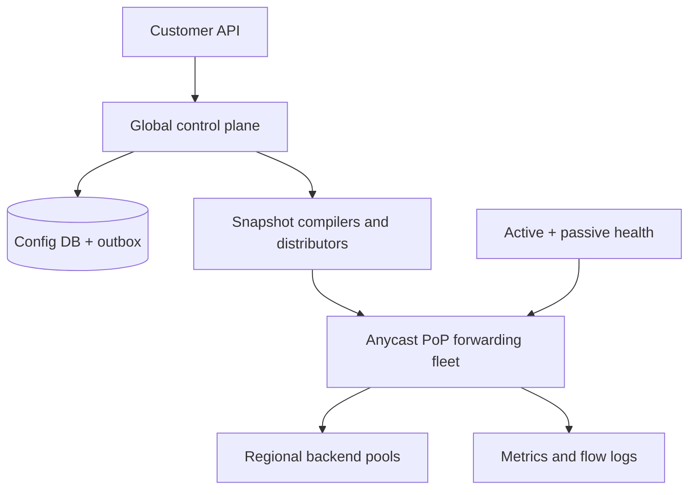
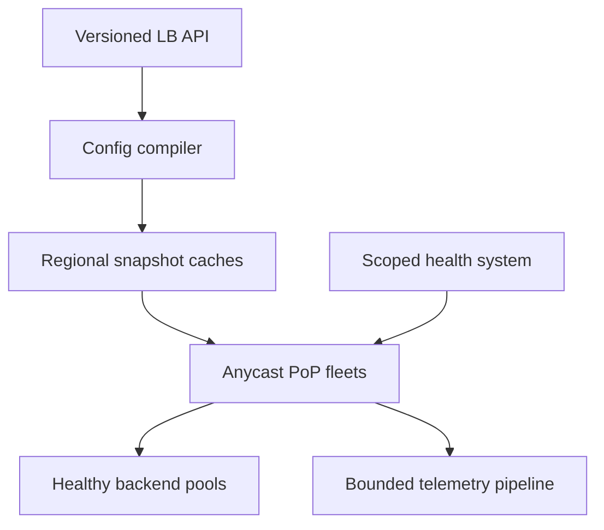

# Design a Global Layer-4 Load Balancing Service

**Difficulty:** Senior / Staff  
**Primary themes:** anycast routing, fast packet processing, consistent hashing, connection tracking, health checking, control/data-plane separation, failure isolation  
**Interview time budget:** about 45 minutes  
**Educational walkthrough:** intentionally more detailed than what you would say in a 45-minute interview

## Interviewer prompt

> Design a managed global Layer-4 load-balancing service. A customer creates a public virtual IP, configures TCP or UDP listeners, registers backend endpoints in several regions, and sends production traffic through that IP. The service should route each flow to a healthy backend with low added latency, preserve flow affinity, survive edge and backend failures, and remain usable during control-plane outages.

This is a transport load balancer, not an HTTP reverse proxy. It can inspect IP and transport headers but does not terminate TLS, understand URLs, inject cookies, or retry application requests.

## Targeted clarifying questions with assumed answers

**Candidate:** Is the virtual IP regional or globally reachable?

**Interviewer:** The main product is a global anycast VIP advertised from many points of presence. Also explain how a regional VIP would simplify the design.

**Candidate:** Which protocols are required?

**Interviewer:** TCP and UDP over IPv4 and IPv6. QUIC is carried as UDP; the load balancer does not decrypt it.

**Candidate:** Do we proxy connections or forward packets?

**Interviewer:** Prefer packet forwarding so the system can handle very high throughput. Preserve the client source IP when possible. You may use encapsulation or direct server return.

**Candidate:** What flow affinity is expected?

**Interviewer:** All packets in one five-tuple flow should reach the same backend for its lifetime unless that backend becomes unusable. New flows should stop going to a draining or unhealthy backend.

**Candidate:** Can backends span regions?

**Interviewer:** Yes. Prefer a healthy backend near the ingress point, but fail over to another region according to customer policy. Backends may be virtual machines, containers, or IP endpoints.

**Candidate:** What scale should I assume?

**Interviewer:** Assume 10 million load balancers, 100 million registered backends, 100 Tb/s peak forwarded traffic, 50 million new flows per second globally, and roughly 3 billion simultaneously active flows.

**Candidate:** What latency and availability targets matter?

**Interviewer:** Add less than 1 ms p99 inside a healthy point of presence, provide 99.999% data-plane availability, and keep existing traffic working during a control-plane outage. Healthy configuration changes should reach 99% of the serving fleet within 30 seconds. Hard backend failures should stop receiving new flows within five seconds.

**Candidate:** What happens to established TCP connections when membership changes?

**Interviewer:** Preserve them when practical. Removing a backend should support connection draining. A failed backend may reset or time out its existing connections; the L4 balancer must not replay TCP bytes to another backend.

**Candidate:** Is DDoS defense in scope?

**Interviewer:** Include volumetric absorption, stateless filtering, SYN-flood protection, and per-tenant isolation. Sophisticated application bot detection is out of scope.

**Candidate:** Do customers require source NAT?

**Interviewer:** Support two modes: source-preserving direct server return as the preferred high-scale mode, and full NAT/proxying when network topology requires a symmetric path.

## How to frame the interview

This walkthrough follows [Hello Interview's public delivery framework](https://www.hellointerview.com/learn/system-design/in-a-hurry/delivery): requirements, entities, interface, high-level design, and deep dives. The useful discipline is to make one packet flow correctly before discussing global failover.

What to say aloud:

> “I’ll separate a strongly consistent control plane from an autonomous packet-forwarding plane. I’ll first create a VIP, distribute an immutable configuration snapshot, and forward one new flow. Then I’ll add stable backend selection, health propagation, anycast failover, connection draining, and attack isolation. The critical contracts are that established flows stay pinned and that packet forwarding does not synchronously depend on the control plane.”

---

## 1. Requirements (~5 minutes)

### Core functional requirements

1. **Manage virtual services.** Create a VIP, TCP/UDP listeners, backend pools, health checks, locality policy, security policy, and drain settings.
2. **Forward flows.** Route packets to healthy backends at line rate while preserving per-flow affinity and, where configured, the client source address.
3. **Adapt safely.** Detect backend and edge failures, drain endpoints, roll out configuration, and fail traffic across zones or regions without requiring the control plane on each packet.

### Out of scope

- HTTP routing, TLS termination, WAF rules, redirects, and cookie affinity;
- backend application semantics or retrying requests after partial execution;
- authoritative DNS internals;
- customer VPC routing implementation beyond required tunnels/routes;
- perfect continuity after the selected backend itself fails;
- application-layer bot and abuse classification;
- billing implementation, though usage events are emitted.

### Quantified non-functional requirements

| Requirement | Target | Design consequence |
|---|---:|---|
| Throughput | 100 Tb/s global peak | Commodity forwarding fleet; no central gateway or remote lookup per packet |
| Flow creation | 50M new flows/s; 3B concurrent | Sharded local flow tables, bounded state, aggressive admission protection |
| Latency | Under 1 ms p99 added within a healthy PoP | Kernel-bypass/eBPF-style fast path, precomputed tables, no control-plane RPC |
| Availability | 99.999% forwarding plane; 99.99% management plane | Anycast, N+2 capacity, autonomous snapshots, failure-domain redundancy |
| Convergence | Hard failures excluded from new flows in under 5 s; config at 99% of nodes in under 30 s | Local health authority plus versioned push distribution |
| Affinity | Stable backend for a flow's lifetime when backend is healthy | Five-tuple flow record or deterministic consistent assignment |
| Isolation | One tenant or attack cannot exhaust shared state or bandwidth | Hierarchical quotas, stateless prefilters, reserved capacity and shedding |

### Scale estimates that change the design

At 100 Tb/s, even forwarding nodes capable of a sustained 100 Gb/s would require:

\[
100\ \text{Tb/s} / 100\ \text{Gb/s} = 1{,}000\ \text{fully utilized nodes}
\]

Operating at 50% target utilization for failover and burst headroom means roughly 2,000 equivalent nodes before accounting for geographic placement. Therefore, a single pair of hardware appliances or a centralized proxy tier is not credible. The VIP must spread traffic across a fleet using routing and equal-cost paths.

If 3 billion active flows require an average 200-byte entry including key, backend, counters, timers, and allocator overhead:

\[
3{,}000{,}000{,}000 \times 200\ \text{bytes} = 600\ \text{GB}
\]

That is manageable only when sharded across the ingress fleet. Replicating every connection globally or storing it in a remote database would be slower and much larger. Flow state remains local; deterministic selection and optional same-rack replication limit disruption.

At 50 million new flows per second, a 20-microsecond database or service lookup would demand one million concurrent lookups before doing useful packet work. The first packet must resolve from an in-memory configuration and backend lookup table.

What to say aloud:

> “Bandwidth forces horizontal packet forwarding, and flow count forces local sharding. The control plane can build tables, but the data plane must decide from memory. I will never put a database or cross-region call between an arriving packet and its backend.”

### Consistency and availability contract

- A customer's control-plane mutation is linearizable per load balancer and protected by an idempotency key plus an expected configuration version.
- The serving fleet consumes immutable, monotonically versioned snapshots. Fleet convergence is eventual and observable; nodes never merge partial configuration fields.
- A listener begins advertising only after a minimum safe serving quorum has the full snapshot. Deletion first stops new admission, then drains, then withdraws the VIP.
- A flow is pinned to one backend under the configuration epoch in which it was admitted. New epochs affect new flows; established flow records remain valid while the backend is eligible or draining.
- Hard local evidence can remove a backend from new-flow selection faster than the global control plane. Health is deliberately eventually consistent across PoPs.
- During management-plane failure, the last valid snapshot continues serving. Safety-critical expirations, certificate concerns, or explicit customer policy may make a VIP fail closed.
- If the system cannot preserve forwarding correctness during a route or configuration ambiguity, it withdraws the affected advertisement rather than black-hole traffic silently.
- Metrics, billing records, and inventory search may lag; listener uniqueness, tenant ownership, and configuration version commits may not.

---

## 2. Core entities (~2 minutes)

| Entity | Purpose |
|---|---|
| `LoadBalancer` | Customer resource, VIP scope, routing mode, tenant and lifecycle state |
| `VIP` | IPv4/IPv6 address, anycast prefix, advertisement policy and ownership lease |
| `Listener` | Protocol, port/range, backend pool and idle-timeout policy |
| `BackendPool` | Membership, locality policy, hashing seed, failover and drain policy |
| `Backend` | IP/port, zone/region, weight, administrative state and health state |
| `HealthCheck` | Protocol, interval, thresholds, expected response and vantage policy |
| `ConfigSnapshot` | Immutable compiled listener, policy and lookup-table version |
| `PoP` | Capacity, route state, failure domain and regional reachability |
| `ForwardingNode` | Snapshot version, local capacity, route membership and health |
| `FlowEntry` | Five tuple, selected backend, config epoch, timestamps and NAT state |
| `RouteAdvertisement` | VIP prefix, PoP origin, preference, lease and withdrawal state |
| `TenantPolicy` | ACLs, quotas, DDoS thresholds and fail-open/fail-closed choices |

The most important distinction is between durable desired configuration and ephemeral flow state. Reconstructing desired configuration must never require recovering billions of connection entries.

What to say aloud:

> “The durable objects describe who may receive future flows. A flow entry is short-lived local execution state. I will version and replicate configuration strongly, but I will not turn every packet into a distributed transaction.”

---

## 3. API and system interface (~5 minutes)

Authentication supplies the tenant and project identity. The client cannot choose another tenant in the body. Management operations are asynchronous because VIP allocation, route advertisement, and fleet convergence take time.

### 3.1 Create the load balancer

```http
POST /v1/projects/{project_id}/global-load-balancers
Authorization: Bearer <token>
Idempotency-Key: checkout-public-lb-v1
Content-Type: application/json

{
  "name": "checkout-public",
  "ip_family": "DUAL_STACK",
  "routing_mode": "ANYCAST_GLOBAL",
  "forwarding_mode": "DIRECT_SERVER_RETURN",
  "failover_policy": "LOCAL_THEN_NEAREST_REGION"
}
```

```http
HTTP/1.1 202 Accepted
Location: /v1/operations/op_A71...
```

```json
{
  "operation_id": "op_A71...",
  "load_balancer_id": "lb_4CF...",
  "state": "PROVISIONING"
}
```

### 3.2 Create a listener

```http
PUT /v1/load-balancers/lb_4CF.../listeners/tls-pass-through
Authorization: Bearer <token>
Idempotency-Key: checkout-listener-443
If-Match: "config-17"

{
  "protocol": "TCP",
  "port": 443,
  "backend_pool_id": "pool_92B...",
  "idle_timeout_seconds": 350,
  "client_ip_preservation": true,
  "drain_timeout_seconds": 300
}
```

```json
{
  "operation_id": "op_B84...",
  "accepted_config_version": 18
}
```

`If-Match` prevents two administrators from silently overwriting each other. The API validates that no overlapping listener owns the same `(VIP, protocol, port range)`.

### 3.3 Replace backend membership

```http
PUT /v1/backend-pools/pool_92B.../backends
Authorization: Bearer <token>
Idempotency-Key: checkout-backends-deploy-614
If-Match: "pool-version-613"

{
  "backends": [
    {"backend_id":"be_use1_a7","ip":"10.20.1.7","port":8443,"region":"us-east1","zone":"a","weight":100},
    {"backend_id":"be_use1_b9","ip":"10.20.2.9","port":8443,"region":"us-east1","zone":"b","weight":100},
    {"backend_id":"be_usw2_c4","ip":"10.40.3.4","port":8443,"region":"us-west2","zone":"c","weight":50}
  ]
}
```

Replacing the full desired membership makes retries deterministic. For very large pools, a batch mutation API can use explicit add/remove operations against an expected version.

### 3.4 Drain a backend

```http
POST /v1/backend-pools/pool_92B.../backends/be_use1_a7:drain
Authorization: Bearer <token>
Idempotency-Key: deploy-20261018-host-a7

{
  "deadline": "2026-10-18T11:30:00Z"
}
```

The response is accepted once desired state is durable. `DRAINING` means no new flow is assigned, but existing flow entries continue until closure, idle timeout, or deadline.

### 3.5 Read rollout and health

```http
GET /v1/load-balancers/lb_4CF.../status
```

```json
{
  "vip": {"ipv4":"203.0.113.18","ipv6":"2001:db8:120::18"},
  "desired_config_version": 18,
  "serving": {"version_18_percent": 99.97, "advertising_pops": 143},
  "backends": {"healthy": 184, "draining": 2, "unhealthy": 3},
  "data_plane_state": "SERVING"
}
```

### 3.6 Internal configuration and health interfaces

```protobuf
rpc WatchSnapshots(WatchRequest) returns (stream SnapshotEnvelope);
rpc AckSnapshot(SnapshotAck) returns (AckResponse);
rpc ReportHealth(stream HealthObservation) returns (ReportAck);
rpc GetSnapshot(GetSnapshotRequest) returns (SnapshotEnvelope);
```

Every envelope includes a resource version, compiled-table digest, validity interval, signature, and previous-version reference. Nodes install only a fully verified snapshot.

The packet-facing interface is not an RPC. It is a local match and action:

```text
match: destination VIP, protocol, destination port, tenant context
key:   source IP, source port, destination IP, destination port, protocol
act:   select backend, encapsulate/NAT, forward, meter, record flow
```

---

## 4. Data flow

### New TCP flow

1. Internet routing brings the SYN to a nearby advertising PoP.
2. ECMP spreads it to one healthy forwarding node.
3. The node looks up `(VIP, protocol, port)` in its installed snapshot and applies ACL/rate policy.
4. It looks for an existing flow entry. On a miss, it hashes the normalized five tuple with the pool seed into a precomputed healthy-backend table.
5. It creates a bounded flow entry containing backend, configuration epoch, TCP state summary, timers, and NAT/encapsulation data.
6. In direct-server-return mode, it encapsulates the original packet to the chosen backend or its host tunnel endpoint.
7. The backend decapsulates, processes the connection, and returns directly to the client using the VIP as source. In symmetric NAT mode, return packets traverse a compatible load-balancer shard.
8. Later packets hit the fast-path flow entry and skip backend selection.

### UDP flow

UDP has no handshake, so the first accepted datagram creates a soft flow entry keyed by five tuple. Subsequent datagrams refresh its idle timer. Timeout is listener-specific because DNS, media, gaming, and QUIC have different lifetimes. Expiry permits a later datagram to select a new backend.

### Configuration change

1. The API commits a new desired version and outbox event.
2. A compiler resolves policy inheritance, validates capacity, builds listener maps and backend lookup tables, and signs an immutable snapshot.
3. Regional distributors fan it to PoPs; PoP agents distribute it to forwarding nodes.
4. Each node verifies, stages, atomically swaps the active pointer, and acknowledges.
5. The rollout controller measures adoption and either continues, pauses, or rolls back. Existing flow entries retain their admitted epoch.

---

## 5. High-level design (~10–15 minutes)



### Operation 1: allocate a VIP and publish desired state

The API validates quota and transactionally creates the load balancer, operation, VIP lease, and outbox row:

```text
LoadBalancer(
  lb_id, tenant_id, project_id, name,
  ipv4_vip, ipv6_vip, routing_mode,
  forwarding_mode, lifecycle_state,
  desired_version, created_at, deletion_timestamp
)

Listener(
  lb_id, listener_id, protocol, port_start, port_end,
  backend_pool_id, idle_timeout, drain_timeout,
  client_ip_preservation, security_policy_id, version
)
```

The VIP allocator holds a strongly consistent ownership lease so the same address cannot belong to two active tenants. The route controller does not advertise immediately. It waits until the configuration compiler has produced a valid snapshot and enough PoPs report readiness, avoiding an advertised black hole.

### Operation 2: compile and distribute a serving snapshot

Forwarding nodes should not interpret an object graph on every packet. The compiler converts desired resources into compact structures:

- exact-match VIP and listener maps;
- ACL prefixes and rate-policy handles;
- locality-specific eligible-backend arrays;
- a Maglev-style consistent lookup table per pool and locality;
- tunnel endpoint and NAT action templates;
- health-check and timeout parameters;
- tenant quota identifiers;
- version, digest and validity metadata.

```text
ConfigSnapshot(
  snapshot_id, lb_id, resource_version,
  compiler_version, parent_version, digest,
  locality, created_at, valid_until,
  rollout_state, signature
)
```

Full snapshots provide a recovery base; deltas reduce steady-state bandwidth. A node applies a delta only to its declared parent, verifies the resulting digest, stages memory, then atomically swaps an active pointer. A crash can leave either old or new complete state, never half an ACL with half a backend table.

Distribution is hierarchical. Global compilers publish to regional caches; each PoP has redundant agents; nodes fetch locally. This turns a change from millions of controller connections into bounded fan-out and lets a PoP recover without the global database.

### Operation 3: steer the VIP to an ingress PoP

Many PoPs advertise the same anycast prefix through BGP. Internet routing generally sends a client toward a nearby reachable advertisement. Inside the PoP, routers use ECMP to spread packets across healthy forwarding nodes.

Anycast is coarse global steering, not a request-by-request latency oracle. Route preference, peering, congestion policy, and failures affect ingress. The route controller advertises only when a PoP has:

- installed a sufficiently recent safe snapshot;
- enough healthy forwarding capacity;
- connectivity to at least one permitted backend locality;
- healthy upstream route sessions;
- no operator or automated withdrawal hold.

Route changes can move later packets in an established flow to a different PoP. For direct-server-return stateless forwarding, deterministic backend selection makes this survivable when both PoPs share the same table version. Local flow state still improves stability across version changes and supports NAT. For strict symmetric NAT, use region-scoped advertisements, flow-aware fabric steering, or replicate minimal state to a small failover group; global replication of every flow is rejected.

### Operation 4: select and reach a backend

The simplest correct baseline computes a hash of the five tuple and indexes an array of healthy backends. Ordinary modulo hashing is disruptive: changing the number of backends remaps most flows. Instead, compile a fixed-size consistent lookup table whose slots map to backend IDs. Adding or removing a backend changes a small fraction of slots while producing near-even distribution.

Google's public Maglev design is a useful precedent for the combination of ECMP, consistent hashing, and connection tracking. The interview design remains implementation-neutral: the important properties are constant-time lookup, common deterministic tables across nodes, limited remapping, weights, and versioning.

```text
Backend(
  backend_id, pool_id, ip, port,
  region, zone, tunnel_endpoint,
  weight, admin_state, health_state,
  health_epoch, drain_deadline, version
)
```

Locality policy creates ordered candidate sets: same zone, same region, then allowed failover regions. The node selects only from a set with sufficient capacity and current local health. Weight changes affect new flows. Established flow records remain pinned.

In direct-server-return mode, the forwarding node preserves the original packet inside IP-in-IP, GRE, or an equivalent tunnel. A backend host agent decapsulates and delivers it to a loopback-bound VIP. The backend sends the response directly to the client, reducing return-path bandwidth and state at the balancer. The network must prevent the backend from advertising the VIP externally and must enforce source authorization.

In full NAT mode, the node rewrites addresses and must see return traffic. This works in more topologies but doubles traversal, consumes source-port/state resources, and makes failover harder.

### Operation 5: admit and track a flow

Flow state is stored in an efficient in-memory table sharded by CPU queue. Receive-side hashing and the software datapath keep packets for a flow on one core when possible.

```text
FlowEntry(
  five_tuple, listener_id, backend_id,
  config_version, health_epoch_at_admit,
  nat_binding, created_at, last_seen_at,
  protocol_state, byte_count, packet_count
)
```

TCP entries expire after FIN/RST plus a short retention window or after a conservative idle timeout. UDP entries use the listener timeout. Timer wheels avoid scanning millions of entries each second.

Admission order matters:

1. stateless malformed/spoofed-source checks;
2. tenant and listener packet/flow rate tokens;
3. existing-flow lookup;
4. new-flow capacity guard;
5. backend selection and state allocation;
6. forwarding.

Existing flows receive reserved capacity so a new-flow flood does not evict every long-lived connection. If flow memory reaches a hard watermark, the node rejects or cookie-challenges new flows rather than fail unpredictably.

### Operation 6: observe backend health

Use both active and passive signals:

- distributed probes test TCP connect, UDP response, or customer-defined health ports;
- backend agents report readiness and planned drain state;
- forwarding nodes observe SYN failures, resets, ICMP errors, and response silence;
- infrastructure systems report host, rack, zone, and tunnel health.

No single probe owns global truth. A health aggregator applies thresholds, hysteresis, freshness, and failure-domain correlation. Local PoPs may quarantine a backend immediately based on strong local evidence, while the global view catches up.

Health states are `UNKNOWN`, `HEALTHY`, `SUSPECT`, `UNHEALTHY`, and `DRAINING`. `SUSPECT` lowers or freezes new admission while confirmation runs. Recovery requires several successes to avoid flapping. A planned drain is not failure: no new flows are assigned, but established flows continue to the deadline.

### Operation 7: delete safely

Deletion is a state machine:

1. mark the load balancer `DELETING` and reject new mutations;
2. compile a snapshot that stops new-flow admission;
3. drain existing flows or reach the customer's deadline;
4. withdraw advertisements and wait for route convergence;
5. retain a temporary discard route so late packets do not reach another tenant;
6. release the VIP only after a quarantine interval;
7. remove snapshots and retain audit/idempotency tombstones.

VIP quarantine prevents delayed packets or stale DNS caches from reaching a newly assigned tenant.

---

## 6. Deep dives (~10–15 minutes)

### Deep dive A: stable assignment, connection tracking, and draining

#### Where the baseline breaks

Pure random choice sends later packets to different backends. Simple modulo hashing remaps most flows when membership changes. Fully stateful choice provides affinity but loses connections when a node fails and consumes memory under attack. A deterministic hash alone cannot preserve a flow across table-version changes.

#### Options

| Approach | Strength | Weakness |
|---|---|---|
| Random per packet | No state | Breaks transport flows and backend ordering |
| Round robin per new flow | Simple and balanced | Requires shared/local state; poor cross-node determinism |
| Modulo five-tuple hash | Stateless and fast | Membership change remaps most flows |
| Consistent table only | Constant-time, limited remapping | Existing flow may move when table version changes |
| Consistent table plus local flow state | Stable existing flows and efficient new selection | Memory, timers, and failover complexity |

Choose consistent tables plus local flow state. The table gives any node a good deterministic answer for a new or reconstructed flow. The flow record freezes the admission decision through later pool versions.

#### Table construction

For each backend, derive a deterministic permutation of a large prime-sized table from backend ID and pool seed. Fill slots round-robin across backends until complete. Every node receiving the same membership and compiler version obtains the same table. Weighted service can assign virtual identities or proportional turns.

The table need not be rebuilt in the packet path. Compilers build and test it, then ship compact arrays. Nodes validate that all referenced backend IDs exist before activation.

#### What happens on changes

- **Add backend:** new table sends a proportional share of new flows to it; old flow entries remain pinned.
- **Drain backend:** remove it from new-flow tables immediately, preserve existing entries until close/deadline.
- **Hard failure:** remove it from selection and invalidate its entries. TCP clients reconnect; the balancer does not transfer an opaque byte stream mid-connection.
- **Weight change:** publish a new table for new flows. Avoid migrating established flows merely to improve balance.
- **Rollback:** re-activate a prior signed snapshot. Flow entries referencing still-valid backend IDs remain usable.

#### Node failure

With direct server return, a packet may land on another node. If it retains the original configuration table, deterministic hashing often recovers the same backend without replicated state. Across a membership update, it may differ. Options are:

1. accept reset risk for flows landing on a different node;
2. replicate flow entries to one same-rack buddy;
3. make the fabric steer a flow to the same shard;
4. keep old tables during maximum flow lifetime and infer the admission epoch, which is difficult without state.

Use stable fabric hashing plus buddy replication only for premium symmetric/NAT listeners. For the highest-scale direct-return service, deterministic recovery and client reconnect are a better cost/complexity tradeoff than fleet-wide state replication.

#### UDP nuance

UDP is connectionless, but applications still expect affinity. Use five-tuple soft state and configurable idle timeouts. RFC 4787's NAT guidance illustrates why mapping timers need explicit behavioral contracts rather than arbitrary rapid expiry. QUIC connection migration can change the five tuple; without decrypting a connection ID, a generic L4 balancer cannot guarantee affinity after migration. Document that limitation or offer an optional QUIC-aware mode as a separate product.

What to say aloud:

> “Consistent hashing limits new-flow remapping, while the flow table freezes old decisions. I do not promise to move a live TCP connection to a new backend; draining preserves it, but hard backend failure requires client recovery.”

### Deep dive B: failure detection, anycast, and safe convergence

#### Where the baseline breaks

A global health bit is both too slow and too coarse. One PoP may lose the tunnel to a backend while another can reach it. A transient probe failure can remove half the fleet and overload the rest. With anycast, withdrawing a route may shift enormous traffic to another PoP that lacks headroom.

#### Local and global health

Model observations by vantage point and failure domain:

```text
HealthObservation(
  backend_id, observer_pop, observer_zone,
  check_type, result, latency, error_class,
  sequence, observed_at, expires_at
)
```

Local data-plane exclusion is fast and scoped. A PoP can mark `(backend, PoP)` unreachable without declaring the backend dead globally. Global health becomes unhealthy after independent observations cross a threshold or authoritative infrastructure evidence arrives.

Use hysteresis:

- fail after `k` consecutive misses or a weighted error threshold;
- recover after more successes than failures required;
- impose a minimum state duration;
- cap how much pool capacity can be removed automatically at once;
- distinguish backend errors from path errors and probe-system errors.

#### Fail-open versus fail-closed

If every backend appears unhealthy, neither choice is universally correct:

- **Fail closed** for financial/admin services: reject flows rather than route to a known bad target.
- **Fail open** for services where overload is preferable to total outage: try the least-bad recently healthy endpoints.
- **Fail over locality** when another region is healthy and policy permits.

Make this a customer policy with a safe default. Never silently turn a regional service into a global failover service with data-residency consequences.

#### Anycast PoP failure

Each PoP advertises only with capacity and reachability. On catastrophic loss, BGP session loss withdraws naturally; automation also withdraws on software/fabric failure. Graceful degradation occurs before withdrawal:

1. stop low-priority new flows;
2. reduce advertised preference if supported by routing policy;
3. shift tenant slices gradually;
4. withdraw only when remaining PoPs have modeled headroom.

Route withdrawal is not instantaneous and existing TCP flows may land elsewhere. Regional VIPs simplify this by keeping ingress within one region and allowing DNS or explicit customer action for global failover.

#### Configuration rollout safety

Snapshot rollout uses cohorts: lab, one canary node, a small PoP slice, one PoP, several regions, then fleet. Gate on:

- snapshot verification and memory pressure;
- drop/reset rate for new and existing flows;
- backend distribution skew;
- CPU cycles and queue drops;
- health-probe changes;
- per-tenant error budget impact.

A node that misses updates keeps its last unexpired snapshot and exposes staleness. If it is too stale for a changed VIP ownership or revoked security policy, the route agent drains and removes it from ECMP. Availability does not justify serving an address to the wrong tenant.

What to say aloud:

> “Health is scoped evidence, not one Boolean. I allow a PoP to quarantine a broken path quickly, aggregate independent evidence for global removal, use hysteresis to prevent flapping, and couple route withdrawal to spare capacity so failover does not create a second outage.”

### Deep dive C: attack resistance and multi-tenant isolation

#### Where the baseline breaks

An attacker can send tiny packets with random source ports, causing far more flow allocations per byte than ordinary traffic. A SYN flood can exhaust state before bandwidth is saturated. A large tenant can fill shared queues and evict another tenant's long-lived flows. Control-plane churn can also become an attack on compilers and distribution.

#### Defend in cost order

Perform the cheapest work first:

1. drop malformed headers, impossible lengths, disallowed fragments, and invalid destination listeners;
2. apply source-prefix and tenant ACLs from compact maps;
3. meter packets, bytes, and new-flow attempts hierarchically;
4. use SYN cookies or a stateless SYN proxy under pressure;
5. allocate flow state only after sufficient proof;
6. invoke expensive anomaly classification or scrubbing selectively.

SYN cookies encode enough connection state in the server's SYN-ACK sequence number to validate the returning ACK without retaining per-SYN memory. They protect state, not bandwidth, and have protocol-option tradeoffs. In direct-forwarding mode, a stateless cookie front end may complete validation before forwarding a reconstructed handshake or may use hardware/fabric support.

#### Hierarchical resource controls

Enforce limits at global, PoP, node, tenant, VIP, listener, and source-prefix levels:

- bits and packets per second;
- new flows per second;
- concurrent flow entries;
- fragments and exceptional slow-path packets;
- telemetry bytes and log sampling;
- configuration mutations and compile work.

Partition flow-table memory into guaranteed tenant reservations plus a reclaimable shared pool. Under pressure, evict expired UDP state first and reject new low-priority flows before disrupting established TCP. Heavy-hitter detection identifies destinations or prefixes responsible for pressure without cardinality-exploding exact counters.

#### Volumetric defense

Anycast spreads attacks across PoPs, but capacity must still exceed or filter the attack. Edge routers and programmable NICs discard obvious traffic before software queues. Scrubbing tiers apply broader source validation and rate policy. Remote-triggered blackholing is a last resort for a VIP when protecting shared infrastructure is more important than that destination's availability.

#### Observability without self-DDoS

Do not log every packet. Maintain aggregated counters in the fast path and sample flow records asynchronously. Export through bounded per-node buffers; telemetry loss must not block forwarding. Always retain compact event records for route changes, snapshot activation, health transitions, capacity shedding, and policy drops.

What to say aloud:

> “The attack is often packets or flow allocations, not just bits. I meter before allocating state, reserve memory for existing flows and small tenants, use stateless SYN validation under pressure, and make telemetry lossy rather than letting observability block packet forwarding.”

### Reliability and observability checklist

#### Key metrics

- packets, bytes, new flows, active flows, and drops by PoP/VIP/listener;
- added forwarding latency and queue depth by node and NIC queue;
- flow-table occupancy, allocation failures, timer lag, and buddy-replication lag;
- backend selection share versus configured weight;
- health probe latency, passive failure rate, flap count, and exclusion age;
- configuration desired/compiled/installed versions and rollout lag;
- route advertisements, withdrawals, convergence time, and shifted traffic;
- tunnel loss, encapsulation errors, NAT port utilization, resets, and ICMP errors;
- rate-limit, SYN-cookie, scrubbing, and policy-drop counts;
- traffic and capacity headroom by failure domain.

#### Invariants and alerts

- one active tenant owns a VIP at a time;
- a node advertises only if it has a valid complete snapshot and minimum capacity;
- a snapshot never references a missing listener, pool, backend, or policy;
- a draining backend receives no newly admitted flows after convergence bounds;
- table slots resolve only to eligible backends for their locality and epoch;
- packet forwarding never requires the management database;
- telemetry backpressure never blocks packet queues;
- failover leaves enough spare capacity in every modeled destination PoP;
- configuration staleness never crosses security or VIP-ownership expiry bounds.

Use synthetic probes from outside the network to verify the complete path, because internal health can be green while routing is broken. Sample distributed traces at the control plane and compiler; use packet captures only through audited, time-bounded tooling that redacts customer payloads.

---

## 7. Final design

### Concise final architecture

1. A globally replicated control plane owns VIP leases and versioned load-balancer configuration with linearizable per-resource mutations.
2. Compilers produce immutable, signed, locality-specific snapshots containing listener maps, policies, tunnel actions, and consistent backend tables.
3. Hierarchical distributors push full snapshots and validated deltas to autonomous PoPs; nodes atomically activate only complete versions.
4. Many PoPs advertise the same global VIP through anycast, while ECMP spreads packets over healthy forwarding nodes.
5. New flows match a listener, pass cheap policy and quota checks, and use a precomputed consistent table to select a healthy locality-appropriate backend.
6. A local flow entry pins the backend, configuration epoch, timers, counters, and NAT state for fast subsequent packets.
7. Direct server return preserves source IP and removes response traffic from the balancer; symmetric NAT is available where topology requires it.
8. Active probes, passive traffic signals, backend agents, and infrastructure health produce scoped observations with hysteresis.
9. Planned draining removes a backend from new-flow tables while retaining existing flow entries; hard failure sacrifices affected connections rather than replaying bytes.
10. Anycast withdrawal and regional failover occur only with capacity checks, while the last safe snapshot continues through control-plane outages.
11. Stateless filters, SYN cookies, hierarchical meters, reserved flow memory, and optional scrubbing protect shared capacity.
12. Aggregated metrics and sampled flow logs leave through bounded asynchronous channels so observability cannot stop forwarding.

### Final architecture diagram



### Requirements check

| Requirement | Design response |
|---|---|
| Global stable VIP | Anycast advertisements from capacity-qualified PoPs |
| TCP and UDP listeners | Compact listener match plus protocol-specific flow timers |
| Low latency | Local in-memory lookup, precomputed tables, fast-path packet actions |
| 100 Tb/s scale | ECMP over a horizontally scaled commodity forwarding fleet |
| Per-flow affinity | Five-tuple entry pins backend and configuration epoch |
| Membership changes | Consistent lookup tables minimize new-flow remapping |
| Preserve source IP | Encapsulation and direct server return |
| Planned maintenance | Drain state stops new admission but preserves existing flows |
| Hard backend failure | Fast scoped exclusion; clients reconnect for lost TCP sessions |
| Control-plane outage | Last valid signed snapshot continues serving autonomously |
| PoP failure | Route withdrawal and anycast convergence with capacity gates |
| Attack isolation | Stateless prefilters, hierarchical quotas, SYN cookies, reserved memory |
| Safe rollout | Immutable versions, cohort rollout, atomic activation and rollback |

### Principal tradeoffs

- Anycast provides simple global ingress but Internet route changes can disrupt established flows.
- Direct server return maximizes throughput and preserves source IP, but requires controlled backend routing and cannot naturally inspect responses.
- Symmetric NAT works in more networks, but doubles path load and makes connection-state failover harder.
- Consistent tables reduce remapping, but local flow state is still needed for strict continuity across configuration versions.
- Replicating flow state improves node failover but costs memory, bandwidth, and tail latency; use it selectively.
- Fast local health removal improves availability but can diverge across PoPs; scoped health is an explicit contract.
- Aggressive route withdrawal avoids black holes but can overload surviving sites; failover capacity must be reserved.
- Longer UDP timeouts preserve affinity but enlarge state; make timeouts workload-specific and quota-protected.
- Fail-open may rescue traffic but can overload damaged backends; fail-closed may turn partial failure into visible outage.

---

## Realistic interviewer follow-ups with strong sample answers

### 1. Why not use DNS to select a region?

**Strong answer:** “DNS is useful for coarse steering, but resolvers cache answers and clients may not refresh quickly. An anycast VIP offers one stable address and network-level failover. I might still use DNS for product segmentation, but not as the only sub-minute failure mechanism.”

### 2. Why is this Layer 4 rather than Layer 7?

**Strong answer:** “The service routes using IP, protocol, and ports and does not terminate TLS or parse HTTP. That preserves end-to-end encryption and supports arbitrary TCP/UDP, but it cannot route by URL, inject cookies, or retry requests semantically.”

### 3. Why does a five-tuple hash help?

**Strong answer:** “All packets with the same source/destination addresses, ports, and protocol derive the same key, so any node with the same table chooses the same backend. A flow entry then freezes that decision across later table changes.”

### 4. Why not just use modulo the backend count?

**Strong answer:** “When the count changes, modulo remaps most keys. A fixed consistent table changes only a bounded fraction of slots, so new flows move minimally and backend churn does not create a reconnect storm.”

### 5. Can you preserve a TCP connection after its backend fails?

**Strong answer:** “Not generically. The backend owns TCP and application state. Moving later packets to another backend would produce an invalid sequence/application stream. Draining preserves planned removals; hard failure relies on client reconnect unless the application independently replicates connection state.”

### 6. What if the forwarding node fails?

**Strong answer:** “The fabric sends packets to another node. Direct-return mode can deterministically recover the same backend when table versions match. For premium symmetric NAT I would use flow-aware shard steering and replicate minimal state to one buddy. I would not synchronously replicate all flows globally.”

### 7. How do you change a backend's weight without breaking connections?

**Strong answer:** “Compile a new lookup table used only for new flows. Existing entries retain their selected backend and epoch. Weight convergence therefore takes roughly the flow lifetime; an emergency hard removal is a different operation.”

### 8. What is the difference between draining and unhealthy?

**Strong answer:** “Draining is planned: stop new assignment but let existing flows finish to a deadline. Unhealthy is evidence of failure: stop new assignment immediately and invalidate or time out existing state because continuing may black-hole traffic.”

### 9. How do you avoid health-check flapping?

**Strong answer:** “Use consecutive thresholds, weighted passive signals, minimum state duration, slower recovery, and failure-domain correlation. I also cap automated capacity removal and distinguish a broken probe system from broken backends.”

### 10. What happens if every backend is unhealthy?

**Strong answer:** “Follow an explicit service policy: fail closed, try recently healthy endpoints, or fail over to an allowed region. The choice affects overload, data residency, and correctness, so it must not be an undocumented implementation detail.”

### 11. Why is snapshot configuration immutable?

**Strong answer:** “It lets a node validate the whole state, stage it, and swap one pointer. Mutable field-by-field updates could combine a new listener with an old policy or incomplete pool. Versions also make rollout, audit, and rollback precise.”

### 12. How do you update millions of forwarding nodes?

**Strong answer:** “Use compilers and a hierarchical distribution tree: global publication, regional caches, redundant PoP agents, and local fetch. Full snapshots form checkpoints; parent-verified deltas reduce bandwidth. Nodes acknowledge versions and expose staleness.”

### 13. Why not store connections in Redis?

**Strong answer:** “Fifty million new flows per second and sub-millisecond forwarding make a remote store both a bottleneck and an availability dependency. Flow state is local fast-path memory; durable stores own configuration, not packets.”

### 14. How does SYN-flood protection work?

**Strong answer:** “Under pressure, validate the client's ACK using a cryptographic SYN cookie before allocating connection state. Combine that with source/listener flow-rate limits and upstream filtering. Cookies protect memory; they do not solve a link-saturating attack.”

### 15. How does UDP change the design?

**Strong answer:** “There is no handshake or FIN, so the first datagram creates soft state and idle time determines lifetime. Short timers reduce memory but may break affinity; long timers cost state. QUIC migration can change the five tuple, which a generic encrypted L4 balancer cannot recognize.”

### 16. Would you ever proxy rather than direct-return?

**Strong answer:** “Yes, when topology requires symmetric NAT, when return-path policy must be enforced, or when backends cannot safely source the VIP. I would expose it as a lower-throughput mode with explicit NAT-state and port-capacity limits.”

### 17. How do you validate the system externally?

**Strong answer:** “Run synthetic TCP and UDP probes from multiple outside networks to every VIP class, compare observed ingress and backend, and test route withdrawal. Internal health alone cannot detect a bad advertisement or peering path.”

### 18. What would you simplify for a regional service?

**Strong answer:** “Advertise or route the VIP only inside one region, keep health and backends regional, and avoid cross-Internet anycast movement. The snapshot, consistent assignment, draining, local flow state, and attack controls remain the same.”

---

## Common pitfalls

1. Drawing one load-balancer box without explaining how traffic reaches and scales across it.
2. Putting a database, Redis, or control-plane RPC on the packet path.
3. Saying “consistent hashing” without defining the flow key, table version, and membership behavior.
4. Using per-packet round robin and breaking TCP/UDP affinity.
5. Claiming a live TCP connection can simply move to another backend.
6. Treating planned drain and hard failure as the same state.
7. Updating backend tables in place and creating mixed versions.
8. Replicating billions of flow entries globally.
9. Ignoring ECMP, anycast route convergence, and packet rehoming.
10. Assuming Internet anycast always chooses the geographically nearest PoP.
11. Preserving source IP without explaining encapsulation or return routing.
12. Choosing direct server return without securing VIP source use on backends.
13. Choosing NAT without budgeting state and ephemeral source ports.
14. Using one global backend-health Boolean for every vantage point.
15. Removing backends after one failed probe and causing flapping.
16. Failing over traffic without reserving destination capacity.
17. Expiring UDP state arbitrarily without a listener contract.
18. Allocating flow state before rate checks during a SYN/UDP flood.
19. Letting new-flow attacks evict all established flows.
20. Logging every packet and turning telemetry into the outage.
21. Continuing to advertise with expired security or VIP-ownership state.
22. Reassigning a deleted VIP immediately while stale traffic still exists.

## A polished 90-second closing

> “The design separates a linearizable configuration plane from autonomous packet-forwarding fleets. A global VIP is advertised by many capacity-qualified PoPs, and ECMP spreads traffic across forwarding nodes. Compilers transform versioned listeners, policies, health settings, and backend membership into signed immutable snapshots with precomputed consistent lookup tables. Nodes install them atomically and never call a database in the packet path. A new TCP or UDP flow is filtered and metered, mapped by five tuple to a healthy locality-appropriate backend, and pinned in a local flow entry with its configuration epoch. Direct server return preserves the client address and removes response traffic from the balancer; symmetric NAT is available when topology requires it. Planned drains stop new flows while existing entries finish. Hard backend failures are scoped by vantage point and removed quickly with hysteresis; affected TCP sessions reconnect rather than being replayed elsewhere. The last safe snapshot serves through management outages, while route withdrawal handles failed PoPs only after capacity checks. Stateless prefilters, SYN cookies, hierarchical quotas, and reserved flow memory isolate attacks and tenants. The main tradeoff is accepting ephemeral local state and possible reconnects on correlated data-plane failure in exchange for line-rate forwarding without a global coordination dependency.”

## Public references

- [Hello Interview: System Design Delivery Framework](https://www.hellointerview.com/learn/system-design/in-a-hurry/delivery) — used for the interview sequence and approximate pacing.
- [Hello Interview: API Design](https://www.hellointerview.com/learn/system-design/core-concepts/api-design) — background for mapping the core operations to a compact interface.
- [Maglev: A Fast and Reliable Software Network Load Balancer](https://research.google.com/pubs/archive/44824.pdf) — public reference for ECMP, consistent backend lookup, and connection tracking in a software load balancer.
- [USENIX NSDI 2016: Maglev](https://www.usenix.org/conference/nsdi16/technical-sessions/presentation/eisenbud) — publication page and paper context.
- [AWS Network Load Balancer overview](https://docs.aws.amazon.com/elasticloadbalancing/latest/network/introduction.html) — public product reference for static addresses and flow-hash target selection.
- [AWS Network Load Balancers](https://docs.aws.amazon.com/elasticloadbalancing/latest/network/network-load-balancers.html) — public reference for maintaining UDP flow state.
- [RFC 4787: NAT Behavioral Requirements for Unicast UDP](https://www.rfc-editor.org/rfc/rfc4787.html) — public reference for explicit UDP mapping behavior and timer requirements.
- [Google SRE Workbook: Managing Load](https://sre.google/workbook/managing-load/) — public operational reference for stabilized anycast and load management.

The walkthrough is original. These sources support the delivery structure and selected networking mechanisms rather than supplying the design.
