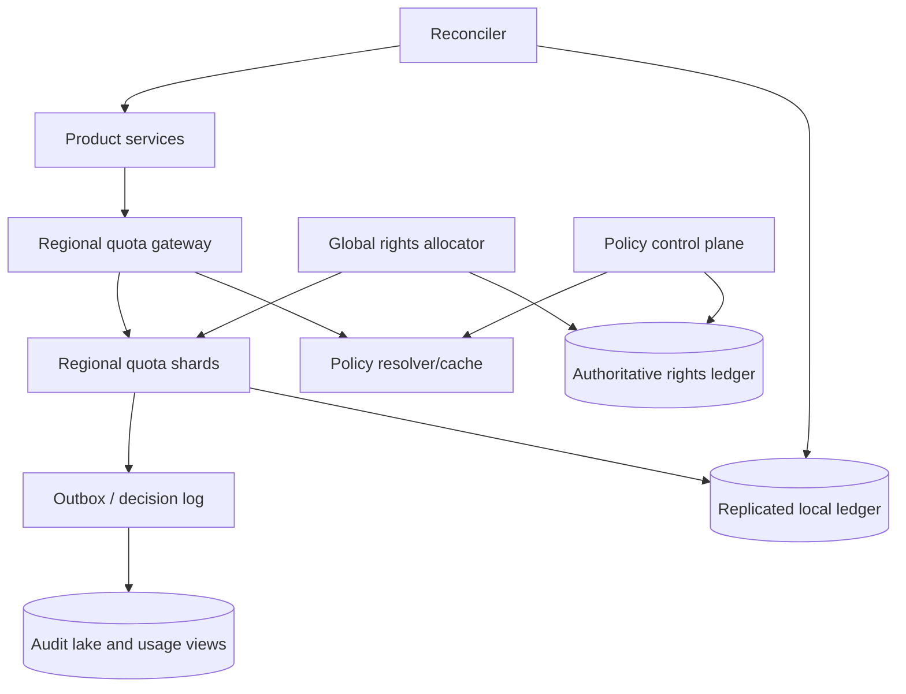
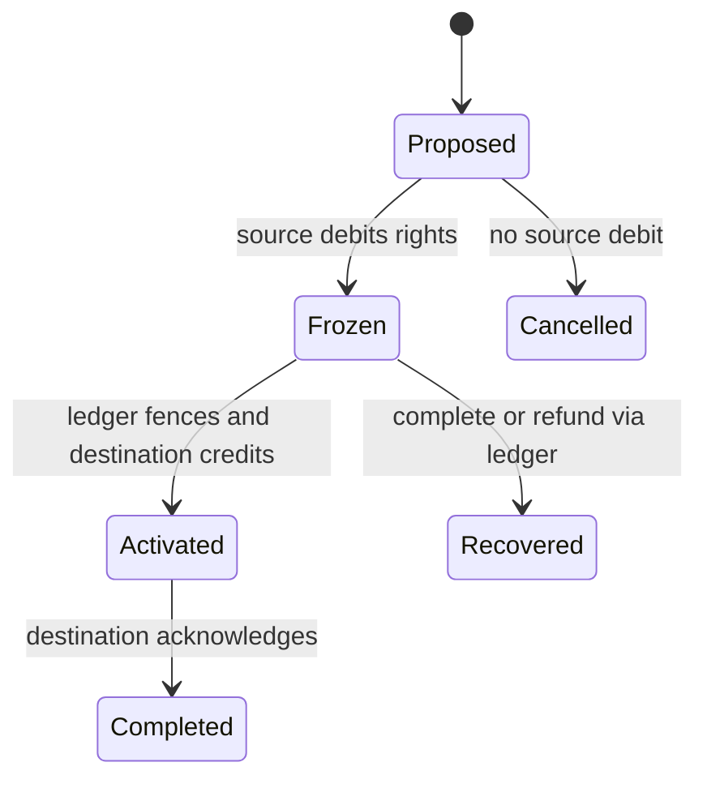

# Design a Global Quota Allocation Service

**Difficulty:** Staff

**Primary themes:** numeric invariants, escrow allocation, multi-region consistency, idempotency, caching, queues, reconciliation, failure recovery

**Interview time budget:** about 45 minutes

**Educational walkthrough:** intentionally more detailed than what you would say in the interview

This original walkthrough uses the Hello Interview delivery sequence: establish the contract, identify core entities, define interfaces, build a complete baseline one operation at a time, and then deepen the constraints that force architectural changes. Hello Interview recommends deciding the contract before drawing boxes, keeping the first entity pass small, and adding fields when components need them; that is the structure used here.

## Interviewer prompt

> Design a globally distributed quota-allocation service for a cloud platform. Product services use it before creating scarce resources such as GPUs, virtual machines, database clusters, or tenant-scoped concurrent jobs. Administrators set global and regional limits. A successful reservation must not allow total committed usage to exceed the applicable hard quota, even when requests arrive concurrently in several regions.

## Targeted clarifying questions

**Candidate:** Are these allocation quotas or request-rate limits?

**Interviewer:** Focus on allocation quotas: counts or weighted units remain consumed until released. Rate limiting is out of scope, though you may contrast it briefly.

**Candidate:** Which limits can apply to one request?

**Interviewer:** A request may be constrained by a tenant-global quota, a tenant-region quota, and a resource-family quota. All applicable dimensions must succeed atomically from the caller's perspective.

**Candidate:** Is a small temporary overshoot acceptable?

**Interviewer:** Not for hard quotas. False rejection during partitions is acceptable; exceeding the configured limit is not. We can also expose optional soft quotas that trade strictness for availability, but hard quota is the main design.

**Candidate:** Does quota approval itself create the resource?

**Interviewer:** No. The quota service reserves capacity and returns a durable reservation. The product service creates its resource, then commits or cancels the reservation. Reservations expire if abandoned.

**Candidate:** What scale and latency should I target?

**Interviewer:** Assume 20 million quota policies, 50 million active reservations, 2 million allocation attempts per second globally at peak, 200,000 releases or expirations per second, and 30 regions. Target p99 under 25 ms within a region for the common path, 99.99% write availability when the caller's region and its quota shard are healthy, and 99.999% read availability.

**Candidate:** How quickly should policy changes take effect?

**Interviewer:** Increases may propagate within 10 seconds. A decrease must never revoke existing committed usage, but no new reservation may violate the new limit once the decrease is acknowledged. If current usage already exceeds the new limit, enter an over-limit state and allow releases only.

**Candidate:** Do allocations need fairness?

**Interviewer:** Avoid permanent regional starvation and support per-tenant priorities, but strict global FIFO is unnecessary.

**Candidate:** Then I will start with a strongly consistent authoritative ledger for correctness, show why routing every allocation through it misses the latency and availability targets, and introduce preallocated regional rights so the common path remains local without overshooting globally.

---

## 1. Requirements (~5 minutes)

### Functional requirements

1. **Manage quota policies.** Administrators set, raise, lower, and inspect hard or soft limits across tenant, region, resource type, and resource family dimensions.
2. **Reserve, commit, and release units.** Product services atomically acquire all applicable quota dimensions, commit the reservation after resource creation, or cancel/release it; retries must not double-consume.
3. **Expose usage and auditability.** Return limit, committed, reserved, locally available, and freshness; retain an immutable decision history and reconcile leaked or expired reservations.

### Quantified non-functional requirements

| Requirement | Target | Design consequence |
|---|---:|---|
| Allocation traffic | 2M attempts/s peak across 30 regions | Region-local decision path; shard by quota key |
| Release/expiry traffic | 200K/s | Idempotent asynchronous cleanup and time-bucketed expiry |
| State | 20M policies; 50M active reservations | Partitioned ledger plus TTL index; no full scans |
| Allocation latency | p99 <25 ms in-region | No cross-region quorum on the common path |
| Availability | 99.99% writes; 99.999% reads | Regional cells, cached policy, durable local shards |
| Safety | Zero hard-quota overshoot | Non-overlapping allocation rights and transactional multi-dimension checks |
| Policy propagation | increase <10 s; acknowledged decrease immediately safe | Versioned policies, barriers, and reclaim protocol |
| Audit | Explain every decision for 90 days | Append-only decision log separated from hot counters |

### Scope and semantic contract

For every hard quota key `q`, maintain the invariant:

\[
\text{committed}_q + \text{unexpiredReserved}_q \le \text{effectiveLimit}_q
\]

The service returns one of four meaningful outcomes:

- `GRANTED`: a durable reservation exists and the caller may proceed.
- `DENIED`: the quota is definitively exhausted under the current policy version.
- `RETRYABLE`: safety is intact, but the service cannot decide now—for example, a region lacks local rights during a partition.
- `CONFLICT`: the idempotency key was reused with different request parameters.

A `GRANTED` response is linearizable within every affected quota shard: once observed, subsequent decisions include it. Usage views may be a few seconds stale and must carry `as_of` and policy versions. Hard-quota safety wins over allocation availability during a network partition. Existing committed resources remain usable; only new reservations can fail closed.

Out of scope: billing, physical capacity scheduling, admission-policy evaluation beyond quota, and generic requests-per-second rate limiting.

### Scale estimates that change the design

At 2 million attempts/s, even a modest three-replica consensus write per attempt would push roughly 6 million replicated mutations/s through the authoritative tier. More importantly, a single global leader or cross-region quorum would blow the 25 ms p99 target. We need many quota shards and a local fast path.

Suppose the average request checks three dimensions. That is 6 million logical counter checks/s. With 1,024 regional shards, the average is about 5,900 counter operations/s per shard before skew—reasonable for in-memory transaction processing backed by a replicated log, but hot tenants still require dedicated partitions or sub-allocation.

Fifty million active reservations at roughly 300 bytes each consume about 15 GB raw, perhaps 45–60 GB with indexes and replication. This is manageable when partitioned. Expiration cannot scan 50 million rows; a hierarchical timing wheel or time-bucketed expiry index makes work proportional to reservations due now.

**What I would say aloud:** “The arithmetic tells me the hard part is not storing counters. It is preserving a numeric invariant at two million decisions per second without a WAN round trip. I’ll keep correctness in a ledger, then move bounded spending authority—not replicated counter values—to regional cells.”

---

## 2. Core entities (~2 minutes)

Start with nouns, not a complete schema:

- **QuotaPolicy** — a versioned limit and scope.
- **QuotaKey** — one concrete constrained dimension, such as tenant `t1` + resource `gpu` + global.
- **RightsGrant** — non-overlapping units that a global allocator delegates to one regional cell.
- **Reservation** — temporary units held for one idempotent operation.
- **UsageCommitment** — the durable consumption attached to a created resource.
- **RightsTransfer** — a fenced movement of unused rights between cells.
- **DecisionEvent** — immutable audit record for grant, deny, commit, cancel, expiry, or policy change.

A request may touch several `QuotaKey`s, but the keys are deliberately mapped to the same **tenant home shard**. That placement rule lets one local transaction reserve tenant-global, tenant-region, and family dimensions atomically. Cross-tenant transactions are not supported.

**What I would say aloud:** “I’m keeping entities conceptual now. I’ll add versions, fencing epochs, and idempotency fields next to the components that need them instead of front-loading a giant schema.”

---

## 3. API / system interface (~5 minutes)

Identity comes from the authenticated workload identity—mTLS service identity or a signed service token. The caller cannot submit an arbitrary tenant as proof of authority; the gateway derives allowed tenant and product scopes from authentication and authorization policy.

### Create or update a policy

```http
PUT /v1/quotas/{quota_key}
Authorization: Bearer <admin-token>
If-Match: "policy-version-41"
Content-Type: application/json

{
  "limit": 10000,
  "mode": "HARD",
  "effective_at": "2026-10-18T20:15:00Z",
  "reason": "approved capacity increase"
}
```

```json
{
  "quota_key": "tenant:t1/global/gpu_h100",
  "policy_version": 42,
  "limit": 10000,
  "state": "ACTIVE"
}
```

Optimistic concurrency prevents two administrators from silently overwriting one another. Decreases may return `202 RECLAIMING` until the new limit is safe to acknowledge.

### Reserve units

```http
POST /v1/reservations
Authorization: Bearer <product-service-token>
Idempotency-Key: provision-vm-01JAF8W7
Content-Type: application/json

{
  "tenant_id": "t1",
  "resource_type": "gpu_h100",
  "region": "us-east-1",
  "units": 8,
  "ttl_seconds": 120,
  "resource_request_id": "vmreq-9821"
}
```

```json
{
  "reservation_id": "qres-7f31",
  "decision": "GRANTED",
  "units": 8,
  "expires_at": "2026-10-18T20:17:00Z",
  "policy_versions": {
    "tenant:t1/global/gpu_h100": 42,
    "tenant:t1/us-east-1/gpu_h100": 19,
    "tenant:t1/global/gpu_family": 7
  }
}
```

Internally, the policy resolver expands the request into all applicable keys. The client does not get to omit a parent quota.

### Commit or cancel

```http
POST /v1/reservations/qres-7f31:commit
Authorization: Bearer <product-service-token>
Idempotency-Key: commit-vmreq-9821

{
  "resource_id": "vm-4419"
}
```

```http
POST /v1/reservations/qres-7f31:cancel
Authorization: Bearer <product-service-token>
Idempotency-Key: cancel-vmreq-9821
```

Commit converts reserved units to committed units without changing total consumption. Cancel returns rights. A repeated identical call returns the original result; a mismatched replay returns `409 CONFLICT`.

### Release a committed resource

```http
POST /v1/commitments/vm-4419:release
Authorization: Bearer <product-service-token>
Idempotency-Key: delete-vm-4419
```

### Read quota state

```http
GET /v1/quotas/tenant:t1/global/gpu_h100?consistency=eventual
Authorization: Bearer <authorized-token>
```

```json
{
  "limit": 10000,
  "committed": 9410,
  "reserved": 118,
  "unassigned_rights": 72,
  "policy_version": 42,
  "as_of": "2026-10-18T20:14:58.430Z",
  "state": "ACTIVE"
}
```

An administrative `consistency=strong` read routes to the authoritative home shard and is slower. Product admission uses `POST /reservations`, never a read-then-write sequence.

### Why not `GET remaining` followed by `POST create`?

Two callers can both observe eight remaining units and each allocate eight. Admission must be one atomic mutation. The read endpoint is for visibility, not authorization.

**What I would say aloud:** “The reservation API is the consistency boundary. It accepts an idempotency key, derives identity from authentication, expands parent quotas server-side, and atomically returns a durable grant or a precise failure.”

---

## 4. Data flow

The resource-creation saga is:

1. Product service generates a stable operation ID and requests quota.
2. Quota service durably records a short-lived reservation and returns `GRANTED`.
3. Product service creates the resource using its own idempotency key.
4. On success it commits the quota reservation with the resource ID.
5. On failure it cancels. If the caller crashes, expiry eventually returns the units.
6. A reconciler compares committed quota records with the product service’s resource inventory and repairs leaks through an auditable workflow.

This is a saga: a sequence of local transactions with compensating actions, not one distributed transaction across the quota and product databases. The temporary reservation closes the gap between “quota approved” and “resource exists.”

---

## 5. High-level design (~10–15 minutes)

### Architecture



The data plane is regional: gateway, policy cache, quota shards, and their local replicated ledger. The control plane stores policy and the global ownership of allocation rights. It is not contacted for every request.

### Step 1: Policy management

The policy control plane validates scope, hierarchy, and authorization, then writes a versioned policy to a strongly consistent authoritative store. Relevant fields become concrete here:

```text
QuotaPolicy(
  quota_key, tenant_id, scope_type, scope_id, resource_type,
  hard_limit, mode, version, state,
  effective_at, updated_by, updated_at
)
```

It publishes policy changes through an outbox. Regional policy resolvers consume them into a cache keyed by `quota_key`. Each data-plane transaction records the exact policy versions it used.

For an increase, the global allocator can mint additional rights because the invariant has more headroom. For a decrease, it first prevents new grants under the old version, reclaims unused rights, and checks current reserved plus committed usage. It acknowledges the lower limit only when rights outstanding and usage are compatible. If committed usage is already above the requested limit, the policy becomes `OVER_LIMIT`; releases continue, grants stop, and the limit becomes enforceable as usage falls.

### Step 2: Establish non-overlapping regional rights

For each hard `QuotaKey`, the global rights ledger accounts for every unit:

\[
L = C + R + \sum_i A_i + U
\]

where:

- `L` is the configured limit,
- `C` is committed usage,
- `R` is active reservation usage,
- `A_i` is unused authority assigned to regional cell `i`, and
- `U` is unassigned authority held centrally.

In implementation, committed and reserved usage are distributed across cells, but each unit of unused authority has exactly one owner. A cell can grant only from its local `available_rights`. Rights are like numbered claim checks: copying a counter value cannot create another valid claim check.

```text
RightsGrant(
  quota_key, cell_id, grant_id,
  units_total, units_available,
  policy_version, ownership_epoch,
  status, updated_at
)
```

The allocator seeds regions according to recent demand, keeps a central safety reserve, and periodically rebalances. Allocation is not equal: a busy region may hold 60% of a tenant’s rights while a disaster-recovery region holds 5%.

### Step 3: Reserve on the regional fast path

The gateway authenticates the caller, derives allowed tenant scope, resolves all quota keys, and routes by `tenant_id` to a regional quota shard. The shard runs one serializable local transaction:

1. Look up `(caller, idempotency_key)`.
2. If it exists with the same request hash, return its stored response.
3. Check every policy version and local rights balance.
4. Decrement `units_available` for all applicable keys.
5. Insert one reservation and its per-dimension debits.
6. Insert a decision event into the same database transaction’s outbox.
7. Commit, then return `GRANTED`.

```text
Reservation(
  reservation_id, tenant_id, caller_id, idempotency_key,
  request_hash, units, region, resource_type,
  status, created_at, expires_at, resource_request_id
)

ReservationDebit(
  reservation_id, quota_key, units,
  policy_version, rights_grant_id, ownership_epoch
)

IdempotencyRecord(
  caller_id, idempotency_key, request_hash,
  response_code, response_body, expires_at
)
```

The `ReservationDebit` records which rights grant funded the reservation. This lineage makes recovery and auditing much easier than reconstructing totals from loosely related counters.

Keys for one tenant live on one shard, so multi-dimension admission is a local transaction. A celebrity tenant that outgrows one shard receives a dedicated shard; its global parent quota delegates sub-rights to stable resource-family partitions. The same non-overlap rule composes hierarchically.

### Step 4: Commit, cancel, release, and expire

Commit atomically changes `Reservation.status` from `HELD` to `COMMITTED` and inserts:

```text
UsageCommitment(
  resource_id, reservation_id, tenant_id,
  units, resource_type, region,
  status, committed_at, released_at
)
```

The counter moves from reserved to committed; no new right is consumed. Cancel or expiry changes `HELD` to `CANCELLED` or `EXPIRED` and returns each debit to the local rights grant, provided the grant epoch still matches. Release changes an active commitment to `RELEASED` and restores rights.

Expiry workers use buckets such as `floor(expires_at / 10 seconds)` plus a timing wheel. They claim rows with leases, recheck status inside the transaction, and perform idempotent expiry. A delayed worker may reduce availability by holding units too long, but cannot create overshoot.

### Step 5: Publish audit and usage views

The transactional outbox avoids the dual-write problem: the same transaction that changes quota state inserts `DecisionEvent`. A relay publishes events to a partitioned log keyed by tenant. Consumers build:

- near-real-time usage views,
- customer-visible history,
- anomaly detection,
- billing signals if another team owns billing,
- reconciliation work queues.

The allocation decision does not wait for the analytics pipeline. A queue outage grows outbox lag but does not make the ledger incorrect.

### Baseline request trace

For an eight-GPU request in `us-east-1`:

1. Gateway validates the product identity and resolves global GPU, regional GPU, and GPU-family keys.
2. Tenant routing sends all keys to shard 317.
3. Shard 317 finds no idempotency record.
4. Its local grants have at least eight rights for every key.
5. One transaction deducts 8 from each grant, writes the reservation and three debits, and appends a decision event.
6. The service returns in roughly one regional network hop plus one local consensus commit.
7. The product creates the VM and commits the reservation.

This is the simplest complete working design. Now we harden the places where it breaks.

---

## 6. Deep dives (~10–15 minutes)

## Deep dive A: Preserve a global invariant without a WAN write

### Where the baseline alternatives break

**Option 1: one global transactional counter.** Correct and simple, but every allocation pays WAN latency, the leader becomes a hotspot, and loss of its quorum stops the world.

**Option 2: asynchronously replicate usage counters.** Fast and available, but unsafe. If two regions each observe ten remaining units, both can grant ten and overshoot by ten.

**Option 3: allow bounded overshoot and reconcile.** Appropriate for telemetry or some soft quotas, but explicitly violates this problem’s hard-quota contract.

**Selected approach: escrow-style rights.** Partition the permission to decrement the global remainder. Each region can act locally only within rights it exclusively owns. This borrows the central idea of escrow transactions and bounded counters: preserve a numeric invariant by distributing non-overlapping rights rather than merging unconstrained decrements.

### Rights transfer protocol

If `us-east-1` is low and `eu-west-1` has spare rights:

1. The allocator creates `transfer T`, source `eu-west-1`, destination `us-east-1`, units 500, and a new fencing epoch.
2. Source shard transaction moves 500 units from `AVAILABLE` to `FROZEN_FOR_TRANSFER(T)` and returns a signed durable acknowledgement.
3. Only after the authoritative ledger records that acknowledgement may the destination create 500 available rights under `T`.
4. Destination acknowledgement lets the ledger mark the transfer complete.
5. Retries are keyed by `transfer_id`; repeated messages cannot duplicate rights.

The safety order is freeze, record, then activate. If a crash occurs after freezing but before activation, 500 units are temporarily unavailable—not duplicated. A recovery worker either completes the transfer or returns the frozen units after consulting the authoritative ledger.



### Leases are not ownership

Wall-clock lease expiry alone must not transfer rights. During a partition, the old owner might still be allocating; a second owner created after a timeout would cause split-brain spending. Ownership changes require a fencing epoch issued by the authoritative ledger. Old epochs are rejected by quota-shard recovery and settlement paths.

### Atomicity across multiple quota dimensions

The request is granted only if every applicable key has local rights. Because keys for a tenant are colocated, one serializable transaction debits them together. On any failure, all debits roll back.

If a future requirement permits arbitrary cross-tenant bundles, we would need either a coordinator with prepared reservations and deterministic recovery, or redesign the API so callers reserve independently and compensate. I would not introduce distributed two-phase commit for a requirement we do not have.

### Conservation invariant and verification

For each quota key, the reconciler periodically proves:

```text
limit
= unassigned_rights
+ sum(cell.available_rights)
+ sum(active reservations)
+ sum(active commitments)
+ sum(frozen transfer rights)
```

Every term is tied to a policy version and epoch. A mismatch pages the control-plane team, freezes new rights minting for that key, and preserves evidence. Existing locally owned rights may still be spendable if policy permits; operators can configure fail-closed mode for the most sensitive resources.

**What I would say aloud:** “A partition can strand rights and cause false denials, but it cannot manufacture rights. That is the central safety tradeoff: bounded local authority gives low latency, and unavailable transfers reduce availability only when a region exhausts its local slice.”

## Deep dive B: Policy decreases, skew, and hot tenants

### The dangerous decrease race

Assume the limit is 10,000 and regions collectively own 400 unused rights. An administrator lowers the limit to 9,700 while usage is 9,600. If cells keep spending the old 400, usage can reach 10,000 and violate the new limit after it is declared active.

We therefore distinguish **requested**, **enforcing**, and **acknowledged** policy versions.

Decrease protocol:

1. Write version 43 as `RECLAIMING`; stop issuing new rights under version 42.
2. Broadcast a barrier to every cell holding version-42 rights.
3. Each cell transaction freezes its unused old rights and reports reserved plus committed usage.
4. The allocator waits for all owners or fences unreachable owners by changing the quota ownership epoch. It cannot reuse their possibly spendable rights until the old shards are prevented from serving writes.
5. If active usage is at most 9,700, redistribute only `9,700 - usage` rights under version 43 and acknowledge it.
6. If active committed usage exceeds 9,700, set `OVER_LIMIT`, issue zero new rights, preserve existing resources, and let releases converge below the limit.

This means a hard decrease may be unavailable during a partition. That is honest: simultaneously acknowledging a lower global limit and allowing an unfenced old owner to allocate would be unsafe.

### Avoid regional starvation

Static equal splits waste capacity. With a 10,000-unit limit across 30 regions, allocating 333 everywhere can deny a busy region even when thousands sit idle elsewhere.

The allocator uses demand-aware watermarks:

- Each cell reports burn rate, denial rate, outstanding reservations, and available rights.
- Forecast near-term demand using an exponentially weighted moving average plus burst headroom.
- Refill when a cell falls below a low watermark; reclaim when above a high watermark.
- Keep perhaps 5–10% unassigned centrally for bursts.
- Guarantee small floors to active regions and age refill requests to prevent starvation.

If a cell burns 20,000 units/s and transfers take 500 ms, a bare minimum buffer is 10,000 units. With a 4× burst factor, target 40,000. This arithmetic directly sets the refill watermark; “refill when almost empty” would be too late.

### Hot-key scaling

A single tenant with hundreds of thousands of decisions per second can overload its home shard. Choices:

- **Vertical/dedicated shard:** simplest and preserves one-transaction multi-dimension checks.
- **Split by resource family:** delegate a parent’s rights into disjoint child partitions; scalable, but rebalancing becomes another rights-transfer problem.
- **Batch permits to product servers:** lowest latency, but increases stranded rights and trust surface.

Start with dedicated shards, then use hierarchical sub-rights for extreme tenants. Batch permits are optional for trusted high-throughput internal services: a product worker receives a small, short-lived, fenced bundle and returns unused rights. The bundle size caps blast radius and is included in the conservation equation.

### Caching

Policy reads use versioned regional caches, but cache hits never authorize more than the local ledger’s rights. A stale higher limit is dangerous, so a cell may spend only rights already minted for that exact policy version. A stale lower limit merely causes false denials.

Negative and usage-view caches have short TTLs with jitter. Idempotency responses live in the authoritative local shard, not only in cache. Cache loss can hurt latency but cannot change correctness.

**What I would say aloud:** “A limit increase is easy: mint new rights. A decrease is a distributed barrier because old authority must be reclaimed or fenced before the lower number is true. I would state that explicitly instead of pretending cache invalidation is enough.”

## Deep dive C: Exactly-once effects over at-least-once delivery

### Failure cases

1. **Client times out after the commit.** Retrying with the same idempotency key returns the existing reservation.
2. **Client retries with different units.** The stored request hash detects misuse and returns `CONFLICT`.
3. **Product resource is created but quota commit is lost.** The reservation remains held, then a reconciler finds the resource via `resource_request_id` and commits before expiry; the product should also retry commit.
4. **Reservation expires just as commit arrives.** One conditional state transition wins. If expiry wins, commit fails and the product must delete or quarantine the resource; if commit wins, expiry observes `COMMITTED` and does nothing.
5. **Release event is duplicated.** Conditional transition from `ACTIVE` to `RELEASED` restores rights once.
6. **Outbox relay publishes twice.** Consumers deduplicate by monotonically unique `decision_event_id`; audit storage is append-only and projections are idempotent.

There is no magical exactly-once network. We build exactly-once **effects** with durable idempotency records and conditional state transitions over at-least-once messages.

### Reservation TTL and clock safety

The server chooses `expires_at`; callers provide only a bounded requested TTL. Shards use a monotonic clock for scheduling and persist absolute expiry for recovery. Modest clock skew may delay reclamation, which reduces availability. Expiring early is more dangerous because the product may still believe its grant is valid, so expiry workers include a safety margin and the response tells the caller the server deadline.

### Reconciliation

The reconciler is not the primary correctness mechanism; it detects operational drift:

- reservation held but no product operation exists,
- product resource exists with a held reservation,
- active commitment points to a deleted resource,
- product resource has no commitment,
- conservation equation mismatch,
- transfer stuck in `FROZEN` or `ACTIVATED`.

Repairs use the same public state transitions, never direct counter edits. High-risk cases enter a manual queue with before/after evidence.

### Multi-region disaster recovery

Each regional quota shard is synchronously replicated across three availability zones. Region loss removes access to rights owned there. The global ledger may reassign those rights only after fencing the old shard’s write identity—for example, revoking its epoch/certificate and establishing that the storage quorum cannot resume independently. Until then, safety beats availability.

Product services in a failed region can route new requests elsewhere only if the destination owns rights. Existing reservations and commitments are recovered from replicated logs or counted as unavailable until ownership is resolved.

### Observability and SLOs

Track metrics by region, shard, tenant class, and resource family—while controlling high-cardinality labels:

- allocation p50/p95/p99 and decision counts,
- definitive denials versus retryable no-local-rights failures,
- rights utilization, stranded rights, refill latency, and transfer age,
- reservation expiry lag and held-to-commit duration,
- policy propagation and decrease-barrier age,
- outbox lag and consumer deduplication rate,
- conservation-check failures,
- idempotency replays and conflicts,
- reconciliation drift and repair age.

Trace IDs connect the reserve call, local transaction, product resource request, commit, and audit event. Logs include decision reason, quota keys, policy versions, grant epochs, and reservation ID, but not bearer tokens.

SLO alerts should distinguish **exhaustion** from **service failure**. A tenant legitimately out of quota is not an availability incident; a region returning `RETRYABLE` while global unassigned rights exist may be.

**What I would say aloud:** “I won’t claim exactly-once delivery. I’ll make each transition idempotent, store the original response, and reconcile the cross-service saga. Duplicates become normal inputs rather than exceptional failures.”

---

## 7. Final design

### Concise architecture summary

- A versioned policy control plane owns hard limits and policy state.
- A strongly consistent global rights ledger accounts for unassigned, assigned, frozen, reserved, and committed units.
- The allocator delegates non-overlapping rights to multi-AZ regional quota shards.
- The common allocation path is one regional serializable transaction covering every tenant quota dimension.
- Durable reservations bridge quota approval and product resource creation.
- Commit, cancel, release, and expiry are idempotent conditional transitions.
- A transactional outbox feeds audit, usage views, anomaly detection, and reconciliation.
- Fenced rights transfers rebalance demand; partitions may strand rights but never duplicate them.
- Policy decreases use a distributed barrier and are acknowledged only when old authority is reclaimed or fenced.

### Requirements check

| Requirement | How the design meets it |
|---|---|
| Manage global/regional/hierarchical policies | Versioned control plane and server-side policy expansion |
| Reserve, commit, cancel, release | Durable reservation saga with conditional transitions |
| Zero hard-quota overshoot | Non-overlapping rights plus local serializable transactions |
| p99 <25 ms common path | Regional gateway and local multi-AZ shard; no WAN call |
| 2M attempts/s | Tenant sharding, dedicated hot shards, optional hierarchical sub-rights |
| Safe retries | Idempotency key, request hash, stored response |
| Safe policy decreases | Reclaim barrier, fencing epochs, `OVER_LIMIT` state |
| Auditability | Transactional outbox, immutable decision log, lineage to rights grants |
| Failure recovery | Multi-AZ replication, conservative fencing, expiry, reconciliation |
| Fresh usage visibility | Event-built projections labeled with version and `as_of` |

### Main tradeoffs

- We choose false denials over hard-quota overshoot during partitions.
- Preallocation lowers latency but can strand capacity in the wrong region.
- Smaller regional grants improve utilization and decrease responsiveness; larger grants improve autonomy but increase stranded capacity.
- Colocating one tenant’s dimensions simplifies atomicity but requires special treatment for hot tenants.
- Expiry recovers leaks but cannot replace reconciliation with the product system.

---

## Realistic interviewer follow-ups and strong sample answers

### 1. Why is this not just a distributed rate limiter?

**Strong answer:** “A rate limiter replenishes permission as time advances; an allocation quota remains consumed until an explicit release. Here I need durable reservation and commitment lifecycle, crash recovery, and reconciliation with real resources. Token-bucket intuition helps with local rights, but time-based refill would be incorrect.”

### 2. Can a CRDT counter solve it?

**Strong answer:** “A normal grow-only or PN-counter converges, but convergence does not prevent concurrent regions from crossing an upper bound before they exchange updates. A bounded counter can work because it adds escrow-like rights: replicas decrement only rights they own and transfer rights without duplication. The invariant comes from rights ownership, not eventual merging alone.”

### 3. What happens if a region uses all its rights while another has many idle rights?

**Strong answer:** “The busy region requests a fenced transfer. If connectivity exists, demand-aware rebalancing should complete before its low watermark is exhausted. During a partition it returns `RETRYABLE` or `DENIED_LOCAL_CAPACITY` even though global capacity may exist. That is the required safety-over-availability tradeoff.”

### 4. How do you atomically enforce global, regional, and family quotas?

**Strong answer:** “Resolve all dimensions server-side and colocate a tenant’s quota keys on one regional shard. One serializable transaction checks and debits all local rights. If a tenant is split for scale, the parent delegates non-overlapping sub-rights to child partitions so a request still touches one child plus dimensions already budgeted to it.”

### 5. Could an administrator decrease a limit instantly?

**Strong answer:** “They can request it instantly, but I cannot safely acknowledge it until unused old-version rights are reclaimed or their owners are fenced. Existing commitments are not revoked. If usage exceeds the new target, the policy becomes over-limit, grants stop, and releases bring it down.”

### 6. What if the product creates the VM and then the reservation expires?

**Strong answer:** “The product must retry commit with a stable key, and the reconciler joins `resource_request_id` against inventory. Commit and expiry race through one conditional state change. If expiry wins before we discover the resource, the product must quarantine or delete the unaccounted resource; the API contract makes that responsibility explicit.”

### 7. How would you support a soft quota?

**Strong answer:** “I would make the policy mode explicit. A soft quota may use replicated approximate usage and a configured overshoot budget for higher availability, while still emitting warnings and audit events. I would never silently apply soft semantics to a hard quota.”

### 8. How do you prevent a compromised product service from hoarding capacity?

**Strong answer:** “Authorize resource types and tenant scopes from workload identity, cap reservation TTL and units per call, rate-limit callers separately, bind commit to a product-owned resource ID, expose hoarding metrics, and reclaim through expiry. Very large requests may require policy approval.”

### 9. What database would you choose?

**Strong answer:** “I need serializable transactions, conditional updates, replication across availability zones, and predictable sharding. A distributed SQL store or a custom replicated state machine can work. I would choose based on proven per-shard write throughput and operational maturity; the correctness comes from the data model and transaction boundary, not a product name.”

### 10. How do you migrate a tenant between shards?

**Strong answer:** “Freeze new admissions briefly or dual-route them through a migration coordinator, snapshot tenant state at a log position, replay the tail, then publish a higher routing epoch. The destination cannot serve writes until the source is fenced. Idempotency records move with the tenant so retries do not double-spend.”

---

## Common pitfalls

- Treating a cached `remaining` value as authorization.
- Using eventually replicated counters and assuming convergence implies no overshoot.
- Saying “lease” without explaining how an old owner is fenced.
- Ignoring parent quotas when enforcing a regional child quota.
- Spreading one tenant’s dimensions across arbitrary shards, then hand-waving atomicity.
- Returning rights on client timeout rather than on an authoritative cancel or expiry transition.
- Claiming exactly-once messaging instead of implementing idempotent effects.
- Activating a lower policy before old-version rights are reclaimed.
- Letting reconciliation directly edit counters and destroy audit lineage.
- Counting legitimate quota exhaustion against the service availability SLO.
- Building analytics synchronously into the allocation path.
- Forgetting that clock skew should cause late reclamation, not premature reuse.

---

## 90-second closing summary

**What I would say aloud:**

“I designed a global allocation-quota service whose hard contract is that committed plus unexpired reserved usage never exceeds the effective limit. The naive global counter is correct but cannot meet a 25-millisecond regional p99, while asynchronously replicated counters can overshoot. So the authoritative ledger distributes non-overlapping spending rights to regional, multi-AZ quota shards. A shard grants only from rights it owns, and one serializable transaction checks every tenant dimension and records a durable, idempotent reservation.

“The product service then creates its resource and commits or cancels; expiry and reconciliation recover abandoned work. Rights move between regions through a freeze-before-activate transfer with fencing epochs, so crashes can strand capacity but cannot duplicate it. Policy increases mint rights, while decreases use a reclaim barrier and are acknowledged only after old authority is removed or fenced. An outbox supplies audit and usage projections without putting queues in the critical path.

“The design deliberately prefers false rejection to hard-quota overshoot during partitions. Its main operational risks are stranded rights, hot tenants, stuck reservations, and policy barriers, so I monitor those directly and verify the conservation equation continuously.”

---

## Further reading

- [Hello Interview — System Design Delivery Framework](https://www.hellointerview.com/learn/system-design/in-a-hurry/delivery)
- [Hello Interview — API Design for System Design Interviews](https://www.hellointerview.com/learn/system-design/core-concepts/api-design)
- [Google Cloud — Cloud Quotas overview](https://cloud.google.com/docs/quotas/overview)
- [AWS — What is Service Quotas?](https://docs.aws.amazon.com/servicequotas/latest/userguide/intro.html)
- [Balegas et al. — Extending Eventually Consistent Cloud Databases for Enforcing Numeric Invariants](https://arxiv.org/abs/1503.09052)
- [O'Neil — The Escrow Transactional Method](https://ics.uci.edu/~cs223/papers/p405-o_neil.pdf)
- [IBM Research — Quota enforcement for high-performance distributed storage systems](https://research.ibm.com/publications/quota-enforcement-for-high-performance-distributed-storage-systems)

