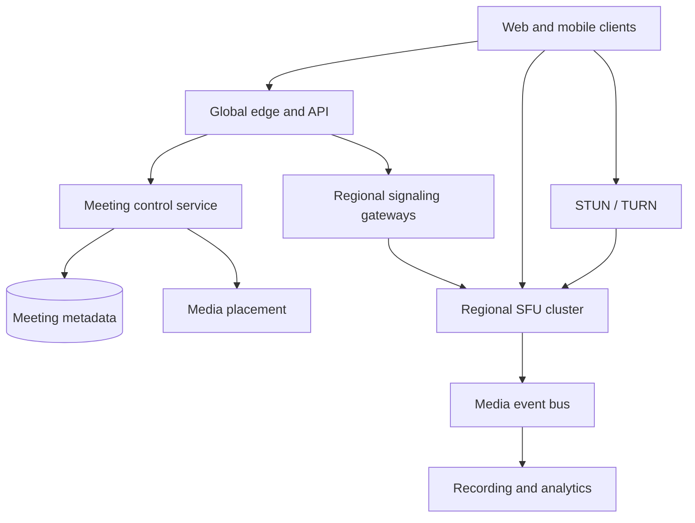
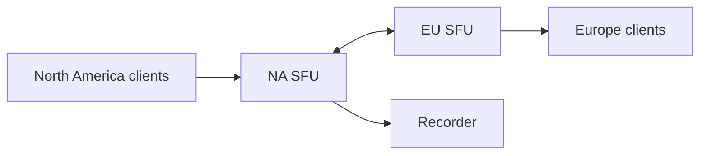

# Design a Large-Scale Video Conferencing System

**Difficulty:** Senior / Staff

**Primary themes:** WebRTC, real-time media, selective forwarding, NAT traversal, congestion control, regional routing, failure recovery, security, observability

**Interview time budget:** about 45 minutes

**Educational walkthrough:** intentionally more detailed than what you would say in the interview

This original walkthrough follows the Hello Interview delivery sequence: clarify the contract, list the core entities, define interfaces, build the simplest complete design one operation at a time, and then deepen the constraints that force architectural changes. The interview timings are pacing targets; the explanation below is deliberately longer for study.

## Interviewer prompt

> Design a global video-conferencing service similar to Zoom or Google Meet. Users can create a meeting, join from browsers or mobile devices, publish microphone, camera, and screen-share tracks, and receive other participants with low latency. The system should tolerate variable networks and regional failures while supporting millions of concurrent participants.

## Targeted clarifying questions

**Candidate:** What meeting sizes should I support?

**Interviewer:** Optimize ordinary interactive meetings for 2–100 participants. Support up to 1,000 interactive participants with reduced video fan-out and up to 20,000 view-only webinar attendees. Do not optimize the common path for the maximum case.

**Candidate:** Which features are essential?

**Interviewer:** Meeting creation and authenticated join, microphone/camera/screen sharing, mute and host controls, active-speaker and gallery layouts, chat/reactions, optional cloud recording, and reconnect after short network interruptions.

**Candidate:** Do we require end-to-end encryption?

**Interviewer:** Transport encryption is mandatory. Offer an optional end-to-end-encrypted mode, but explain what it prevents—especially server-side recording, transcription, and content moderation.

**Candidate:** What scale and latency should I target?

**Interviewer:** Assume 10 million concurrent participants worldwide, 100,000 joins per second during peaks, and 30 media regions. Target p95 mouth-to-ear audio under 200 ms within a continent, p95 glass-to-glass video under 300 ms, p99 join-to-first-media under 5 seconds, and 99.99% meeting-control availability.

**Candidate:** How should the system behave during packet loss or bandwidth drops?

**Interviewer:** Preserve intelligible audio first. Reduce video quality, frame rate, and the number of subscribed videos before interrupting audio. The client should recover automatically when bandwidth returns.

**Candidate:** Must every participant see exactly the same roster and active speaker instantly?

**Interviewer:** No. Authorization and host actions need strong ordering for a meeting. Presence and active-speaker views may converge within a few seconds. Media is real time and lossy by design.

**Candidate:** Are PSTN calling and calendar integrations in scope?

**Interviewer:** No. Mention extension points only. Focus on the meeting and media plane.

**Candidate:** I will separate the meeting control plane from the latency-sensitive media plane. I’ll first make a meeting work through one regional selective forwarding unit, then address bandwidth adaptation, global meetings, and failover.

---

## 1. Requirements (~5 minutes)

### Functional requirements

1. **Create and join meetings.** Authenticated users create meetings; invited or admitted users obtain a short-lived session and connect to a suitable media region.
2. **Publish and receive real-time media.** Participants send audio, camera, and screen-share tracks and receive an adaptive subset of other tracks for their layout and bandwidth.
3. **Control and recover sessions.** Hosts mute/remove users, lock meetings, and manage roles; clients reconnect after network changes, and meetings may optionally record or transcribe.

### Quantified non-functional requirements

| Requirement | Target | Design consequence |
|---|---:|---|
| Concurrency | 10M participants in 30 regions | Regional media clusters and horizontal meeting placement |
| Join burst | 100K joins/s | Stateless edge APIs, cached metadata, partitioned signaling |
| Audio latency | p95 mouth-to-ear <200 ms in-continent | UDP-first paths, minimal processing, nearby SFUs |
| Video latency | p95 glass-to-glass <300 ms | Forward compressed media instead of central transcoding |
| Join time | p99 first media <5 s | Trickle ICE, prewarmed capacity, parallel setup |
| Availability | 99.99% control plane | Multi-region control services and durable meeting metadata |
| Media continuity | Recover most single-node failures <5 s | Reconnect tokens, replica assignment, rapid ICE restart |
| Security | Encrypted transport; optional E2EE | DTLS-SRTP, scoped tokens, key epochs, feature tradeoffs |

### Consistency and availability contract

- Meeting policy, role changes, admission, lock state, and removals are ordered by a per-meeting control leader. Once a removal is acknowledged, that session cannot publish or rejoin without a new authorization.
- Presence, reactions, network-quality indicators, and active-speaker state are eventually consistent. Brief differences between clients are acceptable.
- Media delivery is best effort. The system may drop late video packets and lower quality; it should not wait for global consistency.
- During a control-plane partition, an existing authorized session may continue media using a bounded lease. New joins and privileged actions fail closed if authorization cannot be confirmed.
- Recording is at-least-once at the segment level and finalized asynchronously. A meeting should continue if recording fails, with a visible status change.

### Scale estimates that change the design

Assume an average participant publishes 1.5 Mbps across audio and adaptive video. At 10 million concurrent participants, global ingress is roughly:

\[
10{,}000{,}000 \times 1.5\text{ Mbps} = 15\text{ Tbps}
\]

If each participant receives four visible videos averaging 600 Kbps plus audio, egress exceeds 24 Tbps. Media bandwidth—not meeting metadata—is the dominant cost. Media must stay regional where possible, use efficient UDP, and avoid unnecessary copies.

For an eight-person meeting, a peer-to-peer mesh requires each publisher to upload seven copies. A 1.5 Mbps camera would need 10.5 Mbps uplink, already unreliable on consumer networks. At 100 participants, mesh is impossible. This rules out mesh except perhaps for a specialized two-person optimization.

At 100,000 joins/s, if signaling setup produces 20 messages of about 1 KB, the system handles roughly 2 million signaling messages/s. That is substantial but far smaller than the media plane and can be handled by partitioned WebSocket gateways.

**What I would say aloud:** “The bandwidth estimate immediately separates the problem into two planes. Meeting metadata is conventional distributed state, while tens of terabits per second of latency-sensitive media require regional packet-forwarding infrastructure.”

---

## 2. Core entities (~2 minutes)

Start with only the nouns required by the contract:

- **Meeting** — identity, policy, lifecycle, and assigned media topology.
- **ParticipantSession** — one authenticated device connection and its role.
- **MediaTrack** — audio, camera, or screen-share publication.
- **Subscription** — which track or quality layer a participant should receive.
- **MediaAllocation** — SFU nodes and regions assigned to the meeting.
- **ControlEvent** — ordered join, admit, mute, role, lock, and removal change.
- **RecordingJob** — optional recording lifecycle and segment manifest.
- **KeyEpoch** — cryptographic key version for transport or optional E2EE.

Do not model packets as database rows. RTP packets live briefly in SFU memory and network buffers; only session and operational metadata is durable.

**What I would say aloud:** “I need durable meeting and authorization state, ephemeral participant and track state, and a media allocation. The packet stream itself belongs in the data plane, not the database.”

---

## 3. API and system interface (~5 minutes)

The HTTPS API manages meetings and authorization. A long-lived WebSocket carries signaling and control events. WebRTC transports media using ICE-selected network paths and encrypted RTP.

Identity is derived from the authenticated account or workload session. A `user_id` in a request body is descriptive, not authoritative.

### Create a meeting

```http
POST /v1/meetings
Authorization: Bearer <user-token>
Idempotency-Key: create-team-sync-20261018
Content-Type: application/json

{
  "title": "Team sync",
  "starts_at": "2026-10-18T22:30:00Z",
  "join_policy": "INVITED_OR_ADMITTED",
  "max_interactive_participants": 100,
  "recording_policy": "HOST_OPTIONAL",
  "encryption_mode": "TRANSPORT"
}
```

```json
{
  "meeting_id": "mtg_7K2P",
  "join_url": "https://meet.example/7K2P",
  "version": 1
}
```

### Join a meeting

```http
POST /v1/meetings/mtg_7K2P/sessions
Authorization: Bearer <user-token>
Idempotency-Key: join-device-9f3a
Content-Type: application/json

{
  "device_id": "dev_9f3a",
  "capabilities": {
    "codecs": ["VP9", "VP8", "H264", "OPUS"],
    "simulcast": true,
    "svc": true
  },
  "network_hints": {
    "country": "US",
    "connection_type": "wifi"
  }
}
```

```json
{
  "session_id": "ps_881",
  "state": "ADMITTED",
  "signaling_url": "wss://sig-use1.example/v1/connect",
  "media_region": "us-east-1",
  "session_token": "<short-lived-signed-token>",
  "ice_servers": [
    {"urls": ["stun:stun-use1.example:3478"]},
    {"urls": ["turn:turn-use1.example:3478"], "username": "<ephemeral>", "credential": "<ephemeral>"}
  ],
  "allocation_epoch": 17,
  "resume_token": "<opaque-token>"
}
```

The token is scoped to meeting, session, role, permitted track types, media allocation, and expiry. TURN credentials are temporary so the relay cannot be used as an open proxy.

### Signaling messages

After authenticating the WebSocket, messages include monotonically increasing client and server sequence numbers:

```json
{
  "type": "publish_offer",
  "client_seq": 18,
  "session_id": "ps_881",
  "track": {
    "track_id": "cam_1",
    "kind": "video",
    "source": "camera",
    "encodings": ["low", "medium", "high"]
  },
  "sdp": "<offer>"
}
```

Server events include `participant_joined`, `participant_left`, `track_published`, `subscription_changed`, `host_action`, `active_speakers`, and `reconnect_required`. Sequence numbers and an event replay cursor repair brief signaling disconnects.

### Change subscriptions

The client sends layout intent, not raw routing commands:

```json
{
  "type": "layout_update",
  "client_seq": 24,
  "visible_participants": ["ps_102", "ps_103", "ps_110", "ps_140"],
  "pinned_participant": "ps_102",
  "max_receive_height": 720
}
```

The subscription controller combines this intent with permissions, active speakers, device capability, and current bandwidth.

### Host action

```http
POST /v1/meetings/mtg_7K2P/actions
Authorization: Bearer <host-token>
Idempotency-Key: remove-ps-140-1
Content-Type: application/json

{
  "action": "REMOVE_PARTICIPANT",
  "target_session_id": "ps_140",
  "expected_meeting_version": 52
}
```

The per-meeting control leader serializes the action, advances the version, revokes the session lease, and pushes the result to signaling and media nodes.

### Recording

```http
POST /v1/meetings/mtg_7K2P/recordings
Authorization: Bearer <host-token>
Idempotency-Key: record-mtg-7K2P-1
```

Return `202 Accepted` with a recording job. Starting media capture is asynchronous and must be visible to every participant.

**What I would say aloud:** “HTTPS establishes durable intent and authorization, WebSocket signaling negotiates session state, and WebRTC transports media. I keep host actions versioned and idempotent, but I do not put individual packets through an API service.”

---

## 4. Data flow

### Join-to-first-media flow

1. Client authenticates and requests a participant session.
2. Meeting service checks policy and asks the placement service for the meeting’s media allocation.
3. Placement prefers a nearby healthy region but avoids splitting a small meeting unnecessarily.
4. Client connects to the regional signaling gateway with its short-lived token.
5. Client gathers host, server-reflexive, and relay candidates. ICE connectivity checks select a usable path; trickle ICE sends candidates as they become available instead of waiting for all of them.
6. Client and SFU establish DTLS; keys protect SRTP media.
7. Client publishes Opus audio and multiple camera encodings.
8. SFU announces the track; subscription controllers select appropriate layers for receivers.
9. Receivers get initial keyframes and begin playout using a small jitter buffer.

STUN helps a client discover its public-facing address. TURN relays traffic when direct UDP connectivity to the SFU is blocked. TURN is a compatibility path, not the desired default, because relaying adds bandwidth cost and latency.

---

## 5. High-level design (~10–15 minutes)

### Architecture



The control plane is request/response and durable. The signaling plane maintains session coordination. The media plane is a fleet of high-network-throughput SFUs. These planes scale and fail independently.

### Operation 1: Create a meeting

The edge validates identity and idempotency, then the meeting service writes:

```text
Meeting(
  meeting_id, owner_id, title, join_policy,
  max_interactive, recording_policy, encryption_mode,
  state, version, starts_at, created_at
)
```

Meeting metadata is partitioned by `meeting_id` and replicated across regions. Creation does not allocate an SFU hours in advance. The first join—or a short prewarm window before a scheduled start—triggers placement.

### Operation 2: Join and place the meeting

The placement service scores media clusters using:

- round-trip latency from participants,
- available ingress/egress bandwidth,
- CPU and packet-processing headroom,
- TURN proximity,
- failure-domain diversity,
- meeting affinity and existing allocation,
- compliance or data-residency constraints.

For a small meeting, all participants normally use one regional SFU cluster. Keeping the meeting together avoids inter-region replication and inconsistent speaker selection. For geographically dispersed or large meetings, placement may add a second regional SFU and create a cascaded topology.

```text
MediaAllocation(
  meeting_id, allocation_epoch,
  primary_region, primary_sfu_group,
  secondary_region, topology_mode,
  state, expires_at
)

ParticipantSession(
  session_id, meeting_id, principal_id, device_id,
  role, state, signaling_region, media_region,
  allocation_epoch, lease_expires_at,
  last_control_seq, joined_at
)
```

The meeting control service has a logical leader per active meeting, selected through the partition owner rather than a process-specific permanent leader. It serializes admission and host actions and emits ordered control events. Signaling gateways cache recent events and session leases.

### Operation 3: Negotiate connectivity

Clients connect to signaling over TLS and exchange SDP offers/answers plus trickled ICE candidates. They attempt UDP paths first:

1. local host candidate,
2. public server-reflexive candidate learned through STUN,
3. relayed candidate allocated through TURN,
4. TCP/TLS relay only when UDP is blocked.

The SFU terminates ICE and DTLS-SRTP but does not decode ordinary video in the common path. Transport encryption is hop-by-hop between client and SFU. The SFU verifies the session token and allocation epoch before accepting tracks.

### Operation 4: Publish media

The browser encodes:

- Opus audio, possibly with redundancy or forward-error-correction options;
- camera video as simulcast layers, for example 180p/150 Kbps, 360p/400 Kbps, and 720p/1.2 Mbps;
- screen share with content-appropriate frame rate and resolution.

```text
MediaTrack(
  track_id, meeting_id, publisher_session_id,
  kind, source, codec, encodings,
  e2ee, state, published_at
)
```

The SFU receives one encrypted RTP stream per encoding, validates packet sequence and SSRC mappings, stores only a short retransmission buffer, and forwards selected packets. It sends a `track_published` event through signaling. It does not synchronously write every mute or packet statistic to the meeting database.

### Operation 5: Subscribe and render

The subscription controller combines layout intent with server policy:

- always prefer active audio tracks;
- include pinned and screen-share tracks;
- choose recent active speakers for remaining tiles;
- cap total downlink based on congestion estimate;
- select high resolution only for large visible tiles;
- suspend hidden video but keep audio;
- respect permissions and blocked-participant relationships.

```text
Subscription(
  subscriber_session_id, track_id,
  desired_layer, effective_layer,
  priority, reason, updated_at
)
```

Subscriptions are ephemeral and kept in SFU memory with periodic compact checkpoints. A layout change should not require a durable database transaction.

### Operation 6: Leave and end

An explicit leave closes publications and subscriptions immediately. If a client disappears, its session lease and media timeout expire after a grace period to permit quick reconnect. The control leader publishes a definitive `participant_left` event after the grace period.

When the final participant leaves, the meeting enters a cooling period, then releases SFU allocation and finalizes recording manifests. Durable meeting history stores joins, roles, host actions, and recording status—not packet-level activity.

### Baseline limitations

One SFU makes the design complete for a regional meeting, but three issues remain:

1. sending every participant every publisher’s full-quality stream explodes egress and client decode cost;
2. one region gives poor latency to global participants and one SFU failure interrupts the meeting;
3. transport encryption alone lets the SFU access media keys, which may not meet stronger privacy requirements.

Those become the deep dives.

---

## 6. Deep dives (~10–15 minutes)

## Deep dive A: Choose the media topology and scale fan-out

### Compare plausible architectures

| Topology | Advantages | Where it breaks |
|---|---|---|
| Peer mesh | No media servers; good for tiny calls | Publisher uplink and connection count grow with participants |
| MCU | Server decodes, composites, and re-encodes one stream | Expensive compute, added latency, quality loss, limited personalization |
| SFU | Forwards selected encoded packets; low processing latency | High egress; clients handle multiple streams and adaptation |
| Cascaded SFUs | Regional latency and bounded inter-region copies | More routing state, keyframe coordination, and failover complexity |

Select SFUs for ordinary meetings. They avoid the `O(n)` publisher uplink of mesh and the decode/encode tax of an MCU. Use an MCU-like compositor only for recording, legacy endpoints, or extremely large view-only broadcasts where one composed feed is more efficient.

### Fan-out arithmetic

For 100 participants each publishing 1.2 Mbps high video, forwarding every high stream to every participant would require roughly:

\[
100 \times 99 \times 1.2\text{ Mbps} \approx 11.9\text{ Gbps}
\]

for one meeting, excluding protocol overhead. A realistic client displays perhaps nine videos. If it receives one 720p pinned tile at 1.2 Mbps and eight 180p thumbnails at 150 Kbps, video downlink is about 2.4 Mbps. Selective subscription cuts the example SFU egress by roughly an order of magnitude.

### Cascaded SFUs for global meetings

Suppose 40 participants are in North America and 40 in Europe. Sending every European publication independently across the Atlantic wastes capacity and increases loss exposure. Instead:

- participants publish to their nearby regional SFU;
- each regional SFU elects the small set of tracks/layers demanded remotely;
- one copy of each selected encoding crosses the inter-region backbone;
- the receiving SFU fans it out locally.



The control leader maintains one meeting topology epoch. SFUs reject stale topology commands, preventing two independent trees from forwarding duplicate media after a reconfiguration.

For meetings under about 20 participants, prefer one region selected to minimize maximum or weighted latency. Add regional leaves only when latency, participant count, or egress savings justify the operational complexity.

### Large webinars

Twenty thousand viewers should not join the interactive SFU mesh as publishers. Split roles:

- a small stage of interactive publishers uses the SFU;
- an egress service packages a few adaptive renditions;
- viewers receive low-latency HTTP streaming or a hierarchical receive-only SFU tree;
- chat and reactions travel through separate partitioned channels;
- promotion from audience to stage creates a normal interactive session.

This keeps the common meeting path optimized while handling the asymmetric webinar workload.

### Failure and overload behavior

SFU nodes enforce per-meeting and per-tenant bandwidth budgets. Admission reserves headroom rather than filling links to 100%. On overload:

1. preserve audio and control;
2. stop off-screen video;
3. reduce video layers and frame rates;
4. reduce gallery tile count;
5. reject new video publications while allowing audio joins;
6. move or split the meeting if capacity permits.

**What I would say aloud:** “An SFU is the right default because it forwards encoded packets without transcoding. Selective subscriptions change the cost from every stream to every receiver into only the layers each layout can use. Cascading sends one demanded copy across regions, then fans out locally.”

## Deep dive B: Adapt quality under loss, jitter, and changing bandwidth

### Where a fixed bitrate fails

A participant may move from office Wi-Fi to congested cellular in seconds. Fixed high bitrate fills queues, causing delay and loss; retransmitting every missing video packet can make congestion worse. Conversely, permanently sending low quality wastes good networks.

Interactive real-time media therefore closes a feedback loop:

1. receivers report packet arrival, loss, delay, and jitter through RTCP feedback;
2. the sender or SFU estimates available bitrate;
3. encoders adjust target rate, frame rate, or resolution;
4. subscription controllers switch simulcast/SVC layers;
5. congestion circuit breakers stop media that would harm the network.

### Simulcast versus scalable video coding

**Simulcast** sends several independently encoded resolutions. SFUs can switch whole streams easily, and receiver compatibility is broad, but publisher upload and encoder cost increase.

**Scalable video coding (SVC)** produces a base layer plus spatial or temporal enhancement layers. The SFU can drop enhancements, which is bandwidth-efficient, but codec and device support is less uniform and switching logic is more complex.

Support both. Capability negotiation selects SVC when endpoints support the chosen codec and simulcast otherwise. Audio is a separate high-priority flow.

### Layer selection

For each receiver, calculate a budget from estimated bandwidth minus safety margin. Allocate it by priority:

1. all selected audio;
2. screen share or pinned speaker base layer;
3. active speaker high layer;
4. visible thumbnails;
5. enhancements.

Use hysteresis: upgrade only after sustained headroom, downgrade quickly under congestion. Otherwise the picture oscillates between layers. When switching into a new independent stream, request or wait for a keyframe so the decoder can start cleanly. Rate-limit keyframe requests to avoid a “PLI storm” after many subscribers join.

### Loss recovery

- A short SFU packet buffer supports selective retransmission for useful recent packets.
- Audio may use packet-loss concealment, limited redundancy, or forward error correction because waiting for retransmission may exceed its playout deadline.
- Video retransmission is useful only if the packet can arrive before its frame deadline.
- A jitter buffer smooths arrival variation but must stay small enough for conversation.
- Lip sync uses RTP timestamps and sender reports; do not delay audio indefinitely to match late video.

### Active-speaker detection

Clients can send audio-level metadata; SFUs combine it with voice-activity detection and debounce rules. A noisy participant should not steal the layout continuously. Active-speaker state is soft, regional, and eventually convergent—it should never be in the strongly consistent meeting transaction path.

### Observability

Measure quality from the user’s perspective:

- join phase durations: token, signaling, ICE, DTLS, first audio, first video;
- end-to-end RTT, one-way delay estimates, jitter, packet loss, concealment;
- estimated and actual send/receive bitrate;
- video freeze time, frames decoded/dropped, resolution switches;
- audio interruption duration and mean opinion score proxy;
- TURN usage by network/provider;
- retransmission and keyframe request rates;
- SFU packet-processing CPU, NIC drops, queue depth, and egress saturation.

Aggregate metrics by client version, ISP, device class, region, and codec, while sampling participant-level traces under privacy controls. A server with low CPU can still deliver poor calls because of an ISP route; client telemetry is essential.

**What I would say aloud:** “The quality controller is a deadline-aware feedback loop. Audio wins, visible video receives the remaining budget, downgrades happen quickly, and upgrades use hysteresis. Reliability does not mean retransmitting media after it is too late to play.”

## Deep dive C: Recover from node, region, and signaling failures

### Failure categories

| Failure | Expected response |
|---|---|
| Signaling gateway dies | Client reconnects with cursor; media may continue |
| SFU process dies | Client ICE-restarts to a replacement allocation |
| Availability zone fails | Placement selects spare nodes in another zone |
| Media region fails | Clients reconnect to secondary region; temporary quality loss |
| Control leader fails | Partition elects a new owner and resumes from ordered log |
| Event bus or analytics fails | Meetings continue; buffer or drop noncritical telemetry |

Signaling and media connections are deliberately separable. A short WebSocket outage should not tear down healthy SRTP media. Conversely, signaling may remain healthy while a broken UDP path requires ICE restart.

### Fast SFU recovery

Continuously replicating every RTP packet and SFU buffer to a hot standby would double bandwidth and still struggle with timing. Instead checkpoint compact state:

- participant and track IDs,
- negotiated codecs and header-extension mappings,
- subscription intent,
- topology and allocation epochs,
- latest control-event cursor,
- encrypted resume authorization.

On node failure:

1. health system marks the node unavailable and stops new placement;
2. allocation service selects a replacement in another failure domain;
3. signaling sends `reconnect_required` with a higher allocation epoch;
4. clients perform ICE restart and DTLS setup using the resume token;
5. publishers resend codec headers and keyframes;
6. subscriptions rebuild from layout intent.

Clients continue local capture and may briefly play buffered audio. The target is rapid reconnection, not seamless packet preservation.

### Regional failover

For important meetings, placement preselects a secondary region and replicates control state there. It does not duplicate all media continuously. If the primary region is unreachable, the meeting leader advances the allocation epoch and authorizes the secondary.

Prevent split brain:

- session and media tokens include `allocation_epoch`;
- only the control quorum can advance the epoch;
- SFUs accept new publications only for the current epoch;
- existing old-epoch sessions have a short bounded media lease;
- after lease expiry, an isolated old region stops forwarding.

This may interrupt media for a few seconds, but it prevents two regions from both acting as the authoritative topology indefinitely.

### Reconnect storms

A regional failure can trigger hundreds of thousands of simultaneous reconnects. Clients use exponential backoff with jitter but audio sessions receive an aggressive first retry. The edge returns lightweight signed allocation responses from caches, TURN pools keep spare ports, and placement reserves disaster headroom in neighboring regions. Admission may initially allow audio-only joins, then restore video gradually.

### Control-plane availability

Meeting definitions live in a multi-region durable database. Active meeting control events are appended to a partitioned log keyed by meeting ID, preserving per-meeting order. Gateways cache the latest snapshot and replay from a cursor after reconnect.

If the log is unavailable, existing media continues under leases. Host actions requiring durable order return retryable failures rather than being applied inconsistently. Reactions and diagnostic telemetry may be dropped under pressure.

**What I would say aloud:** “I replicate compact session intent, not the packet stream. After an SFU failure the client reconnects, republishes, and requests a keyframe. Allocation epochs fence the old topology, while jittered recovery and reserved capacity prevent failover from becoming a second outage.”

## Deep dive D: Security, E2EE, recording, and abuse

### Transport security

- HTTPS and WebSocket signaling use TLS.
- WebRTC media uses DTLS-SRTP.
- Join tokens are short-lived, audience-restricted, scoped to meeting and role, and bound to an allocation epoch.
- TURN credentials are ephemeral and bandwidth-limited.
- SFU-to-SFU backbone links use mutually authenticated encryption.
- Host removals revoke session leases and publish a higher control version.

### Optional end-to-end encryption

In normal transport-encrypted mode, the SFU terminates SRTP and can inspect media payloads if necessary for server features. In E2EE mode, clients additionally encrypt encoded media frames with a meeting key unknown to the SFU. The SFU still needs visible routing metadata such as track identifiers, packet timing, and layer information, but cannot decode content.

Key management uses epochs:

- an admitted participant receives the current meeting key through an authenticated key-distribution channel;
- membership changes rotate the epoch;
- removed participants do not receive future keys;
- clients retain a small prior-key window for reordered packets;
- device identity and key confirmation defend against unauthorized insertion.

E2EE disables or changes server-side recording, transcription, moderation, and some legacy endpoints. Client-side recording or a clearly identified trusted recording participant is possible, but users must understand that it becomes another decrypting endpoint.

### Abuse controls

Enforce waiting rooms, meeting passcodes or invitation policy, role-based actions, per-principal join limits, token replay detection, and rate limits. Detect denial-of-service by connection and bitrate behavior without claiming content visibility in E2EE mode. A removed client cannot rely only on a UI event; the media node must reject its revoked lease.

### Recording pipeline

In transport-encrypted mode, a recording worker joins as a hidden authorized subscriber or receives selected tracks from the SFU. It writes short independently checksummed segments to object storage and appends a manifest event. A composer can later produce gallery and speaker views.

Segment creation is idempotent by `(recording_id, track_id, time_range)`. Missing segments are visible in the manifest. Recording failures notify participants but do not block the meeting. Retention, deletion, region residency, and access audit are explicit policies.

**What I would say aloud:** “E2EE is not a checkbox. If the server cannot decrypt frames, server recording and transcription cannot work unchanged. I would expose that product tradeoff, rotate keys on membership changes, and still fence sessions at the routing layer.”

---

## 7. Final design

### Concise architecture

1. A global edge authenticates users and routes meeting-control requests.
2. A partitioned meeting service owns durable policy and ordered per-meeting host actions.
3. A placement service assigns a nearby, healthy SFU group and secondary failure domain.
4. Regional WebSocket gateways coordinate admission, SDP, ICE candidates, tracks, subscriptions, and replayable control events.
5. STUN assists address discovery; TURN provides short-lived relays when direct UDP to the SFU fails.
6. Clients publish Opus audio and simulcast or SVC video through DTLS-SRTP.
7. Regional SFUs forward only selected layers and maintain short retransmission buffers.
8. Subscription controllers prioritize audio, screen share, pinned users, active speakers, and visible tiles within each receiver’s congestion budget.
9. Cascaded SFUs carry one demanded inter-region copy and fan out locally for global meetings.
10. Allocation epochs and bounded leases fence failed or partitioned media topologies.
11. Clients recover through resume tokens, ICE restart, republishing, and keyframe requests.
12. An asynchronous event bus feeds recording, quality analytics, audit, and billing without entering the packet path.
13. Optional frame-level E2EE hides content from SFUs while explicitly disabling incompatible server features.

### Requirements check

| Requirement | Design response |
|---|---|
| Create and join | Durable meeting service, idempotent join, scoped session tokens |
| Audio/video/screen share | WebRTC publishing through regional SFUs |
| Low latency | Nearby UDP-first media path without common-path transcoding |
| 10M concurrent users | Regional clusters, meeting sharding, selective forwarding |
| Variable bandwidth | RTCP feedback, congestion control, simulcast/SVC layer selection |
| NAT/firewall traversal | ICE with STUN and ephemeral TURN relay credentials |
| Host controls | Ordered per-meeting control events and lease revocation |
| Global meetings | Cascaded SFUs and topology epochs |
| Failure recovery | Compact checkpoints, resume token, ICE restart, secondary region |
| Recording | Asynchronous segment pipeline with visible failure state |
| Security | TLS, DTLS-SRTP, scoped tokens, optional frame-level E2EE |
| Observability | Client QoE plus signaling, SFU, TURN, and network metrics |

### Principal tradeoffs

- SFUs reduce compute latency but shift decode work to clients and can incur high egress.
- Simulcast improves fast layer switching at the cost of publisher uplink and encode work.
- SVC is more bandwidth-efficient but has uneven codec/device support.
- A single region simplifies meetings; multiple regions improve latency but complicate topology and recovery.
- Packet retransmission improves quality only while the packet still meets its playback deadline.
- Preallocated failover capacity costs money but prevents recovery storms from exhausting neighboring regions.
- E2EE improves privacy but removes server visibility required by recording, transcription, and moderation.

---

## Realistic interviewer follow-ups with strong sample answers

### 1. Why use an SFU instead of peer-to-peer?

**Strong answer:** “A mesh makes each publisher upload one copy per receiver, so uplink and connection count grow linearly with meeting size. An SFU receives one or a few encodings and forwards only the layers receivers need. I might optimize a two-person call for direct media, but the main architecture needs SFUs.”

### 2. Why not mix everyone into one server-rendered video?

**Strong answer:** “An MCU simplifies receivers but requires decoding and re-encoding every input, adding compute, latency, and quality loss while removing personalized layouts. I reserve composition for recording, legacy clients, or huge receive-only broadcasts.”

### 3. What is the difference between STUN, TURN, and ICE?

**Strong answer:** “ICE gathers possible network candidates and tests candidate pairs. STUN helps a client discover a server-reflexive public address. TURN allocates a relay when direct connectivity fails. ICE is the selection process; STUN and TURN supply candidate types.”

### 4. Why send multiple video encodings?

**Strong answer:** “Receivers have different bandwidth and tile sizes. Simulcast lets the SFU forward low resolution to thumbnails and high resolution to a pinned speaker without transcoding. SVC can provide a base layer plus enhancements when supported.”

### 5. How do you keep audio working on a bad network?

**Strong answer:** “Reserve bandwidth for audio, suspend off-screen video, downgrade layers quickly, use a small jitter buffer and audio loss concealment or limited FEC, and avoid retransmissions that arrive after the playout deadline.”

### 6. What happens when the SFU crashes?

**Strong answer:** “The client retains a resume token and local capture. Placement selects a replacement, signaling sends a higher allocation epoch, clients ICE-restart and establish DTLS, publishers resend keyframes, and subscriptions rebuild from layout intent. I replicate compact state, not every packet.”

### 7. Can media continue if signaling disconnects?

**Strong answer:** “Yes, for a bounded time. The WebSocket coordinates changes, but an established SRTP transport can continue. The client reconnects with its control-event cursor; the session lease prevents an isolated client from continuing indefinitely after revocation.”

### 8. How do you avoid split brain during regional failover?

**Strong answer:** “Every allocation and media token carries an epoch advanced by the control quorum. New SFUs accept only the current epoch, and old-epoch media leases expire. That can cause a brief interruption, but two regions cannot both accept new authoritative publications indefinitely.”

### 9. How do you handle 20,000 webinar viewers?

**Strong answer:** “Keep a small interactive stage on SFUs, then distribute a few adaptive renditions through low-latency HTTP streaming or a receive-only SFU tree. Audience members are not full interactive publishers until promoted.”

### 10. Does end-to-end encryption hide everything from the SFU?

**Strong answer:** “It hides encoded media payloads, but the SFU still sees routing metadata, packet sizes, timing, and the layers needed for forwarding. It also prevents ordinary server-side recording and transcription, so those features must be disabled or implemented through an explicitly trusted endpoint.”

### 11. How do you choose one media region for a meeting?

**Strong answer:** “Score candidate clusters using participant latency, network and CPU headroom, compliance, failure domains, and existing meeting affinity. For a small meeting I minimize weighted latency while keeping everyone together; I add cascaded regional SFUs only when the benefits exceed the complexity.”

### 12. How do you measure call quality?

**Strong answer:** “Server uptime is insufficient. I measure time to first media, audio interruption, packet loss, jitter, RTT, concealment, video freeze ratio, decoded frame rate, resolution, layer switches, and TURN usage, then correlate those with ISP, region, device, codec, and client version.”

### 13. Why not store live subscriptions in the main database?

**Strong answer:** “They change with layout and congestion, potentially many times per second, and losing one is recoverable from client intent. They belong in SFU memory with compact checkpoints; durable storage is for policy, authorization, and audit.”

### 14. What is the hardest capacity-planning resource?

**Strong answer:** “Usually network egress and packets per second, not disk. I plan on NIC headroom, packet-copy efficiency, TURN relay rate, inter-region bandwidth, and correlated reconnect load, while also watching encoder limits on clients and recorders.”

---

## Common pitfalls

1. Using peer-to-peer mesh as the main design for large meetings.
2. Saying “WebRTC handles it” without explaining signaling, ICE, STUN, TURN, DTLS-SRTP, and SFUs.
3. Sending every participant every high-resolution track.
4. Centralizing global media through one region.
5. Putting audio and video at the same degradation priority.
6. Retransmitting packets without considering their playback deadlines.
7. Treating a signaling disconnect as an immediate media failure.
8. Replicating the full RTP stream to a standby instead of designing fast reconnection.
9. Failing to fence the old media topology during failover.
10. Ignoring reconnect storms and disaster headroom.
11. Storing packet-level or rapidly changing subscription state in a relational database.
12. Using a single fixed video bitrate for all receivers.
13. Switching layers without hysteresis or keyframe coordination.
14. Treating active speaker as strongly consistent meeting state.
15. Issuing long-lived TURN credentials that can be abused as an open relay.
16. Claiming E2EE while the server can still decrypt recordings invisibly.
17. Measuring only SFU CPU rather than end-user audio and video quality.
18. Designing the 20,000-viewer webinar as 20,000 normal interactive participants.

---

## A polished 90-second closing

> “I split the system into a durable meeting control plane, a WebSocket signaling plane, and a regional real-time media plane. Users create and join through idempotent APIs, receive a short-lived scoped session token, then use signaling to negotiate ICE, DTLS, tracks, and subscriptions. ICE prefers direct UDP to a nearby SFU, uses STUN for public address discovery, and falls back to an ephemeral TURN relay when necessary.
>
> “Clients publish Opus audio plus simulcast or SVC video layers. The SFU forwards compressed packets rather than transcoding, and each receiver gets only the tracks and layers its layout and congestion budget can use. Audio, screen share, and pinned speakers have priority; video degrades before audio. Small meetings stay in one region, while global meetings use cascaded SFUs so only demanded copies cross the backbone.
>
> “Meeting policy and host actions are ordered per meeting, while presence, active speaker, and subscriptions are soft state. On an SFU failure, clients use resume tokens, a higher allocation epoch, ICE restart, and new keyframes to recover. Allocation epochs and bounded leases fence the old topology. Recording and analytics consume asynchronous media events and cannot block the meeting. Transport encryption is mandatory, and optional frame-level E2EE explicitly disables incompatible server-side features. The main tradeoffs are egress versus compute, regional simplicity versus global latency, and privacy versus server-side functionality.”

---

## Public references

- [Hello Interview — System Design Delivery Framework](https://www.hellointerview.com/learn/system-design/in-a-hurry/delivery) — used for the interview sequence and pacing.
- [W3C — WebRTC 1.0](https://www.w3.org/TR/webrtc/) — browser real-time communication APIs and `RTCPeerConnection` behavior.
- [RFC 8445 — Interactive Connectivity Establishment](https://www.rfc-editor.org/rfc/rfc8445.html) — candidate gathering and NAT traversal connectivity checks.
- [RFC 8838 — Trickle ICE](https://www.rfc-editor.org/rfc/rfc8838.html) — incremental candidate provisioning to reduce setup delay.
- [RFC 5766 — TURN](https://www.rfc-editor.org/rfc/rfc5766.html) — relayed connectivity when direct paths fail.
- [RFC 8834 — Media Transport and Use of RTP in WebRTC](https://www.rfc-editor.org/rfc/rfc8834.html) — RTP/RTCP requirements for WebRTC media.
- [RFC 8836 — Congestion Control Requirements for Interactive Real-Time Media](https://www.rfc-editor.org/rfc/rfc8836.html) — congestion control and circuit-breaker requirements.
- [RFC 8853 — Using Simulcast in SDP and RTP Sessions](https://www.rfc-editor.org/rfc/rfc8853.html) — signaling and identification of simulcast streams.

These references support the public protocols and interview structure. The requirements, scale assumptions, APIs, architecture, failure design, and dialogue are original.
