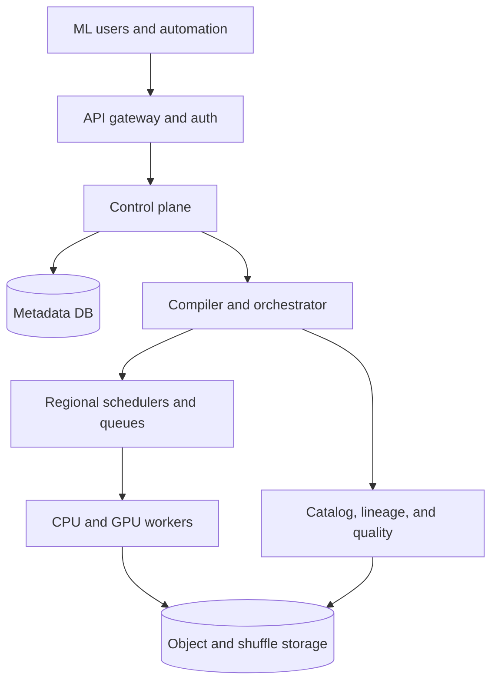
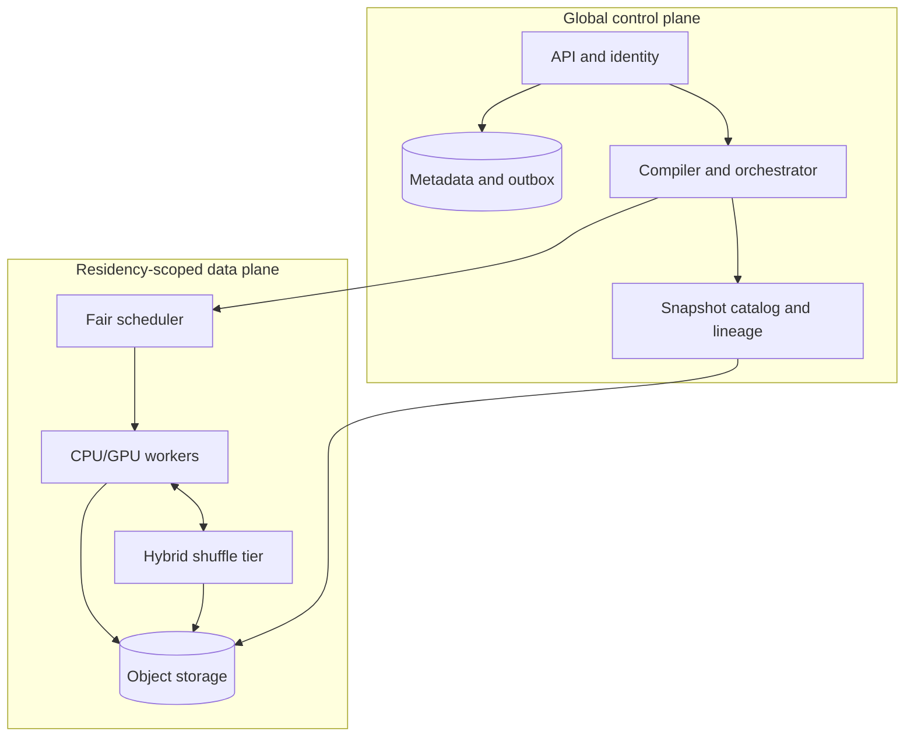

# Design a Large-Scale ML Data Preparation and Training Dataset Platform

**Difficulty:** Senior / Staff  
**Primary themes:** distributed batch processing, immutable snapshots, shuffle and skew, idempotency, lineage, multi-tenant scheduling  
**Interview time budget:** about 45 minutes  
**Educational walkthrough:** intentionally more detailed than what you would say in 45 minutes

## Interviewer prompt

> Design a managed platform that lets machine-learning teams turn raw data in a data lake into reproducible training, validation, and test datasets. Users define transformation pipelines, run them at petabyte scale, inspect progress and quality checks, and publish immutable dataset snapshots that training jobs can consume. The platform is multi-tenant and must handle failures, skewed data, backfills, and expensive CPU or GPU transforms.

This is not a feature-store or model-serving problem. The product ends when it publishes a durable dataset manifest. Model training and online inference are downstream consumers.

## Targeted clarifying questions

**Candidate:** What transformations must we support?

**Interviewer:** SQL-style filters, joins, aggregations, arbitrary containerized map functions, tokenization, image augmentation, deterministic splitting, validation, and shuffling. Pipelines are directed acyclic graphs, or DAGs.

**Candidate:** Are inputs files, tables, or streams?

**Interviewer:** Primarily versioned lake tables and object-store prefixes. Daily incremental builds matter, but the execution model can be bounded batch. Streaming feature serving is out of scope.

**Candidate:** What does reproducible mean here?

**Interviewer:** Given the same pipeline version, immutable input snapshots, code and runtime digests, parameters, and random seed, a rerun should produce the same logical rows and splits. Physical file boundaries may differ if the manifest records that fact.

**Candidate:** What scale and service levels should I design for?

**Interviewer:** About 100,000 runs per day and 20 PB of input scanned per day, with a 5× burst. One run may process from gigabytes to 10 PB. Support roughly 200,000 concurrent task slots across regions. Control-plane APIs should be highly available; large-run completion time is workload-dependent.

**Candidate:** Is publication allowed to expose partial output?

**Interviewer:** No. Readers must see either the previous published snapshot or the complete new snapshot. Progress can be eventually consistent.

**Candidate:** Can task code have external side effects?

**Interviewer:** User transforms should be pure with respect to platform-managed data. External side effects are unsupported because retries are expected.

**Candidate:** Do we need cross-region execution?

**Interviewer:** Yes, but data residency is strict. Move compute to data; do not silently move regulated data across regions.

**Candidate:** Should we optimize for latency or cost?

**Interviewer:** Both through explicit job classes: interactive jobs favor latency, scheduled jobs favor cost, and deadline jobs specify a completion target.

## How to frame the interview

The delivery order follows Hello Interview's public framework: requirements, core entities, interface, high-level design, and deep dives. The useful idea is not to memorize boxes. It is to establish a contract, then make every component earn its place by satisfying an operation or non-functional requirement. See [Hello Interview's delivery framework](https://www.hellointerview.com/learn/system-design/in-a-hurry/delivery) and [API-design guidance](https://www.hellointerview.com/learn/system-design/core-concepts/api-design).

A good opening is:

> “I’ll first pin down correctness and scale, because they determine whether this is a workflow service, a data engine, or both. Then I’ll define the external contract and build the design one user operation at a time. I expect the hard parts to be reproducible publication, shuffle skew, and failure recovery.”

---

## 1. Requirements (~5 minutes)

### Core functional requirements

1. **Define and version a data-preparation pipeline.** A user specifies immutable inputs, a DAG of transforms, schemas, resource requirements, a seed, and quality gates.
2. **Execute and operate a run.** A user starts, observes, retries, or cancels a batch or incremental run; the system schedules map, shuffle, reduce, and validation tasks across a multi-tenant fleet.
3. **Atomically publish a reproducible dataset snapshot.** Successful output includes train/validation/test splits, a manifest, statistics, lineage, and enough provenance to reproduce it.

### Out of scope

- interactive notebooks and pipeline authoring UI;
- model training, hyperparameter search, registry, deployment, and inference;
- low-latency online feature reads;
- arbitrary external side effects from user code;
- a general-purpose streaming engine.

### Quantified non-functional requirements

| Requirement | Target | Why it matters |
|---|---:|---|
| Throughput | 20 PB input/day average, 5× burst | Requires horizontal planning, storage, shuffle, and worker fleets |
| Run volume | 100,000 runs/day; up to 10 PB/run | Control plane cannot store every heartbeat as a transactional row |
| Control-plane availability | 99.99% monthly for submit/status/catalog APIs | Users and automation must still see accepted work during worker failures |
| Durability | No acknowledged pipeline version or published snapshot lost; metadata RPO 0 | Dataset IDs may be referenced by audits and model releases for years |
| Reproducibility | Same frozen inputs/spec/code/runtime/seed gives the same logical records and split membership | Enables debugging, audit, and exact model rebuilds |
| Publication consistency | Atomic snapshot visibility; no partial reads | Trainers must never consume half a dataset |
| Isolation | Enforced quotas, fair scheduling, per-tenant encryption and residency | One tenant or hot run cannot exhaust the shared fleet |
| Recovery | Resume from durable stage boundaries; retry transient task failures automatically | Recomputing petabytes from the beginning is unacceptable |

### Scale estimates that change the design

Average scan bandwidth is:

\[
20\ \text{PB/day} \div 86{,}400 \approx 231\ \text{GB/s}
\]

At a 5× burst, the fleet must sustain roughly **1.15 TB/s of input reads**. If joins, sorts, and materialized intermediate results create 3× write amplification, the platform may move about 60 PB/day, or 694 GB/s on average. This rules out a central coordinator carrying data or a single shuffle service. The control plane handles metadata; workers exchange or externalize data directly.

For a 1 PB run, assume a worker processes 200 MB/s after decompression and transform overhead:

\[
1\ \text{PB} \div 200\ \text{MB/s} \approx 5{,}000{,}000\ \text{worker-seconds}
\]

That is about 1,389 worker-hours. Two thousand effective workers give a lower bound near 42 minutes, before shuffle, skew, startup, and validation. This justifies parallel execution and also explains why eliminating a few stragglers matters.

Finally, if a typical run creates 10,000 task attempts, the service records roughly **one billion task attempts per day**. A strongly consistent database can retain run summaries and leases, but raw heartbeats, logs, and attempt events belong in an append-only event stream and cheap analytical storage.

### Consistency and availability contract

- Pipeline definitions, run submission, cancellation intent, leases, and snapshot publication use strongly consistent metadata operations.
- Task delivery is **at least once**. Exactly-once task execution is not promised; committed effects are idempotent.
- Input and output snapshots are immutable. A mutable table name is resolved to a snapshot ID at submission time.
- A dataset becomes readable through a single atomic catalog-pointer update after all required files and quality results exist.
- Progress, logs, metrics, and lineage indexing may lag by seconds or minutes.
- During a control-plane partition, existing workers may finish leased tasks and upload attempt outputs, but no region independently publishes a snapshot without owning the metadata lease.

What to say aloud:

> “I’m separating execution semantics from visibility semantics. Tasks may run more than once, but only one attempt can commit each logical partition, and the final dataset appears atomically. That is cheaper and more realistic than claiming exactly-once execution.”

---

## 2. Core entities (~2 minutes)

Identify the nouns before designing tables:

| Entity | Purpose |
|---|---|
| `Pipeline` | Stable user-owned name and policy boundary |
| `PipelineVersion` | Immutable DAG, transform specs, schemas, code/runtime digests, defaults |
| `DatasetSnapshot` | Immutable input or published output plus manifest and provenance |
| `Run` | One execution of a pipeline version against resolved inputs |
| `Stage` | Maximal group of tasks separated by a shuffle or materialization boundary |
| `Task` | Logical partition of stage work |
| `TaskAttempt` | One leased execution of a task; multiple attempts may race |
| `Artifact` | Data, shuffle block, statistics, checkpoint, log, or validation result |
| `QualityCheck` | Required or advisory constraint and its result |
| `LineageEdge` | Dependency from input snapshots and transforms to output snapshot |
| `ResourceProfile` | CPU, memory, accelerator, locality, and scheduling class |

Do not fully normalize the schema yet. Introduce fields only when components need them.

What to say aloud:

> “The key distinction is between a logical task and an attempt. Retries create attempts, but only one attempt wins the commit for the logical task. Similarly, a dataset name is mutable metadata, while a snapshot is immutable data.”

---

## 3. API and system interface (~5 minutes)

The public control plane uses REST. Internal latency-sensitive worker coordination uses gRPC. Authentication supplies the tenant and principal; clients never choose `tenant_id` in the body.

### 3.1 Create an immutable pipeline version

```http
POST /v1/pipelines/{pipeline_id}/versions
Authorization: Bearer <token>
Idempotency-Key: 6e125...
Content-Type: application/json

{
  "nodes": [
    {
      "id": "clean",
      "type": "container_map",
      "image_digest": "sha256:ab12...",
      "entrypoint": ["python", "clean.py"],
      "resources": {"cpu": 4, "memory_gib": 16}
    },
    {
      "id": "split",
      "type": "deterministic_split",
      "inputs": ["clean"],
      "key_columns": ["example_id"],
      "ratios": {"train": 0.8, "validation": 0.1, "test": 0.1}
    }
  ],
  "quality_checks": [
    {"expression": "count(*) > 1000000", "severity": "required"},
    {"expression": "null_rate(label) < 0.001", "severity": "required"}
  ]
}
```

```json
{
  "pipeline_version_id": "pv_01J...",
  "spec_digest": "sha256:91ef...",
  "state": "READY"
}
```

The service validates acyclicity, schemas, supported transforms, image allowlists, and declared resources. The identity service derives owner and tenant from the token.

### 3.2 Start a run

```http
POST /v1/pipeline-runs
Authorization: Bearer <token>
Idempotency-Key: run-2026-10-18-recs-v42
Content-Type: application/json

{
  "pipeline_version_id": "pv_01J...",
  "inputs": {
    "events": "catalog://clicks@2026-10-17",
    "users": "snapshot://ds_7K2..."
  },
  "parameters": {"country": "US"},
  "seed": 38471,
  "mode": "INCREMENTAL",
  "scheduling": {"class": "DEADLINE", "complete_by": "2026-10-18T10:00:00Z"}
}
```

```json
{
  "run_id": "run_9MV...",
  "state": "ACCEPTED",
  "resolved_inputs": {
    "events": "snapshot://ds_8TT...",
    "users": "snapshot://ds_7K2..."
  }
}
```

Resolving names to immutable snapshot IDs synchronously is part of accepting the run. The idempotency key prevents a client retry from creating duplicate runs.

### 3.3 Observe and control a run

```http
GET /v1/pipeline-runs/run_9MV...
```

```json
{
  "state": "RUNNING",
  "version": 18,
  "stages": [
    {"stage_id": "s1", "state": "SUCCEEDED", "tasks": {"done": 8192, "total": 8192}},
    {"stage_id": "s2", "state": "RUNNING", "tasks": {"done": 4930, "total": 8192}}
  ],
  "input_bytes": 442190485504000,
  "estimated_completion": "2026-10-18T08:42:00Z"
}
```

```http
POST /v1/pipeline-runs/run_9MV...:cancel
If-Match: "18"
```

Cancellation is an intent, not an instantaneous guarantee. The version condition prevents stale operators from overwriting newer state.

### 3.4 Read a published snapshot

```http
GET /v1/dataset-snapshots/ds_B83...
```

```json
{
  "snapshot_id": "ds_B83...",
  "state": "PUBLISHED",
  "schema_digest": "sha256:88af...",
  "manifest_uri": "s3://ml-datasets/.../manifest-00042.json",
  "manifest_digest": "sha256:7e20...",
  "splits": {"train": 881245990, "validation": 110155749, "test": 110155747},
  "source_run_id": "run_9MV...",
  "lineage_uri": "catalog://lineage/ds_B83..."
}
```

The trainer receives short-lived signed access or a workload identity, not permanent object-store credentials.

### 3.5 Internal worker protocol

```protobuf
rpc LeaseTasks(LeaseRequest) returns (stream TaskLease);
rpc Heartbeat(AttemptHeartbeat) returns (LeaseDirective);
rpc CommitAttempt(CommitRequest) returns (CommitDecision);
```

`TaskLease` includes `task_id`, `attempt_id`, `lease_epoch`, input manifests, output prefix, transform digest, seed material, and resource limits. `CommitAttempt` is conditional on the latest lease epoch.

---

## 4. Data flow

1. The API authenticates the caller, applies tenant quota, deduplicates the request, and resolves every mutable input reference to an immutable snapshot.
2. The compiler validates the DAG, expands schemas, chooses stage boundaries, estimates sizes from manifests and statistics, and writes an immutable physical plan.
3. The orchestrator creates a run record and stage records transactionally, then emits a `RunAccepted` event through an outbox.
4. The scheduler converts the ready stage into locality-aware tasks and places references on queues by region and resource class.
5. Workers lease tasks, read immutable inputs, execute sandboxed transforms, upload attempt-scoped artifacts, and request conditional commits.
6. Shuffle-producing stages publish block manifests. Downstream stages start only after their required barrier or declared pipelined threshold.
7. Validation workers compute required checks and dataset statistics.
8. The publisher verifies all logical partitions, constructs the root manifest, writes lineage, and atomically swaps the dataset catalog pointer from the prior snapshot to the new snapshot.
9. Trainers resolve the snapshot ID and read files directly from object storage.

The manifest approach resembles an established lake-table pattern: Apache Iceberg snapshots reference manifest structures rather than rewriting a monolithic list of every file. See the [Iceberg specification](https://iceberg.apache.org/spec/).

---

## 5. High-level design (~10–15 minutes)

Build the simplest complete design one operation at a time.



### Operation 1: define and version a pipeline

The API gateway authenticates the principal and routes the request. The pipeline service performs authorization and validates the idempotency key. A compiler parses the DAG and rejects cycles, incompatible schemas, unpinned images, unsupported nondeterministic operators, and impossible resource requests.

The strongly consistent metadata database stores:

```text
PipelineVersion(
  pipeline_version_id, tenant_id, pipeline_id, version,
  canonical_spec_uri, spec_digest, compiler_version,
  created_by, created_at, state
)
```

Large canonical plans live in object storage; the database stores their URI and digest. Once ready, a version is immutable. Editing creates a new version.

Why immutable versions? If a run merely points to “the current pipeline,” a later edit makes the historical run ambiguous. The digest is also verified by workers before execution.

### Operation 2: submit and compile a run

On `POST /pipeline-runs`, the run service:

1. checks the idempotency table scoped by tenant and endpoint;
2. resolves input names to immutable snapshot IDs;
3. freezes parameters, seed, code image digests, runtime digest, locale, timezone, and library lockfile;
4. writes `Run(state=ACCEPTED)` plus an outbox event in one transaction;
5. returns the run ID.

The outbox solves a dual-write problem. Without it, the service could commit the run but crash before notifying the orchestrator. A relay repeatedly publishes unacknowledged outbox rows; consumers deduplicate by event ID.

The planner chooses stage boundaries around operations requiring repartitioning: joins, group-bys, global sorts, and explicit materialization. A map-only chain stays in one fused stage to avoid unnecessary files and scheduling overhead.

Relevant fields appear now:

```text
Run(
  run_id, tenant_id, pipeline_version_id, state, state_version,
  resolved_input_snapshot_ids, parameters_digest, seed,
  physical_plan_uri, plan_digest, region, scheduling_class,
  deadline, created_at, started_at, finished_at, output_snapshot_id
)

Stage(
  run_id, stage_id, kind, dependencies, state,
  target_partition_bytes, planned_task_count,
  committed_task_count, input_manifest_uris, output_manifest_uri
)
```

### Operation 3: execute a map-only stage

The regional scheduler reads a ready stage and creates logical tasks from input file splits. A queue holds lightweight task references, not multi-megabyte plans. Workers advertise region, zone, CPU, memory, GPU type, local cache keys, and supported runtime.

The scheduler prefers:

1. the legally permitted region;
2. cached or same-zone input;
3. a matching resource profile;
4. the tenant's fair-share entitlement;
5. earliest deadline and age within that share.

A worker receives a time-bounded lease. It reads its input directly, periodically checkpoints for long transforms, writes output below an attempt-specific prefix, and then calls `CommitAttempt`.

```text
Task(
  run_id, stage_id, task_id, input_partition,
  state, winning_attempt_id, commit_version
)

TaskAttempt(
  attempt_id, task_id, lease_epoch, worker_id,
  state, started_at, heartbeat_at, output_manifest_uri,
  metrics_uri, failure_class
)
```

The metadata service executes a compare-and-swap: if the task is uncommitted and the lease epoch is valid, this attempt becomes the winner. Otherwise the attempt's files remain unreachable garbage and are deleted later.

### Operation 4: add shuffle stages

A join or group-by cannot be completed independently from arbitrary input splits. Map tasks hash or range-partition records into shuffle buckets. Each attempt writes immutable blocks and a block manifest. After map commits reach the barrier, reduce tasks fetch only committed blocks.

For the baseline, use a hybrid shuffle tier:

- local NVMe for active blocks and repeated reads;
- regional shuffle nodes for fast fan-out;
- object storage as durable overflow and recovery backing.

The stage manifest maps `(map_task, reduce_partition)` to block URI, byte range, checksum, row count, and key statistics. Reducers never discover blocks by listing a bucket; object-store listing may be slow or inconsistent, and losing an exact committed set would break correctness.

### Operation 5: validate and atomically publish

After every terminal data stage succeeds, validation tasks compute schema compatibility, row counts, null rates, label distribution, duplicate estimates, drift, and user-defined constraints. Required failures set the run to `QUALITY_FAILED`; advisory failures attach warnings.

The publisher then:

1. verifies that every expected logical partition has one committed artifact;
2. verifies checksums and required quality results;
3. writes leaf manifests and a root manifest with schema, split, provenance, and file references;
4. inserts an immutable `DatasetSnapshot(state=STAGED)` row;
5. transactionally marks it `PUBLISHED`, attaches it to the run, and updates the named dataset's current pointer if requested;
6. emits `SnapshotPublished` through the outbox.

Readers resolve only `PUBLISHED` snapshots. Data files can exist before publication without being visible.

```text
DatasetSnapshot(
  snapshot_id, tenant_id, dataset_id, state,
  root_manifest_uri, manifest_digest, schema_digest,
  logical_content_digest, split_policy_digest,
  source_run_id, created_at, retention_policy
)
```

### Operation 6: incremental builds and backfills

An incremental run compares the new resolved input manifests with the prior successful run. The planner uses partition-level lineage to find affected downstream partitions. A filter by date may invalidate only one day; a global vocabulary or normalization statistic may invalidate everything.

Each operator declares an incremental contract:

- **partition-preserving:** changed input partitions affect corresponding output partitions;
- **key-local:** changed keys affect only their hash buckets;
- **windowed:** changes affect bounded event-time windows;
- **global:** any change may invalidate the whole output.

If the compiler cannot prove safe reuse, it recomputes. Correctness wins over apparent incrementality.

---

## 6. Deep dives (~10–15 minutes)

### Deep dive A: reproducibility and idempotent publication

#### Where the baseline breaks

“Same code and input” is not enough. A pipeline can change because a table name advances, a container tag moves, iteration order changes, a random seed is applied per process rather than per record, a timezone changes, or two retry attempts publish different outputs. Floating-point reductions may vary with execution order.

#### Plausible approaches

| Approach | Advantages | Problems |
|---|---|---|
| Record only source code and table names | Simple | Inputs and dependencies drift; not reproducible |
| Snapshot inputs and pin the container | Good practical baseline | Randomness, operator semantics, and output commit may still vary |
| Freeze a complete execution envelope and commit logical manifests | Auditable and robust | More metadata; some operators remain only numerically reproducible |

#### Selected design

The run's reproducibility envelope includes:

- pipeline spec and compiler digests;
- exact input snapshot IDs and manifest digests;
- container image and runtime digests;
- parameters, schema, locale, timezone, and feature flags;
- a root random seed;
- operator semantic versions and determinism classification;
- hardware class where numerical behavior depends on it.

Random values derive from a stable hash such as `H(root_seed, operator_id, stable_record_id, purpose)`, not from task number or arrival order. A retry or repartition therefore assigns the same record to the same split. Train/validation/test membership similarly hashes a stable entity or group ID, preventing related examples from leaking across splits.

Attempt-scoped paths look like:

```text
/tenants/{tenant}/runs/{run}/stages/{stage}/tasks/{task}/attempts/{attempt}/part-...
```

No task writes the final dataset location. Conditional task commits choose winners, and the root manifest names exactly those winners. Final publication is one metadata transaction. This produces exactly-once **visibility**, although physical execution and uploads are at least once.

The logical content digest is computed from canonical partition digests rather than physical filenames. Thus compaction can change file layout without claiming the rows changed. For order-sensitive output, the contract must include a canonical sort key. For floating-point aggregations, expose a mode:

- strict deterministic reduction with stable tree order, slower;
- bounded numerical reproducibility with documented tolerance, faster.

#### Failure modes

- **Worker dies after upload, before commit:** retry runs; either attempt may win, and orphan cleanup removes the loser.
- **Worker commits, response is lost:** retrying `CommitAttempt` returns the existing decision.
- **Publisher dies after writing manifests, before DB commit:** manifests remain staged and invisible; another publisher resumes.
- **DB commits publication, event delivery fails:** the outbox republishes.
- **Object corruption:** checksums fail reads; restore replicas or recompute from frozen inputs.

What to say aloud:

> “I will not promise exactly-once execution. I promise deterministic logical inputs, idempotent partition commit, and atomic snapshot visibility. That is the property the trainer and auditor actually need.”

### Deep dive B: shuffle, skew, and stragglers

#### Where the baseline breaks

Uniform hash partitioning fails when one key owns 20% of the data, a few compressed files expand dramatically, or a user-defined transform has variable cost. Most tasks finish while a handful run for hours. A pure peer-to-peer shuffle also loses blocks when map workers are reclaimed.

#### Compare shuffle architectures

| Design | Strength | Weakness |
|---|---|---|
| Workers retain local shuffle blocks | Fast and cheap | Worker loss forces map recomputation; poor elasticity |
| Dedicated shuffle service | Decouples compute lifetime; fast reduce reads | Another stateful fleet and possible hot spots |
| Object-store shuffle | Durable, elastic, operationally simple | Higher latency, request cost, and small-object pressure |
| Hybrid tier | Fast common case with durable fallback | More complex placement and cleanup |

Choose the hybrid tier for petabyte jobs and preemptible capacity. Local NVMe absorbs writes, regional shuffle nodes serve active blocks, and sufficiently large immutable blocks spill asynchronously to object storage. A task is not durably committed until its required blocks have enough durable replicas or an object-store copy.

#### Adaptive partitioning

Planning begins with file statistics and sampled key histograms. During map execution, workers report compressed bytes, estimated decoded bytes, record counts, heavy-hitter sketches, and processing rate. The scheduler may then:

- split a large range partition;
- coalesce tiny partitions;
- salt a heavy key into subkeys for associative aggregation;
- replicate the small side of a skewed join;
- isolate heavy keys into dedicated partitions;
- launch speculative copies of statistically abnormal tasks.

Apache Spark's Adaptive Query Execution is a useful real-world reference: it can re-optimize using runtime statistics and split skewed shuffle partitions. See [Spark SQL performance tuning](https://spark.apache.org/docs/latest/sql-performance-tuning.html). The interview design should explain the mechanism rather than simply naming Spark.

Salting is not universally safe. `SUM` can aggregate salted partials, but arbitrary order-dependent user functions may not. The operator registry records whether combine, split, and reorder are legal.

#### Speculation without duplicate output

After enough tasks complete, estimate the remaining-time distribution by operator, input size, and worker class. If an attempt exceeds, for example, the p95 expected duration and spare capacity exists, launch one speculative attempt elsewhere. Both use distinct prefixes; conditional commit chooses one winner.

Do not speculate every slow task. A truly heavy partition would consume double resources. First distinguish a slow worker from a large input using bytes processed and throughput.

#### Backpressure

If shuffle storage is near quota or reducers fall behind, schedulers reduce map concurrency, prioritize draining existing blocks, and reject new best-effort work. This avoids filling the entire regional storage tier and causing correlated failure.

What to say aloud:

> “The main enemy is the tail, not average throughput. I’ll collect runtime partition statistics, adaptively split legal operators, and speculate only when throughput suggests a bad worker rather than genuinely large input.”

### Deep dive C: fault tolerance, scheduling, and multi-tenant isolation

#### Where the baseline breaks

A FIFO queue lets one 10 PB run occupy every slot. A single queue also sends GPU tasks to CPU workers and may move regulated data to an illegal region. Retrying every failure can turn bad code into a retry storm.

#### Scheduling hierarchy

Use hierarchical weighted dominant-resource fairness:

1. region and residency boundary;
2. resource pool: CPU, high-memory, GPU type, confidential compute;
3. tenant guaranteed share and burst ceiling;
4. project or team quota;
5. scheduling class and deadline;
6. stage critical path and data locality.

Dominant-resource fairness compares a tenant by the largest fraction it consumes of any constrained resource. A GPU-heavy tenant and a memory-heavy tenant can share more fairly than with CPU-only accounting.

Interactive jobs reserve a small capacity slice and can preempt checkpointable best-effort attempts. Deadline jobs use remaining-work estimates to request enough slots. Scheduled jobs fill slack with spot or preemptible workers. Preemption writes a checkpoint only when its expected reuse benefit exceeds checkpoint cost.

#### Retry policy

Failures are classified:

- **transient infrastructure:** worker loss, timeout, throttling; retry with exponential backoff and jitter;
- **resource exhaustion:** retry on a larger memory class once, then fail with diagnostics;
- **deterministic user failure:** same code and input repeatedly crash; fail fast after a small threshold;
- **data corruption:** quarantine the source object and stop dependent tasks;
- **regional failure:** resume durable stages in an allowed secondary region if policy permits.

Leases use monotonically increasing epochs. A partitioned worker with an expired epoch may upload data but cannot commit. This fencing prevents a recovered old worker from overwriting a newer attempt.

#### Control-plane reliability

Run metadata is sharded by tenant and run ID across a multi-zone strongly consistent database. Each run has one active orchestration owner protected by a lease; another instance can reconstruct state from metadata and events. The state machine accepts only legal compare-and-swap transitions.

High-volume attempt events flow through a partitioned log to analytical storage. Periodic compact snapshots keep recovery bounded. The authoritative facts—accepted run, winning task attempt, stage completion, and published snapshot—remain in the transactional store.

If the scheduler is unavailable, workers continue only within current leases. If the event bus is unavailable, outbox rows accumulate; accepted work is not lost. If object storage is impaired, the scheduler pauses affected stages instead of burning retries.

#### Security and isolation

- short-lived workload identities and least-privilege paths;
- per-tenant encryption keys and namespace authorization;
- signed, digest-pinned containers scanned before execution;
- network-denied sandboxes by default;
- CPU, memory, disk, GPU, and egress limits;
- immutable audit log for spec, input, and publication decisions;
- data classification propagated through lineage, blocking illegal region or export transitions.

What to say aloud:

> “Fairness is multidimensional. I’ll partition by legal region and hardware first, then allocate by each tenant’s dominant resource share. Leases fence stale workers, and retry policy distinguishes infrastructure failures from deterministic bad code.”

### Observability across all deep dives

Expose three levels:

1. **Platform:** queue delay, runnable versus allocated slots, worker churn, shuffle capacity, object-store errors, scheduler decisions.
2. **Run and stage:** critical path, bytes and records, skew ratio, retry and speculation rate, cache hit rate, estimated completion, cost.
3. **Task and data:** attempt timeline, input partitions, logs, resource utilization, output checksum, quality distributions.

Every request, run, stage, task, attempt, and artifact carries traceable IDs. Sample routine task spans, but retain all failures and long-tail attempts. Metrics must be partitioned by tenant without exposing tenant data in labels.

Important SLOs and alerts:

- submit API availability and latency;
- accepted-run orchestration delay;
- runnable-task queue age by class and tenant;
- lease-expiry and retry storm rates;
- stage p50/p95/p99 skew;
- shuffle durability lag and capacity;
- publication latency after final task commit;
- orphan bytes and cleanup age;
- reproducibility mismatch rate from periodic canary reruns.

---

## 7. Final design

The final platform has a strongly consistent, highly available control plane and a horizontally scalable regional data plane.

- Immutable pipeline versions and input snapshots define the reproducibility envelope.
- A compiler converts DAGs into fused stages separated by shuffle or materialization boundaries.
- Hierarchical fair schedulers lease logical tasks to resource-matched workers close to data.
- Workers write attempt-scoped immutable artifacts; conditional commits choose one winner.
- A hybrid shuffle tier combines local NVMe, regional shuffle nodes, and durable object storage.
- Runtime statistics drive adaptive partition splitting, heavy-key handling, coalescing, and selective speculation.
- Quality checks gate publication.
- A root manifest and one transactional catalog update provide atomic dataset visibility.
- Partition lineage enables safe incremental recomputation; ambiguous operators fall back to full recompute.
- Outboxes, leases, fencing epochs, durable stage boundaries, and classified retries make failure recovery explicit.
- Trainers read published manifests directly from object storage under short-lived identities.

### Final architecture



## Requirements check

| Requirement | Design response |
|---|---|
| Define/version pipelines | Immutable canonical spec, compiler validation, pinned code and runtime digests |
| Execute and operate runs | DAG planner, regional fair schedulers, leases, progress aggregation, cancellation intent |
| Publish datasets | Quality gate, manifests, transactional pointer update, immutable snapshot API |
| 20 PB/day and burst scale | Direct worker I/O, horizontal workers, distributed hybrid shuffle, adaptive partitions |
| Reproducibility | Frozen execution envelope, record-derived randomness, canonical logical digests |
| No partial reads | Staged artifacts plus atomic metadata publication |
| Fault tolerance | At-least-once tasks, idempotent commits, checkpoints, fencing, outbox, retries |
| Tenant isolation | Residency partitions, resource pools, quotas, dominant-resource fairness, sandboxing |
| Incremental builds | Operator contracts and partition-level lineage with safe full-recompute fallback |

---

## Realistic interviewer follow-ups and strong sample answers

### 1. Why not simply run Apache Spark and stop there?

**Strong answer:**

> “Spark can be one execution backend, and its adaptive query features are useful. But the product also needs immutable pipeline/version semantics, tenant authorization, input resolution, deadline and quota policy, cross-run lineage, quality gates, atomic publication, durable APIs, and support for specialized GPU transforms. I would integrate a mature engine where it fits rather than reimplement SQL, while keeping the control-plane contract engine-neutral.”

### 2. How do you prevent training/serving skew?

**Strong answer:**

> “This platform handles training data, so I would require shared, versioned transformation libraries or a declarative transformation IR for features also used online. The snapshot records the transform digest. An online feature system can consume the same definition, and conformance tests compare offline and online outputs. I would not claim the batch platform alone solves online freshness.”

### 3. A user changes one row in a dimension table. What recomputes?

**Strong answer:**

> “It depends on declared operator semantics and lineage. For a key-local join, only output hash buckets containing that key need recomputation. A global normalization based on all rows invalidates every partition. If the compiler cannot prove bounded impact, it recomputes the downstream dataset. This is a correctness boundary, not an optimization guess.”

### 4. How would you support a streaming source later?

**Strong answer:**

> “I would retain the immutable snapshot contract. A streaming ingestion layer would seal bounded epochs using event-time watermarks and allowed lateness, then submit micro-batch snapshots. Revisions create new snapshot IDs. This avoids mixing continuously mutable state into the trainer-facing interface. Apache Beam’s concepts of windowing and triggers are useful background, but the published artifact remains a bounded snapshot.”

### 5. What happens when the metadata database is down but workers are running?

**Strong answer:**

> “Workers may continue within leases and upload attempt-scoped output, but they cannot obtain new authoritative leases or publish. Commit calls retry. Once the DB returns, valid commits proceed; expired attempts are fenced. That sacrifices progress during a partition to preserve one authoritative snapshot history.”

### 6. How do you garbage-collect millions of orphan attempt files safely?

**Strong answer:**

> “Reachability starts from published and retained staged root manifests. A delayed mark-and-sweep job marks referenced manifests and files, then deletes unreferenced attempt prefixes older than the maximum lease and recovery window. Retention pins and legal holds override deletion. I never rely only on naming or task state because publication could race cleanup.”

### 7. Can two runs publish to the same named dataset?

**Strong answer:**

> “Each can publish its immutable snapshot, but advancing the dataset’s current pointer uses compare-and-swap against an expected parent or generation. A loser receives a conflict and may either remain an addressable historical snapshot, rebase, or require operator approval. We never silently use last-writer-wins for a production dataset.”

### 8. How do you estimate completion time?

**Strong answer:**

> “The planner starts with input statistics and historical operator throughput by worker class. At runtime it updates remaining bytes, task-duration distributions, shuffle expansion, skew, queue delay, and available fair-share slots. I would report a range or confidence band, because a single timestamp implies false precision.”

### 9. How do you handle GPU preprocessing efficiently?

**Strong answer:**

> “I isolate accelerator pools by type, batch small records to amortize kernel launch and transfer, prefetch into pinned memory, cache common tokenizer or augmentation artifacts, and fuse compatible transforms. CPU stages should not hold GPUs while waiting on shuffle. The planner inserts a materialization boundary so expensive GPU output can be reused after downstream retries.”

### 10. What would you simplify for a smaller company?

**Strong answer:**

> “I would use one region, a managed workflow service, Spark or Ray as the execution engine, object storage for outputs and shuffle fallback, and a relational metadata database. I would keep the immutable input/output contract, idempotency keys, attempt-scoped writes, and manifest publication because those are correctness properties, not hyperscale embellishments.”

---

## Common pitfalls

1. **Jumping straight to Spark or Kubernetes.** Products and schedulers are implementation choices, not a correctness model.
2. **Claiming exactly-once execution.** Retries and speculation make duplicate attempts normal; explain exactly-once visibility through idempotent commit.
3. **Using mutable input names.** A historical run must point to resolved snapshot IDs.
4. **Letting workers write final paths.** Attempt-scoped outputs plus a manifest prevent partial and duplicate visibility.
5. **Ignoring shuffle.** Joins, sorts, and group-bys dominate network, storage, and tail latency.
6. **Assuming uniform partitions.** Hot keys and expansion ratios create stragglers even when input files are equal size.
7. **Keeping every heartbeat in the control-plane database.** Separate authoritative state from high-volume telemetry.
8. **Treating retries uniformly.** Bad code should fail fast; transient infrastructure should retry with backoff.
9. **Forgetting data residency.** Scheduling and lineage must carry legal placement constraints.
10. **Publishing before quality checks finish.** Required validation belongs inside the atomic publication state machine.
11. **Promising incrementality without operator semantics.** Reuse only when affected outputs can be proven.
12. **Overdesigning the API.** Define the contract and move to the hard distributed-system decisions.

## A polished 90-second closing

> “The design separates a strongly consistent control plane from a scalable regional data plane. At submission, we freeze the pipeline, input snapshots, code, runtime, parameters, and seed. The compiler creates stages around shuffle boundaries, and fair regional schedulers lease logical tasks to CPU or GPU workers. Execution is at least once: attempts write immutable private artifacts, while conditional task commits and a final root manifest provide exactly-once visibility. Runtime statistics drive skew splitting and selective speculation, with a hybrid shuffle tier for speed and recovery. Required quality checks gate one transactional publication step, so trainers see either the old snapshot or the complete new one. Partition lineage supports safe incremental builds, and otherwise we favor recomputation. Leases, fencing, outboxes, durable boundaries, quotas, residency, and layered observability cover the main failure and operational modes.”

## Reference notes

- [Hello Interview: System Design Delivery Framework](https://www.hellointerview.com/learn/system-design/in-a-hurry/delivery) — the interview-stage ordering and approximate timing used here.
- [Hello Interview: API Design](https://www.hellointerview.com/learn/system-design/core-concepts/api-design) — guidance to define a reasonable contract and move to the harder architecture.
- [Apache Iceberg specification](https://iceberg.apache.org/spec/) — an industry reference for snapshot and manifest-based table metadata.
- [Apache Spark SQL performance tuning](https://spark.apache.org/docs/latest/sql-performance-tuning.html) — an industry reference for adaptive execution and skew handling.
- [Apache Beam programming guide](https://beam.apache.org/documentation/programming-guide/) — background for bounded/unbounded data, windowing, triggers, and event-time concepts.

The walkthrough is original; these references support the delivery structure and selected industry concepts rather than supplying the problem solution.
