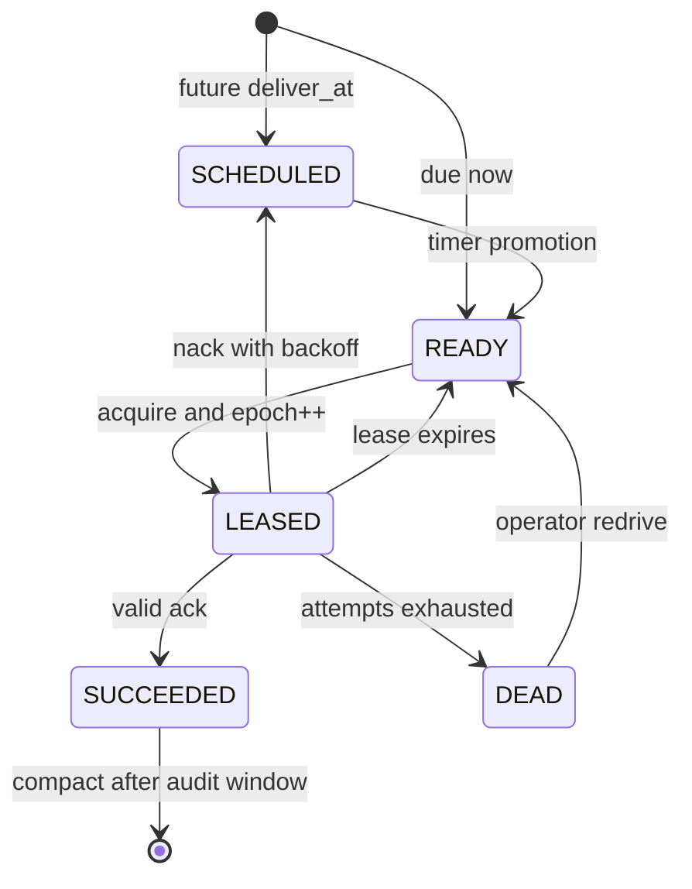
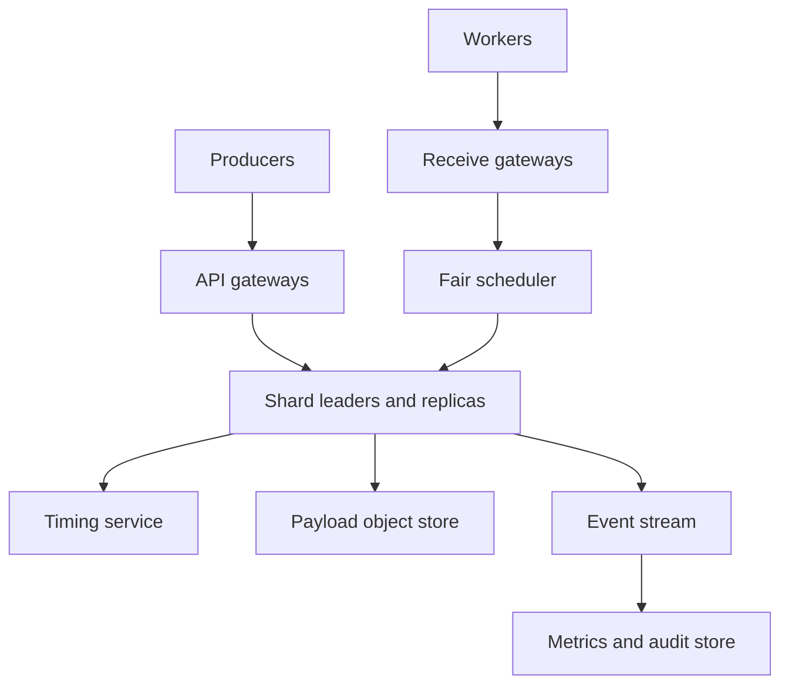

# Design a Multi-Tenant Delayed Job Queue

**Difficulty:** Senior / Staff  
**Primary themes:** queues, leases, delayed scheduling, multi-tenant fairness, durability, idempotency, hot partitions, backpressure  
**Interview time budget:** 40–45 minutes  
**Educational walkthrough:** intentionally more detailed than what you would say in the interview

This walkthrough follows the broad Hello Interview delivery order: clarify requirements, name core entities, define interfaces, build a minimal complete design, and then deepen the parts that carry the most risk. The structure is informed by the public [Hello Interview System Design Delivery Framework](https://www.hellointerview.com/learn/system-design/in-a-hurry/delivery), but the problem, numbers, dialogue, and design are original.

## Interviewer prompt

> Design a managed, multi-tenant job queue. Producers can enqueue work immediately or for a future time. Workers poll for jobs, process them, acknowledge success, or retry failures. The service should be durable, highly available, and fair when one tenant creates a large backlog.

Examples include sending an email later, retrying a webhook, generating a report, or running background media processing. We are designing the queue, not the business-specific worker code.

## Targeted clarifying questions

**Candidate:** “Is this a work queue, where one successful worker should process a job, rather than a pub/sub topic where every subscriber receives a copy?”  
**Interviewer:** “Yes. One successful execution is the goal, though duplicates may occur.”

**Candidate:** “How far into the future can jobs be scheduled, and how precise must delivery be?”  
**Interviewer:** “Up to one year. A due job should normally become available within one second, but we do not promise execution at an exact instant.”

**Candidate:** “Do we need strict ordering?”  
**Interviewer:** “Not globally. Offer best-effort FIFO by default and optional strict ordering within a caller-provided group.”

**Candidate:** “What scale and payload size should I target?”  
**Interviewer:** “Assume 200,000 enqueues per second on average, one million per second at peak, similar dequeue volume, 100 million active tenants, and payloads up to 256 KiB. Most payloads are under 4 KiB.”

**Candidate:** “What should happen if a worker crashes after receiving a job?”  
**Interviewer:** “The job must become available again after a visibility timeout. Workers may extend that timeout.”

**Candidate:** “Can we require workers to be idempotent?”  
**Interviewer:** “Yes. The queue should reduce duplicates and expose stable identifiers, but it need not promise exactly-once business effects.”

**Candidate:** “Should noisy tenants be isolated?”  
**Interviewer:** “Yes. A tenant that floods the service must not consume all capacity or starve smaller tenants.”

**Candidate:** “Are queue creation, arbitrary search, workflow dependencies, and cron scheduling in scope?”  
**Interviewer:** “Queue creation and configuration are in scope. Arbitrary search, DAGs, and recurring cron are out of scope.”

### Scope restatement

> “I’ll design a durable work queue with immediate and delayed enqueue, long-poll receive, visibility leases, acknowledgement, retry, dead-letter handling, and optional FIFO groups. I’ll optimize the data plane for at-least-once delivery and per-tenant fairness. I’ll leave DAG orchestration, arbitrary payload search, and exactly-once external side effects out of scope.”

That restatement matters: otherwise it is easy to drift into designing a workflow engine or a log broker.

---

## 1. Requirements (~5 minutes)

### Core functional requirements

1. **Publish work.** An authenticated producer creates an immediate or delayed job with payload, priority, retry policy, and optional ordering group. Repeated producer retries with the same idempotency key must not create multiple logical jobs.
2. **Lease and complete work.** An authenticated worker long-polls, receives jobs under a visibility lease, may extend the lease, and either acknowledges success or negatively acknowledges failure.
3. **Recover and operate.** Expired leases return jobs to the ready set; retries use backoff; exhausted jobs move to a dead-letter queue; operators can inspect queue depth, age, retry, and fairness metrics.

### Quantified non-functional requirements

| Property | Target | Design implication |
|---|---:|---|
| Peak enqueue rate | 1M jobs/s globally | Partitioned append path; no single ordered database sequence |
| Peak lease/ack rate | 1M jobs/s each | Partitioned ready indexes and batched state changes |
| Enqueue durability | 99.999999% after success | Replicated quorum write before acknowledging |
| Regional API availability | 99.99% monthly | Multi-AZ replication and stateless gateways |
| Immediate-job latency | p99 < 200 ms from accepted to leasable | Ready index updated in the durable write path |
| Delayed-job lateness | p99 < 1 s after `deliver_at` under provisioned load | Hierarchical timing index plus near-term promotion |
| Receive latency | p99 < 1 s when eligible work exists | Long polling, partition notification, adaptive probing |
| Payload retention | 14 days by default; configurable to 30 | Lifecycle cleanup and capacity planning |
| Tenant isolation | No tenant consumes > configured share during contention | Admission quotas plus weighted fair dequeue |

### Scale estimates that change the design

Assume:

- 200,000 jobs/s average, 1,000,000/s peak;
- average stored job record is 5 KiB: roughly 4 KiB payload plus metadata and index overhead;
- average time in the system is one day because delayed and retrying jobs dominate immediate processing;
- three replicas for durable records.

Average daily writes:

\[
200{,}000 \times 86{,}400 \approx 17.3\text{ billion jobs/day}
\]

Logical storage for one day:

\[
17.3\text{B} \times 5\text{ KiB} \approx 86\text{ TB}
\]

With three replicas, indexes, compaction headroom, and 14-day retention, naive inline storage would reach multiple petabytes. This changes two decisions:

1. payloads above a small threshold go to replicated object storage, while queue shards keep a pointer and checksum;
2. completed records are compacted quickly to a small tombstone/dedup record, then removed after the retry and audit window.

At 1M enqueues/s, even 1,000 logical shards average 1,000 writes/s each. We should provision several thousand virtual shards so ownership can be spread and hot shards split without changing API-visible queue IDs.

### Consistency and availability contract

State the contract explicitly:

- **Accepted means durable.** A successful enqueue is replicated to a quorum before the API returns.
- **At-least-once delivery.** A job may be leased again if a worker crashes, loses its acknowledgement, or outlives its lease.
- **No concurrent valid lease in the normal case.** A shard leader grants one lease epoch at a time. A stale worker cannot acknowledge after a newer lease has been issued.
- **Best-effort FIFO by default.** Parallelism, retries, and failures can reorder jobs.
- **Strict order only within an optional group.** At most one job per group is in flight; a stuck job blocks later group members unless the retry policy dead-letters it.
- **Delay is a lower bound.** A job must not be intentionally leased before `deliver_at`; overload or failure can make it late.
- **Queue state is authoritative; metrics are eventually consistent.** Depth and age dashboards may lag by tens of seconds.
- **During a partition, correctness beats write availability for one shard.** A minority replica does not accept enqueues or lease jobs. Other shards continue.

> **Say aloud:** “The queue owns durable state transitions and fencing, but it cannot make an arbitrary database write, email send, or payment exactly once. I’ll provide at-least-once delivery, stable job IDs, idempotent producer keys, and lease epochs so consumers can build idempotent effects.”

---

## 2. Core entities (~2 minutes)

Name only the concepts needed to discuss the interface and flows:

| Entity | Purpose |
|---|---|
| `Queue` | Tenant-owned configuration: quotas, retention, priorities, default lease, retry and DLQ policy |
| `Job` | Durable work item with payload reference, due time, attempt count, priority, and state |
| `Lease` | Time-bounded claim carrying a random receipt handle and monotonically increasing lease epoch |
| `OrderingGroup` | Optional key that serializes jobs within that key |
| `DedupRecord` | Maps `(queue_id, idempotency_key)` to the already-created job during the dedup window |
| `DeadLetterEntry` | Terminal job plus failure metadata and redrive status |

Do not fully normalize a schema yet. Introduce fields when a component needs them.

> **Say aloud:** “The important separation is between immutable job identity and a renewable lease. Workers acknowledge a particular lease attempt, not merely a job ID; that lets the broker reject stale acknowledgements.”

---

## 3. API / system interface (~5 minutes)

All calls use TLS. The gateway derives `tenant_id`, producer or worker identity, and allowed queue scopes from authentication; callers do not supply an authoritative tenant ID in the body.

### 3.1 Enqueue

```http
POST /v1/queues/{queue_id}/jobs
Authorization: Bearer <producer token>
Idempotency-Key: invoice-48392-email-v1
Content-Type: application/json

{
  "payload": {"invoice_id": "48392", "template": "receipt"},
  "deliver_at": "2026-10-19T15:00:00Z",
  "priority": 3,
  "ordering_group": "customer-817",
  "retry_policy": {
    "max_attempts": 8,
    "base_delay_ms": 1000,
    "max_delay_ms": 300000
  }
}
```

```json
{
  "job_id": "job_01J...",
  "queue_id": "billing-email",
  "state": "SCHEDULED",
  "deliver_at": "2026-10-19T15:00:00Z"
}
```

If the same authenticated tenant retries with the same idempotency key and equivalent body, return the original job. If the body differs, return `409 IDEMPOTENCY_KEY_REUSED`.

For payloads above 64 KiB, offer a two-step upload:

1. request a short-lived object-upload URL;
2. enqueue a job containing `payload_uri`, length, and SHA-256 checksum.

This keeps broker replication and scans efficient.

### 3.2 Receive under a lease

```http
POST /v1/queues/{queue_id}/leases:acquire
Authorization: Bearer <worker token>
Content-Type: application/json

{
  "max_jobs": 10,
  "wait_timeout_ms": 20000,
  "visibility_timeout_ms": 60000,
  "priorities": [0, 1, 2, 3]
}
```

```json
{
  "jobs": [
    {
      "job_id": "job_01J...",
      "payload": {"invoice_id": "48392", "template": "receipt"},
      "attempt": 2,
      "lease": {
        "receipt_handle": "rct_random_256_bit_value",
        "epoch": 4,
        "expires_at": "2026-10-19T15:01:00Z"
      }
    }
  ]
}
```

The receipt handle is an unguessable capability bound to tenant, queue, job, and lease epoch. It is safer than accepting `job_id` alone.

### 3.3 Extend, acknowledge, or fail

```http
POST /v1/queues/{queue_id}/leases/{receipt_handle}:extend
{"extension_ms": 60000}
```

```http
POST /v1/queues/{queue_id}/jobs/{job_id}:ack
{"receipt_handle": "rct_random_256_bit_value"}
```

```http
POST /v1/queues/{queue_id}/jobs/{job_id}:nack
{
  "receipt_handle": "rct_random_256_bit_value",
  "reason": "UPSTREAM_TIMEOUT",
  "retry_after_ms": 10000
}
```

`ack` is idempotent for the same valid receipt. A stale receipt returns `409 LEASE_LOST`; that is a signal that another worker may now own the job.

### 3.4 Queue operations

```http
PUT /v1/queues/{queue_id}
If-Match: "config-version-17"

{
  "default_visibility_ms": 60000,
  "retention_seconds": 1209600,
  "max_attempts": 8,
  "dead_letter_queue": "billing-email-dlq",
  "rate_limit_per_second": 20000,
  "fairness_weight": 2
}
```

Queue configuration uses optimistic concurrency. Destructive changes, such as lowering retention below the age of stored jobs, require an explicit confirmation token.

### Interface-to-requirement mapping

| Requirement | Interface |
|---|---|
| Publish immediate or delayed work | `POST .../jobs` |
| Lease and process | `POST .../leases:acquire` |
| Long-running work | `POST ...:extend` |
| Complete safely | `POST ...:ack` with receipt handle |
| Retry or dead-letter | `POST ...:nack`; automatic lease-expiry path |
| Operate queues | queue config plus metrics and DLQ endpoints |

---

## 4. Data flow

There are two related loops.

### Publish and promote

1. Gateway authenticates and enforces coarse tenant admission limits.
2. Router hashes `(tenant_id, queue_id, ordering_group-or-job_id)` to a virtual shard.
3. Shard leader atomically writes the `Job`, `DedupRecord`, and either a ready-index entry or delayed-index entry to its replicated log.
4. After quorum commit, the producer receives `job_id`.
5. A timing service promotes due delayed jobs into the ready index using an idempotent compare-and-set transition.

### Lease and settle

1. Worker long-polls a regional receive gateway.
2. A fair scheduler selects an eligible tenant/queue and a ready shard.
3. Shard leader changes `READY -> LEASED`, increments `lease_epoch`, sets `lease_expires_at`, and returns a receipt handle.
4. Worker executes business logic.
5. A valid acknowledgement changes `LEASED -> SUCCEEDED`; a negative acknowledgement or expiry changes the job to `SCHEDULED_RETRY`, `READY`, or `DEAD`.

The state machine is more important than brand-name storage.



> **Say aloud:** “Every arrow is a conditional write on the owning shard. Notifications can be lost because they are only hints; the durable state machine and periodic scans are the source of truth.”

---

## 5. High-level design (~10–15 minutes)

Build the smallest complete system one operation at a time.



### 5.1 Control plane

A small relational control-plane database stores:

```text
Queue(
  tenant_id, queue_id, config_version,
  retention_seconds, default_visibility_ms,
  max_attempts, dlq_queue_id,
  enqueue_qps_limit, in_flight_limit, fairness_weight,
  state, created_at, updated_at
)
```

Queue mutations are low QPS and benefit from transactions, uniqueness, audit history, and optimistic concurrency. Gateways cache configurations by `(tenant_id, queue_id, config_version)` and receive invalidations. A short cache outage should not stop existing queues; gateways use a signed last-known-good configuration until its safety TTL expires.

### 5.2 Enqueue immediate work

For an immediate job, the router chooses a virtual shard. Each shard is a replicated state machine with one elected leader across three availability zones. The leader appends a transaction containing:

```text
Job(
  tenant_id, queue_id, shard_id, job_id,
  state, priority, sequence,
  payload_inline | payload_uri, payload_sha256,
  deliver_at, created_at, expires_at,
  attempt_count, max_attempts,
  ordering_group,
  lease_epoch, lease_expires_at,
  last_error_code
)

DedupRecord(
  tenant_id, queue_id, idempotency_key,
  request_hash, job_id, expires_at
)

ReadyIndex(
  tenant_id, queue_id, priority,
  shard_id, ready_sequence, job_id
)
```

The append is acknowledged only after a quorum commits it. The ready entry is part of the same shard transaction as the job, avoiding the “job stored but never enqueued” dual-write bug.

The shard emits a best-effort wake-up hint to waiting receive gateways. If the hint is lost, long-pollers periodically probe; correctness does not depend on notification delivery.

### 5.3 Enqueue delayed work

Scanning every future job each second is infeasible. The write instead inserts a compact reference into a hierarchical timing index:

```text
DelayedIndex(
  time_bucket, shard_id, deliver_at,
  tenant_id, queue_id, job_id
)
```

Use coarse buckets far in the future and progressively finer buckets near the deadline, similar to a hierarchical timing wheel:

- month/day buckets for distant jobs;
- hour/minute buckets within a day;
- second buckets for the next minute.

The durable source of truth remains the job row and `deliver_at`. Timer workers own bucket leases, read due references, and issue idempotent `SCHEDULED -> READY` transitions. Multiple workers may race; only one conditional transition wins.

Why not one database index ordered by `deliver_at`? It is a reasonable baseline at smaller scale, but a global leading edge becomes hot: all timer workers repeatedly scan and delete from the same narrow time range. Time buckets plus virtual shards distribute that work.

### 5.4 Lease ready work

The receive gateway should not randomly probe thousands of empty shards. Each shard publishes approximate summaries:

```text
ReadySummary(
  tenant_id, queue_id, shard_id,
  ready_count_by_priority,
  oldest_ready_at,
  in_flight_count,
  summary_version
)
```

Summaries may be stale; they optimize selection but never authorize a lease. The shard leader performs the authoritative conditional transition:

```text
if state == READY
and deliver_at <= leader_time
and group_lock is free:
    state = LEASED
    attempt_count += 1
    lease_epoch += 1
    lease_expires_at = now + visibility
    receipt_hash = H(random_receipt)
```

The worker receives the plaintext receipt; only its hash need be stored. For strict ordering groups, the same transaction acquires:

```text
GroupLock(queue_id, ordering_group, job_id, lease_epoch, expires_at)
```

### 5.5 Acknowledge, retry, and expire

Acknowledgement routes to the job’s shard using information encoded in `job_id`. The leader checks tenant, receipt hash, state, and epoch. A valid acknowledgement moves the job to `SUCCEEDED` and releases its group lock.

On `nack`, compute a retry time:

\[
delay = \min(maxDelay, baseDelay \times 2^{attempt-1}) + jitter
\]

Jitter prevents thousands of failed jobs from retrying simultaneously after a dependency recovers.

Lease expiry is another delayed transition. The timer index contains a lease-expiry reference keyed by `(job_id, lease_epoch)`. If an old expiry fires after a lease extension, its epoch no longer matches and it becomes a no-op.

When `attempt_count >= max_attempts`, commit `DEAD` and append a DLQ entry. The DLQ is just another queue with extra failure metadata; redrive creates a new leaseable attempt while retaining lineage to the original job.

### 5.6 Payload storage

Inline small payloads to avoid another network hop. Store large payloads in object storage under a content checksum and encrypted tenant prefix.

To prevent orphaned objects:

- upload with a short provisional TTL;
- enqueue only after verifying object size and checksum;
- mark the object referenced after the job commit;
- sweep unreferenced provisional objects after the maximum race window;
- retain referenced objects until the job and audit policy permit deletion.

### Baseline request trace

For a job due in ten minutes:

1. Producer retries `enqueue` twice after a timeout.
2. The first request commits job `J7` and dedup key `K`; the second returns `J7`.
3. Timer workers race at the due second; one changes `J7` to `READY`.
4. The scheduler selects the queue, and shard leader grants epoch 1 to worker A.
5. Worker A performs the side effect but crashes before ack.
6. Epoch 1 expires; `J7` returns to `READY`.
7. Worker B receives epoch 2. Its business idempotency table sees that `job_id=J7` already produced the side effect, so it skips repeating it and acknowledges epoch 2.
8. A delayed ack from worker A is rejected because epoch 1 is stale.

This trace demonstrates why queue-level deduplication and consumer-side idempotency solve different problems.

---

## 6. Deep dives (~10–15 minutes)

In the interview, choose two or three based on the interviewer’s interest. The detailed walkthrough includes four.

### Deep dive A: delivery semantics, leases, and exactly-once effects

#### Where the baseline breaks

A worker can complete a side effect and lose its acknowledgement. If the queue retries, either the effect happens twice or the job disappears incorrectly. No protocol between an independent queue and arbitrary external system can infer which event occurred after a network failure.

AWS documents the same essential visibility-timeout pattern: receipt makes a message temporarily invisible, but at-least-once delivery can still produce duplicates. See [Amazon SQS visibility timeout](https://docs.aws.amazon.com/AWSSimpleQueueService/latest/SQSDeveloperGuide/sqs-visibility-timeout.html) and [at-least-once delivery](https://docs.aws.amazon.com/AWSSimpleQueueService/latest/SQSDeveloperGuide/standard-queues-at-least-once-delivery.html).

#### Compare approaches

| Approach | Benefit | Failure / cost |
|---|---|---|
| Delete before processing | No duplicate after delete | Worker crash loses the job |
| Process then ack | No loss if lease eventually retries | Duplicate possible if ack is lost |
| Global distributed transaction | Atomic queue + effect in theory | External APIs rarely participate; high latency and poor availability |
| Stable ID + idempotent consumer | Practical at-least-once processing | Consumer must retain dedup state or use idempotent business keys |
| Queue and effect in same database transaction | Strong when co-located | Only works when both states share a transaction boundary |

#### Selected design

Use process-then-ack with:

- a stable `job_id` across attempts;
- per-attempt `lease_epoch` and random receipt handle;
- heartbeat-based extensions capped by a maximum lease age;
- consumer idempotency keyed by `job_id` or business operation key;
- an inbox table for database-backed consumers;
- idempotency keys when calling downstream APIs that support them.

An inbox transaction looks like:

```sql
BEGIN;
INSERT INTO processed_jobs(job_id) VALUES (:job_id)
  ON CONFLICT DO NOTHING;
-- Only if inserted: apply the business mutation.
COMMIT;
-- Then acknowledge the queue. A lost ack causes harmless re-delivery.
```

Fencing is crucial for long jobs. Suppose worker A pauses, its lease expires, and worker B receives epoch 8. Worker A resumes with epoch 7. The queue rejects A’s ack and extension. If the downstream resource accepts fencing tokens, it should also reject writes carrying epoch 7 after observing 8.

> **Say aloud:** “Exactly-once delivery is not the useful promise. I want one durable job, possibly multiple delivery attempts, and one business effect through consumer idempotency. Lease epochs fence stale workers inside the broker; an external side effect still needs its own idempotency or fencing support.”

#### Failure modes and observability

- **Worker pauses beyond lease:** duplicate attempt; track lease-expiry rate and processing-time/visibility ratio.
- **Ack response lost:** client retries the same ack; broker returns success for an already-settled matching receipt.
- **Clock skew:** only shard-leader time decides due and expiry; clients submit durations, not authoritative expiry timestamps.
- **Poison job:** retries with capped exponential backoff, then DLQ; alert on DLQ arrival rate and repeat failure signatures.
- **Lease-extension storm:** batch heartbeats and limit extensions per job and tenant.

### Deep dive B: delayed scheduling at scale

#### Where the baseline breaks

A single sorted index on `deliver_at` looks elegant, but the head of the index becomes a synchronized hotspot. A per-job timer held in process memory loses work on restart. Publishing delayed messages to one timer process creates a single failure and capacity boundary.

#### Compare approaches

| Approach | Strength | Weakness | Best use |
|---|---|---|---|
| Database ordered index | Simple, transactional | Hot leading range; expensive repeated scans | Moderate scale |
| One timer per job in memory | Precise and fast | Memory-heavy; recovery is difficult | Ephemeral local tasks |
| Hierarchical timing wheel | O(1)-ish bucket operations; natural time partitioning | Bucket recovery and lateness need care | Large delay range |
| Broker tiers by horizon | Separates long-term storage from near-term execution | More movement and components | Very large queues |

Select a durable hierarchical timing index with two horizons:

1. **far future:** cheap, coarse buckets in durable storage;
2. **near future:** second-level buckets cached by timer workers but recoverable from durable records.

Bucket ownership is leased. A worker checkpoints `(bucket_id, cursor)` and promotion is idempotent, so takeover may repeat work but cannot make a job ready twice. Empty buckets are cheap metadata rather than materialized rows.

AWS delay queues illustrate the semantic distinction: delay makes new messages unavailable until the delay elapses, while visibility timeout hides already-received messages. The design here generalizes delay to a one-year horizon rather than a short queue-level setting. See [Amazon SQS delay queues](https://docs.aws.amazon.com/AWSSimpleQueueService/latest/SQSDeveloperGuide/sqs-delay-queues.html).

#### Time and lateness semantics

- `deliver_at` is never an exact execution promise; it is the earliest eligibility time.
- A producer timestamp more than a small skew behind the gateway becomes immediately eligible.
- Timer promotion uses shard-leader time.
- A job is late when `now - deliver_at` exceeds its service objective.
- During overload, preserve durability and admit lateness rather than dropping scheduled work.

Monitor:

- promotion lag p50/p95/p99 by bucket and region;
- oldest unpromoted due job;
- bucket scan duration and takeover count;
- count of early-delivery violations, which should be zero;
- retry-wave concentration after large dependency outages.

#### Recovery example

Timer worker T owns the 12:00:05 bucket and crashes after promoting 60% of it but before checkpointing. Worker U takes over after the bucket lease expires and replays the bucket. Conditional updates make already-ready jobs no-ops. Lateness increases by the takeover interval, but no accepted job disappears.

> **Say aloud:** “The timer is an index, not the source of truth. I can rebuild it from job deadlines, and every promotion is a conditional state transition. That lets me prefer duplicate scans over lost timers.”

### Deep dive C: multi-tenant fairness, quotas, and backpressure

#### Where the baseline breaks

If dequeue always selects the oldest job globally, one tenant with ten billion jobs can monopolize workers and storage bandwidth. If every tenant receives one equal turn, a free trial tenant can get the same capacity as a paid tenant with a larger reservation. Priority alone is also dangerous: a constant stream of priority-0 work can starve priority-3 jobs forever.

#### Selected scheduling hierarchy

Use hierarchical weighted deficit round robin:

1. choose a tenant according to configured weight and outstanding deficit;
2. choose a queue within that tenant using the same method;
3. choose a priority with aging;
4. choose a shard with eligible work;
5. let the shard perform the authoritative lease.

**Deficit round robin** gives each flow a credit proportional to its weight. Leasing a job spends credit based on estimated cost, such as one unit by default or more units for a large payload. Idle tenants accumulate only a bounded burst credit, preventing unlimited later bursts.

Priority aging gradually improves the effective priority of old work:

\[
effectivePriority = basePriority - \left\lfloor\frac{waitTime}{agingInterval}\right\rfloor
\]

Clamp the result to the highest priority. This makes priority useful without permitting starvation.

#### Admission and backpressure

Fair dequeue cannot fix unlimited enqueue. Apply controls at several levels:

- per-tenant enqueue token bucket;
- per-queue stored-byte and job-count quota;
- per-tenant in-flight lease cap;
- regional capacity admission;
- dynamic throttling when shard log, object store, or timer lag crosses a threshold.

Return explicit `429` with `Retry-After` for tenant quota and `503` with jittered retry guidance for regional overload. Producers should use bounded exponential backoff. Do not accept work into an unbounded memory buffer merely to make latency look good.

#### Hot partitions

Hashing by `queue_id` alone makes a popular queue a permanent hotspot. Hash individual jobs across virtual shards, but preserve strict groups by routing all jobs in one `ordering_group` to the same shard. A single ordering group is intentionally limited to one in-flight job; the API should publish a per-group throughput bound.

If a non-ordered shard becomes hot, split its virtual hash range and migrate ownership by epoch. Routers refresh the map; old owners reject writes after the cutover epoch. During migration, forward or dual-read summaries, but never allow two leaders to issue leases for the same state range.

#### Fairness observability

Queue depth alone is insufficient. Track:

- dequeue share versus configured weight;
- oldest-ready age by tenant and priority;
- throttled requests and quota headroom;
- scheduler deficit and skipped-empty selection rate;
- in-flight leases by tenant;
- hot-shard CPU, log append latency, and leader moves.

> **Say aloud:** “I separate admission fairness from service fairness. Quotas stop a tenant from consuming unbounded storage, while weighted deficit scheduling controls who gets dequeue capacity during contention.”

### Deep dive D: replication, regional failure, and disaster recovery

#### Within one region

Each shard is synchronously replicated across three availability zones. A majority elects a leader and commits state transitions. If the leader fails:

1. remaining replicas elect a new leader;
2. the shard’s leadership epoch increases;
3. routers refresh or follow a redirect;
4. committed jobs and leases survive;
5. uncommitted responses were never acknowledged to clients and can be retried with idempotency keys.

Leases may pause during election. That is preferable to two leaders leasing the same job. Some duplicates can still occur because a worker may have completed an external effect before the failure.

#### Across regions

Choose a home region per queue for mutations. Asynchronously replicate job logs and payloads to a paired recovery region. This avoids cross-ocean quorum latency on every lease and ack.

The explicit disaster-recovery contract is:

- normal regional failover within AZs: RPO 0 for acknowledged jobs;
- total regional loss: target RPO under 60 seconds and RTO under 15 minutes;
- optional premium queues can use cross-region quorum for RPO 0 at higher latency and cost.

On disaster promotion, increment a regional generation and fence the old home. Recovery may redeliver recently completed jobs whose acknowledgements were not replicated; at-least-once semantics and idempotent consumers cover this. Never run two writable homes without a consensus or ownership mechanism.

#### Control-plane and dependency failures

- **Control database unavailable:** existing queues run from cached signed configurations; queue creation and config mutation pause.
- **Object store impaired:** inline jobs continue; large-payload enqueue is rejected before queue commit; lease does not return a pointer the worker cannot fetch without an explicit error.
- **Metrics pipeline down:** serving continues because metrics are downstream of the durable log; dashboards become stale and display freshness.
- **DLQ unavailable:** terminal transition and DLQ append occur in the same logical shard transaction or durable outbox; a relay retries until the DLQ accepts it.
- **Region overloaded:** reject new work according to quotas, preserve committed work, slow promotion and dequeue explicitly, and expose lateness.

#### Operational invariants

Continuously verify:

1. every nonterminal job appears in exactly one scheduling class: delayed, ready, or leased;
2. a lease epoch never decreases;
3. no `SUCCEEDED` job becomes ready again;
4. every expired lease is eventually reconsidered;
5. every terminal failure has a DLQ entry or durable outbox record;
6. tenant usage never exceeds hard configured storage quota without an explicit override.

Run reconciliation jobs that scan durable state against secondary indexes. Indexes are repairable; job records and the replicated log are authoritative.

---

## 7. Final design

### Concise architecture

- A transactional control plane manages queue configuration, IAM scopes, quotas, and audit history.
- Stateless API gateways authenticate callers, apply admission control, and route requests to virtual shards.
- Each queue’s jobs are spread across many replicated, single-leader shards. A quorum commit makes enqueue durable.
- Immediate jobs enter a shard-local ready index; future jobs enter a durable hierarchical timing index.
- Timer workers idempotently promote due jobs and requeue expired leases.
- Receive gateways use approximate readiness summaries and a hierarchical weighted fair scheduler, while shard leaders authorize leases.
- Lease epochs and receipt handles fence stale acknowledgements. The service guarantees at-least-once delivery, not exactly-once effects.
- Small payloads are inline; large payloads live in replicated object storage behind checksummed references.
- Retry uses capped exponential backoff with jitter; exhausted work enters a DLQ.
- Serving logs feed asynchronous metrics and audit pipelines. Reconcilers repair secondary indexes.
- Multi-AZ quorum replication provides RPO 0 inside a region; paired-region recovery has an explicit asynchronous RPO unless the tenant buys cross-region quorum.

### Requirements check

| Requirement | How it is met |
|---|---|
| Immediate enqueue | Quorum transaction writes job, dedup record, and ready entry |
| Delayed enqueue | Durable hierarchical timing buckets and idempotent promotion |
| Worker processing | Long polling plus time-bounded visibility lease |
| Crash recovery | Lease expiry returns work to ready state |
| Long jobs | Lease extension tied to current epoch |
| Retry / DLQ | Backoff with jitter, attempt cap, terminal DLQ transition |
| Producer retry safety | Scoped idempotency key and request hash |
| Optional ordering | One in-flight job per ordering group |
| At-least-once durability | Quorum replication, replay, and reconciliations |
| Tenant isolation | Admission quotas, in-flight caps, weighted fair scheduling |
| Scale | Virtual shards, payload tiering, bucketed timers, batched operations |
| Observability | Lag, age, attempts, expiry, throttling, fairness, and invariant checks |

### A strong 90-second summary to say aloud

> “I split the system into a low-QPS control plane and a sharded data plane. Enqueue routes to a virtual shard whose leader atomically stores the job, idempotency record, and either a ready or delayed index entry, then acknowledges after quorum commit. Delayed jobs use durable time buckets; promotion is a conditional transition, so worker takeover can repeat scans without losing work. Receive gateways choose tenants and queues with weighted deficit scheduling, but the shard leader performs the authoritative ready-to-leased transition. A lease has an expiry, random receipt, and monotonically increasing epoch, which rejects stale acks and extensions. Expiry or nack reschedules with jittered backoff; exhausted jobs go to a DLQ. The contract is at-least-once delivery, so workers use stable job IDs for idempotent effects. Virtual shards, large-payload object storage, admission quotas, and per-tenant in-flight caps provide scale and isolation. I use multi-AZ quorum replication and asynchronous cross-region disaster recovery with an explicit RPO.”

---

## Interviewer follow-up questions with strong sample answers

### 1. Why not build the queue directly on Kafka?

**Candidate:** “Kafka is excellent for an ordered append log and independent consumer offsets. A work queue needs per-message visibility leases, arbitrary retry times, ack state, DLQs, and often millions of independent ordering groups. Those can be layered on Kafka, but then the lease-state database and retry scheduler become the real queue. I might still use a replicated log internally, but I would expose work-queue semantics rather than pretending a consumer offset alone solves them.”

### 2. Can two workers ever process the same job simultaneously?

**Candidate:** “Yes under at-least-once semantics: a slow worker may continue after its lease expires while another receives a new epoch. The broker prevents two simultaneously valid leases in normal operation and rejects the stale worker’s ack, but it cannot stop arbitrary code already running. Idempotency and, where possible, downstream fencing tokens protect the side effect.”

### 3. How do you guarantee that a delayed job is not delivered early?

**Candidate:** “The timer only creates candidates. The shard leader checks `deliver_at <= leader_time` inside the lease transition. A bad or duplicated timer hint therefore cannot authorize early delivery. We use server time, not producer or worker clocks.”

### 4. What if the timing index loses an entry?

**Candidate:** “The job record is authoritative. A reconciliation scan by time range rebuilds missing delayed entries, and an age alarm detects overdue scheduled jobs. This may make a job late, but it does not lose an accepted job.”

### 5. Why does the acknowledgement include a receipt handle?

**Candidate:** “A job ID identifies the logical work, not the current attempt. The receipt binds the caller to a particular lease epoch. Without it, a worker from an expired attempt could accidentally acknowledge a newer worker’s job.”

### 6. How would you support strict FIFO for an entire queue?

**Candidate:** “Treat the queue as one ordering group, which intentionally limits it to one in-flight job. That has poor throughput and availability because one poison job blocks the queue. I would make the cost explicit and recommend many independent group keys instead.”

### 7. What happens when a tenant’s oldest job is huge or slow?

**Candidate:** “Payload size affects scheduler cost, and processing time does not reserve the dequeue scheduler after the lease is granted. Per-tenant in-flight caps prevent unlimited outstanding work. For strict groups, a slow job blocks only its group; for unordered work, other jobs proceed.”

### 8. How do you resize shards without duplicate leases?

**Candidate:** “The control plane assigns ownership with a monotonically increasing range epoch. The old leader stops granting mutations before the new owner activates. Routers may retry after redirects, but only the owner for the current epoch can commit a lease. We can copy snapshots and replay the log before the fenced cutover.”

### 9. Can metrics report an exact queue depth?

**Candidate:** “Not cheaply at this scale. I would return approximate, versioned aggregates for dashboards and autoscaling, including freshness. Exact counts require a coordinated scan and are an administrative operation. Correctness never depends on the approximate number.”

### 10. How should workers choose a visibility timeout?

**Candidate:** “Start above normal p99 processing time and allow bounded heartbeats. Too short causes duplicates; too long delays recovery. I’d expose processing-duration histograms, expiry rates, and an adaptive recommendation, while capping the maximum so abandoned work eventually recovers.”

### 11. How would worker autoscaling use queue signals?

**Candidate:** “Scale primarily from oldest-ready age and arrival/service rates, not depth alone. Depth can be huge because of a backlog that has a relaxed deadline, while a small fast-growing queue may need immediate capacity. Apply smoothing and cooldown to avoid oscillation, and respect downstream capacity.”

### 12. How do you safely redrive a DLQ?

**Candidate:** “Redrive is rate-limited, produces new attempt lineage while retaining the original job ID or business idempotency key, and can target a staging queue first. Operators filter by failure signature and software version, preview counts, and stop automatically if the same failure rate recurs.”

---

## Common pitfalls

1. **Claiming exactly once without defining the side-effect boundary.** Broker deduplication does not make an email, payment, or database mutation exactly once.
2. **Acknowledging before processing.** That converts worker crashes into lost jobs.
3. **Using only `job_id` to ack.** A stale worker can settle a newer attempt without a receipt and epoch.
4. **Treating notifications as durable truth.** Wake-up messages can disappear; shard state and scans must recover.
5. **One global `deliver_at` index.** Its leading edge becomes hot at large scale.
6. **One shard per queue.** A single popular queue cannot scale; use virtual shards and pin only strict ordering groups.
7. **No fairness model.** FIFO across all tenants lets a giant backlog starve everyone else.
8. **Only dequeue fairness, no admission control.** A tenant can still consume all storage and timer capacity.
9. **Unlimited lease extension.** Lost workers can hold work forever; cap total lease age and heartbeat frequency.
10. **Retry without jitter.** Dependency recovery creates a synchronized retry storm.
11. **Strict FIFO by default.** It sacrifices throughput and makes poison jobs head-of-line blockers.
12. **Putting 256 KiB payloads in every hot index.** Separate scheduling metadata from large payload bytes.
13. **Relying on client clocks.** Broker leaders decide eligibility and lease expiry.
14. **Exact queue depth on the serving path.** Approximate aggregates are enough for operations; exact global counts are expensive.
15. **Ignoring DLQ operations.** A DLQ without inspection, alerting, retention, and safe redrive is merely hidden data loss.

---

## Interview pacing guide

| Minute | What to cover |
|---:|---|
| 0–5 | Clarify work queue vs pub/sub, delay horizon, ordering, delivery contract, scale |
| 5–7 | Core entities and lease-versus-job distinction |
| 7–12 | Enqueue, receive, extend, ack, nack APIs |
| 12–24 | Quorum shards; immediate and delayed paths; lease state machine; retry and DLQ |
| 24–35 | Deep dive on semantics plus either timers or fairness |
| 35–40 | Failure modes, observability, regional recovery |
| 40–45 | Requirements check and tradeoff summary |

If the interview is only 35 minutes, keep payload object storage and disaster recovery brief. Do not cut the lease-epoch explanation, because it is the central correctness mechanism.

## Public references

- [Hello Interview: System Design Delivery Framework](https://www.hellointerview.com/learn/system-design/in-a-hurry/delivery)
- [Amazon SQS: Visibility timeout](https://docs.aws.amazon.com/AWSSimpleQueueService/latest/SQSDeveloperGuide/sqs-visibility-timeout.html)
- [Amazon SQS: At-least-once delivery](https://docs.aws.amazon.com/AWSSimpleQueueService/latest/SQSDeveloperGuide/standard-queues-at-least-once-delivery.html)
- [Amazon SQS: Delay queues](https://docs.aws.amazon.com/AWSSimpleQueueService/latest/SQSDeveloperGuide/sqs-delay-queues.html)

