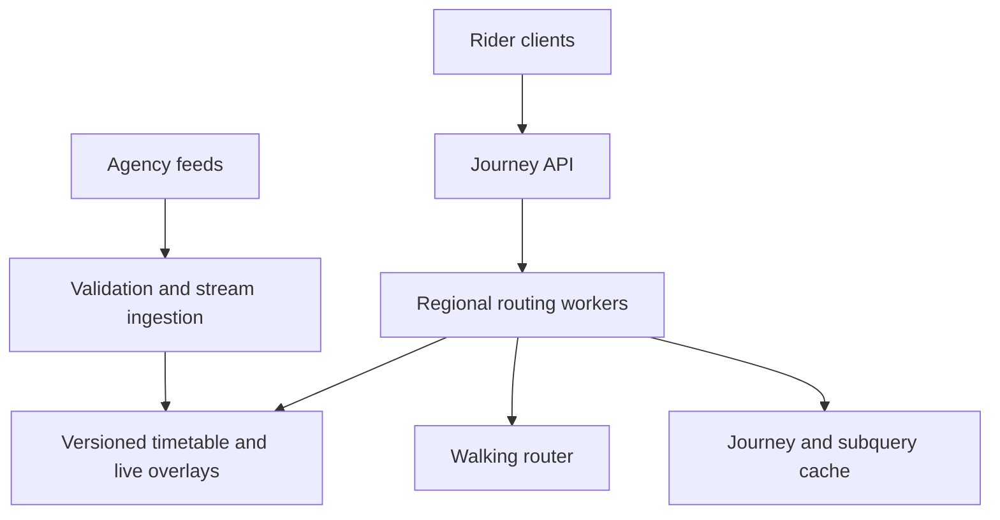

# Design a Real-Time Public Transit Journey Planner

**Difficulty:** Senior / Staff

**Primary themes:** time-dependent routing, batch and streaming ingestion, versioned indexes, caching, consistency, graceful degradation, geospatial search

**Interview time budget:** about 45 minutes

**Educational walkthrough:** intentionally more detailed than what you would say in the interview

This original walkthrough uses the Hello Interview delivery sequence: establish the contract, identify core entities, define interfaces, build a complete baseline one operation at a time, and then deepen the constraints that force architectural changes.

## Interviewer prompt

> Design a global public-transit journey-planning service. A rider provides an origin, destination, and departure or arrival time. Return practical itineraries across walking, buses, trains, ferries, and transfers. Incorporate schedule changes, delays, cancellations, service alerts, and vehicle positions within seconds. Support thousands of transit agencies and large metropolitan networks.

## Targeted clarifying questions

**Candidate:** Are we optimizing one objective or returning alternatives?

**Interviewer:** Return up to five Pareto-useful itineraries balancing arrival time, transfers, walking, accessibility, reliability, and optionally fare. Do not return many near-duplicates.

**Candidate:** Which inputs do agencies provide?

**Interviewer:** Assume GTFS-like static schedules and GTFS-Realtime-like trip updates, vehicle positions, and alerts. Feed quality varies, so validate and expose freshness.

**Candidate:** Do we need road navigation?

**Interviewer:** Only walking access, egress, and transfers. A separate pedestrian-routing service supplies walk times and accessibility constraints.

**Candidate:** How fresh must results be?

**Interviewer:** Static feed changes should publish atomically. Ninety-nine percent of accepted real-time updates should affect new queries within 10 seconds. A single query must use a coherent schedule and real-time snapshot.

**Candidate:** What scale and latency should I target?

**Interviewer:** Assume 25,000 agencies, 10 million stops/platforms, 300 million scheduled stop events per service day, 2 million real-time entities per second at peak, and 200,000 route queries per second globally. Target p99 under 500 ms for ordinary metropolitan queries and 99.99% query availability.

**Candidate:** Must the service continue if live feeds fail?

**Interviewer:** Yes. Fall back to the last valid updates or static schedules, clearly label freshness, and never interpret a missing update as a cancellation.

**Candidate:** Are booking and payment included?

**Interviewer:** No. Deep links are enough. Focus on routing and information correctness.

**Candidate:** Then I will separate immutable, versioned timetable publication from a fast real-time overlay. Queries will pin both versions so they do not mix data halfway through routing.

---

## 1. Requirements (~5 minutes)

### Functional requirements

1. **Ingest and publish transit data.** Validate static agency feeds, build routing indexes, and consume live trip updates, cancellations, vehicle positions, and service alerts.
2. **Plan journeys.** Resolve coordinates or stops, combine walking with scheduled transit, apply live conditions, and return a small diverse set of itineraries for depart-at or arrive-by queries.
3. **Explain and update results.** Return legs, platforms, times, transfer risk, accessibility, fares when available, data freshness, and relevant alerts; allow clients to refresh an itinerary.

### Quantified non-functional requirements

| Requirement | Target | Design consequence |
|---|---:|---|
| Query traffic | 200K route queries/s globally | Region-local routing workers and aggressive safe caching |
| Dataset | 10M stops; 300M stop events/day | Compact in-memory timetable indexes, partitioned by region |
| Live ingestion | 2M entities/s peak | Partitioned log, keyed state, idempotent versioned updates |
| Query latency | p99 <500 ms ordinary city query | Precomputed transfer graph and timetable-native routing |
| Freshness | 99% accepted updates visible <10 s | Push overlay snapshots and monitor event-time lag |
| Availability | 99.99% query API | Immutable last-known-good timetable and degraded static mode |
| Consistency | One coherent timetable/overlay pair per query | Version pinning and atomic snapshot publication |

### Scale estimates that change the design

If each normalized stop event needs 24 bytes for trip, stop, arrival/departure offsets, and flags, then 300 million events require about 7.2 GB raw. With indexes, calendars, route patterns, transfer edges, and multiple service days, a major region may need tens of gigabytes—large but practical across a routing-worker group, not per stateless web process.

At 200,000 queries/s and 20 KB per response, egress is roughly 4 GB/s before compression. Query-result caching matters, but most coordinate/time combinations are unique; reusable subresults and popular origin/destination buckets are more valuable than assuming every full query repeats.

At 2 million real-time entities/s and an average normalized event of 150 bytes, the ingestion backbone sees 300 MB/s before replication. Polling one central database from every router would create both a hotspot and inconsistent mid-query reads. We need a partitioned stream and immutable overlay snapshots.

### Consistency and availability contract

- Every query pins a published `timetable_version` and `realtime_snapshot_id`. All legs are evaluated against that pair.
- A static feed version is visible only after validation and index construction complete. Publication is atomic per routing region.
- Real-time updates are last-write-wins only according to a trusted `(agency, entity, service_date, source_sequence/event_time)` ordering—not ingestion arrival time alone.
- Missing live data means unknown, not on-time or cancelled. Results expose `LIVE`, `STALE`, or `SCHEDULE_ONLY` freshness.
- A cancellation or closed-stop alert is safety-relevant and must not be silently overridden by an older delay update.
- During live-feed failure, availability wins: route on the last valid overlay within its TTL, then on static schedules with an explicit warning.

> **What I would say aloud:** “I want snapshot consistency inside one answer, not global serialization of every vehicle update. A rider should never see the first leg calculated before a cancellation and the connection calculated after it.”

### Out of scope

- Ticket purchase, seat inventory, and payment
- Driving directions and traffic prediction
- Operating the agencies' vehicle-location systems
- Crowd-sourced incident moderation
- Exact fare computation for every proprietary fare system

---

## 2. Core entities (~2 minutes)

| Entity | Purpose |
|---|---|
| `Agency` | Feed ownership, timezone, trust policy, and freshness SLA |
| `Stop` | Station/platform with location, hierarchy, and accessibility |
| `Route` | Rider-facing service such as a subway or bus line |
| `Trip` | One scheduled run of a route on a service date |
| `StopEvent` | Scheduled arrival/departure for a trip at a stop sequence |
| `ServiceCalendar` | Dates and exceptions when a trip operates |
| `TransferEdge` | Walk or in-station connection with duration and constraints |
| `RealtimeUpdate` | Delay, predicted time, cancellation, vehicle position, or alert |
| `TimetableVersion` | Immutable validated static routing snapshot |
| `RealtimeSnapshot` | Immutable point-in-time overlay and freshness watermarks |
| `Journey` | Ordered walking/transit legs plus objectives and explanations |

Do not model every stop event as a generic graph edge during query execution. Public transit is time-dependent: a usable connection depends on departure time, service date, boarding rules, transfer duration, and disruption state.

---

## 3. API / system interface (~5 minutes)

Authentication derives application identity, quota, permitted premium features, and locale defaults. Rider identity is optional for basic routing; accessibility preferences come from the request or authenticated profile.

### Plan a depart-at journey

```http
POST /v1/journeys:plan
Authorization: Bearer <token>

{
  "origin": {"lat": 42.3398, "lon": -71.0892},
  "destination": {"lat": 42.3601, "lon": -71.0589},
  "depart_at": "2026-10-18T14:15:00-04:00",
  "modes": ["WALK", "SUBWAY", "BUS"],
  "preferences": {
    "wheelchair": true,
    "max_walk_meters": 1200,
    "max_transfers": 3
  },
  "limit": 5
}
```

```json
{
  "journeys": [
    {
      "arrival_time": "2026-10-18T14:39:00-04:00",
      "transfers": 1,
      "walk_meters": 430,
      "reliability": "MEDIUM",
      "legs": [
        {"mode":"WALK","to_stop":"place_kenmore","duration_seconds":360},
        {"mode":"SUBWAY","trip_id":"green_1442","from":"place_kenmore","to":"place_gover","scheduled_departure":"14:22","predicted_departure":"14:25"}
      ],
      "alerts": ["Elevator outage at Government Center"]
    }
  ],
  "data_version": {
    "timetable":"bos-2026-10-18.4",
    "realtime_snapshot":"rt-918381",
    "freshness":"LIVE",
    "as_of":"2026-10-18T14:14:54-04:00"
  }
}
```

Exactly one of `depart_at` or `arrive_by` is allowed. Times include an offset; the server resolves agency service days in agency timezones, including trips whose service times extend beyond midnight.

### Search nearby stops

```http
GET /v1/stops:nearby?lat=42.3398&lon=-71.0892&radius_m=800&wheelchair=true
```

### Refresh a selected itinerary

```http
POST /v1/journeys:refresh

{
  "journey_token": "signed_opaque_token",
  "current_time": "2026-10-18T14:20:00-04:00"
}
```

The signed token contains stable leg identities, service date, original preferences, and versions—not sensitive rider identity. Refresh re-evaluates missed connections and returns the original journey if still feasible or alternatives from the rider's current progress.

### Agency ingestion interfaces

```http
POST /internal/agencies/mbta/static-feeds
Idempotency-Key: feed-sha256

{"object_uri":"staging://feeds/mbta/gtfs-20261018.zip","sha256":"..."}
```

Real-time feeds enter through authenticated push or poller adapters and normalize into a common event envelope:

```json
{
  "agency_id":"mbta",
  "entity_type":"TRIP_UPDATE",
  "entity_id":"green_1442:20261018",
  "source_sequence":88421,
  "source_timestamp":"2026-10-18T18:14:51Z",
  "payload": {"stop_id":"place_kenmore","delay_seconds":180}
}
```

### API-to-requirement mapping

| Requirement | Interface |
|---|---|
| Plan journeys | `POST /journeys:plan` |
| Find access stops | `GET /stops:nearby` |
| Re-evaluate travel | `POST /journeys:refresh` |
| Publish schedules/live state | Internal static-feed and stream adapters |

---

## 4. Data flow

### Static schedule pipeline

1. Fetch or receive a versioned feed into quarantine object storage.
2. Verify checksum, schema, referential integrity, calendars, stop sequences, coordinates, timezones, and policy limits.
3. Normalize IDs into `(agency_id, source_id)` and map stops into routing regions.
4. Build compact route patterns, trip timetables, service calendars, spatial stop indexes, and walking-transfer graph.
5. Run regression queries and compare coverage, trip counts, and reachability with the active version.
6. Publish an immutable manifest, then atomically advance the region's active timetable pointer.

### Real-time pipeline

1. Agency adapters poll or receive feeds and write raw payloads to durable storage for replay.
2. Normalizers validate entity identity, service date, timestamps, and references to the active schedule.
3. Events enter a partitioned log keyed by `(agency_id, entity_id, service_date)` to preserve entity order.
4. Stateful processors deduplicate, reject stale updates, apply precedence rules, and maintain latest trip/stop/alert state.
5. Snapshot builders produce immutable per-region overlay segments every few seconds and publish a manifest plus per-agency freshness watermarks.
6. Routers subscribe to manifests, fetch changed segments, verify checksums, and atomically swap overlay pointers.

---

## 5. High-level design (~10–15 minutes)

### Compact architecture



The write side converts unreliable external feeds into immutable validated artifacts. The read side is mostly computation over memory-mapped timetable indexes plus a pinned real-time overlay. Query APIs remain stateless; routing workers are stateful for locality but replaceable.

### Data introduced with components

```text
TimetableManifest
  key: (region_id, timetable_version)
  value: service_range, segment_digests, stop_index_digest,
         transfer_graph_digest, validation_report, created_at

RealtimeEntityState
  key: (agency_id, service_date, entity_type, entity_id)
  value: source_sequence, source_timestamp, normalized_update,
         precedence, expires_at

RealtimeManifest
  key: (region_id, snapshot_id)
  value: base_timetable_version, segment_digests,
         agency_watermarks, created_at

RegionPointer
  key: region_id
  value: active_timetable_version, active_snapshot_id, epoch
```

### Operation 1: publish static schedules

The pipeline never edits the active timetable in place. It builds a candidate version in parallel, runs validations, and writes a content-addressed manifest. The control store changes `RegionPointer` with compare-and-swap only after every segment is durable.

Routing workers watch the pointer, preload segments, verify checksums, warm critical indexes, then swap an in-process reference. Existing queries retain the old reference until completion. If a candidate is corrupt or causes regression, roll back the pointer; immutable versions make rollback fast.

### Operation 2: apply live updates

Partitioning by entity ensures ordered handling of one trip without globally ordering millions of vehicles. The processor compares source sequence and timestamp, checks that a trip belongs to the specified service date, and applies typed precedence:

- cancellation outranks ordinary delay;
- a newer explicit reinstatement may clear cancellation only if the source protocol permits it;
- absolute predicted time and delay are normalized consistently;
- vehicle positions do not overwrite stop-time predictions;
- service alerts attach to routes, stops, trips, or regions through selectors.

Every few seconds, builders write changed overlay segments and a new manifest. A manifest references one static base version. If a new schedule activates, incompatible old live updates are not blindly applied; the normalizer remaps or quarantines them.

### Operation 3: resolve access and egress

The API routes coordinates to a geographical region. A spatial index finds nearby stations/platforms, then the walking service calculates realistic access times considering entrances, pedestrian paths, slopes, wheelchair constraints, and transfer rules. Straight-line distance is only a candidate filter.

Cache walking results by origin cell, stop, accessibility profile, and pedestrian-map version. Use small cells near dense downtown stops and larger cells in sparse areas.

### Operation 4: compute a journey

The router pins the active timetable and overlay references at query start. A timetable-native algorithm such as round-based routing works by number of transit boardings:

1. Round 0 seeds reachable stops from walking access.
2. For each round, scan route patterns serving stops improved in the prior round.
3. Board the earliest feasible trip after transfer time, applying cancellation and predicted-time overlay.
4. Propagate arrival labels along the trip.
5. Relax walking transfer edges.
6. Maintain Pareto labels for arrival time, transfers, walking, accessibility, and reliability; prune dominated labels.
7. Stop after the transfer limit or when no label improves.

For `arrive_by`, use reverse timetable indexes and scan backward. The router reconstructs legs from predecessor labels, calls fare/risk enrichers if their deadline permits, and returns a diverse top five.

> **What I would say aloud:** “Transit is not ordinary shortest path. Edges are only usable at specific times, and each boarding creates a natural round. A timetable-native scan avoids expanding a huge generic time-expanded graph per request.”

### Operation 5: cache safely

Full query cache keys include origin/destination spatial cells, rounded time bucket, modes, accessibility/preferences hash, timetable version, overlay snapshot, and locale. Because including every live snapshot destroys hit rate, use two layers:

- stable caches for nearby stops, walking transfers, route patterns, and static timetable subresults;
- very short-lived final-journey cache keyed by a disruption generation for affected regions/routes.

When no relevant updates occurred, multiple overlay snapshots may share the same disruption generation. Cancellation events increment it immediately. Never serve an itinerary from a cache entry built before a safety-relevant change affecting its legs.

---

## 6. Deep dives (~10–15 minutes)

### Deep dive A: fast multi-criteria routing at metropolitan scale

#### Where the baseline breaks

A time-expanded graph can create a vertex for every stop event and edges for rides, waiting, and transfers. It is conceptually simple but enormous, expensive to update, and awkward for multiple criteria. Running generic Dijkstra over a global graph for 200K QPS is not credible.

#### Alternatives

| Approach | Strength | Weakness |
|---|---|---|
| Time-expanded Dijkstra | Simple semantics | Huge graph and weak update locality |
| Time-dependent graph | More compact | Complex edge functions and preprocessing |
| Round-based timetable routing | Direct timetable scans; natural transfer bound | Requires specialized indexes |
| Precomputed origin-destination answers | Very fast reads | Explodes across time, preferences, and disruptions |

Choose round-based routing for the dynamic core, with precomputed route-pattern and transfer indexes. It supports multiple criteria and incorporates live overlays without rebuilding a global shortest-path structure.

#### Partitioning

Keep normal city queries within a region whose workers hold the complete metropolitan timetable. For long-distance journeys, a federation planner first finds gateway stations/airports and coarse inter-region legs, then asks regional routers for access and egress. Avoid randomly sharding stops within a city: most queries would scatter every round across the network.

Very large regions can be partitioned by natural corridors, but replicate boundary stations and use a coordinator. Prefer adding RAM/worker replicas before distributed fine-grained routing, because network round trips inside every routing round are costly.

#### Pareto pruning and diversity

Label A dominates B when it is no worse on all required criteria and strictly better on at least one. Cap labels per stop and quantize secondary objectives to contain worst-case growth. After routing, cluster near-identical itineraries by line sequence and transfer stations so the top five represent meaningful choices.

Reliability is not simply another additive weight. Estimate probability of making each connection from historical delay distribution, live lateness, transfer walking time, and agency-provided uncertainty. Penalize risky connections or expose them separately rather than hiding all tradeoffs in one magic score.

#### Observability

Track query latency by region and algorithm phase, rounds scanned, routes/trips scanned, labels created/pruned, cache contribution, walking-service time, deadline fallbacks, itinerary diversity, and percentage of results changed by live data. Maintain golden origin-destination queries per feed version.

### Deep dive B: real-time ordering, snapshot publication, and bad feeds

#### Where the baseline breaks

Agency feeds can arrive late, repeat old entities, omit entities, change IDs, use wrong service dates, or temporarily publish impossible times. Applying arrival order directly causes vehicles to move backward and cancellations to disappear. Letting routers query mutable live rows mid-search produces internally inconsistent journeys.

#### Durable raw log plus normalized keyed state

Retain raw payloads with source metadata for replay and debugging. Normalize into a keyed stream and apply only events newer under source-specific ordering. When no sequence exists, use source timestamps with a bounded lateness policy and record uncertainty. Never infer deletion from absence unless the feed explicitly defines a complete snapshot and the adapter successfully received the entire snapshot.

Maintain separate facts for schedule relationship, stop-time predictions, vehicle position, and alerts. Merge them into query overlays with explicit precedence rather than one mutable trip document.

#### Immutable micro-snapshots

Publishing every event directly to every router would create update storms and inconsistent partial application. Instead, build immutable delta segments every 1–5 seconds:

1. freeze processor offsets;
2. write changed keyed state segments;
3. record log offsets and agency freshness in a manifest;
4. publish the manifest atomically;
5. routers load and swap the snapshot pointer.

If a segment is unavailable or fails checksum, the router keeps its prior complete snapshot. It never installs half a generation.

#### Feed-quality defenses

- Quarantine updates referencing unknown trips/stops or implausible dates.
- Clamp nothing silently; retain the raw value and reject or flag it.
- Detect predicted times that violate stop order or imply impossible speed.
- Maintain per-agency circuit breakers. A broken agency overlay falls back independently without removing other agencies' live data.
- Require explicit cancellation/reinstatement semantics.
- Show feed age in APIs and internal dashboards.

#### Failure modes and metrics

Monitor source fetch success, payload age, event-time versus processing-time lag, out-of-order/duplicate rate, unknown reference rate, quarantined entities, overlay build time, router adoption spread, snapshot checksum failure, and schedule-only query percentage. Synthetic trips verify end-to-end visibility from ingestion to route result.

> **What I would say aloud:** “I treat real-time transit as a versioned overlay, not a mutable truth table. Atomic manifests give routers consistency, while per-agency freshness lets one bad feed degrade locally.”

### Deep dive C: correctness across schedule cutovers and time

#### Service-day complexity

Transit service days do not equal civil midnights. A trip may depart at `25:10` on Friday's service schedule, meaning 1:10 AM Saturday. Agencies span timezones and daylight-saving transitions. Convert user timestamps to agency-local service dates, preserve timezone rules in the timetable version, and represent stop-event time as service-day offset plus timezone context.

During a daylight-saving fold, local clock time alone is ambiguous, so API timestamps require offsets and internal instants remain absolute. During a skipped hour, invalid local times are rejected or resolved according to an explicit policy.

#### Static version activation

Feeds often cover overlapping future dates. Build versions ahead of activation and select by service date, not ingestion time. A region may retain several versions so a user can plan next week while today's routers still use today's active data.

The version catalog maps `(region, service_date)` to a timetable version. A query spanning midnight may legitimately read one version containing both service dates or a compatibility-tested pair; do not switch versions arbitrarily at midnight during a running query.

#### Live/static compatibility

Real-time entities carry a service date and base-feed identity where possible. On cutover:

- continue existing trips using the version that defined them;
- route new trips against the new version;
- remap stable agency IDs only through an explicit compatibility table;
- quarantine ambiguous updates;
- expire overlays after their trip/service window.

#### Accessibility correctness

Wheelchair accessibility is a hard constraint when requested, not a soft ranking preference. A station may be nominally accessible while a live elevator outage makes a transfer infeasible. Alert selectors update affected transfer edges. If accessibility data is unknown, say unknown rather than claiming accessible.

#### Reliability and rollback

Canary a candidate timetable on shadow traffic and compare reachability, travel times, and empty-result rates. Publication uses a reversible pointer. Keep old memory-mapped segments until no query references them. A rollback changes the pointer and overlay compatibility epoch; it does not rebuild data under pressure.

### Deep dive D: overload, caching, and graceful degradation

Route requests spike during disruptions—the exact moment live updates and cache invalidations surge. Apply admission by API tenant and region, reserve capacity for rider traffic over bulk analytics, and bound each query by transfer count, walking radius, labels, regions, and deadline.

Use request coalescing for identical popular station-to-station queries. Apply a small randomized TTL to avoid synchronized expiry. Precompute popular station pairs across time buckets for static schedules, then revalidate candidate journeys against the pinned overlay rather than blindly serving them.

Degradation ladder:

1. Drop optional fare and historical reliability enrichment.
2. Reduce alternative count while retaining the best feasible journey.
3. Use a slightly older complete overlay and label it stale.
4. Fall back to static schedule with alerts/freshness warning.
5. If one region is overloaded, isolate it; do not exhaust the global fleet.

Never degrade by ignoring known cancellations, closed stops, or hard accessibility constraints. Cache and overload metrics include hit rate by layer, coalesced requests, stale age, invalidations by cause, rejected query budget, fallback level, regional saturation, and safety-event-to-router latency.

---

## 7. Final design

### Concise architecture

1. Agency adapters ingest immutable static feeds and durable raw real-time payloads.
2. A validation pipeline normalizes schedules, constructs compact timetable/route-pattern indexes, spatial stop indexes, and accessible transfer graphs.
3. Static versions publish through atomic regional manifests and reversible pointers.
4. A partitioned event log keys live data by agency, entity, and service date.
5. Stateful processors deduplicate, order, validate, and merge typed updates with explicit precedence.
6. Snapshot builders publish immutable regional overlay segments every few seconds with feed watermarks.
7. Regional routing workers memory-map timetable indexes, atomically swap overlays, and pin both versions per query.
8. Coordinate resolution combines spatial candidate lookup with a versioned walking/accessibility service.
9. Round-based timetable routing produces bounded Pareto journeys and revalidates transfers against live conditions.
10. Layered caches reuse walking, static, and popular journey subresults while disruption generations prevent unsafe stale hits.
11. Per-agency circuit breakers and a declared degradation ladder retain query availability during bad or missing feeds.
12. Golden queries, shadow routing, freshness metrics, and reversible publication protect correctness.

### Requirements check

| Requirement | Design response |
|---|---|
| Static schedule ingestion | Quarantine, validation, versioned indexes, atomic manifests |
| Live conditions | Ordered keyed stream and immutable micro-snapshots |
| Journey planning | Timetable-native multi-round routing with Pareto labels |
| Depart-at and arrive-by | Forward and reverse timetable indexes |
| Walking/transfers | Spatial index plus pedestrian/accessibility router |
| Freshness | <10-second snapshot target and per-agency watermarks |
| Coherent answers | Pinned timetable and overlay versions |
| High availability | Last-known-good/static fallback and regional isolation |
| Accessibility | Hard constraints plus live facility alerts |
| Low latency | In-memory regional indexes, pruning, bounded searches, caches |
| Bad feeds | Validation, quarantine, precedence, circuit breakers |
| Explainability | Leg-level schedule/prediction, alerts, risk, and version metadata |

### Principal tradeoffs

- Timetable-native routing is fast but more specialized than generic graph search.
- Regional replication consumes memory but avoids network calls within routing rounds.
- Micro-batched overlays add a few seconds of latency but provide atomic consistent snapshots.
- Multi-criteria routing improves usefulness but increases label count and pruning complexity.
- Coarse cache buckets improve hit rate but require final live revalidation.
- Static fallback preserves availability but can only state uncertainty, not invent live punctuality.
- Strict feed validation may discard useful malformed data but prevents dangerous impossible itineraries.

---

## Realistic interviewer follow-ups with strong sample answers

### 1. Why not run Dijkstra over stops?

**Strong answer:** “A stop-to-stop edge is not always usable; it depends on departure time, service date, boarding rules, and transfer feasibility. A timetable-native round-based algorithm scans relevant route patterns by boarding count and handles time-dependent trips without constructing a massive event graph per request.”

### 2. Why not update router memory for every vehicle event?

**Strong answer:** “Millions of mutable pushes create partial states and update storms. I aggregate ordered keyed state into immutable micro-snapshots. Routers atomically swap a complete manifest, giving each query one coherent view with only a few seconds of added latency.”

### 3. What does a missing trip update mean?

**Strong answer:** “Unknown. It does not prove on-time service or cancellation. I retain the last valid update within policy, then fall back to scheduled times and expose freshness.”

### 4. How do you prevent an old update from undoing a cancellation?

**Strong answer:** “Order by source sequence/event time within the trip and use typed precedence. Cancellation state is separate from delay. Only a newer explicit reinstatement allowed by that source can clear it.”

### 5. How do you handle a trip after midnight?

**Strong answer:** “Keep agency service date separate from civil date. A `25:10` stop event is an offset from the prior service day. Convert user instants through the agency timezone and pin the relevant service calendar.”

### 6. How would you support cross-country journeys?

**Strong answer:** “Use a hierarchical planner. A coarse inter-region layer selects gateway stations and long-distance legs; regional routers compute access, local transfers, and egress. I avoid distributing every city-scale routing round globally.”

### 7. How do you cache when updates arrive every few seconds?

**Strong answer:** “Cache stable components—walking access, transfer graph, route patterns—by their own versions. Final journeys have short TTLs and a disruption generation. Candidate cached journeys are revalidated against the pinned live overlay before return.”

### 8. What happens when one agency publishes corrupt data?

**Strong answer:** “Quarantine invalid entities and trip a per-agency circuit breaker. Keep the last valid overlay or static schedule for that agency while other agencies remain live. Alert with concrete validation errors and freshness age.”

### 9. Is a vehicle position enough to predict arrival?

**Strong answer:** “Not reliably by itself. Map it to the trip and route shape, then combine progress, historical segment travel time, current delay, dwell, and agency trip updates. When prediction confidence is low, expose a range or scheduled fallback.”

### 10. How do you ensure wheelchair routing is correct?

**Strong answer:** “Treat requested accessibility as a hard constraint. Model station entrances and transfer edges, incorporate live elevator outages, and distinguish accessible, inaccessible, and unknown. Never downgrade unknown to accessible silently.”

### 11. What would you test before activating a new feed?

**Strong answer:** “Schema and referential integrity, calendar coverage, monotonic stop sequences, geographic bounds, travel-time plausibility, transfer reachability, and golden route queries. Shadow the candidate against production traffic and compare empty-result and travel-time distributions.”

### 12. How do you measure route quality?

**Strong answer:** “Beyond latency, compare predicted versus observed arrivals, missed-transfer rate, route abandonment, diversity, unnecessary walking/transfers, accessibility violations, and regret against later-known conditions. Maintain curated golden journeys for correctness.”

### 13. What if the live stream is delayed globally?

**Strong answer:** “Stop labeling it live. Continue serving the last complete snapshot within a bounded TTL, then schedule-only results. Show `as_of` and freshness, alert on event-time lag, and avoid autoscaling routers for what is actually an ingestion failure.”

### 14. How do you avoid duplicate alternatives?

**Strong answer:** “Compute Pareto labels, then cluster reconstructed journeys by route sequence and transfer points. Apply a diversity penalty so a one-minute timing difference on the same vehicles does not consume all five slots.”

---

## Common pitfalls

1. Treating transit as a static shortest-path graph.
2. Using straight-line distance as the actual walking time.
3. Updating active timetable files in place.
4. Letting one query mix static or live versions.
5. Ordering updates by ingestion arrival alone.
6. Interpreting an absent live entity as cancellation or on-time service.
7. Allowing an old delay event to clear a cancellation.
8. Globally sharding every city's stops and adding network calls to each routing round.
9. Returning hundreds of Pareto variants without meaningful diversity.
10. Treating accessibility as a soft preference after the route is chosen.
11. Ignoring agency timezones, service dates, after-midnight times, or DST ambiguity.
12. Caching journeys without timetable and disruption versions.
13. Rebuilding the full routing index for every vehicle update.
14. Allowing one broken agency feed to poison a region-wide snapshot.
15. Claiming live accuracy without exposing feed age.
16. Serving known-cancelled trips during overload degradation.
17. Measuring only API latency rather than prediction and itinerary quality.
18. Deploying a new feed without golden-query and reachability regression tests.

## A polished 90-second closing

> “I separate validated static timetables from a rapidly changing real-time overlay. Agency schedules pass quarantine, referential and semantic checks, then compile into immutable regional route-pattern, timetable, spatial, and transfer indexes. Atomic manifests make publication and rollback safe. Live trip updates, positions, cancellations, and alerts enter a partitioned log keyed by agency and entity; stateful processors deduplicate, enforce source ordering and typed precedence, and publish immutable overlay snapshots every few seconds. Regional routing workers memory-map the full metropolitan timetable, atomically swap overlays, and pin one static/live version pair per query. Coordinates resolve through a spatial index and walking router. A round-based timetable algorithm expands by transit boardings, applies live conditions, and prunes multi-criteria labels to a small diverse set. Stable subqueries are cached aggressively, while final itineraries use short TTLs, disruption generations, and revalidation. Per-agency circuit breakers and an explicit degradation ladder fall back from live to stale to schedule-only data without ever hiding known cancellations or accessibility failures. The central tradeoff is accepting a few seconds of overlay batching to gain coherent, explainable journeys at high availability.”

## Public references

- [Hello Interview — System Design Delivery Framework](https://www.hellointerview.com/learn/system-design/in-a-hurry/delivery) — used for the interview sequence and pacing.
- [GTFS Schedule Overview and Reference](https://gtfs.org/documentation/overview/) — public specification for agencies, routes, trips, stops, stop times, calendars, and related static transit data.
- [GTFS Realtime Reference](https://gtfs.org/documentation/realtime/reference/) — public specification for trip updates, vehicle positions, service alerts, and real-time entity semantics.
- [Delling, Pajor, and Werneck — Round-Based Public Transit Routing](https://www.microsoft.com/en-us/research/publication/round-based-public-transit-routing/) — primary reference for the RAPTOR family of timetable-native routing algorithms.

These sources support the public data formats and routing concepts. The requirements, APIs, scale assumptions, streaming architecture, reliability design, and dialogue above are original.
