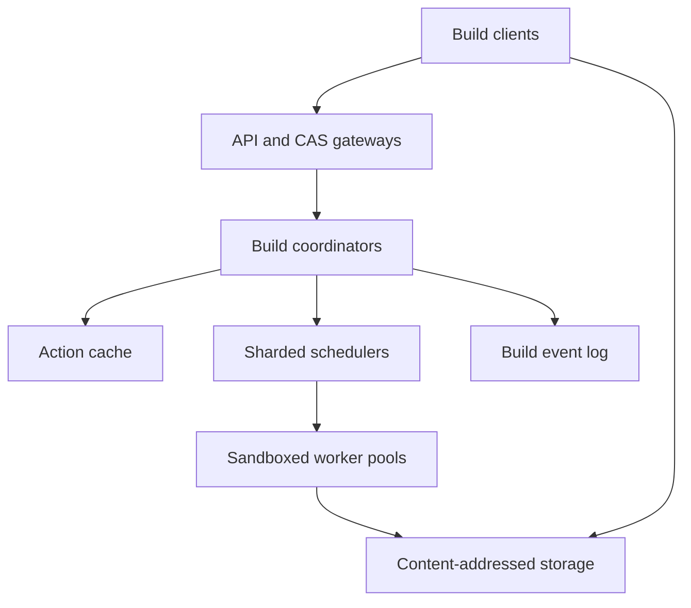

# Design a Remote Distributed Build and Test Platform

**Difficulty:** Senior / Staff

**Primary themes:** dependency DAGs, content-addressed storage, remote caching, scheduling, queues, worker isolation, idempotency, fairness, reliability

**Interview time budget:** about 45 minutes

**Educational walkthrough:** intentionally more detailed than what you would say in the interview

This walkthrough uses the Hello Interview delivery order—requirements, entities, interface, high-level design, then deep dives—but the problem, dialogue, calculations, and proposed architecture are original.

## Interviewer prompt

> Design a multi-tenant remote build and test platform used by developers and CI. A client should submit a build composed of compile, link, code-generation, and test actions. The platform should reuse prior results, execute independent actions in parallel on remote workers, stream progress and logs, and return requested outputs. Assume a large monorepo, heterogeneous Linux toolchains, bursty CI traffic, and petabytes of artifacts.

## Targeted clarifying questions

**Candidate:** Does the service discover dependencies from source code, or does the client send an analyzed action graph?

**Interviewer:** The build client performs loading and analysis. It sends executable actions and their dependencies. Design the remote cache and execution system.

**Candidate:** Must actions be deterministic and hermetic?

**Interviewer:** They should be. Each action declares its command, environment, platform, input-root digest, output paths, timeout, and resource requirements. We need defenses against accidental nondeterminism and cache poisoning.

**Candidate:** What artifact semantics are required?

**Interviewer:** Blobs are immutable and addressed by SHA-256 digest plus byte length. A successful action result may be shared only within its authorized cache namespace and must never reference missing output blobs.

**Candidate:** Do users need every intermediate artifact downloaded locally?

**Interviewer:** No. Intermediate outputs should remain remote and flow between actions by digest. The client downloads only explicitly requested top-level outputs and logs.

**Candidate:** Which worker types exist?

**Interviewer:** Multiple CPU, memory, architecture, operating-system, and accelerator pools. Some tests require exclusive machines or privileged capabilities. Interactive developer builds should not starve behind bulk CI.

**Candidate:** What scale and service levels should I target?

**Interviewer:** At peak, accept 20,000 new actions per second, keep 500,000 actions active or queued, store 5 PB of compressed blobs, and serve 1 TB/s aggregate CAS traffic. For an already-cached action, p99 lookup should be below 50 ms. Start an eligible interactive action within 2 seconds at p95 when its pool has capacity. Build submission availability is 99.99%; committed blobs and action results must survive an availability-zone loss.

**Candidate:** Are actions allowed external network or arbitrary side effects?

**Interviewer:** No by default. Treat execution as untrusted. Network and writable mounts require explicit policy and generally make the action non-cacheable.

**Candidate:** I will design a remote execution data plane, not the language-specific build analyzer. The three core paths will be upload-by-digest, cache-or-execute an action, and observe/cancel/download a build.

---

## 1. Requirements (~5 minutes)

### Core functional requirements

1. **Register a build and make inputs available.** Accept an action DAG, identify missing digests, and upload source files, tools, command descriptions, and directory metadata into content-addressed storage.
2. **Resolve or execute actions.** For each dependency-ready action, return a valid cache hit or schedule it on a compatible isolated worker; publish outputs atomically after successful execution.
3. **Observe and control builds.** Stream state changes and logs, support cancellation, and download selected final outputs without materializing every intermediate file locally.

### Quantified non-functional requirements

| Requirement | Target | Architectural consequence |
|---|---:|---|
| Admission | 20K new actions/s peak; 500K queued or active | Partitioned scheduler and durable queues |
| Storage | 5 PB CAS; 1 TB/s aggregate blob traffic | Sharded immutable storage, locality caches, streaming APIs |
| Cache latency | p99 action-cache lookup <50 ms | Regional metadata index and no synchronous object listing |
| Scheduling latency | eligible interactive action starts within 2 s p95 when capacity exists | Priority/fairness policy, warm workers, direct offers |
| Availability | 99.99% submission/control APIs | Stateless frontends, replicated metadata, degraded cache-miss execution |
| Durability | committed blob/result survives one AZ loss | Multi-AZ replication or erasure coding before publication |
| Isolation | tenant and action sandbox boundaries | Authenticated namespaces, sandboxed workers, capability policy |

### Scale estimates that matter

Assume an average action uploads or reads 20 MB across inputs and outputs. At 20,000 actions/s, naive transfer would be:

`20,000 × 20 MB = 400 GB/s`

Retries, replication, large link actions, and cache downloads can plausibly push the storage fabric toward the stated 1 TB/s. Therefore the scheduler must consider data locality, workers need local CAS caches, and intermediate outputs should remain remote.

Suppose the system stores 5 PB logically and uses 1.5× compression/deduplication benefit. With 1.4× erasure-coding overhead plus metadata and temporary replicas, physical capacity is still roughly:

`5 PB / 1.5 × 1.4 ≈ 4.7 PB`, before operational headroom.

This rules out full replication of every blob and motivates erasure coding for colder large blobs while retaining replicas for hot or newly written data.

At 20,000 actions/s, a seven-day action-result retention creates about 12 billion result records. Result metadata must be partitioned and expired incrementally; a single relational table with periodic full scans is not credible.

### Consistency and availability contract

- **CAS:** immutable by digest. After a successful write acknowledgement, reads in the tenant's authorized instance are strongly read-after-write. Returned bytes must hash to the requested digest.
- **Action cache:** a hit is usable only if the result is authorized, schema-compatible, unexpired, and all referenced outputs exist. A false miss is acceptable because it causes recomputation; a false or poisoned hit is not.
- **Execution:** at-least-once attempts. The same logical action may execute more than once after lease expiry or a lost response. Only one validated result becomes the visible action-cache value for a deterministic action.
- **Build state:** monotonic terminal state. Events may be delivered more than once, but sequence numbers let clients resume and deduplicate.
- **Cancellation:** best effort for running work and strong for future scheduling. Once the service acknowledges terminal cancellation, it will not start new attempts for that build. Already-produced immutable blobs may remain for deduplication and garbage collection.
- During a metadata partition, the service favors correctness: it may return cache misses, pause new execution, or serve existing immutable blobs. It never invents a cache hit or runs an action without a valid lease.

> **What I would say aloud:** “The most important asymmetry is that a false cache miss costs compute, but a false cache hit can silently produce the wrong binary. I will design the cache to fail open to recomputation, never to unverified reuse.”

### Out of scope

- Parsing every build language or computing the target graph
- Source control and code review
- Deployment of built artifacts
- Arbitrary internet access from actions
- Cross-platform result equivalence unless explicitly encoded in the action key

---

## 2. Core entities (~2 minutes)

| Entity | Purpose |
|---|---|
| `Build` | Tenant-scoped invocation, root targets, priority, state, timestamps |
| `Action` | Immutable executable unit defined by command, input root, platform, and outputs |
| `ActionDigest` | Hash of the canonical action description; action-cache lookup key |
| `Blob` | Immutable bytes addressed by `(hash, size)` |
| `Directory` | Merkle-tree node mapping names to file/directory digests |
| `ActionResult` | Exit code, output digests, stdout/stderr digests, timing and provenance |
| `ExecutionAttempt` | Leased try of an action on one worker |
| `Worker` | Registered executor with platform, capacity, health, and local-cache hints |
| `QueueClass` | Platform plus tenant/priority/fairness policy |
| `BuildEvent` | Sequenced state or log event for observation and replay |
| `CacheNamespace` | Authorization and compatibility boundary for CAS and action results |

The action digest must cover every input that can affect the output: command arguments, environment allowlist, working directory, input-root digest, declared outputs, platform/toolchain identity, timeout semantics, execution policy, and cache-salt version.

> **What I would say aloud:** “Content addressing is only correct if the key captures the complete computation. Omitting the compiler version or an environment variable does not improve hit rate; it corrupts the meaning of a hit.”

---

## 3. API / system interface (~5 minutes)

Authentication derives `tenant_id`, `principal_id`, allowed cache instances, quotas, and worker capabilities. The client cannot claim another tenant by putting its ID in a request body.

### Find missing input blobs

```http
POST /v1/cas:findMissing
Authorization: Bearer <token>

{
  "instance": "prod-linux-x86_64",
  "digests": [
    {"hash": "a52d...91", "size_bytes": 18241},
    {"hash": "08be...7c", "size_bytes": 493}
  ]
}
```

```json
{
  "missing": [{"hash": "a52d...91", "size_bytes": 18241}]
}
```

### Upload a blob

```http
PUT /v1/cas/blobs/a52d...91/18241
Content-Length: 18241
Content-SHA256: a52d...91
Idempotency-Key: upload-884

<bytes>
```

The service streams bytes while hashing, rejects a size or digest mismatch, and treats a repeated correct upload as success. Large uploads use resumable chunks tied to a temporary upload session; they become visible only after final digest verification.

### Submit a build

```http
POST /v1/builds
Idempotency-Key: build-20261018-449

{
  "instance": "prod-linux-x86_64",
  "root_actions": [
    {"hash": "0f91...aa", "size_bytes": 417}
  ],
  "priority": "INTERACTIVE",
  "deadline_seconds": 900,
  "download_policy": "TOP_LEVEL_ONLY"
}
```

```json
{
  "build_id": "bld_01J...",
  "state": "ACCEPTED",
  "event_cursor": 0
}
```

The action and command objects are themselves CAS blobs. The DAG manifest maps action digests to dependency action digests and is validated for cycles, missing objects, platform policy, and quota before admission.

### Observe, cancel, and fetch results

```http
GET /v1/builds/bld_01J/events?after=381
Accept: text/event-stream
```

```text
id: 382
event: action_completed
data: {"action":"0f91...aa","source":"EXECUTED","exit_code":0}
```

```http
POST /v1/builds/bld_01J:cancel
Idempotency-Key: cancel-1
```

```http
GET /v1/cas/blobs/7ade...33/984221
Range: bytes=0-1048575
```

### Internal execution lease

```http
POST /internal/workers/wkr_318:poll

{
  "platform": {"os":"linux","arch":"x86_64","cpu":16,"memory_gib":64},
  "free": {"cpu":8,"memory_gib":30},
  "local_digest_bloom": "..."
}
```

```json
{
  "attempt_id": "att_77",
  "lease_epoch": 4,
  "expires_at": "2026-10-18T16:03:40Z",
  "action_digest": {"hash":"0f91...aa","size_bytes":417}
}
```

Workers heartbeat with attempt ID and epoch. Stale epochs cannot publish a result.

### API-to-requirement mapping

| Requirement | Interface |
|---|---|
| Make inputs available | `findMissing`, CAS upload/batch upload |
| Cache or execute | Build submission plus internal worker leases |
| Observe/control/output | Event stream, cancel, build result, ranged CAS read |

---

## 4. Data flow

### Client-side preparation

1. The local build tool analyzes targets into a DAG of actions.
2. It constructs a Merkle tree: file contents are blobs; directory nodes contain child names, digests, and executable bits.
3. It canonicalizes command and action messages and computes their digests.
4. It asks `findMissing` in batches and uploads only absent objects.
5. It submits root action digests and the dependency manifest.

### Server-side execution

1. The build coordinator expands dependency counters and marks zero-dependency actions ready.
2. For each ready action it checks the action cache.
3. A valid hit completes the node immediately and may unlock dependents.
4. A miss enters a compatible queue. The scheduler leases it to a worker.
5. The worker downloads the input Merkle tree, executes in a sandbox, uploads outputs/logs to CAS, and calls complete with output digests and lease epoch.
6. The result validator confirms the lease, output declarations, digests, policy, and CAS durability, then atomically publishes `ActionResult`.
7. Completion decrements dependent counters. When roots finish, the build becomes terminal and the client downloads requested outputs.

The control plane stores small mutable state. The data plane moves immutable blobs directly between clients/workers and regional CAS gateways so coordinators never proxy artifact bytes.

---

## 5. High-level design (~10–15 minutes)

### Compact architecture



Gateways authenticate and rate-limit. Build coordinators own invocation state and dependency counters. Action-cache metadata maps action digests to immutable results. Schedulers partition ready work by platform and fairness domain. Workers execute untrusted actions. CAS gateways route immutable blobs to storage shards and locality caches. A durable event log backs resumable UI/CLI streams.

### Minimal state model

```text
BuildRow
  key: (tenant_id, build_id)
  value: idempotency_key, priority, state, roots, deadline,
         created_at, terminal_at, cancel_epoch

ActionState
  key: (build_id, action_digest)
  value: remaining_dependencies, state, result_digest,
         queue_class, attempt_no, critical_path_score

ActionCacheEntry
  key: (cache_namespace, action_digest)
  value: action_result_digest, provenance, created_at,
         expires_at, validation_version

AttemptRow
  key: attempt_id
  value: build_id, action_digest, worker_id, lease_epoch,
         lease_expiry, state, resource_reservation

BlobIndex
  key: (storage_instance, digest, size)
  value: placement_set, coding_scheme, durability_state,
         last_access_bucket, tenant_refs
```

### Operation 1: upload inputs

`findMissing` partitions digest checks by the digest prefix. Gateways batch requests to metadata shards and may use a conservative presence filter: false positives are dangerous if they make the client skip a truly missing blob, so a probabilistic filter is used only to accelerate known absence or followed by authoritative verification.

For upload, a gateway assigns temporary placement, streams bytes while computing SHA-256, and replicates or erasure-encodes the completed object. Only after the required durability quorum and digest match does it atomically mark the `BlobIndex` entry committed. Concurrent uploads of identical bytes coalesce; losers discard temporary chunks and receive success.

Small blobs can be packed into immutable containers to reduce storage-object and inode overhead. The index maps each small digest to `(pack_id, offset, length)`. Large blobs use independently ranged chunks while the root digest still authenticates the complete object.

### Operation 2: register the DAG

The coordinator validates that referenced action and command messages exist, the graph is acyclic, all roots are reachable, and declared resource/platform fields obey policy. It does not copy source bytes.

For a build with millions of nodes, one coordinator cannot load the whole graph into memory. Persist adjacency lists and dependency counters partitioned by `hash(build_id, action_digest)`. A build-level owner tracks summary state, while node transitions use idempotent messages. Most practical builds are smaller, so an in-memory hot working set with durable checkpoints keeps the common path fast.

### Operation 3: cache lookup and dependency release

For every dependency-ready action:

1. Read `ActionCacheEntry(cache_namespace, action_digest)`.
2. Check TTL, policy/validation version, provenance, and tenant authorization.
3. Verify referenced output blobs through batched CAS metadata checks or a result-validity generation.
4. On a valid hit, record the result and emit `CACHE_HIT`.
5. Atomically transition the node once and decrement each dependent's remaining counter using a dedupe key `(completed_action, dependent)`.

A missing output converts the entry into a miss and schedules repair or eviction; it never returns a partially valid hit.

### Operation 4: schedule and execute a miss

Ready actions enter queue shards keyed by `(platform_class, scheduler_shard)`. A hierarchical fair scheduler chooses tenant/project, then priority, then action. Within a fairness bucket it favors high critical-path score and uses aging so large or unusual actions eventually run.

Workers long-poll with free resources and capabilities. The scheduler performs constraint matching and bin packing, preferring a worker whose local digest summary suggests input locality. It creates a replicated attempt lease before responding.

The worker:

1. verifies the signed lease;
2. materializes the input tree into a fresh sandbox using local CAS hard links or copy-on-write mounts;
3. runs the command with CPU, memory, disk, process, network, and time limits;
4. streams stdout/stderr into chunked CAS-backed logs;
5. hashes declared outputs and uploads missing blobs;
6. submits an `ActionResult` referencing committed output digests.

The validator publishes the result only if the attempt epoch is current and the build/action is still eligible. A late worker may upload useful immutable blobs, but it cannot overwrite logical state.

### Operation 5: finish, stream, and download

Every state transition appends a sequenced build event. An event gateway tails the log and supports reconnect with `after=<sequence>`. Logs are chunk manifests in CAS, so a slow UI does not backpressure worker execution.

When root actions reach terminal success, the coordinator atomically marks the build successful and stores root `ActionResult` digests. The client downloads only top-level outputs. Intermediate digests remain valid remote inputs for later actions or cache hits—often called building without downloading all bytes.

Cancellation increments `cancel_epoch`, prevents new leases, sends revocations to active workers, and marks not-started nodes skipped. Workers regularly compare epochs and kill sandboxes. Terminal state is durable even if a worker ignores cancellation.

---

## 6. Deep dives (~10–15 minutes)

### Deep dive A: CAS and action-cache correctness

#### Where the baseline breaks

“Put files in object storage and map action hash to output” misses several failure modes:

- an action result becomes visible before its blobs are durable;
- garbage collection deletes an output still referenced by a result;
- a bad or compromised worker publishes bytes under a false digest;
- an incomplete action key reuses a result from another toolchain;
- tenants infer or download each other's private artifacts;
- nondeterministic actions alternately publish different results for one key.

#### CAS choices

| Choice | Benefit | Cost |
|---|---|---|
| Full replication | Fast recovery and reads | Too expensive for 5 PB |
| Erasure coding | Lower durable-storage overhead | More CPU and fragments per cold read |
| Hybrid tiering | Hot speed plus cold efficiency | Placement and migration complexity |

Choose hybrid tiering. New blobs receive three-AZ replicated placement for fast fan-out and repair. A background compactor packs small blobs and erasure-codes cold large blobs after access cools. Regional read-through caches hold popular chunks. Placement metadata changes; digest identity does not.

#### Atomic result publication

The worker first uploads every output and log blob. The result service batches `ensureDurable(digests)`. Only after all return committed does one metadata transaction install the action-cache entry and immutable result record. This is a metadata commit over already-durable content, not a transaction over terabytes of bytes.

If the worker dies after uploads but before publication, blobs are temporarily unreferenced and later collected. If the result response is lost, retrying with the same attempt and result digest is idempotent.

#### Garbage collection

Pure reference counting is difficult because results expire, builds are deleted, replication lags, and clients may be uploading. Use epoch-based mark-and-sweep:

1. Roots are unexpired action results, retained builds, pinned releases, active uploads, and active leases.
2. A distributed marker traverses result and directory manifests, recording live digests for GC epoch `N`.
3. Sweep only objects created before the epoch's safety horizon and absent from multiple completed mark epochs.
4. Tombstone index entries before reclaiming fragments; readers encountering a race retry or cause rehydration if another replica exists.

Recent objects receive a generous grace period. GC is biased toward leaks rather than premature deletion.

#### Cache poisoning and nondeterminism

- Hash bytes at every ingress and optionally on read/scrub.
- Bind action results to cache namespace, toolchain/platform identity, policy version, and worker attestation class.
- Let trusted pools write shared entries; untrusted bring-your-own workers may read shared cache but write only private/quarantine namespaces.
- Sample deterministic actions for duplicate execution. If identical action digests produce different result digests, quarantine the key/toolchain and expose a nondeterminism diagnostic.
- Never place secrets in the input tree or key. Secret-bearing or networked actions default to `do_not_cache`.

#### Availability and observability

If action-cache metadata is unavailable, execution can continue as a cache miss if CAS and scheduling are healthy. If CAS durability is unavailable, do not publish success; keep or retry the attempt. Measure CAS hit bytes, action hit rate weighted by saved CPU-seconds, corrupt-digest rate, missing-output references, upload dedupe ratio, hot-key skew, GC reclaimed bytes, repair backlog, and nondeterminism conflicts.

> **What I would say aloud:** “CAS immutability makes retries cheap, but it does not make action caching automatically correct. Publication ordering, namespace authorization, complete keys, and safe garbage collection carry the correctness burden.”

### Deep dive B: scheduling DAGs fairly across heterogeneous workers

#### Where FIFO breaks

A global FIFO queue causes head-of-line blocking: a 256-GB link action at the front can block thousands of small compiles even when ordinary workers are idle. Strict priority can let interactive builds starve CI forever. Greedy packing can leave fragmented memory/CPU, while scheduling without locality can saturate the network.

#### Queue and scheduler hierarchy

1. Route by hard platform constraints: OS, architecture, toolchain image, accelerator, trust and privilege.
2. Within a platform, apply weighted fair queuing across tenants/projects based on reserved capacity and recent resource-seconds.
3. Split each tenant into interactive, presubmit, and batch classes with capped priority shares.
4. Within a class, rank by critical-path score, wait-time aging, estimated duration, and fit.

Critical-path scheduling matters more than maximizing the raw count of completed actions. A build with 10,000 parallel leaf compiles may be waiting on one code-generation action that unlocks everything. The coordinator estimates remaining critical path from historical durations and propagates urgency to ready nodes.

#### Resource model

Request at least CPU, memory, ephemeral disk, accelerator, exclusivity, network class, and timeout. Workers reserve capacity before receiving a lease. Charge tenants by actual dominant resource-seconds rather than action count; otherwise one massive link and one tiny compile look equal.

Use best-fit with safeguards, not perfect multidimensional optimization. Reserve a fraction of each large-memory pool for genuinely large actions so small tasks do not fragment it. Allow controlled backfilling when a reserved job cannot yet start.

#### Locality versus fairness

Input locality is a soft preference. Worker Bloom filters or cache summaries estimate how many input bytes are local. The scheduler can wait a small bounded interval for a locality-favorable worker, but after that it schedules elsewhere. Otherwise a hot tenant could monopolize the same workers and defeat fairness.

For enormous inputs, optionally prefetch after queue placement. Prefetch is cancellable and low-priority; it must not count as an execution lease or make a stale action eligible.

#### Autoscaling

Scale each platform pool from predicted resource-seconds, queue age, and ready critical-path work—not just queue length. Worker startup may take minutes, so combine warm minimums for interactive pools with forecasted CI waves. Avoid scaling on unschedulable actions; surface “no compatible platform” separately.

#### Overload behavior

- Enforce per-tenant queued-action and byte quotas at admission.
- Return explicit retry guidance before accepting work that cannot meet its deadline.
- Shed speculative duplicate attempts before normal work.
- Preserve a reserved interactive slice but cap it so batch makes progress.
- Allow builds to remain queued durably rather than timing out frontends.

#### Observability

Track queue age by platform/tenant/priority, eligible-but-unscheduled time, worker utilization by resource, fragmentation, locality bytes saved, critical-path accuracy, fairness debt, preemption/cancellation waste, cold-start time, and unschedulable-reason counts. Averages hide starvation; report high percentiles and oldest items.

> **What I would say aloud:** “The scheduler optimizes build completion time under fairness, not simply actions per second. Platform constraints are hard, locality is soft, and critical-path priority is bounded by tenant resource shares.”

### Deep dive C: leases, retries, speculative execution, and cancellation

#### Why exactly-once execution is the wrong goal

A worker can finish an action and lose its completion response. The scheduler cannot distinguish that from a dead worker, so it may retry. Preventing duplicate execution across every failure would require coordination that harms availability and still cannot undo an external side effect.

Instead, actions are hermetic and side-effect-free, attempts are at least once, and result publication is fenced and idempotent.

#### Lease protocol

1. Scheduler transactionally changes action `READY → LEASED`, creates `attempt_id`, increments `lease_epoch`, and reserves tenant/worker capacity.
2. Worker heartbeats with epoch and progress. The scheduler extends the lease only while the worker and build remain eligible.
3. On expiry, the attempt becomes stale and capacity is released; the action returns to ready or fails after its retry policy.
4. Result publication compares `(attempt_id, lease_epoch)` with current state. A stale attempt cannot commit even if it finishes later.

Because CAS blobs are immutable, late uploads are harmless and may help deduplication. Mutable action state is the fenced resource.

#### Retry classification

- Infrastructure loss, worker crash, transient CAS failure: retry with backoff, preferably in another failure domain.
- Deterministic nonzero process exit: cacheable only when policy allows and normally not retried.
- Timeout or out-of-memory: retry only if policy changes resources or evidence suggests worker failure; blind retries waste capacity.
- Missing input digest: fail the build with client-correctable detail rather than looping.
- Platform unavailable: remain queued until deadline or fail explicitly.

#### Speculative execution

Tail latency from a few stragglers controls build completion. After an action exceeds a learned percentile and the build's critical path justifies it, launch one speculative attempt in another failure domain. First valid result wins; cancel the loser. Cap speculation globally and per tenant so incidents do not double fleet load.

Do not speculate nondeterministic, exclusive, enormous, or side-effect-capable actions. Compare successful duplicate outputs to detect determinism problems.

#### Cancellation races

Cancellation increments a build epoch in durable metadata before notifications. Schedulers reject offers from older epochs, workers kill matching sandboxes, and result validators refuse publication unless policy allows caching a result completed before the cancellation timestamp. The user-visible build stays cancelled even if a late action result is safe to retain privately.

#### Coordinator and queue recovery

Action transitions append to a partitioned durable log and update materialized state idempotently. A new coordinator reconstructs hot counters from a checkpoint plus log tail. Queue messages carry action-state version; schedulers re-read authoritative state before leasing, so duplicate or delayed messages cannot resurrect completed work.

#### Failure modes and metrics

Test response loss, duplicate queue delivery, scheduler failover, worker partition, clock skew, CAS timeout after execution, stale completion, cancellation during upload, and coordinator replay. Measure lease-expiry rate, duplicate-attempt CPU, late-result rejection, retry reason, speculative win rate, cancellation propagation, orphan sandbox count, checkpoint recovery time, and actions stuck in each state.

### Deep dive D: sandboxing and supply-chain trust

Workers execute code from many repositories, so tenant isolation is not optional. Use short-lived sandbox VMs or hardened containers with user namespaces, seccomp, cgroups, read-only base images, isolated writable scratch space, and default-deny networking. Privileged actions go to dedicated pools and normally bypass shared result caches.

The toolchain image is immutable and its digest is part of the platform/action identity. Workers attest boot image and agent version when registering. Leases are signed and short-lived; worker credentials authorize only required CAS namespaces and the current attempt.

Outputs include provenance: action digest, input-root digest, toolchain image, worker trust class, timestamps, and result digest. This does not prove source correctness, but it creates a verifiable chain from declared inputs to artifact. Audit cache writes, policy overrides, privileged execution, and cross-region artifact replication.

Prevent secret leakage by injecting secrets outside the hashed input tree through a dedicated broker, disabling caching and log persistence by default, redacting known values, and destroying the sandbox after use. Prefer short-lived workload credentials over static tokens.

---

## 7. Final design

### Concise architecture

1. Build clients analyze targets locally, canonicalize actions, create Merkle input trees, and upload only missing digests.
2. Stateless gateways authenticate tenant/instance access and route control requests or high-bandwidth CAS streams independently.
3. Build coordinators persist the action DAG, dependency counters, build epochs, idempotency results, and sequenced events.
4. The action cache maps complete action digests to validated immutable results; missing or suspect entries degrade to recomputation.
5. A hybrid CAS stores replicated hot data and erasure-coded cold data behind regional caches and strong digest verification.
6. Sharded hierarchical schedulers enforce platform constraints, weighted tenant fairness, priority caps, critical-path preference, aging, and locality hints.
7. Sandboxed workers receive fenced leases, materialize inputs, execute without external side effects, stream logs, and upload outputs before proposing results.
8. Result validation verifies lease epoch, declared outputs, policy, digest integrity, and CAS durability before atomic action-cache publication.
9. At-least-once attempts plus fenced idempotent publication handle crashes and ambiguous responses; controlled speculation reduces stragglers.
10. Build events and CAS-backed log chunks support resume, cancellation, and selective top-level downloads.
11. Epoch-based garbage collection preserves active leases, unexpired results, retained builds, and pinned releases with conservative safety windows.
12. Multi-AZ metadata and CAS durability, independent reconciliation, detailed fairness/cache metrics, and worker attestation complete the operational design.

### Requirements check

| Requirement | Design response |
|---|---|
| Register builds and inputs | Merkle DAG, batched missing checks, verified resumable uploads |
| Reuse work | Complete action keys plus authorized action cache |
| Parallel remote execution | Dependency counters, ready queues, heterogeneous worker pools |
| Fast interactive builds | Warm capacity, priority share, critical-path scheduling |
| Fair multi-tenancy | Hierarchical weighted resource fairness and admission quotas |
| Correct cache hits | Durable outputs before result publication; validation and provenance |
| Petabyte storage | Deduplication, packing, regional caches, hybrid erasure coding |
| High availability | Replicated metadata, immutable data plane, resumable queues/events |
| Failure recovery | Leases, fencing epochs, idempotent state transitions, retries |
| Streaming and cancellation | Sequenced event log, CAS-backed logs, durable cancel epoch |
| Isolation | Sandboxes, default-deny network, immutable toolchains, short credentials |
| Efficient downloads | Intermediate outputs remain by reference; top-level-only materialization |

### Principal tradeoffs

- Strong cache validation adds metadata reads but prevents silent wrong builds.
- Source-local analysis keeps the server language-agnostic but trusts clients to produce complete action descriptions.
- At-least-once execution wastes some compute but survives ambiguous failures without global serialization.
- Erasure coding reduces storage cost but makes cold reads and repair more expensive.
- Critical-path scheduling improves wall time but requires duration estimates and can conflict with pure FIFO fairness.
- Locality-aware scheduling saves bandwidth but must remain a bounded preference to avoid starvation.
- Shared caches improve hit rate but expand the poisoning and authorization blast radius.
- Conservative GC consumes more capacity but is preferable to deleting reachable build artifacts.

---

## Realistic interviewer follow-ups with strong sample answers

### 1. Why hash both bytes and size?

**Strong answer:** “The cryptographic hash identifies content, while size catches mismatches early and helps allocation, batching, and validation. The pair is the protocol identity; the server still hashes received bytes rather than trusting either client field.”

### 2. Why is an action cache separate from CAS?

**Strong answer:** “CAS maps a content digest to immutable bytes. The action cache maps a computation digest to result metadata that references output bytes in CAS. They have different validation, authorization, retention, and mutability semantics.”

### 3. Can two tenants share CAS blobs?

**Strong answer:** “Physical deduplication is possible, but authorization is checked through tenant/instance references so knowledge of a digest is not sufficient to download data. Shared action results require an explicitly trusted namespace and compatible toolchain policy.”

### 4. What happens when an action-cache result references a deleted blob?

**Strong answer:** “Treat it as a cache miss, never a partial hit. Invalidate or quarantine the entry, record a correctness alert, and recompute. GC safety and reconciliation should make this rare.”

### 5. How do downstream actions consume outputs without client downloads?

**Strong answer:** “An action result contains output digests. The coordinator or client constructs the downstream input-root Merkle tree using those digests. The destination worker fetches them from CAS or its local cache; bytes never need to round-trip through the developer machine.”

### 6. How do you prevent a changed compiler from hitting an old result?

**Strong answer:** “The compiler binary or immutable toolchain-image digest is an input to the action key. Platform properties and an action-key schema salt are also included, so changing execution semantics invalidates old entries deliberately.”

### 7. Why not guarantee exactly-once execution?

**Strong answer:** “After a worker finishes but its response is lost, the coordinator cannot know whether execution happened. Since actions are hermetic, duplicate attempts are safe. I guarantee one fenced visible result, not one physical process launch.”

### 8. How would you handle flaky tests?

**Strong answer:** “Test policy may run retries as separately identified attempts and aggregate an overall test outcome. I would not put a flaky pass into the ordinary deterministic action cache without policy metadata. Track pass-rate history and quarantine tests independently of infrastructure retries.”

### 9. What should autoscaling use?

**Strong answer:** “Ready and predicted resource-seconds by platform, oldest eligible wait, critical-path backlog, warm-start time, and current fragmentation. Queue length alone treats a one-second compile like a one-hour test and counts unschedulable work as capacity demand.”

### 10. How do you avoid starving a huge link action?

**Strong answer:** “Age its priority, reserve part of the high-memory pool, and allow backfill only when it cannot delay the reservation. Weighted tenant fairness still bounds how much capacity one project consumes.”

### 11. What if the same action produces different outputs?

**Strong answer:** “That signals nondeterminism, incomplete keys, or compromise. Sample duplicate executions, compare result digests, quarantine conflicting entries, preserve both provenances for diagnosis, and stop shared publication until the rule or toolchain is fixed.”

### 12. How do you garbage-collect 5 PB safely?

**Strong answer:** “Use distributed epoch mark-and-sweep from unexpired results, retained builds, pins, uploads, and leases. Sweep only old blobs absent from multiple completed epochs and tombstone metadata before deleting fragments. Bias toward delayed reclamation.”

### 13. What if a worker is partitioned but still running?

**Strong answer:** “Its lease eventually expires and a new epoch may run elsewhere. The old worker can upload immutable blobs, but result publication rejects its stale epoch. Short credentials and lease checks prevent it from mutating current action state.”

### 14. How do you debug a slow build?

**Strong answer:** “Expose the critical path and decompose time into dependency wait, cache lookup, queue wait, input fetch, sandbox setup, execution, output upload, and result commit. Show cache misses and their causes, worker platform, retry/speculation, and bytes transferred.”

### 15. When should a failed action be cached?

**Strong answer:** “Only deterministic failures under an explicit policy and short TTL—for example a compiler error from immutable inputs. Infrastructure errors, timeouts, OOMs, secret-dependent actions, and policy failures should not poison the reusable action cache.”

---

## Common pitfalls

1. Making the server parse every build language instead of defining the analyzed-action boundary.
2. Saying “hash the source” while omitting command, environment, toolchain, platform, or output declarations.
3. Publishing an action result before every referenced output is durable.
4. Treating a missing output as a successful partial cache hit.
5. Assuming digest knowledge is authorization to download a blob.
6. Promising exactly-once physical execution rather than idempotent visible results.
7. Using one global FIFO queue across incompatible worker types.
8. Optimizing actions per second instead of build critical-path completion.
9. Giving interactive work absolute priority and starving CI indefinitely.
10. Scheduling only for locality and causing worker or tenant starvation.
11. Autoscaling from queue length without action size or platform compatibility.
12. Allowing actions network access or secrets while sharing their results broadly.
13. Storing stdout/stderr only on ephemeral workers.
14. Downloading every intermediate artifact to the client.
15. Retrying deterministic compiler failures as if they were infrastructure errors.
16. Garbage-collecting solely from last-access time without reachable-root analysis.
17. Letting stale workers publish after lease expiry or cancellation.
18. Reporting average queue latency while a rare platform starves for hours.
19. Counting cache hits without measuring CPU-seconds and bytes actually saved.
20. Ignoring nondeterminism because most duplicate executions appear to match.

## A polished 90-second closing

> “The design begins with a client-analyzed DAG of hermetic actions. Commands, input Merkle trees, toolchains, and action descriptions are immutable CAS objects, so clients batch-check and upload only missing digests. A coordinator persists dependency counters, checks each ready action against a namespace-authorized action cache, and either releases a validated hit or queues a miss. Sharded schedulers first enforce hard platform constraints, then combine weighted tenant fairness, bounded priority, critical-path urgency, aging, resource fit, and soft data locality. Sandboxed workers receive fenced leases, materialize inputs from regional or local CAS caches, execute without side effects, stream CAS-backed logs, and upload outputs. Only after every output is digest-verified and durable does the result service atomically publish the action result. Physical attempts are at least once, but lease epochs make the visible result idempotent and stale completions harmless. Hot blobs use replication and caches; colder data is packed or erasure-coded, with conservative epoch-based GC. Sequenced build events support reconnect and cancellation, while top-level-only downloads keep intermediate bytes remote. The central contract is that false cache misses may waste compute, but the system never trades correctness for a false hit.”

## Public references

- [Hello Interview — System Design Delivery Framework](https://www.hellointerview.com/learn/system-design/in-a-hurry/delivery) — used for the interview sequence and approximate time allocation.
- [Bazel — Remote Execution Overview](https://bazel.build/docs/remote-execution) — official overview of distributing build and test actions across remote machines.
- [Bazel — Remote Caching](https://bazel.build/remote/caching) — official explanation of the action cache and content-addressable storage model.
- [Bazel Remote Execution API](https://github.com/bazelbuild/remote-apis) — public protocol definitions for CAS, action cache, execution, capabilities, bytestream transfer, and related services.
- [Bazel — Build without the Bytes](https://blog.bazel.build/2023/10/06/bwob-in-bazel-7.html) — official discussion of retaining intermediate outputs remotely and downloading only necessary artifacts.

These sources support the public remote-execution concepts. The requirements, API examples, scale assumptions, scheduling policy, failure analysis, and interview dialogue above are original.
