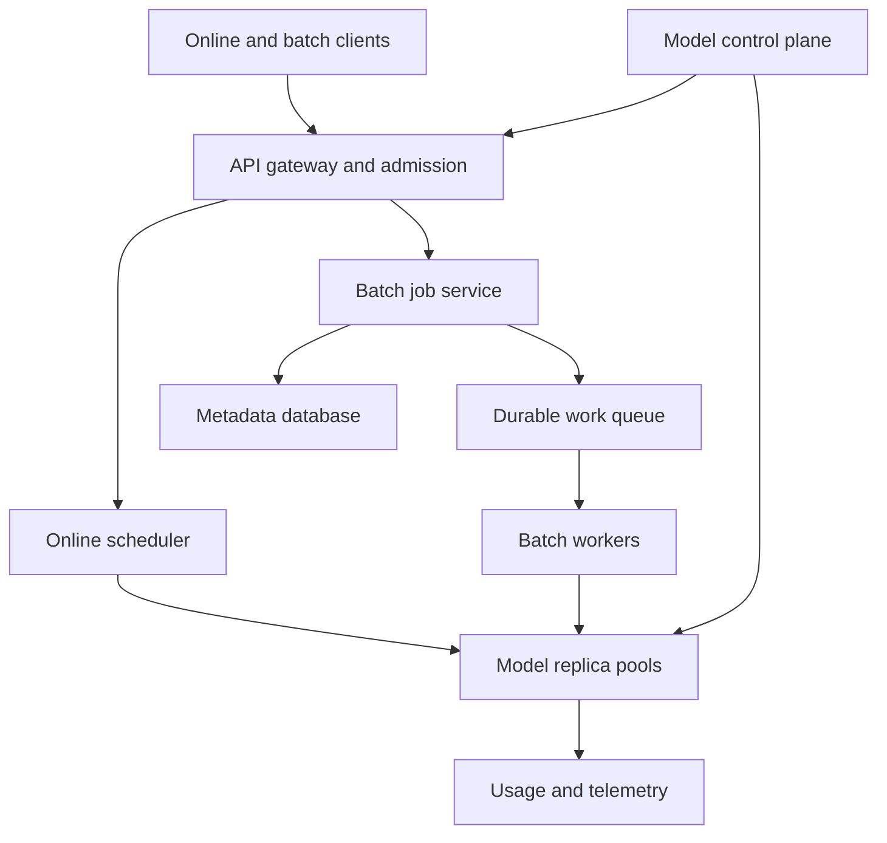

# Design a Multi-Tenant Embedding Inference Platform

**Difficulty:** Senior/Staff  
**Primary themes:** AI inference serving, queues, dynamic batching, caching, scheduling, overload control, model-version consistency  
**Interview time budget:** 45 minutes  
**Educational walkthrough:** intentionally more detailed than the spoken interview

This original walkthrough uses the public Hello Interview delivery sequence: clarify requirements, identify core entities, define interfaces, build a simple end-to-end design, then let non-functional requirements drive the deep dives. See [Hello Interview's System Design Delivery Framework](https://www.hellointerview.com/learn/system-design/in-a-hurry/delivery).

## Interviewer prompt

> Design a managed platform that converts text into embedding vectors. Customers use a low-latency online API for search and recommendation requests and a batch API to embed large datasets. The platform hosts several model versions, serves many tenants, and must use expensive accelerators efficiently without allowing one tenant or batch job to overwhelm interactive traffic.

An embedding is a fixed-length numeric vector representing an input. Similar inputs should be near each other under a chosen distance metric. This system generates vectors; a separate vector database stores and searches them.

## Targeted clarifying questions and assumed interviewer answers

**Candidate:** Are we designing model training, vector search, or only inference?

**Interviewer:** Only embedding inference. Models arrive as approved immutable artifacts. Vector-database ingestion and nearest-neighbor search are out of scope.

**Candidate:** What input forms and sizes do we support?

**Interviewer:** UTF-8 text only, up to 8,192 tokens per item. The online API accepts at most 128 items or 256,000 aggregate tokens. Batch jobs may contain billions of items in object storage.

**Candidate:** What latency and throughput should I target?

**Interviewer:** Across the fleet, 200,000 online items per second at peak and 10 billion batch items per day. For an online request of up to eight short texts, target p50 below 40 ms and p99 below 150 ms in-region, excluding public-network time.

**Candidate:** Is output deterministic? How important is model-version consistency?

**Interviewer:** For the same normalized input, model digest, tokenizer digest, and inference parameters, output should be bitwise stable within one hardware/runtime class. Clients may select an immutable version or an alias such as `embed-default`. A single request and a batch job must never mix versions.

**Candidate:** Can aliases change during a request or job?

**Interviewer:** Aliases can be updated, but they resolve once at admission. The resolved digest is returned and pinned for the operation.

**Candidate:** Do we store customer input or outputs?

**Interviewer:** Online inputs should not be durably stored by default. Cache use must be opt-in and tenant isolated. Batch manifests, status, and outputs are durable according to retention policy.

**Candidate:** What availability and failure behavior do we need?

**Interviewer:** 99.99% online API availability. Never silently switch to a different model. If capacity is unavailable, reject before the deadline with a retryable error. Batch processing is at-least-once internally but must produce exactly one logical output per input record.

**Candidate:** Should online and batch workloads share accelerators?

**Interviewer:** They may share a regional fleet, but online traffic has reserved capacity and strict priority. Batch uses spare capacity and can be preempted between microbatches.

**Candidate:** CPU and GPU?

**Interviewer:** Support both. Smaller or quantized models may be cheaper on CPU; large/high-throughput models use GPUs. Routing should consider the benchmarked performance profile, not hard-coded device assumptions.

## 1. Requirements (~5 minutes)

### Functional requirements

1. **Online embedding:** authenticate a tenant, resolve and pin a model version, validate/tokenize inputs, execute inference, and return ordered vectors plus usage metadata.
2. **Batch embedding:** accept an object-storage manifest, process billions of records resumably, write deterministic partitioned output, and expose status/cancellation.
3. **Model lifecycle and isolation:** deploy immutable model/tokenizer/runtime bundles, update aliases safely, enforce tenant quotas and privacy policy, and never mix versions within an operation.

### Quantified non-functional requirements

- **Scale:** 200K online items/s peak; 10B batch items/day; texts up to 8,192 tokens.
- **Latency:** for up to eight short inputs, in-region p50 < 40 ms and p99 < 150 ms; deadline-aware rejection rather than unbounded waiting.
- **Availability:** 99.99% for online requests across availability-zone failures.
- **Correctness:** preserve input/output order; pin model, tokenizer, runtime, normalization, and output schema; no silent fallback to another model.
- **Cost and utilization:** sustain at least 70% accelerator utilization at steady load without violating the online latency SLO.
- **Privacy:** online payloads are memory-resident only by default; logs exclude raw text; cache is opt-in, tenant-scoped, encrypted, and deletable.

### Consistency and availability contract

- The control plane provides strongly consistent alias updates and deployment state transitions.
- Admission resolves an alias to an immutable `model_revision_id`. Every item in that request or batch job uses that revision.
- Online execution is stateless and retryable. The API is **at-most-one response per request attempt**, but clients may retry; a caller-provided idempotency key deduplicates billable work for a bounded window.
- Batch execution is at-least-once internally. Conditional output commits make the externally visible result exactly once per `(job_id, record_id)`.
- Under overload, preserve admitted work and reject new work with `429` or `503` plus retry guidance. Do not queue beyond its deadline.

The availability boundary is explicit: we may return an error when the pinned model has no healthy capacity. Returning vectors from a different model would preserve availability while breaking semantic correctness.

### Out of scope

- Model training and fine-tuning
- Vector storage and similarity search
- Arbitrary customer code in the serving process
- Images, audio, generative token streaming, and cross-model ensembles
- Cross-region exactly-once execution

### What I would say aloud

> “I will treat the model and tokenizer digests as part of the data contract, not deployment trivia. An alias resolves once at admission. If that exact revision is unavailable, I would rather return a retryable error than silently generate incompatible vectors.”

## 2. Core entities (~2 minutes)

| Entity | Role |
|---|---|
| `Tenant` | Quotas, priority tier, privacy policy, allowed models, billing dimensions |
| `ModelRevision` | Immutable model, tokenizer, runtime, normalization and output-schema digests |
| `ModelAlias` | Mutable human-friendly name pointing to one approved revision |
| `OnlineRequest` | Inputs, resolved revision, deadline, idempotency key, trace metadata |
| `BatchJob` | Input manifest, pinned revision, output destination, progress and lifecycle |
| `WorkUnit` | Resumable range of batch records with lease and commit state |
| `Replica` | Loaded revision, device type, memory capacity, health and queue state |
| `UsageRecord` | Tenant, revision, tokens, items, device time, cache status and outcome |

Avoid drawing a large schema now. Fields appear alongside the components that use them.

## 3. API and system interface (~5 minutes)

Tenant identity, entitlements, rate class, and cache policy come from authentication. A request body cannot claim another tenant or priority tier.

### Online embedding

```http
POST /v1/embeddings
Authorization: Bearer <token>
Idempotency-Key: 9fa23282-bac5-4e43-9f0b-64ebdb02360d
X-Request-Deadline-Ms: 180
Content-Type: application/json

{
  "model": "embed-default",
  "inputs": [
    "distributed inference scheduling",
    "dynamic request batching"
  ],
  "encoding": "float32",
  "cache": "allow"
}
```

```json
{
  "model_revision": "emb-v7@sha256:7bd8...",
  "dimensions": 1536,
  "vectors": [
    [0.012, -0.044, 0.091],
    [0.007, -0.031, 0.105]
  ],
  "usage": {
    "items": 2,
    "input_tokens": 7,
    "cache_hits": 0
  }
}
```

The shortened vectors are illustrative. The response order exactly matches the input order. The server returns the resolved immutable revision even when the caller used an alias.

Errors distinguish causes:

- `400`: invalid UTF-8, dimensions, encoding, or token limit
- `403`: model not allowed for tenant
- `409`: idempotency key reused with different request content
- `429`: tenant quota or admission limit, with `Retry-After`
- `503`: pinned revision has no healthy capacity
- `504`: request cannot complete by its deadline

### Create a batch job

```http
POST /v1/embedding-jobs
Authorization: Bearer <token>
Idempotency-Key: 3d093d5e-e3dd-4a23-97b5-fb69e12e0c65
Content-Type: application/json

{
  "model": "embed-default",
  "input": {
    "uri": "s3://tenant-bucket/corpus/manifest.jsonl",
    "format": "jsonl",
    "id_field": "document_id",
    "text_field": "body"
  },
  "output": {
    "uri": "s3://tenant-bucket/embeddings/run-42/",
    "format": "parquet",
    "encoding": "float16"
  },
  "completion_deadline": "2026-10-20T18:00:00Z"
}
```

```json
{
  "job_id": "job_84f1",
  "model_revision": "emb-v7@sha256:7bd8...",
  "state": "QUEUED"
}
```

`GET /v1/embedding-jobs/{job_id}` returns totals, succeeded/failed records, committed output partitions, retry counts, estimated completion, and error samples. `POST /{job_id}:cancel` stops assigning new work; already committed output remains addressable.

### Model administration

```http
POST /v1/model-revisions
POST /v1/model-aliases/embed-default:promote
GET  /v1/model-revisions/{revision}/status
```

These are privileged control-plane operations. Promotion uses compare-and-set on the alias generation and specifies rollout policy, health gates, and rollback revision.

### What I would say aloud

> “I return the resolved revision because aliases are mutable and embeddings from different revisions are usually not interchangeable. For batch, the client supplies durable input and output locations; the service owns execution checkpoints, not the customer's source of truth.”

## 4. Data flows

### Online path

1. Authenticate and derive tenant policy.
2. Resolve alias to immutable revision; validate quota and deadline.
3. Normalize and tokenize, or retrieve a tenant-safe cached result.
4. Route the item to a compatible model/device queue.
5. Form a deadline-aware dynamic batch and execute inference.
6. Split the output back by request, restore order, encode, meter usage, and respond.

### Batch path

1. Resolve and pin a revision, validate object-storage access, and create a durable job.
2. Enumerate input into deterministic work units.
3. Lease units to workers, read and tokenize records, and construct throughput-oriented batches.
4. Execute on spare or reserved batch capacity.
5. Write temporary output, atomically publish a partition manifest, and checkpoint progress.
6. When every unit is committed, publish the final manifest and mark the job complete.

## 5. High-level design (~10–15 minutes)



### Model control plane

The control plane validates, benchmarks, deploys, and promotes immutable revisions. A revision contains:

```text
revision_id, model_digest, tokenizer_digest
normalization_digest, runtime_image_digest
dimensions, max_tokens, supported_encodings
supported_device_profiles, batch_size_profiles
state, rollout_generation, created_at
```

Artifacts live in versioned object storage and are signed. A deployment controller copies them to regional caches, verifies digests, warms replicas, runs golden-vector tests, then marks the revision routable. Alias metadata is strongly replicated; gateways cache it by generation.

Golden vectors detect a dangerous class of failures: a model can load successfully yet produce semantically or numerically incompatible output because the tokenizer, normalization, runtime, or quantization changed.

### Gateway and admission controller

The gateway authenticates, enforces request-size limits, resolves aliases, and assigns a monotonic deadline. The admission controller has live estimates for each `(revision, device_profile, region)`:

```text
ready_replicas, free_memory, queue_tokens
arrival_rate, service_rate, p99_queue_delay
oldest_deadline, recent_error_rate
```

It uses hierarchical token buckets for tenant request rate, input tokens, concurrent work, and daily budget. A global capacity limiter prevents accepted work from exceeding the fleet's drain rate.

The key rule is **admit only if the predicted queue plus service time fits the remaining deadline**. Rejecting in 3 ms is better than timing out after 180 ms while consuming tokenizer and queue resources.

### Stateless preprocessing tier

Normalization and tokenization run on CPU. The tokenizer is selected by digest, not merely model name. Workers validate the token limit, produce token IDs and attention masks, and attach:

```text
request_id, item_index, tenant_id
revision_id, token_count, deadline
priority_class, encoding, cache_policy
```

For short texts, tokenization may dominate server time, so it is horizontally scaled separately from accelerator replicas. This also prevents malformed or oversized requests from occupying accelerator memory.

### Online scheduler and replica pools

Each regional scheduler maintains logical queues by revision, device profile, priority, and token-length bucket. Replicas pull or receive microbatches only for a revision they have loaded.

An inference replica contains:

- one immutable model revision,
- a serving runtime,
- device-memory arenas,
- input/output buffers,
- health and utilization reporters.

The simplest design dedicates a pool to each popular revision. Low-traffic revisions use a controlled multiplexed pool, but loaded-model locality is preferred to avoid weight thrashing.

### Operation A: serve one online request

1. Gateway pins `revision_id` and checks tenant quota.
2. Preprocessor emits one item envelope per input.
3. Scheduler chooses the matching length bucket and compatible replica pool.
4. The batcher waits only within the smallest remaining deadline budget.
5. Replica pads inputs, executes one tensor batch, and returns item-indexed vectors.
6. Aggregator restores original order, records usage, and returns the revision.

This is complete without caching, batch jobs, autoscaling, or multi-region failover.

### Scale estimates that change the design

Assume the online mix averages 160 tokens per item:

```text
200,000 items/s × 160 tokens ≈ 32M input tokens/s
```

Suppose a benchmarked accelerator sustains 20,000 items/s for this mix at batch 128, but only 3,000 items/s at batch 1. Ignoring headroom, ten accelerators handle the throughput only with large batches; about 67 are needed at batch 1. Dynamic batching therefore changes fleet cost by multiples, not percentages.

At 70% target utilization and 20K items/s measured capacity:

```text
required replicas ≈ 200K / (20K × 0.70) ≈ 14.3
```

Round up to 15, then add zone-loss and rollout headroom—perhaps 22–24 replicas depending on the failure target. Capacity must be based on measured tokens, shapes, and batch efficiency rather than item count alone.

Batch load averages:

```text
10B items/day / 86,400 ≈ 116K items/s
```

That is more than half the online peak. Batch cannot be treated as negligible background traffic; it needs quotas, checkpointing, and reclaimable capacity.

A 1,536-dimensional float32 vector is 6,144 bytes. Returning 200K such vectors per second would be about 1.23 GB/s before protocol overhead. Response bandwidth and serialization are first-class bottlenecks. Float16 or base64/binary transport can materially reduce cost.

### Batch job service

Job metadata is transactional:

```text
job_id, tenant_id, revision_id
input_uri, input_etag, output_uri
state, total_units, committed_units
created_at, deadline, cancellation_epoch
```

The enumerator splits input by immutable object/byte range or file/row-group boundary. Each `WorkUnit` contains:

```text
unit_id, source_range, attempt
lease_owner, lease_expiry, state
temporary_output_uri, output_checksum
committed_manifest_version
```

Workers may retry, so they write attempt-specific temporary objects. A conditional metadata transaction chooses one successful attempt and appends its checksum and URI to the job manifest. Loser outputs are garbage-collected. Thus internal execution is at-least-once while logical output is exactly once.

## 6. Deep dives (~10–15 minutes)

### Deep dive A: deadline-aware dynamic batching

#### Where the baseline breaks

Sending each request immediately minimizes queue time but wastes accelerator parallelism. Waiting for a full batch maximizes throughput but makes sparse traffic or long inputs violate p99 latency. One FIFO queue also creates head-of-line blocking: a long 8,192-token item forces short inputs to pad to its length or wait behind it.

NVIDIA Triton's documentation describes dynamic batching as combining independent requests into a dynamically formed batch to increase throughput; it also exposes maximum queue delay and preferred sizes. That is a useful primitive, but the system still needs tenant fairness and end-to-end deadline logic ([NVIDIA Triton documentation](https://docs.nvidia.com/deeplearning/triton-inference-server/user-guide/docs/user_guide/model_configuration.html)).

#### Options

| Policy | Benefit | Failure mode |
|---|---|---|
| Immediate dispatch | Best queue latency | Low utilization and high cost |
| Fixed batch size | Predictable kernels | Sparse traffic waits indefinitely |
| Fixed time window | Simple throughput/latency knob | Ignores request deadlines and shapes |
| Deadline-aware bucketing | High utilization within SLO | More scheduler state and tuning |

#### Selected design

Maintain queues by revision and length bucket—for example 1–64, 65–128, 129–256, and so on. Within a bucket, use earliest-deadline-first with weighted fair queuing across tenants.

Dispatch when any condition holds:

- preferred token or item batch size is reached,
- the oldest item's latest safe dispatch time arrives,
- the replica is about to idle,
- a high-priority request would otherwise miss its deadline.

The scheduler predicts service time from an online profile keyed by model, device, batch size, and padded sequence length. A batch must satisfy:

```text
now + predicted_queue_delay + predicted_service_time
    <= minimum_item_deadline - response_budget
```

It may add a request only if the padding and compute increase do not cause an earlier item to miss its deadline.

#### Fairness

Pure earliest-deadline-first lets a large premium tenant dominate. Use weighted deficit round robin to select tenants, then earliest deadline within each tenant. Charge by tokens or predicted accelerator milliseconds, not request count. Reserve a small lane for health checks and control probes.

#### Partial failures

If tokenization fails for one item, the API can reject the whole synchronous request to preserve simple ordering semantics. Once a tensor batch executes, a device failure fails every included item; each request is retried only if sufficient deadline remains and retry budget permits. Never return half a vector list without an explicit partial-response contract.

#### Measurements

Track batch items, batch tokens, padding ratio, queue wait, inference duration, deadline slack at dispatch, SLO misses by cause, and fairness debt by tenant. A high utilization number with high padding waste can be misleading.

#### What I would say aloud

> “The scarce resource is accelerator time, but the contract is latency. I bucket by sequence length, batch only compatible requests, and dispatch on either batch efficiency or the earliest safe deadline. I never wait for a preferred batch after that deadline boundary.”

### Deep dive B: cache correctness, privacy, and version pinning

#### Where the baseline breaks

A cache keyed only by raw text can leak cross-tenant information, return an old model's vector after alias promotion, or collide across normalization/tokenizer changes. Logging raw cache keys creates another data leak.

#### Cache-key design

Only cache when tenant policy permits. Use:

```text
HMAC(tenant_cache_secret,
     revision_id || tokenizer_digest || normalization_digest ||
     encoding || canonical_input_bytes)
```

The tenant-specific secret prevents an operator or another tenant from testing whether a known sentence exists in a shared cache. Include every parameter that affects output. The value contains dimensions, vector bytes, revision, checksum, creation time, and expiry.

Use two layers:

- a small encrypted in-process cache for hot repeats,
- a regional distributed cache partitioned and quota-limited by tenant.

Do not cache request IDs or raw text. Encryption keys, deletion, TTL, and residency follow tenant policy. A customer can disable caching entirely.

#### Is caching worth it?

Embedding traffic often has low exact-input reuse. Let hit rate `h`, cache lookup cost `L`, and inference cost `I`. A cache improves average work only if roughly:

```text
h × I > L + operational overhead
```

At a 1% hit rate and 2 ms remote lookup for a 10 ms inference, the cache adds latency and complexity. Admission should bypass the distributed cache for tenants or revisions whose measured hit rate is below threshold. Cache decisions are empirical, not automatic.

#### Alias promotion

Aliases never appear in the cache key. The gateway resolves `embed-default` to revision `R7`; the cache uses `R7`. After promotion to `R8`, new requests miss or hit only `R8` entries. Existing admitted requests finish on `R7`.

For batch jobs, pin all artifact digests in job metadata. A month-long job remains on `R7` even if the alias advances. A customer who wants `R8` launches an explicit new job.

#### Determinism boundary

Bitwise stability may differ across device/runtime classes because floating-point kernels vary. Either:

1. constrain one revision to a certified runtime/device class, or
2. define a semantic tolerance rather than bitwise equality and include an execution-profile digest.

Given the assumed contract, choose the first option. CPU fallback is allowed only if it is certified under the same revision profile. Otherwise it is a different revision, not an invisible fallback.

#### What I would say aloud

> “The cache key is effectively a pure-function signature. It includes the immutable revision, tokenizer, normalization and encoding, plus a tenant-keyed digest of the canonical input. An alias is resolved before lookup, so promotion cannot contaminate old and new vector spaces.”

### Deep dive C: autoscaling, cold starts, and overload

#### Where the baseline breaks

CPU utilization is a poor leading signal for accelerator inference. By the time device utilization is high, queues may already exceed deadlines. Scaling also takes minutes if nodes must start, download multi-gigabyte weights, allocate device memory, and warm kernels.

Kubernetes can scale workloads from custom metrics, but the choice of metric and prewarming strategy remains application-specific ([Kubernetes HPA documentation](https://kubernetes.io/docs/concepts/workloads/autoscaling/horizontal-pod-autoscale/)).

#### Scaling signal

For each revision/device pool, estimate required replicas from queued work and arrival rate:

```text
desired = ceil(
  max(arrival_tokens_per_second / profiled_replica_rate,
      queued_predicted_device_ms / drain_window_ms)
  / target_utilization
)
```

Cap rate of scale-down and require a stabilization window. Scale up more aggressively. Include scheduled batch demand only after online reservations and failure headroom.

#### Cold-start hierarchy

1. **Hot replica:** weights loaded and warmed; route immediately.
2. **Warm node:** runtime and artifact cached locally; load into device memory.
3. **Warm capacity:** compatible idle node exists but artifact must transfer.
4. **Cold capacity:** provision a new node.

Popular revisions maintain minimum hot replicas in at least three zones. Newly promoted versions warm fully before receiving production traffic. Rare revisions may accept seconds of cold-start latency only through an asynchronous or relaxed-SLO API; they do not block the interactive queue.

#### Online versus batch

Partition capacity logically:

- online pools have guaranteed minimums and zone-failure headroom,
- batch receives a bounded share of unused capacity,
- the scheduler can stop assigning new batch microbatches immediately,
- running kernels are not forcibly interrupted; preemption occurs between microbatches,
- batch workers checkpoint output frequently enough that reclamation loses little work.

Do not place online requests behind a large batch already copied to a deep device queue. Keep the device queue shallow and scheduling authority outside the runtime.

#### Overload sequence

1. Stop admitting low-priority batch work.
2. Reduce optional cache lookups and nonessential telemetry sampling.
3. Enforce per-tenant concurrency and token budgets.
4. Reject online requests predicted to miss their deadline.
5. Preserve health, model-control, and already-admitted traffic.

Backpressure must be bounded at every hop. Ray Serve's public API and production guidance, for example, expose maximum queued requests and backpressure rejection; the general lesson is that an unlimited internal queue converts overload into timeouts and memory pressure ([Ray Serve API](https://docs.ray.io/en/latest/serve/api/index.html)).

#### Failure modes

- **Replica crash:** scheduler removes it, retries eligible requests elsewhere, and records device/runtime fingerprint.
- **Zone loss:** route to remaining zones using reserved headroom; shed batch immediately.
- **Bad revision:** golden probes or error/quality canary gates trip; atomically roll alias back while pinned old requests complete.
- **Artifact store outage:** already-loaded replicas continue; new cold starts fail closed for that revision.
- **Scheduler partition:** replicas require renewable leases and reject stale-generation assignments, preventing duplicate ownership assumptions.
- **Usage pipeline outage:** inference continues into a bounded local outbox; when full, policy decides whether to reject billable work rather than lose accounting.

#### What I would say aloud

> “Autoscaling cannot rescue a 150 ms request from a five-minute cold start. I keep failure headroom hot for popular revisions, scale on predicted queued device work, and use admission control as the final safety mechanism. Batch is reclaimable capacity, not an equal-priority neighbor.”

## Reliability, observability, and security

### Reliability controls

- Replicate stateless gateway, tokenization, scheduling, and aggregation services across three zones.
- Store control-plane metadata and batch state in a quorum-replicated database.
- Use immutable, checksummed artifacts and signed manifests.
- Use idempotent batch work and conditional manifest commits.
- Maintain per-revision rollback and last-known-good artifacts.
- Run periodic golden-vector, load, zone-loss, cache-isolation, and batch-resume tests.
- Reconcile job metadata with output manifests and garbage-collect orphan attempt files.

### Observability

Metrics must be segmented by tenant tier, revision, device profile, zone, batch-size bucket, sequence-length bucket, and outcome:

- admission accepted/rejected and predicted deadline slack,
- end-to-end, tokenize, queue, inference, serialization, and network latency,
- batch items/tokens, padding ratio, device utilization and memory,
- queue depth in predicted device milliseconds,
- warm/cold starts and model-load duration,
- cache eligibility, hit rate, lookup latency, and evictions,
- retries, device errors, OOMs, deadline expirations, and revision rollbacks,
- batch unit lease age, retry count, committed progress, and duplicate attempts,
- tokens and accelerator milliseconds used per tenant.

Trace metadata contains hashes and sizes, never raw customer text. Logs apply structured redaction before leaving the request process.

### Security

- Short-lived workload identities access only authorized artifact and tenant storage paths.
- Encrypt artifacts, manifests, cached vectors, and batch outputs at rest and in transit.
- Verify artifact signatures and runtime image digests before load.
- Separate tenant quotas and cache namespaces; defend against timing-based cache membership tests.
- Sandbox parsing and tokenization; enforce byte and token limits before accelerator allocation.
- Audit model promotions, policy changes, storage access, and job cancellation.

## Final design

The system separates a strongly consistent model control plane from a latency-sensitive inference data plane. At admission, an alias resolves to an immutable bundle containing model, tokenizer, normalization, runtime, and output-schema digests. Requests are authenticated, quota checked, tokenized on CPU, and routed into revision- and length-specific queues.

A deadline-aware scheduler fairly combines compatible tenant items into dynamic microbatches, sends them to warm CPU or GPU replica pools chosen from benchmark profiles, and restores per-request order. The fleet scales using predicted queued device work while preserving hot failure headroom. Overload is handled through bounded queues and early rejection, not unlimited buffering.

Batch jobs pin the same immutable revision, split object-storage input into resumable work units, use spare accelerator capacity, and conditionally commit partition manifests so retries do not duplicate logical outputs. An optional tenant-scoped cache uses a complete function-signature key and is bypassed when reuse is not economically useful.

## Requirements check

| Requirement | Design answer |
|---|---|
| Low-latency online embeddings | Regional admission, separate tokenization, warm pools, deadline-aware batching |
| Large batch jobs | Durable jobs, leased work units, checkpointing, conditional output manifests |
| Version consistency | Alias resolves once to immutable model/tokenizer/runtime digests |
| High utilization | Dynamic batching, length buckets, profiled device routing |
| Tenant fairness | Hierarchical quotas and weighted fair scheduling charged by predicted work |
| 99.99% availability | Multi-zone stateless tiers, hot headroom, replicated metadata, early shedding |
| Privacy | No durable online input by default; redacted telemetry; opt-in tenant cache |
| Correct retries | Online idempotency window; at-least-once batch execution with exactly-once logical commit |
| CPU/GPU support | Certified performance profiles and revision-specific compatibility |
| Overload behavior | Bounded queues, predicted deadline admission, retryable rejection |

## Interviewer follow-ups with strong sample answers

### 1. Why not put every request straight into Kafka?

**Candidate:** “Kafka is appropriate for durable batch work, but an interactive request with a 150 ms p99 should not pay durable-log and consumer-queue latency. The online path uses bounded in-memory regional queues and fails quickly; the client can retry with an idempotency key.”

### 2. How do you choose CPU versus GPU?

**Candidate:** “I benchmark each certified revision across device profiles using the real length and concurrency distribution. Routing minimizes cost subject to the deadline and residency constraints. I do not assume GPU is always faster, especially for small batches or quantized models.”

### 3. Can you combine requests from different tenants in one tensor batch?

**Candidate:** “Yes, if policy permits, because the computation is independent. Metadata and outputs remain separated by request and item index, buffers are zeroed before reuse, and fairness is enforced before batching. High-isolation tenants can require dedicated pools.”

### 4. How do you avoid one long text slowing every short text?

**Candidate:** “Bucket by token length and limit padding ratio. A long item joins a compatible bucket or runs separately. The batcher considers predicted padded compute before adding it.”

### 5. What happens during alias promotion?

**Candidate:** “Warm and validate the new revision first, then atomically advance the alias generation. Requests resolve once: already-admitted work stays on the old revision and new work uses the new one. Metrics and cache keys are revision-specific, so rollback is clean.”

### 6. Why not fall back from GPU to CPU during an outage?

**Candidate:** “Only do so if that CPU runtime is certified as the same revision and can meet the deadline. Otherwise its numeric behavior or latency contract may differ, so it must be exposed as another revision or the request fails.”

### 7. How do you make batch output exactly once?

**Candidate:** “Workers may execute more than once and write attempt-specific temporary objects. A conditional transaction selects one attempt for each deterministic work-unit ID and appends it to the manifest. Readers consume only the committed manifest.”

### 8. How do you cancel a batch job safely?

**Candidate:** “Increment a cancellation epoch and stop issuing leases. Workers check it between microbatches. Already committed partitions remain valid; temporary outputs are garbage-collected. The final state reports the exact committed prefix rather than pretending all work vanished.”

### 9. How would you reduce response bandwidth?

**Candidate:** “Offer float16 or quantized encodings, binary transport and compression where effective. For batch, write columnar output directly to object storage. I would never silently reduce precision because that changes the contract.”

### 10. What if tokenization is the bottleneck?

**Candidate:** “It is a separate autoscaled CPU tier with digest-pinned tokenizer instances. Scale on queued tokens and CPU time, cache tokenization only under the same privacy rules, and use efficient native tokenizers. Accelerator capacity should not wait on serial tokenization.”

### 11. How do you detect a semantically broken model that returns HTTP 200?

**Candidate:** “Run golden-vector tests before readiness, canary against distribution and cosine-similarity metrics, track norms and NaN rates, and gate alias promotion. Operational health alone is insufficient for ML outputs.”

### 12. Why not autoscale only on GPU utilization?

**Candidate:** “Utilization is lagging and cannot represent queued deadlines or cold-start time. I scale on arrival rate and predicted queued device milliseconds, retain minimum hot replicas, and still use admission control because new capacity cannot arrive within an existing request's deadline.”

### 13. What happens if usage metering is down?

**Candidate:** “Write usage to a local durable outbox and replay it. Bound that outbox. Depending on billing policy, once it is full either reject new billable work or temporarily meter conservatively; silently losing usage indefinitely is not acceptable.”

### 14. How would you support a tenant with strict data residency?

**Candidate:** “Bind its credentials and policy to allowed regions, route only to regional control/data-plane instances, use regional artifact and cache storage, and prevent cross-region failover. The availability contract for that tier reflects the narrower failure domain.”

## Common pitfalls

1. Treating model name as sufficient identity while ignoring tokenizer and normalization versions.
2. Silently switching model versions or hardware profiles during overload.
3. Maximizing batch size without considering deadlines or padding waste.
4. Using one FIFO queue and causing head-of-line blocking.
5. Measuring only requests rather than tokens and predicted device time.
6. Autoscaling on CPU/GPU utilization after queues are already late.
7. Assuming autoscaling can fix cold starts within an interactive deadline.
8. Letting batch fill deep device queues ahead of online traffic.
9. Sharing a raw-text cache across tenants.
10. Omitting revision parameters from the cache key.
11. Adding a cache without measuring exact-input reuse.
12. Logging prompts, raw cache keys, or vector contents by default.
13. Claiming exactly-once execution instead of designing idempotent logical commits.
14. Writing batch retries to the same output object without conditional publication.
15. Ignoring response serialization and bandwidth for large vectors.
16. Using item count as capacity when sequence lengths differ by orders of magnitude.
17. Declaring a replica ready before weights, kernels, and golden tests are warm.
18. Mixing online and batch capacity without reservations or preemption boundaries.
19. Returning partial online results without defining partial-response semantics.
20. Discussing GPU kernels deeply before establishing API, consistency, and overload contracts.

## Compact 45-minute delivery plan

| Time | Focus |
|---:|---|
| 0–5 min | Scope inference, input limits, scale, SLO, determinism and privacy |
| 5–7 min | Identify tenant, revision, request, job, work unit and replica |
| 7–12 min | Online, batch and model-management APIs |
| 12–23 min | Build control plane, admission, tokenization, scheduling and replica path |
| 23–32 min | Deep dive on deadline-aware dynamic batching and fairness |
| 32–39 min | Deep dive on autoscaling, cold starts and overload |
| 39–43 min | Cache/version correctness, batch idempotency, security and observability |
| 43–45 min | Requirements check and final tradeoff summary |

### Strong 90-second closing summary

> “I separate immutable model identity from mutable aliases. Admission resolves and pins model, tokenizer, normalization and runtime digests, applies tenant quotas, and accepts work only when the predicted queue and service time fit the deadline. CPU tokenizers feed revision- and length-specific queues; a weighted, deadline-aware scheduler forms dynamic microbatches and sends them to warmed CPU or GPU pools chosen from benchmark profiles.
>
> “Popular revisions keep multi-zone hot headroom because autoscaling cannot help an already-admitted 150 millisecond request. Batch jobs use durable leased work units and spare capacity, checkpoint between microbatches, and publish outputs through conditional manifests so at-least-once execution produces exactly-once logical records. Optional caching is tenant-scoped and keyed by the complete inference signature. Under overload I reclaim batch capacity and reject early rather than silently changing models or building an unbounded queue.”

## Public references

- [Hello Interview — System Design Delivery Framework](https://www.hellointerview.com/learn/system-design/in-a-hurry/delivery)
- [NVIDIA Triton Inference Server — Dynamic batching and model configuration](https://docs.nvidia.com/deeplearning/triton-inference-server/user-guide/docs/user_guide/model_configuration.html)
- [NVIDIA Triton Inference Server — Ragged batching](https://docs.nvidia.com/deeplearning/triton-inference-server/user-guide/docs/user_guide/ragged_batching.html)
- [Kubernetes — Horizontal Pod Autoscaling](https://kubernetes.io/docs/concepts/workloads/autoscaling/horizontal-pod-autoscale/)
- [Ray Serve — API, batching and backpressure](https://docs.ray.io/en/latest/serve/api/index.html)
- [Ray Serve — Dynamic request batching](https://docs.ray.io/en/latest/serve/advanced-guides/dyn-req-batch.html)

These sources support the public delivery structure and concrete serving primitives. The product requirements, APIs, scale assumptions, scheduling policy, consistency contract, dialogue, failure handling, and final architecture are original.
