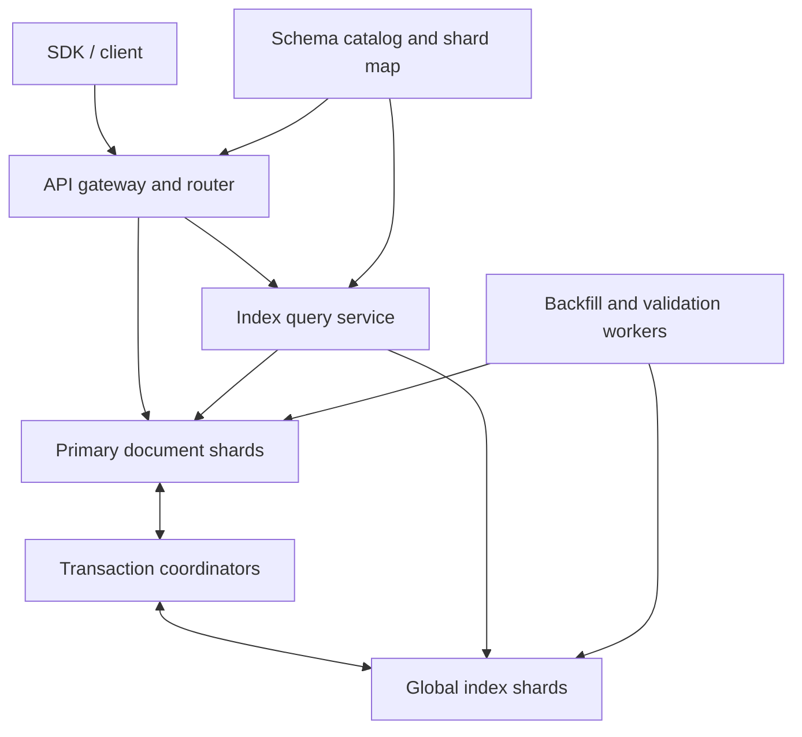

# Design a Managed Document Database with Global Secondary Indexes

**Difficulty:** Staff-level  
**Primary themes:** distributed databases, indexing, transactions, online backfill, consistency, hot partitions, reliability  
**Interview time budget:** about 45 minutes  
**Educational walkthrough:** intentionally more detailed than what you would say in 45 minutes

This walkthrough follows the broad Hello Interview delivery sequence—requirements, core entities, interface, high-level design, then deep dives—while the system and reasoning are original. Hello Interview's public delivery guidance recommends getting to a simple end-to-end design before using non-functional requirements to choose the important deep dives. See [System Design Delivery Framework](https://www.hellointerview.com/learn/system-design/in-a-hurry/delivery) and [Guided Practice](https://www.hellointerview.com/practice/overview).

## Interviewer prompt

> Design a managed, multi-tenant document database. Applications should store JSON documents by primary key and create global secondary indexes so they can query by other fields. Indexes must be created online without taking collections offline. Some indexes may enforce uniqueness.

The word **global** means an index is partitioned independently from the base documents. An index entry and its document may therefore live on different shards. That is the central difficulty: scale improves, but a single logical write can become a distributed transaction.

## Targeted clarifying questions and assumed answers

**Candidate:** What document operations and query shapes matter most?

**Interviewer:** Put, get, conditionally update, and delete by document ID. For secondary indexes, support equality on a partition field plus equality or range predicates on one sort field. Return paginated results. No joins or arbitrary ad hoc JSON scans.

**Candidate:** Must an acknowledged write be immediately visible through a secondary index?

**Interviewer:** Yes for the default index type. You may offer a cheaper asynchronous index as an explicit alternative, but callers must be able to distinguish the semantics.

**Candidate:** What does a unique index mean?

**Interviewer:** Within one collection, two live documents may not have the same indexed value. Creating a unique index over existing conflicting data must fail safely.

**Candidate:** Do we need general multi-document transactions?

**Interviewer:** No. Support atomic mutation of one document plus all of its synchronous index entries. Conditional writes on the document version are required.

**Candidate:** Is this globally multi-writer?

**Interviewer:** A collection has a home region for writes. Reads can be served locally where the requested consistency permits. Cross-region active-active conflict resolution is out of scope.

**Candidate:** What scale should I design for?

**Interviewer:** Across the service: 10 PB of logical documents, 100,000 tenants, one million document writes per second, five million primary-key reads per second, and two million index queries per second. A document is at most 1 MiB and averages 2 KiB. A collection may have ten indexes.

**Candidate:** What availability and latency targets matter?

**Interviewer:** Target 99.99% service availability, p99 under 20 ms for same-region point reads, p99 under 100 ms to return the first index-query page, and no acknowledged data loss. Index creation must remain online and add less than 10% foreground latency or throughput impact.

**Candidate:** Do index queries need a stable view while paginating?

**Interviewer:** Yes. A cursor should continue a snapshot rather than silently mixing old and new versions.

**Candidate:** Can I defer full-text search, aggregations, triggers, and analytics?

**Interviewer:** Yes.

## 1. Requirements (~5 minutes in the interview)

### Functional requirements

1. **Store and mutate documents by ID.** Create, get, conditionally update, and delete a JSON document. Retries must be idempotent.
2. **Create and query global secondary indexes.** Support equality and ordered range access, projections, stable pagination, and online create/drop.
3. **Preserve index correctness.** A synchronous index changes atomically with its document; a unique index rejects conflicting writes; operators can observe and recover index builds.

### Non-functional requirements

- **Scale:** 10 PB logical data; 1M writes/s, 5M point reads/s, 2M index queries/s; up to ten indexes per collection.
- **Latency:** same-region p99 point reads below 20 ms and first-page indexed queries below 100 ms under the documented load envelope.
- **Availability:** 99.99% overall, with each shard replicated across three availability zones. The system may reject writes rather than violate strong index consistency.
- **Durability:** once acknowledged, a write survives an availability-zone loss; target at least eight nines of annual durability through quorum replication, checksums, backups, and repair.
- **Online evolution:** building or dropping an index does not stop document traffic and consumes at most 10% of a collection's foreground resource budget.

### Consistency and availability contract

For the default **synchronous index**:

- A document mutation and all its synchronous index deletions/inserts commit atomically.
- A successful conditional write is linearizable in the collection's home region.
- A strongly consistent index query begun after that success observes the new entry and not the old one.
- Paginated queries read at one MVCC timestamp and one index schema version.
- Unique keys are serialized strongly.

During a network partition, a shard needs a replica quorum. If either a primary-data participant or a synchronous-index participant cannot reach quorum, the write fails or times out; it is not acknowledged partially. This is a deliberate consistency-over-write-availability choice.

For an optional **asynchronous index**, the document write can succeed before the index catches up. Its API reports a lag watermark, and it never claims strong freshness. This resembles the explicit tradeoff in Amazon DynamoDB, whose global secondary indexes are asynchronously maintained and support eventually consistent reads rather than strongly consistent ones ([AWS documentation](https://docs.aws.amazon.com/amazondynamodb/latest/developerguide/GSI.html)).

### Out of scope

- General multi-document transactions
- Cross-region multi-primary writes
- Joins, full-text relevance, vector search, analytics, and arbitrary predicates
- Automatic selection of arbitrary JSON paths without a declared index

### What I would say aloud

> “The key contract I want to make explicit is that a normal index is not a cache. If I acknowledge a document update, the old index key must disappear and the new one must appear atomically. I will prefer consistency to write availability for those indexed writes, and I will make any cheaper asynchronous mode a different, visible product contract.”

## 2. Core entities (~2 minutes)

At this stage, name the nouns without prematurely designing every column.

| Entity | Purpose |
|---|---|
| `Tenant` / `Collection` | Isolation, quotas, home region, schema and index limits |
| `Document` | JSON value, document ID, version, commit timestamp, tombstone state |
| `IndexDefinition` | Indexed paths, key types, projection, uniqueness, state, schema version |
| `IndexEntry` | Encoded index key pointing to a document, optionally with projected fields |
| `ShardDescriptor` | Key range, replicas, leader, epoch, split lineage |
| `TransactionRecord` | Durable decision for a cross-shard document/index mutation |
| `IndexBuild` | Snapshot timestamp, backfill spans, progress frontier, errors, build epoch |
| `IdempotencyRecord` | Maps a caller's retry token to the original outcome |

The physical key shapes will emerge when the storage components need them. That keeps the early discussion focused on behavior.

### What I would say aloud

> “My essential durable nouns are the document, index definition, index entry, transaction decision, and index-build checkpoint. The shard map is also first-class because both documents and indexes move while clients keep operating.”

## 3. API and system interface (~5 minutes)

All requests carry an authenticated credential. The gateway derives `tenant_id`, roles, collection permissions, quota class, and allowed consistency modes from authentication. The caller never supplies an authoritative tenant ID.

### Put or conditionally update a document

```http
PUT /v1/collections/customers/documents/cus_814
Authorization: Bearer <token>
Idempotency-Key: 8e8087ca-1b12-4b42-9301-83c0f35ce993
If-Match: "17"
Content-Type: application/json

{
  "email": "ada@example.com",
  "region": "us-east",
  "lifetime_value": 12800,
  "status": "active"
}
```

```json
{
  "document_id": "cus_814",
  "version": 18,
  "commit_timestamp": "2026-10-19T08:03:12.481932Z"
}
```

`If-Match` provides optimistic concurrency control. A stale version returns `412 Precondition Failed`. Repeating the same idempotency key and request returns the original result; reusing the key with different content returns `409 Conflict`.

### Get a document

```http
GET /v1/collections/customers/documents/cus_814?consistency=strong
Authorization: Bearer <token>
```

The response includes `ETag: "18"`. A bounded-stale read may specify `max_staleness_ms` and use a follower.

### Delete a document

```http
DELETE /v1/collections/customers/documents/cus_814
Authorization: Bearer <token>
Idempotency-Key: 5990117e-cf0b-4b55-bcaa-e78954a8c220
If-Match: "18"
```

Deletion writes a versioned tombstone and transactionally removes synchronous index entries. Physical reclamation waits for replication, backups, change streams, and active snapshots.

### Create an index online

```http
POST /v1/collections/customers/indexes
Authorization: Bearer <token>
Content-Type: application/json

{
  "name": "email_unique",
  "mode": "synchronous",
  "partition_paths": ["$.email"],
  "sort_path": null,
  "unique": true,
  "projection": ["$.status", "$.region"]
}
```

```json
{
  "index_id": "idx_902",
  "state": "BUILDING",
  "build_id": "bld_771"
}
```

Index creation is asynchronous as an administrative operation. `GET /indexes/idx_902` reports state, snapshot timestamp, completed spans, change-catch-up frontier, estimated completion, throttling, and any uniqueness conflicts.

### Query an index

```http
POST /v1/collections/customers/query
Authorization: Bearer <token>
Content-Type: application/json

{
  "index": "region_value",
  "partition": {"eq": "us-east"},
  "sort": {"gte": 10000, "lt": 20000},
  "limit": 100,
  "consistency": "strong",
  "projection": ["$.email", "$.status"]
}
```

```json
{
  "items": [
    {
      "document_id": "cus_814",
      "email": "ada@example.com",
      "status": "active"
    }
  ],
  "read_timestamp": "2026-10-19T08:04:00.104127Z",
  "next_cursor": "opaque-signed-token"
}
```

The cursor contains a signed, opaque encoding of tenant, collection, index ID, index schema version, snapshot timestamp, last composite key, and shard-map epoch. It cannot be modified to cross tenant boundaries. If the snapshot has aged past the retention window, the API returns a specific `410 Snapshot Expired` rather than silently changing views.

### Interface-to-requirement mapping

| Requirement | Operations |
|---|---|
| Document CRUD | `PUT`, `GET`, `DELETE /documents/{id}` |
| Online indexing | `POST`, `GET`, `DELETE /indexes/{id}` |
| Equality/range access | `POST /query` with declared index and cursor |
| Correct retries | `Idempotency-Key`, `If-Match`, returned version |
| Visible semantics | `mode`, `consistency`, `read_timestamp`, lag watermark |

### What I would say aloud

> “Identity comes from the token, not the JSON body. The write interface exposes both idempotency and compare-and-set because distributed retries and concurrent writers are separate problems. Query cursors pin a timestamp and schema version so page two cannot quietly come from a different database view.”

## 4. Useful data flows

### Foreground write

1. Authenticate, authorize, enforce quota, and resolve the collection schema.
2. Route the document ID to its primary shard leader.
3. Read the prior document version and compute the exact old index entries to delete and new entries to insert.
4. Atomically commit the document change, index mutations, and any unique-key reservations.
5. Return the committed version and timestamp; retries resolve through the idempotency record and transaction decision.

### Online index creation

1. Publish a non-queryable `BUILDING` index definition and choose snapshot timestamp `T0`.
2. Make all post-`T0` foreground writes maintain the new index.
3. Scan primary shards at `T0` and bulk-ingest missing historical entries with idempotent build keys.
4. Catch up and verify every span's mutation frontier.
5. Atomically change the catalog state to `ACTIVE` at `T1`.

That separation—snapshot history plus concurrent mutations—is the core of an online backfill.

## 5. High-level design (~10–15 minutes)

Start with the smallest complete system and satisfy one operation at a time.



### Component 1: schema catalog and shard map

The strongly replicated control plane stores collection configuration, index definitions, state transitions, and shard descriptors. Gateways cache signed versions so a brief catalog outage does not stop traffic.

An `IndexDefinition` needs at least:

```text
index_id, collection_id, name
partition_paths[], sort_path, key_types
projection_paths[], unique, mode
state: BUILDING | ACTIVE | DROPPING | FAILED
schema_version, build_epoch
activation_timestamp, drop_timestamp
```

Shard descriptors contain key-range boundaries, replica addresses, leader hint, and an epoch. Requests carrying an obsolete epoch are redirected; a client never guesses ownership.

### Component 2: replicated primary document store

Partition primary data by:

```text
(tenant_id, collection_id, hash(document_id), document_id)
```

Hashing distributes unrelated IDs. Each shard is a consensus group with three or five replicas across availability zones. The leader orders writes; a quorum persists the log before commit. MVCC—multi-version concurrency control—retains timestamped versions so readers can see a stable historical snapshot while writes continue.

A stored row includes:

```text
document_id, json_bytes, version, commit_timestamp
schema_version, tombstone, checksum
```

A point read routes directly to one shard. Strong reads use the leader or a quorum-confirmed leaseholder. Bounded-stale reads may use a follower whose applied timestamp satisfies the requested staleness.

### Component 3: independently partitioned global index store

An index entry is an ordered key-value row:

```text
Key: (tenant_id, collection_id, index_id,
      encoded_partition_values,
      encoded_sort_value,
      document_id)

Value: (document_version, projected_fields, commit_timestamp)
```

`document_id` is the final tie-breaker, making entries unique and pagination deterministic even when many documents share the same index value. Values use a canonical, type-aware encoding so byte order matches database order for strings, signed numbers, timestamps, nulls, and descending fields.

Index ranges are partitioned separately from document ranges. That lets a region query scan a narrow ordered range without contacting every primary shard.

### Scale estimate that changes the design

Assume an average write changes five of the collection's ten indexes. One million document writes per second then produce roughly:

```text
1M primary mutations/s + 5M index mutations/s = 6M logical mutations/s
```

An update can require both an old-entry delete and new-entry insert, so peak physical index operations may be closer to 10M/s before replication. At three replicas, storage-node log traffic is tens of millions of mutations per second. A single colocated database or one index partition cannot absorb that load. Primary and index data must shard independently, and the write path must batch participant operations.

For capacity, 10 PB divided into 4 TB logical primary ranges implies about 2,500 primary ranges before headroom and replication. Real deployment uses more, smaller ranges for parallelism and failure isolation. The arithmetic is not a machine count; it explains why automatic splitting and distributed metadata are fundamental rather than optional.

At 2 KiB average, 1M writes/s is about 2 GB/s of primary payload before replication and indexes. Backfill bandwidth must be separately throttled or it will compete directly with foreground writes.

### Operation A: put a document without indexes

The gateway validates document size and JSON, resolves the primary range, then sends the request to its leader. The leader checks the idempotency key and `If-Match`, appends the new MVCC version through consensus, and returns after quorum durability.

This is the simplest complete path and already satisfies primary-key CRUD.

### Operation B: add synchronous global indexes

The primary leader reads the previous document version and active index definitions. It deterministically derives:

- old entries to delete,
- new entries to insert,
- unique guard keys to acquire,
- the new primary row or tombstone.

Because these keys can span shards, use two-phase commit (2PC) over replicated participants:

1. The document shard becomes coordinator and assigns `transaction_id` and provisional commit timestamp.
2. In parallel, each primary or index shard validates its conditions, acquires intent locks, and quorum-replicates a `PREPARED` record.
3. The coordinator quorum-replicates one durable `COMMIT` decision.
4. Participants convert intents into committed MVCC versions at the commit timestamp; cleanup may be asynchronous.
5. The coordinator returns success only after the commit decision is durable and the protocol's visibility condition is met.

The durable decision is the source of truth after a crash. An indeterminate client timeout does not mean “retry as a new write”; the SDK retries with the same idempotency key and asks the system to resolve the original transaction.

Google's Spanner paper is useful background for the feasibility of globally distributed, synchronously replicated storage with externally consistent transactions and timestamped reads, though this design does not assume an identical implementation ([Google Research, 2012](https://research.google/pubs/spanner-googles-globally-distributed-database-2/)).

### Unique index keys

A unique index uses a guard row whose key omits `document_id`:

```text
(tenant_id, collection_id, index_id, encoded_unique_value)
    -> owning_document_id, owning_document_version
```

The transaction conditionally inserts this row if absent or already owned by the same document. Two concurrent claims route to the same key range and serialize there. Replacing `a@example.com` with `b@example.com` atomically deletes the old guard, inserts the new guard, changes index entries, and changes the document.

This is stronger than checking the index before writing: a separate read followed by a write has a race.

### Operation C: query an active index

The query service validates that the requested predicate matches the declared index prefix. It chooses a read timestamp no earlier than the caller's session token for strong read-after-write behavior, locates the relevant index ranges, and performs ordered scans in parallel.

If the projection covers the requested fields, the query returns directly from index values. Otherwise it batches document IDs by primary shard and fetches document versions at the same snapshot timestamp. The latter costs more network hops but avoids copying large documents into every index.

The service merges sorted shard streams, returns up to `limit`, and signs the cursor containing the last composite key and read timestamp.

### Operation D: build an index online

The schema service creates a `BUILDING` definition and chooses `T0`. From that point, the normal write path includes the new index even though queries cannot use it. Backfill workers scan primary ranges as of `T0`, derive entries, and bulk-ingest them with keys containing the build epoch.

Each work item is a resumable span:

```text
build_id, primary_range, start_key, end_key
snapshot_timestamp, resume_key
rows_scanned, bytes_written, mutation_frontier
checksum, status, lease_owner, lease_expiry
```

Workers checkpoint frequently. A crashed worker's lease expires and another resumes; duplicate writes are harmless because index keys and build epochs are deterministic.

Once all historical spans are complete and every post-`T0` mutation is known to be applied, validators compare counts, checksums, and sampled document-to-index mappings. The catalog then publishes `ACTIVE` at `T1`. New queries pin the active schema version. This dual-maintenance-plus-backfill pattern is consistent with the public description of online index changes in CockroachDB, where concurrent writes create legitimate index entries while backfill proceeds ([Cockroach Labs](https://www.cockroachlabs.com/blog/how-online-schema-changes-are-possible-in-cockroachdb/)).

## 6. Deep dives (~10–15 minutes)

In a real interview, choose two or three based on interviewer interest. The walkthrough includes three.

### Deep dive A: atomic primary/index writes and uncertain commits

#### Where the baseline breaks

The tempting design is: write the document, emit a change event, and update indexes asynchronously. It is scalable and available, but after success an immediate index query can miss the document, return an old key, or temporarily return both. It cannot enforce a truly unique global value without another strongly serialized structure.

Another tempting design is to update the document and indexes synchronously but without a transaction. A crash after one participant commits exposes a permanently torn write.

#### Options

| Approach | Strength | Weakness |
|---|---|---|
| Async change stream | Fast primary writes; index outages do not block writes | Stale/duplicate results; hard unique constraints |
| Colocate every index with documents | Local atomic commit | Query by index fans out to all document shards |
| Distributed 2PC | Atomic global indexes and unique constraints | More latency, locks, coordination, and reduced write availability |
| Consensus log containing all data | Simple total order | Global bottleneck and unacceptable blast radius |

#### Selection

Use distributed 2PC for synchronous indexes, optimize the common case, and offer asynchronous indexes separately.

Optimizations:

- Small tenants can place a document partition and selected indexes in the same shard group, collapsing 2PC to a local consensus commit.
- Derive all index mutations once and send participant prepares in parallel.
- Group multiple mutations for the same participant.
- Use wound-wait or deterministic lock ordering to reduce deadlocks.
- Bound transaction size: one document, at most ten indexes, fixed document limit.

#### Coordinator failure and transaction recovery

Suppose every participant prepared, the coordinator durably decided commit, and the client connection died before receiving the response. The client sees an unknown result.

Recovery rules:

1. A participant never invents a decision. It queries the coordinator's replicated transaction record.
2. A durable `COMMIT` means all participants eventually commit, even if the original coordinator process is gone.
3. A durable `ABORT` releases intents.
4. If no decision exists and the coordinator lease has expired, a recovery coordinator safely aborts according to the protocol. The exact presumed-abort rule must be proven against coordinator replication and epochs.
5. Retain the decision and idempotency result longer than the maximum client retry window.

Prepared intents cannot live forever. Alert on their age; recovery workers resolve them. Readers encountering an intent either push recovery, wait within a deadline, or read an earlier MVCC version if their snapshot allows it.

#### Availability consequence

If a synchronous index shard is unavailable, writes affecting that index cannot commit. Silently skipping the index would violate the advertised contract. The service returns retryable `503 Index Participant Unavailable`, applies backpressure before queues explode, and preserves reads at older committed timestamps where possible.

#### Observability

Track p50/p95/p99 transaction duration, participant count, prepare/commit latency, abort reason, lock-wait time, deadlocks, unresolved intent age, idempotency replays, and indeterminate responses. Trace by `transaction_id` across coordinator and participants.

#### What I would say aloud

> “An index-outage-induced write failure is not an accidental downside; it follows from the strong contract. I would make async indexes a separate mode for customers who prefer write availability, rather than weakening correctness invisibly.”

### Deep dive B: online index backfill and unique-index activation

#### Where the baseline breaks

Scanning today's documents while writes continue produces a mixed-time index. A document updated after its shard was scanned can be indexed twice, under the wrong value, or not at all. Stopping writes avoids the race but violates online creation.

#### Options

| Approach | Benefit | Problem |
|---|---|---|
| Stop-the-world scan | Conceptually simple | Downtime grows with collection size |
| Scan then replay a change log | Decoupled foreground path | Requires exact replay frontier and retention |
| Dual-write then snapshot backfill | Clear correctness boundary | Adds write cost before index becomes useful |
| Shadow copy entire collection | Easy validation | Excessive storage and copy cost |

#### Selection and invariant

Choose dual maintenance from `T0` plus an MVCC scan at `T0`.

The activation invariant is:

```text
For every live document visible at T1,
the index contains exactly the entry derived from that document at T1,
and no entry from a superseded version is visible.
```

The snapshot covers history at `T0`; foreground transactions cover changes after `T0`. MVCC timestamps make their boundary explicit. A mutation frontier per range proves the handoff has no gap.

#### Unique indexes are harder

Historical data may already contain duplicates. During build:

1. Backfill attempts conditional unique-guard creation.
2. Conflicts are recorded with both document IDs; neither is arbitrarily deleted.
3. The build enters `FAILED_CONFLICTS` and never becomes queryable as unique.
4. From `T0`, new writes also reserve guards, preventing new duplicate values while the old data is examined.

An operator can fix conflicting documents and resume. If product requirements instead allow deterministic winner selection, that must be explicit because silently hiding losers changes application data semantics.

#### Resource isolation

Backfill workers use a token bucket capped at, for example, 5% read I/O and 5% write I/O per shard, leaving room under the 10% foreground-impact target. Controllers reduce the rate when foreground p99, consensus-apply lag, compaction debt, or replica queue depth rises. Small spans prevent a single hot shard from monopolizing the job.

#### Drop is also a schema change

Mark an index `DROPPING` so new queries stop choosing it. Existing cursors pinning the older schema may continue during a grace period. After the maximum snapshot/cursor lifetime and a protected-timestamp check, stop dual writes and garbage-collect index ranges. Immediate physical deletion risks breaking an in-flight snapshot.

#### Validation and repair

Use three layers:

- compare per-span row counts and commutative checksums,
- sample index entries and fetch their source documents at a pinned timestamp,
- run continuous low-rate anti-entropy that detects missing, extra, or malformed entries.

Repairs use conditional writes tied to document version so a repair based on stale evidence cannot overwrite a newer entry.

#### What I would say aloud

> “I need a temporal boundary, not just a scan. I publish the building schema at T0, dual-write everything after T0, scan an MVCC snapshot at T0, and activate only after every range proves its mutation frontier has caught up.”

### Deep dive C: partitioning, hot values, and transparent splits

#### Where the baseline breaks

Range partitioning is ideal for ordered scans, but a celebrity tenant or low-cardinality value such as `status = active` can direct enormous traffic to one contiguous range. Pure hashing spreads load but destroys efficient range order.

#### Index-specific partitioning

Use ordered range partitioning on the full encoded key, with automatic splitting by bytes, QPS, CPU, and write pressure. Include `tenant_id`, `collection_id`, and `index_id` early so tenants and indexes have enforceable quotas and can move independently.

For high-cardinality values, range splitting naturally distributes different values. A single hot value remains tricky because all entries share the prefix. Split that value's document-ID suffix into subranges:

```text
(index_id, "active", -infinity .. doc_4...)
(index_id, "active", doc_4... .. doc_9...)
(index_id, "active", doc_9... .. +infinity)
```

A query for `active` fans out only across those subranges and merge-sorts them. This preserves ordering after the equality prefix. If the query requires a range over a sort field, split within `(partition_value, sort_value, document_id)` ranges, not by an unrelated hash.

For extreme write hotspots with no useful ordered suffix, optionally introduce a declared write-shard prefix. Equality queries fan out over a small fixed number of buckets. This is a tradeoff exposed in index configuration because it increases read amplification.

#### Transparent range split

1. The current leader selects a split key from sampled key and traffic distributions.
2. It records a split intent and creates two child ranges at a new epoch.
3. Replicas take a consistent snapshot, then stream log tail to children.
4. The catalog atomically publishes child ownership.
5. The parent forwards or redirects requests for a bounded grace period.
6. Old replicas are reclaimed after no protected snapshots require them.

Transaction intents carry range epochs. If a split races with prepare, the old range either completes under its epoch or returns a structured retry with child descriptors. Split processing never loses a prepared transaction.

#### Noisy-neighbor controls

Enforce hierarchical quotas: service → tenant → collection → index → shard. Reserve capacity for transaction recovery and schema metadata so a saturated tenant cannot prevent correctness work. Admission control should price a query by scanned keys and bytes, not just request count.

#### Cache use

Cache schema and shard metadata aggressively because they are small and read-heavy. A short-lived point-read cache can help immutable versions, but do not put a generic cache in front of strong index queries: invalidating arbitrary range results after every indexed write is complex and can violate freshness. Covering indexes and follower snapshots are safer latency tools.

#### What I would say aloud

> “I want order where the API needs range scans and hashing only where I can tolerate fan-out. A hot equality value can be split by the remaining ordered suffix; if I add artificial write buckets, I will call out the read amplification explicitly.”

## Reliability, failure modes, and operations

| Failure | Behavior | Recovery / protection |
|---|---|---|
| Primary leader dies | Brief retry; no acknowledged loss | Consensus elects a leader; epoch fences old leader |
| Index participant unavailable | Affected synchronous writes fail or time out | Quorum recovery; backpressure; never skip mutation |
| Coordinator dies after decision | Client may see unknown result | Replicated decision record; idempotent resolution |
| Backfill worker dies | One span pauses | Expiring lease and durable resume key |
| Catalog unavailable | Existing routes continue from cache | Quorum control plane; block unsafe schema changes |
| Stale shard map | Request reaches old owner | Epoch validation and structured redirect |
| Replica bit rot | Checksum mismatch | Scrub against quorum/backup, repair, alert |
| Region loss | Home-region writes pause or fail over | Cross-region durable log/backup; fenced promotion |
| Async index falls behind | Stale results | Lag watermark, SLO alert, throttle source or scale consumers |
| Cursor snapshot expires | Pagination cannot continue safely | Return explicit expiration; client restarts query |

Backups are incremental and versioned. Periodic full logical restore drills matter more than merely reporting successful uploads. A restore rebuilds catalog, primary ranges, transaction decisions still within retention, then either restores indexes or rebuilds them from primary data. Indexes are derived, but unique-guard correctness and recovery time may justify backing them up too.

Key service-level indicators:

- point-read and index-query latency by consistency mode,
- write success and indeterminate-outcome rate,
- replication and follower safe-time lag,
- transaction aborts, lock waits, and oldest prepared intent,
- index build scan/catch-up frontier and estimated completion,
- index mismatch rate from validation,
- per-key-range QPS, bytes, split rate, and hotspot score,
- storage amplification, compaction debt, and tombstone age,
- tenant throttling and noisy-neighbor impact.

## Final design

The final system has a strongly replicated metadata plane and an independently sharded data plane. Primary documents are hash-partitioned by document ID; global index entries are ordered by declared index keys and partitioned into adaptive ranges. Both stores use consensus replication and MVCC.

A one-document write derives old and new index mutations and commits them through a bounded distributed transaction. Unique values use transactionally acquired guard keys. Strong index queries read a pinned timestamp and schema version; covering projections avoid primary lookups when possible. Optional asynchronous indexes use a change stream and expose their lag instead of pretending to be fresh.

Online index creation publishes a building schema at `T0`, dual-maintains new writes, backfills an MVCC snapshot, catches up mutation frontiers, validates, and atomically activates. Ranges split and migrate transparently under epochs. Admission control, tenant quotas, backpressure, repair workers, restore drills, and correctness-oriented metrics keep the service operable.

## Requirements check

| Requirement | Design answer |
|---|---|
| CRUD by document ID | Direct routing to replicated primary range; versions and idempotency |
| Equality/range secondary queries | Ordered, independently partitioned global index |
| Strong primary/index consistency | Bounded 2PC across consensus-replicated participants |
| Unique index | Serialized guard key in the same transaction |
| Online create/drop | Dual maintenance, MVCC backfill, frontier, activation/grace period |
| Stable pagination | Cursor pins snapshot timestamp and index schema version |
| 1M writes/s and 10 PB | Independent sharding, parallel participants, auto-splits, tiered quotas |
| Low latency | Direct point routing, parallel prepare, covering indexes, follower reads where allowed |
| 99.99% and durability | Multi-AZ quorum replication, recovery records, checksums, backups |
| Failure transparency | Epochs, idempotent retries, explicit unknown-result resolution |

## Realistic interviewer follow-ups and strong sample answers

### 1. Why not update every index from Kafka?

**Candidate:** “That is a good implementation for explicitly asynchronous indexes. It is not sufficient for the default contract because the document can be acknowledged before the index update, and exactly-once delivery alone would not give atomic visibility across stores. I use the stream for async indexes, audit, and repair—not as the commit mechanism for a synchronous index.”

### 2. Does two-phase commit block forever?

**Candidate:** “Classic 2PC can block if its decision is available only from one failed coordinator. Here the coordinator record is itself quorum replicated, and recovery is lease- and epoch-aware. Participants can discover a durable decision from a replacement coordinator. We still monitor old intents and accept that quorum loss can temporarily sacrifice write availability.”

### 3. Can a query return an index entry whose document was deleted?

**Candidate:** “Not for a synchronous index at a valid snapshot: the tombstone and index deletion share a commit timestamp. A query that fetches base documents uses the same timestamp. An asynchronous index can temporarily do so, so its query layer may revalidate against the base document and exposes lag.”

### 4. What happens if a document changes indexed value during backfill?

**Candidate:** “The backfill reads the document as of T0. The foreground transaction after T0 deletes the old derived entry and inserts the new one. Activation waits until both the historical span and the post-T0 mutation frontier are complete, so the visible index at T1 has only the current entry.”

### 5. How do you prevent duplicate work from corrupting a backfill?

**Candidate:** “Work items have leases and durable resume keys, but I still assume at-least-once execution. Entry keys are deterministic and include the build epoch, so replay is idempotent. Validation is independent of worker completion flags.”

### 6. Why include document version in an index value?

**Candidate:** “It helps validate covering results, perform conditional repair, and diagnose mismatches. A repair based on document version 17 must not overwrite an index entry already produced by version 18.”

### 7. How would you support read-your-writes from a follower?

**Candidate:** “Return a session token containing the commit timestamp. A follower may serve the next request only after its safe applied timestamp reaches that value; otherwise route to the leader or wait within the latency budget.”

### 8. How would you change the design for 99.999% write availability?

**Candidate:** “I would first question whether strong global-index atomicity is still mandatory. With it, every participant expands the failure surface. Higher write availability likely means colocating critical indexes, limiting synchronous indexes, using more replicas, or accepting asynchronous indexes with reconciliation. I would not promise both unchanged semantics and arbitrary availability.”

### 9. How do you secure multi-tenancy in index storage?

**Candidate:** “Tenant identity prefixes every physical key, but prefixing alone is not authorization. The gateway and storage service derive tenant from authenticated context, shard-to-shard credentials carry that context, encryption keys can be tenant-scoped for higher tiers, and quotas plus audit logs are enforced at each layer.”

### 10. What if the indexed JSON path is missing or has the wrong type?

**Candidate:** “The index definition declares missing/null behavior and key types. A write either omits the entry, indexes a canonical null, or fails validation according to that policy. Type coercion must not be implicit because it can break ordering and uniqueness.”

### 11. Could you make index queries serverless and stateless?

**Candidate:** “The coordinators can be stateless because the cursor carries signed continuation state and the stores hold MVCC versions. The caveat is protected snapshot retention: the service must either register a short-lived protected timestamp or bound cursor lifetime so compaction cannot remove needed versions.”

### 12. What is the first capacity bottleneck you expect?

**Candidate:** “Probably write amplification or a hot index value, not raw primary bytes. I would watch per-index participant count, log bytes per document write, compaction debt, and key-range skew. Those metrics tell me whether to reduce projections, split ranges, add write shards, or move a customer to dedicated capacity.”

## Common pitfalls

- Saying “eventual consistency is fine” without confirming the product contract.
- Checking uniqueness with a read-before-write instead of a serialized guard key.
- Updating the document and indexes sequentially without a recovery protocol.
- Claiming exactly-once delivery solves atomic visibility.
- Backfilling “current rows” without a snapshot timestamp or mutation frontier.
- Activating an index because workers finished, without validating coverage and duplicates.
- Hashing the entire index key and then discovering range queries require a full scan.
- Ignoring one extremely popular index value after choosing range partitioning.
- Treating a client timeout as an abort and issuing a new non-idempotent write.
- Letting cursors paginate across different timestamps or schema versions.
- Dropping physical index data while old snapshots still reference it.
- Adding caches to strong range queries without a defensible invalidation model.
- Listing consensus, MVCC, 2PC, and CDC without tying each mechanism to a requirement.
- Giving scale numbers that never change a design decision.

## A compact 45-minute delivery plan

| Interview time | Goal |
|---|---|
| 0–5 min | Clarify query shapes, scale, index freshness, uniqueness, and transaction scope |
| 5–7 min | Name core entities |
| 7–12 min | Define CRUD, index-build, and query interfaces |
| 12–23 min | Build primary storage, global index, write transaction, and query path |
| 23–33 min | Deep dive into atomicity and uncertain commits |
| 33–40 min | Deep dive into online backfill and uniqueness |
| 40–44 min | Discuss hotspots, splits, reliability, and observability |
| 44–45 min | Summarize tradeoffs and verify requirements |

The strongest closing sentence is:

> “The design spends coordination on the contract that customers cannot reconstruct themselves—atomic document and synchronous-index visibility—while using MVCC, online backfill, adaptive partitioning, and explicit asynchronous modes to recover scalability where semantics permit.”

## Public references

- [Hello Interview: System Design Delivery Framework](https://www.hellointerview.com/learn/system-design/in-a-hurry/delivery)
- [Hello Interview: Guided Practice overview](https://www.hellointerview.com/practice/overview)
- [Google Research: Spanner—Google's Globally-Distributed Database](https://research.google/pubs/spanner-googles-globally-distributed-database-2/)
- [Amazon DynamoDB: Using Global Secondary Indexes](https://docs.aws.amazon.com/amazondynamodb/latest/developerguide/GSI.html)
- [Amazon DynamoDB: Read consistency](https://docs.aws.amazon.com/amazondynamodb/latest/developerguide/HowItWorks.ReadConsistency.html)
- [Cockroach Labs: How online schema changes are possible](https://www.cockroachlabs.com/blog/how-online-schema-changes-are-possible-in-cockroachdb/)
