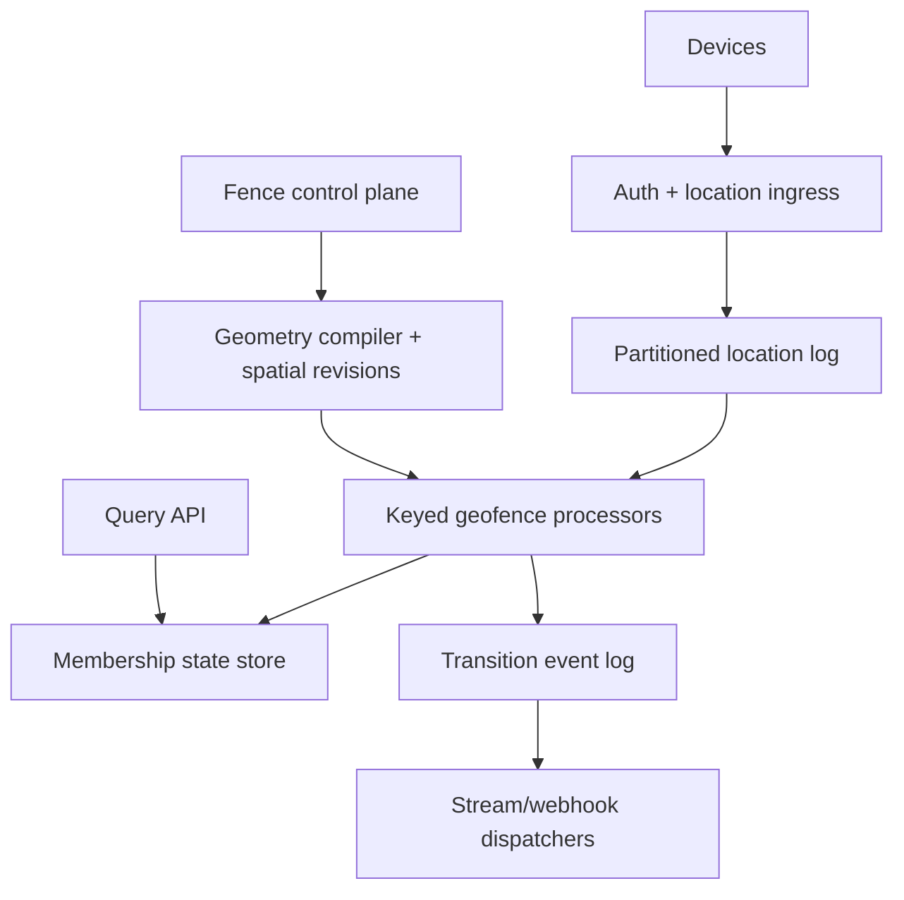

# Design a Large-Scale Geofencing Service

**Difficulty:** Staff-level  
**Primary themes:** spatial indexing, stateful stream processing, caching, event-time consistency, queues, noisy data, multi-region reliability

This is a detailed educational walkthrough for a 45–60 minute interview. The time labels describe what to prioritize in the actual interview; the written treatment goes deeper so each design decision and tradeoff is explicit.

## Interviewer prompt

> Design a multi-tenant geofencing platform. Customers define circular or polygonal geographic regions, devices continuously upload locations, and the system emits enter, exit, and dwell events when devices cross those regions. Customers can query current membership and receive events through webhooks or a streaming API.

## Targeted clarifying questions with assumed answers

**Candidate:** What creates geofences and what sends location updates?

**Interviewer:** Enterprise customers create fences through an API. Mobile apps, vehicles, delivery devices, and IoT trackers upload GPS samples using tenant-issued device credentials.

**Candidate:** Which operations are most important?

**Interviewer:** Create/update/delete versioned geofences, ingest location batches, detect enter/exit/dwell transitions, query a device's current memberships, and deliver transition events.

**Candidate:** What shapes and sizes must we support?

**Interviewer:** Circles and simple or multi-polygons, including holes. A fence can range from a 50-meter store perimeter to a country-sized service region. Reject self-intersecting or otherwise invalid geometry.

**Candidate:** What is the scale?

**Interviewer:** 100 million registered devices, 10 million simultaneously active, one location every five seconds on average, bursts to 5 million updates per second, 50 million active fences, and 100,000 tenants. Geography and tenant sizes are highly skewed.

**Candidate:** What latency and availability should we target?

**Interviewer:** Acknowledge location ingestion under 100 ms p99 in-region. Emit normal transitions within 3 seconds p99 after receiving a sample. Fence changes should activate globally within 10 seconds. Ingestion should be 99.99% available; accepted samples must survive an availability-zone failure.

**Candidate:** GPS is noisy. What should “inside” mean near a boundary?

**Interviewer:** Avoid alert flapping. The platform should support configurable hysteresis and dwell duration. Incorporate reported horizontal accuracy rather than treating every coordinate as perfect.

**Candidate:** Are samples ordered?

**Interviewer:** A device normally supplies a monotonically increasing sequence number, but retries, offline batches, duplicate samples, clock skew, and late arrival occur. Do not retroactively retract customer webhooks for arbitrarily late data.

**Candidate:** Do customers need exactly-once events?

**Interviewer:** Generate one logical transition per device, fence version, and transition sequence internally. Webhook delivery is at least once; provide a stable event ID for customer deduplication.

**Candidate:** What retention and privacy constraints apply?

**Interviewer:** Retain raw locations for seven days by default and transition events for one year. Tenants can choose shorter retention. Encrypt location data, enforce regional residency, and audit administrative access.

**Candidate:** Should a fence edit create enter/exit events for stationary devices?

**Interviewer:** By default, no. A new version applies to subsequently evaluated locations. Customers may request an explicit asynchronous reevaluation job whose events are marked `CONFIG_REEVALUATION`.

> **What I would say aloud:** “There are two different accuracy problems: efficiently finding candidate fences and deciding a stable semantic transition from noisy, late GPS. A spatial grid solves the first only approximately; a state machine with exact geometry, accuracy handling, and hysteresis solves the second.”

---

## 1. Requirements (~5 minutes)

The structure follows the public Hello Interview delivery framework: clarify requirements, identify entities and interfaces, build a simple complete design one operation at a time, and reserve the deep dives for the load-bearing bottlenecks ([System Design Delivery Framework](https://www.hellointerview.com/learn/system-design/in-a-hurry/delivery)). genui{"citation":{"ref":"turn173search1"}}

### Core functional requirements

1. **Manage geofences.** Create, validate, version, activate, update, and delete circle or polygon fences with enter, exit, dwell, accuracy, and hysteresis policies.
2. **Ingest locations and detect transitions.** Accept duplicate and out-of-order device samples, determine memberships, and emit one logical enter/exit/dwell transition.
3. **Expose state and events.** Query current device memberships and deliver transition events through a stream or retryable webhook subscription.

### Quantified non-functional requirements

| Requirement | Target | Design implication |
|---|---:|---|
| Location throughput | 2M updates/s average; 5M/s burst | Partitioned durable log and keyed stream processors |
| Detection latency | p99 < 3 s from receipt | In-memory spatial index and local keyed state |
| Ingest latency | p99 < 100 ms in-region | Acknowledge after replicated log append, not after evaluation |
| Configuration freshness | Fence version active globally within 10 s | Compiled revision snapshots with explicit activation watermark |
| Availability/durability | 99.99% ingest; no acknowledged loss after one-AZ failure | Multi-AZ quorum log, replayable state and idempotency |
| Data governance | 7-day raw location; 1-year transitions; residency | Tiered TTL storage, encryption and region-aware routing |

### Scope

In scope: circles/polygons, geometry validation, configuration versioning, device authentication, batch location ingestion, candidate lookup, exact containment, enter/exit/dwell state, late events, webhooks/streams, membership query, retention, tenant isolation, regional recovery, and observability.

Out of scope: turn-by-turn navigation, route prediction, map rendering, GPS generation, road-map matching, marketing campaign authoring, and billing.

### Consistency and availability contract

- **Ingest acknowledgement:** success means the normalized sample and its device/sequence identity are durably appended to a quorum-replicated regional log.
- **Device retry semantics:** at-least-once input with deduplication by `(tenant_id, device_id, boot_id, sequence)`. Reusing a sequence with different coordinates is rejected and audited.
- **Ordering:** stream processing is serialized by device key. Samples are evaluated in event-time order within a 30-second lateness buffer. Very late data is stored for history but does not rewrite already delivered customer transitions by default.
- **Fence consistency:** configuration writes are strongly ordered per fence. A version becomes `ACTIVE` only after its compiled index revision is ready in the required regions. Processing records the exact fence version used.
- **Membership consistency:** the processing-state store is authoritative. Query supports read-your-writes using the accepted sample token; without a token it may lag by seconds.
- **Notification semantics:** one logical transition event internally, at-least-once transport externally. Stable event IDs let subscribers deduplicate.
- **Regional partition behavior:** location ingress can buffer durably near the device, but one fenced processing epoch owns a device partition. Failover favors brief delay over two processors emitting conflicting transitions.

> **What I would say aloud:** “I am not promising that every GPS point produces an immediate truth. I promise durable intake, bounded normal lateness, versioned configuration, deterministic transition IDs, and explicit behavior for data arriving after the watermark.”

### Scale estimates that change the design

With 10 million active devices sending every five seconds:

- `10M ÷ 5 ≈ 2M location updates/s` average.
- At 120 bytes normalized per sample, `2M × 120 ≈ 240 MB/s`, or about `20.7 TB/day` before replication and indexes.
- Seven days of raw normalized locations is roughly `145 TB` logical.
- At a 5M/s burst, an exact point-in-polygon check against all 50M fences would require `250 trillion` comparisons per second—impossible.
- If 0.1% of samples generate transitions, average transition rate is `2,000/s`; a stadium release or city evacuation can create much sharper localized bursts.

Therefore, location ingestion must be log-backed and horizontally partitioned, and fence lookup needs a coarse spatial index that reduces 50 million fences to a small candidate set before exact geometry. Transition delivery must be independently buffered so a slow webhook cannot slow detection.

---

## 2. Core entities (~2 minutes)

- **Tenant** — isolation, region policy, quotas, retention and encryption keys.
- **Device** — authenticated source, boot/session identity, sequence state and home processing region.
- **LocationSample** — device sequence, event time, receipt time, coordinate, accuracy and optional motion data.
- **Geofence** — stable logical identity, owner and lifecycle state.
- **GeofenceVersion** — immutable geometry, rules, effective time and revision.
- **SpatialCover** — hierarchical grid cells that may intersect a fence version.
- **MembershipState** — per device/fence status, candidate timers, entered time and last transition sequence.
- **TransitionEvent** — immutable ENTER, EXIT or DWELL event with cause and stable ID.
- **Subscription** — stream or webhook target, filters, secret and retry policy.
- **DeliveryAttempt** — leased notification attempt and outcome.
- **IndexRevision** — compiled mapping from cells to fence versions and regional activation status.

> **What I would say aloud:** “The key durable entities are versioned fence definitions, location samples, membership state, and transition events. The cell cover and query cache are derived structures that I can rebuild.”

---

## 3. API and system interfaces (~5 minutes)

All calls use TLS. Management APIs use tenant-user OAuth; ingestion uses device certificates or signed device tokens. `tenant_id` and authoritative `device_id` come from verified identity, never from an untrusted request body.

### 3.1 Create a geofence version

```http
POST /v1/geofences
Authorization: Bearer <tenant-admin-token>
Idempotency-Key: gf-create-447
Content-Type: application/json

{
  "name": "Boston warehouse",
  "geometry": {
    "type": "Polygon",
    "coordinates": [[[-71.06,42.36],[-71.05,42.36],[-71.05,42.35],[-71.06,42.35],[-71.06,42.36]]]
  },
  "rules": {
    "emit_enter": true,
    "emit_exit": true,
    "dwell_seconds": 300,
    "enter_confirm_seconds": 5,
    "exit_confirm_seconds": 10,
    "boundary_buffer_meters": 20,
    "max_accepted_accuracy_meters": 100
  },
  "effective_at": "2026-10-19T18:05:00Z"
}
```

```json
{
  "geofence_id": "gf_71",
  "version": 1,
  "status": "COMPILING",
  "activation_deadline": "2026-10-19T18:05:10Z"
}
```

Update creates a new immutable version:

```http
PUT /v1/geofences/gf_71
If-Match: "version-1"
```

The conditional write prevents two administrators from unknowingly overwriting one another. Delete creates a terminal version; it does not erase historical versions needed to explain old events.

### 3.2 Ingest device locations

```http
POST /v1/device-locations:batch
Authorization: Bearer <device-token>
Content-Type: application/json

{
  "boot_id": "boot_20261019_01",
  "samples": [
    {
      "sequence": 91321,
      "observed_at": "2026-10-19T18:05:01.201Z",
      "latitude": 42.3558,
      "longitude": -71.0553,
      "accuracy_meters": 12,
      "speed_mps": 8.3
    }
  ]
}
```

```json
{
  "accepted": [{"sequence": 91321, "ingest_token": "p482:99172003"}],
  "rejected": [],
  "server_received_at": "2026-10-19T18:05:01.270Z"
}
```

A per-item response allows a client to retry only failed samples. Batch size, coordinate range, timestamp skew, and payload size are bounded.

### 3.3 Query current memberships

```http
GET /v1/devices/dev_42/memberships?min_ingest_token=p482:99172003
Authorization: Bearer <tenant-user-token>
```

```json
{
  "device_id": "dev_42",
  "evaluated_through": "2026-10-19T18:05:01.201Z",
  "state_token": "p482:99172003",
  "memberships": [
    {
      "geofence_id": "gf_71",
      "geofence_version": 1,
      "status": "INSIDE",
      "entered_at": "2026-10-19T18:04:55.021Z",
      "confidence": "HIGH"
    }
  ]
}
```

If the processor has not reached the requested token, the API waits briefly, routes to the owning processor, or returns `202 PROCESSING` rather than serving older state as current.

### 3.4 Consume transitions

Streaming consumers read an ordered tenant event stream. Webhooks receive:

```json
{
  "event_id": "evt_4f6d...",
  "type": "ENTER",
  "cause": "LOCATION_UPDATE",
  "tenant_id": "derived-by-auth-context",
  "device_id": "dev_42",
  "geofence_id": "gf_71",
  "geofence_version": 1,
  "transition_sequence": 44,
  "effective_at": "2026-10-19T18:05:01.201Z",
  "detected_at": "2026-10-19T18:05:02.033Z",
  "location": {"latitude": 42.3558, "longitude": -71.0553, "accuracy_meters": 12}
}
```

Webhook requests carry a timestamp, delivery ID and HMAC signature. A `2xx` acknowledges delivery. Timeouts and non-2xx responses retry with backoff; the same `event_id` is preserved.

### 3.5 Request explicit reevaluation

```http
POST /v1/geofences/gf_71:reevaluate
Authorization: Bearer <tenant-admin-token>
```

This asynchronous job scans the tenant's latest eligible device locations against a chosen fence version. Resulting events use `cause=CONFIG_REEVALUATION`, preventing customers from confusing a changed boundary with physical motion.

---

## 4. Data flow

1. A tenant writes a fence version to the strongly consistent configuration store.
2. Geometry workers validate and normalize the shape, calculate hierarchical cell covers, and build a new immutable spatial-index revision.
3. Regional processors download and atomically activate that revision at the declared effective time.
4. Devices send location batches to a nearby ingress service, which authenticates, validates, deduplicates and appends samples to a multi-AZ log.
5. The log partitions by device so one stateful processor evaluates a device's ordered stream.
6. The processor uses the spatial index to find candidate fences, performs exact geometry checks, applies hysteresis/dwell rules, updates membership state and appends transitions.
7. Query replicas expose membership state; dispatchers deliver transition events to streams and webhooks independently.

---

## 5. High-level design (~10–15 minutes)



### Operation 1: create and activate a geofence

The control plane validates coordinate ranges, polygon closure, ring orientation, self-intersection, holes, vertex limits and tenant quotas. Store the original request and a normalized spherical geometry as immutable `GeofenceVersion` records.

```text
GeofenceVersion {
  tenant_id, geofence_id, version, geometry_type,
  normalized_geometry_blob, bounding_box,
  rules, created_at, effective_at, lifecycle_state,
  config_revision
}
```

The compiler creates a **spatial cover**: grid cells whose areas intersect the fence. H3 is a hierarchical geospatial index that maps coordinates into cells at selectable resolutions ([H3 introduction](https://h3geo.org/docs/), [indexing API](https://h3geo.org/docs/api/indexing/)). genui{"citation":{"refs":["turn173search4","turn173search2"]}} S2 offers a similar hierarchical decomposition of the sphere into cells ([S2 cell hierarchy](https://s2geometry.io/devguide/s2cell_hierarchy)). genui{"citation":{"ref":"turn173search28"}}

The grid is an index, not the final truth. H3's hierarchy provides exact logical cell relationships but approximate geometric containment across resolutions, so every candidate near a real fence boundary still needs exact geometry evaluation. genui{"citation":{"ref":"turn173search5"}}

Write compiled artifacts under a new `IndexRevision`:

```text
IndexRevision {
  tenant_id, revision, manifest_hash,
  cell_map_objects[], fence_geometry_objects[],
  effective_at, required_regions[], activation_status
}
```

Processors download the revision into a shadow index, validate counts and checksums, then atomically swap a pointer. They never apply a partial list of cell deltas in place. The control plane reports the version `ACTIVE` only when required regions acknowledge readiness.

> **What I would say aloud:** “Configuration is low-write but correctness-sensitive. I compile an immutable revision and atomically swap it at processors, so a location is evaluated entirely against one known revision rather than a half-applied fence update.”

### Operation 2: ingest location updates

The ingress tier authenticates the device, derives tenant/device identity, validates coordinates and plausible timestamp skew, and normalizes the sample. It rejects the same sequence with conflicting bytes and returns the previous result for an identical retry.

The log key is `(tenant_id, device_id)`, which preserves arrival order for one device. The record contains both event time and server receipt time:

```text
LocationSample {
  tenant_id, device_id, boot_id, sequence,
  observed_at, received_at, latitude, longitude,
  accuracy_meters, speed_mps?, heading?, ingest_partition, offset
}
```

Acknowledgement ends after quorum append. Spatial lookup, membership state, notifications and historical storage are independent consumers. Raw samples are compacted into time-partitioned encrypted object files for seven-day retention.

### Operation 3: find candidate fences and evaluate exact membership

For a location point, compute its cell at one or more supported resolutions. Query the local in-memory mapping for:

- fence covers containing that cell or its ancestors;
- tenant-wide or exceptionally large fences stored at coarse resolutions;
- fences in the device's previous membership set, even if the new point is outside every covered cell—otherwise exits could be missed.

Union and deduplicate candidate fence IDs, filter by tenant and effective version, then apply a cheap bounding-box check. Finally run exact spherical point-in-polygon or point-in-circle evaluation. Database systems expose exact predicates such as `ST_Contains`; its boundary semantics are subtle, so the product must define whether a point exactly on the boundary counts as inside ([PostGIS `ST_Contains`](https://postgis.net/docs/ST_Contains.html)). genui{"citation":{"ref":"turn173search0"}}

For this design, the exact geometric boundary is neither a direct enter nor exit. It belongs to a configurable uncertainty band handled by hysteresis.

### Operation 4: update the membership state machine

State is keyed by device, collocated with the stream partition:

```text
DeviceState {
  tenant_id, device_id, last_sequence, event_time_watermark,
  last_location, active_memberships{}, transition_sequence,
  config_revision, processor_epoch
}

FenceMembership {
  geofence_id, geofence_version,
  stable_state: OUTSIDE | INSIDE,
  candidate_state?, candidate_since?,
  entered_at?, dwell_emitted,
  last_exact_distance_to_boundary?, confidence
}
```

A raw containment result does not immediately change `stable_state`:

- `OUTSIDE -> ENTER_CANDIDATE` when the accuracy-aware point is sufficiently inside.
- Confirm `INSIDE` after two consistent samples or `enter_confirm_seconds`.
- `INSIDE -> EXIT_CANDIDATE` when sufficiently outside.
- Confirm `OUTSIDE` after two consistent samples or `exit_confirm_seconds`.
- Emit `DWELL` when event time exceeds `entered_at + dwell_seconds` and state remained inside.
- A sample whose accuracy circle overlaps the boundary is `UNCERTAIN`; it does not flip stable state.

Upon a confirmed transition, update state and append the transition in one transactional state-machine operation, or use a transactional outbox colocated with state. Generate:

```text
event_id = hash(tenant, device, geofence, version,
                transition_type, transition_sequence)
```

This stable identity suppresses duplicates during replay.

### Operation 5: query membership and deliver events

Processors checkpoint membership state to a replicated key-value store. The query API routes by device and reads the owning state partition or a caught-up replica. It exposes `evaluated_through`, `config_revision`, and a state token rather than hiding staleness.

The transition log is partitioned for scalable consumers. For webhooks, subscription dispatchers create deterministic `(event_id, subscription_id)` deliveries. Each attempt uses a lease and fencing token. Success is recorded on 2xx; retries retain the same logical event ID. A slow customer receives backlog in its own fair queue and cannot stall detection or other tenants.

---

## 6. Deep dives (~10–15 minutes)

### Deep dive A: spatial indexing and candidate explosion

#### Where the baseline breaks

Comparing each point against 50 million polygons is impossible. A single fixed grid resolution also fails:

- coarse cells map a downtown point to thousands of small fences;
- fine cells make a country polygon expand into millions of index entries;
- cell membership alone produces false positives at boundaries.

#### Options

| Approach | Strength | Weakness |
|---|---|---|
| Relational spatial index for every point | Exact and simple baseline | Network/DB bottleneck at millions of points/s |
| Geohash fixed resolution | Easy key-value lookup | Poor fit across fence sizes; edge and neighbor handling |
| Hierarchical H3/S2 cover + exact check | Local lookup, adaptive scale, globally partitionable | Cover construction and revision management |
| Per-tenant R-tree in memory | Exact bounding candidates | Harder distribution and hot-update propagation |

**Choice:** hierarchical cell covers for the fast coarse filter, exact spherical geometry for final truth, and an R-tree/bounding-box structure inside exceptionally dense cells if needed.

#### Adaptive cover

Choose a target of perhaps 10–100 candidates per active point, measured by geography. Small fences use fine cells; very large fences use coarser cells. Store cover entries tagged with their resolution. At lookup, inspect the point's fine cell and relevant ancestors.

Classify cover cells:

- **interior:** wholly inside the fence;
- **boundary:** intersects the fence boundary;
- **exterior:** omitted.

Interior classification can skip expensive polygon math only when the classification algorithm is conservative and accuracy radius cannot cross outside. Otherwise exact evaluation remains safer. Boundary cells always run exact geometry plus hysteresis.

#### Dense cells and hot fences

- A shopping district with thousands of overlapping store fences uses a secondary in-cell bounding-box/R-tree filter.
- A country fence exists once at a coarse level instead of millions of leaf cells.
- Cache immutable fence geometry by `(fence_id, version)` with request coalescing.
- Prewarm cells based on recent device density before large events.
- Track candidate count percentiles by cell; automatically recompile pathological covers at a better resolution.
- Enforce tenant limits on vertices, cover entries and overlapping fences so one customer cannot create computational denial of service.

#### Partitioning

The processing partition follows device identity, not current cell. Spatially partitioning the stream would migrate state every time a device crossed a cell and could reorder its samples. Each device processor carries a region-local read-only spatial index, while fence configuration is replicated to all relevant processors.

> **What I would say aloud:** “I partition computation by device to keep its state ordered, but index fences by hierarchical cells for local candidate lookup. The cell grid removes most candidates; exact geometry remains the authority.”

### Deep dive B: GPS noise, late data and deterministic transitions

#### Where the baseline breaks

A phone standing beside a store boundary may report alternating points 15 meters apart. Immediate containment flips would emit enter/exit every few seconds. Offline devices can later upload an older path after newer events were already delivered. Device restarts may reset counters.

#### Accuracy-aware membership

Treat the reported position as an uncertainty disk, not a perfect point:

- confidently inside if the entire uncertainty disk plus entry buffer is inside;
- confidently outside if the entire disk plus exit buffer is outside;
- uncertain if it overlaps the boundary.

Exact distance to a complex boundary is costly, so compute it only for boundary-cell candidates. Circle fences use simple spherical distance. Policy may choose a pragmatic approximation, but event metadata should report confidence.

#### Hysteresis and debounce

Use different thresholds for entering and exiting. For example, confirm entry 20 meters inside for five seconds and exit 30 meters outside for ten seconds. This is spatial and temporal hysteresis: the system requires stronger evidence to reverse its stable state than to remain in it.

Fast-moving vehicles may otherwise cross a 50-meter fence between sparse samples. Segment-intersection testing between the prior and current point can detect a pass-through, but only when:

- sample gap is below a configured maximum;
- implied speed is plausible;
- accuracy is adequate.

Emit a distinct `CROSSING` or paired enter/exit with low confidence; do not invent precise dwell time.

#### Event-time ordering

Within each device partition:

1. deduplicate by `(boot_id, sequence)`;
2. place samples in a bounded event-time buffer;
3. advance a watermark based on maximum observed event time minus allowed lateness;
4. process samples up to the watermark deterministically;
5. mark samples behind the committed watermark as late.

Why not wait forever? An offline tracker could withhold data for days, making real-time output impossible. The 30-second window is a product tradeoff, not a universal truth.

Very late samples are written to history with `late=true`. Default behavior does not retract webhooks. A tenant needing forensic reconstruction can run an offline job that produces a separately versioned corrected trajectory.

#### Restart and replay

`boot_id` distinguishes sequence reuse after a legitimate device restart. The ingestion service also enforces monotonicity within a boot. Stream processors periodically checkpoint state and source offsets. On recovery they restore a checkpoint and replay. Deterministic transition IDs plus an idempotent output table prevent logical duplicate transitions.

> **What I would say aloud:** “The watermark converts unbounded disorder into a bounded promise. Hysteresis converts noisy coordinates into stable product semantics. Late forensic truth is preserved, but it does not rewrite notifications already sent in real time.”

### Deep dive C: configuration rollout, event delivery and failure isolation

#### Where the baseline breaks

If cell mappings update before geometry blobs, some processors miss the fence; if geometry updates first, others evaluate an unannounced version. Processor replay can emit duplicate transitions. A stadium exit can create hundreds of thousands of events while one customer's webhook is down.

#### Immutable revision activation

Compare three approaches:

| Approach | Benefit | Failure |
|---|---|---|
| TTL-only mutable cache | Simple | Up to a TTL of inconsistent geometry |
| In-place cell deltas | Low bandwidth | Partial update and hard rollback |
| Immutable compiled revision + atomic pointer | Consistent, verifiable, reversible | More storage and rollout coordination |

Choose immutable revisions. A manifest lists every cell-map and geometry object with hashes. Each processor:

1. downloads missing objects;
2. validates hashes and referential completeness;
3. warms hot structures;
4. reports `READY(revision)`;
5. atomically activates at `effective_at`.

If a region misses readiness, the control plane either delays global activation or marks that region unavailable for the affected tenant. It never silently mixes versions. Every transition records config revision and fence version.

#### Exactly-once logical production, at-least-once delivery

The membership update and transition append share a transaction or transactional outbox. A unique constraint on `event_id` makes replay safe. Downstream event-log publication may repeat; consumers deduplicate by event ID.

Webhooks cannot be exactly once because a customer can commit the event and lose the HTTP response. Retry with the same `event_id` and `delivery_id`; document that handlers must be idempotent. After the retry horizon, move the delivery—not the underlying transition—to a customer-visible failed-delivery queue with replay controls.

#### Burst isolation

- Partition detection by device for even compute distribution.
- Partition delivery by tenant/subscription so one endpoint cannot monopolize workers.
- Use hierarchical token buckets for platform, tenant and subscription fairness.
- Retain transition events independently of webhook backlog.
- Scale dwell timers using a timing wheel or event-time priority buckets rather than one operating-system timer per membership.
- Apply overload degradation in order: delay analytics/history compaction, delay webhooks, then reject uncommitted ingestion with explicit retry. Never drop already acknowledged samples.

#### Cache correctness

Processors cache cell candidate lists and geometry by immutable revision, making stale entries distinguishable rather than ambiguous. Query caches include a membership state version and processor epoch. A read requiring a newer ingest token cannot use an older cache entry.

Use negative caching for empty cells with short TTLs, single-flight loading, TTL jitter and admission policies that prevent a one-time device path from evicting hot cells. Revision activation can retain the previous snapshot briefly for in-flight event-time processing and rollback.

#### Failure scenarios

- **Processor crashes before state/output commit:** replay produces the transition once logically.
- **Processor commits but fails before checkpoint:** replay hits the unique event ID and converges.
- **One AZ fails:** the durable log and replicated state retain quorum.
- **Region fails:** a new region acquires a higher processing epoch, restores the latest checkpoint, and replays. Old-epoch outputs are rejected.
- **Config service fails:** active immutable revisions continue; new edits wait.
- **Spatial-object store fails:** processors use pinned local revisions; a cold replacement may remain unavailable rather than evaluate without geometry.
- **Webhook endpoint fails:** transitions accumulate only in that subscription queue.
- **State query replica lags:** response exposes its state token or routes to the owner.

#### Observability

Track:

- ingest QPS/bytes, p99 append latency, duplicate/conflict rate and partition skew;
- event-time lag, out-of-order depth, late-sample rate and watermark stalls;
- candidate fences per sample, exact-check rate, boundary-check cost and dense-cell hot spots;
- active revision by region, compile duration, manifest mismatches and activation deadline misses;
- membership-state size, checkpoint age, restore/replay time and old-epoch rejection;
- ENTER/EXIT/DWELL rate, suppressed flaps, uncertain classifications and pass-through events;
- transition-log age, per-tenant burst rate, webhook p99 latency, retries and failed-delivery backlog;
- query staleness, token wait/reroute rate, cache valid-hit rate and stampede suppression;
- raw-location deletion lag, residency violations, legal-hold blocks and unauthorized access attempts.

Run a continuous canary device through a known synthetic path. Verify durable receipt, candidate lookup, expected hysteresis, exactly one logical transition, membership query freshness, and signed webhook delivery. Component health alone does not prove the end-to-end semantic path.

---

## Reliability and invariants

| Invariant | Enforcement |
|---|---|
| Accepted sample is never silently lost | Multi-AZ log and offset monitoring |
| One sequence identifies one payload | Dedupe key plus payload-hash conflict check |
| A sample uses one coherent config revision | Immutable revision pointer captured during evaluation |
| One logical transition per state change | Atomic state/outbox and unique deterministic event ID |
| Membership query exposes freshness | State token, evaluation time and processor epoch |
| Old processor cannot emit after failover | Fencing epoch checked by state and output stores |
| One failed webhook cannot block detection | Independent per-subscription queues |
| Expired locations are deleted | TTL lifecycle plus deletion-lag audit |

---

## Final design

Tenant administrators create immutable geofence versions. A geometry compiler validates each shape, generates adaptive H3/S2-style cell covers, stores exact spherical geometry, and publishes a checksummed immutable index revision. Regional stateful processors download, validate and atomically activate the revision, so every location is evaluated against one identifiable configuration.

Devices send authenticated batches to regional ingress. The service derives tenant/device identity, validates and deduplicates samples, and acknowledges after a multi-AZ log append. The log partitions by device so one processor can apply bounded event-time ordering. For each sample, the processor looks up hierarchical cell candidates, adds prior memberships, filters by bounding box, runs exact geometry, and feeds an accuracy-aware hysteresis state machine. State changes and deterministic transition events commit atomically.

Membership state is checkpointed to a replicated store and served with freshness tokens. Transition events live in a separate durable log. Per-subscription dispatchers provide ordered streams or signed at-least-once webhooks with stable event IDs, fair quotas, retry, and customer-visible replay. Multi-region failover uses processing epochs and fencing; late data remains queryable but does not silently rewrite already delivered real-time events.

## Requirements check

| Requirement | Design answer |
|---|---|
| Manage circles and polygons | Validated immutable versions and exact spherical geometry |
| 2M/s average, 5M/s burst | Partitioned durable log and device-keyed processors |
| Detection p99 under 3 s | In-memory hierarchical candidate index and local state |
| Avoid all-fence scanning | Adaptive cell covers plus bounding and exact checks |
| Stable enter/exit near boundaries | Accuracy disk, spatial/temporal hysteresis and debounce |
| Handle duplicates and disorder | Boot/sequence dedupe, bounded event-time buffer and watermark |
| Dwell events | Event-time timers stored with membership state |
| Fence activation under 10 s | Compiled revision, readiness acknowledgements and atomic swap |
| Query current membership | Replicated state store with sample/state token |
| Duplicate-safe events | Atomic outbox and deterministic event ID |
| Reliable webhooks | Per-subscription at-least-once queues and stable delivery ID |
| Regional reliability | Quorum log, checkpoints, epoch-fenced failover |
| Retention/residency | Regional encryption domains and audited TTL lifecycle |

## Realistic interviewer follow-ups with strong sample answers

### 1. Why not query PostGIS for every location?

**Candidate:** “It is an excellent correctness baseline and control-plane tool, but millions of points per second would turn network and spatial-index contention into the bottleneck. I replicate a compiled coarse index into processors and keep exact geometry local.”

### 2. Does an H3 cell prove the point is inside a fence?

**Candidate:** “No. It is a candidate filter. Cell covers approximate geometry, especially at boundaries and across resolutions. I run exact spherical containment for candidates unless a conservatively classified interior cell and accuracy policy make skipping safe.”

### 3. Why partition by device instead of location cell?

**Candidate:** “Membership is stateful and must process one device consistently. Cell partitioning would migrate state and risk reorder every time a device moves. Fence indexes are read-only replicated data, so device-keyed compute is the cleaner boundary.”

### 4. How do you detect an exit if the new cell has no fence entry?

**Candidate:** “Always union spatial candidates with the device's current membership set. Every previously active fence must be reevaluated until exit is confirmed.”

### 5. How do you stop boundary flapping?

**Candidate:** “Use reported accuracy, a boundary uncertainty band, separate entry/exit buffers, and temporal confirmation. An uncertain sample preserves the stable state instead of flipping it.”

### 6. What happens to a location arriving two minutes late?

**Candidate:** “It is behind the 30-second real-time watermark, so I store it as late history but do not retract prior webhooks. A forensic reconstruction job can produce a corrected versioned trajectory separately.”

### 7. Can you guarantee exactly-once webhooks?

**Candidate:** “No. The receiver can commit and lose its HTTP response. I guarantee one internal logical event, then deliver at least once using stable event and delivery IDs so receivers can deduplicate.”

### 8. How does a fence edit affect stationary devices?

**Candidate:** “By default it affects the next evaluated sample and does not fabricate physical motion. If the customer requests reevaluation, the system scans latest locations and labels resulting events `CONFIG_REEVALUATION`.”

### 9. How do you update the spatial index without partial results?

**Candidate:** “Build an immutable checksummed revision, load it beside the current revision, verify all objects, then atomically swap at an effective time. Every transition records which revision and fence version it used.”

### 10. How do you support very large and very small fences?

**Candidate:** “Use adaptive hierarchical covers. Small fences use fine cells; country-sized fences use coarse ancestors. Lookup checks the point's cell and relevant ancestors, then performs exact geometry.”

### 11. What if a million devices leave a stadium together?

**Candidate:** “Detection remains device-partitioned. Transition storage is durable and independent of delivery. Per-tenant/subscription fair queues absorb webhook fanout, while bulk event bursts cannot starve other tenants.”

### 12. How do you detect a car that crosses a small fence between samples?

**Candidate:** “Optionally test the segment between consecutive points against the boundary when the gap, speed and accuracy are credible. Mark the result as pass-through or low confidence; do not invent a long dwell.”

### 13. What happens when a processor restarts?

**Candidate:** “Restore its checkpoint and source offset, replay the log, and regenerate deterministic event IDs. Unique event storage suppresses logical duplicates. A processor epoch fences an old instance after reassignment.”

### 14. How do you enforce data residency?

**Candidate:** “Tenant policy determines ingest, log, state, blob and checkpoint regions. Global routing holds only non-sensitive mapping metadata. Raw coordinates and encryption keys remain inside the allowed boundary.”

### 15. How would you reduce battery and network usage?

**Candidate:** “Let the client batch samples, adapt frequency based on motion, and optionally download coarse nearby hints. The server contract remains sequence-based and does not trust client-side geofence decisions as authoritative.”

## Common pitfalls

1. Comparing every point with every fence.
2. Treating grid-cell membership as exact polygon containment.
3. Using one fixed cell resolution for all fence sizes.
4. Forgetting to reevaluate current memberships, which misses exits.
5. Partitioning by cell and losing per-device ordering/state locality.
6. Treating GPS coordinates as perfectly accurate.
7. Emitting enter or exit on a single boundary sample.
8. Using processing time for dwell despite delayed samples.
9. Waiting forever for late data and destroying real-time latency.
10. Retroactively retracting webhooks without an explicit correction contract.
11. Applying partial spatial-index deltas in place.
12. Mixing old cell covers with new geometry versions.
13. Claiming exactly-once webhook delivery.
14. Updating membership state and publishing an event as unrelated writes.
15. Using one timer object per dwell membership at massive scale.
16. Letting a webhook outage backpressure detection.
17. Ignoring stadium-scale synchronized transition bursts.
18. Trusting tenant/device identity supplied in a location body.
19. Using wall-clock timestamps alone to order device samples.
20. Failing over processors without an epoch that fences the old owner.

## Compact interview-time plan

| Time | What to cover aloud |
|---:|---|
| 0–5 min | Scale, shapes, transition semantics, noisy GPS and lateness |
| 5–7 min | Fence/version, sample, membership, transition and subscription |
| 7–12 min | Fence, location, membership and event APIs |
| 12–23 min | Config compilation, durable ingest, candidates, exact check and state |
| 23–31 min | Spatial-index tradeoffs and hot-cell mitigation |
| 31–38 min | Accuracy, hysteresis, watermark and replay semantics |
| 38–43 min | Revision rollout, webhook delivery, failure and observability |
| 43–45 min | Requirements check and closing summary |

## Strong 90-second closing summary

> “I separate geofence configuration from high-volume location processing. Fence writes produce validated immutable versions. A compiler builds adaptive hierarchical cell covers plus exact spherical geometry into a checksummed revision that processors atomically activate. Devices authenticate and append sequence-numbered samples to a multi-AZ log; the API acknowledges at that durability boundary.
>
> “The stream partitions by device, preserving state locality and bounded event-time order. For each sample, a processor unions hierarchical cell candidates with prior memberships, applies bounding filters and exact geometry, then feeds an accuracy-aware hysteresis state machine for enter, exit and dwell. Membership state and a deterministic transition outbox commit together, so replay does not create a second logical event. Queries expose state tokens and config revisions. A separate transition log feeds fair per-subscription streams and at-least-once signed webhooks. Checkpoints, immutable config revisions and processing epochs provide reliable recovery without split-brain alerts.”

## Public references

- [Hello Interview — System Design Delivery Framework](https://www.hellointerview.com/learn/system-design/in-a-hurry/delivery)
- [H3 — Introduction](https://h3geo.org/docs/)
- [H3 — Indexing functions](https://h3geo.org/docs/api/indexing/)
- [S2 Geometry — Cell hierarchy](https://s2geometry.io/devguide/s2cell_hierarchy)
- [PostGIS — `ST_Contains`](https://postgis.net/docs/ST_Contains.html)

These sources support the interview structure and established spatial-index/geometry concepts. The requirements, APIs, scale assumptions, transition semantics, dialogue and architecture are original.
