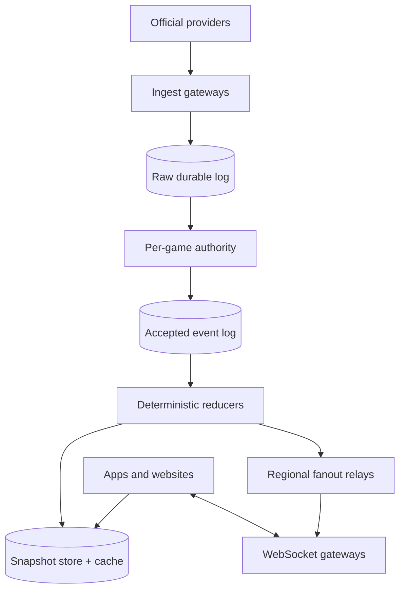
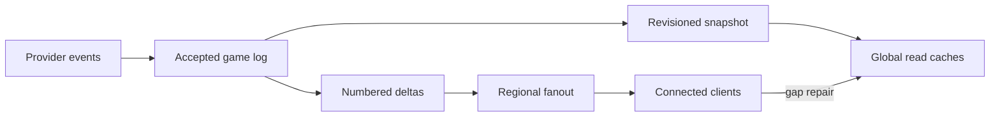

# Design a Global Live Sports Score and Play-by-Play Platform

**Difficulty:** Senior  
**Primary themes:** streaming ingestion, ordered event logs, state materialization, caching, fanout, corrections, multi-region reliability

> **Interview-time note:** The time labels describe a 45-minute interview. This educational walkthrough is intentionally more detailed so you can study the reasoning and then compress it in the room.

This walkthrough uses the public [Hello Interview delivery framework](https://www.hellointerview.com/learn/system-design/in-a-hurry/delivery): define requirements, core entities, and interfaces before building the simplest complete design one operation at a time, then deepen the bottlenecks. The scenario, scale, dialogue, APIs, and design are original.

---

## Interviewer prompt

> Design a global platform that shows live scores, game clocks, standings-impacting results, and play-by-play updates for major sports. Users can follow games and receive live updates. The system ingests official feeds, remains usable during traffic spikes, and handles late or corrected events without displaying internally impossible state.

The interesting part is not a `Game(scoreA, scoreB)` row. A goal can be overturned, two providers can disagree, events can arrive late, and millions of clients can reconnect after halftime at once. We need an authoritative event history, fast materialized views, and a client protocol that makes gaps and corrections explicit.

## Targeted clarifying questions and assumed answers

**Candidate:** Which sports and experiences are in scope?

**Interviewer:** Support soccer, basketball, baseball, and similar event-based sports. Users see schedules, current score and clock, game status, and ordered play-by-play. Video streaming and betting settlement are out of scope.

**Candidate:** Where does live data come from?

**Interviewer:** Licensed official providers push events over persistent feeds. Important leagues have a primary and backup provider. Operators may issue audited corrections.

**Candidate:** Do we need sub-second delivery?

**Interviewer:** For 99% of accepted live events, update connected clients within two seconds. The score-read API should have p99 below 100 ms globally.

**Candidate:** What scale should I assume?

**Interviewer:** 200 million daily users, 20 million concurrent users during a major final, 100,000 simultaneously live games globally, about 5,000 accepted source events per second normally, and a 50,000-event/s burst.

**Candidate:** How many users may watch one game?

**Interviewer:** A championship can have 10 million concurrent followers. Most games have fewer than 1,000.

**Candidate:** Is event ordering global?

**Interviewer:** No. Preserve an authoritative order per game. Events for different games are independent.

**Candidate:** Can accepted events be changed?

**Interviewer:** Never rewrite history invisibly. A provider or operator can append a correction, cancellation, or replacement that produces a new game revision.

**Candidate:** What happens when providers disagree?

**Interviewer:** The primary source normally wins. Automatic failover requires health and divergence rules; ambiguous high-impact events can be marked pending for an operator.

**Candidate:** Must clients see every pitch or possession?

**Interviewer:** A play-by-play subscriber should detect gaps and recover them. A score-only subscriber may coalesce intermediate updates as long as it receives the latest correct snapshot.

**Candidate:** How fresh must the game clock be?

**Interviewer:** Clients may extrapolate a running clock from a server timestamp, but score and official period transitions come only from accepted events.

### Scope statement to say aloud

> “I’ll make each game an independent ordered stream. Provider messages first enter a durable raw log. A single logical sequencer per game deduplicates, resolves source authority, appends accepted events and corrections, and advances a monotonic game revision. Stream processors fold that log into immutable revisioned snapshots. Read APIs and global caches serve snapshots, while regional fanout gateways send either reliable numbered play-by-play deltas or coalesced score updates. Clients detect gaps and repair from the snapshot plus replay API.”

---

## 1. Requirements (~5 minutes)

### Core functional requirements

1. **Ingest and reconcile live game events.** Accept primary, backup, and operator events; deduplicate them; establish one authoritative per-game order; and represent corrections explicitly.
2. **Serve current game state and history.** Return schedules, current score/status/clock, and paginated play-by-play with a revision that clients can use to detect staleness.
3. **Push live updates at large fanout.** Let authenticated or anonymous users follow games, receive low-latency updates, detect gaps, reconnect, and recover without overwhelming the origin.

### Out of scope

- Live video or audio delivery
- Betting odds and financial settlement
- Ticketing, fantasy scoring, or social comments
- Creating official league statistics from raw sensor data
- Provider contract negotiation
- Arbitrary user-generated score reports
- Strong ordering across unrelated games

### Quantified non-functional requirements

| Requirement | Target | Design consequence |
|---|---:|---|
| Read scale | 2M average score reads/s, 10M/s burst | CDN and regional cache in front of precomputed snapshots. |
| Live connections | 20M concurrent; 10M on one game | Regional gateways and hierarchical topic fanout, not one broker subscription per user. |
| Ingestion | 5K accepted events/s, 50K/s burst | Durable partitioned log; partition and order by game. |
| Freshness | 99% accepted events visible to connected users within 2 s | Streaming materialization and push; monitor stage-by-stage lag. |
| Read latency | snapshot API p99 <100 ms globally | In-region cache/read store and compact payloads. |
| Availability | reads and live snapshots 99.99%; ingestion must not lose acknowledged events | Separate read path from ingestion; multi-zone durable logs and replay. |
| Correctness | one monotonic accepted history per game; corrections auditable | Per-game sequence, revisioned reducer, append-only corrections. |
| Recovery | client reconnect catches up within 5 s for normal gaps | Short delta retention plus snapshot-and-replay protocol. |

### Scale estimates that change the design

Assume an accepted event envelope averages 1 KB:

\[
50{,}000\text{ events/s} \times 1\text{ KB} = 50\text{ MB/s}
\]

At the normal 5,000 events/s, raw accepted events are about 432 GB/day before replication. Keeping 30 days hot is roughly 13 TB; three replicas make it about 39 TB. This is comfortable for a partitioned append log and object-storage archive. Event storage is not the dominant scale.

Fanout is. If 10 million followers each received a 500-byte update independently from origin, one event would create 5 GB of application payload. Ten events per second would be 50 GB/s before transport overhead. Therefore one per-user queue at the origin is the wrong abstraction. We need regional topic fanout, compact updates, and coalescing for score-only clients.

Twenty million long-lived connections distributed across gateways supporting 50,000 connections each require at least:

\[
20{,}000{,}000 / 50{,}000 = 400\text{ gateway instances}
\]

With zone failures, deployments, and headroom, provision roughly 700–800 globally. This makes connection count, not CPU alone, a first-class capacity signal.

If current snapshots average 5 KB for 100,000 live games, the hot working set is only about 500 MB. Replicated in-memory caches can easily hold it. Again, the hard problems are update correctness and skewed fanout, not state size.

### Consistency and availability contract

- **Ordered per game:** accepted events have a strictly increasing `game_seq`; no global event order is promised.
- **Revisioned state:** every materialized snapshot reports the highest applied `game_seq` and a `state_revision`.
- **Append-only corrections:** wrong events remain in the audit log and are neutralized by later correction events.
- **At-least-once ingestion and processing:** duplicates are expected; stable source IDs and reducer checkpoints make reprocessing safe.
- **Eventually consistent edge reads:** regions may briefly serve an older revision, but never a state assembled from incompatible revisions.
- **Monotonic client sessions:** a gateway does not send revision 120 and later revision 118. A client rejects regressions.
- **Availability under partition:** cached snapshots and accepted local revisions remain readable. If game authority cannot safely advance, mark the game `UPDATES_DELAYED` rather than invent or fork state.
- **Gap honesty:** a play-by-play client missing deltas receives an explicit reset/gap instruction and repairs from the API.

### What to say aloud

> “The consistency unit is a game, not the entire sports universe. I need one accepted history for each game, but a user in Singapore can safely read a slightly older immutable snapshot revision. I will expose revision and freshness so availability does not masquerade as perfect recency.”

---

## 2. Core entities (~2 minutes)

- **Competition** — league, season, ruleset, teams, and standings configuration.
- **Game** — participants, scheduled time, venue, lifecycle state, source policy, and current authoritative revision.
- **ProviderEvent** — raw provider payload, provider sequence/ID, received time, source, signature, and parse status.
- **AcceptedGameEvent** — canonical event, `game_seq`, source provenance, effective game time, and correction relationship.
- **GameSnapshot** — score, period, clock anchor, possession/bases/outs as relevant, status, and applied sequence.
- **Subscription** — connection-scoped interest in one or more games and delivery mode.
- **SourceLease** — active source, epoch, failover status, and divergence state for a game or competition.
- **StandingsProjection** — eventually updated league table derived from final/corrected game results.

Start with these nouns and add fields beside the operation that needs them. That keeps the schema connected to actual access patterns rather than turning the interview into table recital.

---

## 3. API and system interface (~5 minutes)

Identity comes from authentication when personalization is required. Public score reads can use an anonymous session token and do not accept an arbitrary `user_id`.

### 3.1 Read the current game snapshot

```http
GET /v1/games/game_9812
If-None-Match: "rev-4421"
```

```json
{
  "game_id": "game_9812",
  "status": "LIVE",
  "home": {"team_id": "BOS", "score": 102},
  "away": {"team_id": "NYK", "score": 100},
  "period": 4,
  "clock": {
    "mode": "RUNNING",
    "value_ms_at_anchor": 83100,
    "anchor_server_time": "2026-10-20T03:58:12.120Z"
  },
  "state_revision": 4421,
  "applied_game_seq": 881,
  "freshness": "LIVE",
  "updated_at": "2026-10-20T03:58:12.120Z"
}
```

The clock is an anchor, not a server write every tenth of a second. The client advances it locally until a pause, period boundary, correction, or new anchor arrives.

### 3.2 Read play-by-play

```http
GET /v1/games/game_9812/events?after_seq=860&limit=100
```

```json
{
  "events": [
    {
      "game_seq": 861,
      "event_id": "evt_7A1",
      "type": "THREE_POINT_MADE",
      "game_clock_ms": 121000,
      "team_id": "BOS",
      "player_id": "p_77",
      "score_after": {"home": 99, "away": 98}
    }
  ],
  "next_after_seq": 861,
  "snapshot_revision": 4402
}
```

Use a sequence cursor rather than an offset. New events cannot shift already-read pages.

### 3.3 Follow games over WebSocket

```json
{
  "op": "subscribe",
  "request_id": "r-18",
  "games": ["game_9812", "game_4301"],
  "mode": "PLAY_BY_PLAY",
  "resume": {"game_9812": 860}
}
```

Server messages are versioned:

```json
{
  "type": "game_delta",
  "game_id": "game_9812",
  "from_seq": 861,
  "to_seq": 863,
  "state_revision": 4404,
  "events": ["..."],
  "snapshot_patch": {"home.score": 99, "clock.mode": "STOPPED"}
}
```

If the requested cursor is outside delta retention:

```json
{
  "type": "reset_required",
  "game_id": "game_9812",
  "latest_revision": 4421,
  "snapshot_url": "/v1/games/game_9812"
}
```

`SCORE_ONLY` subscriptions may skip intermediate deltas and send only the newest snapshot revision. `PLAY_BY_PLAY` subscriptions preserve sequence or explicitly reset.

### 3.4 Provider ingestion interface

```protobuf
rpc Publish(stream ProviderEventBatch) returns (stream IngestAck);

message ProviderEvent {
  string provider = 1;
  string provider_game_id = 2;
  string provider_event_id = 3;
  uint64 provider_sequence = 4;
  bytes payload = 5;
  int64 provider_timestamp_ms = 6;
  bytes signature = 7;
}
```

Acknowledgement means the raw event is durable, not that it has been accepted into the public game history.

### 3.5 Operator correction

```http
POST /v1/operations/games/game_9812/corrections
Authorization: Bearer <authorized-operator-token>
Idempotency-Key: case-741:event-861

{
  "action": "VOID_EVENT",
  "target_game_seq": 861,
  "reason_code": "OFFICIAL_REVIEW_OVERTURNED",
  "evidence_ref": "case-741"
}
```

This appends a correction; it does not update event 861 in place.

### API-to-requirement map

| Requirement | Interface |
|---|---|
| Current state | `GET /games/{id}` |
| Replay/history | cursor-based events API |
| Live following | resumable WebSocket subscription |
| Source ingestion | authenticated streaming RPC |
| Corrections | audited idempotent operator endpoint |

---

## 4. Data flow

1. A source adapter authenticates the provider, verifies signatures, maps provider game IDs, and durably appends the untouched payload to a raw log.
2. A normalizer parses provider-specific data into a canonical sports event and records parse/version metadata.
3. The per-game authority deduplicates, checks source lease/epoch, resolves ordering and divergence, and appends an accepted event with the next `game_seq`.
4. A deterministic reducer folds accepted events into a new `GameSnapshot` and checkpoints its sequence.
5. The publisher writes the snapshot to the regional read store, emits a compact delta, and invalidates or updates cache entries.
6. Regional fanout relays replicate deltas once per game topic; edge gateways distribute them to local subscribers.
7. Clients apply only increasing revisions. On a sequence gap, they replay deltas or fetch the latest snapshot and resume.
8. Final game revisions asynchronously update standings, search, notifications, and analytics.

---

## 5. High-level design (~10–15 minutes)

### Architecture



The raw log protects against provider resend, parser bugs, and new normalization logic. The accepted log is the authoritative public history. Snapshots and deltas are derived state and can be rebuilt.

### Operation 1: ingest provider events durably

An ingest gateway terminates a provider connection and:

1. verifies mTLS/workload identity and event signature;
2. validates size and envelope syntax;
3. maps `(provider, provider_game_id)` to internal `game_id`;
4. assigns `ingest_id` and `received_at`;
5. appends the original bytes to a partitioned raw log;
6. acknowledges only after quorum durability.

Relevant state:

```text
ProviderEvent(
  ingest_id, game_id,
  provider, provider_event_id,
  provider_sequence,
  provider_timestamp, received_at,
  raw_payload_ref, payload_digest,
  signature_status, adapter_version
)
```

Partition raw traffic by `game_id`, so one game's messages retain broker order. Provider sequence still matters because reconnects and adapter failover may replay or expose gaps.

The gateway never equates provider acknowledgement with public acceptance. A malformed but authenticated event can be durably acknowledged, quarantined, and investigated without asking the provider to resend forever.

### Operation 2: establish one accepted history per game

A game-authority consumer owns the partition containing that `game_id`. It loads:

```text
GameAuthority(
  game_id,
  active_source,
  source_epoch,
  last_provider_sequences,
  last_game_seq,
  state_revision,
  divergence_status,
  lease_expiry
)
```

The authority normalizes an input into a canonical event, deduplicates by `(provider, provider_event_id)` and payload digest, verifies it belongs to the current source epoch, then appends:

```text
AcceptedGameEvent(
  game_id, game_seq,
  canonical_event_id, type,
  game_clock_ms, period,
  payload,
  source_provider, source_event_id,
  source_epoch,
  supersedes_game_seq,
  accepted_at, decision_reason
)
```

`game_seq` is allocated only inside the game partition. A transaction or atomic log append records the event and the new authority checkpoint. Duplicate consumption returns the existing accepted mapping.

For the baseline, primary-source events are accepted and backup events are stored only for comparison. If the primary is unhealthy, a source coordinator may grant a higher `source_epoch` to the backup. Stale primary events carrying the old epoch cannot advance public history.

> “The source feed has an order, but it is not automatically our truth. The game authority turns provider inputs into one explicit accepted history.”

### Operation 3: materialize a coherent snapshot

A deterministic reducer consumes accepted events in `game_seq` order:

```text
GameSnapshot(
  game_id,
  state_revision,
  applied_game_seq,
  status, period,
  home_score, away_score,
  clock_mode,
  clock_value_ms_at_anchor,
  anchor_server_time,
  sport_specific_state,
  source_epoch,
  updated_at
)
```

The reducer applies sport-specific rules from a versioned ruleset. A basketball `THREE_POINT_MADE` adds three; a later `VOID_EVENT(target=861)` recomputes from a checkpoint before 861 or applies a validated inverse transition, then emits a higher revision.

Every N events, persist a reducer checkpoint containing state and applied sequence. Corrections replay from the closest safe checkpoint rather than from kickoff. Because the reducer is deterministic, a shadow processor can rebuild the same revision and compare digests.

Snapshot publication uses compare-and-set: write only if `applied_game_seq` exceeds the current value. A delayed processor cannot overwrite revision 4421 with 4419.

### Operation 4: serve current scores

The read path is cache-first:

1. CDN/edge cache for public game snapshots;
2. regional in-memory cache;
3. regional key-value snapshot store;
4. authoritative home-region store only as fallback.

Snapshot keys are `(game_id, state_revision)` plus a small mutable pointer `game_id -> latest_revision`. Publishing writes immutable revisioned state first and updates the pointer second. A reader either sees the old complete revision or the new complete revision—never half an update.

During a live game, use a very short pointer TTL or push cache invalidation. Immutable revision payloads can cache much longer. Finished games get long CDN TTLs.

The response includes `ETag`, revision, applied sequence, update time, and freshness. If a region is lagging beyond its SLO, it sets `freshness=DELAYED` or routes to a fresher region rather than pretending the old state is current.

### Operation 5: push updates without per-user origin work

The reducer emits one compact `GameDelta` to a topic keyed by `game_id`. Regional relays consume the topic and send one copy to each edge point of presence interested in the game. Each WebSocket gateway maintains an in-memory map:

```text
game_id -> {connection_ids, last_topic_seq, delivery_mode}
```

The durable broker has perhaps hundreds of relay consumers, not 20 million user consumers. Fanout from relay to connections is ephemeral and local.

For `SCORE_ONLY`, the gateway stores at most one pending delta per game/connection and replaces it with a newer revision under backpressure. For `PLAY_BY_PLAY`, it preserves numbered deltas until a small byte/time limit. If the connection cannot keep up, send `reset_required` and drop buffered history.

Slow users cannot consume unbounded memory. Fair scheduling prevents a 10-million-follower final from starving thousands of smaller games.

### Operation 6: reconnect and repair gaps

The client remembers the last `game_seq` per followed game. On reconnect it sends that cursor.

- If the regional delta buffer retains all later events, replay them.
- Otherwise return `reset_required`.
- The client fetches the latest snapshot, records its `applied_game_seq`, then resumes deltas after that sequence.

This avoids pretending WebSockets are durable. The durable truth is the accepted log and snapshot/replay API; the socket is a low-latency transport.

### Operation 7: finalize a game and update standings

An accepted `GAME_FINAL` produces a provisional final snapshot. After a configured correction window or explicit provider confirmation, the authority emits `GAME_CONFIRMED_FINAL`.

An outbox event drives:

- standings projection;
- team schedules and records;
- user notifications;
- search indexing;
- archival compaction.

These views are eventually consistent and idempotent by `(game_id, final_revision)`. A later official correction emits a higher final revision; projections apply a compensating change rather than editing history silently.

---

## 6. Deep dives (~10–15 minutes)

### Deep dive A: primary/backup reconciliation and safe failover

#### Where the baseline breaks

Simply consuming the primary until its TCP connection fails is unsafe. The feed may be alive but delayed, omit events, repeat a sequence, or disagree with the backup. Immediately switching providers can also double-apply a score because their event IDs and granularity differ.

#### Plausible approaches

| Approach | Benefit | Failure mode |
|---|---|---|
| Trust only primary | Simple | Silent bad or delayed primary data |
| Merge both feeds automatically | Fast and redundant | Duplicate/conflicting semantic events |
| Switch on connection failure | Easy rule | Does not detect stale-but-alive source |
| Primary authority plus shadow comparison and fenced failover | Controlled correctness | More reconciliation logic and operator tooling |

#### Selection

Maintain a source policy per competition and a `SourceLease`:

```text
SourceLease(
  scope_id,
  active_provider,
  epoch,
  granted_at,
  lease_expiry,
  health_evidence,
  failover_reason
)
```

Measure each provider's heartbeat, sequence continuity, event-time lag, parse errors, and divergence from the other source. The backup runs in shadow mode and its events are canonicalized for comparison but do not mutate public state.

Failover requires a policy such as:

1. primary lag exceeds five seconds or misses heartbeat threshold;
2. backup is healthy and near real time;
3. compare the last common canonical state;
4. grant backup a higher epoch through a consensus-backed coordinator;
5. reconcile events after the common point;
6. accept backup events tagged with the new epoch.

The old primary may reconnect, but its stale epoch is rejected. This is fencing: a monotonically increasing token prevents a former authority from continuing to write after failover.

#### Divergence handling

Not all differences are equivalent:

- spelling/stat metadata: accept primary, repair later;
- provider sequence gap: pause and request replay;
- score-changing conflict: mark event `PENDING_REVIEW`, surface `UPDATES_DELAYED`, and page an operator;
- primary correction: append canonical correction;
- both sources agree after normalization: increase confidence.

The public snapshot retains its last accepted revision during ambiguity. It is better to say “update delayed” for several seconds than oscillate between impossible scores.

#### Event-time versus ingest-time

Use `received_at` for pipeline latency and provider health. Use provider game clock/event time for presentation. Use `game_seq` for authoritative processing order. These are three different clocks; conflating them creates subtle bugs.

### Deep dive B: corrections, replay, and deterministic state

#### Where the baseline breaks

Updating `home_score` directly loses how the state was produced. If a goal is overturned, downstream standings, notifications, and play-by-play may disagree. Rewriting the original event destroys auditability and makes replica recovery ambiguous.

#### Options

| Approach | Correction cost | Auditability | Risk |
|---|---:|---:|---|
| Mutate snapshot only | Low | Poor | History and projections disagree |
| Rewrite old event | Medium | Poor | Replicas may have consumed old bytes |
| Append inverse/correction event | Low–medium | Strong | Reducer must model corrections |
| Rebuild entire game after correction | Higher | Strong | Simple but potentially slower |

#### Selection

Append correction events and make reducers deterministic. Examples:

```text
VOID_EVENT(target_game_seq=861)
REPLACE_EVENT(target_game_seq=861, replacement={...})
ADJUST_SCORE(home_delta=-1, reason=OFFICIAL_RULING)
```

Prefer `VOID` or `REPLACE` linked to a target because it preserves causality. Use a direct adjustment only when the provider cannot identify the original play.

The reducer stores checkpoints every 50 events and on period boundaries. For a correction at 861 when current sequence is 900:

1. load the last checkpoint before 861;
2. replay accepted events through 900, interpreting the correction relationship;
3. validate sport invariants;
4. write a new snapshot revision with the same or higher applied sequence;
5. emit a correction delta containing the replacement snapshot digest.

#### Important invariants

- scores cannot be negative;
- period cannot regress without a correction/rebuild marker;
- `GAME_FINAL` cannot be followed by ordinary live events without reopening;
- one source event maps to at most one active canonical effect;
- snapshot digest from independent replay must match;
- a correction always produces a higher `state_revision`.

#### Downstream side effects

Never retract a push notification by deleting it. Emit a correction notification only for meaningful changes. Standings and analytics consume revisioned final results and apply explicit deltas. Betting is out of scope because its settlement and regulatory contract would require a separate ledger-grade design.

#### Testing

Use recorded games as golden replay fixtures. Run old and new reducer versions against the same accepted log and compare snapshots at every sequence. Property tests generate duplicates, reordering at the raw layer, corrections, period changes, and restarts, then assert deterministic final state.

### Deep dive C: celebrity-game fanout and reconnection storms

#### Where the baseline breaks

A naïve design gives every WebSocket connection its own durable broker consumer and queued copy of every event. Ten million followers turn one event into ten million broker messages, and a network flap creates simultaneous reconnect and replay traffic.

#### Hierarchical fanout

Use four levels:

1. accepted event/delta log, partitioned by game;
2. one regional relay consumer group;
3. one ephemeral topic stream per interested edge/gateway cluster;
4. in-memory local fanout to connections.

The expensive durable copy exists once per region or relay, not once per user. Gateways subscribe upstream only when their local subscriber count moves from zero to one and unsubscribe after a grace period when it returns to zero.

#### Load balancing

Pure connection-count balancing is insufficient: 50,000 users following one high-frequency game can cost more than 50,000 users spread across finished games. The edge assigns a cost score based on connections, subscriptions, outgoing bytes, and hot-topic frequency.

For a celebrity game, every gateway may subscribe to the same regional topic. The relay tree must shard outgoing work across processes and network interfaces. Multicast-like shared buffers let many connections reference one encoded frame rather than serialize it repeatedly.

#### Backpressure policy

| Mode | Slow-client behavior |
|---|---|
| `SCORE_ONLY` | Replace pending state with newest revision |
| `PLAY_BY_PLAY` | Buffer within byte/time limit; then explicit reset |
| Critical control message | Never coalesce; close connection if it cannot be delivered |

Each connection has a small bounded buffer. Gateway memory is therefore proportional to active connections, not interruption duration.

#### Reconnection storms

Clients use exponential backoff with jitter and regional endpoints advertise retry windows. Gateways issue resumable session hints but do not promise the same process. Admission control prioritizes existing healthy sessions and spreads new connections across cells.

The snapshot API and delta replay tier are scaled separately from WebSocket acceptance. Prewarm championship snapshots at CDN/edge locations. If replay traffic is excessive, return the latest compact snapshot instead of thousands of deltas.

#### Delivery latency budget

An example two-second p99 budget:

| Stage | p99 budget |
|---|---:|
| Provider to durable raw log | 300 ms |
| Normalize and accept | 250 ms |
| Reduce and publish | 250 ms |
| Cross-region relay | 400 ms |
| Gateway queue and network | 600 ms |
| Safety margin | 200 ms |

Measure each stage using `received_at`, `accepted_at`, `snapshot_published_at`, relay receipt, gateway send, and optional sampled client acknowledgement. An end-to-end SLO without stage timestamps is hard to debug.

---

## Reliability, observability, and security

### Failure-mode table

| Failure | Detection | Safe behavior | Recovery |
|---|---|---|---|
| Provider resends event | stable ID/digest | deduplicate | return existing mapping |
| Provider sequence gap | continuity checker | pause acceptance or mark delayed | request replay; reconcile backup |
| Primary is stale but connected | event-time lag and shadow divergence | do not trust heartbeat alone | fenced failover if policy passes |
| Authority worker crashes | partition lease/checkpoint | no second unfenced writer | resume from accepted log |
| Event accepted but reducer fails | sequence lag | reads serve previous coherent revision | restart and replay |
| Reducer publishes out of order | CAS on applied sequence | reject stale write | reload checkpoint and replay |
| Cache misses invalidation | revision/freshness monitor | TTL eventually converges | republish pointer/invalidation |
| Regional relay disconnects | offset lag | local clients see delayed status | replay durable deltas from offset |
| Gateway crashes | socket loss | clients reconnect elsewhere | resume or snapshot reset |
| Slow client | buffer limit | coalesce or explicit reset | client refetches snapshot |
| Correction processor bug | shadow replay digest mismatch | hold new reducer rollout | roll back and rebuild derived state |
| Operator duplicates correction | idempotency key | same result returned | no duplicate effect |
| Regional partition | replication watermark | serve last coherent snapshot with freshness | catch up from durable log |

### Observability

**Freshness and latency**

- provider event-time lag and sequence gaps
- raw-to-accepted, accepted-to-snapshot, snapshot-to-relay, and relay-to-send percentiles
- percentage delivered within two seconds
- snapshot age and applied sequence by region

**Correctness**

- primary/backup divergence by game and event type
- duplicate source events and conflicting payload digests
- reducer replay digest mismatches
- rejected stale snapshot writes
- corrections per league/provider and operator intervention time
- impossible-state invariant failures

**Fanout health**

- concurrent connections and subscriptions per gateway/cell
- hot topics by subscribers and bytes/s
- send-buffer occupancy, coalesced deltas, reset-required rate
- reconnect attempts, admission rejections, and replay volume
- relay offset lag and fanout tree saturation

**Capacity and fairness**

- partition skew, hot-game CPU, cache hit ratio
- per-tenant/provider ingress quota use
- small-game delivery latency during celebrity events
- snapshot store and CDN origin QPS

### Security

- mTLS, signed events, IP allowlists, and rotated provider credentials
- raw payload digest and append-only audit trail
- strict operator roles and two-person approval for high-impact manual score changes
- immutable record of actor, evidence, previous revision, and correction reason
- schema validation and payload size/rate limits before parsing
- tenant/league authorization for nonpublic feeds
- no trust in client-supplied game state or clock
- WAF, DDoS protection, connection quotas, and anonymous-session limits
- separate production and replay/simulation credentials

---

## 7. Final design

The final platform separates authoritative event acceptance from high-volume derived delivery:

- Provider gateways authenticate sources and durably append untouched messages before acknowledgement.
- Normalizers create canonical events, while a single fenced authority per game deduplicates sources and appends one ordered accepted history.
- Primary/backup comparison detects stale or divergent feeds; failover grants a higher source epoch rather than merging writers blindly.
- Deterministic reducers fold accepted events and explicit corrections into immutable revisioned snapshots, with checkpoints for fast replay.
- Regional caches and a key-value store serve current state; immutable revision payloads and a mutable latest pointer prevent torn reads.
- One durable delta per game feeds regional relays, which hierarchically fan out to WebSocket gateways and local connections.
- Score-only delivery coalesces; play-by-play delivery is numbered and either complete or explicitly reset.
- Reconnects repair from short delta retention or a snapshot plus cursor.
- Final revisions update standings and notifications asynchronously with idempotent revision keys.



### Requirements check

| Requirement | Design response |
|---|---|
| Ingest official feeds | authenticated durable raw log and canonical normalizer |
| One game history | per-game partition, sequence, source lease, and fencing epoch |
| Handle duplicates | provider IDs/digests and idempotent accepted mapping |
| Handle corrections | append-only correction events and deterministic replay |
| Fast current scores | immutable snapshots, latest pointer, CDN and regional cache |
| Massive live fanout | regional relays and local in-memory topic distribution |
| Reliable play-by-play | numbered deltas, bounded replay, explicit gap reset |
| Survive source failure | shadow comparison and controlled backup failover |
| Survive regional failure | replicated logs, coherent cached snapshots, freshness markers |
| Protect small games | weighted fairness and separate hot-topic capacity |

### Thirty-second closing statement

> “I model each game as an ordered, replayable state machine. Provider messages first become durable raw evidence; a fenced game authority chooses one canonical accepted sequence, including explicit corrections. Deterministic reducers build revisioned snapshots, so reads never assemble mixed state and any view can be rebuilt. Immutable snapshots cache globally, while one delta per game fans out through regional relays to millions of sockets. Score-only clients may coalesce, play-by-play clients detect gaps, and both can recover from a snapshot and cursor. This keeps the correctness boundary small while letting the read and fanout planes scale independently.”

---

## Realistic interviewer follow-up questions and strong answers

### 1. Why store both raw and accepted logs?

The raw log preserves exactly what each provider sent, enabling parser fixes, audits, and reconciliation. The accepted log is the canonical public history after deduplication and source decisions. Mixing them makes replay nondeterministic because a later parser or failover policy could reinterpret old inputs.

### 2. Why not update a `Game` row directly?

A row serves current state but cannot explain corrections, replay downstream views, or prove source decisions. Keep the event history as truth and the row-like snapshot as a derived read model.

### 3. Do you need exactly-once processing?

No. Logs and workers are at least once. Stable source IDs, unique `(game_id, game_seq)`, reducer checkpoints, and conditional snapshot writes make duplicates harmless. Exactly-once marketing does not remove external retries or client reconnects.

### 4. How is ordering preserved?

Partition accepted events by `game_id` and give one logical authority ownership at a time. It assigns increasing `game_seq`. No ordering is needed across games.

### 5. What if the provider sends events out of order?

Track provider sequence gaps and retain a small reorder window only if the provider contract allows it. Do not rely solely on game-clock timestamps because two events can share a clock and network delay can reorder them. Unresolved score-changing gaps mark updates delayed and trigger replay/reconciliation.

### 6. Why not merge primary and backup events?

Their IDs and granularity differ, so automatic union can double-apply one play. Use the backup for health/divergence comparison and switch authority with a fenced epoch after finding a common canonical point.

### 7. How do you show a running clock without an update every second?

Return clock value, running/stopped mode, and a server-time anchor. Clients extrapolate locally, periodically correcting for server clock offset. Official pauses and period transitions arrive as events.

### 8. What if a correction affects 40 later events?

Replay deterministically from the checkpoint before the corrected event through the current sequence, publish a higher state revision, and send a correction/reset delta. The original events remain auditable.

### 9. How do you prevent stale processors from overwriting state?

Snapshots are conditional on increasing `applied_game_seq` and authority epoch. A stale worker's compare-and-set fails.

### 10. Why WebSockets rather than polling?

Polling millions of clients creates repeated empty requests and slower updates. WebSockets fit bidirectional subscription and resumption. SSE is also viable for one-way web clients; the underlying sequence and repair contract remains the same.

### 11. Are WebSocket messages durable?

No. The accepted log and snapshot/replay APIs are durable. WebSockets are best-effort low-latency transport with sequence numbers and explicit repair.

### 12. How do you handle one game with ten million viewers?

Publish one durable delta, relay it once per region/edge cell, encode shared frames once, and fan out locally. Do not create ten million broker consumers or payload copies. Scale gateway network capacity and weight placement by outgoing bytes, not connections alone.

### 13. How do you deal with slow clients?

Use bounded buffers. Coalesce score-only state to the latest revision. For play-by-play, retain a limited sequence window and then issue `reset_required`. Never let a client consume unbounded gateway memory.

### 14. What happens during a regional partition?

Serve the last coherent snapshot with its revision and delayed freshness. Existing local deltas may continue if safely replicated. Do not allow an unfenced regional authority to create a competing history. Catch up from the accepted log after recovery.

### 15. How do standings remain correct after a final-score correction?

Standings consume `(game_id, final_revision)` changes. A higher confirmed final revision applies an explicit reversal/replacement delta to both teams' records. Idempotency prevents applying the same revision twice.

### 16. Would you use a relational database or key-value store?

Use an append log for events, a transactional metadata store for games/source leases/operator actions, and a regional key-value store for snapshots. Different access patterns justify different stores; one database is not required to do everything.

### 17. How do you deploy a new reducer safely?

Shadow-replay recorded and live accepted streams, compare per-sequence snapshot digests, canary low-risk competitions, and keep the ruleset/reducer version in snapshots. Roll back on divergence and rebuild derived state from the accepted log.

### 18. How would you notify users about score changes?

Notification consumers use accepted event IDs and user preferences. A meaningful correction emits a separate correction notification. Never “unsend” by deleting the original record; retain an auditable relationship.

### 19. How would you reduce cost for low-interest games?

Create regional relay subscriptions only where local viewers exist, keep snapshots cacheable, scale inactive gateways down, and archive older deltas to object storage. Correctness remains the same; fanout allocation follows demand.

### 20. What is the most important alert?

Accepted-event-to-client freshness by game popularity, combined with source sequence health. Aggregate uptime can look green while the championship game is five seconds stale, so use popularity-weighted and per-critical-game SLOs.

---

## Common pitfalls

1. Treating the current score row as the source of truth.
2. Trusting TCP connection health as proof that a provider is current.
3. Automatically merging primary and backup feeds.
4. Ordering by provider timestamp alone.
5. Requiring a global order across all games.
6. Mutating or deleting an incorrect event instead of appending a correction.
7. Forgetting that reducer logic must be versioned and deterministic.
8. Allowing a stale worker to overwrite a newer snapshot.
9. Publishing a mutable snapshot without a revision or applied sequence.
10. Caching partial fields independently and constructing an impossible mixed state.
11. Creating a durable broker consumer or queue for every connected user.
12. Treating WebSocket delivery as durable.
13. Buffering unlimited play-by-play for slow clients.
14. Coalescing play-by-play without signaling a gap.
15. Replaying thousands of deltas when one snapshot would recover faster.
16. Updating the game clock every second from the server.
17. Ignoring celebrity-game partition and network skew.
18. Balancing gateways only by connection count.
19. Letting a major final starve smaller games.
20. Failing over sources without a fencing epoch.
21. Saying “exactly once” without explaining deduplication and side effects.
22. Measuring average latency instead of critical-game and stage-by-stage freshness.

---

## Suggested 45-minute interview pacing

| Time | Focus |
|---:|---|
| 0–5 min | Scope, sources, scale, latency, per-game consistency contract |
| 5–7 min | Game, provider event, accepted event, snapshot, source lease |
| 7–12 min | Snapshot, history, WebSocket, ingestion, correction interfaces |
| 12–25 min | Raw ingest → authority → accepted log → reducer → read and push paths |
| 25–38 min | Source failover and corrections; celebrity fanout if time |
| 38–43 min | Failure modes, observability, security, regional behavior |
| 43–45 min | Requirements check and concise closing statement |

In the interview, do not begin with ten databases or every sport-specific rule. Complete one path from provider event to a user's screen, state the ordering and correction contract, and then harden the source and fanout bottlenecks.

---

## Public references

- [Hello Interview — System Design Delivery Framework](https://www.hellointerview.com/learn/system-design/in-a-hurry/delivery)
- [Hello Interview — API Design for System Design Interviews](https://www.hellointerview.com/learn/system-design/core-concepts/api-design)
- [Hello Interview — Data Modeling for System Design Interviews](https://www.hellointerview.com/learn/system-design/core-concepts/data-modeling)

The references are used for interview-delivery structure only. The requirements, quantitative assumptions, source-reconciliation protocol, APIs, event model, correction semantics, fanout design, dialogue, and tradeoffs are original.
