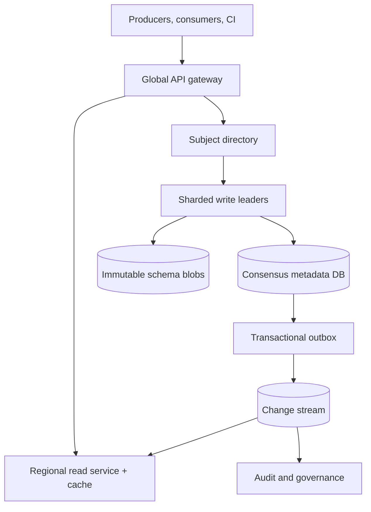
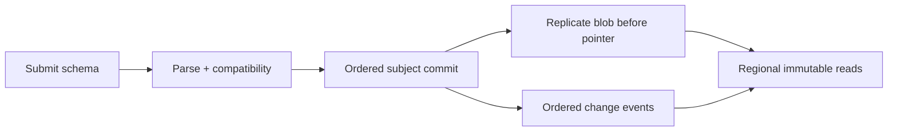

# Design a Multi-Region Schema Registry and Compatibility Service

**Difficulty:** Senior / Staff  
**Primary themes:** metadata databases, immutable caching, queues, multi-region consistency, compatibility algorithms, failure fencing

> **Interview-time note:** The pacing labels describe a 45-minute interview. This document is deliberately more detailed so you can study the reasoning, then compress it when speaking.

The walkthrough follows the public Hello Interview delivery sequence—requirements, core entities, interface, high-level design, then deep dives—and builds the high-level design one operation at a time. genui{"citation":{"refs":["turn177search0","turn177search3"]}} The design and dialogue below are original.

---

## Interviewer prompt

> Design a multi-tenant, multi-region schema registry for an organization with thousands of event producers and consumers. Teams register Avro, Protocol Buffer, and JSON schemas, evolve them under compatibility rules, and fetch immutable schemas while serializing or deserializing messages. The system must prevent incompatible changes without making message processing depend on a distant control plane.

A schema registry stores a named contract and its ordered versions. It is deceptively small in bytes but large in blast radius: accepting one bad schema can break many consumers, while making every consumer synchronously call the registry can turn a metadata outage into a company-wide streaming outage.

## Targeted clarifying questions and assumed answers

**Candidate:** Are we storing schemas for streaming events only, or also REST APIs and database tables?

**Interviewer:** Focus on event schemas used by brokers and log-based pipelines. The model could later extend to other contracts.

**Candidate:** Which formats must we support?

**Interviewer:** Avro, Protobuf, and JSON Schema. Each format has different compatibility semantics, so do not reduce validation to a textual diff.

**Candidate:** How are schemas organized?

**Interviewer:** A tenant owns subjects such as `orders-value`. Each subject has an ordered version history and one compatibility policy. A schema may reference other schemas by immutable ID.

**Candidate:** What compatibility modes are required?

**Interviewer:** `BACKWARD`, `FORWARD`, `FULL`, their transitive variants, and `NONE`. Policy changes must be audited. Compatibility means format-level reader/writer compatibility, not proof that business semantics are safe.

**Candidate:** What scale should I assume?

**Interviewer:** 20,000 tenants, 2 million subjects, 100 million schema versions, 5 million schema fetches per second globally, 2,000 registrations per second normally, and 10,000 registration attempts per second during a fleet migration.

**Candidate:** What latency and availability matter?

**Interviewer:** Cached fetch p99 below 10 ms in-region and uncached fetch p99 below 50 ms. Fetch availability is 99.999%; registration is 99.99% with p99 below 500 ms for ordinary schemas.

**Candidate:** May two regions register the next version of the same subject concurrently?

**Interviewer:** Clients may try, but the service must serialize accepted versions. No split-brain histories.

**Candidate:** What should happen during a region or WAN partition?

**Interviewer:** Existing schemas must remain readable. New registrations may pause or route to the subject's write leader rather than accept divergent history.

**Candidate:** Can schemas be edited or hard-deleted?

**Interviewer:** Accepted schema bytes are immutable. Subjects or versions can be deprecated and later tombstoned under retention policy, but referenced schemas cannot disappear from normal decoding paths.

**Candidate:** Do clients fetch `latest` on every message?

**Interviewer:** No. Producers resolve a version during deployment or startup, then embed an immutable schema ID in messages. Consumers cache by ID.

### Scope statement to say aloud

> “I’ll split this into a strongly consistent control plane for registration, ordered versions, references, and policy, and a highly available read plane for immutable schema IDs. Each subject has one write authority at a time, while accepted blobs replicate globally and cache aggressively. Registration validates syntax, resolves pinned references, checks the effective compatibility policy, and commits the version plus an outbox event atomically. During a partition, decoding continues from caches and replicas, but I would rather reject a registration than create two version histories.”

---

## 1. Requirements (~5 minutes)

### Core functional requirements

1. **Register and evolve schemas safely.** Parse a submitted schema, resolve immutable references, check compatibility under the subject's policy, and atomically assign the next version.
2. **Retrieve schemas at runtime.** Fetch by immutable schema ID or by subject and version, with globally low latency and no dependency on the write leader for hot-path decoding.
3. **Govern subjects.** Read or change compatibility policy, deprecate versions, list history, run a dry-run compatibility check, and publish an auditable change feed for CI/CD and tooling.

### Out of scope

- Operating the event broker itself
- Serializing every application payload inside the registry service
- Proving semantic compatibility such as whether changing `amount` from cents to dollars is safe
- Generating SDKs for every language
- Arbitrary REST/OpenAPI governance
- Migrating existing event payloads
- Full data catalog and lineage search

### Quantified non-functional requirements

| Requirement | Target | Design consequence |
|---|---:|---|
| Read traffic | 5M fetches/s globally, >99.9% by immutable ID | Multi-level cache and regional read replicas; no leader hop on a cache hit. |
| Write traffic | 2K registrations/s, 10K/s burst | Shard subjects; isolate CPU-heavy validation; queue only noncritical propagation work. |
| Latency | cached fetch p99 <10 ms; uncached <50 ms; register p99 <500 ms | In-region caches, bounded schemas, precompiled validators, single-subject transaction. |
| Availability | reads 99.999%; registrations 99.99% | Separate read/write failure domains; serve immutable accepted data during WAN partitions. |
| Correctness | one total order per subject; no accepted incompatible version under committed policy | Per-subject leader/consensus shard, fencing epoch, atomic policy-read-and-register transaction. |
| Durability | no acknowledged schema or policy change lost | Replicated transactional metadata, content-addressed blob store, outbox and backups. |
| Isolation | noisy tenant cannot exhaust validators or cache | Tenant quotas, admission control, per-format pools, bounded schema/reference graph. |

### Scale estimates that change the design

Assume an average canonical schema is 2 KB:

\[
100{,}000{,}000 \times 2\text{ KB} = 200\text{ GB}
\]

Even with metadata, indexes, three replicas, and 5× headroom, this is only a few terabytes. Storage volume is not the main problem. Five million reads per second is.

If every read returned 2 KB from the database:

\[
5{,}000{,}000 \times 2\text{ KB} \approx 10\text{ GB/s}
\]

That excludes protocol overhead and would overload the metadata database. But immutable IDs make a 99.9% aggregate cache-hit ratio realistic. The backing tier then sees roughly 5,000 reads/s, plus fills and failover bursts. This arithmetic justifies client caches, regional caches, request coalescing, and prewarming.

At 10,000 registration attempts/s and an average 10 ms of validator CPU, naïvely validating each attempt needs about 100 CPU cores before parsing references, authentication, or replication. Duplicate CI retries and abusive schemas could multiply that, so validation needs quotas, size/depth limits, compiled validator caches, and idempotency.

If subject metadata averages 500 bytes per version, 100 million versions add about 50 GB before indexes. A relational or distributed SQL store can handle this, sharded by `(tenant_id, subject_hash)`. We choose it for transactions and uniqueness, not because the dataset is large.

### Consistency and availability contract

- **Linearizable per subject:** accepted version numbers, active policy version, deprecation state, and reference graph updates have one order.
- **Immutable by ID:** once `schema_id` resolves to canonical bytes, it resolves to those bytes forever. Reuse is forbidden.
- **Read-your-write:** registration responses include a session token/commit position. Reads with that token route to a replica that has applied at least that position.
- **Eventual regional propagation:** a newly accepted schema may take seconds to appear in every region, but clients can use the registration response or session token immediately.
- **Partition behavior:** ID reads remain available from regional replicas/caches. Subject writes route to the fenced leader or fail with `503 WRITE_AUTHORITY_UNAVAILABLE`; they never fork.
- **Ordered change feed:** events are ordered per subject and delivered at least once. Consumers deduplicate by `(subject_id, version)` or `event_id`.
- **Deletion safety:** deprecation is immediate metadata; physical reclamation waits until no live reference, retention, replica, or message-retention obligation needs the schema.

### What to say aloud

> “CAP is not one choice for the whole service. Immutable ID lookup is availability-oriented because replicas cannot disagree about the bytes. Version allocation and policy evaluation are consistency-oriented because two accepted version 42s would corrupt the contract history.”

---

## 2. Core entities (~2 minutes)

- **Tenant** — quota, encryption domain, audit settings, and default compatibility policy.
- **Subject** — tenant-scoped contract name, home shard, current version, policy pointer, and lifecycle state.
- **SchemaBlob** — immutable canonical bytes, format, fingerprint, parser/validator version, and size.
- **SchemaVersion** — maps `(subject, version)` to a blob ID, references, creator, commit position, and status.
- **CompatibilityPolicy** — mode, transitivity, format-specific options, policy version, and audit metadata.
- **SchemaReference** — a named edge from one version to another immutable schema ID.
- **IdempotencyRecord** — tenant, key, request digest, result, and expiry.
- **ChangeEvent** — ordered outbox record for cache fill, replication, audit, and watchers.

Do not enumerate every column yet. As Hello Interview's framework suggests, start with the essential entities and introduce fields beside the component that needs them. genui{"citation":{"refs":["turn177search0","turn177search12"]}}

---

## 3. API and system interface (~5 minutes)

The gateway derives `tenant_id`, actor identity, and permissions from workload authentication. A caller cannot register into another tenant by placing a tenant ID in the JSON body.

### 3.1 Register a schema

```http
POST /v1/subjects/orders-value/versions
Authorization: Bearer <workload token>
Idempotency-Key: deploy-884:orders:v17
If-Match: "subject-version:16;policy-version:7"
Content-Type: application/json

{
  "format": "AVRO",
  "schema": "{...}",
  "references": [
    {"name": "Money", "schema_id": "sch_7M2..."}
  ],
  "metadata": {"service": "checkout", "build": "884"}
}
```

```json
{
  "schema_id": "sch_V4F8Q9...",
  "subject": "orders-value",
  "version": 17,
  "fingerprint": "sha256:91f2...",
  "policy_version": 7,
  "validator_version": "avro-compat-4.3.1",
  "commit_token": "shard-031:term-88:index-94012"
}
```

`If-Match` is optional for simple clients but valuable in deployment automation. A stale caller gets `409 SUBJECT_ADVANCED` or `409 POLICY_CHANGED` and must revalidate.

### 3.2 Dry-run compatibility

```http
POST /v1/subjects/orders-value/compatibility:check
Authorization: Bearer <workload token>

{
  "format": "AVRO",
  "schema": "{...}",
  "references": [{"name": "Money", "schema_id": "sch_7M2..."}],
  "against": {"type": "LATEST"}
}
```

```json
{
  "compatible": false,
  "effective_policy": "BACKWARD_TRANSITIVE",
  "policy_version": 7,
  "violations": [
    {
      "path": "Order.customer_tier",
      "code": "MISSING_DEFAULT",
      "compared_to_versions": [3, 9, 16]
    }
  ],
  "advisory_only": true
}
```

Dry-run is advisory because the subject can advance before registration. The authoritative check always runs inside the registration operation.

### 3.3 Fetch by immutable ID

```http
GET /v1/schemas/sch_V4F8Q9...
Authorization: Bearer <workload token>
If-None-Match: "sha256:91f2..."
```

```json
{
  "schema_id": "sch_V4F8Q9...",
  "format": "AVRO",
  "canonical_schema": "{...}",
  "references": [{"name": "Money", "schema_id": "sch_7M2..."}],
  "fingerprint": "sha256:91f2..."
}
```

The response is immutable and cacheable. Client libraries should cache it indefinitely subject to memory policy.

### 3.4 Resolve a subject version

```http
GET /v1/subjects/orders-value/versions/17
Authorization: Bearer <workload token>
X-Min-Commit-Token: shard-031:term-88:index-94012
```

`latest` is permitted for deployment tools, not recommended in a per-message data path.

### 3.5 Change compatibility policy

```http
PUT /v1/subjects/orders-value/policy
Authorization: Bearer <schema-admin token>
If-Match: "policy-version:7"

{
  "mode": "FULL_TRANSITIVE",
  "reason": "consumer fleet now retains three years of events"
}
```

The server returns policy version 8 and its commit token. Registrations racing this update serialize in the subject transaction and are evaluated under exactly one committed policy.

### 3.6 Watch subject changes

```protobuf
rpc WatchSubject(WatchRequest) returns (stream ChangeEvent);

message WatchRequest {
  string subject = 1;
  string after_event_id = 2;
}
```

This powers CI gates, local mirrors, cache warmers, and governance tooling. Delivery is at least once with resumable offsets.

### Interface-to-requirement map

| Requirement | Interface |
|---|---|
| Register safely | `POST /subjects/{name}/versions` |
| Test before deployment | `compatibility:check` |
| Runtime decoding | `GET /schemas/{immutable_id}` |
| Inspect history | subject/version and paginated history reads |
| Govern policy | conditional policy update |
| Propagate changes | resumable watch stream |

---

## 4. Data flow

Registration is a useful processing pipeline:

1. Authenticate the workload and apply tenant/subject authorization and quotas.
2. Deduplicate the idempotency key and bound request size, nesting depth, and reference count.
3. Parse and canonicalize with a versioned format plugin.
4. Resolve every reference by immutable ID; build a bounded directed acyclic graph.
5. Read the subject head and effective policy from its write-authoritative shard.
6. Run format-specific compatibility checks against the required prior versions.
7. In one transaction, allocate the next version, store metadata/references, and append an outbox event.
8. Replicate the immutable blob before publishing regional availability pointers.
9. Fan out cache warming, audit, change-feed, and governance events asynchronously.

---

## 5. High-level design (~10–15 minutes)

### Architecture



The read service and caches scale on fetch QPS. Write leaders and validators scale on registrations. A directory maps `(tenant_id, subject_hash)` to a shard and current leadership epoch. The metadata store may be distributed SQL or many relational consensus groups; what matters is transactional ordering inside a subject, not a particular vendor.

### Operation 1: fetch a schema by immutable ID

The producer embeds `schema_id` in each message. A consumer library resolves it through:

1. in-process LRU cache;
2. node-local/shared regional cache;
3. regional read service backed by a local metadata/blob replica;
4. remote origin only as a controlled last resort.

Relevant state:

```text
SchemaBlob(
  schema_id, tenant_id, format,
  canonical_bytes, fingerprint,
  parser_version, size_bytes,
  created_at, encryption_key_ref
)
```

`schema_id` is a random 128-bit public identifier; `fingerprint` is a SHA-256 digest of format-specific canonical bytes plus normalized references. The random ID avoids leaking cross-tenant equality. A unique `(tenant_id, fingerprint, format)` index deduplicates identical content within a tenant. On a digest match, the service compares full canonical bytes before deduplicating, defending against collision or canonicalizer defects.

Positive cache entries are immutable and need no TTL for correctness. Eviction is capacity-based. Negative cache entries get a short TTL because a newly registered ID may not yet have propagated. Cache misses for the same ID use request coalescing so a cold deploy produces one backing fetch, not ten thousand.

The read service returns a signed envelope or validates the stored fingerprint, preventing a poisoned cache from silently changing schema bytes. Authorization can be cached briefly, but schema content and tenant isolation remain separate concerns.

> “The best availability optimization is not merely Redis; it is making the lookup key immutable so stale data is still correct.”

### Operation 2: register a new schema version

The gateway routes the request to the subject's current leader. The leader checks the idempotency record:

```text
IdempotencyRecord(
  tenant_id, idempotency_key,
  request_digest, state,
  response_blob, expires_at
)
```

The same key and digest returns the original response. The same key with different bytes returns `409 IDEMPOTENCY_KEY_REUSED`.

The format plugin parses the schema and emits:

- canonical bytes;
- a typed intermediate representation;
- declared names/fields/tags/defaults;
- normalized immutable references;
- compiler and plugin version.

References are pinned to schema IDs, never `latest`. The service walks their graph, rejects cycles if the format/runtime cannot safely support them, and limits depth and total expanded bytes to stop resource-exhaustion attacks.

The leader then begins a subject transaction. Relevant rows are:

```text
Subject(
  tenant_id, subject_id, name,
  shard_id, leader_epoch,
  head_version, policy_version,
  lifecycle_state, row_version
)

SchemaVersion(
  subject_id, version,
  schema_id, status,
  policy_version_used,
  validator_version,
  reference_set_digest,
  actor_id, commit_position, created_at
)
```

It reads and locks the subject head and policy, checks compatibility, inserts or finds the blob, increments `head_version`, inserts the new version and reference edges, and writes an outbox row. A uniqueness constraint on `(subject_id, version)` plus consensus leadership makes concurrent registrations serialize.

The response is sent only after the metadata transaction is durably replicated and the referenced blob is locally durable. Remote cache warming is asynchronous.

### Operation 3: check compatibility

Confluent's public documentation describes backward, forward, full, and transitive modes; transitive modes compare against all prior versions rather than only the latest. genui{"citation":{"refs":["turn177search1","turn177search7"]}} Our registry exposes similar policy categories but implements checks through format-specific, versioned plugins.

For a non-transitive policy, compare candidate `N` with `N-1`. For a transitive policy, logical correctness may require compatibility with all relevant accepted predecessors. Re-parsing thousands of schemas on every write would eventually violate latency, so the service stores parsed intermediate representations and compatibility summaries.

The first design is intentionally simple: scan prior versions for transitive checks, bounded by a subject quota. The deep dive evolves it for long histories.

### Operation 4: change policy without a race

Policy state is subject-scoped:

```text
CompatibilityPolicy(
  subject_id, policy_version,
  mode, format_options,
  created_by, reason,
  created_at, supersedes_version
)
```

A policy update and a registration both lock/compare the same `Subject.row_version`. Therefore either:

- registration commits under policy 7, then the policy becomes 8; or
- policy 8 commits first, and registration validates under 8.

There is no interval where a caller receives success under an unrecorded mixture. The outbox emits both operations in commit order.

### Operation 5: publish changes and warm regions

The transaction writes:

```text
ChangeEvent(
  event_id, subject_id,
  subject_version, policy_version,
  schema_id, event_type,
  commit_position, created_at
)
```

An outbox relay publishes to a partitioned change stream keyed by subject. Consumers include:

- regional replica appliers;
- cache warmers;
- watch-stream servers;
- audit archive;
- search/catalog indexer;
- reference-count and garbage-collection indexer.

Delivery is at least once. Each consumer stores its last applied event and uses idempotent upserts. The publisher ensures blob bytes are present in the destination region before making the version pointer visible there. This “data before pointer” rule prevents a replica from advertising an ID it cannot serve.

### Operation 6: deprecate and eventually reclaim

Deprecation marks a version or subject as discouraged for new production, but ID lookup continues. Hard deletion is unsafe while retained messages still contain that ID or other schemas reference it.

Garbage collection requires:

```text
deprecated AND retention_elapsed
AND incoming_reference_count = 0
AND broker_message_retention_elapsed
AND all_regions_applied_tombstone
AND no legal_or_audit_hold
```

Even then, keeping small immutable schema blobs may be cheaper than risking undecodable archival data. The default is long retention and metadata tombstones, not aggressive physical deletion.

---

## 6. Deep dives (~10–15 minutes)

### Deep dive A: compatibility is a versioned program, not a JSON diff

#### Where the baseline breaks

A generic structural diff produces both false accepts and false rejects:

- Avro reader/writer resolution depends on defaults, names, aliases, unions, and type promotion.
- Protobuf wire compatibility depends heavily on field numbers, types, unknown fields, oneofs, and reserved tags.
- JSON Schema compatibility involves constraints whose logical subset relationships can be expensive or undecidable in unrestricted forms.
- A referenced type can change while the top-level text remains identical.

Official Protobuf guidance says adding fields is generally wire-safe, removing a field requires that its number not be reused, and some parse-compatible type changes may still be lossy. genui{"citation":{"refs":["turn177search2","turn177search11"]}} That is exactly why one universal rule engine is dangerous.

#### Plausible approaches

| Approach | Benefit | Problem |
|---|---|---|
| Text/AST diff | Simple and explainable | Does not model reader/writer semantics |
| One generic rules engine | Shared infrastructure | Lowest-common-denominator semantics; format bugs |
| Invoke official compiler/runtime per request | High fidelity | Slow, unsafe if unbounded, version drift |
| Sandboxed versioned format plugins | Fidelity plus operational control | More plugin lifecycle and conformance work |

#### Selection

Use a common orchestration contract with sandboxed, versioned plugins:

```text
parse(schema, references) -> IR
canonicalize(IR) -> bytes
check(candidate_IR, prior_IR, direction, options) -> violations
summarize(IR) -> compatibility_signature
```

Every accepted version stores `validator_version`. Upgrading a plugin does not silently rewrite history. Before rollout, replay the new plugin against a corpus of accepted/rejected registrations and official conformance cases. Differences are reviewed, then the plugin is canaried by tenant.

Compatibility modes mean:

- **BACKWARD:** a new reader can read data written by the prior writer schema.
- **FORWARD:** the prior reader can read data written by the new writer schema.
- **FULL:** both directions.
- **TRANSITIVE:** the chosen direction(s) must hold against every relevant historical accepted version.

The registry clearly separates **wire/schema compatibility** from **semantic policy**. Optional governance rules may forbid field-name or classification changes, but the response labels them separately. A registry cannot infer that `temperature` changed from Celsius to Fahrenheit.

#### Scaling transitive checks

For short histories, compare every prior IR. For long histories:

1. cache parsed IRs and resolved reference closures;
2. precompute format-specific compatibility signatures such as required reader fields, reserved Protobuf tags, enum constraints, and JSON constraint summaries;
3. maintain checkpoints every K versions;
4. use summaries to identify candidate conflicts, then run the authoritative full check only where needed;
5. enforce a maximum synchronous complexity and move pathological schemas to an explicit asynchronous review path rather than time out unpredictably.

Do not claim every format admits a perfect constant-size summary. The summary is an optimization; the authoritative plugin decides.

#### Reference correctness

References form a graph of immutable IDs. Registration:

- authorizes access to every referenced schema;
- pins exact IDs and includes them in the fingerprint;
- rejects missing nodes and disallowed cycles;
- bounds expanded node count and bytes;
- stores reverse edges transactionally for impact analysis and safe deletion.

A change to `Money` creates a new ID. Existing `Order` versions still point to the old `Money`, so they remain reproducible.

### Deep dive B: multi-region writes without split brain

#### Where the baseline breaks

If every region accepts `orders-value` independently during a partition, both may allocate version 17 under different policies. Last-write-wins cannot repair that: messages may already carry the two incompatible IDs, and audit history loses its meaning.

#### Options

| Approach | Availability | Consistency | Tradeoff |
|---|---:|---:|---|
| Active-active last-write-wins | High | Poor | Divergent accepted histories |
| Global consensus on every write | Medium | Strong | WAN latency for all registrations |
| Subject home region with consensus shard | High for reads; bounded for writes | Strong per subject | Home-region outage pauses/reroutes writes |
| CRDT version set | High | Convergent set only | Cannot preserve one ordered policy history |

#### Selection

Assign each subject to a home consensus shard. A shard has replicas across three failure domains; its leader is normally near the tenant's primary region. The global directory contains `(shard_id, leader_region, leader_epoch)`.

Writers include the epoch in every commit. Storage rejects a stale epoch, fencing an old leader after failover. The directory uses leases only as a routing optimization; consensus membership and epoch are the correctness boundary.

Failover sequence:

1. quorum detects leader loss;
2. a replica with the committed log is elected;
3. epoch increments;
4. directory and gateways learn the new route;
5. retries with the same idempotency key return the committed result or safely re-execute.

If no quorum exists, registrations fail closed. Existing ID reads remain available because accepted blobs and mappings are immutable in every healthy region.

#### Read-your-write and propagation

Registration returns a commit token. A caller immediately fetching the ID can:

- use the schema bytes already returned by registration;
- send `X-Min-Commit-Token` to wait briefly for a regional replica;
- be routed to the authoritative shard if bounded waiting expires.

Ordinary consumers do not need linearizable `latest`; they resolve the ID embedded in the message. This API choice removes most global consistency pressure.

#### Rebalancing hot tenants

Directory indirection lets us move a subject range:

1. snapshot shard state to target replicas;
2. stream the remaining log;
3. pause new writes briefly;
4. commit a higher routing/leadership epoch;
5. resume on the target and leave forwarding pointers.

Reads by ID are unaffected. A celebrity tenant can receive dedicated shards and validator pools without changing API semantics.

### Deep dive C: cache safety, propagation, and outage containment

#### Where the baseline breaks

A fleet restart can simultaneously evict millions of client caches. If all clients retry directly against the registry, the system experiences a cache stampede. If the registry is down and clients cannot decode messages, backlogs cascade through the entire data platform.

#### Multi-level cache design

| Layer | Key | Lifetime | Purpose |
|---|---|---|---|
| Client process | `schema_id` | capacity-based | Avoid network on hot messages |
| Node/sidecar | `tenant_id + schema_id` | capacity-based | Share across processes |
| Regional distributed cache | same | effectively immutable | Absorb fleet cold starts |
| Regional read replica | ID mapping and blob | durable | Source of truth for region |

Controls:

- request coalescing per missing ID;
- bounded exponential backoff with jitter;
- circuit breakers to remote origin;
- admission priority for known production IDs over exploratory history scans;
- prewarm from the change stream and deployment manifests;
- short negative-cache TTL and no permanent caching of authorization denial;
- tenant-aware cache keys and encryption domains;
- serve stale positive ID entries indefinitely because immutable stale is correct.

#### Client behavior during outage

Serializer/deserializer libraries maintain a disk-backed cache for recently used IDs. Consumers can continue processing known schemas when the registry and network are unavailable. An unknown ID pauses only the affected partition/message flow, retries with jitter, and routes to a dead-letter or quarantine path according to application policy; it does not crash the entire consumer fleet.

Producers should register during CI/deployment and pin an approved schema ID. Runtime auto-registration is disabled in production by default. This prevents a registry outage from blocking every publish and prevents accidentally accepting a developer-generated schema from a hot path.

#### Safe publication ordering

For each region:

1. replicate and verify blob bytes;
2. write the immutable ID index;
3. expose subject/version metadata;
4. emit the regional applied watermark;
5. warm caches.

If replication stops between steps 1 and 3, clients may know the blob but not see `latest`; safe. Reversing the order could expose a pointer to missing bytes.

#### Backpressure and failure isolation

Registration uses per-tenant token buckets and separate pools by format. Validation CPU saturation returns `429` with retry guidance before exhausting read-serving resources. Read and write services have independent autoscaling, caches, connection pools, and deployment rings.

A malformed or adversarial schema is bounded by:

- maximum raw and expanded size;
- maximum nesting and reference depth;
- parser wall-clock and CPU budget;
- sandbox memory limit;
- cancellation on client disconnect;
- plugin circuit breaker and quarantine.

Read SLO capacity is reserved and cannot be consumed by catalog scans or validator work.

---

## Reliability, observability, and security

### Critical invariants

1. `(subject_id, version)` maps to exactly one immutable `schema_id`.
2. A `schema_id` never resolves to different canonical bytes.
3. Registration uses one committed subject head and one committed policy version.
4. Every accepted reference points to an existing authorized immutable ID.
5. Only the current fenced leader epoch may append a subject version.
6. A regional pointer is not visible before its blob is locally readable.
7. Change events may duplicate but never reorder within a subject.
8. Deprecation or deletion never makes retained production messages undecodable.

### Failure-mode table

| Failure | Detection | Safe behavior | Recovery |
|---|---|---|---|
| Metadata commits; response is lost | client timeout, idempotency lookup | retry returns same version | replay response from idempotency record |
| DB commits; event publish fails | outbox age | schema remains accepted, propagation delayed | relay republishes until acknowledged |
| Duplicate change event | consumer event ID | idempotent no-op | advance stored offset |
| Blob missing in destination | checksum/publication guard | do not expose pointer | recopy and verify blob |
| Cache corruption | fingerprint/signature mismatch | evict and fail that lookup | refill from replica; alert |
| Validator crashes | sandbox exit/timeout | registration not committed | retry boundedly or quarantine plugin |
| Policy update races registration | row version/subject lock | one serial order wins | loser reloads and revalidates |
| Region partition | quorum and replication watermarks | ID reads continue; writes fail closed if no authority | elect fenced leader after quorum |
| Stale leader resumes | epoch mismatch | storage rejects commits | refresh directory/epoch |
| Cache stampede | miss concurrency and origin QPS | coalesce, shed low-priority reads | refill and prewarm |
| Change-feed consumer lags | per-region watermark | direct ID reads remain correct; watches report lag | scale/replay from durable offset |
| Reference target deprecated | reverse-edge check | existing refs still resolve; warn on new ref | migrate dependents before reclamation |

### Observability

**Read plane**

- fetch QPS and p50/p95/p99 by cache layer and region
- client, node, regional, and replica hit ratios
- unknown-ID rate, negative-cache rate, and coalesced waiter count
- blob checksum failures and cross-region fallback rate
- cache cold-start amplification during deploys

**Write plane**

- registration latency split into parse, reference resolution, compatibility, transaction, and replication
- accepted/rejected registrations by format and violation code
- subject lock contention and hot-shard distribution
- idempotency reuse, validator timeout, sandbox OOM, and quota rejection
- policy-to-registration race/conflict rate

**Correctness and replication**

- per-region applied commit watermark and age
- outbox backlog and oldest unpublished event
- pointers whose blobs are absent—target must be zero
- duplicate or out-of-order subject events
- plugin-version divergence and conformance replay differences
- stale-leader fencing attempts

Traces carry opaque tenant, subject, schema, policy version, validator version, shard, epoch, and commit position. Raw schema text is excluded from general logs because it may contain sensitive field names or documentation.

### Security and tenancy

- workload identity and mTLS for services; short-lived human tokens for administrators
- subject-level read/register/admin roles
- authorization of every referenced schema to prevent cross-tenant existence leaks
- tenant-scoped random IDs and encryption keys
- immutable audit events for policy, registration, deprecation, and override actions
- schema size/depth/rate quotas and sandboxed parsers
- no untrusted plugin network access
- signed release process and conformance corpus for validators
- two-person approval for changing a subject to `NONE` in production
- secrets scanning for schema descriptions/defaults; reject or quarantine likely credentials

---

## 7. Final design

The final system has a small, strongly ordered write path and a massive immutable read path:

- A global gateway authenticates callers and derives tenant identity.
- A subject directory routes registration and policy writes to a single fenced consensus leader per subject shard.
- Versioned, sandboxed plugins parse, canonicalize, resolve pinned references, and perform format-specific compatibility checks.
- One transaction locks the subject, evaluates the committed policy, allocates the next version, records references, and writes an outbox event.
- Schema blobs are immutable, content-verified, replicated before pointers, and retained conservatively.
- A durable change stream feeds regional replicas, caches, watch APIs, audit, search, and garbage-collection indexes.
- Consumers fetch by immutable schema ID through client, node, regional, and durable replica caches; producers pin IDs during deployment.
- WAN partitions preserve known-schema reads. New writes either reach the fenced authority or fail rather than split history.
- Idempotency, commit tokens, safe publication ordering, quotas, and observability make retries and failures explicit.



### Requirements check

| Requirement | Design response |
|---|---|
| Register safely | subject transaction, committed policy, versioned format plugin |
| Prevent races | per-subject ordering, conditional requests, uniqueness, fencing epoch |
| Support references | immutable pinned IDs, authorization, bounded graph, reverse edges |
| Fetch at 5M/s | client/node/regional caches and local durable replicas |
| Preserve availability | immutable-ID reads during partitions; disk-backed client cache |
| Avoid global inconsistency | home consensus shard and fail-closed registration |
| Propagate changes | outbox plus partitioned at-least-once change stream |
| Support read-your-write | returned bytes and minimum commit token |
| Govern lifecycle | policy versions, deprecation, audit, conservative garbage collection |
| Isolate tenants | quotas, separate validator pools, scoped IDs/keys/authorization |

### Thirty-second closing statement

> “The central design move is separating immutable lookup from ordered evolution. Consumers decode by an immutable ID cached at several layers, so a control-plane or WAN outage does not stop known traffic. A subject has one fenced write authority; registration resolves exact references, runs a versioned format-specific compatibility program, and atomically commits the next version under one policy. The outbox propagates data after commit, and each region publishes pointers only after blob bytes arrive. That gives us high read availability without weakening the one-history-per-subject invariant.”

---

## Realistic interviewer follow-up questions and strong answers

### 1. Why not make the schema ID the SHA-256 hash?

A content hash gives deterministic deduplication and integrity, but a public cross-tenant hash leaks that two tenants use identical schemas and makes future canonicalization mistakes part of the external identity. I expose a random tenant-scoped 128-bit ID, keep SHA-256 as an integrity/deduplication fingerprint, and compare full canonical bytes on a hash match. A content-addressed public ID is also defensible if cross-tenant equality leakage is acceptable.

### 2. Why not use a relational sequence for every version globally?

We need order only within a subject. A global sequence would create needless contention. Shard by tenant and subject; transact on the subject row and enforce uniqueness on `(subject_id, version)`.

### 3. Can two schemas share one ID?

Only if they are byte-for-byte equal after the same format/version canonicalization and normalized references, within the allowed tenant scope. Full-byte comparison defends the fingerprint index.

### 4. What does backward compatibility mean?

A consumer using the new reader schema can read data produced with the older writer schema. Direction matters. I would say the reader/writer pair aloud because “backward” is often misremembered.

### 5. Does compatibility guarantee a safe deployment?

No. It covers declared schema/wire rules. Units, meaning, privacy classification, cardinality, or changed business invariants may still break consumers. Optional governance rules and consumer contract tests complement the registry.

### 6. Why pin references by ID rather than subject `latest`?

Pinned references make a schema reproducible and cacheable. A floating reference could change the effective contract without changing the parent version and could make historical compatibility results impossible to replay.

### 7. What if a schema has 100,000 historical versions under a transitive policy?

Persist parsed IRs and compatibility summaries, checkpoint long histories, use summaries to prune comparisons, and run authoritative checks on candidate conflicts. Bound synchronous complexity. If a format cannot summarize safely, move the rare pathological registration to explicit asynchronous review rather than silently weaken transitivity.

### 8. Can registration be asynchronous?

Ordinary registration should synchronously return accepted or rejected because deployment needs a definitive ID. An explicit review workflow can handle pathological schemas, but it returns `PENDING`, never an ID that producers may use before validation.

### 9. What if the response is lost after commit?

The client retries with the same idempotency key and request digest. The registry returns the original schema ID/version. A different digest under the same key is a conflict.

### 10. How do you handle `latest`?

It is a mutable metadata read appropriate for CI or startup. It can be served from a bounded-staleness regional pointer or with a commit token for stronger semantics. Per-message processing uses immutable IDs, never `latest`.

### 11. What happens if the home region is down?

Read replicas and caches continue serving accepted IDs. If the consensus shard has quorum elsewhere, elect a new leader with a higher fencing epoch. Without quorum, reject writes rather than create a second history.

### 12. Why is the change stream at least once?

Exactly-once transport is unnecessary and would not eliminate duplicated side effects. Events have stable IDs and subject/version keys; consumers idempotently upsert and persist offsets.

### 13. How do you prevent pointer-before-blob failures?

Regional replication copies and verifies immutable bytes first, then exposes the ID and subject/version pointers. Monitors continuously assert that every visible pointer has a readable, matching blob.

### 14. What if a validator upgrade changes an old decision?

Historical versions retain their validator version and remain accepted. Replay both versions on a conformance corpus, audit differences, canary the new validator, and use it for future registrations. A critical security defect may trigger governance remediation, not silent history mutation.

### 15. How do consumers survive a complete registry outage?

Client libraries keep memory and optional disk caches. Known IDs decode locally. Unknown IDs pause or quarantine only affected records and retry with jitter. Production producers pin IDs during deployment and do not auto-register on the send path.

### 16. How would you delete a schema?

Normally deprecate it but keep ID resolution. Physical deletion requires no incoming reference, expired message/archive retention, every regional tombstone applied, and no hold. Since blobs are small and loss makes data undecodable, long retention is usually the right tradeoff.

### 17. How do you stop a malicious schema from consuming all CPU?

Enforce raw/expanded size, depth, reference count, CPU, wall-clock, and memory limits; sandbox parsers; isolate pools by format and tenant; rate-limit before validation; and reserve read-plane capacity.

### 18. Would you store schema blobs in object storage or the database?

Either works at this size. I would keep transactional metadata and small inline/cached blobs in the database for simple reads, with immutable object storage as durable backing for larger schemas and backups. The abstraction must publish the pointer only after bytes are durable.

### 19. How do you test the multi-region behavior?

Inject lost responses, duplicate outbox delivery, replica lag, missing blobs, leader pauses, stale-epoch writes, full WAN partitions, and cache cold starts. Property tests assert immutable ID mapping, one version per subject number, policy/version serialization, and data-before-pointer publication.

### 20. Why not use a CRDT for active-active registration?

A CRDT can converge a set of versions, but the contract requires a single order and policy evaluated at each accepted point. Merging two independently accepted version 17s after the fact does not undo messages already produced under them.

---

## Common pitfalls

1. Treating schema compatibility as a textual or generic JSON diff.
2. Forgetting the reader/writer direction of backward and forward compatibility.
3. Claiming schema compatibility proves business-semantic safety.
4. Letting runtime producers auto-register schemas in production.
5. Fetching `latest` for every message.
6. Sending all reads to a global write leader.
7. Allowing two regions to allocate subject versions independently.
8. Using last-write-wins to repair an ordered contract history.
9. Returning success before metadata and blob are durable.
10. Publishing a regional pointer before the blob arrives.
11. Floating references to another subject's latest version.
12. Ignoring cycles, graph depth, and expanded reference size.
13. Revalidating an unbounded transitive history from raw text every time.
14. Upgrading validator logic without recording the validator version.
15. Assuming exactly-once messaging makes cache/audit consumers exactly once.
16. Caching `404` forever for a not-yet-propagated schema.
17. Sharing cache keys without tenant scope or authorization checks.
18. Letting validator CPU starvation take down read serving.
19. Deleting deprecated schemas while retained messages still reference them.
20. Logging full schemas, defaults, or documentation that may contain secrets.
21. Ignoring the lost-response/idempotency case.
22. Saying “use Kafka” without explaining the authoritative database, ordering key, outbox, and replay behavior.

---

## Suggested 45-minute interview pacing

| Time | Focus |
|---:|---|
| 0–5 min | Scope, formats, scale, requirements, consistency contract |
| 5–7 min | Tenant, subject, blob, version, policy, reference |
| 7–12 min | Register, dry-run, fetch, policy, watch interfaces |
| 12–25 min | Immutable read path, ordered registration, policy race, propagation |
| 25–38 min | Compatibility plugins and multi-region authority; caching if time |
| 38–43 min | Failures, observability, security, deletion semantics |
| 43–45 min | Requirements check and closing summary |

In the interview, finish the baseline before diving into every Avro or Protobuf rule. Establish the key invariants—immutable IDs, one ordered history per subject, exact references, and data-before-pointer publication—then let the interviewer choose the deepest tradeoff.

---

## Public references

- [Hello Interview — System Design Delivery Framework](https://www.hellointerview.com/learn/system-design/in-a-hurry/delivery)
- [Hello Interview — API Design for System Design Interviews](https://www.hellointerview.com/learn/system-design/core-concepts/api-design)
- [Hello Interview — Data Modeling for System Design Interviews](https://www.hellointerview.com/learn/system-design/core-concepts/data-modeling)
- [Confluent — Schema Evolution and Compatibility](https://docs.confluent.io/platform/current/schema-registry/fundamentals/schema-evolution.html)
- [Confluent — Schema Registry API Compatibility Concepts](https://docs.confluent.io/platform/current/schema-registry/develop/api.html)
- [Protocol Buffers — Proto3 Language Guide: Updating a Message Type](https://protobuf.dev/programming-guides/proto3/)
- [Protocol Buffers — Best Practices](https://protobuf.dev/best-practices/dos-donts/)

The references ground the delivery structure and format semantics. The scale assumptions, APIs, multi-region protocol, cache hierarchy, failure handling, dialogue, and complete architecture are original.
