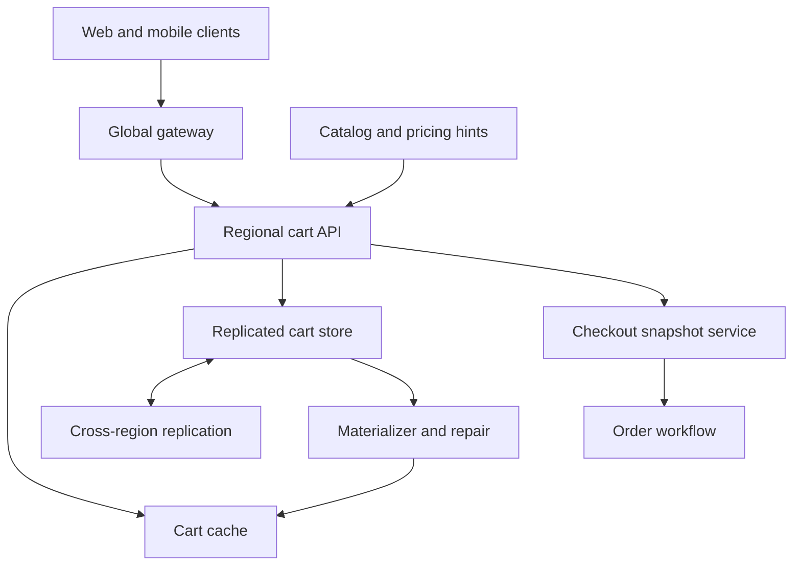

# Design a Multi-Region Shopping Cart Service

**Difficulty:** Senior  
**Primary themes:** availability, eventual consistency, conflict resolution, caching, idempotency, checkout handoff, multi-region reliability  
**Interview time budget:** about 45 minutes  
**Educational walkthrough:** intentionally more detailed than the spoken interview

This is an original problem walkthrough organized with the public Hello Interview sequence: requirements, core entities, API, high-level design, then requirement-driven deep dives. Their delivery guidance recommends establishing a complete, simple design before introducing complexity for scale and reliability. See [Hello Interview's System Design Delivery Framework](https://www.hellointerview.com/learn/system-design/in-a-hurry/delivery).

## Interviewer prompt

> Design the shopping-cart service for a global e-commerce marketplace. Signed-in customers use the same cart across phones and browsers; guests also have carts that can merge at sign-in. Adding or removing an item should remain available during regional or network failures. Checkout must consume a stable cart snapshot and must not create duplicate orders.

The design intentionally separates two different consistency domains:

- **Cart editing** is preference capture. It should favor availability and converge after concurrent edits.
- **Checkout** creates financial and inventory obligations. It needs an immutable snapshot, idempotency, and strong downstream validation.

That boundary is the center of the interview.

## Targeted clarifying questions and assumed answers

**Candidate:** Does adding an item reserve inventory or lock its price?

**Interviewer:** No. The cart stores intent plus a price reference for display. Checkout revalidates price, promotions, seller availability, shipping restrictions, and inventory.

**Candidate:** Which cart mutations are required?

**Interviewer:** Add quantity, decrement quantity, remove a line, apply or remove a coupon, read the cart, merge a guest cart at sign-in, and begin checkout.

**Candidate:** Should two devices be able to edit the same cart concurrently?

**Interviewer:** Yes. Prefer accepting both edits over rejecting one. The merge policy must be deterministic and explainable.

**Candidate:** What consistency should a user see after their own write?

**Interviewer:** Read-your-writes within the same session. Another device or region may be briefly stale, but replicas should normally converge within two seconds.

**Candidate:** How should a remove racing with an add behave?

**Interviewer:** Do not silently discard an add the remover could not have observed. Use add-wins semantics for a truly concurrent add. A later remove that has observed the add should remove it.

**Candidate:** May a user keep editing while checkout is in progress?

**Interviewer:** Yes. Checkout uses a frozen snapshot. Subsequent edits form a newer cart state and do not change that checkout attempt.

**Candidate:** What is the scale?

**Interviewer:** 50 million daily active shoppers, 100,000 peak cart mutations per second, 500,000 peak reads per second, 20 items in a typical non-empty cart, and 200 items maximum. Keep active carts for 90 days.

**Candidate:** Latency and availability targets?

**Interviewer:** Same-region p99 below 80 ms for mutations and 50 ms for reads. Target 99.99% API availability. A region may accept cart writes while isolated. Cart updates should not be lost after acknowledgment.

**Candidate:** Do we design inventory, pricing, promotion, tax, payment, and order systems?

**Interviewer:** Treat them as external services. Define the checkout handoff and failure behavior, but do not design their internals.

**Candidate:** Are carts private?

**Interviewer:** Yes. Identity must come from authentication. Guest carts use signed, unguessable credentials and are claimed securely at sign-in.

## 1. Requirements (~5 minutes)

### Functional requirements

1. **Edit and read a cart:** add/decrement/remove item quantities and manage coupons, with idempotent retries and read-your-writes for the initiating session.
2. **Synchronize and merge:** converge concurrent cross-device and cross-region edits; merge a guest cart into the authenticated customer's cart without duplicating replayed operations.
3. **Begin checkout safely:** create one immutable checkout snapshot per idempotency key, then hand it to downstream validation and order creation without treating cart data as authoritative price or inventory.

### Quantified non-functional requirements

- **Scale:** 100K peak mutations/s, 500K reads/s, 50M DAU, up to 200 lines per cart.
- **Latency:** same-region mutation p99 < 80 ms and read p99 < 50 ms.
- **Availability:** 99.99%; local writes remain available during a regional partition when durable quorum exists locally.
- **Durability and convergence:** no acknowledged edit is lost; cross-region replicas normally converge within two seconds after connectivity is healthy.
- **Retention:** active cart state for 90 days; mutation and idempotency metadata retained long enough to cover replication, retry, recovery, and audit windows.

### Consistency and availability contract

Cart editing is multi-region, active-active, and eventually consistent:

- An accepted operation is durably recorded in its local region before success.
- The response carries a causal session token. Reads using that token observe that operation or wait/route to a replica that does.
- Concurrent operations merge deterministically. For item presence, an add not observed by a concurrent remove survives—**add-wins observed-remove semantics**.
- Duplicate operation IDs have no additional effect.
- Reads without a session token may be stale during replication delay.

Checkout has a stronger contract:

- `beginCheckout` pins one immutable resolved cart version and one checkout-attempt ID.
- The same idempotency key returns the same attempt and snapshot.
- Later cart edits cannot mutate an existing snapshot.
- Inventory, price, promotion, tax, and payment are revalidated by their authoritative services.

During a network partition, both regions may accept cart edits and later merge them. Checkout is routed to the customer's designated commerce region or another region that can reach the strongly consistent order workflow. If that authority is unavailable, editing remains available but new checkout attempts fail safely.

### Out of scope

- Catalog search and recommendations
- Inventory allocation internals
- Promotion-rule evaluation internals
- Tax, shipping, payment, and order-service internals
- Shared household carts and collaborative permissions

### What I would say aloud

> “I want to avoid accidentally making the cart a reservation system. Cart edits are highly available, mergeable intent. Checkout draws a hard boundary: it freezes one cart version and asks authoritative services to validate everything that creates money or inventory obligations.”

## 2. Core entities (~2 minutes)

| Entity | Purpose |
|---|---|
| `Cart` | Ownership, lifecycle, causal summary, materialized lines and coupons |
| `CartLine` | Product/offer identity, quantity state, add/remove causality, display reference |
| `CartOperation` | Immutable, uniquely identified add/decrement/remove/coupon/merge event |
| `SessionToken` | Signed causal context supporting read-your-writes |
| `GuestCartCredential` | Signed capability identifying an unclaimed guest cart |
| `CheckoutSnapshot` | Immutable resolved cart version used by one checkout attempt |
| `CheckoutAttempt` | Idempotency key, snapshot, status, downstream order reference |
| `ReplicationCursor` | Per-region applied frontier used for convergence and repair |

The mutation log is the durable source for merging and recovery. The materialized cart is the efficient read model.

## 3. API and system interface (~5 minutes)

For authenticated users, the gateway derives `customer_id`, tenant/marketplace, region and permissions from the access token. A client cannot submit an authoritative customer ID. Guest callers present a server-signed cart capability stored in a secure cookie or app keychain.

### Apply an item operation

```http
POST /v1/cart/operations
Authorization: Bearer <token>
Idempotency-Key: 48c7670c-d662-4035-a548-f0a6e6927957
X-Cart-Session: <signed-causal-token>
Content-Type: application/json

{
  "type": "ADD_QUANTITY",
  "offer_id": "offer_914",
  "quantity_delta": 2,
  "display_context": {
    "observed_price_id": "price_77"
  }
}
```

```json
{
  "cart_id": "cart_38f",
  "operation_id": "op_us2_991",
  "resolved_quantity": 3,
  "cart_version": "vv:us2=991,eu1=174",
  "session_token": "signed-opaque-token"
}
```

Quantity changes are deltas, not read-modify-write absolute assignments. Deltas commute across replicas and do not silently lose a simultaneous increment. The service rejects a result below zero and caps each line at the product limit.

### Remove a line

```http
POST /v1/cart/operations
Authorization: Bearer <token>
Idempotency-Key: 941bbdac-9bce-4ee8-8e06-abcd163daf88
X-Cart-Session: <signed-causal-token>
Content-Type: application/json

{
  "type": "REMOVE_LINE",
  "offer_id": "offer_914",
  "observed_context": "vv:us2=991,eu1=174"
}
```

The observed context states which prior adds the remove has seen. An unseen concurrent add remains after merge. A subsequent remove issued after refresh observes and removes it.

### Read the cart

```http
GET /v1/cart
Authorization: Bearer <token>
X-Cart-Session: <signed-causal-token>
```

```json
{
  "cart_id": "cart_38f",
  "lines": [
    {
      "offer_id": "offer_914",
      "quantity": 3,
      "display_price": {"amount": "29.99", "currency": "USD"},
      "availability_hint": "IN_STOCK"
    }
  ],
  "coupons": ["FALL10"],
  "cart_version": "vv:us2=991,eu1=174",
  "session_token": "signed-opaque-token",
  "priced_at": "2026-10-19T11:55:00Z"
}
```

Price and availability are explicitly hints. The response can be useful and fast without claiming that checkout will accept them.

### Claim and merge a guest cart

```http
POST /v1/cart:mergeGuest
Authorization: Bearer <token>
Idempotency-Key: ebcac45c-2ab4-4a42-a403-abdf03dc6661
Content-Type: application/json

{
  "guest_cart_credential": "signed-guest-capability"
}
```

The service atomically marks the guest capability claimed and imports its operations using original operation IDs. A retry therefore cannot double quantities.

### Begin checkout

```http
POST /v1/cart:beginCheckout
Authorization: Bearer <token>
Idempotency-Key: 69b01324-af7a-4123-a717-a6936970060d
X-Cart-Session: <signed-causal-token>
Content-Type: application/json

{
  "expected_cart_version": "vv:us2=991,eu1=174"
}
```

```json
{
  "checkout_attempt_id": "chk_72c",
  "snapshot_id": "snap_8f0",
  "snapshot_version": "vv:us2=991,eu1=174",
  "status": "VALIDATING"
}
```

If the submitted version is behind the user's required causal token, the service first catches up. If new concurrent operations exist, policy can either include the resolved superset and return its exact version or return `409 Cart Changed`; in this design, return `409` so the user knowingly reviews the final cart.

### Interface-to-requirement mapping

| Requirement | Interface |
|---|---|
| Edit cart | Idempotent operation API with delta and observed context |
| Read-your-writes | Signed session token on reads and mutations |
| Guest merge | One-time claim plus operation-level deduplication |
| Stable checkout | Expected version, immutable snapshot and attempt ID |
| Identity isolation | Customer from authentication; signed guest capability |

### What I would say aloud

> “I use operation IDs for retry safety and a causal token for session consistency. The token is not user identity and it cannot authorize another cart. For checkout I require an expected version so the user cannot unknowingly purchase a concurrently changed cart.”

## 4. Data flows

### Edit flow

1. Authenticate or verify the guest capability.
2. Validate the operation, tenant limits and client causal context.
3. Append the immutable operation to a local quorum-replicated partition.
4. Update or invalidate the regional materialized-cart cache.
5. Publish the operation to other regions and return a new session token.

### Checkout flow

1. Ensure local state dominates the client's session token.
2. Resolve all known operations into one cart version.
3. Conditionally create an immutable snapshot and idempotent checkout attempt.
4. Send snapshot references to pricing, inventory, promotion, shipping and order orchestration.
5. Leave later edits in a newer cart generation; on successful order creation, mark purchased operations consumed rather than blindly deleting a possibly newer cart.

## 5. High-level design (~10–15 minutes)



### Global routing and regional APIs

Geo-aware routing sends a client to a nearby healthy region while maintaining session affinity when practical. Every request has a hard timeout and an idempotency key. The regional API is stateless except for bounded in-memory metadata caches.

The session token contains a signed compact causal frontier, cart ID, issuance time and key version. A receiving region must apply operations through that frontier, fetch missing operations, route to a region that has them, or fail within a deadline. It must not return an older state while claiming read-your-writes.

### Partitioned cart store

Partition by a stable hash of `cart_id` within each region. A partition is replicated across three availability zones using consensus so a locally acknowledged operation survives a node or zone failure.

Each durable operation contains:

```text
cart_id, operation_id, origin_region, origin_counter
actor_id_hash, operation_type, offer_id, delta
observed_context, coupon_code
display_reference, created_at, expiry_at
```

`operation_id` is globally unique, such as `(origin_region, origin_counter, random_suffix)`. The per-origin counter contributes to the version vector used for causal comparison.

The store also holds periodic compacted snapshots:

```text
cart_id, snapshot_frontier, line_state, coupon_state
claimed_guest_ids, checkout_markers, checksum
```

Snapshots reduce read cost; the operation log after the snapshot preserves unresolved concurrency and recovery history.

### Regional materializer and cache

The materializer folds operations into a deterministic cart projection. Cache keys include `cart_id` and a version/frontier. The cache holds complete small carts and never becomes the source of truth.

Use read-through behavior carefully:

1. Read the cache.
2. Verify that the cached frontier dominates the caller's session token.
3. If not, fetch/merge from the durable store and refresh the cache.
4. On cache failure, bypass it; do not make cart correctness depend on cache availability.

Amazon's Builders' Library warns that cache-fleet failures and cold caches can degrade service availability unless applications explicitly handle cache unavailability ([Caching challenges and strategies](https://aws.amazon.com/builders-library/caching-challenges-and-strategies/)).

### Scale estimates that change the design

Given 100K peak mutations/s and three in-region replicas:

```text
100K operations/s × 3 replicas = 300K replicated log writes/s
```

Assuming an encoded operation averages 250 bytes:

```text
100K × 250 bytes ≈ 25 MB/s logical
≈ 2.16 TB/day before replication and compression
```

We cannot retain every raw mutation forever in the hot store. Periodic snapshotting and safe log compaction are required. Compaction waits until every region's replication frontier and the deduplication window have passed the operations being removed.

For reads, 500K/s against the durable store would be expensive. If 50M active carts average 4 KiB materialized state:

```text
50M × 4 KiB ≈ 200 GiB
```

That is a practical distributed-cache working set per major geography, with headroom. A 95% cache hit rate reduces 500K reads/s to about 25K durable reads/s, but the database and materializers must survive a cold-cache ramp, not merely steady state.

The average mutation rate implied by 50M shoppers and 15 edits/day is about 8.7K/s, far below the 100K peak. This large peak-to-average ratio argues for admission headroom, prewarming before sales events and partitions that distribute by cart—not static capacity at average load.

### Operation A: add quantity

The regional API validates the operation and idempotency key. The local partition appends it through quorum consensus, advances the cart's origin counter, and returns a session token. A stream sends the same immutable operation to other regions, where deduplication by operation ID makes retries harmless.

This satisfies durable, highly available editing before we add sophisticated merging.

### Operation B: read a cart

The API checks a cached projection. If its frontier covers the requested session frontier, return it. Otherwise, read the latest snapshot and tail operations, merge them, update the cache and return the new frontier.

Display prices and stock hints are batched from their services or caches. Failure to enrich does not hide the cart: return lines with `price_status: unavailable` rather than failing the durable intent read.

### Operation C: replicate and merge

Each region streams operations partitioned by cart ID. Receivers persist before advancing their replication cursor. Delivery is at least once; operation IDs deduplicate. Anti-entropy periodically compares per-partition frontiers and checksums, then transfers missing ranges.

Concurrent operations do not require synchronized clocks. Causal contexts distinguish “remove after observing add” from “remove concurrent with an unseen add.” This is the main reason not to rely on wall-clock last-write-wins alone.

Amazon's Dynamo paper is relevant historical grounding: it describes an always-on key-value system that sacrifices consistency under some failures and uses application-aware reconciliation; shopping carts were a motivating workload ([Amazon Science](https://www.amazon.science/publications/dynamo-amazons-highly-available-key-value-store)). This walkthrough chooses explicit operation semantics rather than exposing raw sibling versions to clients.

### Operation D: create a checkout snapshot

The snapshot service operates in the cart's commerce authority region:

1. Catch up through the required causal frontier.
2. Recompute the resolved cart and compare its version to `expected_cart_version`.
3. In one strongly consistent transaction, create `CheckoutAttempt(idempotency_key)` and immutable `CheckoutSnapshot` if absent.
4. Publish a transactional outbox event to the order workflow.
5. Return the existing attempt on retry.

Snapshot fields include:

```text
snapshot_id, cart_id, customer_id_hash
resolved_frontier, resolved_lines, coupons
marketplace, currency, locale
created_at, checkout_attempt_id, checksum
```

The snapshot records product/offer IDs and quantities, not authoritative final prices. Downstream services return a price/inventory proposal for user confirmation when needed.

## 6. Deep dives (~10–15 minutes)

### Deep dive A: conflict semantics that users can understand

#### Where the baseline breaks

A single primary region gives simple ordering but stops accepting writes during regional isolation. Last-write-wins using timestamps stays available, yet clock skew or a later unrelated write can erase a valid concurrent add. Blindly unioning cart contents prevents lost adds but makes removed products reappear forever.

#### Options

| Approach | Strength | Weakness |
|---|---|---|
| Single leader | Simple linearizable behavior | Regional outage or WAN dependency blocks edits |
| Wall-clock last-write-wins | Small metadata, deterministic | Can lose concurrent intent; clock-sensitive |
| Return sibling versions to client | Storage is generic | Pushes confusing merge behavior to every client |
| Operation-based observed-remove cart | Available, deterministic, intent-aware | More metadata, compaction and semantic design |

#### Selected model

Use an operation-based observed-remove map keyed by `offer_id`.

- `ADD_QUANTITY(+n)` creates a unique causal dot and positive delta.
- `DECREMENT_QUANTITY(-n)` creates another unique delta, bounded during resolution at zero.
- `REMOVE_LINE` carries the causal context it observed and tombstones all item operations covered by that context.
- An add concurrent with the remove is not covered, so it survives: add wins.
- Replayed operations are ignored by ID.

This resembles the family of observed-remove set CRDTs—replicated data types designed so independently applied concurrent updates converge without coordination. The CRDT literature catalogues observed-remove/add-wins set semantics and their metadata tradeoffs ([CRDT paper index](https://crdt.tech/papers.html)).

#### Quantity edge cases

Concurrent deltas commute:

```text
Start: quantity 1
Phone: +2
Laptop: +1
Merged: 4
```

An absolute `SET_QUANTITY(2)` is harder because two offline devices can set different values. Keep the public primitive as delta. A UI typing an exact quantity reads the current version and sends the computed delta with `If-Cart-Version`; on mismatch it refreshes instead of guessing.

For remove versus concurrent add:

```text
Phone observes quantity 1 and removes it.
Laptop, still offline, adds 1 without observing the remove.
Merged result: quantity 1 because the new add was concurrent.
```

This can surprise a user, but it does not silently discard purchase intent. The UI can show “cart updated on another device.” A later remove after synchronization removes the surviving add.

#### Coupons

Coupon presence can use the same observed-remove set. Actual combinability and discount value are not merged in the cart; promotion service evaluates them at read and checkout. Invalid coupons remain visible with status rather than disappearing silently.

#### Metadata compaction

CRDT metadata cannot grow forever. Each region advertises a durable applied frontier. Once every live region and backup/recovery policy has advanced past a tombstoned operation, a compactor folds it into the snapshot and removes individual dots. A region offline beyond the retention contract must bootstrap from a fresh snapshot rather than replay ancient operations.

#### What I would say aloud

> “I am not claiming CRDTs make product semantics automatic. I choose the semantics first: concurrent adds survive removes that could not have observed them, and quantity changes are deltas. The observed-remove operation model implements that decision without synchronized clocks.”

### Deep dive B: checkout as a consistency boundary

#### Where the baseline breaks

If checkout reads a mutable eventual cart and then calls five services, a concurrent edit can change quantities halfway through. Retrying after a timeout can create two order workflows. Deleting the cart after order creation can erase newer edits made while checkout was running.

#### Alternatives

| Approach | Benefit | Problem |
|---|---|---|
| Lock entire cart through checkout | Simple stable view | Long-lived lock hurts availability and cross-device UX |
| Copy current cart without version check | Fast | User may checkout unseen concurrent changes |
| Immutable versioned snapshot | Stable, retryable, edits continue | Requires explicit version and lifecycle management |

#### Selected flow

Use an immutable snapshot plus idempotent saga:

1. Client submits reviewed cart version and idempotency key.
2. Snapshot service catches up to the session frontier.
3. If the resolved version differs, return `409` with the new cart for review.
4. Transactionally create one checkout attempt, snapshot and outbox event.
5. Order workflow requests price, promotion, inventory, shipping and payment decisions.
6. It persists state before each externally visible transition and uses idempotency keys per downstream call.
7. On successful order creation, emit `CartPurchased(snapshot_frontier)`.

The cart consumes only operations covered by that snapshot frontier. Operations created afterward remain in the cart. If the order fails, the snapshot remains auditable and the cart remains editable.

#### What does “exactly once” mean?

Networks cannot guarantee a request executes physically once. The guarantee is one logical checkout attempt and at most one order per idempotency key. Durable result records let a retry discover the earlier outcome. This follows the broader practice of making retries safe through explicit caller tokens and stored intent, described in Amazon's Builders' Library guidance on idempotent APIs ([Making retries safe](https://aws.amazon.com/builders-library/making-retries-safe-with-idempotent-APIs/)).

#### Downstream inconsistencies

- Price changed: return a revised proposal and require confirmation.
- Some inventory unavailable: offer quantity adjustment or remove affected lines; never mutate the snapshot invisibly.
- Payment succeeds but response is lost: query payment by idempotency key before retry.
- Inventory reserved but payment fails: saga releases reservation.
- Order service times out: checkout attempt stays `UNKNOWN/RECONCILING`; do not tell the user to create a new attempt.

#### What I would say aloud

> “I do not make the eventually consistent cart transactional with inventory and payment. I convert one reviewed cart version into an immutable checkout snapshot, then run an idempotent saga. That narrows strong consistency to the point where business obligations begin.”

### Deep dive C: cache correctness, regional failure and anti-entropy

#### Where the baseline breaks

A cache-aside implementation keyed only by cart ID can return stale data immediately after a write, lose session consistency after region failover, and stampede the database when the cache fleet restarts. Cross-region streaming alone may permanently miss an operation after cursor corruption or retention loss.

#### Version-aware caching

Each cached projection stores its causal frontier. A read with required frontier `F` can use cached state `C` only if `C >= F` for every origin component. Otherwise it fetches missing operations or routes elsewhere.

After a mutation, update the local cache from the known operation or invalidate it after the durable append. Do not acknowledge based only on a cache write. Apply short TTL jitter to avoid synchronized expiry and use request coalescing so one worker rebuilds a cold key while others wait briefly.

Negative caching is useful for empty guest carts but requires a very short TTL; an empty result must also respect the session frontier.

#### Region isolation

While a region is isolated:

- local cart writes continue on local quorum,
- session reads remain consistent locally,
- other regions may show older state,
- checkout may be disabled if commerce authority is unreachable,
- replication backlog and oldest operation age rise visibly.

After reconnection, operation IDs deduplicate and causal merge converges. Rate-limit replay so backlog does not starve live traffic.

#### Anti-entropy

Streaming replication is the fast path; anti-entropy is the correctness backstop. For each partition, regions compare compact Merkle trees or range checksums over operation IDs and snapshot frontiers. Mismatched ranges are narrowed and repaired. The repair process is idempotent and cannot delete a locally unique operation merely because another replica lacks it.

#### Cache outage

The durable store must handle a controlled fraction of cold traffic. Use:

- per-partition request coalescing,
- admission limits and tenant fairness,
- gradual cache warmup from recent-access logs,
- circuit breakers around the failing cache,
- direct-store fallbacks with smaller response enrichment,
- precomputed hot-cart snapshots.

Do not retry cache timeouts multiple times on the user path; that amplifies the outage.

#### Observability

Track cache hit rate by version-valid versus stale hit, materialization time, database fallback QPS, replication lag by origin, causal-token wait/reroute rate, unmerged sibling/operation counts, anti-entropy mismatches, oldest uncompacted tombstone, and cache stampede suppression.

#### What I would say aloud

> “A cache hit is valid only if its frontier covers the caller's session token. Replication streams give low lag, while anti-entropy proves eventual convergence. During a cache outage I degrade enrichment and coalesce rebuilds instead of turning every miss into a retry storm.”

## Reliability, failure modes and observability

| Failure | User-visible behavior | Protection and recovery |
|---|---|---|
| Regional API instance fails | Retry to another instance | Stateless service and idempotency key |
| One storage replica fails | Usually no impact | Local consensus quorum and repair |
| Entire region isolated | Local edits continue; remote devices may be stale | Active-active log, causal merge after recovery |
| Replication stream duplicates | No quantity inflation | Deduplicate immutable operation IDs |
| Replication stream drops data | Lag/checksum alarm | Anti-entropy range repair |
| Cache unavailable | Higher latency, reduced enrichment | Bypass, coalescing, admission control, gradual warmup |
| Guest merge retried | Same result | One-time claim and original operation IDs |
| Checkout response lost | Attempt appears pending/unknown | Lookup by idempotency key; reconcile, never recreate blindly |
| Pricing or inventory down | Cart remains readable/editable; checkout pauses | Soft dependency on reads, hard revalidation at checkout |
| Clock skew | No causal data loss | Region counters/context, not wall-clock conflict ordering |
| Poison operation | One cart/partition quarantined | Schema validation, dead-letter diagnostics, replay tooling |

Key metrics and invariants:

- mutation/read latency and availability by region,
- local durable-append failures and quorum health,
- replication p50/p99 lag and backlog age,
- session-token waits, redirects and unsatisfied-token errors,
- cart-operation deduplication rate,
- cache valid-hit, stale-hit and bypass rates,
- merge outcomes, concurrent add/remove frequency and quantity clamps,
- guest-claim conflicts and duplicate-merge prevention,
- checkout snapshot conflicts, retries and unknown outcomes,
- `one idempotency key -> at most one checkout attempt -> at most one order`,
- `snapshot contents == resolved operations through snapshot frontier`,
- anti-entropy mismatches and repair duration,
- compaction frontier and raw-log storage growth.

## Final design

The final design accepts cart operations in the nearest healthy region and durably appends them to a per-cart, locally quorum-replicated log. Immutable operation IDs make retries and cross-region delivery idempotent. Causal contexts and observed-remove semantics preserve unseen concurrent adds, while quantity deltas commute. Regional materializers build compact cart snapshots, and version-aware caches serve most reads only when their frontier covers the caller's session token.

Cross-region streams provide fast propagation; anti-entropy detects and repairs gaps. Catalog, price and stock information are non-authoritative read enrichments, so their failure degrades display quality without losing cart intent.

Checkout is deliberately separate. The service verifies the reviewed cart version, transactionally creates one immutable snapshot and checkout attempt per idempotency key, and hands it to an idempotent order saga. Later edits remain in a newer cart state, and downstream authorities revalidate every price, promotion and inventory decision.

## Requirements check

| Requirement | Design answer |
|---|---|
| Highly available edits | Local-region quorum append with asynchronous cross-region replication |
| Cross-device convergence | Unique operations, causal frontiers and deterministic merge |
| Read-your-writes | Signed session token; cache/store must dominate its frontier |
| Concurrent add/remove | Add-wins observed-remove semantics |
| Retry safety | Operation IDs and stored idempotency results |
| Guest merge | One-time claim plus operation-level import/deduplication |
| Fast reads | Materialized snapshots and version-aware regional cache |
| Stable checkout | Expected version and immutable snapshot |
| No duplicate orders | Durable checkout attempt and downstream idempotency keys |
| Regional partition behavior | Editing continues; strong checkout may pause |
| Lost-stream recovery | Frontier checks, range checksums and anti-entropy |
| 90-day retention | Snapshot compaction with safe causal/tombstone frontier |

## Realistic interviewer follow-ups and strong sample answers

### 1. Why not use a strongly consistent global database for everything?

**Candidate:** “It simplifies semantics but makes every edit depend on cross-region quorum latency or a remote leader. Cart editing is mergeable intent, so I prefer local availability and explicit conflict semantics. I use strong consistency only when creating the checkout snapshot and attempt.”

### 2. Why use deltas rather than `quantity = 3`?

**Candidate:** “Concurrent deltas commute, whereas absolute assignments race and one must win. If the UI needs an exact value, it sends a conditional delta against the version it displayed and refreshes on conflict.”

### 3. Won't add-wins make removed products reappear?

**Candidate:** “Only an add concurrent with a remove survives. A remove tombstones every add in its observed causal context. Once the devices synchronize, a subsequent remove observes and removes the concurrent add.”

### 4. Why not store only the materialized cart?

**Candidate:** “During partitions I need enough causal information to merge concurrent changes and deduplicate delivery. Periodic snapshots keep reads cheap, but the recent operation tail preserves intent until every region passes a safe compaction frontier.”

### 5. What happens if a client retries an add after losing the response?

**Candidate:** “It reuses the idempotency key. The service returns the stored operation result. The immutable operation ID also ensures replication or internal retry cannot apply the delta twice.”

### 6. How do you prevent a stolen guest cookie from claiming a cart?

**Candidate:** “Use a high-entropy, signed, short-lived capability bound to marketplace and device risk signals, rotate it after mutation, never expose a sequential cart ID, and mark it claimed atomically. Sensitive checkout still requires authenticated identity.”

### 7. Can checkout proceed from a stale region?

**Candidate:** “Only after the snapshot service catches up through the client's required frontier and confirms the expected resolved version. Otherwise it routes, waits within a deadline, or returns a retryable conflict. It never snapshots an older cart while claiming the reviewed version.”

### 8. Why not clear the cart immediately after checkout starts?

**Candidate:** “Checkout may fail, and the customer may keep editing. On successful order creation I consume only operations covered by the purchased snapshot frontier. Newer operations remain.”

### 9. How do coupons merge?

**Candidate:** “Coupon codes use an observed-remove set for presence. The cart does not decide combinability or value; promotion service evaluates the resolved set and returns statuses. That keeps replicated merge semantics separate from changing business rules.”

### 10. How do you handle a cache cold start before a major sale?

**Candidate:** “Prewarm from recent-access and active-cart data, add TTL jitter, coalesce per-cart rebuilds, cap durable-store fallback and degrade optional enrichment. Capacity testing assumes the cache can be unavailable rather than treating hit rate as guaranteed.”

### 11. What if a region is offline longer than operation retention?

**Candidate:** “It cannot rejoin by replaying its old cursor. Fence it, bootstrap partitions from current verified snapshots plus retained tails, then publish a new replication generation. Accepting ancient writes without that process could resurrect tombstoned state.”

### 12. Why include price references at all if they are not authoritative?

**Candidate:** “They improve display latency, support change explanations and let caches key enrichment. The API labels the timestamp and status clearly. Checkout always obtains a current authoritative price.”

### 13. How do you prevent one abusive customer from creating huge logs?

**Candidate:** “Cap lines, per-line quantity, operations per second and unresolved operation count. Compact safe histories, throttle by customer and credential, and quarantine malformed or pathological carts without blocking unrelated partitions.”

### 14. Could two checkout attempts purchase the same snapshot?

**Candidate:** “Different idempotency keys could intentionally create two attempts, so the product needs an additional active-attempt rule. I would conditionally allow one nonterminal attempt per customer and snapshot checksum, or require explicit confirmation before a second. The order service still deduplicates each attempt independently.”

## Common pitfalls

1. Treating “add to cart” as an inventory reservation.
2. Requiring a synchronous cross-region quorum for every preference edit without discussing latency and availability.
3. Saying “eventual consistency” without defining merge behavior.
4. Using wall-clock last-write-wins and ignoring clock skew and lost concurrent intent.
5. Unioning carts without a removal/tombstone model.
6. Supporting absolute quantity updates without defining concurrent-set semantics.
7. Retrying quantity changes without operation IDs.
8. Returning a stale cache entry despite a newer session token.
9. Making cache availability a prerequisite for cart availability.
10. Assuming a replication stream cannot drop or skip data.
11. Retaining unbounded CRDT metadata and mutation history.
12. Compacting tombstones before every region passes a safe frontier.
13. Merging a guest materialized total and double-counting retries.
14. Trusting customer ID or priority supplied in the request body.
15. Using cart prices or availability hints as checkout authority.
16. Reading a mutable cart throughout the checkout workflow.
17. Clearing all current cart state after purchasing an older snapshot.
18. Claiming exactly-once network execution instead of logical idempotency.
19. Letting an indeterminate checkout timeout create a fresh attempt automatically.
20. Making catalog or recommendation failure take down durable cart reads.

## Compact 45-minute delivery plan

| Time | Focus |
|---:|---|
| 0–5 min | Clarify reservation boundary, concurrency, scale and checkout behavior |
| 5–7 min | Cart, line, operation, session token, snapshot and attempt |
| 7–12 min | Mutation, read, guest merge and checkout APIs |
| 12–23 min | Regional store, replication, materialization, cache and checkout snapshot |
| 23–32 min | Deep dive on observed-remove merge and quantities |
| 32–39 min | Deep dive on checkout consistency and idempotency |
| 39–43 min | Cache failure, regional partition, anti-entropy and observability |
| 43–45 min | Requirements check and closing summary |

### Strong 90-second closing summary

> “I model the cart as highly available intent rather than inventory. Each regional API durably appends uniquely identified operations to a local quorum and returns a causal session token. Quantity deltas commute, and an observed-remove model ensures a remove deletes the adds it saw while a truly concurrent add survives. Streams replicate quickly, anti-entropy repairs gaps, and materializers plus version-aware caches serve reads only when their frontier covers the session token.
>
> “Checkout is the consistency boundary. The client submits the reviewed cart version; the authority region catches up, rejects unseen changes, and transactionally creates one immutable snapshot and checkout attempt per idempotency key. An idempotent saga revalidates price, promotion, shipping and inventory. Later edits remain outside the purchased frontier. This preserves edit availability during regional failures without weakening the correctness of orders and payments.”

## Public references

- [Hello Interview — System Design Delivery Framework](https://www.hellointerview.com/learn/system-design/in-a-hurry/delivery)
- [Amazon Science — Dynamo: Amazon's Highly Available Key-value Store](https://www.amazon.science/publications/dynamo-amazons-highly-available-key-value-store)
- [ACM — Dynamo paper, SOSP 2007](https://doi.org/10.1145/1294261.1294281)
- [CRDT research paper index](https://crdt.tech/papers.html)
- [Amazon Builders' Library — Caching challenges and strategies](https://aws.amazon.com/builders-library/caching-challenges-and-strategies/)
- [Amazon Builders' Library — Making retries safe with idempotent APIs](https://aws.amazon.com/builders-library/making-retries-safe-with-idempotent-APIs/)

These sources support the delivery structure and established ideas around highly available storage, observed-remove replicated sets, cache failure and idempotent retries. The requirements, APIs, merge policy, scale assumptions, checkout boundary, dialogue and final architecture are original.
