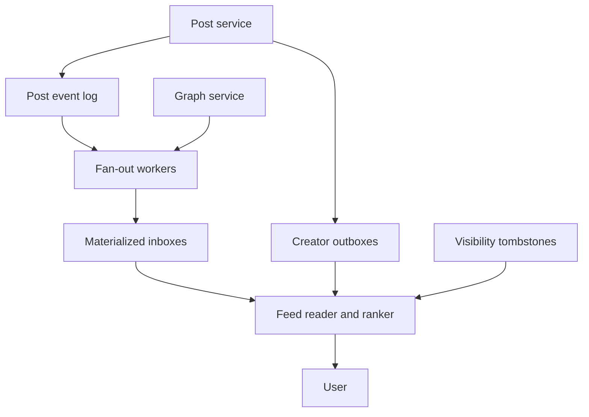

# Design a Personalized Social Home Feed

**Difficulty:** Senior / Staff  
**Primary themes:** fan-out, social graph, caching, ranking, pagination, hot creators, consistency, deletion, reliability  
**Interview time budget:** 40–45 minutes  
**Educational walkthrough:** intentionally more detailed than the live interview answer

This walkthrough uses the broad ordering from the public [Hello Interview System Design Delivery Framework](https://www.hellointerview.com/learn/system-design/in-a-hurry/delivery): requirements, core entities, APIs, a complete high-level design, and focused deep dives. The requirements, scale assumptions, dialogue, and architecture are original.

## Interviewer prompt

> Design the personalized home feed for a large social network. Users create posts, follow other users, and open a ranked feed containing recent posts from people they follow. The feed should load quickly, remain available during partial failures, and handle creators with hundreds of millions of followers.

Design the feed system and the post distribution path. Media upload, comments, direct messaging, ads, and model training can be treated as external systems.

## Targeted clarifying questions

**Candidate:** “Is the feed strictly chronological or ranked?”  
**Interviewer:** “Ranked, but recency is important. Explain how chronological ordering could be supported as a simpler mode.”

**Candidate:** “Which content sources are required?”  
**Interviewer:** “Only original posts and reshares from followed accounts. Recommended posts from outside the follow graph are out of scope.”

**Candidate:** “Do follows and posts have privacy controls?”  
**Interviewer:** “Yes. Accounts can be public or private, users can block each other, and posts can be public, followers-only, or deleted.”

**Candidate:** “How quickly should a new post appear?”  
**Interviewer:** “For normal creators, 95% of eligible followers should see it within five seconds. Very large creators may be merged when the follower reads.”

**Candidate:** “What does deletion mean?”  
**Interviewer:** “A deleted post must stop appearing in feeds globally within 60 seconds. Physical storage deletion can be asynchronous.”

**Candidate:** “What scale should I use?”  
**Interviewer:** “Assume 300 million daily active users, 100 million new posts per day, an average of 500 followed accounts, and 20 feed opens per active user per day. Peak traffic is five times average.”

**Candidate:** “How many items should a feed return?”  
**Interviewer:** “Twenty items per page with cursor pagination. Support roughly the most recent seven days of feed candidates.”

**Candidate:** “Should likes instantly reorder an already visible feed?”  
**Interviewer:** “No. Ranking signals can lag by seconds or minutes. Avoid severe reshuffling while the user paginates.”

### Scope restatement

> “I’ll design post creation, follow-graph reads, candidate distribution, ranked feed retrieval, cursor pagination, and deletion/privacy enforcement. I’ll start with a pull-based feed, then evolve to a hybrid design: fan out normal creators on write, but fetch high-fan-out creators on read. Ranking will operate on a bounded candidate set, and every serving layer will validate visibility before returning a post.”

---

## 1. Requirements (~5 minutes)

### Core functional requirements

1. **Publish and remove posts.** An authenticated user creates a post or reshare and may later delete it. Eligible followers should receive it according to current privacy and block rules.
2. **Read a ranked home feed.** An authenticated user requests stable cursor-paginated pages of recent eligible posts from followed accounts.
3. **Change the audience.** Follow, unfollow, block, and privacy changes must affect future feed reads; sensitive removals must bypass stale fan-out entries and caches.

### Quantified non-functional requirements

| Property | Target | Design implication |
|---|---:|---|
| Feed-read latency | p50 < 100 ms; p99 < 300 ms | Precomputed candidates, bounded ranking, cache-first hydration |
| Feed availability | 99.99% monthly | Multi-zone services and graceful fallback to cached candidates |
| Normal post propagation | 95% within 5 seconds | Asynchronous partitioned fan-out workers |
| Post-create durability | 99.999999% after success | Quorum write and transactional outbox |
| Deletion suppression | Globally within 60 seconds | Versioned tombstone/visibility filter after caches |
| Page size | 20 posts | Fetch and rank a bounded oversampled set |
| Feed horizon | 7 days of candidates | TTL and compaction on materialized inboxes |
| Ranking freshness | Engagement features within 1–5 minutes | Streaming feature updates; feed remains usable if stale |

### Scale estimates that change the design

Feed opens per day:

\[
300\text{M DAU} \times 20 = 6\text{B feed opens/day}
\]

Average feed-read rate:

\[
6\text{B} / 86{,}400 \approx 69{,}400\text{ reads/s}
\]

At 5× peak, that is about 350,000 feed reads/s. Each page returns 20 posts but may consider 500–2,000 candidate IDs. This is a read-heavy, latency-sensitive system.

Post creation averages:

\[
100\text{M posts/day} / 86{,}400 \approx 1{,}160\text{ posts/s}
\]

At 5× peak, roughly 6,000 posts/s seems modest. Fan-out changes the calculation. With 500 followers on average:

\[
100\text{M} \times 500 = 50\text{B candidate insertions/day}
\]

That is about 580,000 insertions/s average and several million/s at peak. Worse, a single creator with 100 million followers would create 100 million writes for one post. Therefore:

- pure pull-on-read is too expensive for users following hundreds of accounts;
- pure fan-out-on-write creates pathological bursts for high-fan-out creators;
- a **hybrid push/pull design** is the central architecture decision.

If each feed entry is 32 bytes—post ID, author ID, creation time, source, and flags—50 billion daily entries would be about 1.6 TB/day before replication and indexes. Seven-day retention with three replicas is practical but large, so feed entries store references, not complete post bodies.

### Consistency and availability contract

- A successful post create is durable before the API returns.
- The author receives read-your-writes for the post detail and their own feed through a write receipt or direct insertion.
- Followers’ feeds are eventually consistent: normal propagation target is five seconds, not a distributed transaction across followers.
- Feed entries are hints, not authorization. A final visibility check enforces current deletion, privacy, unfollow, and block state.
- Follow and unfollow are strongly ordered for one `(follower, followee)` edge. An unfollow may leave stale inbox entries, but they are filtered at read and removed asynchronously.
- Ranking and engagement counters are eventually consistent.
- Cursor pagination is stable relative to a declared feed session and candidate watermark, not a globally frozen social network.
- On dependency failure, prefer a slightly stale but privacy-safe feed over an error. Never prefer availability over a known block or deletion.

> **Say aloud:** “I separate candidate presence from visibility authority. Fan-out can be asynchronous and stale because the read path rechecks post state and relationship policy. That lets me keep feed generation available without leaking deleted or blocked content.”

---

## 2. Core entities (~2 minutes)

| Entity | Purpose |
|---|---|
| `User` | Account identity, privacy mode, status, and creator fan-out class |
| `FollowEdge` | Directed relationship from follower to followee with version and state |
| `Post` | Canonical content metadata, author, creation time, audience, and lifecycle state |
| `FeedEntry` | Lightweight candidate reference placed in a user’s materialized inbox |
| `CreatorOutbox` | Time-ordered recent posts for pull-on-read creators |
| `FeedCursor` | Opaque pagination state containing session and ranking boundaries |
| `VisibilityTombstone` | Fast suppression record for deleted or policy-blocked posts |
| `FeatureSnapshot` | Versioned ranking signals for a candidate and viewer |

> **Say aloud:** “The `Post` is canonical. A `FeedEntry` is a denormalized candidate reference that can be regenerated, expire, or be filtered. Keeping those concepts separate prevents the inbox cache from becoming the source of truth.”

---

## 3. API / system interface (~5 minutes)

### 3.1 Create a post

```http
POST /v1/posts
Authorization: Bearer <user token>
Idempotency-Key: mobile-draft-8c91
Content-Type: application/json

{
  "text": "A practical lesson from building distributed systems...",
  "media_ids": ["media_01K..."],
  "audience": "FOLLOWERS",
  "reshared_post_id": null
}
```

```json
{
  "post_id": "post_01K...",
  "author_id": "usr_42",
  "created_at": "2026-10-19T05:58:00Z",
  "state": "ACTIVE",
  "distribution_receipt": "dist_01K..."
}
```

The service derives `author_id` from authentication. The idempotency key is scoped to the authenticated author. Reusing it with a different request body returns `409 IDEMPOTENCY_KEY_REUSED`.

### 3.2 Read the home feed

```http
GET /v1/feed/home?limit=20&cursor=<opaque>
Authorization: Bearer <user token>
X-Feed-Session: optional-existing-session-id
```

```json
{
  "items": [
    {
      "post_id": "post_01K...",
      "author": {"user_id": "usr_42", "display_name": "Asha"},
      "created_at": "2026-10-19T05:58:00Z",
      "text": "A practical lesson from building distributed systems...",
      "viewer_state": {"liked": false},
      "rank_reason": "RECENT_FROM_FOLLOWED_ACCOUNT"
    }
  ],
  "next_cursor": "eyJzZXNzaW9uX2lkIjo...",
  "candidate_watermark": "2026-10-19T05:58:02Z",
  "ranking_version": "feed-ranker-417"
}
```

The cursor is signed and opaque. It includes a session ID, candidate cutoff, ranking model version, last sort key, and expiration—not a page number.

### 3.3 Follow and unfollow

```http
PUT /v1/users/{followee_id}/follow
Authorization: Bearer <user token>
If-Match: "edge-version-7"
```

```http
DELETE /v1/users/{followee_id}/follow
Authorization: Bearer <user token>
If-Match: "edge-version-8"
```

The authenticated user is always the follower. Private accounts may create a `PENDING` edge requiring approval.

### 3.4 Delete a post

```http
DELETE /v1/posts/{post_id}
Authorization: Bearer <user token>
If-Match: "post-version-3"
```

```json
{
  "post_id": "post_01K...",
  "state": "DELETED",
  "visibility_epoch": 551203,
  "suppression_deadline": "2026-10-19T06:03:00Z"
}
```

Only the author or an authorized moderation principal can delete. The API first commits canonical state and a tombstone outbox event; physical removal from feed inboxes is asynchronous.

### Interface-to-requirement mapping

| Requirement | Interface |
|---|---|
| Publish content | `POST /v1/posts` |
| Read ranked feed | `GET /v1/feed/home` |
| Change audience graph | follow/unfollow endpoints |
| Remove content | `DELETE /v1/posts/{post_id}` |

---

## 4. Data flow

### Normal creator post

1. Post service authenticates the author and commits the `Post` plus an outbox event.
2. Outbox relay publishes `PostCreated` to a replicated event log.
3. Fan-out coordinator reads follower IDs in pages from the graph service.
4. Partitioned workers insert lightweight entries into follower inbox shards.
5. Feed readers retrieve candidate IDs, rank them, hydrate post bodies, enforce visibility, and respond.

### High-fan-out creator post

1. Post service commits identically.
2. The creator is classified as pull-on-read.
3. The post enters the creator’s ordered outbox but is not copied to every follower inbox.
4. When a follower reads, the feed service merges recent posts from followed pull-on-read creators with their materialized inbox.

### Delete

1. Canonical post changes to `DELETED` in the same transaction as a tombstone outbox row.
2. Tombstone propagates through a high-priority stream to regional visibility filters and caches.
3. Read paths immediately suppress the post even if an inbox entry remains.
4. Cleanup workers remove feed entries, cached objects, search references, and eventually content bytes.



---

## 5. High-level design (~10–15 minutes)

### 5.1 Canonical post storage

Posts are partitioned by `author_id` and time, which supports author-profile reads and ordered outbox construction:

```text
Post(
  post_id,
  author_id,
  created_at,
  version,
  state,
  audience,
  text_blob_ref,
  media_ids,
  reshared_post_id,
  moderation_state,
  visibility_epoch
)

PostOutbox(
  event_id,
  post_id,
  author_id,
  event_type,
  created_at,
  publish_state
)
```

The post and outbox row commit atomically. The API returns after a quorum commits them, not after fan-out to every follower. A relay can publish the event repeatedly; downstream workers deduplicate by `event_id`.

Post bodies and media metadata are cached regionally. Large media bytes remain in object storage/CDN and are not copied into feed entries.

### 5.2 Social graph service

The graph supports two dominant queries:

- list whom user U follows;
- page through followers of creator C.

Store both edge directions because deriving the reverse at fan-out time is too expensive:

```text
FollowingEdge(
  follower_id,
  followee_id,
  edge_version,
  state,
  created_at,
  updated_at
)

FollowerEdge(
  followee_id,
  follower_id,
  edge_version,
  state,
  created_at,
  updated_at
)
```

One direction is authoritative and the reverse is maintained through an atomic transaction when co-located or a durable outbox plus reconciliation when partitioned. Reads always validate active edge state from a versioned cache or graph store before returning sensitive content.

Facebook’s TAO paper describes a read-optimized, geographically distributed store for a social graph using a fixed set of object and association queries. It is a useful example of optimizing graph storage around known access patterns rather than exposing arbitrary graph traversal. See [TAO: Facebook’s Distributed Data Store for the Social Graph](https://www.usenix.org/conference/atc13/technical-sessions/presentation/bronson).

### 5.3 Baseline: pull every followed outbox on read

The simplest correct design is fan-out-on-read:

1. fetch the 500 followed accounts;
2. fetch the most recent N posts from each author;
3. merge by time;
4. rank and return 20.

This avoids write amplification and handles high-fan-out creators naturally. It fails at read latency: 500 remote reads plus a large merge for every feed request cannot meet p99 reliably.

We can batch author-outbox reads by shard, but users following thousands of accounts still create wide fan-out. That motivates precomputed inboxes.

### 5.4 Materialized feed inbox

For normal creators, asynchronous workers insert:

```text
FeedEntry(
  viewer_id,
  candidate_time,
  post_id,
  author_id,
  source_type,
  author_post_sequence,
  fanout_event_id,
  expires_at
)
```

Partition by `viewer_id`. Within a viewer, cluster by descending `candidate_time`. The insertion is idempotent on `(viewer_id, fanout_event_id)` or `(viewer_id, post_id, source_type)`.

Entries expire after seven days. The inbox stores perhaps the newest 2,000–10,000 candidate IDs per active user, depending on activity. It is not the final ranked order; it is a bounded candidate reservoir.

Fan-out workers process follower pages independently. They checkpoint `(event_id, follower_page_cursor)` and use at-least-once delivery. If a worker crashes, a page may be replayed, but idempotent insertion prevents duplicate effect.

### 5.5 Hybrid fan-out classification

Classify creators using follower count, post rate, follower activity, and current system load:

- **push class:** fan out to active followers;
- **hybrid class:** push to highly active or close followers, pull for others;
- **pull class:** store only in creator outbox and merge on read.

Do not use one fixed celebrity threshold forever. Estimate expected work:

\[
pushCost \approx activeFollowers \times postsPerDay
\]

\[
pullCost \approx activeFollowers \times feedReadsPerDay \times mergeCost
\]

Choose the lower cost subject to propagation and latency budgets. Recompute the class periodically and version it. A post event records the chosen distribution policy so workers do not change behavior halfway through one fan-out.

Twitter has publicly described a timeline cache written by Timeline and Fanout services and backed by a customized Redis structure, illustrating the value of materialized timeline candidates in a large social system. See [The Infrastructure Behind Twitter: Scale](https://blog.x.com/engineering/en_us/topics/infrastructure/2017/the-infrastructure-behind-twitter-scale).

### 5.6 Feed read and candidate merge

On a feed request:

1. read 500–1,000 newest candidate IDs from the viewer’s materialized inbox below the cursor cutoff;
2. fetch the viewer’s followed pull-class creators from a cached graph-derived set;
3. batch-read recent outbox posts for those creators;
4. merge and deduplicate by canonical post ID;
5. filter tombstones, inactive follow edges, blocks, audience, and moderation state;
6. retrieve ranking features in batch;
7. rank and apply diversity constraints;
8. hydrate roughly 30 top posts to survive last-mile filtering;
9. return 20 and a signed cursor.

The pull-class set must be bounded. If a user follows thousands of celebrity accounts, maintain a per-viewer pull-source summary or merge a shared celebrity stream rather than issue thousands of reads.

### 5.7 Multi-stage ranking

Ranking all seven days of content is unnecessary. Use stages:

1. **Retrieval:** 500–2,000 recent eligible candidates.
2. **Light ranker:** cheap features reduce to perhaps 200.
3. **Heavy ranker:** a more expressive model scores 200.
4. **Policy/diversity pass:** limit repeated authors, reshares, or content types.
5. **Hydration:** fetch complete data for about 30 and return 20.

Candidate features might include:

- post age;
- viewer-author affinity;
- prior viewer engagement with the author;
- post engagement velocity and quality;
- content type preference;
- negative feedback;
- reshare duplication;
- whether the post was already seen.

Hard privacy and deletion checks are not model features; they are mandatory filters.

Meta has described News Feed ranking as a multi-stage prediction problem and has separately described client-side reranking of server-provided stories. Those are useful examples of separating candidate supply, ranking, and presentation. See [News Feed ranking, powered by machine learning](https://engineering.fb.com/2021/01/26/ml-applications/news-feed-ranking/) and [Client-side ranking](https://engineering.fb.com/2016/10/20/networking-traffic/client-side-ranking-to-more-efficiently-show-people-stories-in-feed/).

### 5.8 Caching

Use distinct caches for distinct consistency needs:

- `PostCache(post_id, post_version)` for immutable or versioned post bodies;
- `InboxHeadCache(viewer_id)` for recent candidate IDs;
- `GraphCache(viewer_id, graph_epoch)` for follows and blocks;
- `FeatureCache(entity_id, feature_version)` for ranking features;
- `TombstoneCache(post_id, visibility_epoch)` for mandatory suppression;
- `FeedPageCache(viewer_id, session_id, cursor)` only for short-lived retries.

Do not cache a fully personalized first page globally. Cache underlying candidate and object data, because viewer state, follows, blocks, seen history, and experiments fragment the key space.

### End-to-end request trace

Suppose creator A has 20,000 active followers and creates post P:

1. Post service commits P and outbox event E, then returns success.
2. Distribution planner classifies A as push and emits follower-page tasks.
3. Workers write P into follower inboxes. Duplicate task delivery is harmless.
4. Viewer V opens the feed two seconds later. Their inbox already includes P.
5. Feed service merges V’s materialized inbox with recent posts from two pull-class creators.
6. Visibility service confirms P is active, V still follows A, and neither has blocked the other.
7. Ranker places P fourth. Hydrator fetches its post body and returns it.
8. A deletes P. The canonical update and tombstone commit together.
9. Within seconds, regional visibility caches learn the tombstone. P remains physically present in V’s inbox but is never returned again.
10. Cleanup later removes P’s inbox references.

> **Say aloud:** “The critical insight is that feed entries are disposable references. Canonical post state and current relationship policy decide visibility, so asynchronous fan-out and lazy cleanup cannot leak deleted content.”

---

## 6. Deep dives (~10–15 minutes)

Choose two or three in an interview. This walkthrough includes four.

### Deep dive A: fan-out strategy and the celebrity problem

#### Where pure push breaks

A creator with 100 million followers can create 100 million inbox writes from one post. If the creator posts during a major event, the fan-out queue grows rapidly, competes with normal creators, and may take minutes or hours to drain. Many writes are wasted on inactive followers who may never open the feed.

#### Where pure pull breaks

A user following 500 accounts would require wide graph and outbox reads at every feed open. Tail latency becomes the maximum of many dependencies, and repeated readers redo the same merge work.

#### Compare approaches

| Strategy | Write cost | Read cost | Main failure |
|---|---:|---:|---|
| Push all | High, follower-count dependent | Low | Celebrity write explosion |
| Pull all | Low | High, follow-count dependent | Wide read fan-out |
| Hybrid by creator | Moderate | Moderate | Classification and merge complexity |
| Hybrid by viewer activity | Lower wasted writes | Moderate | More routing metadata |

Choose hybrid by creator plus viewer activity.

For normal creators, push only to recently active followers. An inactive follower’s first return can backfill candidates by pulling recent author outboxes. For celebrity creators, pull on read. For medium creators, push to frequently interacting followers and pull for the rest.

#### Fan-out queue isolation

Partition fan-out tasks by creator class and follower-page hash. Apply weighted scheduling:

- normal creators receive protected capacity;
- high-fan-out creators receive capped bandwidth;
- deletion/tombstone propagation has a separate high-priority lane;
- retries use jitter and dead-letter diagnostics;
- per-event backlog age drives autoscaling.

This prevents one viral account from starving ordinary posts.

#### Transitions between classes

A creator may become popular suddenly. Stamp every `PostCreated` event with `distribution_policy_version` and one selected mode. Do not switch the same event from push to pull halfway without a reconciliation plan, or some followers may receive duplicates while others miss it.

Duplicates are still possible during policy migration. Feed read deduplicates by canonical `post_id`. Missing push entries are repaired by the pull merge or a fan-out reconciler.

#### Observability

Track:

- propagation latency by creator class;
- candidate writes per post;
- fan-out backlog age and retry rate;
- active-follower hit rate;
- pull-source merge count and latency;
- posts missing from sampled expected follower inboxes;
- cost per delivered and per viewed candidate.

> **Say aloud:** “The correct threshold is economic and dynamic, not merely a follower count. I compare expected push writes against expected pull reads, then isolate high-fan-out work so one creator cannot consume the entire distribution fleet.”

### Deep dive B: stable pagination in a changing ranked feed

#### Where offset pagination breaks

With `page=2`, new posts inserted before page 1 shift offsets. The user sees duplicates or misses posts. Ranking changes have the same effect even without new posts.

#### Cursor contract

Create a short-lived feed session on the first page:

```text
FeedSession(
  session_id,
  viewer_id,
  candidate_cutoff_time,
  inbox_watermark,
  graph_epoch,
  ranking_version,
  experiment_bucket,
  seen_set_ref,
  expires_at
)
```

The signed cursor includes:

- `session_id`;
- last returned rank key;
- candidate cutoff time;
- model version;
- page sequence;
- expiration.

Newer posts after `candidate_cutoff_time` wait for refresh rather than appearing halfway through pagination. The session maintains a compact seen set, such as exact IDs for the few hundred items in one session. The next page excludes seen IDs even if ranking signals changed.

#### Snapshot choices

| Choice | Stability | Storage | Freshness |
|---|---:|---:|---:|
| Recompute every page | Low | Low | High |
| Store complete ranked list | High | High | Fixed |
| Pin watermarks + seen set | Good | Moderate | Good |

Choose watermarks plus a seen set. It avoids storing a full personalized list for every session but offers understandable stability. The model version is pinned for the session; features may be read at a bounded watermark.

If the session expires, return `410 CURSOR_EXPIRED` and let the client refresh. Do not silently interpret an old cursor against a new model and graph epoch.

#### Deletion during a session

Deletion overrides session stability. A deleted or newly blocked post disappears even if it was in the session candidate set. The service fetches extra candidates so it can still return close to 20 items.

#### Read-your-writes

The author’s new post may not be present in their materialized inbox yet. The create response carries a distribution receipt. For a short period, the feed service can merge the viewer’s own recent posts directly or wait briefly until the inbox watermark covers the receipt.

> **Say aloud:** “I do not promise a frozen world. I promise that one short feed session has a fixed candidate cutoff and model version, excludes already returned IDs, and still honors live deletion and privacy changes.”

### Deep dive C: deletion, unfollow, block, and cache consistency

#### Where eager cleanup breaks

One deleted post may exist in millions of inboxes, page caches, object caches, and ranking stores. Waiting to synchronously remove every reference makes the delete API slow and unreliable. Treating cache invalidation as perfect risks showing the post after deletion.

#### Selected two-layer deletion

1. **Logical suppression:** commit `Post.state=DELETED`, increment `visibility_epoch`, and append a tombstone event atomically.
2. **Physical cleanup:** asynchronously remove feed entries, cached bodies, search indexes, media references, and eventually storage bytes.

Every feed response passes candidate IDs through a regional visibility filter after candidate caches. The filter uses:

- pushed tombstones in memory;
- a compact bloom filter to identify possible tombstones;
- an exact versioned tombstone map or canonical lookup on positive bloom matches;
- a maximum safety lease for the tombstone stream.

A bloom filter alone cannot authorize visibility because it has false positives and, if stale, can miss new deletions. It is an optimization for exact lookups.

#### Relationship changes

Unfollow and block update an authoritative edge version. They publish invalidations to graph caches and a cleanup stream. Feed reads verify:

```text
follow_state == ACTIVE
and follower_edge_version >= required_version
and no block in either direction
and post.audience permits viewer
```

For public posts, product semantics may allow a post to remain after unfollow only if recommendations are in scope; here they are not, so unfollow filters it.

Block is stricter than unfollow. It should enter the same high-priority invalidation channel as deletion and may fail closed if current state cannot be established.

#### Cache keys and versions

Post bodies use `(post_id, post_version)`, so a deleted post’s previous body may remain physically cached but is never selected without passing visibility. Graph caches carry `graph_epoch`. Feed-page caches have very short TTLs and are filtered again before response serialization.

#### Failure modes

- **Tombstone stream lag:** alert before the 60-second SLO; stale servers fail closed for candidate IDs newer than their safety watermark or query canonical state.
- **Graph cache invalidation lost:** TTL plus edge-version validation and reconciliation.
- **Cleanup backlog:** serving remains correct; storage cost increases.
- **Canonical post store unavailable:** serve only candidates covered by a sufficiently fresh safe snapshot, or return a partial feed.
- **Region isolated from policy plane:** safety lease expires; affected content classes fail closed.

Track maximum tombstone age by region, post-delete impressions, stale-edge filter counts, cleanup backlog bytes, and block propagation latency.

> **Say aloud:** “Deletion correctness comes from a negative authority checked after caches, not from successfully deleting every positive copy. Cleanup controls storage; tombstones control visibility.”

### Deep dive D: reliability, backpressure, and graceful degradation

#### Failure domains

Separate these planes:

- post acceptance;
- distribution/fan-out;
- feed candidate retrieval;
- ranking/features;
- visibility policy;
- hydration/media.

A ranker outage should not stop post creation. A fan-out delay should not erase posts. A media outage should allow text-only placeholders when permitted.

#### Graceful degradation order

For a feed read:

1. normal ranked hybrid feed;
2. lightweight ranker using recency and affinity;
3. chronological eligible materialized inbox plus pull-class merge;
4. cached last safe candidate page, refiltered for current visibility;
5. partial feed rather than unbounded latency.

Never degrade by bypassing deletion, block, or audience checks.

#### Backpressure

Fan-out workers expose lag to the planner. When overloaded:

- preserve the durable post event;
- slow high-fan-out and inactive-follower writes first;
- retain protected capacity for normal creators and tombstones;
- reduce the active-follower horizon temporarily;
- pull missing content on read;
- apply bounded retries with jitter.

Feed readers use tight deadlines and bulkheads. A slow feature store receives a few milliseconds before fallback. Circuit breakers prevent retry storms. Hedged requests are reserved for idempotent high-percentile reads and sent only after a latency threshold, not immediately.

#### Multi-region strategy

Assign each user a home region for post and graph mutations, synchronously replicated across availability zones. Replicate posts and graph changes asynchronously to other regions. Feed reads occur near the viewer and consume replicated data.

Post-create receipt provides read-your-writes when the author travels or fails over. For catastrophic regional loss, state an explicit target such as RPO under 60 seconds and RTO under 15 minutes; premium or critical moderation state may use cross-region quorum.

#### Correctness invariants

Continuously test:

1. every accepted active post has a canonical record and durable distribution event;
2. a feed never returns a deleted post at or beyond the suppression deadline;
3. a blocked pair never produces an impression after the block deadline;
4. duplicate fan-out events create one logical inbox candidate;
5. pull and push sources deduplicate by canonical post ID;
6. cursor pages do not repeat IDs within a session;
7. distribution lag and graph/tombstone watermarks are externally visible.

Run a shadow recomputation on sampled users: rebuild expected candidates from graph and creator outboxes, compare with inbox contents, and repair missing or excess entries.

---

## 7. Final design

### Concise architecture

- The post service commits canonical post state and a transactional outbox event to a quorum-replicated store.
- The social graph stores both following and follower directions, optimized for known access patterns and versioned per edge.
- A distribution planner selects push, hybrid, or pull mode using active follower count, post rate, reader activity, and load.
- Normal creator posts are asynchronously inserted as lightweight references into viewer-partitioned inboxes.
- High-fan-out creator posts remain in ordered creator outboxes and are batch-merged during reads.
- Feed reads combine inbox and pull candidates, deduplicate, apply current deletion/privacy/block filters, rank a bounded set, hydrate top posts, and return signed cursor pagination.
- Short feed sessions pin candidate cutoff, graph/ranking watermarks, and a seen set to avoid duplicates and severe reshuffling.
- Logical tombstones and relationship epochs enforce removals after every cache; physical cleanup is asynchronous.
- Ranking, feature, fan-out, and media failures degrade independently, while mandatory visibility checks never degrade open.

### Requirements check

| Requirement | How it is met |
|---|---|
| Durable post creation | Quorum commit of post plus transactional outbox |
| Normal propagation under 5 seconds | Partitioned active-follower fan-out workers |
| Celebrity scalability | Pull-on-read creator outboxes and hybrid classification |
| Feed p99 under 300 ms | Materialized inbox, bounded source merge, staged ranking, batch hydration |
| Ranked results | Retrieval, light ranker, heavy ranker, diversity pass |
| Cursor pagination | Signed session cursor, cutoff watermark, model pin, seen set |
| Delete within 60 seconds | High-priority tombstone stream and post-cache visibility filter |
| Unfollow/block correctness | Versioned graph edges checked during read |
| Availability | Multi-zone replicas and ranked-to-chronological fallbacks |
| Idempotent fan-out | Event IDs and conditional inbox insertions |
| Observability | Propagation, watermark, tombstone, cache, ranker, and invariant metrics |

### A strong 90-second summary to say aloud

> “I keep canonical posts separate from feed candidates. Post creation commits the post and an outbox event atomically, then returns without waiting for millions of followers. For ordinary creators, partitioned workers push lightweight post references into active followers’ viewer-sharded inboxes. Pure push fails for celebrity accounts, so high-fan-out creators stay in ordered creator outboxes and their recent posts are merged on read. The planner chooses push, pull, or hybrid using expected write and read cost.
>
> “A feed read combines the materialized inbox with a bounded number of pull sources, deduplicates by post ID, enforces current deletion, audience, follow, and block state, then runs multi-stage ranking and batch hydration. A short feed session pins a candidate cutoff and ranker version and tracks seen IDs, giving stable cursor pagination without freezing the world.
>
> “Feed entries are disposable hints, not authorization. Deletes create high-priority versioned tombstones checked after every cache, so the post disappears within the safety SLO even while physical inbox cleanup continues. Ranking or feature failure degrades to a recency-based feed; fan-out lag falls back to pull; none of those paths bypass privacy.”

---

## Interviewer follow-up questions with strong sample answers

### 1. Why not always fan out when a post is created?

**Candidate:** “It makes reads fast, but one celebrity post can cause 100 million writes, most to inactive users. I fan out normal creators and pull high-fan-out creators on read, with a dynamic cost-based threshold.”

### 2. Why not always assemble the feed on read?

**Candidate:** “A typical viewer follows hundreds of accounts. Fetching and merging every author outbox creates broad fan-out and poor tail latency on every open. Materialized inboxes amortize that work.”

### 3. How do you prevent duplicate posts when one source is pushed and another is pulled?

**Candidate:** “Every source carries the canonical `post_id`. The merge deduplicates on that ID before ranking. Fan-out inserts are also idempotent on viewer and event ID.”

### 4. What happens when a user unfollows someone?

**Candidate:** “The edge changes authoritatively and receives a higher version. Existing inbox entries may remain temporarily, but read-time relationship filtering removes them immediately. Cleanup deletes the stale candidates later.”

### 5. How can deletion be fast if a post exists in millions of inboxes?

**Candidate:** “I do not wait to erase every positive reference. I commit a logical tombstone and distribute it through a high-priority path. Every response checks that negative authority after caches. Physical cleanup is independent.”

### 6. Why not cache the first personalized page?

**Candidate:** “Viewer identity, follows, blocks, seen state, experiments, and ranking features create a huge fragmented key space. I cache reusable candidates, posts, graph state, and features, then assemble the page. A short session page cache can help retries.”

### 7. How do you paginate while new posts arrive?

**Candidate:** “The first page creates a session with a candidate cutoff, ranking version, and seen set. Newer posts wait for refresh. Later pages query below the cutoff and exclude seen IDs, while live deletions still override the session.”

### 8. What if the ranking service is unavailable?

**Candidate:** “Fall back to a lightweight ranker using recency and affinity, then to chronological eligible candidates. Visibility filters remain mandatory. Feed quality falls, but feed availability and privacy remain.”

### 9. What if fan-out is delayed for ten minutes?

**Candidate:** “The canonical post and event are durable. Feed reads can pull recent outboxes for lagging sources, and a reconciler repairs missing inbox entries. I expose propagation watermarks so the product can label or investigate freshness.”

### 10. How do you rank a feed with millions of possible posts?

**Candidate:** “I never score all posts. Retrieval produces a recent set of hundreds or a few thousand from the inbox and pull sources. A light model narrows it, a heavier model scores perhaps 200, and a diversity pass selects the final page.”

### 11. How do you stop one viral creator from starving fan-out for everyone else?

**Candidate:** “Classify high-fan-out creators into a separate queue and cap their bandwidth. Use weighted scheduling with protected capacity for normal creators and a separate high-priority lane for tombstones.”

### 12. Does a follower see a post if the follow happens after the post was created?

**Candidate:** “Define the product rule explicitly. I would backfill a bounded number of recent eligible posts from the creator outbox when the follow becomes active, rather than replaying historical fan-out.”

### 13. How do private accounts affect fan-out?

**Candidate:** “Only an approved active edge qualifies. The distribution worker may use an edge snapshot for efficiency, but the read path revalidates the current edge before display. Revocation therefore does not depend on inbox cleanup.”

### 14. How do you verify that feeds are correct?

**Candidate:** “Sample users and recompute expected candidates independently from graph edges and creator outboxes. Compare that with inbox contents, test no deleted or blocked impressions after deadlines, and reconcile missing or extra entries.”

---

## Common pitfalls

1. Choosing pure fan-out-on-write without addressing celebrity accounts.
2. Choosing pure fan-out-on-read without calculating read fan-out.
3. Storing full post bodies in every user inbox.
4. Treating feed entries as the source of truth for privacy.
5. Waiting for complete fan-out before acknowledging post creation.
6. Assuming exactly-once queue delivery instead of idempotent inbox writes.
7. Using offset pagination in a changing ranked list.
8. Letting model or feature updates reshuffle a pagination session completely.
9. Deleting millions of inbox rows synchronously before suppressing a post.
10. Relying only on cache invalidation for deletion correctness.
11. Forgetting that unfollow and block must filter already-fanned-out entries.
12. Querying one post or one feature at a time during hydration.
13. Allowing one viral creator to monopolize fan-out workers.
14. Caching personalized pages without accounting for privacy and seen state.
15. Failing the entire feed when ranking or engagement features are unavailable.
16. Using engagement as a substitute for hard safety policy.
17. Omitting version and watermark metadata from observability.
18. Keeping inactive-user inboxes warm indefinitely instead of backfilling on return.

---

## Interview pacing guide

| Minute | What to cover |
|---:|---|
| 0–5 | Ranked vs chronological, sources, privacy, scale, propagation, deletion |
| 5–7 | User, follow edge, post, feed entry, outbox, cursor, tombstone |
| 7–12 | Create, read-feed, follow/unfollow, delete APIs |
| 12–24 | Post store, graph, pull baseline, materialized inbox, hybrid fan-out, ranking |
| 24–35 | Deep dive into celebrity handling plus pagination or deletion |
| 35–40 | Reliability, degradation, observability, regional behavior |
| 40–45 | Requirements check and closing summary |

If time is short, keep model details brief. Do not omit the hybrid fan-out calculation, cursor stability contract, or tombstone-after-cache visibility check; those are the highest-signal decisions.

## Public references

- [Hello Interview — System Design Delivery Framework](https://www.hellointerview.com/learn/system-design/in-a-hurry/delivery)
- [TAO: Facebook’s Distributed Data Store for the Social Graph](https://www.usenix.org/conference/atc13/technical-sessions/presentation/bronson)
- [Engineering at Meta — TAO: The power of the graph](https://engineering.fb.com/2013/06/25/core-infra/tao-the-power-of-the-graph/)
- [Twitter Engineering — The Infrastructure Behind Twitter: Scale](https://blog.x.com/engineering/en_us/topics/infrastructure/2017/the-infrastructure-behind-twitter-scale)
- [Engineering at Meta — News Feed ranking, powered by machine learning](https://engineering.fb.com/2021/01/26/ml-applications/news-feed-ranking/)
- [Engineering at Meta — Client-side ranking](https://engineering.fb.com/2016/10/20/networking-traffic/client-side-ranking-to-more-efficiently-show-people-stories-in-feed/)
- [USENIX OSDI — FlightTracker: Consistency across Read-Optimized Online Stores at Facebook](https://www.usenix.org/conference/osdi20/presentation/shi)

These references support the delivery structure and examples of social-graph, timeline-cache, ranking, and cache-consistency systems. The requirements, scale assumptions, APIs, hybrid policy, consistency contract, dialogue, and final architecture are original.

