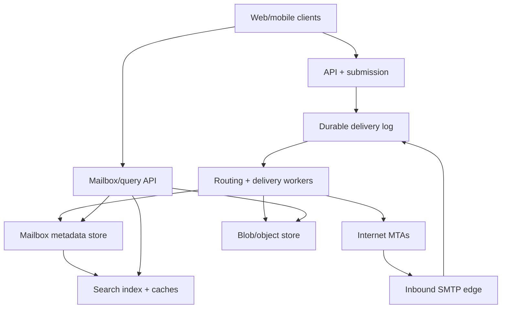
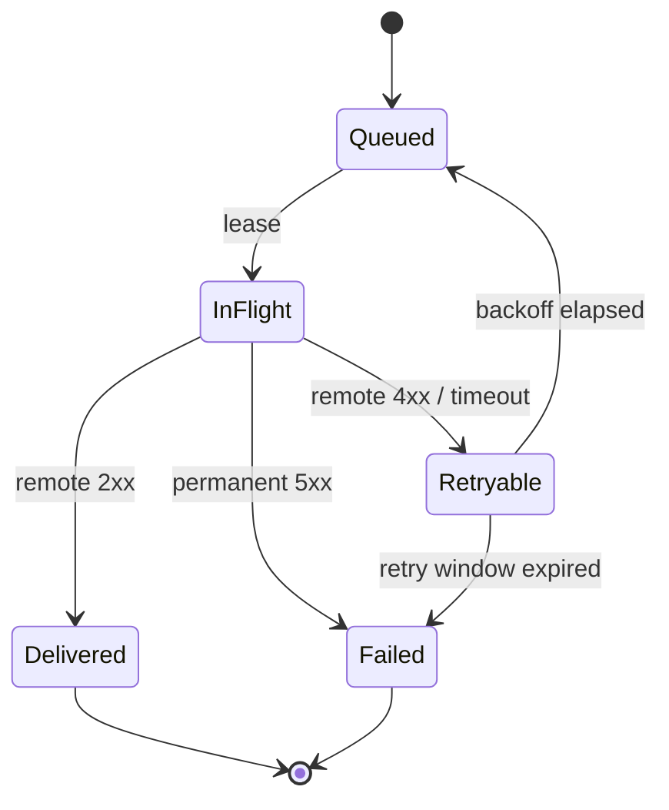

# Design a Planet-Scale Email Service

**Difficulty:** Senior/Staff  
**Primary themes:** durable queues, mailbox storage, SMTP delivery, indexing, caching, idempotency, abuse prevention, multi-region reliability

This is a detailed study walkthrough for a 45–60 minute interview. The time labels describe what to prioritize aloud; the written version intentionally goes deeper so the design choices and failure semantics are clear.

## Interviewer prompt

> Design an email service similar to Gmail. Users should be able to send and receive email, view threaded mailboxes, search recent and historical messages, manage labels and read state, and exchange mail with external providers.

## Targeted clarifying questions with assumed answers

**Candidate:** Are we building the web/mobile client, the backend, or the public mail protocol too?

**Interviewer:** Focus on the backend. Include authenticated client APIs and SMTP ingress/egress to other providers. You may treat DNS as external infrastructure.

**Candidate:** Which product operations are essential?

**Interviewer:** Send a message with attachments, receive local and external mail, list/read threaded mailboxes, search, and change mutable state such as labels, read/unread, archive, and trash.

**Candidate:** Do we need drafts, contacts, calendars, end-to-end encryption, or marketing-campaign sending?

**Interviewer:** Drafts are optional. Contacts and calendars are out of scope. Encrypt stored data, but user-managed end-to-end encryption is out of scope. Bulk campaign infrastructure is separate and should not be allowed to dominate consumer mail.

**Candidate:** What scale should I assume?

**Interviewer:** 500 million registered users, 100 million daily active users, 1 billion newly submitted messages per day, and 5 billion recipient deliveries per day after fanout. Traffic peaks at roughly ten times the average. Average headers plus body are 40 KB; 10% of messages have attachments averaging 1 MB.

**Candidate:** What are the latency and reliability targets?

**Interviewer:** API submission under 300 ms p99, local-provider delivery under 2 seconds p99, mailbox-list reads under 200 ms p99, and search freshness under 60 seconds. Do not lose an accepted message. The user-facing API and SMTP ingress should target 99.99% availability.

**Candidate:** What exactly does successful send mean?

**Interviewer:** It means the service durably accepted responsibility for the message. It does not mean every external recipient has received it. The sender should see per-recipient delivery status and eventually receive a failure notification for permanent failures.

**Candidate:** Is exactly-once delivery required?

**Interviewer:** Prevent duplicates inside our system. Across SMTP, provide best effort: ambiguous network outcomes mean a remote provider can receive a retry twice.

**Candidate:** How should consistency work?

**Interviewer:** Users should read their own sends and mailbox mutations immediately in their home region. Search may lag by up to 60 seconds. Message ordering need only be stable within one mailbox; no global total order is required.

**Candidate:** How long is data retained?

**Interviewer:** Keep active mail until users delete it. Trash is recoverable for 30 days. Legal holds can prevent physical deletion. Spam may have a shorter retention policy.

> **What I would say aloud:** “I will separate submission, delivery, mailbox projection, and search. Submission success transfers responsibility to us; each recipient then advances through an independent delivery state machine. That distinction will keep retries honest.”

---

## 1. Requirements (~5 minutes)

The organization follows the Hello Interview-style delivery progression: establish requirements, entities, and interfaces; build the simplest complete design one operation at a time; then harden the load-bearing areas. This mirrors the public [System Design Delivery Framework](https://www.hellointerview.com/learn/system-design/in-a-hurry/delivery). genui{"citation":{"ref":"turn172search0"}}

### Core functional requirements

1. **Submit and deliver mail.** Authenticated users send messages to local or external recipients; the system tracks each recipient independently and generates failure notifications.
2. **Receive and read mail.** Accept external SMTP traffic, deliver local copies, and let users list threads and retrieve messages and attachments.
3. **Search and manage mailbox state.** Search messages and update labels, archive/trash state, starred state, and read/unread state.

### Quantified non-functional requirements

| Requirement | Target | Design implication |
|---|---:|---|
| Submission traffic | 1B messages/day; 10× peak | Horizontally sharded submission service and durable log |
| Fanout traffic | 5B recipient deliveries/day; 10× peak | Recipient-level work items and idempotent workers |
| Latency | submit p99 < 300 ms; local delivery p99 < 2 s | Accept after durable metadata/outbox commit; asynchronous fanout |
| Read/search | mailbox p99 < 200 ms; search freshness < 60 s | Per-user mailbox shards, cache, asynchronous inverted index |
| Durability/availability | no accepted-message loss; 99.99% APIs and SMTP ingress | Multi-AZ replication, durable spool, replayable queues |
| Isolation/security | tenant/user isolation, encrypted data, abuse resistance | Auth-derived identity, scoped storage, scanning and rate limits |

### Scope

In scope: authenticated send, SMTP receive/send, immutable message content, attachments, mailbox folders/labels, threads, search, delivery status, spam/malware hooks, deletion, legal hold, multi-region recovery, and observability.

Out of scope: contact management, calendars, advertising, newsletter authoring, end-to-end user-managed keys, sophisticated ranking of promotional mail, and implementation details of DNS.

### Consistency and availability contract

- **Submission acknowledgement:** `202 Accepted` means envelope, immutable content references, sender copy, and a durable outbox record are committed in a replicated transaction. The service owes either delivery attempts or a terminal status.
- **Internal idempotency:** one `(sender_id, idempotency_key)` creates at most one logical message. One `(message_id, recipient_id)` creates at most one local mailbox item.
- **External delivery:** at least once at the protocol boundary. A timeout after a remote SMTP server accepts `DATA` is ambiguous, so a retry may duplicate mail. A stable `Message-ID` helps recipients deduplicate, but cannot guarantee exactly once.
- **Mailbox consistency:** read-your-writes for send, label, read, archive, and trash operations in the user's home region. Cross-device sessions can carry a mailbox change sequence.
- **Search consistency:** asynchronous, target under 60 seconds. Results report an index watermark; exact lookup by message ID can use the primary mailbox store immediately.
- **Ordering:** stable order by server-assigned mailbox sequence and received time. Client `Date` headers are displayed but not trusted for consistency.
- **Availability during failure:** accepted mail remains durable. When a recipient's home shard or external domain is unavailable, queue it and retry; do not turn dependency failure into silent loss.

> **What I would say aloud:** “The strongest contract is on durable acceptance, not instant external delivery. SMTP itself is store-and-forward, so the product must expose queued, delivered, temporary-failure, and permanent-failure states rather than collapse them into a single ‘sent’ boolean.”

### Scale estimates that affect architecture

Average rates:

- `1B submissions/day ÷ 86,400 ≈ 11,600 submissions/s`; 10× peak is about `116,000/s`.
- `5B deliveries/day ÷ 86,400 ≈ 58,000 deliveries/s`; 10× peak is about `580,000/s`.
- Message bodies: `1B × 40 KB ≈ 40 TB/day` before compression and replication.
- Attachments: `100M × 1 MB ≈ 100 TB/day` before deduplication and replication.
- Mailbox metadata: `5B recipient copies × 1 KB ≈ 5 TB/day`.

The body and attachments must be stored once and referenced by many mailbox items; duplicating a 1 MB attachment for five recipients would multiply the dominant storage cost. Recipient metadata still fans out because labels, read state, spam classification, and deletion are user-specific.

Peak submission traffic is manageable with thousands—not millions—of partitions, but the workload is skewed: popular domains and large group aliases can create hot fanout. Partition keys must include recipient/user or destination domain rather than message ID alone.

---

## 2. Core entities (~2 minutes)

- **Account** — user identity, primary address, aliases, home region, quota.
- **Message** — immutable headers/body metadata, sender, globally unique ID, content hashes.
- **ContentBlob** — immutable MIME body or attachment stored by content reference.
- **EnvelopeRecipient** — one recipient's routing and delivery state.
- **MailboxItem** — user-specific reference to a message with mailbox sequence and mutable state.
- **Thread** — user-specific conversation projection and latest-message summary.
- **Label** — system or user-created mailbox classification.
- **DeliveryAttempt** — leased attempt, destination, response code, next retry, and terminal result.
- **SearchDocument** — derived searchable projection.
- **IdempotencyRecord** — maps client retries to the original submission result.
- **ChangeLogEntry** — monotonic per-mailbox change used by clients, caches, and indexers.

> **What I would say aloud:** “Message content is immutable and shared, but mailbox membership is mutable and belongs to one user. Separating those entities avoids copying large bodies while preserving independent labels and deletion.”

---

## 3. API and system interfaces (~5 minutes)

Client APIs use TLS and OAuth/session tokens. The gateway derives the account and permitted sender aliases from authentication. A caller cannot choose an arbitrary authoritative `sender_user_id`.

### 3.1 Submit a message

Large attachments are uploaded first through scoped, short-lived URLs. Final submission references verified blobs.

```http
POST /v1/messages:send
Authorization: Bearer <token>
Idempotency-Key: 8dc8c593-...
Content-Type: application/json

{
  "from_alias": "rahul@example.com",
  "to": ["local@example.com", "friend@external.net"],
  "cc": [],
  "bcc": [],
  "subject": "Project update",
  "body": {"content_type": "text/plain", "blob_id": "blob_body_7"},
  "attachments": [
    {"blob_id": "blob_att_9", "filename": "report.pdf"}
  ],
  "in_reply_to": "<prior-message-id@example.com>"
}
```

```json
{
  "message_id": "msg_01JAF...",
  "internet_message_id": "<msg_01JAF...@example.com>",
  "status": "ACCEPTED",
  "mailbox_change_seq": 8810042,
  "recipients": [
    {"address": "local@example.com", "status": "QUEUED"},
    {"address": "friend@external.net", "status": "QUEUED"}
  ]
}
```

The same idempotency key and same request hash returns the original response. Reusing the key with different content returns `409 Conflict`.

### 3.2 List threads and retrieve messages

```http
GET /v1/threads?label=INBOX&limit=50&cursor=<opaque>
Authorization: Bearer <token>
```

```json
{
  "threads": [
    {
      "thread_id": "thr_81",
      "subject": "Project update",
      "participants": ["rahul@example.com", "local@example.com"],
      "latest_received_at": "2026-10-19T15:55:02Z",
      "message_count": 4,
      "unread_count": 1,
      "labels": ["INBOX"]
    }
  ],
  "mailbox_change_seq": 8810108,
  "next_cursor": "eyJsYXN0X3NlcSI6..."
}
```

```http
GET /v1/threads/{thread_id}
GET /v1/messages/{message_id}
GET /v1/blobs/{blob_id}/download-url
```

The download URL is short-lived and bound to the authenticated account and blob authorization; knowing a blob ID is insufficient.

### 3.3 Change mailbox state

```http
PATCH /v1/messages/{message_id}/mailbox-state
Authorization: Bearer <token>
If-Match: "state-version-17"

{
  "add_labels": ["STARRED"],
  "remove_labels": ["INBOX"],
  "read": true
}
```

The conditional version prevents an offline client from silently overwriting a newer change. The response returns the new state version and mailbox change sequence.

### 3.4 Search

```http
GET /v1/search?q=from:boss@example.com+has:attachment+quarterly
  &limit=50&cursor=<opaque>&min_change_seq=8810042
Authorization: Bearer <token>
```

```json
{
  "messages": [{"message_id": "msg_...", "thread_id": "thr_...", "snippet": "..."}],
  "index_change_seq": 8810039,
  "is_caught_up": false,
  "next_cursor": "..."
}
```

The service parses a safe query language into tenant-scoped predicates; clients never send raw search-engine DSL.

### 3.5 SMTP interfaces

- **Inbound MTA:** public MX endpoints receive SMTP from external servers.
- **Outbound MTA:** delivery workers resolve destination MX records and conduct SMTP sessions.
- **Internal delivery interface:** a private, idempotent recipient-delivery command keyed by `(message_id, recipient_account_id)`.

SMTP is a store-and-forward protocol whose client is expected to queue and retry mail after temporary failures, so external delivery naturally belongs behind a durable retry state machine ([RFC 5321](https://www.rfc-editor.org/rfc/rfc5321.html)). genui{"citation":{"ref":"turn172search4"}}

---

## 4. Data flows

### Outbound message

1. Client uploads attachments; blob service scans, hashes, encrypts, and stores them.
2. Submission service validates addresses, aliases, quota, and attachment state.
3. One transaction creates message metadata, the sender's `SENT` mailbox item, idempotency result, recipient rows, and an outbox event.
4. A relay publishes the outbox event to the durable delivery log.
5. Local-recipient workers create mailbox items; external-recipient workers enqueue destination-domain attempts.
6. Search indexers consume mailbox changes asynchronously.
7. Terminal failures create a delivery-status message for the sender.

### Inbound external message

1. Edge MTA applies connection limits, reputation checks, recipient validation, and size limits during SMTP.
2. After `DATA`, it streams the message to a replicated durable spool and acknowledges with SMTP `250` only after durable acceptance.
3. Parsers normalize MIME safely; DKIM/SPF/DMARC and content scanners produce verdict metadata.
4. Routing workers create a local mailbox item in inbox, spam, or quarantine.
5. The mailbox change feeds thread projection, notification, and search indexing.

---

## 5. High-level design (~10–15 minutes)



### Operation 1: submit mail without a dual-write hole

The simplest unsafe implementation writes the message to a database and then publishes a queue event. A crash between those writes leaves an accepted message that will never be delivered. Publishing first creates the inverse problem: workers may see a message whose authoritative metadata never committed.

Use a **transactional outbox**. In one shard-local transaction, write:

```text
Message(message_id, sender_id, internet_message_id, header_blob_id,
        body_blob_id, subject_preview, created_at, content_hash)

EnvelopeRecipient(message_id, recipient_key, route_type,
                  status=QUEUED, attempt_count=0, next_attempt_at)

MailboxItem(sender_id, message_id, mailbox_seq, labels={SENT}, state_version)

IdempotencyRecord(sender_id, key, request_hash, message_id, response)

OutboxEvent(event_id, message_id, type=DELIVER_MESSAGE)
```

A relay reads committed outbox rows and publishes them at least once. Workers are idempotent, so duplicate publication is harmless. The API acknowledges after the transaction commits, not after all recipients finish.

Message bodies and attachments are immutable encrypted blobs. Metadata stores only content IDs, sizes, hashes, MIME types, and authorization references. Upload finalization verifies that every referenced blob belongs to the sender and passed scanning.

> **What I would say aloud:** “I need one atomic boundary between accepting responsibility and creating delivery work. A transactional outbox gives me that boundary without a distributed transaction between the metadata database and queue.”

### Operation 2: deliver to local recipients

The delivery-log key is a stable `delivery_id = hash(message_id, normalized_recipient)`. A router resolves aliases and groups to canonical local accounts or an external domain.

For a local recipient, a shard transaction performs an insert-if-absent:

```text
MailboxItem {
  account_id, message_id, thread_id, mailbox_seq,
  received_at, labels, read, spam_verdict,
  state_version, deleted_at?, legal_hold?
}
```

The unique constraint `(account_id, message_id, delivered_alias)` prevents internal retries from creating duplicate items. The transaction also increments the account's `mailbox_change_seq`, updates quota counters, and appends a change-log entry. Once committed, the recipient state becomes `DELIVERED_LOCAL`.

The mailbox is sharded by `account_id`, keeping one user's mutable state and sequence in one logical shard. A message sent to five users produces five small mailbox items but one shared immutable body. Very large groups are expanded in bounded chunks with deterministic child work IDs.

### Operation 3: deliver to an external domain

External delivery is recipient-specific because one SMTP session can accept some recipients and reject others. Workers group ready attempts by destination domain, resolve MX records, pool connections, and respect domain-level concurrency and retry limits.

State machine:



Each lease includes an epoch. Only the current epoch can record the outcome, preventing a slow expired worker from overwriting a newer attempt. Retryable failures use jittered exponential backoff and a bounded maximum lifetime. RFC 5321 explicitly requires SMTP clients to be able to retry queued mail after unsuccessful attempts; the exact schedule is an operational policy, not a reason to busy-loop. genui{"citation":{"ref":"turn172search17"}}

Before transmission, add a DKIM signature using the sending domain's protected key. DKIM binds selected headers and body content to a domain signature; verification and reputation systems can then evaluate authenticity ([RFC 6376](https://www.rfc-editor.org/rfc/rfc6376.html)). genui{"citation":{"ref":"turn172search5"}}

Permanent failure or retry-window expiry generates a structured delivery-status notification. SMTP's DSN extension standardizes recipient-specific success, delay, and failure notification semantics ([RFC 3461](https://www.rfc-editor.org/rfc/rfc3461.html)). genui{"citation":{"ref":"turn172search11"}}

### Operation 4: list mailbox threads

The mailbox store is authoritative for membership and mutable state. A per-user thread projector consumes mailbox changes and updates:

```text
ThreadProjection {
  account_id, thread_id, normalized_subject,
  participant_summary, latest_mailbox_seq, latest_received_at,
  message_count, unread_count, aggregate_labels, snippet
}
```

Threading primarily uses `Message-ID`, `In-Reply-To`, and `References`; normalized subject is a fallback, not the sole key. Thread membership is a user-specific projection because two users may possess different subsets of a conversation.

The inbox query reads thread summaries ordered by `(latest_received_at, latest_mailbox_seq)`. An opaque cursor contains the last sort key and query filters. A Redis-like cache holds hot first pages keyed by `(account_id, label, mailbox_change_seq bucket)`. Mailbox mutations emit invalidations; short TTL jitter limits damage from a lost invalidation.

If the cache is down, the source store remains correct. Apply request coalescing and per-user admission limits so a cold-cache event does not stampede the shard.

### Operation 5: search

An indexer consumes per-mailbox change logs. It fetches authorized message text, extracts safe searchable fields, and writes an inverted index partitioned by account or tenant bucket. Each index partition stores the greatest **contiguous** mailbox change sequence processed. It may not jump over a failed event.

Search returns the index watermark. If a client supplies `min_change_seq` and the index is slightly behind, the coordinator may wait briefly or overlay recent mailbox changes for simple filters. It should not claim full-text read-your-writes if the body has not been indexed.

Deletion first removes the mailbox item from user-visible results and emits an index tombstone. Physical blob deletion waits until no live mailbox item, retention rule, or legal hold references it.

---

## 6. Deep dives (~10–15 minutes)

### Deep dive A: delivery correctness and retry ambiguity

#### Where the baseline breaks

Crashes can occur before or after every network or storage boundary. A worker may deliver locally and die before marking success. An external MTA may accept the message and close the connection before our worker reads the reply. A message can contain ten recipients with mixed outcomes.

#### Approaches

| Approach | Advantage | Failure |
|---|---|---|
| Synchronous delivery in API request | Simple mental model | Slow, unavailable when any domain is down |
| Queue without durable submission/outbox | Fast | Accepted mail can disappear before enqueue |
| Durable submission + idempotent recipient state machines | Survives failure and isolates recipients | More state and honest at-least-once semantics |

**Choice:** durable submission transaction, recipient-level state, leased idempotent workers, and explicit ambiguous outcomes.

#### Local delivery

Local delivery can be logically exactly once because we control the destination transaction. The unique mailbox constraint turns retries into reads of the existing result. A status update that is delayed after mailbox insertion cannot duplicate the copy.

#### External delivery

End-to-end exactly once is impossible without cooperation from the remote system. Consider:

1. Remote MTA commits the message.
2. Network fails before our worker receives `250 OK`.
3. We still see `IN_FLIGHT` or timeout.
4. If we retry, the recipient may see two copies; if we do not, the recipient may see none.

Retry because avoiding loss is the stronger mail-system contract. Reuse the same `Message-ID`, content, and delivery identity. Many receivers can suppress duplicates, but the sender-facing status should be `UNKNOWN_RETRYING`, not a false exact-once claim.

#### Backpressure and fairness

- Maintain per-destination-domain queues so one slow provider cannot block all mail.
- Cap concurrent connections, attempts per second, and in-flight bytes by domain.
- Use weighted fair scheduling across consumer mail, transactional mail, and approved bulk classes.
- Honor local resource pressure by temporarily rejecting new SMTP sessions with retryable 4xx responses before accepting responsibility.
- Once `250` is sent, never discard for overload; spill to durable object-backed spool if primary log retention is threatened.
- Dead-letter only malformed internal work; real mail reaches a terminal failure and produces a DSN rather than disappearing into an operator-only queue.

> **What I would say aloud:** “Exactly once is achievable for our local mailbox transaction, not across an SMTP timeout. For external mail I choose at-least-once because a duplicate is recoverable while silent loss is not, and I make the ambiguity visible in state.”

### Deep dive B: shared immutable content versus mutable mailbox state

#### Where the baseline breaks

Copying the whole message into every recipient mailbox multiplies body and attachment storage. Storing one global mutable message row is also wrong: one user may archive or delete a message while another retains it, and BCC recipients must not become visible to one another.

#### Approaches

| Model | Storage | Isolation/mutation | Tradeoff |
|---|---:|---|---|
| Full copy per recipient | Expensive | Simple ownership | Massive attachment duplication |
| One global message row with shared state | Cheap | Incorrect | Leaks or couples per-user actions |
| Immutable content + per-user mailbox references | Efficient | Correct independent state | Reference counting and GC are harder |

**Choice:** immutable content-addressed blobs, immutable message metadata, and mutable per-user mailbox items.

#### Blob lifecycle

Upload to a temporary namespace with creator identity and expiry. Streaming upload computes a cryptographic hash, performs malware scanning, and encrypts with a data key. Final send promotes only verified blobs. Identical attachments may be deduplicated within an encryption/privacy boundary; global cross-user deduplication leaks equality and complicates deletion, so it is not automatically safe.

Garbage collection is mark-and-sweep rather than a fragile synchronous reference counter:

1. Mark blobs reachable from live messages, legal holds, drafts, and unexpired trash.
2. Require two independent inventory scans or a grace period.
3. Delete unmarked data keys and objects idempotently.
4. Record an audit event and recheck immediately before deletion.

#### Mailbox sharding and hot users

Shard by account ID for efficient reads and ordered change sequences. Split extremely large accounts into time buckets for message rows while retaining a small account coordinator for the monotonic change sequence and first-page thread summaries. Avoid a single global auto-increment.

Large aliases are expanded asynchronously. A celebrity mailing list or compromised account is controlled by fanout quotas and a separate bulk lane. The sender sees expansion progress rather than holding a database transaction open for millions of recipients.

#### Mutable-state conflicts

Use optimistic concurrency per mailbox item. Some operations can safely commute:

- adding distinct labels can union;
- marking read can be modeled as setting a state version;
- trash/restore should use a later conditional version rather than wall-clock last-write-wins;
- deletion is per user and does not mutate shared content.

Clients synchronize by `mailbox_change_seq`, requesting changes since their last token. If the log window expired, they perform a snapshot resync.

> **What I would say aloud:** “I fan out references, not bytes. Shared content is immutable, while every recipient owns an independent mailbox item. That is the storage optimization and the correctness boundary.”

### Deep dive C: search freshness, abuse controls, and regional failure

#### Where the baseline breaks

Indexing on the submission path violates latency and availability goals. But a fully asynchronous index can appear to lose new mail. SMTP edges also face hostile traffic: connection floods, forged senders, zip bombs, malware, spam, and compromised accounts. Finally, a home-region outage cannot be solved safely by merely changing DNS.

#### Search consistency

- Index changes at least once; document version is mailbox change sequence, so replay cannot resurrect older state.
- Publish the greatest contiguous index sequence, not the maximum observed sequence.
- Point lookup by message ID reads the mailbox store immediately.
- Search responses disclose freshness and can wait briefly for a required sequence.
- Maintain tombstones longer than the maximum replay window so an old index event cannot recreate deleted content.
- Rebuild indexes from mailbox snapshots plus change logs; the index is never the durability source.

#### Abuse and security layers

At SMTP connection/envelope time:

- IP/domain reputation, connection rate limits, TLS policy, recipient existence protection, greylisting where appropriate, and message-size limits;
- reject clear policy violations before `250`, because after acceptance the service owns the mail;
- avoid revealing whether a specific private address exists through materially different timing or responses.

After durable spool:

- MIME parser sandboxing with decompression and nesting limits;
- DKIM/SPF/DMARC results, URL reputation, attachment malware scanning, and statistical spam classification;
- quarantine uncertain attachments while allowing safe message metadata to appear;
- outbound account velocity and recipient-diversity limits to contain compromised users;
- separate abuse feedback loops so false positives can be reviewed without altering immutable original content.

Protect storage with envelope encryption, service-scoped credentials, audited administrative access, short-lived attachment URLs, and per-user authorization before cache lookup. Never place a private blob behind a public cache keyed only by blob ID.

#### Multi-region behavior

Each account has a home region for strongly ordered mailbox mutations. The control plane stores account-to-home mapping with epochs. Message blobs are asynchronously replicated to allowed regions.

- **API regional instance failure:** stateless retry within the region.
- **One AZ failure:** shard quorum remains available.
- **Home region impaired:** SMTP edges may still durably spool inbound mail in another region, but recipient visibility waits for safe routing to the home shard.
- **Regional failover:** acquire a higher account/shard epoch through a globally durable coordinator; fence old writers before accepting mutable mailbox writes in the recovery region.
- **External destination outage:** retain and retry by domain without affecting local mail.

For a severe partition, accepting SMTP into a durable alternate spool is safer than returning success for a mailbox mutation that could split-brain. The UI may operate read-only from replicas or report delayed mutations until fencing completes.

#### Observability

Track:

- submission acceptance rate, p50/p99 latency, outbox age, idempotency hit/conflict rate;
- recipient delivery lag by local/external route and destination domain;
- SMTP 2xx/4xx/5xx distributions, ambiguous disconnects, retries, queue age, and DSN rate;
- mailbox-shard quorum health, change-sequence lag, quota drift, and hot accounts;
- cache valid-hit rate, invalidation lag, source fallbacks, and stampede suppression;
- index contiguous watermark lag, poison-document count, tombstone backlog, and rebuild progress;
- spam false-positive appeals, malware hits, decompression-limit violations, and compromised-account velocity;
- blob replication lag, orphan candidates, deletion grace age, and legal-hold blocks;
- per-region spool bytes, oldest accepted-undelivered message, recovery epoch, and failed fencing attempts.

Critical invariants include:

```text
accepted message -> durable outbox + sender mailbox item
(message, local recipient, alias) -> at most one mailbox item
DELIVERED_LOCAL -> recipient mailbox row exists
terminal external failure -> sender-visible DSN or status
index watermark N -> every change <= N applied or explicitly tombstoned
physical blob deletion -> no live reference and no legal hold
```

---

## Failure-mode summary

| Failure | User-visible behavior | Protection/recovery |
|---|---|---|
| API crashes after commit before response | Client retries and receives original message ID | Durable idempotency record |
| Outbox relay crashes | Delivery starts later | Re-scan committed outbox; idempotent publish |
| Local worker repeats | No duplicate inbox item | Unique recipient delivery key |
| Remote accepts but reply is lost | Possible duplicate; status temporarily unknown | Retry with stable Message-ID; expose ambiguity |
| External domain returns 4xx | Message remains queued | Jittered retry and domain fairness |
| External domain returns permanent 5xx | Recipient fails | Terminal state and DSN |
| Search index unavailable | Mailbox still readable; search stale/unavailable | Source store independent; replay/rebuild |
| Cache fleet restarts | Higher read latency | Coalescing, admission control, gradual warmup |
| Attachment scanner unavailable | Submission waits or attachment quarantined | Do not release unscanned content |
| Mailbox home region fails | Accepted ingress spooled; UI may degrade | Replicas, epoch-fenced failover |
| Queue backlog spikes | Delivery delayed, no loss | Durable spill, quotas, priority fairness |
| Deletion worker retries | Safe repeated cleanup | Idempotent tombstones and object deletion |

---

## Final design

Authenticated clients upload scoped attachments and submit a message with an idempotency key. A shard-local transaction writes immutable message metadata, sender mailbox state, recipient rows, the idempotency result, and a transactional outbox record. The response means durable acceptance—not recipient delivery.

A relay publishes recipient work to a partitioned durable log. Local workers insert one mailbox item per recipient using unique delivery keys. External workers maintain leased recipient-level SMTP state machines, group traffic by destination domain, apply fair backpressure, sign outgoing mail with DKIM, retry temporary failures, and generate delivery-status notifications for terminal failures.

Immutable bodies and attachments live once in encrypted object storage; mutable per-user mailbox items store labels, read state, deletion, thread membership, and monotonic change sequence. Thread summaries and first-page caches accelerate reads without becoming authoritative. An asynchronous inverted index consumes mailbox changes, publishes a contiguous freshness watermark, and is rebuildable from primary state.

Inbound SMTP edges reject clear violations before acceptance, then acknowledge only after writing to a replicated spool. Parsing, authentication checks, spam classification, malware scanning, and local routing proceed asynchronously. Multi-region recovery preserves a single mailbox writer using epochs and fencing, while alternate-region spools protect accepted inbound traffic during home-region outages.

## Requirements check

| Requirement | Design answer |
|---|---|
| Durable send acceptance | Replicated metadata transaction plus outbox before response |
| Local delivery under 2 seconds | Partitioned recipient queue and idempotent local inserts |
| External interoperability | Domain-aware SMTP MTAs with retry and DSN state |
| No internal duplicates | Submission idempotency and unique mailbox-delivery key |
| Efficient recipient fanout | One immutable body; small per-user mailbox references |
| Fast mailbox reads | Account-sharded metadata, thread projections, first-page cache |
| Search freshness under 60 seconds | Change-log indexer with contiguous watermark |
| Independent labels/read/deletion | Mutable mailbox item per account |
| Abuse resistance | Edge reputation/rates, sandboxed parsing, auth and scanning |
| Accepted-message durability | Multi-AZ log/spool, retryable consumers, no silent dead letter |
| Regional recovery | Replication, alternate spooling, epoch-fenced failover |
| Retention/legal hold | Tombstones, grace periods, reachability GC, hold checks |

## Realistic interviewer follow-ups with strong sample answers

### 1. Why return `202` instead of waiting for delivery?

**Candidate:** “External domains can be unavailable for hours. Waiting would make the API inherit every domain's availability and latency. `202` means we durably accepted responsibility; recipient-level status progresses asynchronously.”

### 2. Can email delivery be exactly once?

**Candidate:** “Inside our mailbox database, yes logically, through a unique delivery key. Across SMTP, no: if the remote server commits and the connection drops before we receive its response, retrying can duplicate and not retrying can lose. I choose at least once with a stable Message-ID.”

### 3. Why not store a full message copy in every mailbox?

**Candidate:** “Five billion daily recipient deliveries would multiply bodies and attachments. I store immutable content once and fan out small per-user references. Labels, read state, spam state, and deletion remain independent on those references.”

### 4. How do BCC recipients remain private?

**Candidate:** “The SMTP envelope recipient set is separate from visible MIME headers. Each mailbox item grants access to the shared content but does not expose the full envelope. The rendered headers contain only To/CC fields chosen by the sender.”

### 5. What if an outbox event is published twice?

**Candidate:** “Publication is at least once. Local delivery has a unique `(account, message, alias)` key, and external attempts use a stable recipient delivery ID plus state transitions, so duplicate events resume or read existing work.”

### 6. How do you thread messages reliably?

**Candidate:** “Use Message-ID references first—`In-Reply-To` and `References`—with normalized subject as a fallback. Threading is a user-specific projection because users may hold different subsets. Mis-threading can be corrected without changing immutable mail.”

### 7. What if the search index says no results immediately after send?

**Candidate:** “The response includes mailbox and index sequences. Point lookup reads primary storage; search reports its watermark and may wait briefly for `min_change_seq`. I do not pretend asynchronous full-text indexing is strongly consistent.”

### 8. How do you handle a message to one million local users?

**Candidate:** “Expand the alias into deterministic chunks on a separate bulk lane, apply fanout quotas, and create recipient items asynchronously. The shared body is written once. Consumer-mail latency is protected through weighted fair scheduling.”

### 9. How do you prevent cache leakage between users?

**Candidate:** “Authorization precedes cache lookup. Cache keys include account and authorization-relevant version, while blob download URLs are short-lived and account-scoped. A bare content hash is never sufficient authorization.”

### 10. What happens when a mailbox exceeds quota?

**Candidate:** “Quota is checked against authoritative counters during local delivery. Product policy can reject at SMTP time when the recipient is known, accept into a grace/quarantine area, or generate a failure status. The policy must be explicit; silently dropping is never allowed.”

### 11. Why use a mailbox change sequence?

**Candidate:** “It gives clients, caches, and indexers a common freshness contract. Devices can fetch changes since a token, cache entries can declare their version, and the index can expose the greatest contiguous applied sequence.”

### 12. How do you delete shared content safely?

**Candidate:** “User deletion removes only that mailbox reference. A delayed mark-and-sweep process checks all live references, trash grace periods, drafts, and legal holds. Two-pass inventory plus a grace window protects against lagging metadata.”

### 13. What happens during a destination-domain outage?

**Candidate:** “Only that domain's queue backs up. Per-domain connection limits and fair scheduling prevent it from consuming all workers. Temporary failures back off with jitter; the sender sees delayed status, and final expiry creates a DSN.”

### 14. How do you fail over a user's home region?

**Candidate:** “Promote only after a globally durable coordinator assigns a higher shard epoch and fences the old writer. SMTP edges can spool accepted inbound mail elsewhere during the transition, but mutable mailbox writes do not run active-active without conflict semantics.”

### 15. What is the biggest privacy trap in attachment deduplication?

**Candidate:** “Global content hashes can reveal that two users possess the same secret file and couple deletion/encryption domains. I deduplicate only within a privacy boundary, use keyed or hidden identifiers externally, and authorize through mailbox references rather than hash possession.”

## Common pitfalls

1. Treating successful API submission as proof of external recipient delivery.
2. Claiming exactly-once SMTP delivery despite ambiguous network outcomes.
3. Writing the database and queue independently without an outbox or equivalent atomic boundary.
4. Putting SMTP, malware scanning, or search indexing on the synchronous send path.
5. Retrying the whole message instead of tracking each recipient independently.
6. Copying message bodies and attachments for every recipient.
7. Storing global mutable label or read state on shared message content.
8. Trusting a sender account supplied in the request body rather than authenticated aliases.
9. Exposing BCC envelope recipients through shared metadata.
10. Advancing search watermarks past failed changes.
11. Letting stale replay resurrect an index document after deletion.
12. Treating a cache as the mailbox source of truth.
13. Accepting SMTP with `250` before durable spooling.
14. Dropping overload after acceptance instead of backpressuring beforehand.
15. Letting one slow destination domain or bulk sender consume all delivery capacity.
16. Using client `Date` headers as authoritative ordering.
17. Deleting a shared blob immediately when one recipient empties trash.
18. Failing over by DNS alone without fencing the old mailbox writer.
19. Running MIME decompression without size, nesting, or CPU limits.
20. Assuming a content hash is authorization to download an attachment.

## Compact interview-time plan

| Time | What to cover aloud |
|---:|---|
| 0–5 min | Scope, submission meaning, SMTP boundary, scale and consistency |
| 5–7 min | Message, recipient, mailbox item, thread, blob and delivery attempt |
| 7–12 min | Send, list/read, mutate, search and SMTP interfaces |
| 12–23 min | Transactional outbox, local/external delivery, mailbox store and search |
| 23–31 min | Delivery retries, idempotency and ambiguous SMTP outcomes |
| 31–38 min | Shared content, recipient state, threading and deletion |
| 38–43 min | Abuse controls, regional failure and observability |
| 43–45 min | Requirements check and closing summary |

## Strong 90-second closing summary

> “The design separates immutable message content from per-recipient mailbox state. A send request commits message metadata, a sender copy, recipient states, idempotency, and an outbox event in one transaction, so accepted mail cannot fall between the database and queue. Delivery workers consume at least once. Local delivery is logically exactly once through a unique mailbox key; external SMTP is honestly at least once because a lost acknowledgement creates an unavoidable ambiguity.
>
> “Bodies and attachments live once in encrypted object storage, while user-sharded mailbox items carry labels, read state, deletion, spam result, thread ID, and a monotonic change sequence. Thread summaries and caches accelerate the inbox; an asynchronous inverted index exposes a contiguous freshness watermark and can be rebuilt. SMTP edges acknowledge only after durable spool, then authentication, spam, malware, and routing pipelines run asynchronously. Destination fairness, explicit backpressure, legal-hold-aware garbage collection, and epoch-fenced regional failover protect correctness under overload and failure.”

## Public references

- [Hello Interview — System Design Delivery Framework](https://www.hellointerview.com/learn/system-design/in-a-hurry/delivery)
- [RFC 5321 — Simple Mail Transfer Protocol](https://www.rfc-editor.org/rfc/rfc5321.html)
- [RFC 6376 — DomainKeys Identified Mail Signatures](https://www.rfc-editor.org/rfc/rfc6376.html)
- [RFC 3461 — SMTP Extension for Delivery Status Notifications](https://www.rfc-editor.org/rfc/rfc3461.html)

The references support the interview structure and public mail-protocol semantics. The requirements, APIs, data model, scale assumptions, failure policy, dialogue, and architecture are original.
