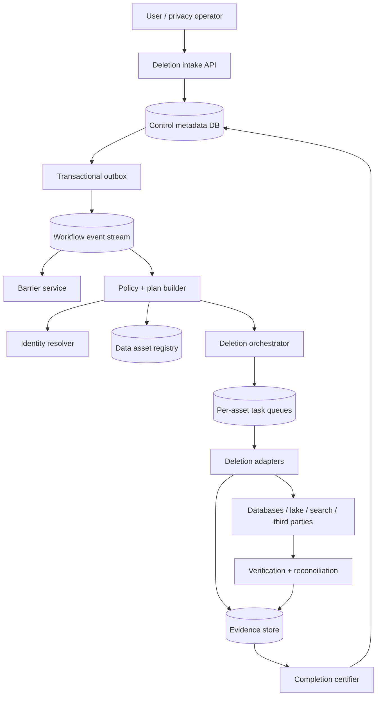
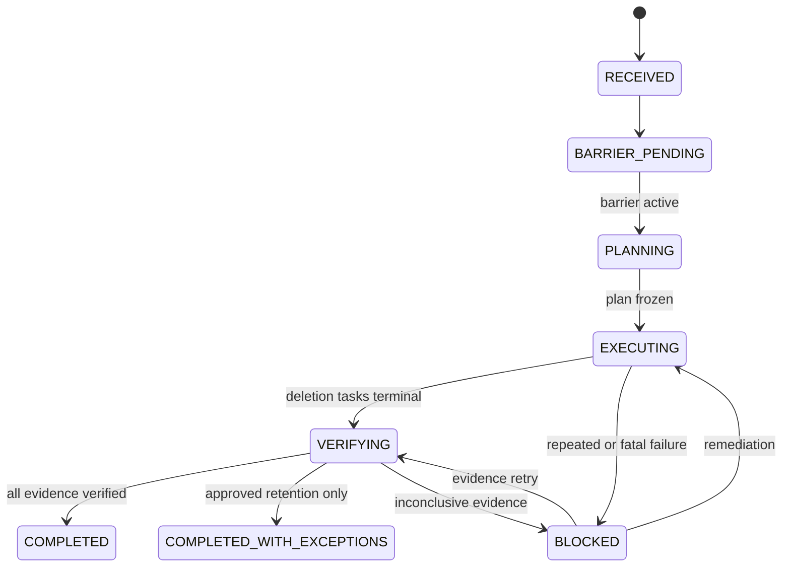
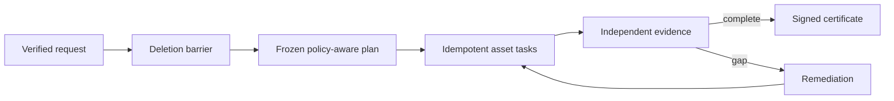

# Design a Privacy Data-Deletion Orchestration Platform

**Difficulty:** Staff-level  
**Primary themes:** irreversible workflows, queues, data lineage, idempotency, consistency barriers, backups, verification, auditability  
**Interview time box:** about 45 minutes  
**Educational walkthrough:** intentionally more detailed than the spoken interview

This walkthrough uses the broad Hello Interview delivery sequence: clarify requirements, identify core entities, define the system interface, build the simplest complete design, and then deepen the most consequential bottlenecks. A particularly useful interview habit is to trace each operation through the state it changes instead of drawing a collection of disconnected boxes. genui{"citation":{"ref":"turn176search5"}}

This is an engineering design exercise, not legal advice. The interviewer supplies the deletion deadlines, exemptions, and retention rules as product requirements. In a real company, privacy and legal teams own policy interpretation.

---

## Interviewer prompt

> Design a privacy data-deletion platform for a large technology company. A verified user or authorized privacy operator can request erasure of that user’s personal data. The platform must find the data across hundreds of services, operational databases, caches, search indexes, analytics lakes, and backups; apply holds and exemptions; coordinate deletion; verify completion; and produce an auditable result.

Deletion is not an ordinary CRUD endpoint. It is a long-running, partially irreversible distributed workflow where “retry everything” must not recreate data, and “all tasks returned 200” is not strong evidence that all relevant data was found.

## Targeted clarifying questions and assumed answers

**Candidate:** Is this a user deleting an account, or a general record-retention platform?

**Interviewer:** Focus on user-initiated and privacy-operator erasure requests. Retention expiry may reuse the same machinery later.

**Candidate:** How is the requester’s identity verified?

**Interviewer:** Logged-in users complete step-up authentication. Support agents create requests only through a separately authorized privacy workflow. The deletion service trusts an upstream identity-proofing result but records it.

**Candidate:** What data systems exist?

**Interviewer:** Roughly 300 registered systems: relational and key-value stores, object storage, caches, search indexes, message streams, analytics warehouses/lakes, third-party processors, and backups.

**Candidate:** Can all data be physically deleted immediately?

**Interviewer:** No. Some records must be retained under a legal hold or other approved policy. Immutable backups expire on a schedule; until then they must be inaccessible in normal processing and must not resurrect deleted data during restore.

**Candidate:** What does success mean?

**Interviewer:** Every in-scope registered data asset has either produced verifiable deletion evidence or an approved, scoped exception. The system must also install a barrier that prevents late pipelines, replays, or restores from recreating usable data.

**Candidate:** What scale should I assume?

**Interviewer:** Fifty million active users, up to 100,000 deletion requests per day, 1,000 requests per second during rare regulatory or product events, and about 30 downstream deletion tasks per request on average.

**Candidate:** What are the deadlines?

**Interviewer:** Acknowledge request creation in under one second. Disable ordinary account access within one minute. Complete 99% of online-system deletions within 24 hours and all ordinary cases within 30 days. Backup media may age out within 35 days under the provided policy.

**Candidate:** Can we put raw email addresses or user IDs into orchestration logs?

**Interviewer:** No raw personal data in queues, metrics, or operator logs. Use opaque subject handles, and tightly control the identity-resolution service.

**Candidate:** Should deletion be globally atomic?

**Interviewer:** No. That is infeasible across heterogeneous systems. It should be durable, monotonic, observable, retryable, and safe under partial failure.

### Scope statement to say aloud

> “I’ll make deletion a durable state machine, not a synchronous fan-out call. Intake creates an opaque subject handle and a deletion generation. Before destructive work, I’ll install a suppression barrier so new writes, delayed events, restores, and replays cannot reintroduce the subject. A versioned data inventory produces a frozen plan; adapters execute idempotent tasks; verification creates evidence rather than trusting transport acknowledgements; and completion requires evidence or an approved exception for every planned asset.”

---

## 1. Requirements (~5 minutes)

### Core functional requirements

1. **Accept and govern an erasure request.** Verify authority, resolve the subject’s identifiers, apply legal holds and policy exceptions, immediately restrict normal account use, and produce a frozen deletion plan.
2. **Execute deletion across heterogeneous data systems.** Dispatch dependency-aware, idempotent work to registered adapters and third parties while preventing deleted data from being recreated.
3. **Verify and report completion.** Collect independently meaningful evidence, expose request status, escalate failures, and issue an auditable deletion certificate containing no unnecessary personal data.

### Out of scope

- Interpreting privacy law or deciding which exemptions apply
- Identity proofing itself
- Redesigning every downstream datastore
- Physical destruction of storage hardware
- General records management for non-user data
- User-facing data export and portability
- Deleting public information held by unrelated parties

The official GDPR text, for example, contains a right to erasure as well as exceptions. That reinforces why policy must be represented explicitly rather than hard-coded as “delete every byte immediately.” genui{"citation":{"ref":"turn176search16"}}

### Quantified non-functional requirements

| Requirement | Target | Design consequence |
|---|---:|---|
| Intake scale | 100K requests/day; rare 1K requests/s burst | Keep creation lightweight and asynchronous; pre-provision queue capacity. |
| Fan-out scale | ~30 tasks/request average, up to 300 | Roughly 3M tasks/day average; shard by request/asset and apply tenant/system quotas. |
| Latency | create p99 <1 s; access restriction <1 min; 99% online deletion <24 h | Install the barrier first, then run long-lived work asynchronously. |
| Durability | no acknowledged request or committed state transition lost | Replicated transactional metadata with an outbox. |
| Correctness | no asset silently omitted; no completed subject reappears in ordinary processing | Versioned inventory, frozen plan, deletion generations, ingestion/restore barriers, reconciliation scans. |
| Availability | intake 99.99%; downstream outages must not lose progress | At-least-once tasks, durable retries, circuit breakers, and deadlines. |
| Privacy/security | orchestration plane contains opaque handles, not raw PII | Isolate identity mapping, minimize evidence, encrypt and tightly authorize it. |
| Audit retention | seven-year control evidence, according to assumed policy | Append-only evidence and policy snapshots with redacted identifiers. |

### Scale estimates that change the design

The average request rate is modest:

\[
100{,}000 / 86{,}400 \approx 1.16\text{ requests/s}
\]

But average request rate is misleading. At 30 tasks per request, normal volume is about three million tasks per day. A 1,000-request/s burst can create 30,000 tasks/s before retries. A synchronous request handler calling 30 systems would amplify every outage and could exhaust connection pools. We need a durable plan and work queues.

If each orchestration record and evidence summary averages 5 KB:

\[
100{,}000 \times 5\text{ KB} \approx 500\text{ MB/day}
\]

Metadata storage is manageable. The hard problem is not bytes; it is proving completeness across 300 evolving data systems and preventing reappearance.

Suppose a warehouse contains 10 PB and is partitioned by day but not subject. Scanning it once per request is impossible. At even 100 GB/s aggregate scan bandwidth, one complete pass takes roughly 28 hours. Therefore deletion capability and subject-location indexes must be built into asset ingestion and table design; the orchestrator cannot discover arbitrary personal data by brute force at request time.

### Consistency and availability contract

- **Strongly consistent:** request state, policy version, hold decision, deletion generation, frozen plan membership, task terminal state, and completion decision.
- **At-least-once execution:** workers and adapters may receive the same task repeatedly. Each task has a stable idempotency key and monotonic generation.
- **Eventual physical deletion:** downstream systems converge independently. Completion requires evidence or an approved exception, not simultaneous commits.
- **Monotonic subject state:** once generation `G` is deletion-blocked, older-generation writes cannot become visible again.
- **No ordinary rollback:** deletion is irreversible. A failed request is repaired forward by retrying, applying an exception, or fixing the asset. We do not attempt a distributed rollback that recreates deleted data.
- **During control-plane partition:** new progression may pause, but installed barriers remain enforced locally; downstream systems can finish already issued idempotent tasks.
- **Status honesty:** `COMPLETED_WITH_EXCEPTIONS` is distinct from `COMPLETED`; stale or absent evidence cannot be interpreted as deletion.

### What to say aloud

> “I’m choosing consistency for the control record and monotonic deletion generation, but not pretending deletion is globally atomic. The workflow is a convergent saga with no compensating recreation step: every retry moves the system toward less accessible data.”

---

## 2. Core entities (~2 minutes)

- **SubjectHandle** — opaque identifier for the person within the deletion plane; maps to source identifiers only through an isolated resolver.
- **DeletionRequest** — requester, reason category, jurisdiction/policy version, deletion generation, deadline, and lifecycle state.
- **HoldDecision** — scoped retention or legal-hold outcome, approver, policy basis, fields/assets affected, and expiry/review date.
- **DataAssetRegistration** — owner, system type, identifier schemes, deletion capability, verification method, dependencies, SLA, and adapter version.
- **DeletionPlan** — immutable snapshot of in-scope assets and task graph for one request.
- **DeletionTask** — one asset-specific action with idempotency key, generation, attempts, lease, status, and evidence reference.
- **DeletionBarrier** — monotonic record consumed by producers, ingestors, restorers, caches, and readers to suppress older-generation data.
- **DeletionEvidence** — signed/minimized proof of what was deleted or retained, at which asset revision, and how it was verified.
- **CompletionCertificate** — digest over the plan, policy, terminal outcomes, and evidence manifest.

The entity boundary is important: the request is not a mutable checklist discovered opportunistically. It references a frozen, versioned plan so completion has a well-defined universe.

---

## 3. API and system interface (~5 minutes)

### 3.1 Create a self-service deletion request

```http
POST /v1/me/deletion-requests
Authorization: Bearer <step-up-authenticated token>
Idempotency-Key: device-19:req-442
Content-Type: application/json

{
  "scope": "ACCOUNT_AND_ASSOCIATED_PERSONAL_DATA",
  "reason": "USER_REQUEST",
  "confirmation": "DELETE"
}
```

```json
{
  "request_id": "del_01K7R...",
  "state": "BARRIER_PENDING",
  "submitted_at": "2026-10-20T00:03:11Z",
  "deadline": "2026-11-18T23:59:59Z",
  "status_url": "/v1/me/deletion-requests/del_01K7R..."
}
```

The API derives the user identity from the verified authentication context. It does not accept `user_id` in the body. In one transaction it creates the request, allocates a subject handle and deletion generation, records the policy snapshot, inserts an audit event, and writes an outbox event.

### 3.2 Privacy-operator intake

```http
POST /v1/privacy/deletion-requests
Authorization: Bearer <privacy-operator token>
Idempotency-Key: case-88421

{
  "verified_case_token": "proof_opaque_82...",
  "scope": "ACCOUNT_AND_ASSOCIATED_PERSONAL_DATA",
  "jurisdiction": "POLICY_PROFILE_EU_STANDARD",
  "case_reference": "case_88421"
}
```

The case token is resolved by an isolated identity-proofing service. The orchestration database stores the opaque case reference, not uploaded documents or raw identity evidence.

### 3.3 Read status

```http
GET /v1/me/deletion-requests/del_01K7R...
Authorization: Bearer <token>
```

```json
{
  "state": "EXECUTING",
  "created_at": "2026-10-20T00:03:11Z",
  "barrier": {
    "generation": 7,
    "status": "ACTIVE",
    "activated_at": "2026-10-20T00:03:38Z"
  },
  "progress": {
    "planned_assets": 34,
    "verified": 27,
    "in_progress": 5,
    "retained_by_approved_policy": 1,
    "blocked": 1
  },
  "next_action": "NONE",
  "last_updated_at": "2026-10-20T00:41:09Z"
}
```

The user sees meaningful categories, not internal database names or sensitive evidence.

### 3.4 Apply or release a hold

```http
POST /v1/privacy/deletion-requests/del_01K7R.../holds
Authorization: Bearer <authorized counsel token>
If-Match: "request-version:12"

{
  "scope": {
    "asset_classes": ["FINANCIAL_LEDGER"],
    "field_classes": ["TRANSACTION_ID", "AMOUNT", "TIMESTAMP"]
  },
  "policy_reference": "retention-policy-v18:section-4",
  "review_at": "2033-10-20T00:00:00Z",
  "reason_code": "STATUTORY_RETENTION"
}
```

Holds are narrow: retain required fields while deleting unrelated profile fields from the same logical record where possible. `If-Match` prevents an operator acting on stale request state.

### 3.5 Downstream adapter contract

```protobuf
rpc DeleteSubject(DeleteSubjectRequest) returns (DeleteSubjectResult);
rpc VerifyDeletion(VerifyDeletionRequest) returns (VerificationResult);

message DeleteSubjectRequest {
  string task_id = 1;
  string subject_handle = 2;
  uint64 deletion_generation = 3;
  string asset_registration_id = 4;
  string identifier_bundle_ref = 5;
  string scoped_policy_ref = 6;
  string plan_digest = 7;
}

message DeleteSubjectResult {
  enum Status { DELETED = 0; NOT_FOUND = 1; RETAINED_SCOPED = 2; RETRYABLE = 3; FATAL = 4; }
  Status status = 1;
  string evidence_ref = 2;
  string asset_revision = 3;
  string result_digest = 4;
}
```

The adapter authenticates with workload identity and is authorized only for its registered asset. It remembers the result for `(task_id, deletion_generation)` so retries return the same or a more advanced outcome.

### 3.6 Register a data asset

```http
POST /v1/privacy/data-assets
Authorization: Bearer <data-governance-admin token>

{
  "asset_id": "asset_search_profiles_v3",
  "owner_team": "profile-search",
  "data_classes": ["PROFILE", "USER_CONTENT_INDEX"],
  "identifier_schemes": ["GLOBAL_USER_ID"],
  "deletion_mode": "ADAPTER_RPC",
  "verification_mode": "KEY_LOOKUP_AND_SAMPLE_SCAN",
  "dependencies": ["asset_primary_profile_db"],
  "sla_seconds": 3600,
  "adapter_version": "7.4.1"
}
```

Production data publication must be gated on valid registration and tested deletion capability. Inventory cannot remain a voluntary spreadsheet.

### API-to-requirement map

| Requirement | Interface |
|---|---|
| Govern request | self-service/operator create, scoped hold API |
| Execute deletion | adapter `DeleteSubject` contract |
| Verify | adapter `VerifyDeletion`, evidence manifest |
| Observe | requester and operator status APIs |
| Maintain completeness | data-asset registration API and deployment gate |

---

## 4. Data flow

1. Intake verifies authority, creates the request, allocates generation `G`, and restricts ordinary account access.
2. The barrier service durably marks the subject deleted at generation `G` and distributes that state to ingestion, serving, cache, replay, and restore paths.
3. The identity resolver builds an encrypted, access-controlled identifier bundle for the opaque subject handle.
4. The planner evaluates the policy and holds against a versioned data inventory, freezes a task DAG, and hashes the plan.
5. The orchestrator dispatches idempotent tasks through per-system queues with rate limits and dependencies.
6. Adapters delete or irreversibly transform in-scope data, return minimized evidence, and schedule independent verification.
7. Reconciliation processes scan for missed data, stale replicas, derived indexes, and unauthorized resurrection.
8. The completion service checks that every planned asset has verified evidence or an approved exception, signs a certificate manifest, and marks the request terminal.

---

## 5. High-level design (~10–15 minutes)

### Architecture



The metadata database is a replicated relational store because request, plan, and task transitions benefit from transactions, uniqueness constraints, and compare-and-swap updates. The workflow stream carries durable events and absorbs bursts. Task queues are separated by asset or adapter class so one broken warehouse job cannot block cache deletions or account restriction.

### Operation 1: accept a request and install the barrier

In the synchronous path, the API:

1. Authenticates the requester and verifies step-up assurance or an operator case token.
2. Validates request scope and deduplicates the idempotency key.
3. Resolves or creates an opaque `subject_handle` through the isolated identity service.
4. Reads the current subject deletion generation and allocates `G+1`.
5. In one transaction, inserts the request, policy snapshot, audit event, and outbox event.
6. Returns the request ID.

Relevant fields:

```text
DeletionRequest(
  request_id, subject_handle,
  requester_type, requester_subject,
  scope, reason_code, policy_profile,
  deletion_generation,
  state, version, deadline,
  plan_id, created_at, updated_at
)
```

The barrier is the first asynchronous critical step:

```text
DeletionBarrier(
  subject_handle,
  active_generation,
  state, activated_at,
  policy_profile, source_request_id,
  barrier_version
)
```

Writers and data pipelines attach a subject generation to personal-data records. Before making a write visible, a participating system checks the local barrier cache or authoritative service:

```text
allow write only if record_generation > active_deletion_generation
and the subject has been legitimately re-created under a new lifecycle
```

For ordinary deletion, there is no legitimate new lifecycle, so all older and equal generations are suppressed. If the business later supports account re-registration, it must allocate a new lifecycle identity and explicit generation rather than reusing old delayed events.

Barrier distribution uses a compacted stream keyed by `subject_handle`, regional caches, and periodic full snapshots. Kafka documents tombstone records and log compaction as a way to retain the latest value per key while removing superseded history; a similar compacted-key distribution is useful here, although our deletion record itself should remain an explicit durable state rather than disappearing too early. genui{"citation":{"ref":"turn176search36"}}

The account service consumes the barrier and disables login, tokens, outbound messaging, and nonessential processing within one minute. This reduces ongoing exposure while the full workflow continues.

> “I install prevention before cleanup. Otherwise a delayed event can recreate data after the adapter has correctly deleted it.”

### Operation 2: resolve identities without spreading PII

One person may be represented as:

- global account ID;
- historical account IDs after merges;
- email/phone hashes;
- device or advertising IDs;
- billing customer ID;
- support-case identity;
- third-party processor identifiers.

The identity resolver owns this sensitive mapping. It creates an encrypted immutable bundle:

```text
IdentifierBundle(
  bundle_id, subject_handle,
  encrypted_identifiers,
  identity_graph_revision,
  created_at, expires_at,
  content_digest
)
```

Adapters receive a reference and can retrieve only identifier types declared in their asset registration. Queues and general logs contain the bundle reference, never raw values. Access is audited.

The bundle is a snapshot. If the identity graph changes during deletion—perhaps a late account merge—the resolver emits a `SUBJECT_IDENTIFIERS_EXPANDED` event. The planner creates supplemental tasks under the same request and generation. A request cannot be certified while a newer identity revision is unprocessed.

### Operation 3: freeze a complete, policy-aware plan

The plan builder reads:

- request scope and policy profile;
- active holds and approved exceptions;
- identifier schemes in the bundle;
- the data-asset registry at inventory revision `R`;
- dependencies between authoritative and derived assets.

It creates:

```text
DeletionPlan(
  plan_id, request_id,
  inventory_revision, policy_version,
  identity_graph_revision,
  plan_digest, state, created_at
)

PlanItem(
  plan_id, asset_registration_id,
  action, dependency_ids,
  adapter_version,
  verification_method,
  scoped_retention_rule,
  deadline
)
```

Actions include `DELETE`, `PSEUDONYMIZE`, `RETAIN_SCOPED`, `CRYPTO_SHRED`, `NOTIFY_PROCESSOR`, and `VERIFY_ONLY`.

The plan is frozen and hashed before execution. Later inventory changes do not mutate historical evidence. Instead, a supplemental plan adds newly discovered in-scope assets. Completion always references all plan generations.

Task dependencies enforce sensible order. For example:

1. activate global barrier;
2. delete authoritative profile rows;
3. invalidate caches and search projections;
4. delete derived analytics rows or tombstone partitions;
5. notify third parties;
6. verify and reconcile.

Not every task must be serial. Independent systems run in parallel, bounded by adapter capacity.

### Operation 4: execute idempotent deletion tasks

The orchestrator transitions planned items to tasks and uses a transactional outbox to publish them:

```text
DeletionTask(
  task_id, request_id, plan_item_id,
  subject_handle, deletion_generation,
  asset_registration_id,
  state, attempt_count,
  lease_owner, lease_expires_at,
  next_attempt_at, deadline,
  evidence_ref, version
)
```

Workers pull from per-asset queues. The adapter performs conditional work such as:

```sql
DELETE FROM profile
WHERE global_user_id = :resolved_id
  AND lifecycle_generation <= :deletion_generation;
```

For a key-value store, it may write a durable tombstone with generation `G` rather than merely remove the current value. For a search index, it deletes by internal document IDs discovered from the authoritative mapping and waits for refresh/segment cleanup according to the evidence policy. For caches, it invalidates known keys and relies on the read/write barrier to prevent repopulation.

The task ID is the idempotency key. The adapter stores:

```text
AdapterExecution(
  task_id, generation,
  highest_phase, result_digest,
  evidence_ref, updated_at
)
```

Retrying a completed task returns the prior result. Retrying a partially completed task resumes from its highest durable phase. A lower deletion generation can never overwrite a higher one.

Queue delivery is at least once. The orchestrator does not require exactly-once messaging, which would not make side effects in an external database exactly once anyway.

### Operation 5: handle specialized stores

#### Caches

Delete known keys and invalidate subject-tagged cache entries. More importantly, cache fill checks the deletion barrier. An invalidation alone is insufficient because a delayed database replica or event could refill the cache.

#### Search indexes

Delete by stable document IDs and emit evidence after the index’s visible generation no longer returns the subject. Background segment compaction may remove bytes later; normal queries must be blocked immediately.

#### Event streams

Append a deletion tombstone keyed by subject and make all materializers generation-aware. Historical immutable events may be encrypted and access-restricted until retention expiry, depending on policy. Consumers rebuilding state must apply the barrier snapshot before replaying old events.

#### Analytics tables and data lakes

Maintain subject-to-file/partition indexes during ingestion. Deletion jobs rewrite affected columnar files without in-scope rows, atomically publish a new table snapshot, and retire old files under storage-policy controls. Query engines apply deletion vectors or a mandatory subject suppression join until compaction removes old files.

#### Third-party processors

Send a signed idempotent request carrying the processor’s scoped identifier and task ID. Record acknowledgement, poll or receive webhook completion, and enforce processor SLAs. A transport acknowledgement is not completion evidence.

#### Backups

If data is encrypted with a subject- or small-cohort-specific data-encryption key, deleting the wrapped key can make retained ciphertext unreadable quickly. This is **crypto-shredding**. It is powerful but not free: key cardinality, shared records, and deduplication complicate per-subject encryption.

Where fine-grained encryption is unavailable, backups remain sealed from ordinary processing, expire within the policy window, and every restore must apply the latest deletion-barrier snapshot before serving traffic or replaying events. Restored systems run deletion reconciliation before promotion.

### Operation 6: verify instead of trusting success codes

An adapter’s `DELETED` response proves only that code ran. Verification is asset-specific:

- point lookup for every resolved primary key;
- query through the normal serving path;
- search-index query after refresh;
- cache key/tag absence plus barrier check;
- lake snapshot scan using the subject index;
- key-destruction evidence from the KMS;
- third-party signed completion receipt;
- sample or full restore drill for backup suppression.

```text
DeletionEvidence(
  evidence_id, task_id,
  asset_registration_id, asset_revision,
  verification_method, outcome,
  retained_scope_digest,
  result_digest, verifier_identity,
  generated_at, signature
)
```

Evidence minimizes personal data. It records hashes, counts, revisions, method, and signatures—not deleted values.

Verification returns `VERIFIED_ABSENT`, `VERIFIED_RETAINED_SCOPED`, `INCONCLUSIVE`, or `FAILED`. `NOT_FOUND` during execution is not automatically success: it may mean the identifier mapping is incomplete. The verifier cross-checks inventory and identity revisions.

The NIST Privacy Framework includes outcomes covering access for deletion, destruction according to policy, privacy-aware audit records, and testing of technical measures. That supports treating inventory, policy, evidence minimization, and verification as first-class parts of the design rather than a final status flag. genui{"citation":{"ref":"turn176search48"}}

### Operation 7: certify completion

The certifier evaluates a strongly consistent predicate:

```text
barrier ACTIVE at generation G
AND every plan item across all plan supplements is terminal
AND each terminal item has valid evidence
AND all exceptions are approved, scoped, and unexpired
AND processed identity revision >= current identity revision
AND no unresolved resurrection alert exists
```

It creates:

```text
CompletionCertificate(
  certificate_id, request_id,
  subject_handle_digest,
  deletion_generation,
  policy_version, inventory_revisions,
  plan_digests, evidence_manifest_digest,
  outcome, signed_at, signature
)
```

Outcomes are `COMPLETED`, `COMPLETED_WITH_EXCEPTIONS`, or `FAILED/ESCALATED`. The certificate is immutable. Subsequent discovery of a new asset reopens operational work through a supplemental remediation record; it never rewrites history to pretend the original inventory knew more than it did.

---

## 6. Deep dives (~10–15 minutes)

### Deep dive A: how do we know we found all the data?

#### Where the baseline breaks

A central service cannot query 300 arbitrary systems for “everything about this person” unless those systems expose identity and deletion contracts. Schemas drift, teams create shadow tables, logs copy identifiers, and derived pipelines can outlive their source.

The hardest failure is an omitted asset that reports nothing because it was never planned.

#### Plausible approaches

| Approach | Benefit | Failure mode |
|---|---|---|
| Manually maintained catalog | Easy to start | Becomes stale; no enforcement |
| Runtime scan of all stores | Finds some unregistered copies | Prohibitively expensive; PII classifiers have false positives/negatives |
| Build-time registration contract | Creates ownership and deletion capability | Misses systems bypassing the platform |
| Data-lineage graph from pipelines | Captures derived copies | Lineage may be incomplete or field-level semantics unclear |
| Combined preventive and detective controls | Strongest practical coverage | Requires organizational investment and reconciliation |

#### Selection

Use a combination:

1. **Mandatory asset registration:** production stores and datasets declare data classes, subject-key schemes, owner, retention, adapter, and verifier.
2. **Deployment and pipeline gates:** CI/CD and data-platform APIs reject unregistered personal-data sinks.
3. **Write-time tagging:** events and datasets carry data classification, source asset, subject-key type, and lineage metadata.
4. **Automated lineage:** stream/batch jobs publish source-to-sink relationships and transformation metadata.
5. **Discovery scans:** periodic classifiers find likely personal data in unregistered or misclassified stores.
6. **Reconciliation:** compare cloud resources, schema catalogs, access logs, and registered assets; escalate gaps.

The registry is versioned. A plan at inventory revision 82 remains explainable even after revision 83 adds an asset.

#### Derived and aggregated data

Not every aggregate is personal data under every policy. The classification engine does not decide law; it applies a policy decision supplied by privacy governance:

- row-level data keyed to the subject: delete;
- pseudonymous data still linkable through retained keys: delete or sever linkage;
- aggregate meeting approved anonymity thresholds: perhaps retain;
- model parameters: governed by a separate approved policy and machine-unlearning capability, if required.

The plan records the decision and policy version. Do not let individual service owners invent exceptions ad hoc.

#### Evidence of completeness

We cannot mathematically prove absence from an unknown universe. We can provide strong operational assurance:

- all registered in-scope assets at frozen revision covered;
- no policy-gated production asset lacks a deletion contract;
- lineage closure traversed;
- discovery scans show no unresolved finding;
- identity mapping revision current;
- periodic restore/replay drills preserve barriers;
- asset owners attest and systems provide signed evidence.

Say this explicitly in an interview. “Proof of deletion everywhere” is only meaningful relative to a governed inventory and threat model.

### Deep dive B: idempotent orchestration and preventing resurrection

#### Where the baseline breaks

Imagine the profile database deletes a user at 10:00. At 10:05, a delayed `ProfileUpdated` event from 09:50 arrives and rebuilds the search document. At 11:00, a cache miss reads from a lagging replica and repopulates the cache. Next week, a backup restore brings the row back.

Every individual delete task may have succeeded, yet the system failed.

#### Selection: deletion generation as a monotonic fence

Associate personal records and events with lifecycle generation. The deletion plane establishes barrier generation `G`. Every ingestion or materialization path enforces:

```text
if event.subject_generation <= barrier.active_generation:
    suppress event
    emit suppression audit metric
else:
    process event
```

If old sources do not carry generation, the barrier still keys by subject and blocks all historical writes until a deliberately provisioned new lifecycle establishes a higher generation.

The barrier must exist in:

- authoritative write APIs;
- change-data-capture consumers;
- stream and batch materializers;
- cache loaders;
- search indexers;
- replay tools;
- backup restore promotion checks;
- third-party sync exporters.

Local caches improve latency, but stale-cache behavior must fail toward suppression for subjects recently marked deleted. Barrier events are signed/versioned, and services periodically compare their applied watermark to the authoritative stream.

#### Workflow state machine



State transitions use compare-and-swap on request version. A manual exception racing with automated completion cannot silently win; the loser reloads the new state.

#### Task delivery and backoff

- stable `task_id` and generation are the idempotency identity;
- leases allow crashed workers’ tasks to be reclaimed;
- exponential backoff with jitter handles transient failures;
- retry budgets and deadlines prevent infinite silent retries;
- fatal schema/authorization errors go to remediation, not a generic dead-letter graveyard;
- per-adapter circuit breakers stop cascading overload;
- priority queues handle barriers and deadline-near requests before bulk compaction.

Large assets may split one logical plan item into child tasks, but the parent is terminal only when all children and their verification evidence are complete.

#### Why this is not a normal saga

A classic saga compensates a failed sequence by applying inverse actions. Here, restoring data would violate the request. The only safe direction is forward: retry deletion, strengthen suppression, fix discovery, or record a valid scoped retention exception. This is a **monotonic destructive workflow**.

### Deep dive C: backups, analytics lakes, and meaningful verification

#### Where the baseline breaks

Operational rows can be deleted quickly, but immutable backups and columnar lake files are optimized for append and bulk recovery. Editing each backup per request can destroy deduplication, increase corruption risk, and make recovery unmanageable.

#### Options for backups

| Approach | Advantages | Limitations |
|---|---|---|
| Rewrite every backup | Physical deletion quickly | Extremely expensive and risky; breaks immutability |
| Wait for backup expiry | Simple operations | Data remains recoverable until expiry; restore can resurrect it |
| Per-subject crypto-shredding | Fast logical destruction | High key cardinality; shared records and indexes complicate encryption |
| Sealed backups + restore suppression | Preserves recovery model | Requires rigorous restore gates and accepted retention window |

#### Selection

Use a tiered strategy:

- Subject-scoped encryption where the data model supports it, destroying wrapped data keys on deletion.
- Immutable backups remain sealed from ordinary access and expire within the approved window.
- The deletion-barrier snapshot is retained separately and restored **before** application data.
- A recovered environment replays all active deletion generations and runs reconciliation before serving users.
- Regular restore drills test that deleted subjects remain inaccessible.

Do not claim that deleting an encryption key physically removes ciphertext. State the actual contract: data becomes cryptographically inaccessible under the key-management threat model, and media later ages out.

#### Analytics-lake strategy

At ingestion time, maintain a privacy index:

```text
subject_handle -> {table_snapshot, file_ids, row-group hints, min/max event time}
```

On deletion:

1. publish a table-level deletion vector or suppression side table immediately;
2. rewrite only affected files/row groups in background;
3. atomically publish a new table snapshot;
4. prevent queries from accessing retired snapshots without privileged approval;
5. garbage-collect old files after time-travel and backup policy permits.

The privacy index itself is sensitive and must be access-controlled, encrypted, and deleted or minimized after the retention period.

#### Verification levels

Use explicit assurance tiers:

1. **Execution evidence:** adapter reports a successful command.
2. **Serving-path absence:** normal reads no longer return the subject.
3. **Storage-key absence:** direct lookup/index checks find no in-scope record.
4. **Lineage closure:** registered derived assets and processors are verified.
5. **Resurrection resistance:** replay/restore tests confirm barriers.
6. **Physical or cryptographic disposition:** file compaction, media expiry, or key destruction evidence.

Not every asset can reach every tier immediately. The policy says which tier and deadline are required. Status must distinguish them.

#### Failure cases

- **Lake compaction fails:** suppression remains active; retry background rewrite; request stays incomplete for the physical-deletion milestone.
- **Backup expiry job misses media:** alert before deadline, quarantine affected media, escalate, and do not issue an unqualified certificate.
- **KMS key deletion is pending:** record the provider’s scheduled-deletion state and only claim the policy-approved assurance level.
- **Third party is silent:** retry, escalate contract owner, and expose blocked status.
- **Verifier unavailable:** pause certification; never substitute an old green result.

---

## Reliability, observability, and security

### Critical invariants

1. Each request has one monotonic deletion generation.
2. The barrier becomes active before ordinary destructive tasks are considered complete.
3. A frozen plan item cannot disappear; it ends with evidence or an approved exception.
4. Lower-generation data can never overwrite higher-generation deletion state.
5. Task retries are idempotent and cannot recreate data.
6. Completion uses current identity and all supplemental plan revisions.
7. Audit and evidence stores contain no unnecessary raw personal data.
8. Restore cannot serve until deletion barriers and reconciliation are applied.

### Failure-mode table

| Failure | Detection | Safe behavior | Recovery |
|---|---|---|---|
| Intake DB commits but event is not sent | outbox lag | request remains durable, not lost | outbox relay republishes |
| Duplicate task delivery | adapter execution lookup | return prior or more advanced result | acknowledge duplicate |
| Worker crashes mid-delete | lease expiry | task remains nonterminal | new worker resumes idempotently |
| Adapter schema changes | contract/version error | stop affected asset; keep barrier | deploy compatible adapter and retry |
| Asset queue overloaded | age and depth alerts | apply backpressure; protect barrier traffic | fair scheduling and scale workers |
| Identity graph expands | revision event | reopen/supplement plan | create tasks for new identifiers |
| Inventory adds missed asset | governance reconciliation | create remediation supplement | execute and update certificate trail |
| Search/cache repopulates data | resurrection detector | suppress serving immediately | trace producer, replay delete, fix barrier gap |
| Verifier unavailable | evidence SLA | no certification | retry or use approved independent verifier |
| Third party misses SLA | deadline monitor | show blocked/escalated | contract escalation and repeated signed request |
| Regional control outage | failover health | barriers remain cached; workflow may pause | promote replica, replay outbox/tasks |
| Restore lacks fresh barrier snapshot | restore admission check | prohibit promotion | load barrier, reconcile, verify |

### Observability without leaking personal data

**Progress and SLA**

- requests by state, policy profile, and age bucket
- time to barrier activation
- online-deletion and end-to-end completion percentiles
- tasks by asset, outcome, retry reason, and deadline risk
- verification latency and inconclusive rate
- approved exception count and upcoming review expiry

**Correctness**

- lower-generation write suppressions
- resurrection detections
- assets missing adapters/verifiers
- inventory-to-infrastructure drift
- identity-revision lag
- completed requests reopened by new evidence
- restore drills that fail suppression checks

**Capacity**

- queue depth and oldest task per adapter
- worker lease churn and retry amplification
- warehouse rewrite bytes and backlog
- evidence store write/read latency
- barrier-cache watermark and staleness

Metrics use asset IDs, error classes, policy profiles, and opaque request buckets—not emails, phone numbers, or raw subject identifiers. Traces carry `request_id`, `task_id`, `asset_id`, `generation`, and plan digest. Operator tooling resolves a subject only through an audited, least-privilege workflow.

### Security controls

- step-up authentication for self-service deletion
- strong role separation for support, privacy operations, legal holds, and completion overrides
- two-person approval for broad or long-lived exceptions
- mTLS and workload identity for adapters
- envelope encryption for identifier bundles and evidence
- tenant- and purpose-scoped access policies
- immutable audit log for request, hold, plan, task, evidence, and certificate transitions
- signed plan and evidence digests
- no raw PII in queues, logs, metrics, URLs, or certificates
- deletion-adapter conformance tests and production admission gates
- break-glass access with justification, expiration, and review

---

## 7. Final design

The final platform has a small, strongly consistent control plane and many asynchronous, idempotent execution paths:

- Intake verifies authority, records a policy snapshot, allocates a monotonic deletion generation, and writes an outbox event.
- A deletion barrier is distributed first so delayed events, cache fills, indexers, replays, and restores cannot recreate older-generation data.
- An isolated identity resolver produces a minimized encrypted identifier bundle.
- A versioned asset registry and lineage graph generate an immutable, policy-aware deletion plan.
- A durable orchestrator dispatches dependency-aware tasks through per-asset queues; adapters deduplicate by task and generation.
- Operational stores, indexes, caches, event streams, analytics lakes, third parties, and backups each use explicit deletion and verification contracts.
- Verification measures absence or approved retention at declared assurance levels rather than trusting RPC success.
- Completion requires evidence or a scoped approved exception for every planned item and all supplements.
- Discovery scans, lineage reconciliation, resurrection detectors, and restore drills continually test the completeness assumptions.



### Requirements check

| Requirement | Design response |
|---|---|
| Accept and govern requests | verified intake, policy snapshots, scoped holds, opaque subject handles |
| Restrict access quickly | barrier and account restriction before full deletion |
| Delete across 300 systems | frozen task DAG, adapter contracts, per-system queues |
| Handle retries safely | stable task IDs, monotonic generations, adapter execution records |
| Prevent reappearance | generation-aware writes, consumers, caches, replays, and restores |
| Cover analytics and backups | subject indexes, deletion vectors, compaction, crypto-shredding, expiry and restore gates |
| Verify completion | asset-specific independent verification and signed evidence |
| Avoid silent omissions | mandatory registry, lineage, deployment gates, discovery and reconciliation |
| Meet deadlines | asynchronous fan-out, quotas, deadline queues, escalation |
| Protect privacy metadata | isolated resolver, encrypted bundles, minimized logs/evidence |

### Thirty-second closing statement

> “I would not model erasure as thirty synchronous DELETE calls. The correctness boundary is a durable request, a monotonic deletion generation, and a frozen inventory-relative plan. I install the barrier before cleanup, execute idempotent asset tasks at least once, and require asset-specific evidence or a scoped exception before certification. Registration gates and lineage reduce omissions, while reconciliation scans and restore drills test those assumptions. That makes failures repairable forward and prevents successfully deleted data from quietly returning.”

---

## Realistic interviewer follow-up questions and strong answers

### 1. Why not use a distributed transaction across all databases?

The systems have different transaction models, some work lasts hours, third parties cannot join the transaction, and backups are not mutable participants. A global transaction would be unavailable and still would not solve omitted assets. Use a strongly consistent workflow record with idempotent convergence and explicit evidence.

### 2. Is this exactly-once deletion?

No. Delivery is at least once. The same deletion may execute repeatedly, but stable task IDs, conditional generation checks, and adapter execution records make repeats safe. Exactly-once messaging would not guarantee exactly-once external effects.

### 3. Why is the barrier needed if every system deletes correctly?

Deletion is not the only writer. Delayed events, lagging replicas, batch replays, cache fills, exports, and restores can reintroduce old data. The barrier turns deletion into a monotonic lifecycle state enforced by every creation path.

### 4. What if an asset was not registered?

The initial certificate can only attest to the inventory it knew. Preventive deployment gates and lineage make omissions less likely; discovery scans detect gaps. A newly discovered asset creates a remediation supplement and an auditable reopening rather than silently changing historical evidence.

### 5. How do you verify `NOT_FOUND`?

Cross-check the identifier bundle, identity revision, asset’s declared key schemes, authoritative source mappings, and direct/serving-path queries. `NOT_FOUND` is evidence only when the lookup domain is known to be complete.

### 6. What if a legal hold arrives while deletion is running?

The hold API performs a conditional request-version update. Tasks not yet committed receive the new scoped policy. Already deleted data is not recreated. The system records the race and escalates if the new hold expected data that is already gone.

### 7. What if a hold is later released?

The release creates a new plan supplement for the retained scope. The existing barrier remains active, and deletion tasks execute against the previously retained records. The request’s audit trail shows both decisions.

### 8. How do you delete data from append-only event streams?

Publish a durable subject tombstone/barrier, make all consumers generation-aware, restrict historical event access, and compact or re-encrypt segments according to policy. Replays load barriers before events. Immediate physical byte removal may require segment rewrite or key destruction.

### 9. Would you store subject handles in all services?

Prefer a common opaque subject key because it simplifies indexing and deletion. Where a service requires local identifiers, the isolated bundle maps only the schemes that asset needs. Avoid distributing raw email or phone values.

### 10. How do you handle shared records, such as a conversation between two users?

Policy defines field-level behavior. Delete or anonymize the requesting user’s private attributes and linkage while preserving data belonging to the other participant where required. The asset adapter implements that domain-specific transformation and reports a scoped-retention digest.

### 11. Can a completed request ever be reopened?

Operationally, yes. A new asset, identity mapping, failed restore drill, or resurrection alert creates a supplemental remediation workflow. The original certificate remains immutable and the new evidence links to it.

### 12. What if the deletion service itself stores personal data?

It should store opaque handles and minimized evidence. The identity resolver holds encrypted mappings under stricter access. After operational and audit retention expires, resolver bundles are destroyed; the certificate can retain a salted digest that proves control execution without identifying the person.

### 13. How do you prioritize a large burst?

Activate barriers first because they reduce ongoing risk. Then use deadline-aware weighted fair queues by request age, asset capacity, tenant, and policy deadline. Reserve capacity for retries and near-deadline cases so bulk submissions cannot starve them.

### 14. How do you prevent a broken adapter from deleting the wrong users?

Use workload identity, asset-scoped permissions, signed plan/task digests, test environments, canary deletion against synthetic subjects, generation checks, blast-radius rate limits, and two-stage verification. Adapters should receive only scoped identifiers and cannot enumerate arbitrary subjects.

### 15. What does crypto-shredding prove?

It proves that ciphertext is inaccessible under assumptions about key isolation, key deletion, and cryptography. It does not prove the ciphertext bytes vanished, that plaintext was not copied elsewhere, or that shared records used only that key. State the assurance level precisely.

### 16. How would you test the platform?

Use synthetic canary subjects seeded through every registered system, then request deletion and verify the whole lifecycle. Add fault injection for duplicate tasks, lost responses, stale barriers, schema changes, worker crashes, third-party delays, lake-compaction failures, and backup restores. Property tests assert that state and generations never move backward.

### 17. How do you deal with a service that cannot delete by user?

Treat that as an unsupported capability that blocks production approval for new personal data. For an existing system, build a side index and batch rewrite, add mandatory suppression immediately, assign remediation ownership, and expose the reduced assurance until migration completes.

### 18. Is pseudonymization the same as deletion?

Not necessarily. If the data can still be linked back through retained keys or auxiliary information, it may remain personal under the supplied policy. The plan uses explicit actions and assurance definitions rather than treating every hash as deletion.

### 19. How do you make the certificate tamper-evident?

Hash the immutable plan manifests and evidence objects into a manifest digest, sign it with a controlled key, timestamp it, and retain it in append-only storage. Verification checks the signature and referenced object hashes. Do not place deleted values in the certificate.

### 20. Why not delete the user first and discover systems afterward?

We restrict access and install the barrier immediately, but we need a frozen plan before claiming completion. Discovery only after deletion risks losing the identity links required to find derived copies. Snapshot the identifier bundle and inventory before destroying mappings.

---

## Common pitfalls

1. Implementing deletion as synchronous fan-out from the API.
2. Claiming global atomic deletion across heterogeneous systems.
3. Deleting data before preserving the identifier mapping needed to find copies.
4. Treating message delivery as exactly-once side effects.
5. Using raw email addresses or phone numbers in queues and logs.
6. Considering HTTP 200 sufficient deletion evidence.
7. Treating `NOT_FOUND` as proof without validating lookup completeness.
8. Relying on a manually maintained inventory with no deployment gates.
9. Ignoring derived stores and data lineage.
10. Invalidating a cache without preventing repopulation.
11. Deleting operational rows but ignoring delayed stream events.
12. Restoring backups before applying deletion barriers.
13. Claiming crypto-shredding physically removes ciphertext.
14. Rewriting every immutable backup per request without considering recovery risk.
15. Allowing broad legal holds when field-level retention is possible.
16. Mutating a frozen plan and losing auditability.
17. Dropping failed tasks into a dead-letter queue with no remediation owner.
18. Letting one overloaded adapter block unrelated systems.
19. Issuing a clean completion certificate with inconclusive verification.
20. Assuming an immutable certificate means new findings cannot require remediation.
21. Logging deleted values as “evidence.”
22. Forgetting that deletion is irreversible and has no safe recreate-data compensation.

---

## Suggested 45-minute interview pacing

| Time | Focus |
|---:|---|
| 0–5 min | Scope, policy assumptions, requirements, scale, consistency contract |
| 5–7 min | Core entities: request, asset, plan, task, barrier, evidence |
| 7–12 min | Intake, hold, status, adapter, and registration interfaces |
| 12–25 min | Intake → barrier → identity → plan → execute → verify → certify |
| 25–38 min | Inventory completeness and resurrection prevention; backups if time |
| 38–43 min | Failure modes, observability, security, and evidence semantics |
| 43–45 min | Requirements check and concise summary |

In the interview, do not attempt to recite every adapter detail. Establish the irreversible workflow and barrier first, finish an end-to-end design, and then let the interviewer choose the datastore-specific deep dive.

---

## Public references

- [Hello Interview — System Design Delivery Framework](https://www.hellointerview.com/learn/system-design/in-a-hurry/delivery)
- [Hello Interview — API Design for System Design Interviews](https://www.hellointerview.com/learn/system-design/core-concepts/api-design)
- [EUR-Lex — Regulation (EU) 2016/679, including Article 17](https://eur-lex.europa.eu/eli/reg/2016/679)
- [NIST — Privacy Framework](https://www.nist.gov/privacy-framework)
- [NIST Privacy Framework Version 1.0](https://www.nist.gov/system/files/documents/2020/01/16/NIST%20Privacy%20Framework_V1.0.pdf)
- [Apache Kafka — Design: log compaction and tombstones](https://kafka.apache.org/design/)

The legal and policy examples establish why deletion and exceptions need explicit governance; they do not prescribe implementation details. The requirements, scale assumptions, APIs, deletion-generation barrier, task model, evidence scheme, dialogue, and architecture are original.
