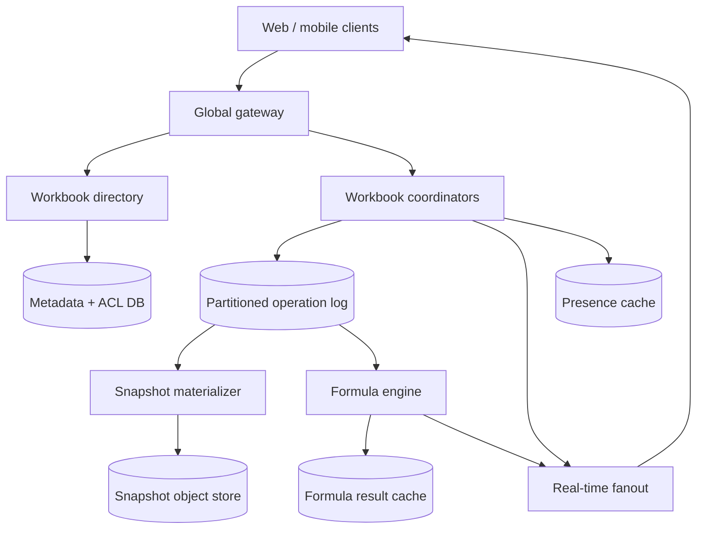
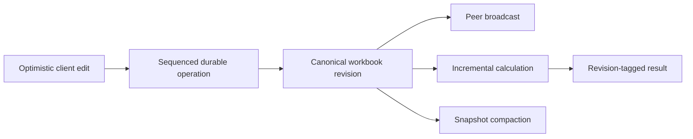

# Design a Real-Time Collaborative Spreadsheet

**Difficulty:** Senior / Staff-level  
**Primary themes:** real-time collaboration, concurrency control, operation logs, caching, incremental computation, offline merge, hot-key isolation  
**Interview time box:** about 45 minutes  
**Educational walkthrough:** intentionally more detailed than the spoken interview

This walkthrough uses the broad Hello Interview delivery order: requirements, core entities, interface, high-level design, and focused deep dives. The useful discipline is to trace each requirement from an API request through state changes and back to the response, introducing schema fields only when the design needs them. genui{"citation":{"ref":"turn175search12"}}

The architecture and dialogue below are original. Public collaboration systems and research are cited only where they clarify established concepts such as operational transformation and CRDT convergence.

---

## Interviewer prompt

> Design a cloud spreadsheet like Google Sheets that lets multiple people edit the same workbook in real time. It should support cell values, formulas, row and column changes, presence, offline edits, and version history.

The deceptively hard part is not rendering a grid. It is defining what concurrent edits mean, maintaining formula correctness as structure changes, and opening large workbooks without replaying an unbounded history.

## Targeted clarifying questions and assumed answers

**Candidate:** Which spreadsheet features are required?

**Interviewer:** Support multiple sheets, primitive cell values, formulas, basic formatting, row/column insertion and deletion, sharing permissions, comments, presence, undo, and version history.

**Candidate:** Are charts, pivot tables, macros, external data sources, and arbitrary user code in scope?

**Interviewer:** No. Mention how the design could evolve, but do not design them.

**Candidate:** How many simultaneous editors can one workbook have?

**Interviewer:** Normally fewer than 10, but support 100 active editors. A public workbook might also have thousands of read-only viewers.

**Candidate:** How large can a workbook become?

**Interviewer:** Allow up to one million non-empty cells, though most workbooks have fewer than 100,000. Opening the initial viewport should not require loading all cells.

**Candidate:** Must edits work offline?

**Interviewer:** Yes. A client may keep editing while disconnected and synchronize later. Conflicts should converge deterministically, and users should be warned when the same cell was changed concurrently.

**Candidate:** What consistency do formulas need?

**Interviewer:** Cell edits must have one authoritative order within a workbook. Formula results may lag briefly but must identify the workbook revision they were computed from. Users should never see a result presented as current when it belongs to an older revision.

**Candidate:** Do we need cross-workbook formulas?

**Interviewer:** No. Formula dependencies stay inside one workbook.

**Candidate:** What scale should I assume?

**Interviewer:** Ten million stored workbooks, two million daily active users, 200,000 peak connected editing sessions, and 100,000 peak edit operations per second.

**Candidate:** Can users choose a data region?

**Interviewer:** Yes. Each workbook has one home region for writes. Clients can connect globally, but cross-region disaster recovery should be possible.

### Scope statement to say aloud

> “I’ll treat a workbook as the unit of ordering and ownership. Online edits receive a durable total order from a home-region coordinator; clients apply them optimistically and rebase when necessary. Presence is ephemeral, formulas are incrementally recomputed against explicit revisions, and snapshots compact the operation history. I’ll deep-dive on concurrent structural edits, formula dependencies, and hot-workbook recovery.”

---

## 1. Requirements (~5 minutes)

### Core functional requirements

1. **Open and edit a workbook.** Users can read visible ranges and atomically change cells, formulas, formatting, rows, or columns according to their permissions.
2. **Collaborate in real time.** Connected editors see committed changes, selections, and presence quickly; disconnected clients can later merge queued edits.
3. **Compute and recover history.** Formula results update incrementally, users can perform scoped undo, and a workbook can be viewed or restored at a prior revision.

### Out of scope

- Charts, pivot tables, macros, and plugin execution
- Cross-workbook formulas
- Import/export fidelity for every Excel feature
- Full-text search across all workbooks
- Public anonymous editing
- Billing and organization administration

### Quantified non-functional requirements

| Requirement | Target | Design consequence |
|---|---:|---|
| Scale | 10M workbooks, 2M DAU, 200K concurrent editing sessions, 100K peak operations/s | Partition the operation log and active coordinators by workbook ID. |
| Collaboration latency | local edit acknowledgement p99 <150 ms; committed edit visible to online peers p99 <300 ms | Keep one active coordinator near the workbook’s home-region users and fan out over persistent connections. |
| Open latency | first visible viewport p95 <1 s for normal workbooks | Load metadata plus range chunks, not the entire workbook; cache recent snapshots. |
| Formula freshness | ordinary incremental recalculation p95 <500 ms; expose revision and `CALCULATING` state | Separate edit commitment from recalculation while versioning results. |
| Durability | no acknowledged edit lost; recovery point objective <1 minute after regional disaster | Acknowledge after quorum-durable log append; asynchronously replicate logs and snapshots cross-region. |
| Convergence | online replicas converge to the same committed revision; offline merges are deterministic | Use a per-workbook authoritative order plus stable row/column identities and operation rebasing. |
| Availability | online service 99.99%; offline editing continues locally | Writes for one workbook may briefly pause during coordinator failover; clients retain an outbox. |

### Scale estimates that affect the architecture

Assume 200,000 connected editing sessions and an average active-session edit rate of 0.2 operations per second:

\[
200{,}000 \times 0.2 = 40{,}000\text{ operations/s average while active}
\]

Provision for 100,000 operations/s at peak. If the compressed operation plus metadata averages 1 KB, ingress is about 100 MB/s. With replication, indexes, and protocol overhead, several hundred MB/s is plausible. This supports a partitioned append log; it does not require one database row transaction per cell heartbeat.

For a hot workbook:

\[
100\text{ editors} \times 5\text{ operations/s} = 500\text{ operations/s}
\]

A single workbook still fits through one in-memory coordinator if operations are batched and formula work is offloaded. We should preserve single-workbook ordering rather than prematurely shard one workbook and create distributed transactions for common multi-cell edits.

Storage is driven by snapshots and history. If an average workbook occupies 5 MB including history retained online:

\[
10{,}000{,}000 \times 5\text{ MB} = 50\text{ TB}
\]

The long tail is much larger, so snapshots and old logs belong in object storage, while hot metadata and recent operations use low-latency stores.

### Consistency and availability contract

- **Committed edits:** one total order per workbook, identified by monotonically increasing `workbook_revision`.
- **Atomic batch:** a paste, fill, or transaction containing multiple cell mutations either appears entirely at one revision or not at all.
- **Reads:** opening at revision `R` returns a snapshot plus log suffix whose combined state is exactly `R`. Range reads state their revision.
- **Formula results:** eventually consistent with edits, but every result carries `computed_at_revision`. The UI shows `CALCULATING` rather than mixing an older result with a newer input state.
- **Presence and cursors:** ephemeral and eventually consistent; losing a cursor update is acceptable.
- **Offline work:** accepted locally but not server-committed until reconnection. Concurrent same-cell writes resolve deterministically and surface a conflict notification.
- **Partition behavior:** a client that cannot reach the workbook’s authoritative coordinator may continue offline but cannot claim its edits are globally committed.

This is a deliberate CP choice for each online workbook: during an ownership ambiguity, pause global commitment rather than permit two authoritative histories. Local editing remains available as tentative work.

### What to say aloud

> “Presence can be lossy, formula results can lag with revision tags, but committed edits need a single per-workbook order. That distinction lets me keep correctness where users care without forcing every cursor movement through consensus.”

---

## 2. Core entities (~2 minutes)

- **Workbook** — identity, tenant, home region, permissions, head revision, and snapshot pointers.
- **Sheet** — a tab inside a workbook with ordered row and column collections.
- **Row / Column** — stable identifiers plus ordering metadata and tombstone state.
- **Cell** — sparse content keyed by stable `(row_id, column_id)`, including literal, formula, format, and last-writer information.
- **OperationBatch** — one client intent, possibly affecting many cells, with a base revision and idempotency identity.
- **Snapshot** — immutable materialized workbook state at a specific revision.
- **FormulaNode** — compiled expression, dependencies, dependents, dirty state, and computed revision.
- **PresenceSession** — ephemeral connection, user, selected range, and heartbeat expiry.
- **CommentThread** — durable discussion anchored to a stable cell or range.

Numeric coordinates such as `B17` are presentation. Internal cell identity uses stable row and column IDs so inserting a row above 17 does not accidentally change which logical cell an operation meant.

---

## 3. API and real-time interface (~5 minutes)

Authentication uses a session token or OAuth/JWT. The gateway derives `user_id`, `tenant_id`, and organization roles from verified claims. The request never supplies an authoritative actor identity. Every operation is checked against the workbook ACL.

### 3.1 Open a workbook

```http
GET /v1/workbooks/wb_7f3/open?sheet_id=sh_budget&range=A1:Z200
Authorization: Bearer <token>
```

```json
{
  "workbook_id": "wb_7f3",
  "permission": "EDITOR",
  "head_revision": 981244,
  "snapshot_revision": 981000,
  "sheets": [
    {"sheet_id": "sh_budget", "name": "FY27 Budget"}
  ],
  "range": {
    "sheet_id": "sh_budget",
    "revision": 981244,
    "rows": ["row_a", "row_b"],
    "columns": ["col_a", "col_b"],
    "cells": {
      "row_a:col_a": {"value": "Department"},
      "row_b:col_b": {
        "formula": "=SUM(B3:B20)",
        "display": "125000",
        "computed_at_revision": 981244
      }
    }
  },
  "resume_token": "opaque:wb_7f3:981244"
}
```

The response includes enough structure for the first viewport and a token to start the real-time stream without a race between HTTP load and WebSocket subscription.

### 3.2 Commit an operation batch

```http
POST /v1/workbooks/wb_7f3/operations
Authorization: Bearer <token>
Idempotency-Key: client-42:1937
Content-Type: application/json

{
  "base_revision": 981244,
  "client_id": "client-42",
  "client_sequence": 1937,
  "operations": [
    {
      "type": "SET_CELL",
      "sheet_id": "sh_budget",
      "row_id": "row_mktg",
      "column_id": "col_q1",
      "content": {"kind": "FORMULA", "source": "=SUM(B3:B8)"}
    },
    {
      "type": "PATCH_FORMAT",
      "sheet_id": "sh_budget",
      "row_id": "row_mktg",
      "column_id": "col_q1",
      "patch": {"currency": "USD", "bold": true}
    }
  ]
}
```

```json
{
  "status": "COMMITTED",
  "revision": 981245,
  "client_sequence": 1937,
  "rebased": false,
  "canonical_operations": ["..."],
  "formula_status": "CALCULATING"
}
```

If `base_revision` is behind, the coordinator rebases the batch over intervening operations. It returns the canonical transformed operations so the client replaces its speculative local form with the committed form.

`Idempotency-Key` and `(workbook_id, client_id, client_sequence)` prevent a retry after a lost response from duplicating a paste.

### 3.3 Insert rows

```json
{
  "base_revision": 981245,
  "client_id": "client-42",
  "client_sequence": 1938,
  "operations": [
    {
      "type": "INSERT_ROWS",
      "sheet_id": "sh_budget",
      "after_row_id": "row_mktg",
      "new_rows": [
        {"row_id": "client42-row-88", "count": 3}
      ]
    }
  ]
}
```

The client creates globally unique row IDs. The server assigns their canonical position among other concurrent inserts using a deterministic tie-breaker.

### 3.4 Subscribe to collaboration events

```text
WebSocket /v1/workbooks/wb_7f3/live?resume_token=opaque:wb_7f3:981244
```

Server messages include:

```json
{
  "type": "COMMITTED_OPERATIONS",
  "from_revision": 981245,
  "to_revision": 981246,
  "batches": ["..."]
}
```

```json
{
  "type": "FORMULA_RESULTS",
  "computed_at_revision": 981246,
  "cells": {
    "sh_budget:row_total:col_q1": {
      "display": "137500",
      "error": null
    }
  }
}
```

Presence travels on the same connection but through a logically separate lossy channel:

```json
{
  "type": "PRESENCE",
  "session_sequence": 412,
  "sheet_id": "sh_budget",
  "selection": {
    "anchor": ["row_mktg", "col_q1"],
    "focus": ["row_mktg", "col_q4"]
  }
}
```

### 3.5 Version history and restore

```http
GET /v1/workbooks/wb_7f3/history?before_revision=981245&limit=50
GET /v1/workbooks/wb_7f3/view?revision=960000&range=A1:Z200
POST /v1/workbooks/wb_7f3/restores

{
  "source_revision": 960000,
  "expected_head_revision": 981245,
  "reason": "Restore approved quarterly budget"
}
```

A restore creates a new head revision whose contents match the older version. It does not erase intervening history.

### Interface-to-requirement map

| Requirement | Interface |
|---|---|
| Open and edit | `GET /open`, `POST /operations` |
| Real-time collaboration | WebSocket committed-operation and presence channels |
| Offline merge | queued `OperationBatch` with base revision and client sequence |
| Formula results | versioned `FORMULA_RESULTS` messages |
| History and restore | `/history`, `/view`, `/restores` |

---

## 4. Data flow

1. A client opens workbook metadata and the visible range at revision `R`.
2. It starts a WebSocket from a resume token tied to `R`; the server sends operations after `R` before live events.
3. The client applies a local edit optimistically and places it in a durable browser/mobile outbox.
4. The workbook coordinator authenticates, authorizes, deduplicates, validates, and rebases the batch.
5. The coordinator appends the canonical batch to a quorum-durable per-workbook log, assigns revision `R+1`, and acknowledges.
6. The committed batch fans out to peer sessions, snapshot materialization, audit/history, and the formula engine.
7. The formula engine updates its dependency graph, recalculates the affected subgraph, and emits results tagged with the revision used.
8. Background compaction creates a new immutable snapshot, verifies it against the log, then advances the snapshot pointer.

---

## 5. High-level design (~10–15 minutes)

### Architecture



The **workbook directory** maps a workbook to its home region, log partition, and current coordinator lease. The **coordinator** is a stateful actor for an active workbook, not a permanent server. It owns sequencing and conflict transformation while leased. The durable log is the authority; in-memory state is disposable.

### Operation 1: open a workbook without loading everything

The gateway authenticates the user and asks the metadata service for the workbook ACL and routing record:

```text
Workbook(
  workbook_id, tenant_id, title,
  home_region, head_revision,
  latest_snapshot_revision, latest_snapshot_uri,
  acl_version, created_at, updated_at
)
```

The client is routed to the home region. A snapshot index locates the chunks containing sheet structure and the requested range. A workbook with one million populated cells might be split by sheet and stable row-ID ranges, with a separate structure index.

The read service loads:

- workbook and sheet metadata;
- ordered row/column identifiers needed for the viewport;
- cell chunks intersecting the viewport;
- log operations after the snapshot that touch the structure or requested range;
- cached formula results whose revision is valid.

It returns revision `R` plus a resume token. When the WebSocket starts, the coordinator sends committed operations after `R`, closing the load/subscribe race.

For hot workbooks, the coordinator and current range chunks are cached in memory. For cold workbooks, object storage provides the snapshot while the recent log suffix remains in the low-latency log store.

> “The client opens a consistent prefix, not necessarily the full workbook. The resume token turns the HTTP snapshot and live stream into one gap-free history.”

### Operation 2: edit a cell and broadcast it

The client immediately updates its local view, marks the cell pending, and persists the operation in its outbox. Optimistic rendering hides network latency but is not global commitment.

The coordinator processes a batch serially relative to other batches for that workbook:

1. Verify the session and current ACL version.
2. Deduplicate `(client_id, client_sequence)`.
3. Check syntactic limits, batch size, formula grammar, and protected ranges.
4. If the client base is stale, transform or rebase the batch over revisions `(base, head]`.
5. Append the canonical operation and assigned revision to the replicated log.
6. After quorum durability, update the in-memory workbook head and return success.
7. Publish the committed batch to online subscribers and downstream consumers.

Relevant fields:

```text
OperationBatch(
  workbook_id, revision,
  client_id, client_sequence, base_revision,
  actor_user_id, acl_version,
  canonical_operations, conflict_metadata,
  committed_at
)
```

The durability boundary matters. If the coordinator crashes after the log append but before replying, the retry is deduplicated and returns the prior revision. If it crashes before append, the retry can commit normally.

The log is partitioned by a hash of `workbook_id`, preserving order for a workbook while spreading independent workbooks across many partitions. One coordinator worker can host many mostly idle workbook actors.

### Operation 3: handle concurrent edits

For two edits to different stable cell IDs, the operations commute and need no transformation.

For two users writing the same cell from the same base revision, the server order decides the visible value. The later canonical operation wins, but its event records the overwritten concurrent value and actor. Both clients converge, and the UI can show “Rahul’s value replaced another concurrent edit.” Silent convergence is not the same as good user experience.

Structural edits require more care. Rows and columns have stable identities:

```text
Row(
  row_id, sheet_id, position_key,
  created_revision, deleted_revision
)

Cell(
  sheet_id, row_id, column_id,
  content, format,
  content_revision, format_revision
)
```

An insert says “place these new row IDs after row X,” not “insert at numeric index 17.” Concurrent inserts after X are ordered by a deterministic tuple such as `(server_revision, client_id, row_id)`. Deletes tombstone identities. An edit aimed at a concurrently deleted row becomes a recorded no-op or a recoverable conflict, rather than accidentally landing in the row now occupying index 17.

Formula text displayed as `=B3+B4` is compiled to references involving stable row and column IDs. When structure changes, rendering back to A1 notation changes, but the logical references remain stable according to spreadsheet semantics.

ShareDB is an example of a real-time collaboration system that manages conflicts with Operational Transformation (OT). genui{"citation":{"ref":"turn175search13"}} Our design borrows the idea of transforming stale operations, but specializes the operation set for a sparse spreadsheet and stable structural identities.

### Operation 4: calculate formulas incrementally

Once a committed batch changes cells or structure, the formula engine consumes it in revision order. It maintains a dependency graph per active workbook:

```text
FormulaNode(
  workbook_id, cell_id,
  formula_source, compiled_expression,
  dependency_ids, dependent_ids,
  formula_revision,
  result, result_revision,
  status
)
```

For `C1 = A1 + B1`, edges point from `A1` and `B1` to `C1`. Changing `A1` marks `C1` dirty; the engine walks outward through dependents and recalculates the affected subgraph in topological order.

A cycle such as `A1 = B1` and `B1 = A1` is detected when the graph cannot topologically order the dirty component. The engine writes a deterministic cycle error for every cell in the component.

Calculation is asynchronous from edit acknowledgement. Results carry `result_revision`. Suppose revision 100 changes `A1`, then revision 101 changes `B1` before calculation 100 finishes. A result for 100 may be stored for history, but it must not replace a result already computed for 101. The cache applies results conditionally:

```text
accept result only if incoming_revision >= stored_result_revision
```

The client displays a cached result only when it is valid for the visible revision or when the UI explicitly marks it stale/calculating.

Simple expressions execute in a sandboxed deterministic evaluator. Expensive functions have CPU, memory, and dependency-fanout budgets. Volatile functions such as `NOW()` are evaluated from a workbook calculation epoch, not independently on every client, so collaborators see the same result.

### Operation 5: presence and viewers

Presence is high frequency and disposable. The gateway writes session state to an in-memory TTL store keyed by workbook and publishes coalesced updates to active editors:

```text
PresenceSession(
  workbook_id, session_id, user_id,
  sheet_id, selection, viewport,
  session_sequence, expires_at
)
```

Cursor updates are throttled, for example to 10 per second, and intermediate messages may be dropped. A sequence number prevents an older cursor location from overwriting a newer one.

Thousands of read-only viewers should not attach directly to the single editing coordinator. Fanout servers consume the committed stream and distribute updates through a tree or regional pub/sub channels. Editors get low-latency ordered delivery; viewers may receive coalesced range invalidations and refetch visible chunks.

### Operation 6: offline edits and reconnect

An offline client retains:

- the last server revision it fully applied;
- a local snapshot or relevant ranges;
- an ordered outbox of local operation batches;
- stable IDs allocated for new rows, columns, comments, and sheets.

On reconnect it first fetches committed operations since its base, applies them locally, and submits queued batches in client-sequence order. The server rebases each batch against the current head.

Examples:

- Remote edit to another cell: both survive.
- Remote and offline edit to the same cell: server order decides the head value; a conflict marker retains both values for user review.
- Remote deletion of a row that the offline user edited: the edit cannot silently target a different row. Mark it conflicted and offer to restore the deleted row or copy the content elsewhere.
- Concurrent inserts at the same anchor: stable IDs and deterministic order preserve both.

CRDTs take another approach: replicas may update without coordination and converge once they receive the same updates. That convergence property is formalized in CRDT research. genui{"citation":{"ref":"turn175academia48"}} Yjs is a practical example whose document updates can be applied in any order while shared state converges. genui{"citation":{"ref":"turn175search39"}}

For this product, we still choose a server-sequenced log because:

- online users expect a clear version history and permission enforcement;
- formulas need a reproducible revision order;
- large offline periods are allowed but not the dominant case;
- spreadsheet conflict semantics are application-specific;
- one workbook’s peak throughput fits one logical sequencer.

Stable IDs and deterministic insert ordering borrow CRDT-like techniques without making every cell a fully decentralized replicated object.

### Operation 7: snapshots, history, and restore

Replaying millions of operations on every open is unacceptable. A materializer consumes the log and periodically creates an immutable snapshot at revision `S`:

```text
Snapshot(
  workbook_id, snapshot_revision,
  manifest_uri, content_hash,
  parent_snapshot_revision,
  created_at, verified_at
)
```

The manifest references independently compressed sheet-structure, cell-range, formula-graph, and comment chunks. After materialization, a verifier checks the snapshot hash and selected invariants against log replay. Only then does a metadata transaction advance `latest_snapshot_revision`.

Old logs can move to archival storage after the snapshot and retention rules make them unnecessary for fast recovery. They remain available for long-term history and audit.

Version-history reads choose the latest snapshot at or before target revision `T`, then replay operations through `T`. Named versions can receive dedicated snapshots. Restore materializes revision `T`, computes a canonical replacement batch or new snapshot-root operation, and appends it as a new revision at the head.

---

## 6. Deep dives (~10–15 minutes)

### Deep dive A: OT, CRDT, or locks?

#### Where the baseline breaks

A last-write-wins map keyed by `A1` works until users insert rows concurrently. Coordinates shift, formulas change meaning, and a stale edit can land in the wrong logical cell. Locking the entire workbook avoids ambiguity but gives poor latency, fails offline, and makes a slow client block everyone.

#### Options

| Approach | Advantages | Limitations |
|---|---|---|
| Pessimistic locks | Simple semantics for contested ranges | Poor collaboration; abandoned locks; offline editing fails |
| Server sequencing + OT/rebase | Clear authoritative history; good permission enforcement; compact operations | Central ordering dependency; transformations must cover every operation pair |
| Full CRDT | Local-first availability and deterministic convergence | Metadata/tombstone overhead; nuanced spreadsheet and undo semantics; formula versioning still needed |
| Hybrid stable IDs + server order | Simpler common transforms, clear history, useful offline behavior | Offline same-cell conflicts still need product semantics |

#### Choice

Choose the hybrid: a quorum-durable server order for committed batches, stable identity-based structure, and operation-specific rebasing. This is closer to OT operationally, but avoids index-heavy transformations for most grid edits.

#### Transformation rules

- `SET_CELL(X)` vs `SET_CELL(Y)`: commute if `X != Y`; otherwise later server revision wins and records conflict metadata.
- `PATCH_FORMAT` vs `SET_CELL`: commute because content and format have independent sub-revisions.
- `INSERT_ROWS(after X)` vs another insert after X: preserve both using deterministic ordering.
- `DELETE_ROW(X)` vs `SET_CELL(X, C)`: delete wins in the visible sheet; retain the cell edit as a recoverable conflict.
- `DELETE_ROW(X)` vs formula referencing X: formula reference becomes `#REF!` according to defined spreadsheet semantics.
- sheet rename vs formula reference: internal sheet ID stays stable; only rendered name changes.
- batch vs batch: transform atomically so a multi-cell paste cannot be half-applied.

Every transformation rule needs algebraic/property tests. For any two valid concurrent operations `A` and `B`, applying `A` then transformed `B` must converge with applying `B` then transformed `A`, except where the documented server-order rule deliberately selects a winner.

#### Per-user undo

Undo is not “move the workbook pointer backward,” which would erase other users’ work. The server records enough inverse context for each user-authored batch. Undo creates a new compensating operation against the current head.

If Rahul changed `A1` from 5 to 7 and Priya later changed it to 9, blindly restoring 5 would overwrite Priya. The system can:

- mark Rahul’s undo conflicted and ask for confirmation;
- undo only if the cell still contains Rahul’s committed value;
- or apply the inverse with an explicit override event.

The safe default is conditional undo plus a visible conflict.

#### Permissions changing during offline work

Each operation is authorized at commit time, not merely when created. If edit access was revoked while a device was offline, queued changes remain local/exportable but cannot commit. The server checks current ACL and protected ranges after rebasing.

### Deep dive B: dependency graphs and recalculation storms

#### Where the baseline breaks

Recomputing every formula after every edit is acceptable for a toy sheet, not a million-cell workbook. A single changed input may also feed a high-fanout chain, and 100 users can create edits faster than a naive calculator finishes them.

#### Baseline improvement: incremental graph

Compile formulas into an abstract syntax tree and stable cell/range references. Maintain dependency and reverse-dependency indexes. On change:

1. Update graph edges for formulas whose source changed.
2. Find transitive dependents of changed inputs.
3. Collapse cycles into error components.
4. Topologically schedule dirty acyclic nodes.
5. Cache results by `(cell_id, formula_revision, input_revision_vector or workbook_revision)`.
6. Publish changed visible results.

#### Range dependencies

A formula `SUM(A1:A100000)` should not create 100,000 heavyweight object edges. Represent ranges through interval indexes or hierarchical range nodes. A cell change queries which range nodes contain it; the range aggregate may update incrementally using a segment tree or chunk aggregates for associative functions such as `SUM`, `COUNT`, `MIN`, and `MAX`.

#### Coalescing and revision watermarks

If revisions 100–110 arrive while revision 99 is calculating, intermediate results may be useless to interactive users. The scheduler coalesces dirty nodes and calculates toward the newest available revision, while retaining strict inputs for history when needed.

The engine exposes:

- `committed_head_revision` — latest cell state;
- `calculation_target_revision` — revision currently being processed;
- `fully_calculated_revision` — latest revision with all mandatory formulas complete.

The UI may show literals from head revision 110 and mark formula cells as calculating until results for 110 arrive. It must not label revision-99 results current.

#### Isolation and budgets

Formula work runs outside the sequencing coordinator so a pathological formula cannot block edits. Per-workbook CPU and memory quotas prevent one workbook from exhausting a calculation cluster. Prioritize visible cells and formulas needed by visible cells, then background formulas.

Functions fall into classes:

- pure scalar functions: cheap and deterministic;
- associative ranges: incrementally aggregatable;
- expensive scans/lookups: budgeted and cancellable;
- volatile functions: evaluated from a controlled epoch;
- unsupported/external functions: rejected or marked unavailable.

#### Failure and recovery

The formula graph is a derived index. It can be checkpointed for fast activation but rebuilt from a snapshot and subsequent committed operations. Results are also derived and conditionally updated by revision, so duplicate evaluation is harmless.

If workers crash, outstanding dirty nodes are rescheduled. If the calculation backlog exceeds the SLO, editing remains available, formula cells show explicit staleness, and alerts identify the workbook/functions causing the backlog.

### Deep dive C: hot workbooks, persistence, and failover

#### Where the baseline breaks

Hash partitioning distributes many workbooks well, but cannot split one hot workbook’s ordered stream across independent leaders without coordinating every multi-cell batch. Thousands of viewers can also create much more fanout load than sequencing load.

#### Keep one logical writer; split everything else

The coordinator performs only lightweight validation, transformation, sequencing, and durable append. Move formula computation, snapshotting, presence, viewer fanout, and historical queries to separate services.

At 500 operations/s, batches averaging 1 KB produce about 0.5 MB/s for one hot workbook before replication. That is manageable for one actor. CPU-expensive parsing is cached by formula text and can be offloaded before or after commit depending on validation needs.

Fanout scales independently:

- one regional channel for editors;
- a tree of pub/sub nodes for viewers;
- coalesced viewport invalidations for readers;
- backpressure or reconnect-with-resume for slow clients.

Never let one slow WebSocket block the coordinator. Each session has a bounded outbound queue. When it overflows, disconnect the session with its last delivered revision; it reconnects and catches up from the log or a fresh range snapshot.

#### Coordinator failover

The directory grants a lease with a monotonically increasing `coordinator_epoch`. Log appends include the epoch. The log rejects an old coordinator after a new epoch is active, fencing a paused process that later resumes.

Failover steps:

1. Detect expired lease or process failure.
2. Acquire a higher epoch through a conditional directory update.
3. Load the latest verified snapshot or in-memory checkpoint.
4. Replay log entries through the durable head.
5. Resume sequencing and issue fresh connection tokens.

Clients retain unacknowledged batches and retry. Deduplication prevents double commit. A brief write pause is acceptable; permitting two heads is not.

#### Snapshot correctness and compaction

Compaction must not race incorrectly with new edits. The materializer chooses a fixed revision `S`, applies exactly the prefix through `S`, and writes an immutable snapshot. New operations continue at `S+1` and beyond. Publishing the pointer is a conditional metadata update, and garbage collection waits until:

- the snapshot is verified;
- at least one older recovery snapshot remains;
- downstream consumers have passed the deletion watermark;
- regional replication confirms durability.

#### Regional disaster

The home region streams log records and snapshots to a warm secondary. Normal acknowledgements require quorum durability inside the primary region, not a cross-ocean round trip. Thus the regional-disaster RPO may be under one minute rather than zero.

During failover, writes pause, the directory promotes the secondary with a higher regional epoch, and clients reconnect. Any operations acknowledged after the last replicated record but lost in the disaster must be surfaced through client outboxes or an explicit recovery notice; do not pretend an asynchronous DR design has zero RPO.

For customers requiring RPO 0, synchronously replicate to another failure domain, accepting higher write latency and lower partition availability.

---

## Reliability, consistency, observability, and security

### Critical invariants

1. A workbook revision identifies exactly one canonical operation batch.
2. Only the current coordinator epoch may append new revisions.
3. A client sequence commits at most once for a workbook.
4. A snapshot contains exactly a prefix of the operation log.
5. Formula results never move backward in computed revision.
6. A stable row or column ID is never silently reused.
7. Authorization is checked at commit time against current policy.

### Failure-mode table

| Failure | Detection | User-visible behavior | Recovery |
|---|---|---|---|
| Coordinator crashes before append | connection loss, lease expiry | pending edit remains local | retry to new coordinator |
| Crash after append before response | retry finds dedupe record | brief pending state | return original committed revision |
| Duplicate/out-of-order WebSocket event | revision check | no duplicate edit | ignore duplicate; fetch missing gap |
| Slow client | outbound queue watermark | reconnect notice | resume from last revision |
| Formula worker failure | task lease/heartbeat | cells show `CALCULATING` | reschedule derived work |
| Snapshot corruption | hash/invariant verification | serve older snapshot plus longer replay | discard and rebuild snapshot |
| Log consumer lag | revision watermark metrics | stale formulas/history view | autoscale and replay |
| Presence store loss | cache health | cursors temporarily disappear | sessions republish presence |
| Regional outage | health and directory quorum | online commit pauses; local edits queue | promote secondary at higher epoch |
| Permission revoked offline | commit authorization failure | local edits cannot sync | export or request access |

### Observability

**User experience**

- operation acknowledgement latency
- peer visibility latency from commit to client application
- workbook open latency by snapshot age and range size
- reconnect and offline-merge success rate
- conflict rate by operation pair
- formula freshness lag and calculation duration

**Correctness**

- revision gaps or duplicate revision attempts
- stale coordinator append rejections
- deduplication hits
- snapshot hash/invariant failures
- formula result regression attempts
- divergent client checksum reports

**Capacity**

- operations/s and bytes/s per log partition
- hottest workbooks by sequencing CPU, fanout, and formula cost
- outbound queue depth and disconnected slow consumers
- dirty formula nodes and calculation backlog
- snapshot replay suffix length
- active coordinators and actor activation rate

Trace identifiers include `workbook_id`, `revision`, `coordinator_epoch`, `client_id`, and `client_sequence`. Sample ordinary operations, but retain full traces for conflicts, failed transformations, and invariant violations.

### Security and abuse controls

- workbook- and range-level authorization
- current ACL check for every committed batch
- encrypted transport and storage
- tenant-scoped encryption keys where required
- formula parser and evaluator sandbox with resource limits
- operation size, paste size, row/column, and formula-depth quotas
- malware scanning for attachments if comments later support them
- immutable audit events for sharing changes, restores, exports, and protected-range overrides
- content isolation in browser rendering to prevent formula or comment injection
- rate limits by user, tenant, workbook, and connection

---

## 7. Final design

The final system uses a per-workbook home region and one logical sequencing coordinator for active edits. Clients optimistically apply operations and keep a durable local outbox. The coordinator authorizes, deduplicates, rebases, and appends each atomic batch to a replicated log before acknowledging it. Stable row and column IDs preserve intent through structural changes; canonical revisions give online collaboration, formulas, and history a reproducible order.

Snapshots compact the log into chunked sparse workbook state so the first viewport opens quickly. Real-time fanout is separated from sequencing, and read-only viewers receive coalesced updates through scalable pub/sub. Formula workers maintain an incremental dependency graph and publish results with explicit calculation revisions. Presence remains ephemeral. Offline batches merge on reconnect, with deterministic resolution and visible conflict metadata rather than silent data loss.



### Requirements check

| Requirement | Design response |
|---|---|
| Cell, range, and structural edits | typed atomic operation batches over stable row/column IDs |
| Real-time collaboration | per-workbook ordered log plus low-latency WebSocket fanout |
| Presence | lossy TTL cache and coalesced updates |
| Offline editing | client outbox, stable IDs, server rebase, visible conflicts |
| Formula computation | incremental dependency graph and revision-tagged results |
| Undo and history | compensating operations, immutable log, snapshots, revision views |
| 100 editors on a hot workbook | one lightweight sequencer; computation and fanout scale separately |
| Fast open | chunked snapshot plus bounded log suffix and viewport range reads |
| No acknowledged edit loss | quorum-durable append before acknowledgement |
| Safe failover | leases, fencing epoch, replay, client retry and deduplication |

### Thirty-second closing statement

> “The workbook is my unit of consistency. A fenced coordinator turns optimistic client intent into a quorum-durable revision order, while stable row and column IDs make concurrent structural edits tractable. Fanout, presence, formulas, and snapshots are separate derived planes. Formula results and range reads declare their revision, offline edits rebase with visible conflicts, and coordinator recovery replays the durable log. This gives fast collaboration without pretending every signal needs the same consistency.”

---

## Realistic interviewer follow-up questions and strong answers

### 1. Why not put a distributed lock on every cell?

Most edits are uncontended, so locks add round trips and complex expiry while preventing useful offline work. Multi-cell operations would require acquiring many locks without deadlock. Optimistic local edits plus server ordering handle the common case; true same-cell conflicts are rare and can be made visible.

### 2. Why not use only a CRDT?

A CRDT is reasonable for a more decentralized, local-first product. Here, a home-region sequencer already satisfies latency and throughput, permissions require an authority, and formulas/history benefit from a canonical revision. We still use stable IDs and deterministic ordering inspired by CRDT designs. The choice is a product tradeoff, not a claim that CRDTs are unsuitable.

### 3. Does a total order make the whole system single-threaded?

Only commitment for one workbook is logically serialized. Different workbooks run across many partitions and workers. Within a workbook, parsing, formula evaluation, snapshotting, presence, history, and fanout are parallelized. The sequencer’s critical section is small.

### 4. What happens if two users paste over the same large range?

Each paste is an atomic batch. The coordinator orders the batches. The later batch wins for overlapping cells; non-overlapping cells from both survive. Conflict metadata summarizes the overwritten range rather than emitting a modal for every cell.

### 5. How do formulas survive inserted rows?

The parser resolves displayed coordinates into stable row and column IDs. Structural inserts change ordering, not identity. When displayed again, the formula renders updated A1 coordinates. Deletes have explicit semantics such as converting references to `#REF!`.

### 6. Can the formula engine see a partial paste?

No. A paste is one log batch and one revision. Consumers observe it atomically. The calculator updates dependencies after the entire canonical batch is applied.

### 7. How do you provide read-your-writes?

The originating client renders optimistically. After commitment it receives the canonical revision and transformed batch. Subsequent server reads can include `minimum_revision`; the gateway routes to a replica or coordinator that has applied at least that revision.

### 8. How is a slow client resynchronized?

The server bounds each connection queue. On overflow it sends or records the last delivered revision and disconnects. The client reconnects with that revision, receives the missing suffix, or reloads a snapshot/range if the suffix is too large.

### 9. Can an operation log grow forever?

Long-term audit may be retained cheaply in object storage, but the serving path uses verified snapshots plus only a recent suffix. Consumer watermarks and retention policy determine when old low-latency log segments can be archived.

### 10. How do you calculate formulas that reference huge ranges?

Represent ranges with interval indexes and hierarchical aggregates instead of one heavyweight edge per cell. Associative functions update chunk aggregates incrementally. Expensive non-associative functions receive quotas and can be deprioritized behind visible cells.

### 11. What if one formula depends on almost every cell?

That is a legitimate high-fanout dependency and may require recalculation. Coalesce rapid revisions, give the workbook a compute budget, prioritize visible outputs, and expose calculation lag. Do not block edit commitment on finishing it.

### 12. How do you implement version history efficiently?

Choose the nearest snapshot at or before the target revision, load only required chunks, and replay the suffix. Named or frequently viewed revisions can receive dedicated snapshots. Restore creates a new head revision rather than rewriting history.

### 13. How does undo work during collaboration?

Undo submits a compensating batch for the initiating user’s earlier batch. It checks whether affected cells still contain that user’s result. If others subsequently changed them, undo becomes a conflict instead of silently erasing their work.

### 14. What if the same user opens two devices offline?

Each installation has a distinct `client_id` and monotonic sequence. Their operations merge like two collaborators. The user identity is shared for attribution, but deduplication and causality remain device-specific.

### 15. How would you support thousands of viewers?

Keep them off the sequencing coordinator. Regional fanout nodes consume committed revisions, coalesce changes into range invalidations, and serve cached snapshot chunks. Viewers needing exact freshness can request a minimum revision.

### 16. How would you shard a workbook beyond one coordinator?

First confirm sequencing is the bottleneck; usually formulas or fanout fail earlier. If necessary, shard sheets or disjoint ranges under a workbook-level transaction coordinator, but multi-range batches and structural edits become distributed transactions. I would preserve one logical sequence and scale the derived work before accepting that complexity.

### 17. What is the cache invalidation strategy?

Immutable snapshot chunks are content-addressed and need no invalidation. Mutable latest-range caches include workbook revision. A committed operation publishes affected stable cell/range IDs; caches either apply the operation or mark those chunks stale. Clients also compare returned revision with their required minimum.

### 18. What does “conflict” mean if the server always orders operations?

Ordering guarantees convergence, not user intent. Two concurrent writes to the same logical cell can have a deterministic winner while still representing a semantic conflict. We preserve the losing value and attribution so users can inspect or restore it.

---

## Common pitfalls

1. Modeling cells only by mutable coordinates such as `A1`.
2. Treating cursor presence with the same durability as edits.
3. Claiming optimistic UI state is globally committed state.
4. Acknowledging before the operation is durably replicated.
5. Ignoring the race between initial load and live subscription.
6. Applying a multi-cell paste as independent visible revisions.
7. Saying “last write wins” without defining ordering or preserving conflict evidence.
8. Using workbook-wide locks for normal edits.
9. Claiming CRDT or OT solves application conflict semantics automatically.
10. Recomputing every formula after every edit.
11. Blocking edit acknowledgement on formula completion.
12. Displaying stale formula results without their calculation revision.
13. Creating one dependency edge per cell for enormous ranges.
14. Allowing a pathological formula to consume unbounded resources.
15. Replaying the complete operation history on every open.
16. Deleting old logs before snapshot verification and consumer watermarks.
17. Letting thousands of viewers connect directly to the coordinator.
18. Letting a slow WebSocket block committed-operation fanout.
19. Implementing undo by resetting the entire workbook revision.
20. Authorizing offline edits using stale permissions.
21. Promising zero regional RPO while using asynchronous replication.
22. Sharding a single workbook before proving its sequencer is the bottleneck.

---

## Suggested 45-minute interview pacing

| Time | Focus |
|---:|---|
| 0–5 min | Scope, functional requirements, scale, consistency contract |
| 5–7 min | Core entities and stable row/column identity |
| 7–12 min | Open, operation batch, WebSocket, and history interfaces |
| 12–25 min | Open → edit → durable order → fanout → formula → snapshot flows |
| 25–38 min | Concurrent edits and formula graph; hot-workbook failover if time |
| 38–43 min | Failure modes, observability, security, DR tradeoffs |
| 43–45 min | Requirements check and concise summary |

In the interview, do not attempt to deliver every subsection. Establish the consistency model early, finish a complete design, and then go deep where the interviewer shows interest.

---

## Public references

- [Hello Interview — System Design Delivery Framework](https://www.hellointerview.com/learn/system-design/in-a-hurry/delivery)
- [Hello Interview — API Design for System Design Interviews](https://www.hellointerview.com/learn/system-design/core-concepts/api-design)
- [ShareDB — Introduction](https://share.github.io/sharedb/)
- [ShareDB — Document History](https://share.github.io/sharedb/document-history)
- [Yjs — Introduction](https://docs.yjs.dev/)
- [Preguiça, Baquero, and Shapiro — Conflict-Free Replicated Data Types](https://arxiv.org/abs/1805.06358)

These sources support the delivery structure and the definitions of established collaboration techniques. The product requirements, APIs, scale assumptions, merge semantics, formula architecture, dialogue, and failure-handling design are original.
