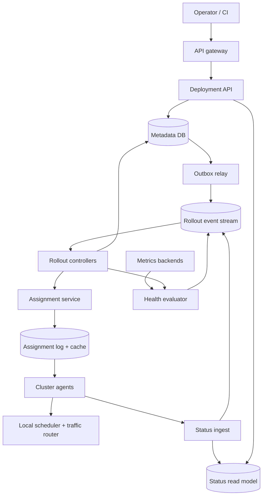
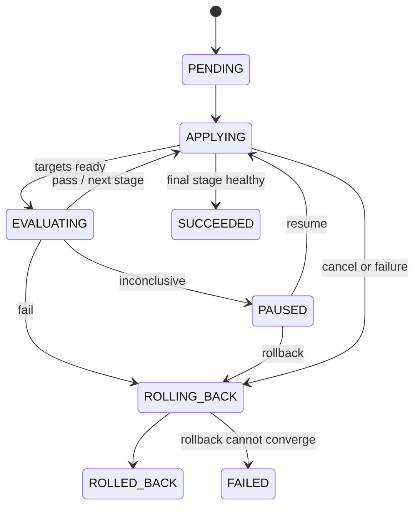
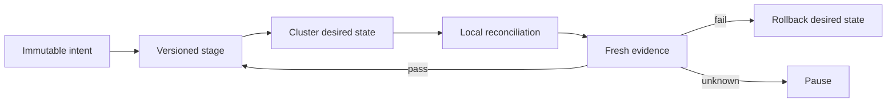

# Design a Safe Progressive Deployment Control Plane

**Difficulty:** Senior / Staff-level  
**Primary themes:** distributed control planes, reconciliation, queues, state machines, consistency, failure isolation, observability  
**Interview time box:** about 45 minutes  
**Educational walkthrough:** intentionally more detailed than what you would say in 45 minutes

This walkthrough follows the broad delivery sequence recommended by Hello Interview: establish requirements, name the core entities, define the interface, build a complete high-level design, and then deepen the important bottlenecks. Hello Interview recommends letting the API and high-level design reveal the fields that actually matter instead of prematurely designing every table. genui{"citation":{"ref":"turn174search15"}}

---

## Interviewer prompt

> Design a multi-tenant deployment control plane that safely rolls new versions of stateless services across many clusters and regions. It should support canaries, automatic health checks, progressive promotion, pause/resume, and rollback.

The important word is **safely**. This is not merely a job scheduler. A bug in the deployment system can turn a small application defect into a fleet-wide outage.

## Targeted clarifying questions

**Candidate:** Are we deploying only stateless services, or must we coordinate database schema migrations and stateful workloads too?

**Interviewer:** Focus on stateless services. A deployment may include a backward-compatible pre-deploy hook, but cross-version database migration orchestration is out of scope.

**Candidate:** Does the platform own the underlying scheduler, such as Kubernetes?

**Interviewer:** No. Each cluster already has a local scheduler. Our system decides *what version and rollout step each target should run* and asks a cluster-local agent to reconcile that desired state.

**Candidate:** How are canary requests selected?

**Interviewer:** Support both instance-based canaries and weighted traffic splitting when the cluster has a compatible ingress or service mesh. You may design the generic control plane and abstract the local mechanism.

**Candidate:** Which signals decide whether a canary passes?

**Interviewer:** Readiness and rollout progress are mandatory. Teams may also configure error rate, latency, and one business metric. Missing or stale telemetry must not be interpreted as success.

**Candidate:** What scale should I assume?

**Interviewer:** Roughly 100,000 services, one million running instances, 1,000 clusters, and 20,000 deployments per day. A large rollout can affect 100,000 instances. Traffic and deployment activity are bursty.

**Candidate:** Do we need active-active global control-plane writes?

**Interviewer:** A highly available regional control plane with a warm disaster-recovery region is enough. Cluster agents must behave safely if disconnected.

**Candidate:** Who can promote or roll back?

**Interviewer:** Automated policy may do either. Authorized humans may pause, resume, promote, cancel, or roll back. Every action must be attributable and auditable.

**Candidate:** Is artifact building and vulnerability scanning in scope?

**Interviewer:** No. Artifacts arrive already built and signed. Verify their immutable digest and signature, but do not design CI or a registry.

**Candidate:** What should happen to an in-progress rollout if the control plane is unavailable?

**Interviewer:** Existing workloads continue serving. Agents may finish an already authorized local step but must not begin a new promotion step. Prefer a frozen rollout over an unsafe rollout.

### Scope statement to say aloud

> “I’ll design the control plane from a signed immutable artifact to a safely converged fleet. I’ll treat the cluster scheduler, traffic router, metrics backend, and registry as dependencies. I’ll focus on versioned desired state, progressive health gates, rollback, partitions, and auditability.”

---

## 1. Requirements (~5 minutes in the interview)

### Core functional requirements

1. **Create a deployment.** An authenticated operator selects a service/environment, immutable artifact digest, target fleet, rollout strategy, and health policy.
2. **Execute and control a progressive rollout.** The system deploys a canary, evaluates health, promotes through bounded waves, and supports pause, resume, cancel, and manual or automatic rollback.
3. **Observe and audit.** Operators can see desired versus observed state, per-stage health, stale clusters, failure reasons, and an immutable history of every automated and human decision.

### Explicitly out of scope

- Building, scanning, or storing artifacts
- General-purpose CI pipelines
- Stateful database migrations
- Implementing the cluster scheduler or service mesh
- Feature-flag evaluation
- Arbitrary DAG workflow orchestration

Keeping this boundary is interview discipline. Hooks can be constrained, but turning the product into a generic workflow engine would obscure the safety problem.

### Quantified non-functional requirements

| Requirement | Target | Design consequence |
|---|---:|---|
| Scale | 100K services, 1M instances, 1K clusters, 20K deployments/day | Deployment writes are modest; status fan-in and rollout fan-out dominate. |
| Responsiveness | create/pause/rollback API p99 < 300 ms; agents see newly authorized work within 5 s | Persist intent synchronously, perform rollout asynchronously, and use watch streams with polling fallback. |
| Safety | at most one active rollout per `(service, environment)`; default canary ≤1%; automatic rollback decision within 30 s after a conclusive breach | Use conditional writes, versioned state, bounded waves, and continuous health evaluation. |
| Availability | control plane 99.99%; running services unaffected by its outage | Separate data plane from control plane and make disconnected agents fail safe. |
| Status freshness | normal per-cluster state visible within 10 s; mark it stale after 45 s | Aggregate high-volume status asynchronously and expose freshness explicitly. |
| Durability/audit | no acknowledged deployment intent or decision lost; seven-year audit retention | Transactional metadata plus an append-only event archive. |

### Scale estimates that change the design

The average deployment arrival rate is surprisingly small:

\[
20{,}000 / 86{,}400 \approx 0.23\text{ deployments/s}
\]

Even a 20× business-hours burst is under 5 new deployments per second. Therefore, we do **not** need a globally sharded database merely for deployment creation.

Status traffic is different. If one million instances report every 30 seconds:

\[
1{,}000{,}000 / 30 \approx 33{,}000\text{ instance updates/s}
\]

During a large rollout, retries and transitions can push that beyond 100,000 updates/s. Writing every heartbeat into the strongly consistent deployment database would be wasteful and could starve safety-critical writes. We will ingest observations through a stream and maintain compact per-target materialized state.

A 100,000-instance rollout also rules out one command per instance from the global control plane. At roughly 1 KB per command that is only 100 MB, but the operational problem is 100,000 independently retried actions and acknowledgements. We will issue **one versioned assignment per cluster/service shard** and let local agents expand it into instance operations.

### Consistency and availability contract

We should state the contract, not vaguely say “eventual consistency.”

- **Strongly consistent:** the active rollout pointer, rollout state transition, authorized stage number, stable artifact, desired artifact, version, and fencing epoch for a `(service, environment)`.
- **Eventually consistent:** instance observations, dashboards, aggregate counts, and metrics evaluations. Each includes an observation timestamp and source revision.
- **Monotonic control:** an agent never applies an assignment with a lower revision or fencing epoch than one it has already accepted.
- **No exactly-once promise:** commands and reports may be duplicated. Desired-state reconciliation and idempotency make duplicates harmless.
- **During a partition:** workloads keep serving; an agent may complete the currently authorized stage but cannot infer approval for the next stage. Automated promotion requires fresh health data and a durable state transition.
- **Safety over rollout availability:** when ownership, telemetry, or desired state is ambiguous, freeze. Do not promote.

### A concise interview version

> “The low-QPS API hides a high-fan-out reconciliation problem. I need linearizable transitions for the authorized rollout stage, but observations can be eventual and timestamped. During ambiguity I preserve serving availability while sacrificing rollout progress.”

---

## 2. Core entities (~2 minutes)

Name only the concepts that shape the design at first:

- **ServiceEnvironment** — the deployable identity, such as `payments/prod`, including its stable release and active rollout.
- **ReleaseArtifact** — immutable image digest, signature metadata, configuration digest, and compatibility metadata.
- **Deployment** — one requested change with creator, target snapshot, strategy, health policy, and lifecycle state.
- **Stage** — one authorized rollout wave, such as canary, 10%, 25%, 50%, or 100%.
- **TargetAssignment** — versioned desired state for one `(cluster, service, environment)` shard.
- **TargetObservation** — the agent’s observed assignment revision, readiness, replica counts, and timestamp.
- **HealthEvaluation** — inputs, time window, result (`PASS`, `FAIL`, or `INCONCLUSIVE`), and evidence.
- **RolloutEvent** — immutable record of state transitions and human/automation actions.

Do not start by drawing twenty tables. Fields will appear next to the operation that needs them.

> “My source of truth is deployment intent and authorized stage. Agent observations are reports about reality, not authority to change it.”

---

## 3. API and system interfaces (~5 minutes)

All public calls carry an OAuth/JWT bearer token. The API gateway validates it and passes signed claims such as `subject`, `tenant`, and roles. The caller never supplies `actor_id` in the body.

### 3.1 Create a deployment

```http
POST /v1/service-environments/payments/prod/deployments
Authorization: Bearer <token>
Idempotency-Key: dep-2026-10-19-payments-1842
Content-Type: application/json

{
  "artifact": {
    "image_digest": "sha256:8d91...f02a",
    "config_digest": "sha256:13ac...921d"
  },
  "expected_stable_release": "rel_01JZSTABLE",
  "target_selector": {
    "regions": ["us-east", "us-west", "eu-west"],
    "cluster_labels": {"tier": "production"}
  },
  "strategy": {
    "stages": [
      {"name": "canary", "percent": 1, "min_instances": 10, "bake_seconds": 600},
      {"name": "wave-10", "percent": 10, "bake_seconds": 600},
      {"name": "wave-25", "percent": 25, "bake_seconds": 900},
      {"name": "wave-50", "percent": 50, "bake_seconds": 900},
      {"name": "complete", "percent": 100, "bake_seconds": 600}
    ],
    "max_unavailable_percent": 5,
    "max_surge_percent": 10
  },
  "health_policy": {
    "error_rate": {"max_absolute": 0.01, "max_ratio_to_control": 1.5},
    "p99_latency_ms": {"max_absolute": 400, "max_ratio_to_control": 1.2},
    "min_requests": 10000,
    "on_inconclusive": "PAUSE"
  }
}
```

```json
{
  "deployment_id": "dep_01K7C2...",
  "state": "PENDING",
  "version": 1,
  "target_snapshot_count": 74231,
  "created_by": "user:rahul@example.com"
}
```

`expected_stable_release` prevents an operator from deploying on top of a stale view. `Idempotency-Key` makes a timed-out client retry safe. The response does not wait for clusters.

### 3.2 Read deployment status

```http
GET /v1/deployments/dep_01K7C2...
```

```json
{
  "state": "EVALUATING",
  "version": 7,
  "stage": {"index": 1, "name": "wave-10"},
  "stable_artifact": "sha256:old...",
  "candidate_artifact": "sha256:8d91...f02a",
  "targets": {
    "total": 74231,
    "candidate_ready": 7310,
    "candidate_unready": 42,
    "stable_ready": 66879,
    "stale_clusters": 1
  },
  "health": {
    "result": "INCONCLUSIVE",
    "window_ends_at": "2026-10-19T20:18:00Z",
    "reason": "minimum request count not reached"
  },
  "observed_at": "2026-10-19T20:14:07Z"
}
```

The response clearly separates the strongly consistent rollout state from an eventually consistent observed summary.

### 3.3 Control the deployment

```http
POST /v1/deployments/dep_01K7C2.../actions
If-Match: "version:7"
Content-Type: application/json

{
  "action": "PAUSE",
  "reason": "Investigating elevated checkout retries"
}
```

Allowed actions are `PAUSE`, `RESUME`, `PROMOTE`, `ROLLBACK`, and `CANCEL`. `If-Match` provides optimistic concurrency: a human acting on version 7 cannot overwrite an automatic rollback that already produced version 8.

Return `409 Conflict` with the current state/version when the precondition loses. Authorization policy may allow an on-call role to roll back but require a release-manager role plus a justification to force-promote an inconclusive stage.

### 3.4 Cluster-agent interface

The control plane exposes a bidirectional authenticated stream. A polling fallback uses the same revision semantics.

```protobuf
rpc WatchAssignments(WatchRequest) returns (stream Assignment);
rpc ReportObservation(Observation) returns (ObservationAck);

message WatchRequest {
  string cluster_id = 1;          // bound to mTLS identity
  uint64 after_cluster_revision = 2;
}

message Assignment {
  string service_environment_id = 1;
  string deployment_id = 2;
  uint64 fencing_epoch = 3;
  uint64 assignment_revision = 4;
  string stable_digest = 5;
  string candidate_digest = 6;
  uint32 desired_candidate_replicas = 7;
  uint32 desired_stable_replicas = 8;
  uint32 traffic_weight_basis_points = 9;
  string spec_hash = 10;
}
```

The agent identity comes from its certificate, not from `cluster_id` alone. Assignment delivery is at least once. The agent stores its last accepted `(fencing_epoch, assignment_revision)` durably.

### API-to-requirement map

| Requirement | Interface |
|---|---|
| Create rollout | `POST .../deployments` |
| Pause/promote/rollback | `POST .../actions` with `If-Match` |
| Observe/audit | `GET /deployments/{id}` and `GET /deployments/{id}/events` |
| Reconcile clusters | `WatchAssignments` / `ReportObservation` |

---

## 4. Data flow

This is a processing pipeline, so a short data-flow view is useful:

1. An operator creates an immutable deployment specification.
2. A transaction writes the deployment, target selector snapshot, initial state, and outbox event.
3. The rollout controller acquires ownership and authorizes the canary stage.
4. The assignment service produces one versioned desired assignment per affected cluster/service shard.
5. Cluster agents reconcile those assignments through the local scheduler and traffic router.
6. Agents stream observations; the metrics evaluator queries canary and control telemetry.
7. The controller combines readiness, progress, and metric evidence into `PASS`, `FAIL`, or `INCONCLUSIVE`.
8. A durable state transition either authorizes the next stage, pauses, or creates rollback assignments.
9. Every transition emits an immutable audit event and refreshes the read model.

The term **reconciliation** means repeatedly comparing desired state with observed state and taking idempotent actions to reduce the difference. It is more robust than assuming a one-time command succeeded.

---

## 5. High-level design (~10–15 minutes)

### Architecture



The metadata database is a replicated relational store because the critical write rate is low and we benefit from transactions, unique constraints, and compare-and-swap updates. The event stream absorbs bursts and decouples controllers, status materialization, auditing, and notifications. Assignment storage is partitioned by `cluster_id`, which matches how agents consume it.

### Operation 1: create and validate a deployment

The Deployment API:

1. Authenticates the caller and evaluates RBAC/tenant policy.
2. Resolves the target selector to an immutable snapshot of clusters and approximate instance counts.
3. Verifies the image signature, digest existence, supported platform, and configuration digest.
4. Validates stage percentages, bake times, health query allowlist, `maxUnavailable`, and `maxSurge`.
5. In one database transaction:
   - inserts `Deployment` with state `PENDING` and version 1;
   - stores the target snapshot;
   - enforces a unique active rollout for `(service_environment_id)`;
   - inserts a `RolloutEvent(CREATED)` and outbox row.
6. Returns immediately.

Important fields introduced here:

```text
ServiceEnvironment(
  id, tenant_id, service_id, environment,
  stable_release_id, active_deployment_id, version
)

Deployment(
  id, service_environment_id, artifact_digest, config_digest,
  expected_stable_release_id, target_snapshot_uri,
  strategy_json, health_policy_json,
  state, stage_index, version, owner_epoch,
  created_by, created_at, updated_at
)
```

Why snapshot targets? If a cluster label changes midway, the same deployment must not silently gain a new failure domain. Autoscaling inside an already targeted shard is fine, but adding a new cluster requires an explicit policy or later deployment amendment.

The outbox row is written in the same transaction as the deployment. A relay publishes it to the stream and marks it delivered. This avoids the classic dual-write failure where the database commit succeeds but the “start rollout” message is lost.

> “The synchronous path records durable intent and rejects conflicts. It does not wait for rollout work, so the API latency target is independent of fleet size.”

### Operation 2: authorize and execute the canary

A rollout controller consumes `CREATED`, claims the deployment with a renewable lease, and increments `owner_epoch`. The epoch fences off an old controller that pauses during a network partition and later resumes.

The controller deterministically chooses canary shards across failure domains. For 74,231 instances, 1% is about 742 instances. Rather than choosing all 742 from one cluster, it might select a minimum of 10 instances across two representative clusters in one region first, then widen to a full 1% cross-region canary. The exact policy balances representativeness against blast radius.

For each selected cluster, the Assignment Service writes:

```text
TargetAssignment(
  cluster_id, service_environment_id,
  deployment_id, fencing_epoch, assignment_revision,
  stable_digest, candidate_digest,
  desired_stable_replicas, desired_candidate_replicas,
  traffic_weight_bps, max_unavailable, max_surge,
  spec_hash, authorized_stage, created_at
)
```

Assignments are immutable revisions. The latest pointer can be cached, but the durable log is authoritative. An agent receiving revision 42 after 43 ignores it. If two different payloads somehow claim the same revision, the `spec_hash` mismatch is a critical invariant violation and the agent freezes that target.

The agent applies desired state through the local scheduler. With instance-based canaries it scales candidate instances and reduces stable instances within the availability budget. With traffic splitting it can run the candidate at sufficient capacity and adjust routing weight separately.

Kubernetes illustrates the local rollout mechanics: `maxUnavailable` limits how many replicas can be unavailable, `maxSurge` bounds extra replicas, and a progress deadline can surface a stalled rollout. Kubernetes itself reports a stalled Deployment but does not automatically roll it back, which is a responsibility our higher-level controller can assume. genui{"citation":{"ref":"turn174search1"}}

The agent reports:

```text
TargetObservation(
  cluster_id, service_environment_id,
  deployment_id, fencing_epoch, assignment_revision,
  observed_spec_hash,
  stable_ready, candidate_ready, unavailable,
  local_condition, failure_code,
  observed_at, agent_sequence
)
```

The local action is idempotent because it declares counts and weights rather than saying “add ten pods.” Retrying the same assignment converges to the same outcome.

### Operation 3: evaluate health

Once canary instances are ready for a minimum stabilization time, the controller requests a `HealthEvaluation`. The evaluator uses an allowlisted query template populated with service, release, cluster, and time-window labels. Users cannot submit arbitrary expensive metrics queries.

The result has three values:

- `PASS`: all mandatory checks have fresh, sufficient evidence and are within thresholds.
- `FAIL`: a mandatory readiness, progress, or metric threshold is breached.
- `INCONCLUSIVE`: telemetry is stale, sample size is too small, labels are missing, or checks disagree according to policy.

```text
HealthEvaluation(
  id, deployment_id, stage_index,
  candidate_start, candidate_end,
  control_start, control_end,
  policy_version, result, reason,
  metric_evidence_uri, evaluated_at
)
```

The evaluator checks both absolute and relative guardrails. For example, candidate error rate must be below 1% *and* no more than 1.5× the simultaneous control rate. The absolute threshold prevents both cohorts being terrible; the relative threshold reduces false alarms from a shared upstream incident.

Google’s SRE guidance defines a canary as a partial, time-bounded deployment evaluated before deciding whether to proceed; that is exactly the contract of our stage plus health evaluation. genui{"citation":{"ref":"turn174search0"}}

After the bake window, the evaluator publishes a signed result referencing the deployment version, stage, policy version, and exact metric window. A result for stage 0 cannot promote stage 1.

### Operation 4: promote through waves

On `PASS`, the controller performs a compare-and-swap transaction:

```sql
UPDATE deployment
SET stage_index = stage_index + 1,
    state = 'APPLYING',
    version = version + 1
WHERE id = :id
  AND version = :expected_version
  AND stage_index = :evaluated_stage
  AND owner_epoch = :my_epoch
  AND state = 'EVALUATING';
```

If zero rows update, another action won. The controller reloads state instead of guessing.

It emits new assignments for the next cumulative percentage. Promotions are checkpoints: 1% → 10% → 25% → 50% → 100%, never an unbounded loop that reacts to each individual instance.

At 100% ready and healthy, a final transaction changes `ServiceEnvironment.stable_release_id`, clears `active_deployment_id`, and marks the deployment `SUCCEEDED`. The previous stable artifact remains retained for the rollback window.

### Operation 5: pause, cancel, and roll back

**Pause** stops new assignments but does not undo already applied work. **Cancel** stops forward movement and, by policy, usually initiates rollback. **Rollback** is an explicit new desired-state revision pointing traffic and replica counts back to the last stable artifact.

Rollback is not “delete the new version and hope.” It is another reconciled rollout with higher assignment revisions and the same fencing epoch or a newly committed epoch. It prioritizes traffic restoration:

1. Set candidate traffic weight toward zero as stable capacity becomes ready.
2. Restore stable replicas within surge/unavailable constraints.
3. Verify readiness and critical health.
4. Scale down candidate replicas after connections drain.
5. Mark `ROLLED_BACK`, retaining evidence.

If the stable binary cannot start because an external schema changed incompatibly, the platform cannot manufacture safety. That is why migration compatibility is a release-policy prerequisite and why rollback itself needs health monitoring.

Argo Rollouts documents a practical optimization: returning to a known stable revision can skip ordinary analysis steps to accelerate rollback. Our system adopts the same principle while retaining basic readiness and catastrophic guardrails. genui{"citation":{"ref":"turn174search19"}}

### Operation 6: query status and history

The status ingestor deduplicates observations by `(cluster_id, agent_sequence)`, rejects lower epochs/revisions, and writes compact latest-state rows plus time-series events. A stream processor rolls them up by deployment, stage, region, and failure code.

The read API joins strongly consistent deployment metadata with the materialized status. It always includes `observed_at` and stale-target counts. The UI must never present an old green aggregate as current truth.

Audit events are append-only:

```text
RolloutEvent(
  event_id, deployment_id, event_type,
  from_state, to_state, deployment_version,
  actor_type, actor_subject, reason,
  evidence_refs, idempotency_key, occurred_at
)
```

Events are archived to immutable object storage for seven years. The transactional database keeps a searchable recent index.

---

## 6. Deep dives (~10–15 minutes)

In a real interview, explicitly ask which two areas the interviewer wants. The three strongest are below.

### Deep dive A: reliable orchestration, idempotency, and fencing

#### Where the baseline breaks

A naive coordinator could send `deploy 10%`, wait for acknowledgements, then send `deploy 25%`. It breaks when:

- the coordinator crashes after sending but before recording the command;
- a command or acknowledgement is duplicated;
- a slow old coordinator resumes after a new coordinator has taken ownership;
- the event stream redelivers events out of order;
- one cluster is disconnected for hours;
- a manual rollback races with an automatic promotion.

#### Plausible approaches

| Approach | Strength | Weakness |
|---|---|---|
| Push imperative commands | Simple mental model; fast on healthy links | Retry ambiguity; command ordering and partial failure become complex |
| Durable workflow engine | Timers, retries, and histories are convenient | Per-instance workflows explode; external effects still require idempotency |
| Versioned desired state + reconciliation | Naturally retries; tolerates disconnects; agents can self-heal | Requires careful versioning, observation semantics, and convergence logic |

#### Selection

Use a **durable state machine at deployment/stage granularity** and **versioned desired-state reconciliation at cluster granularity**. A workflow engine could implement timers internally, but it is not the correctness boundary. Database state, fencing epochs, and assignment revisions are.

The rollout state machine is:



Every transition is conditional on expected `version`, `stage_index`, and `owner_epoch`. Side effects follow an outbox event from the committed transition.

#### Why both leases and fencing tokens?

A lease says “I probably still own this work until time T.” Clock skew or a partition can make an expired owner continue. A monotonically increasing **fencing epoch** lets downstream systems reject the old owner categorically. The new controller commits epoch 18; an assignment from epoch 17 is invalid even if it arrives later.

#### Delivery semantics

- Events and assignments are **at least once**.
- API creation is deduplicated by `(tenant, idempotency_key)` and request hash.
- Agent reports are deduplicated by per-agent sequence number.
- Assignments are declarative and immutable.
- State transitions are compare-and-swap operations.
- There is no attempt at distributed exactly-once execution.

#### Queue partitioning and fairness

Partition rollout events by `service_environment_id` so events for one target are ordered. Assignment logs are partitioned by `cluster_id` because that is the consumer key. Large deployments are broken into bounded batches so one 100,000-instance rollout cannot monopolize controller workers.

Use weighted fair queues per tenant and caps such as:

- maximum concurrent active deployments per tenant;
- maximum simultaneous instance changes per cluster;
- maximum rollouts affecting the same failure domain;
- emergency rollback priority above ordinary promotion.

Do not let priority starve safety checks: health evaluations for active canaries remain high priority too.

#### Failure modes and recovery

- **Controller crashes after committing a stage:** the outbox republishes; the next owner reconstructs work from database state.
- **Controller crashes before commit:** no stage authorization exists, so agents do not advance.
- **Agent loses local disk:** it requests a full assignment snapshot and reconciles; it does not rely on replaying every command.
- **Event retention gap:** controller rebuilds from metadata and current assignments, then re-subscribes from a checkpoint.
- **Poison event:** move it to a dead-letter queue, page, and freeze the affected deployment; do not silently skip it.

> “Retries are expected, not exceptional. The safety invariant is that only a committed, higher-version desired state can cause forward progress.”

### Deep dive B: health gates that are useful, not dangerously optimistic

#### Where the baseline breaks

Readiness alone proves only that a process answers a shallow probe. A release can be ready while returning 500s, increasing latency, corrupting responses, or hurting conversion. Conversely, a fixed global error threshold can fail a healthy candidate during a shared dependency incident or pass a candidate with too little traffic.

#### Plausible approaches

| Approach | Benefit | Problem |
|---|---|---|
| Human-only approval | Flexible judgment | Slow, inconsistent, and poor at continuous monitoring |
| Absolute thresholds | Easy to explain | Environment-dependent and vulnerable to shared incidents |
| Candidate-vs-control comparison | Controls for simultaneous background conditions | Needs representative cohorts and enough samples |
| Formal sequential statistics | Can make efficient decisions | Easy to misuse; assumptions may not fit sparse, correlated metrics |

#### Selection

Use layered gates:

1. **Mechanical gates:** artifact fetched, scheduler progressing, instances ready, unavailable count within budget.
2. **Absolute safety guardrails:** e.g. error rate <1%, p99 <400 ms.
3. **Relative canary/control guardrails:** e.g. error ratio <1.5 and latency ratio <1.2 over aligned windows.
4. **Evidence rules:** minimum requests, minimum healthy instances, minimum bake time, metric freshness, and label coverage.
5. **Optional manual hold:** for sensitive environments or business metrics.

Argo Rollouts likewise integrates metrics providers so analysis can drive automatic promotion or rollback; our design generalizes that idea across clusters and adds explicit evidence/freshness contracts. genui{"citation":{"ref":"turn174search38"}}

#### Avoiding common measurement traps

- **Warm-up bias:** start the evaluation after candidate readiness plus a stabilization delay.
- **Low traffic:** return `INCONCLUSIVE`; do not divide by tiny samples or treat zero errors as proof.
- **Canary selection bias:** stratify selection across instance types or representative clusters; compare similar traffic.
- **Delayed metrics:** evaluate only windows whose end time is behind the metrics backend’s completeness watermark.
- **Simpson’s paradox:** inspect important regions or endpoint classes instead of relying solely on one global aggregate.
- **Multiple signals:** distinguish mandatory guardrails from advisory metrics; otherwise enough dashboards can always create a false alarm.
- **Metric query drift:** version health policies and store exact queries/evidence with the result.

#### Failure policy

`FAIL` automatically rolls back. `INCONCLUSIVE` pauses by default. A privileged force-promotion records actor, reason, evidence, and the policy exception. Missing telemetry is never `PASS`.

Rollback triggers should have hysteresis where appropriate. For example, one isolated scrape should not undo a rollout, but a catastrophic readiness collapse should not wait ten minutes. Define:

- fast-fail signals: crash loop, readiness collapse, error rate >10%;
- windowed signals: modest latency or error regression sustained for N evaluation intervals;
- recovery confirmation: stable capacity ready before candidate traffic drains completely.

#### Observability for the evaluator

Track evaluation latency, telemetry age, query failures, inconclusive rate by reason, false-positive reviews, rollback-decision time, and the number of deployments promoted with policy overrides. High override frequency means the policy is teaching users to ignore it.

### Deep dive C: partitions, blast radius, and safe degradation

#### Where the baseline breaks

A central controller connected directly to every workload becomes both a scaling bottleneck and a correlated failure source. A WAN partition could leave half the fleet updated, while a retry storm after recovery overloads every cluster at once.

#### Selection: hierarchical control

The global control plane owns intent, stage authorization, and cross-cluster health. A cluster-local agent owns convergence within its cluster. This hierarchy compresses fan-out, isolates scheduler-specific details, and preserves local reconciliation when the WAN is intermittent.

Agents cache only signed, immutable assignments and the latest accepted revision. If disconnected:

- existing workloads continue;
- the agent completes a local action already authorized by its current assignment;
- it maintains desired replicas if pods fail;
- it does not raise traffic weight or candidate count beyond that assignment;
- it queues observations locally with bounded storage;
- after the staleness deadline, the global controller marks the cluster unknown and blocks promotion.

This is a deliberate availability split: the **application data plane** remains available, while the **deployment mutation plane** becomes unavailable rather than unsafe.

#### Failure-domain-aware waves

A percentage is not enough. Ten percent concentrated in one zone could remove half of that zone’s capacity. The target planner therefore enforces budgets by region, zone, cluster, and service:

```text
global candidate <= stage percentage
unavailable per zone <= zone budget
simultaneous changed clusters per region <= region budget
at least N stable instances per failure domain
```

For small fleets, percentages round badly. A service with six instances cannot have a meaningful 1% canary. Use explicit minimum and maximum counts, then show the operator the actual blast radius before creation.

#### Control-plane database outage

- APIs reject mutations rather than acknowledge uncertain intent.
- Controllers stop transitions.
- Assignment streams may serve cached committed revisions, but never synthesize newer ones.
- Agents maintain their current desired state.
- Status ingestion may buffer in the event stream.
- After recovery, controllers compare durable state, assignment revisions, and observations before proceeding.

#### Metrics outage

Stages in `EVALUATING` become `INCONCLUSIVE` and pause. Already running services are untouched. A policy may allow a manual override, but an automatic promotion cannot use stale evidence.

#### Registry outage

Preflight should verify candidate availability in relevant regional caches before changing traffic. If image pulls fail, local progress gates fail and the rollout pauses or rolls back. Stable artifacts are pinned for at least the rollback window.

#### Rollback storm

A shared dependency incident might make many simultaneous canaries fail. Rolling all of them back at once can overload schedulers and registries. Emergency rollbacks receive priority but still obey per-cluster concurrency and capacity budgets. If evidence shows a global telemetry or dependency incident affecting control and candidate equally, relative checks may pause rather than trigger thousands of pointless rollbacks.

#### Multi-region disaster recovery

Replicate metadata and audit events to a warm region. Promotion of the DR control plane requires a single leadership decision and a higher global epoch. Cluster agents pin the trusted control-plane identity and reject lower epochs. Recovery objectives might be RPO <1 minute for in-flight metadata and RTO <15 minutes; acknowledged creation is protected synchronously within the primary region, while the data plane remains unaffected during failover.

---

## Reliability, consistency, and observability summary

### Key invariants

1. At most one active rollout exists per `(service, environment)`.
2. A target applies only assignments with a nondecreasing fencing epoch and strictly increasing revision.
3. No stage promotes without a committed transition referencing a fresh evaluation for that exact stage and policy version.
4. Missing or stale observations can never count as healthy.
5. The previous stable artifact remains retrievable throughout the rollback window.
6. Every user and automation action has an immutable audit event.

### Failure-mode table

| Failure | Detection | Safe behavior | Recovery |
|---|---|---|---|
| Rollout controller crash | lease expires, heartbeat alert | no new transition | new owner uses higher epoch and resumes from DB |
| Duplicate/out-of-order assignment | revision and epoch comparison | ignore stale; reapply duplicate harmlessly | request snapshot if gap cannot be filled |
| Cluster partition | agent stream heartbeat absent | freeze global promotion; local workloads continue | reconcile latest snapshot, then assess health |
| Metrics unavailable/stale | completeness watermark/query errors | `INCONCLUSIVE`, pause | reevaluate a fresh window |
| Scheduler cannot make progress | local deadline/readiness conditions | halt affected wave | repair capacity/config or roll back |
| Stable artifact unavailable | rollback preflight failure | keep candidate at safest current level; page | restore/pin artifact, then rollback |
| DB unavailable | health checks and write errors | reject mutations; do not promote | fail over or restore, then reconcile |
| Event stream lag | consumer lag SLO | slow new rollouts; preserve critical rollback capacity | autoscale consumers and replay |
| Two controllers active | epoch mismatch/CAS conflicts | stale owner cannot commit or issue accepted assignments | investigate lease system; higher epoch wins |
| Bad health policy | unusual overrides/false decisions | pause, allow audited emergency action | roll back policy version and re-evaluate |

### Metrics and alerts

**Safety and outcome**

- deployments by result: success, rollback, cancel, failed rollback
- time to detect and time to rollback
- instances and requests exposed before rollback
- promotions with missing targets, stale observations, or manual override
- invariant violations, stale-epoch attempts, spec-hash conflicts

**Control-plane health**

- API latency/error rate and database transaction conflicts
- active deployments and per-state age
- controller lease age, transition failures, and outbox lag
- assignment propagation p50/p95/p99
- event-stream lag and dead-letter count
- agent connected percentage and observation freshness

**Local convergence**

- desired-versus-ready delta by cluster
- image pull, quota, readiness, and progress-deadline failures
- scheduler reconciliation duration
- traffic-weight desired/observed mismatch

Every trace carries `deployment_id`, `stage_index`, `cluster_id`, `assignment_revision`, and `fencing_epoch`. Logs alone are insufficient; high-cardinality detail belongs in traces/events, while alerting uses bounded metric labels.

### Security controls

- mTLS and short-lived workload identities for agents
- RBAC scoped by tenant/service/environment
- artifact signature and provenance verification
- policy-as-code validation before deployment creation
- secrets referenced, never copied into deployment specs or audit logs
- separation of duties for production force-promotion
- signed audit records exported to immutable storage
- rate limits and quotas at tenant and cluster levels

---

## 7. Final design

The completed system has a small strongly consistent core and a large eventually consistent observation plane:

- A deployment API writes immutable intent, target snapshots, and outbox events to a relational metadata store.
- A versioned state machine authorizes one rollout stage at a time using conditional writes, leases, and fencing epochs.
- An assignment service publishes declarative desired state per cluster/service shard.
- Cluster-local agents reconcile that state through local schedulers and traffic routers and report observations asynchronously.
- A health evaluator combines rollout progress, absolute guardrails, relative canary/control metrics, sample sufficiency, and telemetry freshness.
- Promotion, pause, and rollback are durable state transitions, not ephemeral commands.
- Status streams feed a materialized read model; immutable audit events capture every decision.
- During partitions, workloads keep serving while rollout progress freezes at the last authorized boundary.



### Requirements check

| Requirement | How it is met |
|---|---|
| Create deployment | authenticated idempotent API, immutable artifacts, preconditions, target snapshot |
| Progressive rollout | deterministic canary and bounded waves, cluster assignments, health-gated transitions |
| Pause/promote/cancel/rollback | optimistic-concurrency action API and explicit state machine |
| Observe/audit | timestamped read model, event history, immutable archive |
| 1M instances / 1K clusters | cluster-level assignments and streaming observation aggregation |
| <5 s assignment visibility | watch streams with partitioned assignment log and polling fallback |
| Safety under races | unique active rollout, CAS transitions, fencing epochs, monotonic revisions |
| Survive control-plane outage | data/control separation and fail-safe agent behavior |
| Fresh, meaningful health | three-valued evaluation, aligned control cohort, sample and freshness rules |

### Thirty-second closing statement

> “The central design choice is to authorize immutable desired state rather than send one-shot commands. Strong consistency covers only rollout ownership and stage transitions; agents and observations are asynchronous and idempotent. Canary health uses fresh, sufficient evidence, and any ambiguity pauses promotion. That keeps the application data plane running during failures without letting a disconnected or stale controller expand the blast radius.”

---

## Realistic interviewer follow-up questions and strong sample answers

### 1. Why not store every instance heartbeat in PostgreSQL?

At one report per 30 seconds, one million instances produce about 33,000 updates per second before bursts. Most reports overwrite nearly identical state and do not need transactions with rollout intent. A stream plus compact materialized state isolates this volume. PostgreSQL stores critical transitions and perhaps per-cluster summaries, not raw heartbeat history.

### 2. How do you guarantee exactly one rollout controller?

I do not depend on exactly one process running. Leases reduce duplicate work, while conditional writes and fencing epochs make stale owners unable to commit transitions or publish accepted assignments. Correctness comes from fencing, not perfect leader election.

### 3. Could a delayed `PASS` promote a later stage?

No. A health result names the deployment version, policy version, stage index, time window, and candidate digest. The promotion transaction verifies all of them. A result for an earlier stage is evidence only for that stage.

### 4. How is the canary cohort selected?

Use deterministic hashing over stable target identifiers, constrained by failure-domain budgets and eligibility. The hash makes retries select the same cohort; constraints ensure representativeness and prevent concentration. Store the selected cohort in the target snapshot so it is explainable.

### 5. What if 1% is one instance?

Specify both percentage and minimum/maximum counts. For a tiny fleet, an instance canary may be statistically weak, so use a dedicated synthetic or shadow cohort, a longer bake, manual approval, or blue-green traffic splitting. The UI exposes the actual count rather than pretending the percentage is meaningful.

### 6. What if autoscaling happens during a rollout?

The assignment expresses candidate and stable proportions plus hard budgets for a targeted shard. The local agent recomputes desired counts when total replicas change while preserving stage limits. New clusters are not silently added unless the deployment policy explicitly allows dynamic target membership.

### 7. How do you avoid a rollback reducing capacity?

Treat rollback as reconciliation: first ensure stable capacity, then shift traffic, then drain and remove candidate capacity. Apply `maxSurge` and `maxUnavailable` to rollback too. Fast does not mean deleting candidate instances first.

### 8. What if control and canary receive different traffic?

Stratify or route comparable request classes and attach cohort/version labels at the serving layer. Evaluate per important region/endpoint before aggregation. If comparability or label coverage falls below policy, mark the result inconclusive.

### 9. Would you use Kafka or a workflow engine?

Kafka-like logs are useful for event fan-out, assignment streams, and status ingestion. A workflow engine is useful for durable timers and retry bookkeeping. Neither replaces the relational state machine, fencing, and idempotent external effects. I would choose managed equivalents based on the organization’s operational expertise.

### 10. How do emergency manual promotions work?

They require a stronger role, current deployment version, explicit reason, and possibly two-person approval for production. The override is a committed event and increments the deployment version. It bypasses only the named policy condition, not artifact verification, fencing, or hard availability budgets.

### 11. How do you prevent one tenant from overwhelming the system?

Apply per-tenant API quotas, active-rollout limits, weighted fair scheduling, and per-cluster mutation budgets. Large rollouts yield between batches. Reserve worker and queue capacity for rollback and health processing.

### 12. What is the disaster-recovery story?

Continuously replicate metadata and archive events to a warm region. Failover establishes a higher global control epoch before accepting mutations. Agents reject old-region assignments with lower epochs. In-flight rollouts remain frozen until the new region reconstructs ownership and compares observations.

### 13. How would you support a deployment spanning services?

I would avoid an all-or-nothing distributed transaction across services. Model a release train with dependency order and compatibility contracts, then deploy each service independently with checkpoints. If strict simultaneity is truly required, that is a different problem and probably signals unsafe coupling.

### 14. How do configuration changes fit?

Treat configuration as an immutable digest paired with the artifact. The assignment spec hash covers both. Dynamic configuration that changes independently needs its own rollout and compatibility policy; mutating it underneath an existing deployment would destroy reproducibility.

### 15. How would you test this control plane?

Use state-machine model tests for invalid transitions; property tests for monotonic revisions and budgets; fault injection for duplicate, delayed, and reordered events; controller/agent crash tests; metrics-outage and partition game days; and shadow rollouts that calculate decisions without applying them. The most valuable end-to-end assertion is that no fault authorizes a stage that was not durably committed.

### 16. Why not automatically roll back whenever telemetry disappears?

Telemetry loss does not prove the candidate is bad, and mass rollback can create load or availability risk. The safe default is to stop expansion. Roll back automatically on conclusive application or mechanical failure; use explicit policy for telemetry outages.

### 17. What is the difference between pause and cancel?

Pause preserves the current mixed state and can resume. Cancel declares the rollout should not proceed; the default policy transitions it into rollback. Making the semantics distinct prevents a harmless investigation from unexpectedly reshaping the fleet.

### 18. How can status be stale without violating safety?

The dashboard is a read model, not the input to promotion. Promotion consumes evaluation and observation records with explicit freshness and revision checks. The UI exposes its own `observed_at`, while the controller independently enforces the safety contract.

---

## Common pitfalls

1. Designing a CI system instead of a deployment control plane.
2. Treating the global controller as the per-instance scheduler.
3. Saying “Kafka gives exactly once” and ignoring external side effects.
4. Using leases without fencing tokens.
5. Sending imperative “add N” commands instead of declarative desired state.
6. Letting a missing metric evaluate to zero and pass.
7. Using only readiness probes as release health.
8. Comparing canary and control over misaligned windows or populations.
9. Choosing a percentage without a minimum sample size.
10. Promoting while some clusters have stale observations.
11. Mutating a deployment spec in place and losing reproducibility.
12. Forgetting the previous artifact may be unavailable at rollback time.
13. Assuming rollback is instant or guaranteed to succeed.
14. Draining candidate capacity before stable capacity is ready.
15. Writing all heartbeats into the transactional metadata database.
16. Ignoring manual-action races with automation.
17. Allowing a large tenant or rollout to starve emergency work.
18. Showing aggregate green status without freshness timestamps.
19. Expanding targets when labels change midway through a rollout.
20. Claiming high availability while allowing partitions to auto-promote.

---

## Suggested 45-minute interview pacing

| Time | Goal |
|---:|---|
| 0–5 min | Clarify scope; state three functional requirements and quantified NFRs |
| 5–7 min | Name entities and the authority/observation distinction |
| 7–12 min | Define create, action, status, and agent interfaces |
| 12–25 min | Build create → canary → health → promote → rollback → observe |
| 25–38 min | Deep dive on reconciliation/fencing and health gates; add partitions if time |
| 38–43 min | Failure modes, consistency, observability, security |
| 43–45 min | Requirements check and crisp summary |

Do not recite every detail in this document. Lead with invariants, show a complete design, and spend remaining time where the interviewer probes.

---

## References

- [Hello Interview — System Design Delivery Framework](https://www.hellointerview.com/learn/system-design/in-a-hurry/delivery)
- [Hello Interview — API Design for System Design Interviews](https://www.hellointerview.com/learn/system-design/core-concepts/api-design)
- [Google SRE Workbook — Canarying Releases](https://sre.google/workbook/canarying-releases/)
- [Kubernetes — Deployments](https://kubernetes.io/docs/concepts/workloads/controllers/deployment/)
- [Argo Rollouts — Architecture](https://argo-rollouts.readthedocs.io/en/stable/architecture/)
- [Argo Rollouts — Rollback Window](https://argo-rollouts.readthedocs.io/en/latest/features/rollback/)
