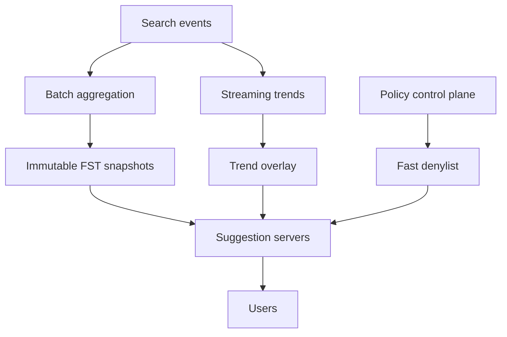

# Design a Global Search Autocomplete Service

**Difficulty:** Senior  
**Primary themes:** low-latency reads, prefix indexes, caching, streaming pipelines, ranking, consistency, privacy, abuse prevention  
**Interview time budget:** 40–45 minutes  
**Educational walkthrough:** intentionally more detailed than what you would say in the interview

This walkthrough follows the broad sequence in the public [Hello Interview System Design Delivery Framework](https://www.hellointerview.com/learn/system-design/in-a-hurry/delivery): clarify requirements, identify core entities, define the system contract, build a simple complete design, and then deepen the most important bottlenecks. The problem, numbers, dialogue, and final design are original.

## Interviewer prompt

> Design the autocomplete service for a global search product. As a user types, return a short list of relevant query suggestions. Suggestions should reflect historical popularity and recent trends, support multiple locales, and prevent unsafe or private queries from being exposed.

We are designing suggestion generation and serving, not the search-results engine itself.

## Targeted clarifying questions

**Candidate:** “Are suggestions complete search queries, entity names, or both?”  
**Interviewer:** “Return query completions. Product and entity suggestions could be a later extension.”

**Candidate:** “Should we personalize suggestions?”  
**Interviewer:** “Use global and regional popularity as the core. You may add a small private layer from the signed-in user’s own recent searches, but do not build a full recommendation system.”

**Candidate:** “Do we support only prefix matching, or typo tolerance and semantic suggestions too?”  
**Interviewer:** “Exact normalized prefix matching is required. Basic typo tolerance is a stretch goal after the prefix path works.”

**Candidate:** “How fresh should trends and removals be?”  
**Interviewer:** “Ordinary popularity can lag by several hours. Trending queries should appear within five minutes. A policy or privacy removal should take effect globally within one minute.”

**Candidate:** “What scale should I use?”  
**Interviewer:** “Assume 500 million daily active users, ten search sessions per user per day, and roughly eight autocomplete requests per session. Peak traffic is ten times average.”

**Candidate:** “What languages and scripts?”  
**Interviewer:** “Start with 50 locales. Unicode, case, accents, and locale-specific normalization matter. Do not transliterate between scripts in the core design.”

**Candidate:** “Can zero-prefix or one-character requests return suggestions?”  
**Interviewer:** “No zero-prefix suggestions. One-character results are allowed, but they need aggressive caching and stricter safety thresholds.”

**Candidate:** “What is out of scope?”  
**Interviewer:** “Search-result ranking, ads, voice input, spell correction beyond a basic optional path, and training large language models.”

### Scope restatement

> “I’ll design a read-heavy, globally distributed service that returns up to ten safe query completions for a normalized prefix and locale. The core ranking combines long-term popularity with a bounded fresh-trend overlay; an optional user-local layer can add private history. I’ll focus on sub-50-millisecond serving, cache behavior for hot prefixes, snapshot publication, streaming freshness, and emergency removals.”

---

## 1. Requirements (~5 minutes)

### Core functional requirements

1. **Serve suggestions.** Given a prefix and locale, return up to ten ranked, policy-safe query completions. Repeated keystrokes must receive stable-enough results to avoid UI flicker.
2. **Build and refresh candidates.** Aggregate eligible historical search queries and successful engagement signals into locale-specific indexes; incorporate recent trends within five minutes.
3. **Enforce safety and privacy.** Exclude low-frequency, sensitive, malicious, and policy-blocked queries; emergency removals must override every cache and index version within one minute.

### Quantified non-functional requirements

| Property | Target | Design consequence |
|---|---:|---|
| Peak request rate | ~10M requests/s globally | Regional serving, edge caching, compact in-memory indexes |
| Serving latency | p50 < 10 ms, p99 < 50 ms server-side | No remote fan-out on the common path |
| Availability | 99.99% monthly | Multi-zone replicas and last-known-good snapshots |
| Base-index freshness | New snapshot every 6 hours | Offline aggregation and immutable publication |
| Trending freshness | 95% visible within 5 minutes | Streaming counters and a small mutable overlay |
| Emergency removal | Global enforcement within 60 seconds | Versioned denylist on a separate fast path |
| Result size | At most 10 suggestions | Precomputed top candidates per state where practical |
| Privacy threshold | No suggestion below a locale-specific k-anonymity floor | Aggregated counts and delayed eligibility |

### Scale estimates that change the design

Requests per day:

\[
500\text{M users} \times 10\text{ sessions} \times 8\text{ keystrokes}
= 40\text{B requests/day}
\]

Average request rate:

\[
40\text{B} / 86{,}400 \approx 463{,}000\text{ requests/s}
\]

With a 10× peak, provision for roughly 4.6M requests/s. Add growth and regional skew, and use **10M requests/s** as the design peak.

This arithmetic changes the architecture. A database prefix query per keystroke is too expensive and too slow. The common path should be a regional memory lookup, ideally avoided entirely on cache hits.

Suppose a locale has 100 million eligible suggestions. At an average of 40 UTF-8 bytes for normalized text plus score, safety, and offset metadata, an uncompressed representation is several gigabytes before pointer overhead. A pointer-heavy trie may multiply that. We therefore want a compact finite-state representation and locale/prefix partitioning rather than one object per character node.

Traffic is highly skewed. The empty prefix is disallowed, and a small set of one- and two-character prefixes can represent a large fraction of requests. That makes CDN/regional response caching valuable, but also means invalidation must handle safety removals correctly.

### Consistency and availability contract

- Suggestions are **eventually consistent** with query popularity and trends.
- Every response carries `index_version`, `trend_watermark`, and `policy_version` so staleness is observable.
- A snapshot is immutable. A request is evaluated against one coherent base version, never a mixture of files from two builds.
- Trend overlays may lag or be temporarily unavailable; the system then serves base results and marks trend freshness.
- Policy removals take precedence over availability of a candidate. If the latest required denylist cannot be obtained before its safety TTL, the server fails closed for affected categories or falls back to a smaller known-safe snapshot.
- The service does not promise read-your-writes. A user’s just-submitted public query is not immediately eligible for global suggestions.
- A user’s private history can be read-your-writes because it is isolated from public aggregation and merged only for that authenticated user.
- During a regional outage, route to another region and accept higher latency. Never serve an unvetted newly built index merely to preserve freshness.

> **Say aloud:** “Popularity can be eventually consistent, but safety has a stricter contract. I’ll separate immutable suggestion snapshots, a best-effort trend overlay, and a mandatory fast denylist so an analytics or trend failure cannot bypass policy.”

---

## 2. Core entities (~2 minutes)

| Entity | Meaning |
|---|---|
| `QueryCandidate` | Normalized public query text and its locale, eligibility, and aggregate signals |
| `PrefixState` | Position in a prefix index from which top completions can be enumerated |
| `IndexSnapshot` | Immutable, signed set of base-index partitions for one locale and version |
| `TrendEntry` | Short-lived score delta for a recently rising candidate |
| `PolicyRule` | Block, allow, or category rule with a monotonically increasing version |
| `UserHistoryEntry` | Private recent query visible only to the authenticated user |
| `SuggestionResponse` | Ranked strings plus reason, version, and freshness metadata |

Avoid designing every table now. The physical fields appear with the components that need them.

> **Say aloud:** “A candidate is not eligible merely because someone searched it. It becomes public only after aggregation, minimum-support checks, privacy filtering, and policy review. That distinction shapes the ingestion pipeline.”

---

## 3. API / system interface (~5 minutes)

### 3.1 Fetch suggestions

```http
GET /v1/suggestions?prefix=distributed%20s&locale=en-US&limit=10
Authorization: Bearer <optional user token>
X-Session-ID: sess_7f3...
```

The gateway derives `user_id`, account age, allowed personalization scope, and coarse region from authentication and trusted infrastructure. It does not accept an authoritative user ID or region in query parameters.

```json
{
  "normalized_prefix": "distributed s",
  "suggestions": [
    {
      "text": "distributed systems",
      "source": "BASE_AND_TREND",
      "score_bucket": "HIGH"
    },
    {
      "text": "distributed sql database",
      "source": "BASE",
      "score_bucket": "MEDIUM"
    }
  ],
  "index_version": "en-US-2026-10-19T00:00Z-1842",
  "trend_watermark": "2026-10-19T00:02:00Z",
  "policy_version": 98217,
  "cache_ttl_ms": 30000
}
```

Why return score buckets rather than raw scores? Raw ranking values expose little product value, can help attackers reverse-engineer thresholds, and are not stable across versions.

Request rules:

- reject prefixes longer than 100 Unicode code points;
- require a supported locale;
- return no public suggestions for an empty prefix;
- rate-limit by authenticated principal, device, IP reputation, and session;
- normalize server-side so cache keys and index traversal use the same logic.

### 3.2 Record an accepted search event

The browser does not call the aggregation pipeline directly. The search gateway emits a trusted event after accepting a search:

```json
{
  "event_id": "evt_01K...",
  "event_time": "2026-10-19T00:03:11Z",
  "query_text_encrypted": "...",
  "normalized_query_hash": "...",
  "locale": "en-US",
  "coarse_region": "us-northeast",
  "actor_class": "SIGNED_IN_ESTABLISHED",
  "result_count": 8421,
  "engagement": {
    "clicked": true,
    "dwell_bucket": "30_TO_120_SECONDS"
  }
}
```

Raw text is restricted to a privacy-controlled pipeline. Serving indexes never store user IDs or source events.

### 3.3 Emergency policy update

```http
POST /v1/policy/rules
Authorization: Bearer <policy-operator token>
Idempotency-Key: case-48191-query-removal
If-Match: "policy-version-98217"

{
  "match_type": "EXACT_NORMALIZED_QUERY",
  "value": "sensitive query text",
  "action": "BLOCK",
  "reason_code": "PERSONAL_DATA",
  "expires_at": null
}
```

The actor and authorization come from identity. Changes require audit logging, dual authorization for high-impact patterns, and optimistic concurrency.

### API-to-requirement mapping

| Requirement | Interface or internal contract |
|---|---|
| Serve ranked completions | `GET /v1/suggestions` |
| Learn from searches | Trusted search-event stream |
| Add private history | Authenticated user-history service |
| Remove unsafe suggestions | Versioned policy-rule API and push channel |

> **Say aloud:** “The public API is intentionally small. Search behavior enters through a trusted event stream rather than a client-controlled popularity endpoint, which makes bot resistance and event provenance tractable.”

---

## 4. Data flow

Autocomplete has a serving path and two update paths.

### Serving path

1. Client debounces keystrokes and sends the latest prefix.
2. Edge or regional cache checks a key containing normalized prefix, locale, experiment bucket, base version, and policy version.
3. On a miss, the suggestion server traverses the base prefix index.
4. It fetches a small trend list for the same prefix and optional private history for the authenticated user.
5. A ranker merges, deduplicates, applies policy, and returns ten suggestions.

### Base-index pipeline

1. Trusted search events enter a partitioned log.
2. Batch jobs deduplicate, normalize, aggregate counts, compute quality signals, and enforce privacy thresholds.
3. Policy filtering removes prohibited candidates.
4. An index builder creates immutable per-locale partitions and a manifest.
5. Validation gates publish a signed version pointer.
6. Regional servers download, verify, warm, and atomically activate the snapshot.

### Trend and removal paths

1. Streaming processors compute recent, baseline-adjusted popularity.
2. Eligible deltas enter a small regional trend overlay with expiration.
3. Policy updates travel through a separate high-priority channel to every server and cache tier.



---

## 5. High-level design (~10–15 minutes)

Start with a design that works, then evolve it.

### 5.1 Baseline: database prefix lookup

A first version can store:

```text
Suggestion(
  locale,
  normalized_text,
  display_text,
  popularity_score,
  quality_score,
  safety_state,
  updated_at
)
```

Create a composite ordered index on `(locale, normalized_text)`. For prefix `distributed s`, query the lexical interval:

```sql
SELECT display_text, popularity_score
FROM suggestion
WHERE locale = 'en-US'
  AND normalized_text >= 'distributed s'
  AND normalized_text <  'distributed t'
  AND safety_state = 'ALLOWED'
ORDER BY popularity_score DESC
LIMIT 10;
```

This is correct enough for modest scale, but it scans an unpredictable lexical range and sorts candidates for every keystroke. At millions of requests per second, we need a serving-optimized index.

### 5.2 Normalize consistently

Normalization must be a versioned library used by ingestion, index building, serving, and cache-key construction:

1. validate UTF-8;
2. apply locale-aware Unicode normalization;
3. case-fold where appropriate;
4. collapse repeated whitespace;
5. standardize safe punctuation;
6. preserve display text separately;
7. reject control characters and deceptive encodings.

Do not apply one English-centric rule to every script. For example, accent handling and token boundaries are locale decisions. Store `normalization_version` in events and manifests so a rule change triggers a controlled rebuild rather than silently mixing keys.

### 5.3 Build a weighted finite-state prefix index

A trie stores prefixes by sharing their initial characters. A **finite-state transducer (FST)** compresses repeated suffix structure and can associate paths with outputs such as weights or candidate IDs. Lucene exposes a weighted FST suggester that traverses a prefix and then walks the shortest weighted paths to retrieve top-ranked suggestions; this is a useful implementation model, not a requirement to use Lucene. See [Lucene weighted FST suggestion API](https://lucene.apache.org/core/10_3_0/suggest/org/apache/lucene/search/suggest/fst/package-summary.html).

For each locale, the builder produces:

```text
IndexManifest(
  locale,
  index_version,
  normalization_version,
  policy_version_at_build,
  source_watermark,
  partition_boundaries,
  partition_checksums,
  created_at,
  signature
)

CandidateRecord(
  candidate_id,
  normalized_text,
  display_text,
  base_score,
  quality_features,
  category_bits
)
```

Partition first by locale, then by an adaptive leading-prefix range. Common prefixes receive narrower partitions; sparse ranges share larger ones. A small routing table maps a normalized prefix to one or a few partitions.

Each partition is immutable and memory-mapped. Servers load a new manifest in the background, verify checksums and signatures, warm top states, then atomically swap one pointer from version N to N+1. In-flight requests finish on N.

### 5.4 Precompute top candidates

At every prefix state, storing ten full strings would duplicate memory heavily. Compare three options:

| Option | Lookup | Memory | Build complexity |
|---|---:|---:|---:|
| Traverse subtree at request time | Variable | Low | Low |
| Store top 10 at every state | O(10) | High | Moderate |
| Store top IDs only for hot/shallow states | Fast for hot traffic | Moderate | Moderate |

Choose a hybrid:

- precompute top candidate IDs for one- to four-character and historically hot states;
- use weighted FST traversal for colder or long prefixes;
- cap nodes explored and return fewer suggestions rather than violate latency SLOs.

The FST plus immutable candidate table is read-only, cache-friendly, and safe to share across server processes.

### 5.5 Add regional and edge caches

Cache key:

```text
(
  locale,
  normalized_prefix,
  coarse_region,
  experiment_bucket,
  base_index_version,
  trend_epoch,
  policy_version
)
```

Do not include `user_id` in the shared cache. Public results are cached first; private history is merged afterward in process or on the client.

Cache tiers:

1. **Browser cache:** very short-lived results for backspace and repeated input.
2. **Edge cache:** hot one- and two-character public prefixes, typically 5–30 seconds.
3. **Regional in-process cache:** hot merged base-plus-trend results.
4. **Memory-mapped FST:** authoritative serving snapshot for cache misses.

The response includes a short TTL, but policy versioning can invalidate an unsafe cached result immediately. Edge nodes either receive a purge by candidate/prefix tag or reject entries with an older mandatory policy epoch.

### 5.6 Add the trend overlay

A six-hour snapshot cannot represent a breaking event. Stream processors maintain windows such as 5 minutes, 1 hour, and 24 hours, partitioned by `(locale, normalized_query_hash)`.

A naive recent count promotes ordinary popular queries, not rising ones. Compute a bounded trend score from recent rate relative to expected baseline:

\[
trend(q) = confidence(q) \times
\log\left(1 + \frac{recentRate(q)}{baselineRate(q)+\epsilon}\right)
\]

`confidence(q)` stays near zero until minimum unique-actor, reputation, geographic-diversity, and engagement thresholds are met.

Trend entries contain only vetted candidates:

```text
TrendEntry(
  locale,
  normalized_prefix,
  candidate_id,
  trend_score,
  first_seen_at,
  expires_at,
  stream_watermark,
  policy_version
)
```

Regional overlay stores replicate asynchronously. A serving process requests perhaps 20 trend candidates for the prefix, merges them with 30 base candidates, and ranks the bounded set locally. If the overlay times out in 3–5 ms, serve base-only results.

### 5.7 Rank and stabilize results

For a candidate `q`, a simple serving score is:

\[
score(q) =
w_b \cdot basePopularity
+ w_t \cdot trend
+ w_r \cdot regionalAffinity
+ w_q \cdot quality
+ w_p \cdot privateHistory
- penalties
\]

The public candidate list uses no raw per-user feature. Private history can boost or insert the user’s own prior queries after public policy checks, but those entries are never written to shared caches.

To reduce flicker between keystrokes:

- use deterministic tie-breakers such as score, normalized text, then candidate ID;
- apply a small continuity bonus to suggestions shown for the previous prefix within the same session;
- do not let tiny trend-score changes reshuffle the whole list;
- pin a session to one base index version for a short interval when practical.

### End-to-end request trace

For authenticated user U typing `distributed s`:

1. Client cancels its request for `distributed ` and waits a 50 ms debounce interval.
2. Edge cache misses because this prefix is long and cold.
3. Regional gateway authenticates U, derives locale and experiment bucket, and applies rate limits.
4. Suggestion server normalizes the prefix with version 31 and routes to FST partition `en-US:d...f`.
5. It obtains 30 base candidates by weighted traversal and 12 candidates from the trend overlay.
6. It filters both through in-memory policy version 98217.
7. It retrieves U’s five matching private-history entries under a 3 ms budget.
8. Ranker deduplicates and scores at most 47 candidates, then returns ten.
9. Public base-plus-trend results enter the regional cache; U’s private additions do not.
10. The response exposes the base version, trend watermark, and policy version.

> **Say aloud:** “The common path is bounded: one local FST traversal, one tiny overlay lookup, optional private-history lookup with a hard deadline, and an in-process merge. I avoid fanning out to the search engine or scanning a database per keystroke.”

---

## 6. Deep dives (~10–15 minutes)

In a real interview, choose two or three. This walkthrough includes four so you can practice the interviewer’s likely branches.

### Deep dive A: prefix partitioning, hot keys, and cache behavior

#### Where the baseline breaks

Hash-sharding by full query text balances index construction but cannot answer a prefix without contacting every shard. Sharding by the first character keeps a prefix local, but popular Latin letters such as `s` may receive enormous traffic and index size. A fixed two-character scheme still leaves skew and makes small locales waste partitions.

#### Compare partition strategies

| Strategy | Read fan-out | Balance | Resharding |
|---|---:|---:|---:|
| Hash full query | All shards | Excellent | Easy |
| Fixed first character | One shard | Poor | Crude |
| Fixed first two characters | Usually one | Better, still skewed | Awkward |
| Adaptive prefix ranges | One or few | Good | Directory update |

Choose adaptive prefix ranges. The builder samples candidate counts and request heat, then creates ranges such as:

```text
[a, app)      -> partition 17
[app, apr)    -> partition 18
[apr, b)      -> partition 19
...
```

The directory is immutable per snapshot. A request pins `index_version`, so it never combines an old directory with new partitions. If a candidate crosses a boundary after a rebuild, that is fine because the next version is installed atomically.

#### Hot-prefix protection

For one-character prefixes:

- precompute complete public responses by locale, region, and experiment bucket;
- push them to edge caches before activating the snapshot;
- use request coalescing so one expired entry causes one rebuild;
- add TTL jitter to prevent synchronized expiry;
- serve stale-while-revalidate if the policy epoch is still valid;
- cap per-principal request rate and drop superseded keystroke requests.

Negative results also deserve short caching, especially for rare long prefixes. A bloom filter per partition can cheaply prove that many prefixes are absent before traversal, though a normal failed FST traversal is already fast.

#### Failure modes and observability

- **Cache stampede:** coalescing, jitter, stale-while-revalidate; measure origin amplification.
- **Hot partition:** split at next snapshot; temporarily add replicas because the index is immutable.
- **Uneven locale traffic:** allocate replicas from QPS and p99, not candidate count alone.
- **Bad directory:** manifest validation plus rollback; never partially activate.
- **Memory pressure:** unload cold locales, reduce precomputed states, and route to a larger regional pool.

Track cache hit rate by prefix length, FST nodes visited, lookup CPU, per-partition QPS, response age, and fallback rate.

> **Say aloud:** “Hash sharding is the wrong default because a prefix would fan out everywhere. I preserve lexical locality with adaptive prefix ranges, and I scale hot immutable partitions by replication rather than moving them during a traffic spike.”

### Deep dive B: freshness without sacrificing serving stability

#### Where the baseline breaks

Rebuilding the full FST every minute is computationally expensive, creates constant distribution churn, and makes results unstable. Updating the FST in place complicates concurrency and risks corrupting a serving structure optimized for reads. A snapshot every six hours alone misses breaking news.

#### Compare approaches

| Approach | Freshness | Serving simplicity | Risk |
|---|---:|---:|---|
| Frequent full rebuild | Minutes | Simple reads | Heavy build/distribution churn |
| Mutable distributed trie | Seconds | Complex reads and replication | Inconsistent partial updates |
| Immutable base + mutable overlay | Minutes | Bounded merge | Two score systems to calibrate |

Choose immutable base plus a small overlay.

The base builder uses a consistent source watermark. A manifest becomes publishable only if:

1. every input partition reaches the watermark;
2. privacy and safety stages succeed;
3. offline quality tests pass;
4. checksums and sizes match expectations;
5. canary servers load and answer golden prefixes;
6. the policy version is not older than the minimum allowed version.

Publication is two-phase:

1. upload immutable partition files and signed manifest;
2. atomically advance the locale’s `active_version` pointer.

Servers keep versions N and N−1 for instant rollback.

The trend overlay has bounded influence. It may insert a candidate only after the candidate clears privacy and policy eligibility. Limit the number of trend-only suggestions, for example to two of ten, until stronger evidence accumulates. Expire entries automatically so a failed stream processor cannot leave yesterday’s trend permanently boosted.

#### Late and duplicate events

Search events are delivered at least once. Stream and batch jobs deduplicate by `event_id`. They aggregate by event time, use watermarks for late data, and revise recent windows when allowed. The base snapshot eventually incorporates corrected counts.

Expose:

- base source watermark;
- trend watermark and lag;
- overlay hit and insertion rates;
- version activation progress by region;
- ranking divergence between canary and current versions.

> **Say aloud:** “I don’t mutate the optimized base index. An immutable snapshot gives coherent, rollbackable serving, while a small expiring overlay buys five-minute freshness. If the overlay fails, quality degrades gracefully rather than availability failing.”

### Deep dive C: privacy, safety, and trend manipulation

#### Where the baseline breaks

Autocomplete can amplify a query that only a few people issued, leak personal information, or let coordinated bots manufacture a harmful trend. Counting raw searches and sorting by frequency is not safe.

#### Candidate eligibility pipeline

A query must pass all stages:

1. **Provenance:** accept events only from trusted search gateways.
2. **Deduplication:** remove retries and obvious replay.
3. **Normalization:** use the versioned locale-specific library.
4. **Actor quality:** discount new, automated, or compromised actors.
5. **Minimum support:** require at least `k` distinct eligible actors and geographic/time diversity.
6. **Sensitive-data detection:** reject likely phone numbers, addresses, credentials, account identifiers, and doxxing patterns.
7. **Policy classification:** enforce prohibited-content categories and jurisdiction rules.
8. **Quality:** require meaningful results and optionally positive engagement.
9. **Human escalation:** route ambiguous high-impact trends for review.

The exact k threshold is policy- and locale-dependent and should not be public. Small locales may need longer aggregation windows, not a weaker privacy threshold.

#### Defending trends

Compare recent unique eligible actors with a historical baseline. Add signals for:

- account age and reputation;
- source-network diversity;
- device diversity without creating persistent cross-site tracking;
- entropy of timing and phrasing;
- search-result engagement;
- concentration in a small set of autonomous systems or locations;
- similarity to known campaigns.

Rate-limit a single actor’s contribution so repeated searches do not linearly increase score. Use robust capped counts rather than raw volume.

#### Emergency removal architecture

Removing a suggestion cannot wait for the next FST build.

Maintain a compact, versioned deny structure in every serving process:

```text
PolicyRule(
  rule_id,
  version,
  scope_locale,
  match_type,
  normalized_value_or_hash,
  action,
  reason_code,
  created_by,
  created_at,
  expires_at
)
```

Exact blocks can use a hash set; prefix or category rules use a small trie or compiled automaton. The policy plane pushes new versions to servers and cache tiers. Every response records the version used. A global convergence monitor pages if any region falls behind the required epoch.

Caches are defense in depth, not the final policy authority. On every cache hit, the edge validates the entry’s policy epoch or filters candidate IDs against the current deny structure. Purge affected tags immediately, but do not assume purge delivery is perfect.

#### User-private suggestions

Store recent history in a separate, access-controlled service keyed by authenticated user. Encrypt it, support deletion, apply short retention, and never feed it into public popularity without going through aggregate privacy rules. Merge private candidates after the shared-cache lookup so one user’s history cannot leak to another.

> **Say aloud:** “The key privacy invariant is that no public serving artifact contains user identity or a query that has not crossed an aggregate eligibility threshold. Emergency blocks are evaluated after every candidate source, including caches and private history.”

### Deep dive D: ranking quality, typo tolerance, and experimentation

#### Ranking choices

The first version should be understandable and debuggable. Use calibrated features such as:

- decayed query frequency;
- distinct eligible actors;
- click and dwell quality;
- result availability;
- regional affinity;
- trend lift;
- query length and spam penalties;
- edit distance only in the optional typo path.

Train a lightweight learning-to-rank model offline after the heuristic baseline is stable. Export a small versioned model that scores at most 50 candidates in process. Keep hard safety outside the model.

#### Typo tolerance

Do not run expensive fuzzy search for every keystroke. Trigger it only when:

- the exact prefix returns fewer than a threshold;
- prefix length is at least three;
- a small latency budget remains.

Options:

| Method | Benefit | Cost |
|---|---|---|
| Character deletion variants | Simple lookup | Larger index |
| Levenshtein automaton over FST | Compact and principled | More CPU per request |
| Spell-correct prefix first | Reusable correction service | Extra dependency and possible semantic drift |

Choose a bounded Levenshtein automaton or deletion index for edit distance one, with a strict node-exploration cap. Exact-prefix results always rank ahead unless quality evidence strongly favors the correction.

Elasticsearch’s completion suggester is an example of a completion field optimized for prefix lookup and supports contextual filtering and boosting; it is a useful baseline for a smaller implementation. See [Elasticsearch completion field](https://www.elastic.co/docs/reference/elasticsearch/mapping-reference/completion) and [suggester examples](https://www.elastic.co/docs/reference/elasticsearch/rest-apis/search-suggesters).

#### Experimentation and consistency

Assign experiments deterministically from authenticated user or session identity at the gateway. Include the experiment bucket in shared cache keys. Log exposure only when suggestions are actually rendered, not merely computed.

Guardrails include:

- search completion rate;
- time to submit search;
- suggestion acceptance and abandonment;
- zero-result searches;
- policy complaint rate;
- latency and error rate;
- result-list churn between adjacent keystrokes.

Never optimize acceptance rate alone: sensational or misleading suggestions may attract clicks while harming users.

---

## 7. Final design

### Concise architecture

- Trusted search gateways emit deduplicated behavioral events into a partitioned log.
- Batch aggregation normalizes by locale, applies privacy and safety eligibility, computes stable scores, and builds immutable weighted-FST snapshots.
- Snapshots are split by locale and adaptive lexical prefix ranges, stored with signed manifests, validated, and atomically activated.
- Streaming processors compute abuse-resistant trend deltas and publish a small expiring regional overlay within five minutes.
- A separate policy control plane pushes a mandatory denylist version globally within one minute.
- Suggestion servers memory-map the base FST, merge bounded base and trend candidates, enforce policy, and rank locally.
- Public results use browser, edge, and regional caches. Private user history is merged after shared caching and never enters public artifacts.
- Hot shallow prefixes have precomputed results and extra replicas; adaptive partitions preserve prefix locality without global fan-out.
- Every response exposes base version, trend watermark, and policy version. Servers retain the previous snapshot for rollback.

### Requirements check

| Requirement | Design response |
|---|---|
| Prefix suggestions | Weighted FST traversal with precomputed hot states |
| Ten ranked results | Bounded candidate merge and local ranker |
| 10M peak requests/s | Regional deployment, edge caching, immutable in-memory indexes |
| p99 under 50 ms | No search-engine or database fan-out on common path |
| Multiple locales | Locale-specific normalization, indexes, and policy scopes |
| Six-hour stable popularity | Immutable batch-built snapshots |
| Five-minute trends | Streaming overlay with TTL and bounded influence |
| One-minute removals | Separate versioned fast denylist and cache validation |
| Privacy | k-anonymity-style eligibility, actor diversity, no identities in serving artifacts |
| Bot resistance | Trusted provenance, capped actor contribution, reputation and diversity signals |
| Availability | Multi-zone replicas, cached results, last-known-good snapshot, base-only fallback |
| Safe deployment | Checksums, signatures, canaries, atomic activation, instant rollback |

### A strong 90-second summary to say aloud

> “At this scale, I would not query a database or search cluster on every keystroke. Trusted search events feed an offline pipeline that deduplicates, normalizes per locale, applies privacy and safety eligibility, and builds immutable weighted-FST snapshots. The FST shares prefix structure and retrieves high-weight completions efficiently. I partition by locale and adaptive lexical ranges so a prefix reaches one partition rather than every shard.
>
> “Regional servers memory-map a coherent signed snapshot, precompute top candidates for hot shallow prefixes, and use browser, edge, and in-process caches. A separate streaming pipeline produces a small, expiring trend overlay within five minutes. The request path merges a bounded set of base and trend candidates, applies the latest mandatory policy version, and ranks locally. Private user history is merged only after the shared-cache lookup and never becomes public data.
>
> “Base popularity is eventually consistent, but every response exposes its index version and watermarks. Policy removals use an independent push channel and are checked even on cache hits, with a one-minute global target. Immutable snapshots, atomic pointer swaps, canaries, and retaining the prior version make rollout and rollback safe. If trends or personalization fail, we degrade to base results rather than failing autocomplete.”

---

## Interviewer follow-up questions with strong sample answers

### 1. Why not use a relational database with `LIKE 'prefix%'`?

**Candidate:** “It is a reasonable baseline. At millions of requests per second, each keystroke would scan a variable lexical range and rank rows. A compact in-memory prefix index turns the common path into local traversal and avoids database fan-out.”

### 2. Why not hash-shard suggestions?

**Candidate:** “Hashing full queries balances storage but destroys prefix locality. Every prefix lookup would have to contact every shard. Adaptive lexical ranges keep a prefix in one or a few partitions while still splitting hot ranges.”

### 3. What is an FST, and why use it instead of a trie?

**Candidate:** “Both share prefixes. An FST also merges equivalent suffix structure and can associate path outputs such as weights or candidate IDs, making it more compact. A weighted traversal can find high-ranked completions without materializing a pointer-heavy object per character.”

### 4. How do trends appear before the next snapshot?

**Candidate:** “A streaming pipeline computes recent lift against baseline and publishes only privacy- and policy-eligible candidates to a small TTL-based overlay. Serving merges at most a few dozen overlay and base candidates. Overlay failure degrades to stable base results.”

### 5. How do you remove a harmful suggestion already cached worldwide?

**Candidate:** “Push a monotonically increasing policy version through a separate high-priority channel, purge tagged cache entries, and require cache nodes or origin servers to validate candidate IDs against the current deny structure. Purge is an optimization; version enforcement is the correctness mechanism.”

### 6. How do you stop someone from searching their phone number until it appears?

**Candidate:** “A single actor’s repeated events contribute only a capped amount. Public eligibility requires distinct trusted actors, diversity, time, and sensitive-data checks. Low-support raw queries never enter the serving index.”

### 7. Why not rebuild the FST every minute?

**Candidate:** “That creates constant build and distribution churn for a structure optimized to be immutable. A six-hour coherent base plus a small mutable overlay gives nearly the same visible freshness with safer activation and rollback.”

### 8. How do you prevent result flicker as the user types?

**Candidate:** “Use deterministic tie-breakers, bounded trend influence, a small session continuity feature, and short-lived version pinning. I would measure list churn between adjacent prefixes as a quality guardrail.”

### 9. What happens when the trend store is slow?

**Candidate:** “Give it a 3–5 ms deadline and serve base-only results. The response reports an older or absent trend watermark. Autocomplete availability must not depend on the freshness overlay.”

### 10. How do you deploy a new normalization rule?

**Candidate:** “Version the normalization library, rebuild the affected locale snapshots, and make clients and servers use the manifest’s version. Never mix events or cache keys normalized by incompatible rules without explicit migration.”

### 11. How would you support personalization without leaking history?

**Candidate:** “Fetch a small private list under authenticated access, prefix-filter it, apply the same policy layer, and merge after shared cache lookup. Do not place user IDs in shared keys or feed private queries directly into public popularity.”

### 12. What if one locale’s index no longer fits in memory?

**Candidate:** “Split it into more adaptive lexical partitions, keep shallow routing and hot-prefix results resident, and load colder partitions on dedicated pools or memory-map them. Because versions are immutable, popular partitions can be replicated independently.”

### 13. Can suggestions be strongly consistent across regions?

**Candidate:** “They do not need to be for popularity. Regions may activate a new base version minutes apart, and the version is visible in responses. Safety is different: a mandatory policy epoch has a one-minute convergence objective and stale servers fail closed when their safety lease expires.”

### 14. How do you validate ranking changes?

**Candidate:** “Offline replay checks relevance, policy violations, and golden prefixes. Then canary traffic verifies latency and output divergence. Online experiments measure successful search completion, time to search, zero-result rate, abandonment, complaints, and list stability—not acceptance rate alone.”

---

## Common pitfalls

1. Querying the main search engine for every keystroke.
2. Hash-sharding full queries and ignoring prefix fan-out.
3. Treating a pointer-heavy trie as automatically memory efficient.
4. Rebuilding or mutating the full serving index for every trend.
5. Mixing partitions from different snapshot versions.
6. Using client-provided locale or identity as authoritative.
7. Putting user-specific results in a shared cache.
8. Counting raw searches without deduplication or actor caps.
9. Publishing low-frequency queries before privacy thresholds are met.
10. Relying only on cache purge for emergency removal.
11. Letting the trend overlay bypass policy checks.
12. Applying one English normalization rule to every script.
13. Ignoring one-character hot prefixes and cache stampedes.
14. Returning raw ranking scores that expose unstable internals.
15. Offering fuzzy matching on every request without a CPU bound.
16. Measuring click-through alone and rewarding sensational suggestions.
17. Blocking serving because the analytics pipeline is delayed.
18. Activating a snapshot before every partition and checksum is validated.

---

## Interview pacing guide

| Minute | What to cover |
|---:|---|
| 0–5 | Clarify query completions, freshness, locale, personalization, scale, safety |
| 5–7 | Candidate, prefix state, snapshot, trend, policy, private history |
| 7–12 | Suggest API, trusted events, emergency policy interface |
| 12–24 | Database baseline, normalization, weighted FST, snapshots, caches, overlay |
| 24–35 | Deep dive into partitioning plus freshness or privacy |
| 35–40 | Failure modes, versioning, observability, rollback |
| 40–45 | Requirements check and 90-second summary |

If time is short, omit typo tolerance and detailed learning-to-rank discussion. Do not omit policy enforcement after caches or the immutable-snapshot activation contract; those are the most revealing correctness details.

## Public references

- [Hello Interview — System Design Delivery Framework](https://www.hellointerview.com/learn/system-design/in-a-hurry/delivery)
- [Hello Interview — API Design](https://www.hellointerview.com/learn/system-design/core-concepts/api-design)
- [Apache Lucene — Weighted FST suggestion API](https://lucene.apache.org/core/10_3_0/suggest/org/apache/lucene/search/suggest/fst/package-summary.html)
- [Elasticsearch — Completion field type](https://www.elastic.co/docs/reference/elasticsearch/mapping-reference/completion)
- [Elasticsearch — Suggester examples](https://www.elastic.co/docs/reference/elasticsearch/rest-apis/search-suggesters)
- [Google Research — Context-Sensitive Query Auto-Completion](https://research.google/pubs/context-sensitive-query-auto-completion/)

These references support the delivery structure and prefix-suggestion implementation concepts. The requirements, scale assumptions, APIs, pipeline, consistency model, ranking design, and dialogue are original.

