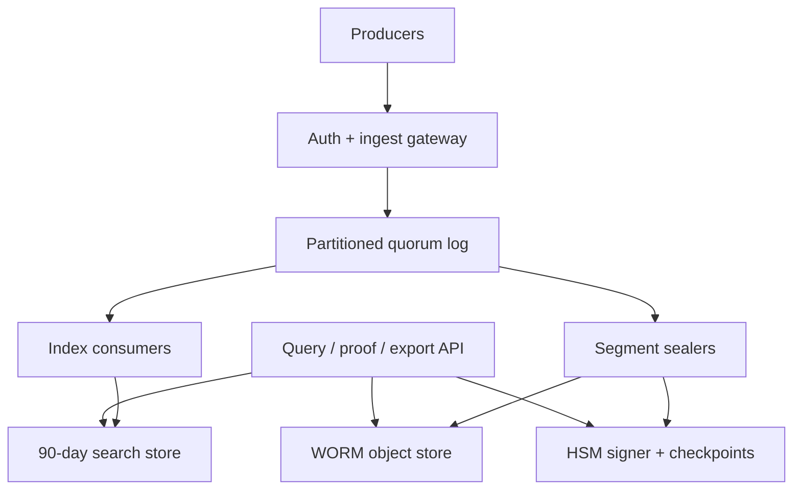

# Design a Tamper-Evident Compliance Audit Log Service

**Difficulty:** Staff-level  
**Primary themes:** durable ingestion, append-only storage, Merkle proofs, queues, indexing, consistency, multi-region reliability, retention

This is an educational walkthrough for a 45–60 minute interview. The time labels describe what to cover aloud in the interview; the written explanation is intentionally more detailed so you can study the reasoning behind each decision.

## Interviewer prompt

> Design a multi-tenant audit-log service for a cloud platform. Internal services and customer applications send security and control-plane events. Authorized users must be able to search recent history, export records, retain data for years, and prove that retained records were not changed or silently deleted.

## Targeted clarifying questions

**Candidate:** Who produces events, and can we trust producer clocks and delivery behavior?

**Interviewer:** Both first-party services and customer applications produce events. Producers authenticate, but clocks can drift and retries are common. Some producers expose monotonically increasing source sequence numbers; others do not.

**Candidate:** Which user operations matter most?

**Interviewer:** Ingest batches of events, search and export a tenant's events, and obtain cryptographic evidence that an event belongs to an immutable log. Administrators also configure retention and legal holds.

**Candidate:** What does “prove” mean? Are we preventing tampering, detecting it, or proving that every real-world action was logged?

**Interviewer:** Prevent modification or early deletion of sealed data, and detect modification, deletion, reordering, or insertion after acknowledgement. We cannot prove an action was submitted if the producer never sent it, but sequence-aware producers should reveal gaps.

**Candidate:** What scale and retention should I design for?

**Interviewer:** Average 1 million events per second globally, bursts to 5 million per second, roughly 1 KB per event, 100,000 tenants, 90 days searchable, and 7 years retained. Tenant sizes are highly skewed.

**Candidate:** What latency and durability are expected?

**Interviewer:** In-region ingestion acknowledgement under 100 ms p99, narrow search under 2 seconds p99, new events searchable within 30 seconds, and an integrity proof available within 15 minutes. Ingestion availability should be 99.99%, with no loss of an acknowledged event after an availability-zone failure.

**Candidate:** Do users require a single global order?

**Interviewer:** No. Preserve exact order within a producer stream when it supplies a sequence number. Provide a stable audit order within each storage partition, but do not pretend that unrelated events have a true global order.

**Candidate:** May events be edited or deleted?

**Interviewer:** Events are append-only. Corrections are new events referencing earlier ones. Data can be physically deleted only after retention expires and no legal hold applies.

**Candidate:** Should the design include an analytics platform or SIEM correlation engine?

**Interviewer:** No. Basic filtered search and bulk export are in scope; behavioral analytics, alert rules, and arbitrary full-text analytics are out of scope.

> **What I would say aloud:** “I want to separate three claims: durable receipt, later tamper evidence, and source completeness. A receipt can prove we accepted an event; a Merkle proof can prove a sealed record was not changed; only a cooperative producer with sequence numbers can help us detect events that were never submitted.”

---

## 1. Requirements (~5 minutes)

Following the public Hello Interview delivery approach, start with a small prioritized requirement set, then build a working design before hardening it in deep dives. The framework also recommends identifying entities before elaborating their fields and mapping the interface to the requirements ([Delivery Framework](https://www.hellointerview.com/learn/system-design/in-a-hurry/delivery), [API Design](https://www.hellointerview.com/learn/system-design/core-concepts/api-design)). genui{"citation":{"refs":["turn171search19","turn171search13"]}}

### Core functional requirements

1. **Durably ingest audit events.** Accept authenticated batches, deduplicate retries, preserve producer sequence information, and return a durable receipt.
2. **Search and export tenant history.** Filter by time, actor, action, resource, outcome, producer, and event ID; create stable, resumable exports.
3. **Retain and verify records.** Seal immutable segments, return inclusion proofs and signed manifests, detect gaps when possible, and enforce retention and legal holds.

### Non-functional requirements

| Requirement | Target | Design consequence |
|---|---:|---|
| Ingest throughput | 1M events/s average; 5M/s burst | Partitioned replicated log and asynchronous downstream work |
| Ingest latency | p99 < 100 ms in-region | Acknowledge after quorum append, not after indexing or sealing |
| Durability/availability | 99.99% ingest; no acknowledged loss after one-AZ failure | Multi-AZ quorum replication, idempotent retry, regional recovery |
| Search/proof latency | Narrow query p99 < 2 s; indexed < 30 s; proof < 15 min | Separate search index; bounded segment sealing |
| Retention/isolation | 90 days searchable; 7 years immutable; strict tenant isolation | Tiered storage, WORM objects, tenant-scoped auth and encryption |

### Scope

In scope: ingestion, deduplication, producer gap detection, recent search, point lookup, exports, integrity proofs, retention, legal holds, access auditing, and disaster recovery.

Out of scope: detecting uninstrumented real-world actions, arbitrary SIEM analytics, alert-rule evaluation, packet capture, and mutable event correction.

### Consistency and availability contract

- **Write acknowledgement:** success means the canonical event and idempotency identity are durably replicated to a quorum across at least three availability zones in the selected home region.
- **Retry semantics:** the API is **at-least-once**, made effectively once per `(tenant_id, producer_id, event_id)` by durable deduplication. Reusing an event ID with different content is rejected.
- **Search consistency:** indexing is eventual, normally under 30 seconds. A returned `ingest_token` supports read-your-writes: a query with `min_ingest_token` waits briefly for the index watermark or merges the relevant log tail.
- **Proof consistency:** a receipt initially reports `PENDING`; after its segment is sealed, the proof is stable and immutable. Target is 15 minutes.
- **Ordering:** exact within one partition offset sequence; producer order is checked using `source_sequence` when supplied. `observed_at` is evidence, not authoritative order.
- **Partition behavior:** during a cross-region partition, the tenant's home region remains authoritative. A healthy home region accepts writes; failover requires fencing the old writer before a new region accepts them. We prefer temporary unavailability over split-brain audit histories.

> **What I would say aloud:** “The source of truth is strongly durable, while search is explicitly eventual. I will expose that gap in the API instead of letting users mistake index lag for missing audit evidence.”

### Scale estimate that changes the design

Assume 1 KB after canonicalization but before compression:

- `1,000,000 events/s × 1 KB ≈ 1 GB/s`
- `1 GB/s × 86,400 s/day ≈ 86.4 TB/day`
- Seven years is roughly `221 PB` logical before replication, indexes, and compression.
- A 5M events/s burst is roughly `5 GB/s` of inbound payload.
- With 256 MB sealed objects, average creation is about `1 GB/s ÷ 256 MB ≈ 4 objects/s` globally, distributed across many partitions.

This rules out a single relational database and makes two separations essential: a compact replicated log for the ingestion path, and immutable object storage for economical retention. It also argues against indexing every attribute for seven years. Keep a rich 90-day search tier, while older data is retrieved through partition/time manifests and export scans.

---

## 2. Core entities (~2 minutes)

Start with nouns, not a prematurely complete schema.

- **Tenant** — isolation boundary, home region, keys, quotas.
- **Producer** — authenticated source, sequence capability, allowed schema.
- **AuditEvent** — canonical append-only fact.
- **Receipt** — durable acknowledgement and lookup handle.
- **Segment** — bounded ordered batch of canonical events.
- **SegmentManifest** — hashes, offset range, count, retention metadata, prior-manifest link, and signature.
- **IntegrityCheckpoint** — signed commitment to one or more partition heads, optionally anchored outside the primary account.
- **IndexDocument** — searchable projection; derived and rebuildable.
- **ExportJob** — snapshot watermark, filters, progress, and output objects.
- **RetentionPolicy / LegalHold** — deletion eligibility rules.

> **What I would say aloud:** “I’m keeping the entity list intentionally thin. I’ll add fields when a request path proves they are necessary.”

---

## 3. API and system interface (~5 minutes)

All calls use TLS. Producer traffic uses mTLS or workload identity; user traffic uses OAuth/JWT. The gateway derives `tenant_id`, `producer_id`, and authorization scopes from verified identity. Those fields are never trusted from the request body.

### 3.1 Ingest events

```http
POST /v1/audit-events:batch
Authorization: Bearer <workload-token>
Content-Type: application/json

{
  "events": [
    {
      "event_id": "01JAE2...",
      "source_sequence": 884211,
      "observed_at": "2026-10-19T13:59:59.412Z",
      "actor": {"type": "user", "id": "usr_42"},
      "action": "role.binding.update",
      "resource": {"type": "project", "id": "prj_9"},
      "outcome": "SUCCESS",
      "attributes": {"old_role": "viewer", "new_role": "admin"}
    }
  ]
}
```

```json
{
  "receipts": [
    {
      "event_id": "01JAE2...",
      "receipt_id": "rcpt_7f...",
      "partition": 381,
      "offset": 1920401182,
      "received_at": "2026-10-19T14:00:00.017Z",
      "ingest_token": "381:1920401182",
      "integrity_status": "PENDING"
    }
  ]
}
```

The service adds `tenant_id`, `producer_id`, `received_at`, `schema_version`, `partition`, and `offset`. A batch has per-item status so one malformed event does not force retries of all valid items. Maximum batch bytes and event count bound memory and abuse.

### 3.2 Search events

```http
GET /v1/audit-events?from=2026-10-19T00:00:00Z&to=2026-10-20T00:00:00Z
  &actor_id=usr_42&action=role.binding.update&limit=100
  &min_ingest_token=381:1920401182
Authorization: Bearer <user-token>
```

```json
{
  "events": [{"event_id": "01JAE2...", "received_at": "...", "action": "..."}],
  "next_cursor": "eyJzbmFwc2hvdCI6...",
  "snapshot_watermark": "2026-10-19T14:00:31.000Z",
  "index_watermark": "2026-10-19T14:00:30.400Z"
}
```

The opaque cursor contains a signed query hash, snapshot watermark, and last sort key. This prevents duplicates or omissions when new events arrive during pagination.

### 3.3 Request a verification bundle

```http
GET /v1/audit-events/01JAE2.../proof
Authorization: Bearer <auditor-token>
```

```json
{
  "status": "SEALED",
  "canonical_event_hash": "sha256:...",
  "leaf_index": 1821,
  "merkle_path": ["sha256:...", "sha256:..."],
  "segment_manifest": {
    "partition": 381,
    "first_offset": 1920399360,
    "last_offset": 1920403455,
    "event_count": 4096,
    "merkle_root": "sha256:...",
    "previous_manifest_hash": "sha256:...",
    "signing_key_id": "audit-signing-2026-q4",
    "signature": "base64:..."
  },
  "checkpoint": {"checkpoint_id": "chk_...", "signature": "base64:..."}
}
```

The bundle is self-verifiable using published public keys. A pending segment returns `202 Accepted` plus an estimated seal time.

### 3.4 Create an export

```http
POST /v1/audit-exports
Authorization: Bearer <auditor-token>

{
  "from": "2026-01-01T00:00:00Z",
  "to": "2026-04-01T00:00:00Z",
  "filters": {"resource_type": "project"},
  "include_proofs": true,
  "format": "JSONL"
}
```

Response: `202 Accepted` with `export_id`, frozen snapshot watermark, status URL, and expiry. A worker writes encrypted output and a signed export manifest to object storage; the user receives a short-lived download URL.

### 3.5 Retention and legal hold

```http
PUT /v1/retention-policy
POST /v1/legal-holds
DELETE /v1/legal-holds/{hold_id}
```

These require privileged scopes, step-up authentication, dual approval for shortening retention or releasing a hold, and they generate audit events themselves.

---

## 4. Data flow

1. Producer authenticates and sends a batch.
2. Gateway authorizes tenant/producer, enforces quotas, validates size and schema, and canonicalizes each event.
3. Router chooses a partition. The partition leader deduplicates and appends to a multi-AZ quorum log.
4. The service returns a receipt immediately after quorum durability.
5. Independent consumers build the recent-search index, detect producer sequence gaps, seal immutable segments, and feed exports.
6. The sealer computes a Merkle root, writes data plus manifest under WORM retention, signs the manifest through an HSM/KMS key, and advances a signed checkpoint.
7. Search and proof APIs read derived indexes and immutable manifests; neither may mutate the source log.

---

## 5. High-level design (~10–15 minutes)



### Operation 1: durably ingest an event

**Gateway.** Verify workload identity, map it to a tenant and producer, apply per-tenant token-bucket limits, validate required fields, and cap arbitrary attributes. Convert input to a deterministic canonical representation. Deterministic encoding matters because signatures over semantically identical but byte-different JSON would not match.

**Partitioning.** Use `hash(tenant_id, stream_id)` across many logical partitions, where `stream_id` defaults to producer ID. This preserves a producer's order without placing every large tenant on one partition. Very small tenants can share partitions; very large tenants get dedicated partition ranges. A metadata service maps logical partitions to replicated leaders.

**Quorum log.** Each partition is a replicated append-only log across three availability zones. The leader assigns the authoritative `offset` and `received_at`, appends canonical bytes and dedupe identity, and acknowledges after two or three replicas persist the record. Consensus terms fence stale leaders.

Minimal durable record:

```text
AuditEvent {
  tenant_id, producer_id, event_id, source_sequence?,
  observed_at, received_at, actor, action, resource, outcome,
  attributes, schema_version, partition, offset, payload_hash
}
```

The dedupe table stores `(tenant, producer, event_id) -> payload_hash, partition, offset, receipt`. Same key and hash returns the original receipt; same key with a different hash returns `409 Conflict`. The dedupe record and log append must be one replicated state-machine operation, avoiding a dual-write race.

**Sequence gaps.** For sequence-capable producers, store the highest contiguous sequence and a compact missing-range set. A gap emits `SOURCE_GAP_DETECTED` but does not necessarily block the stream: blocking would let one missing event halt audit ingestion. Late arrival closes the gap with another audit record.

> **What I would say aloud:** “The 100 ms path ends at a quorum log. Search, hashing, object upload, and signatures are deliberately downstream so their failures cannot consume the ingest latency budget.”

### Operation 2: search recent events

An idempotent indexer consumes log partitions and writes a tenant-scoped index. The primary key is `(tenant_id, received_at, partition, offset)`. Inverted indexes cover the contracted dimensions: actor, action, resource type/ID, outcome, producer, and event ID. High-cardinality arbitrary attributes remain stored but are not automatically indexed.

Each index shard publishes the greatest contiguous consumed offset per log partition. The query coordinator uses these watermarks to:

- expose index freshness;
- wait up to a small bound for `min_ingest_token`;
- merge a small unindexed log tail for read-your-writes;
- prevent a hole from being hidden by a later processed offset.

Queries require tenant and time bounds. They scatter only to shards owning that tenant and interval, merge by `(received_at, partition, offset)`, and return a signed cursor pinned to a snapshot watermark. The index is disposable: after corruption, rebuild it from immutable segments plus the live log.

### Operation 3: seal and prove immutable history

The sealer closes a segment when it reaches 256 MB or 5 minutes, whichever comes first. Five minutes bounds normal proof delay; the remaining 10-minute budget covers queueing, object upload, replication, and signing.

For each canonical event `Eᵢ`, compute a domain-separated leaf:

```text
leaf_i = SHA-256(0x00 || canonical_bytes(E_i))
parent  = SHA-256(0x01 || left_hash || right_hash)
```

Domain separation prevents a leaf's bytes from being confused with an internal tree node. The Merkle root commits to every event and its position. An inclusion proof needs only `O(log n)` sibling hashes rather than the whole segment. This follows the same broad authenticated-tree idea standardized for Certificate Transparency's Merkle audit proofs ([RFC 6962](https://www.rfc-editor.org/rfc/rfc6962.html)). genui{"citation":{"ref":"turn171search15"}}

The `SegmentManifest` includes:

```text
tenant_scope, partition, first_offset, last_offset, event_count,
first_received_at, last_received_at, segment_object_uri,
segment_sha256, merkle_root, previous_manifest_hash,
retention_until, legal_hold_state, schema_version,
created_at, signing_key_id, signature
```

The `previous_manifest_hash` forms a per-partition hash chain. A signed regional checkpoint periodically commits to every current partition head. That resembles production digest-chain systems: CloudTrail integrity validation delivers digest files and can detect whether delivered log files were changed or deleted ([CloudTrail validation](https://docs.aws.amazon.com/awscloudtrail/latest/userguide/cloudtrail-log-file-validation-intro.html), [CloudTrail security guidance](https://docs.aws.amazon.com/awscloudtrail/latest/userguide/best-practices-security.html)). genui{"citation":{"refs":["turn171search1","turn171search35"]}}

Write the compressed segment and manifest into object storage with compliance-mode WORM retention. Retention periods and legal holds prevent protected object versions from being overwritten or deleted; this is the storage primitive, while signatures provide independent detection ([S3 Object Lock](https://docs.aws.amazon.com/AmazonS3/latest/userguide/object-lock.html)). genui{"citation":{"ref":"turn171search0"}}

Finally, sign the manifest and checkpoint through an HSM-backed asymmetric key. Replicate checkpoints to a separately administered account or external transparency service. Without an independent witness, a fully compromised operator controlling data, keys, and published checkpoints could rewrite history and re-sign it.

### Operation 4: export a stable snapshot

At creation, an export captures per-partition high-watermarks. Workers read only offsets at or below those watermarks from the hot store or immutable segments. They write JSONL/Parquet files plus a manifest containing query filters, input segment roots, output hashes, record count, and signer identity.

Work items are queued by tenant and time slice. Retries use deterministic output part names, so completion is idempotent. A coordinator marks the job complete only when every part is present and the manifest is signed.

---

## 6. Deep dives (~10–15 minutes)

### Deep dive A: ingestion durability, retries, and overload

#### Where the baseline breaks

At 5 GB/s burst ingress, synchronously writing search indexes and object storage would couple acknowledgement to slow, failure-prone dependencies. A client timeout after a successful append also creates duplicates. A single tenant can monopolize partitions or consumer bandwidth.

#### Options

| Approach | Strength | Weakness |
|---|---|---|
| Write database + index + object synchronously | Immediate visibility | Slow, distributed dual writes, poor failure isolation |
| Acknowledge from memory and flush later | Very low latency | A process or AZ loss can lose acknowledged audits |
| Quorum log, then asynchronous consumers | Durable fast acknowledgement; replayable | Requires lag management and explicit eventual consistency |

**Choice:** quorum log plus asynchronous idempotent consumers.

#### Evolved design

- Replicate partition state across three AZs and acknowledge only a majority.
- Use producer batching and compression, but cap batch size to bound head-of-line blocking.
- Enforce hierarchical quotas: producer, tenant, partition, and region. Reserve capacity for platform security events.
- Apply explicit backpressure using `429`/`503`, `Retry-After`, and client jitter. Do not silently drop.
- Give each consumer group independent offsets. Index failure cannot block sealing; signing failure cannot block ingestion.
- Store contiguous consumer watermarks. Never advance a watermark past a failed record; quarantine poison events with an auditable reference and continue only under a defined policy.
- For extreme backlog, retain the log long enough to cover repair time and spill closed chunks into temporary durable object storage.

**Failure cases:**

- *Leader dies before quorum:* client receives no success and retries; no durability claim was made.
- *Leader dies after quorum but before response:* retry finds the dedupe record and returns the same receipt.
- *One AZ fails:* majority remains; re-replicate before another failure erodes durability.
- *Region fails:* fail over only after fencing the old region. DNS routing alone is insufficient because it can create two leaders.
- *Indexer falls behind:* ingestion and sealing continue; freshness watermark and alarms expose lag.

> **What I would say aloud:** “At-least-once is honest at the network boundary. The useful guarantee is that retries converge to one durable logical event, and a conflicting reuse of the idempotency key is visible.”

### Deep dive B: what tamper evidence really proves

#### Where the baseline breaks

A checksum stored beside a file detects random corruption, but an attacker who changes both file and checksum defeats it. A signed hash per event is expensive and does not efficiently prove an ordered set. A lone hash chain makes inclusion verification linear unless auxiliary data is retained.

#### Options

| Approach | Verification cost | Detects deletion/reordering | Operational tradeoff |
|---|---:|---|---|
| Plain file checksum | O(file) | Only if checksum is independently trusted | Simplest, weak against privileged attacker |
| Per-event signature | O(1) per event | Does not alone prove completeness/order | High signing volume and key pressure |
| Hash chain | O(n) naive | Yes, from a trusted head | Cheap append, awkward random proof |
| Merkle segment + chained signed manifests | O(log n) inclusion | Yes within segment and across sealed heads | More metadata; best verification ergonomics |

**Choice:** Merkle trees within bounded segments, a hash chain between manifests, signed checkpoints, WORM storage, and an independently administered anchor.

#### Verification procedure

An offline verifier:

1. canonicalizes the event and recomputes its leaf hash;
2. applies sibling hashes and positions to reconstruct the segment root;
3. checks the root, object hash, offset range, and count in the manifest;
4. verifies the manifest signature against a public key valid at `created_at`;
5. follows `previous_manifest_hash` or verifies the partition head in a checkpoint;
6. compares that checkpoint with the independently published copy;
7. checks WORM retention and legal-hold evidence.

This proves that the supplied event was included at an exact position in the committed segment and that the committed chain has not changed since the trusted checkpoint.

#### Limits and adversaries

- It does **not** prove that an uncooperative producer sent every real-world action.
- A durable receipt closes one important gap: once issued, the service must later produce the matching event or reveal a broken commitment.
- Producer sequence gaps improve completeness evidence, but sequence reset and key rotation must be explicit signed lifecycle events.
- A compromised signer alone cannot alter WORM data. A compromised storage operator alone cannot forge signatures. Separation of duties raises the attack threshold.
- If the signer is unavailable, continue ingesting and sealing unsigned roots into a durable signing queue, but report proof status as delayed. Do not falsely label them verified.

#### Key rotation

Use quarterly signing keys, protected by HSM policy. Checkpoints identify `key_id`; a long-lived offline root signs the key-validity statement. Revocation never invalidates old signatures retroactively unless compromise time is known. Preserve public keys and certificates for at least the log retention period.

> **What I would say aloud:** “Tamper-evident is not magic immutability. The trust boundary is the signed checkpoint. I reduce correlated compromise by separating storage, signing, and the external witness.”

### Deep dive C: searchable immutability, retention, and tenant isolation

#### Where the baseline breaks

The searchable copy is mutable by nature: documents are merged, rebalanced, and expired. Treating that index as the compliance record makes every index repair a potential evidence incident. Meanwhile, seven-year full indexing would be disproportionately expensive, and a malicious query could cross tenant boundaries.

#### Options

- **One mutable search store:** simple reads, unacceptable as the evidence source.
- **Immutable source plus rebuildable index:** extra storage and pipeline complexity, clean trust boundary.
- **Query immutable columnar files only:** economical but cannot reliably meet interactive p99 latency for recent data.

**Choice:** immutable source of truth plus a 90-day derived search tier; older queries become asynchronous exports over pruned object ranges.

#### Evolved design

- Every index row carries `tenant_id`; routing, shard keys, authorization filters, and encryption context all enforce it.
- The query service generates filters from verified identity. Users cannot override them in raw search syntax.
- Large tenants receive dedicated shards and bandwidth pools; small tenants share shards with row-level isolation.
- Object keys are time/partition organized, manifests expose min/max timestamps and selected metadata, and Bloom filters skip objects that cannot match.
- Envelope-encrypt each segment with a data key; wrap it with a tenant/region key. Signing covers ciphertext hash and canonical plaintext root so storage corruption and record semantics are both verifiable.
- Retention lifecycle deletes only when `now > retention_until`, no legal hold exists, replicas agree, and a dual-controlled deletion job records evidence. The expired-segment deletion event belongs to a separate longer-lived administrative audit stream.
- A legal hold can extend retention but never shorten it. Policy changes are versioned and prospective unless an approved extension backfills locks.
- Sensitive values should be minimized or tokenized before ingestion. “Crypto-shredding” can make payloads unreadable, but it conflicts with mandated retention; policy owners must decide which obligation wins instead of letting engineering quietly erase evidence.

#### Observability and controls

Track and alert on:

- accepted events/s, quorum-append latency, retry and conflict rates;
- per-tenant throttling and partition skew;
- producer sequence gaps and unresolved-gap age;
- index lag by partition, query fanout, and stale-read rate;
- unsealed bytes and age, seal failures, unsigned-root backlog;
- checkpoint publication lag and external-anchor disagreement;
- sampled end-to-end proof-verification failures;
- WORM configuration drift, retention exceptions, legal-hold changes;
- export backlog, corrupt part hashes, and authorization denials.

Run a continuous canary that emits a known event, waits for search, downloads the proof, verifies it with an independent verifier, and confirms its checkpoint at the external witness. Infrastructure health alone cannot prove the evidence chain works.

---

## Final design in one minute

> “Authenticated producers send bounded batches to a regional gateway. The gateway derives tenant and producer identity, canonicalizes events, and appends them with a dedupe key to a partitioned three-AZ quorum log. That quorum append is the acknowledgement boundary and returns a receipt plus ingest token. Independent consumers build a disposable 90-day search index, monitor producer sequence gaps, create stable exports, and seal five-minute or 256 MB segments. Each segment has a Merkle root; its signed manifest includes offset range, count, object hash, retention, and the prior manifest hash. Data and manifests go to WORM object storage, while HSM-signed checkpoints are copied to an independently administered witness. Queries expose freshness and support read-your-writes via log-tail merge. Proofs are `O(log n)` inclusion paths tied to signed chained checkpoints. Multi-region failover uses fencing to prevent split brain, and retention/legal-hold administration is itself audited with separation of duties.”

## Requirements check

| Requirement | How the design meets it |
|---|---|
| Durable ingest at 1M/s, burst 5M/s | Sharded batched quorum log; async consumers; quotas/backpressure |
| p99 acknowledgement < 100 ms | Critical path ends after in-region quorum append |
| Retry safety | Atomic log append + durable dedupe identity |
| Search < 2 s and freshness < 30 s | Tenant/time-sharded recent index with watermarks |
| Proof < 15 min | Time/size-bounded sealing, Merkle proof, signed checkpoint |
| Detect modification/deletion/reordering | Canonical hashes, Merkle root, manifest chain, external checkpoint |
| 7-year immutable retention | Compressed tiered WORM objects, retention and legal holds |
| No false global ordering claim | Partition offsets plus optional producer sequences and clock metadata |
| Regional reliability | Multi-AZ quorum; fenced single-writer regional failover |
| Tenant isolation | Auth-derived identity, scoped routing/filtering/keys, per-tenant quotas |

## Realistic interviewer follow-ups and strong sample answers

### 1. Why not assign one global sequence number?

“At a million events per second across regions, a synchronous global sequencer adds latency and creates a critical bottleneck. The requirement does not need it. I provide exact partition order, producer sequence verification where available, and timestamps with uncertainty. Cross-partition correlation is a query concern, not a fabricated total order.”

### 2. Can a Merkle proof show that an event was not omitted?

“It proves inclusion in a committed tree, not that every real-world action entered the tree. For accepted events, the durable receipt creates accountability. For producer streams, monotonically increasing sequence numbers reveal gaps. Absolute source completeness requires trust or attestation at the producer.”

### 3. Why both WORM storage and signatures?

“WORM prevents ordinary overwrite or early deletion under storage policy, while signatures let an external verifier detect substitution and reduce trust in storage. They address different failure and attacker models.”

### 4. What if the index says an event is missing?

“Check its receipt and partition offset against the index watermark. If the watermark is behind, wait or merge the log tail. If it is ahead and the event is absent, that is an index-integrity incident; rebuild from immutable segments and the log. The index is never the evidence source.”

### 5. How do you prevent hot tenants?

“Partition a tenant across producer streams, dynamically assign dedicated ranges to large tenants, enforce hierarchical quotas, and isolate search/export concurrency. I preserve order only where promised rather than forcing all tenant events through one shard.”

### 6. What happens if signing is down for an hour?

“Ingestion continues because it is not on the signing path. Seal data and roots durably, queue unsigned manifests, expose delayed proof status, and alert before the proof SLO expires. Once signing recovers, sign in original chain order. Never claim those segments are verified early.”

### 7. Could an administrator shorten retention?

“Not unilaterally. Policy evaluation takes the maximum applicable retention, a legal hold only extends protection, and shortening requires dual approval plus an auditable change. Compliance-mode WORM should make early deletion impossible even for normal administrators.”

### 8. How would you recover from regional destruction?

“Continuously replicate sealed WORM objects and checkpoints to another region/account. Replicate the live log with an explicit recovery-point objective. During failover, acquire a higher epoch through a globally durable fencing service; the old epoch cannot acknowledge. If the unrecovered tail contains acknowledged records, the system must remain unavailable rather than silently fork.”

### 9. How do you handle bad clocks?

“Store both producer `observed_at` and server `received_at`, along with optional clock uncertainty. Order by authoritative partition offset. Search may filter on either field, but proofs bind the exact stored values rather than asserting clock truth.”

### 10. Why 256 MB segments or five minutes?

“The size amortizes object, compression, manifest, and signing overhead. The time bound prevents low-volume partitions from waiting indefinitely and gives budget under the 15-minute proof SLO. I would tune both from measured upload/signing latency and partition skew.”

### 11. How do you change canonicalization rules?

“Version them. Every event and manifest records `schema_version` and canonicalization version. Verifiers select the historical algorithm. Never reserialize sealed events in place; migrations create a new derived representation while preserving the original bytes and commitments.”

### 12. How do you prove an export is complete?

“Freeze per-partition high-watermarks, list all input segment ranges, count records, hash each output part, and sign the export manifest. The verifier checks that the selected ranges cover the snapshot without gaps and that each included record maps back to committed segment roots.”

### 13. What about data residency?

“Tenant metadata selects allowed home and replica regions. Raw payload and data keys never leave that boundary. A global control plane stores only routing and non-sensitive checkpoint metadata. External anchors can publish hashes without publishing event content.”

### 14. Would you use Kafka, a database, or custom consensus?

“The interview design needs capabilities, not a brand. I need partitioned ordered append, replicated durability, idempotent producer identity, long-enough replay, and consumer offsets. A managed log is attractive; a consensus-backed database can own metadata and dedupe. I would not build consensus unless existing infrastructure cannot meet the guarantees.”

## Common pitfalls

- Claiming “exactly once” without defining idempotency scope and conflict behavior.
- Putting search indexing, object upload, or signing on the acknowledgement path.
- Treating a mutable search index as the compliance source of truth.
- Saying “immutable” without naming the operator/attacker model, retention mode, and key controls.
- Using a checksum stored beside the data and calling it tamper evidence.
- Claiming that Merkle inclusion proves every real-world action was logged.
- Trusting caller-supplied tenant identity.
- Using event timestamps as a global order despite clock skew.
- Advancing consumer watermarks past holes.
- Ignoring signer outage, key rotation, public-key preservation, and compromised-key time.
- Letting one tenant's ingest, query, or export workload starve others.
- Designing seven years of expensive full-text indexing when only 90 days must be interactive.
- Forgetting that legal-hold release and retention changes are privileged audit events too.

## Study takeaway

The key move is to decompose “audit log” into independently testable contracts:

1. **Receipt:** the service durably accepted these exact bytes.
2. **Order:** these bytes occupy this exact partition position.
3. **Integrity:** this event belongs to this Merkle root and signed segment.
4. **Continuity:** this segment follows the previously committed head.
5. **Retention:** protected objects cannot be changed or deleted before policy allows.
6. **Completeness boundary:** the system can prove what it accepted and expose producer gaps, but cannot prove an event that was never submitted.

That precision is more valuable in an interview than repeatedly saying “immutable” or “exactly once.”
