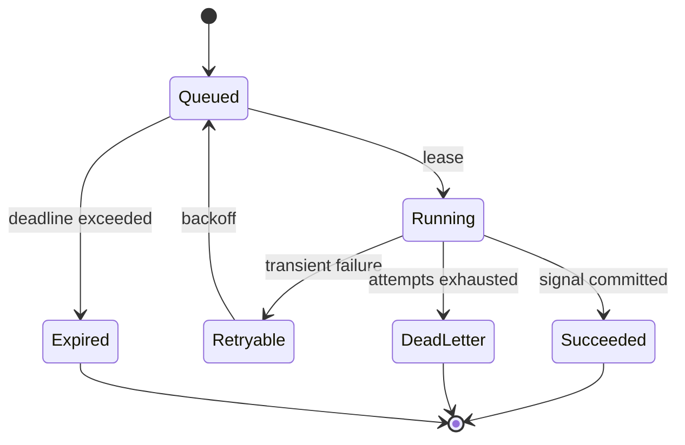
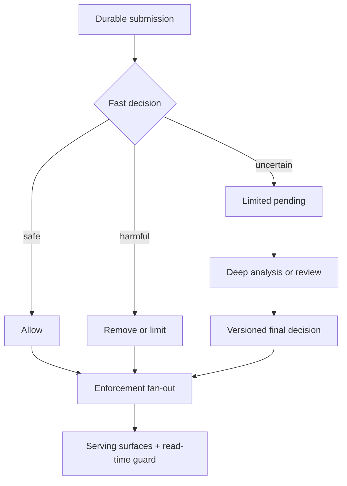

# Design a Large-Scale Content Moderation Platform

**Difficulty:** Senior / Staff  
**Primary themes:** event-driven pipelines, multimodal inference, human review, policy consistency, reliability, backpressure  
**Interview time budget:** 45–50 minutes  
**Educational walkthrough:** intentionally more detailed than what you would say aloud

This walkthrough follows the requirements → entities → interfaces → high-level design → deep dives progression advocated in Hello Interview's [System Design in a Hurry](https://www.hellointerview.com/learn/system-design/in-a-hurry/introduction) and [Delivery Framework](https://www.hellointerview.com/learn/system-design/in-a-hurry/delivery). The design and examples below are original.

---

## Interviewer prompt

> Design a content moderation platform for a global social network. Users can publish text, images, and short videos. The platform must detect policy violations, prevent clearly harmful content from being distributed, route uncertain cases to human reviewers, and support creator appeals.

## Targeted clarifying questions

**Candidate:** Are we moderating only new posts, or also comments, messages, live streams, and historical content?

**Interviewer:** Focus on new public posts containing text, images, and videos up to five minutes. Existing content may be rescanned when policy or models change. Exclude private messages and live streams.

**Candidate:** Should publication wait for moderation?

**Interviewer:** Use a risk-based contract. Text and image posts should usually receive an initial decision before broad distribution. Videos may enter a limited-visibility state while deeper analysis runs. Clearly safe content should not feel delayed.

**Candidate:** Which outcomes are required?

**Interviewer:** `ALLOW`, `LIMIT`, `REMOVE`, and `REVIEW`. `LIMIT` may disable recommendations or age-gate content. Human reviewers can override automated decisions. Creators can appeal removals and limits.

**Candidate:** What scale and latency should I design for?

**Interviewer:** Assume 500 million posts per day, a 10× peak over average, and these targets:

- text/image initial decision: p95 under 500 ms;
- video initial decision: p95 under 3 seconds, with deeper scanning completing within 60 seconds;
- decision API availability: 99.99%;
- no acknowledged upload may disappear from moderation;
- appeals should normally complete within 24 hours.

**Candidate:** How should correctness trade against availability?

**Interviewer:** For high-confidence severe-harm signals, favor safety over immediate publication. During dependency failures, ordinary content may be accepted into limited visibility and processed later. Do not silently publish content whose risk is unknown.

**Candidate:** Is exact global policy consistency required at the instant a policy changes?

**Interviewer:** No. New submissions should converge to the new policy version within five minutes. Every decision must record the exact policy and model versions used. Emergency rules need near-immediate rollout and can conservatively restrict distribution.

**Candidate:** Are model training and reviewer workforce scheduling in scope?

**Interviewer:** Online inference, feedback capture, and rescanning are in scope. Training pipelines and staffing optimization are out of scope.

### Scope statement to say aloud

> “I’ll design the decisioning platform for public text, image, and short-video posts. I’ll cover fast automated screening, durable deeper analysis, human escalation, enforcement, appeals, and policy-version auditability. I’ll treat model training, private messaging, and live moderation as extensions.”

---

## 1. Requirements (~5 minutes)

Hello Interview recommends narrowing broad prompts to roughly three core functional requirements and naming non-functional requirements that will drive architecture. That keeps the design causal: every major component should satisfy a stated need.

### Core functional requirements

1. **Screen newly submitted content.** Return an initial `ALLOW`, `LIMIT`, `REMOVE`, or `REVIEW` decision based on text, images, video samples, account context, policy, and model scores.
2. **Complete durable asynchronous moderation.** Run expensive analyses, combine signals, retry failures, rescan older content when required, and enforce any changed decision.
3. **Support human review and appeals.** Prioritize uncertain or severe cases, present safe evidence to reviewers, record auditable judgments, and let creators appeal eligible actions.

### Explicitly out of scope

- model training and feature-label experimentation;
- reviewer hiring and shift scheduling;
- direct messages and end-to-end encrypted content;
- live-stream frame-by-frame moderation;
- legal discovery and law-enforcement workflows;
- full social-feed ranking, except for consuming moderation status.

### Quantified non-functional requirements

| Property | Target | Design consequence |
|---|---:|---|
| Throughput | 500M posts/day; 10× peak | Horizontal partitioning and asynchronous fan-out |
| Initial latency | text/image p95 < 500 ms; video p95 < 3 s | Small synchronous model bundle; expensive work deferred |
| Availability | 99.99% decision API | Multi-AZ stateless services, graceful degradation |
| Durability | No acknowledged upload lost from moderation | Transactional outbox or durable submission log |
| Policy rollout | routine < 5 min; emergency near-immediate | Versioned immutable bundles plus push invalidation |
| Appeal completion | 95% < 24 h | Priority queues, reviewer capacity alarms, aging escalation |

### Scale estimates that change the design

Assume 500 million posts/day:

\[
QPS_{avg} = \frac{500{,}000{,}000}{86{,}400} \approx 5{,}800
\]

At 10× peak, submission traffic is about **58,000 posts/s**. Suppose 70% contain text, 20% images, and 10% videos; posts may contain more than one modality, so use these as workload approximations rather than exclusive categories.

If an average upload generates six pipeline events and two inference calls, the internal system handles roughly **350,000 events/s** and **116,000 inference calls/s** at peak. This is enough to justify a partitioned durable log and separately autoscaled model pools.

For video, assume 50,000 hours uploaded per day after accounting for average duration. Storing the original video is the media platform's job. If moderation extracts one JPEG frame every two seconds at 80 KB/frame, naive extraction produces:

\[
50{,}000 \times 3{,}600 / 2 \times 80\text{ KB} \approx 7.2\text{ TB/day}
\]

That arithmetic changes the design: extracted frames should have short retention, be sampled adaptively, and be referenced from object storage rather than embedded in queue messages.

If 0.2% of posts need human review, that is one million cases/day. At an average 30 seconds per review, it requires about 8,300 reviewer-hours/day before appeals or redundancy. Therefore the automated threshold is not merely a model choice; it is a capacity-control mechanism.

### Consistency and availability contract

- The **content record and durable moderation intent** are atomically created. We never acknowledge a post and forget to moderate it.
- The author receives **read-your-writes** for submission and status.
- Enforcement is strongly consistent per `content_id`: a monotonically increasing decision version prevents an older `ALLOW` from overwriting a newer `REMOVE`.
- Feed/search caches and replicas are eventually consistent with enforcement, targeted to converge within seconds. A synchronous policy check at content fetch blocks known-removed content during cache lag.
- Policy and model deployment are versioned. Every result records `policy_version`, `model_versions`, and evidence hashes.
- Under partial failure, availability is preserved by placing unknown-risk content in `LIMITED_PENDING`, not by treating unknown as safe.

### Concise interview phrasing

> “The important contract is not globally synchronous moderation. It is durable intake, monotonic decisions per content item, explicit policy versions, and fail-limited behavior when risk is unknown.”

---

## 2. Core entities (~2 minutes)

Name entities before choosing databases. This keeps schema discussion tied to access patterns.

| Entity | Purpose | Important fields |
|---|---|---|
| `ContentSubmission` | Moderation-facing representation of a post | `content_id`, `creator_id`, `media_refs`, `text`, `region`, `created_at`, `state` |
| `ModerationJob` | Durable unit of pipeline work | `job_id`, `content_id`, `stage`, `attempt`, `priority`, `deadline`, `status` |
| `Signal` | Output from a model, rule, hash list, or metadata check | `signal_id`, `content_id`, `source`, `label_scores`, `model_version`, `evidence_ref` |
| `Decision` | Authoritative moderation result | `content_id`, `decision_version`, `action`, `reason_codes`, `policy_version`, `source`, `created_at` |
| `PolicyBundle` | Immutable executable policy snapshot | `policy_version`, `region`, `rules`, `thresholds`, `effective_at`, `emergency` |
| `ReviewCase` | Human-review work item | `case_id`, `content_id`, `queue`, `severity`, `sla_deadline`, `lease_owner`, `status` |
| `ReviewJudgment` | Append-only reviewer decision | `case_id`, `reviewer_id`, `action`, `reason_codes`, `evidence_hash`, `created_at` |
| `Appeal` | Creator request for reconsideration | `appeal_id`, `content_id`, `creator_id`, `statement`, `status`, `resolution` |
| `EnforcementEvent` | Idempotent command to downstream surfaces | `content_id`, `decision_version`, `action`, `target_surfaces` |

The schema is deliberately split between append-only evidence and a compact current state. Evidence is useful for audit and replay; current state serves low-latency reads.

### Concise interview phrasing

> “The central object is an immutable decision history plus a latest-decision pointer. Signals explain why we decided; enforcement events make that decision take effect elsewhere.”

---

## 3. API and system interfaces (~5 minutes)

User identity comes from the authenticated session or service token, never from a caller-supplied `creator_id`.

### 3.1 Submit content for moderation

The post service calls this after media upload has produced immutable object references.

```http
POST /v1/moderation/submissions
Authorization: Bearer <service-token>
Idempotency-Key: 8ed3c1...
Content-Type: application/json

{
  "content_id": "post_9f31",
  "text": "caption text",
  "media": [
    {"type": "video", "object_ref": "media://sha256/ab12...", "duration_ms": 42000}
  ],
  "locale": "en-US",
  "requested_visibility": "PUBLIC"
}
```

The gateway derives `creator_id` from the authenticated posting context. The request's idempotency key protects client/service retries.

Fast result:

```json
{
  "content_id": "post_9f31",
  "decision_version": 1,
  "action": "LIMITED_PENDING",
  "reason_codes": ["DEEP_VIDEO_SCAN_PENDING"],
  "policy_version": "policy-2026-10-20.3",
  "status_url": "/v1/moderation/content/post_9f31"
}
```

Why not return `200 ALLOW` and moderate later? Because downstream systems tend to interpret `ALLOW` as stable. `LIMITED_PENDING` accurately represents incomplete work and lets distribution apply a conservative policy.

### 3.2 Read moderation status

```http
GET /v1/moderation/content/post_9f31
Authorization: Bearer <user-token>
```

```json
{
  "content_id": "post_9f31",
  "decision_version": 2,
  "action": "LIMIT",
  "user_reason": "Not eligible for recommendation",
  "appealable": true,
  "updated_at": "2026-10-20T13:55:19Z"
}
```

The service authorizes the caller as the creator or a privileged moderator. Internal consumers can request full reason codes; user responses reveal only approved explanations.

### 3.3 Create an appeal

```http
POST /v1/moderation/content/post_9f31/appeals
Authorization: Bearer <user-token>
Idempotency-Key: appeal-client-771

{
  "decision_version": 2,
  "statement": "This is documentary footage used for education."
}
```

```json
{
  "appeal_id": "apl_72bc",
  "status": "QUEUED",
  "target_resolution_at": "2026-10-21T13:55:19Z"
}
```

Including `decision_version` prevents an appeal from accidentally targeting a superseded action.

### 3.4 Reviewer interfaces

```http
POST /v1/reviewer/cases:claim
Authorization: Bearer <reviewer-token>

{"queue": "SEVERE_HARM_EN", "capabilities": ["EN", "VIDEO"]}
```

```http
POST /v1/reviewer/cases/case_81/judgments
Authorization: Bearer <reviewer-token>
Idempotency-Key: judgment-81-1

{
  "lease_token": "lease_v7...",
  "action": "REMOVE",
  "reason_codes": ["GRAPHIC_VIOLENCE"],
  "evidence_hash": "sha256:43ef..."
}
```

The case lease prevents duplicate active work; the database still accepts only one terminal judgment for the case version.

### Event interfaces

Queues carry identifiers and small metadata, not media bytes:

```json
{
  "event_type": "MODERATION_STAGE_REQUESTED",
  "event_id": "evt_01J...",
  "content_id": "post_9f31",
  "stage": "VIDEO_DEEP_SCAN",
  "media_ref": "media://sha256/ab12...",
  "policy_version": "policy-2026-10-20.3",
  "attempt": 1,
  "deadline_ms": 60000
}
```

### Concise interview phrasing

> “The synchronous API returns a truthful publication state, while durable events drive expensive work. Every mutation is idempotent, and identity comes from authentication rather than the JSON body.”

---

## 4. Processing data flow

1. The media service stores immutable media and produces a content hash.
2. The post service writes the post and an outbox row in one transaction.
3. An outbox relay publishes `CONTENT_SUBMITTED` to the moderation log.
4. The intake service creates a moderation state row and launches the fast path.
5. The fast path runs cheap rules, reputation lookups, text classification, known-hash matching, and sparse image/video sampling.
6. The decision engine evaluates signals against a pinned policy bundle.
7. It writes a versioned decision and emits an enforcement event atomically.
8. `REVIEW` or uncertain cases enter specialist human queues; expensive video/audio/OCR stages continue asynchronously.
9. Enforcement consumers update post visibility, feeds, search, recommendations, and notifications idempotently.
10. Appeals create high-priority review cases with the original evidence, policy version, and new creator context.

---

## 5. High-level design (~10–15 minutes)

Build the simplest complete design one operation at a time.

```mermaid
flowchart TD
    A["Post service + outbox"] --> B["Moderation intake"]
    B --> C["Fast screening"]
    B --> D["Durable event log"]
    C --> E["Decision engine"]
    D --> F["Deep-analysis workers"]
    F --> E
    E --> G["Decision store + outbox"]
    E --> H["Human review queues"]
    H --> E
    G --> I["Enforcement consumers"]
    I --> J["Feed, search, post service"]
```



### Operation 1: accept a post without losing moderation intent

The post service owns the user-visible post. It stores the post in `PENDING_MODERATION` or `LIMITED_PENDING` and writes a `CONTENT_SUBMITTED` outbox record in the same relational transaction.

An **outbox** is a table of events committed alongside business data. A relay later publishes rows to a broker and marks them sent. This closes the dual-write gap where the post commit succeeds but queue publication fails.

The broker is a replicated, partitioned log keyed by `content_id`. Keying preserves per-content order while distributing load across many partitions. Consumers may process messages more than once, so handlers use `event_id` and stage keys for idempotency.

Why not call moderation synchronously before storing the post? The upload could time out after moderation succeeds but before the post exists, and a moderation outage would make durable submission impossible. We can still wait briefly for the fast result after the durable write.

**Say aloud:**

> “My first invariant is that an accepted post and its moderation obligation are one atomic fact. I’ll use a transactional outbox, then make every downstream stage idempotent.”

### Operation 2: produce the initial decision

The moderation intake loads:

- current creator risk tier and recent enforcement counts from a low-latency feature cache;
- the immutable policy bundle selected by region, content type, and rollout assignment;
- known-bad or known-safe perceptual hashes;
- content metadata and signed media references.

It sends modality-specific requests in parallel to small fast-path model pools:

- text classifier and rule engine;
- OCR plus lightweight image classifier;
- sparse video frame classifier and audio fingerprint lookup.

Each model gateway performs dynamic batching within a tiny latency budget, enforces deadlines, and returns calibrated scores plus its `model_version`. The decision engine waits until either all mandatory signals arrive or the fast-path deadline expires.

It then evaluates a policy decision table, for example:

```text
if trusted_hash == ILLEGAL_KNOWN:
    REMOVE
elif severe_harm_score >= 0.995:
    REMOVE
elif severe_harm_score >= 0.80 or model_disagreement > threshold:
    REVIEW and LIMITED_PENDING
elif recommendation_risk >= 0.70:
    LIMIT
elif mandatory_signal_missing:
    LIMITED_PENDING
else:
    ALLOW
```

Scores alone do not encode product policy. Keeping policy evaluation separate lets policy owners alter actions without retraining models and makes decisions reproducible.

The authoritative write uses a transaction:

1. append `Decision(content_id, decision_version, ...)`;
2. compare-and-set `CurrentDecision` if the new version is greater;
3. append `EnforcementEvent` to an outbox.

The response returns as soon as the fast decision is durable. The post service can expose `ALLOW` broadly, apply `LIMIT`, suppress `REMOVE`, or expose `LIMITED_PENDING` only to the creator and direct-link viewers according to product policy.

### Operation 3: finish deep analysis

The orchestrator materializes a `ModerationJob` for required stages. Separate queues exist for video decoding, audio transcription, OCR, multimodal classification, and external specialist checks. Isolation prevents a surge in video from starving text.

Workers fetch media using short-lived credentials, write derived artifacts to encrypted object storage, and emit `SignalProduced`. The signal store is append-only and keyed by `content_id`. The decision engine re-evaluates whenever a material signal arrives.

The orchestrator uses a stage state machine:



Retries are at-least-once. A unique key on `(content_id, stage, input_hash, model_version)` makes repeated successful inference harmless.

If a new deep signal changes `ALLOW` to `REMOVE`, the engine creates decision version 2 and enforcement consumers retract the post. If it confirms safety, `LIMITED_PENDING` becomes `ALLOW`.

### Operation 4: execute enforcement

Each downstream surface consumes `EnforcementEvent(content_id, decision_version, action)` and stores the highest applied version. Older events become no-ops.

- Post service controls direct reads.
- Feed and recommendation systems remove or down-rank candidates.
- Search deletes or masks indexed documents.
- Notification systems cancel unsent fan-out where possible.
- Creator UX receives an explanation and appeal eligibility.

Because asynchronous consumers lag, every direct content read performs a lightweight check against the current enforcement cache. Removed IDs are cached aggressively; cache misses may read the authoritative current-decision store. This creates defense in depth while fan-out catches up.

### Operation 5: human review and appeal

The routing service maps cases to queues by severity, language, region, required expertise, and SLA. A queue is not merely FIFO: its priority score can combine harm severity, exposure, uncertainty, age, legal deadline, and appeal status.

Reviewers claim short leases. The console obtains sanitized, watermarked evidence with least-privilege access. A judgment records the reviewer, policy version, evidence hash, and reason codes. High-severity categories may require two independent reviews or specialist escalation.

An appeal references the exact decision version. It is routed to a reviewer who did not make the original judgment. If overturned, the engine writes a higher decision version and publishes compensating enforcement. The history is never rewritten.

### Storage choices

| Need | Choice | Reason |
|---|---|---|
| Current moderation state | Sharded relational or strongly consistent KV store | conditional version updates and point reads by `content_id` |
| Decisions and judgments | Append-only relational/event store | auditability and replay |
| Pipeline transport | Partitioned replicated log | high throughput, replay, consumer isolation |
| Review queues | Durable priority queue plus relational case index | leases, SLA ordering, skill routing |
| Media and derived evidence | Encrypted object storage | large immutable blobs and lifecycle rules |
| Policy bundles | Versioned object store plus CDN/local cache | immutable rollout artifacts |
| Hot enforcement lookup | Distributed cache backed by current-decision store | low-latency read-time blocking |
| Analytics | Stream to warehouse/lake | aggregates without burdening serving stores |

---

## 6. Deep dives (~10–15 minutes)

### Deep dive A: durable processing, retries, and monotonic decisions

#### Where the baseline breaks

A simple queue plus workers fails in several ways:

- the post commits but queue publication fails;
- a worker finishes inference, crashes before acknowledging, and repeats work;
- delayed version-1 enforcement arrives after version 2 and incorrectly restores content;
- poison content crashes the same decoder repeatedly;
- retry storms overload inference after a regional outage.

#### Options

| Approach | Benefit | Problem |
|---|---|---|
| Distributed transaction across post DB and broker | Conceptually atomic | operationally expensive and usually unsupported across services |
| Best-effort dual write | Simple | loses moderation obligations |
| Transactional outbox + at-least-once consumers | Durable with common primitives | duplicates must be handled |
| Fully event-sourced post service | Excellent replayability | larger domain rewrite than needed |

#### Selected design

Use a transactional outbox at both critical boundaries: submission → moderation log, and decision → enforcement log. All workers are idempotent. Maintain these keys:

- submission: `(producer, idempotency_key)`;
- job result: `(content_id, stage, input_hash, model_version)`;
- judgment: `(case_id, case_version)`;
- enforcement: `(consumer, content_id, decision_version)`.

`decision_version` is allocated by a conditional write on the content partition. Enforcement applies only when `incoming_version > applied_version`. This is a **fencing token**: a monotonically increasing number that prevents stale actors from changing newer state.

Use exponential backoff with jitter and retry budgets. Permanent parse failures move to a dead-letter queue and cause `LIMITED_PENDING` plus an operator alert; they do not become `ALLOW`. Replay tools require an explicit stage/model version and emit ordinary auditable events.

#### Failure behavior

- **Broker unavailable:** outbox grows; submissions remain limited. Alarm on oldest unpublished row.
- **Decision store unavailable:** do not acknowledge a final result; keep content limited and retry.
- **Inference timeout:** use available signals only if policy says they are sufficient; otherwise `LIMITED_PENDING`.
- **Enforcement consumer lag:** read-time current-decision check blocks removed content.
- **Duplicate or reordered events:** idempotency keys and decision fencing make them harmless.

#### Observability

Track end-to-end age, not only queue depth:

- oldest unmoderated submission by risk tier;
- p50/p95/p99 time in each stage;
- retry and dead-letter rates by decoder/model version;
- decision-to-enforcement lag by surface;
- percentage stuck in `LIMITED_PENDING`;
- sampled trace from submission through final enforcement.

**Say aloud:**

> “I am choosing at-least-once delivery because exactly-once transport does not give exactly-once business effects. Idempotency plus monotonically versioned decisions is the simpler end-to-end guarantee.”

### Deep dive B: inference latency, GPU capacity, and overload control

#### Where the baseline breaks

Running every model synchronously makes tail latency equal to the slowest model, wastes GPUs on tiny batches, and lets a video spike exhaust all capacity. Running everything asynchronously gives good throughput but may expose harmful content before analysis.

#### Plausible approaches

1. **All synchronous:** strongest immediate screening; unacceptable cost and tail latency.
2. **All asynchronous:** simplest and cheapest; violates the initial safety contract.
3. **Risk-tiered two-path system:** cheap mandatory gate followed by deep asynchronous analysis.

Choose option 3.

#### Fast path

Keep a small, stable bundle loaded per region. Route by modality and model version. Use dynamic batching for requests that arrive within a 2–10 ms window; this improves GPU utilization without spending the whole latency budget waiting for a batch.

Admission control is hierarchical:

- per-tenant/user rate limits for abuse;
- separate concurrency pools by modality;
- reserved capacity for high-risk and appeals;
- deadline-aware queues that drop work whose answer can no longer meet the caller deadline;
- circuit breakers around unhealthy model versions.

On overload, degrade by policy rather than randomly:

- trusted low-risk text may use rules plus a smaller CPU model;
- unknown video becomes `LIMITED_PENDING`;
- high-risk accounts retain access to the strongest screening pool;
- expensive enrichment is shed before mandatory safety classifiers.

#### Deep path

Video decoding is CPU-intensive; inference may be GPU-intensive. Separate those pools so autoscaling follows the correct resource. Sample frames at scene boundaries and around audio/OCR anomalies rather than uniformly scanning every frame. Escalate to dense sampling only when early signals warrant it.

If peak video intake is 5,800 videos/s and sparse screening uses eight frames each, that is 46,400 frame inferences/s. At an effective 800 frames/s per GPU after batching, raw demand is about 58 GPUs. Applying 2× headroom for burst, failure, and uneven routing yields roughly 120 GPUs for that model tier. This estimate justifies dedicated regional pools and queue-based autoscaling; it is not a procurement forecast.

Autoscaling signals should include queued compute-seconds, not just request count. One five-minute video is not equivalent to one image.

#### Model rollout and fallback

- deploy immutable model versions;
- shadow new versions on a sample without affecting enforcement;
- canary by region/risk cohort;
- compare score distribution, disagreement, latency, and appeal overturn rate;
- keep the previous version warm for instant rollback.

Never silently substitute a model with different semantics. The response records the fallback version and the policy decides whether its evidence is sufficient.

#### Observability

Monitor:

- GPU utilization and batch fill rate;
- queue wait versus inference time;
- timeout and fallback rate by content/risk cohort;
- label score distributions and sudden drift;
- automated-to-human escalation rate;
- false-positive proxies such as successful appeals;
- severe false-negative samples from later reports.

**Say aloud:**

> “I’ll spend synchronous budget only on signals that can change immediate distribution. Everything else is durable and asynchronous. Overload changes visibility state; it never turns unknown into safe.”

### Deep dive C: policy consistency, human review, and safe evolution

#### Where the baseline breaks

If policy is mutable configuration fetched during evaluation, two models in one decision may use different thresholds. A later audit cannot reproduce the result. Emergency policy changes may leave stale caches, while mass rescans can overwhelm production. Human queues can also grow without bound when thresholds shift slightly.

#### Policy bundles

Compile policy into immutable, signed bundles. A bundle contains:

- decision rules and thresholds;
- required signals per content type and risk tier;
- regional exceptions;
- user-facing reason mappings;
- review routing and appeal eligibility;
- fallback behavior for missing dependencies.

The control plane validates a bundle against a typed schema, runs historical replay, canaries it, then updates an active-version pointer. Evaluators load bundles locally and pin one version for the whole decision. Routine updates propagate by watch stream and polling fallback within five minutes. Emergency rules use push invalidation and may fail conservatively.

The policy control plane is off the hot path. If it fails, evaluators continue using the last verified bundle rather than failing all traffic.

#### Rescanning

A policy or model change can create a rescan campaign. Do not dump millions of jobs into the live queue. Store a campaign cursor over content partitions, assign a bounded quota, and use separate low-priority queues. Pause campaigns automatically when live-work SLOs degrade.

Decisions from rescans still use normal fencing. Before applying, verify that the scanned content hash matches the current content revision. Otherwise the result is stale.

#### Human queue stability

Suppose a threshold change raises escalation from 0.2% to 0.5%. Review volume jumps from 1 million to 2.5 million cases/day. The queue must expose projected clearance time before rollout.

Use:

- severity- and SLA-aware priority;
- reviewer skill and locale routing;
- aging boosts so low-severity work does not starve;
- sampling rather than individual review for low-impact borderline content when policy permits;
- explicit capacity gates on policy rollout;
- dual review for narrow high-stakes categories.

Reviewer decisions can be wrong or compromised. Apply least privilege, randomized case assignment, watermarking, anomaly detection on reviewer behavior, separation of duties for high-risk cases, and immutable audit logs. Sensitive evidence has short-lived access tokens and retention by category/legal basis.

#### Appeals and feedback

An appeal is a new adjudication, not a mutation of history. The appeal reviewer sees the original decision and relevant policy but should not be anchored unnecessarily to the original reviewer identity. Overturn creates a newer decision and compensating enforcement.

Appeal outcomes feed offline quality analysis. Do not immediately train on all reviewer labels: policy changes, reviewer error, and adversarial appeals can contaminate labels. Curated feedback belongs to the out-of-scope training system.

#### Consistency tradeoff

We deliberately accept temporary cross-region differences during routine rollout because forcing a globally synchronous policy transaction would reduce availability. We regain auditability by pinning and recording a version. Emergency rules trade precision for speed and may temporarily over-limit content.

**Say aloud:**

> “Global instantaneous policy consistency is less important than deterministic local evaluation. I pin an immutable version per decision, bound rollout staleness, and use conservative emergency overrides.”

---

## 7. Final design

The final system uses a transactional outbox to connect post creation to a partitioned moderation log. A fast synchronous path executes cheap mandatory classifiers and policy rules, returning a truthful visibility state within the latency budget. Durable modality-specific queues drive deep text, image, audio, and video analysis. Signals are append-only; a version-pinned decision engine converts them into monotonically versioned actions.

Human cases are routed through durable SLA-aware priority queues with leases, skill constraints, and audited judgments. Appeals target a specific decision version and can create a compensating higher version. A second outbox reliably fans decisions to feed, search, post, and notification systems. Consumers apply only increasing versions, while a read-time enforcement cache covers propagation lag.

The policy control plane distributes immutable signed bundles and remains off the request path. Inference pools are isolated by modality, dynamically batch work, and degrade to `LIMITED_PENDING` under uncertainty. All critical flows expose age, lag, version, retry, quality, and capacity metrics.



### Requirements check

| Requirement | How the design satisfies it |
|---|---|
| Screen new posts | parallel fast classifiers plus version-pinned policy engine |
| Deep asynchronous analysis | durable per-modality queues, retryable stage state machine |
| Human review and appeals | leased priority queues, audited judgments, independent appeal path |
| 58K peak posts/s | partitioned log, stateless intake, horizontally scaled workers |
| p95 initial latency | small synchronous bundle, local policy cache, deadlines, batching |
| 99.99% availability | multi-AZ services, isolated pools, graceful `LIMITED_PENDING` mode |
| No lost moderation | transactional submission outbox and replayable log |
| Correct enforcement | monotonic decision versions, idempotent consumers, read-time guard |
| Policy rollout and audit | immutable signed bundles and recorded versions |
| Appeals within 24 hours | SLA queues, aging priority, capacity forecasting |

---

## Interviewer follow-up questions with strong sample answers

### 1. Why not hold every post until every model finishes?

> “That would couple publication latency and availability to the slowest, most expensive dependency. I use a mandatory fast gate and expose incomplete work as `LIMITED_PENDING`. Risky or unknown content has restricted distribution, while clearly safe content is not delayed by deep analysis.”

### 2. What happens if a user edits an allowed post?

> “An edit creates a new immutable content revision and moderation submission. Decisions include the content hash or revision. Enforcement for the old revision cannot authorize the new bytes, and stale deep-scan results fail the revision check.”

### 3. Can the broker provide exactly-once processing?

> “Some brokers provide transactional or exactly-once features within their boundary, but external databases and enforcement systems still need idempotency. I design for at-least-once delivery and exactly-once business effects using unique stage keys and decision-version fencing.”

### 4. How do you prevent an older allow from resurrecting removed content?

> “Each content item has monotonically increasing decision versions. The current-decision store uses compare-and-set, and each consumer persists the highest applied version. Any event with an equal or lower version is ignored.”

### 5. How would you handle a model outage?

> “Circuit-break the unhealthy version, use an explicitly approved fallback if available, and record it. If required evidence is missing, place the post in `LIMITED_PENDING`. Preserve reserved capacity for severe-risk traffic and recover queued work with bounded retries.”

### 6. How do you keep inference cost bounded?

> “Tier work by risk, dynamically batch, separate CPU decode from GPU inference, sample video adaptively, cache deterministic results by content hash and model version, and enforce per-stage budgets. Rescan campaigns use low-priority quotas and yield to live traffic.”

### 7. Why cache by content hash?

> “Exact or near-exact reuploads are common. A result keyed by immutable input hash, preprocessing version, and model version avoids repeated computation. I would not reuse it if user context changes a policy decision; I reuse the signal, then re-run policy evaluation.”

### 8. How do you prevent cache poisoning or forged media references?

> “Only trusted upload services create immutable, signed media references. Workers verify authorization, object hash, MIME signature, size, and decoder limits. The cache key comes from verified bytes and versioned preprocessing—not caller metadata.”

### 9. How is reviewer privacy protected?

> “The console exposes only necessary evidence through short-lived scoped URLs. Evidence is watermarked, access is logged, downloads are restricted, PII is redacted where possible, and retention follows policy and legal basis. Reviewer identities are hidden from creators.”

### 10. What if a reviewer abandons a case?

> “Claims are leases, not permanent ownership. Heartbeats extend active work; after expiry, the case becomes claimable again. A judgment requires the current lease token and case version, so a stale reviewer cannot overwrite a later result.”

### 11. How do you measure accuracy without immediate ground truth?

> “Use multiple delayed and biased signals: appeal overturns, trusted-user reports, expert audits, random samples of allows and removals, inter-reviewer agreement, and known benchmark sets. Slice by language, region, content type, and exposure because aggregate accuracy hides harm.”

### 12. How would you support country-specific rules?

> “Policy bundle selection includes jurisdiction and distribution region. Region-specific actions and reason mappings live in versioned policy, not model code. If content is globally visible, enforcement can be scoped per region while the decision history records each jurisdictional result.”

### 13. How do you stop a breaking policy bundle?

> “Schema validation, historical replay, shadow evaluation, cohort canaries, decision-distribution alarms, and a warm previous version. The active pointer can roll back immediately. A bundle is immutable, so rollback means selecting a known version.”

### 14. Could a mass-rescan starve new posts?

> “Not if rescan has separate queues and a hard resource quota. The campaign controller watches live-work latency and queue age, then pauses or reduces its token budget when SLOs are threatened.”

### 15. What would change for live streaming?

> “I would add segment-based streaming analysis, rolling risk state, sub-second enforcement, temporal models, and broadcaster interruption controls. There is no single immutable upload, so watermark positions and partial-result ordering become central. That is why I excluded live streams from the initial scope.”

### 16. How do you detect a moderation outage before users report it?

> “Synthetic submissions exercise known allow, remove, and review paths continuously. I alert on end-to-end decision age, limited-pending rate, enforcement lag, missing heartbeats, score-distribution shifts, and absence of expected decisions—not just process health.”

---

## Common pitfalls

1. **Treating moderation as one model call.** Real systems combine models, rules, hashes, context, policy, and human judgment.
2. **Acknowledging the post before durable moderation intent.** A dual-write failure can permanently bypass screening.
3. **Calling missing evidence safe.** Timeouts should produce a named restricted state.
4. **Sending media through the broker.** Queue small references; keep large immutable blobs in object storage.
5. **Claiming exactly once without end-to-end idempotency.** Retries and external side effects still duplicate.
6. **Ignoring event reordering.** Versioned decisions and consumer fencing are essential.
7. **Mixing model scores with policy actions.** Separation improves auditability, rollout, and regional variation.
8. **Using one queue for every modality.** Video spikes will starve cheap text work.
9. **Ignoring human capacity.** Tiny threshold changes can create millions of cases.
10. **Making the policy control plane a hot-path dependency.** Evaluators should use the last verified local bundle.
11. **Overlooking enforcement lag.** A correct database decision is useless if feeds still serve the post.
12. **Forgetting content revisions.** Results must bind to immutable bytes or a revision hash.
13. **Reporting only aggregate accuracy.** Measure quality by language, region, risk category, and exposure.
14. **Skipping privacy and reviewer safety.** Evidence access needs minimization, isolation, auditing, and retention controls.

---

## A polished 60-second closing summary

> “I designed moderation as a durable, versioned decision pipeline. Post creation and moderation intent are atomic through an outbox. A small synchronous model bundle returns an initial allow, limit, remove, or limited-pending result; expensive multimodal work runs through isolated durable queues. Signals are immutable and policy evaluation is separate, using a pinned signed bundle. Human review and appeals use SLA-aware leased queues. Decisions increase monotonically, and another outbox fans enforcement to serving systems whose consumers ignore stale versions. Under dependency failure, unknown content stays limited rather than becoming safe. The main tradeoff is accepting bounded policy and enforcement propagation lag in exchange for availability, while preserving deterministic auditability and read-time protection.”

## References

- Hello Interview, [System Design in a Hurry](https://www.hellointerview.com/learn/system-design/in-a-hurry/introduction)
- Hello Interview, [System Design Delivery Framework](https://www.hellointerview.com/learn/system-design/in-a-hurry/delivery)
- Hello Interview, [Functional Requirements](https://www.hellointerview.com/learn/system-design/in-a-hurry/requirements)
- Hello Interview, [API Design](https://www.hellointerview.com/learn/system-design/core-concepts/api-design)
- Martin Kleppmann, [Using logs to build a solid data infrastructure](https://martin.kleppmann.com/2015/05/27/logs-for-data-infrastructure.html)
