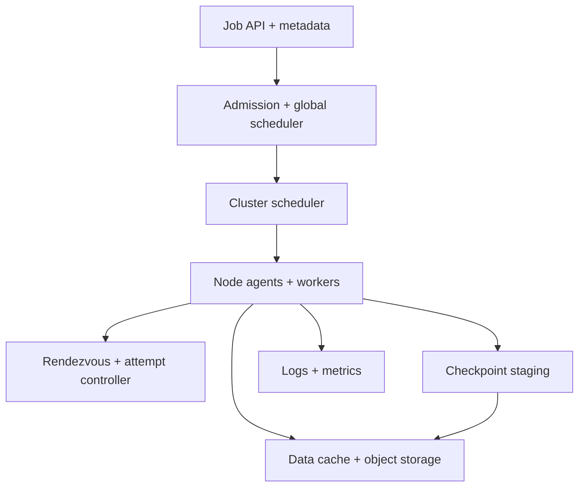
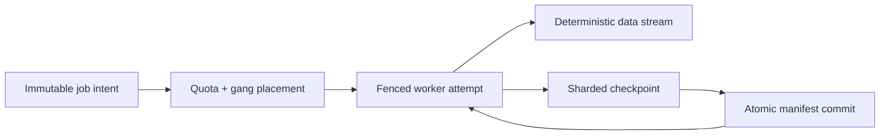

# Design a Fault-Tolerant Distributed ML Training Platform

**Difficulty:** Staff-level  
**Primary themes:** cluster scheduling, distributed coordination, collective communication, checkpointing, data pipelines, reliability, reproducibility  
**Interview time budget:** 45–50 minutes  
**Educational walkthrough:** intentionally more detailed than what you would say aloud

This original walkthrough follows the requirements → entities → interfaces → high-level design → deep dives progression described in Hello Interview's [System Design Delivery Framework](https://www.hellointerview.com/learn/system-design/in-a-hurry/delivery). It first builds a complete single-job path, then evolves it around scarce accelerator placement, failures, checkpoints, and deterministic data consumption.

---

## Interviewer prompt

> Design a multi-tenant platform for training large machine-learning models across hundreds or thousands of GPUs or other accelerators. Users submit jobs with code, data, resources, and checkpoint policy. The platform schedules workers, launches distributed training, survives failures, tracks artifacts, and makes runs reproducible.

## Targeted clarifying questions with assumed answers

**Candidate:** What training styles must we support?

**Interviewer:** Prioritize synchronous data-parallel and hybrid data/model/pipeline parallel training. Support single-node jobs too. Hyperparameter sweeps can submit many ordinary jobs.

**Candidate:** What is the cluster scale?

**Interviewer:** Fifty thousand accelerators across several regions and clusters. One job may request from 1 to 4,096 accelerators. Expect 10,000 queued or running jobs.

**Candidate:** What is the service-level objective?

**Interviewer:** The control plane should be 99.99% available. Once admitted, 99% of workers should launch within five minutes. A recoverable infrastructure failure should lose at most 15 minutes of training work.

**Candidate:** Are accelerators interchangeable?

**Interviewer:** No. Jobs specify accelerator type, memory, interconnect requirements, image/driver compatibility, region, and sometimes topology constraints.

**Candidate:** What storage should I assume?

**Interviewer:** Training data and durable checkpoints live in object storage. Clusters have local NVMe and optional distributed high-throughput caches. Model artifacts can be terabytes.

**Candidate:** How should failures work?

**Interviewer:** Most synchronous jobs restart the whole worker group from a committed checkpoint when a worker fails. Elastic jobs may shrink or grow at explicit safe points.

**Candidate:** What does reproducibility mean?

**Interviewer:** We should record code, container, configuration, data snapshot, feature/tokenizer versions, random seeds, topology, framework, and checkpoint lineage. Bit-for-bit identity across different hardware is not mandatory.

**Candidate:** Is notebook development in scope?

**Interviewer:** No. Cover submitted training jobs, logs, metrics, checkpoints, cancellation, retries, and artifacts.

### Scope statement to say aloud

> “I’ll design job submission and validation, quota-aware gang scheduling, topology-aware worker launch, rendezvous and heartbeats, deterministic data sharding, checkpoint commit and recovery, observability, and artifact lineage. I’ll exclude interactive notebooks, model serving, and the internals of gradient algorithms.”

---

## 1. Requirements (~5 minutes)

### Core functional requirements

1. **Submit and schedule training jobs.** Validate immutable job specifications, enforce quotas and priority, place compatible accelerator groups, and launch workers atomically enough for synchronous training.
2. **Run and recover distributed training.** Establish a worker group, coordinate ranks, stream logs/metrics, detect failures, and resume from a valid checkpoint.
3. **Persist reproducible outputs.** Version data inputs, checkpoints, final artifacts, execution metadata, and lineage; expose job status and cancellation.

### Non-functional requirements

| Property | Target | Design consequence |
|---|---:|---|
| Fleet size | 50K accelerators | sharded cluster managers and hierarchical scheduling |
| Max job size | 4,096 accelerators | topology-aware gang placement and admission control |
| Control-plane availability | 99.99% | replicated metadata, leased reconcilers, idempotent actions |
| Launch SLO | 99% within 5 min after admission | reservations, image prefetch, capacity-aware admission |
| Recovery point | < 15 min work lost | incremental/asynchronous checkpoints and health detection |
| Metadata durability | no acknowledged job/checkpoint loss | transactional state plus immutable manifests |

### Scale estimates that change design decisions

A 4,096-accelerator job cannot be scheduled by independently assigning one device at a time. If 4,095 workers launch while the last device is unavailable, expensive resources idle. We need **gang scheduling**: reserve the compatible group before starting the job.

For a model with two trillion parameters trained in 16-bit form, weights alone are 4 TB. With gradients and optimizer state, a checkpoint may be 20–40 TB depending on optimizer and sharding. Writing 30 TB every 15 minutes requires an average of 33 GB/s, before burst overhead. Workers must write sharded checkpoints in parallel to local or distributed staging, then upload asynchronously; a single coordinator cannot serialize the data.

Suppose 50,000 workers heartbeat every 10 seconds. That is only 5,000 heartbeat events/s, but updating a strongly consistent central row for each pulse would create avoidable write pressure and failure coupling. Use regional heartbeat aggregators and leases, persisting state transitions rather than every pulse.

At 400 Gbit/s interconnect per worker, a large collective can move tens of TB/s inside a training fabric. Placement across a slow oversubscribed link can dominate step time. Topology is a performance requirement, not merely a scheduling preference.

Ten thousand jobs emitting 100 metrics/s produce one million metric points/s. Metrics and logs need separate scalable pipelines; they must not write through the transactional job database.

### Consistency and availability contract

- Job submission is idempotent and strongly consistent per job ID.
- Job state is a versioned state machine; only the active reconciliation epoch may launch or terminate workers.
- Worker heartbeats and metrics are eventually consistent, but terminal state transitions and checkpoint commits are durable.
- A checkpoint becomes recoverable only after every required shard is verified and one manifest is atomically marked `COMMITTED`.
- Scheduling is fair over time but not globally serializable at every instant; reservations prevent double-allocation inside an ownership epoch.
- Synchronous worker groups use one immutable attempt/rendezvous generation. A worker from an older generation cannot join a restarted job.
- The system prefers delaying a launch to starting a group that violates requested topology or compatibility.

### Concise interview phrasing

> “The scarce resource is not just a count of GPUs; it is a compatible, connected gang. I’ll separate durable job intent from per-cluster reconciliation and make checkpoints visible only through an atomic manifest.”

---

## 2. Core entities (~2 minutes)

| Entity | Purpose | Important fields |
|---|---|---|
| `TrainingJob` | Durable user intent | `job_id`, owner, project, spec version, priority, state, retry policy |
| `JobSpec` | Immutable execution definition | image digest, command, resources, topology, data refs, checkpoint policy |
| `JobAttempt` | One execution generation | attempt ID, fencing epoch, cluster, worker count, start/end, failure reason |
| `WorkerLease` | Reserved execution slot | attempt ID, rank, node/device, lease expiry, generation |
| `Rendezvous` | Rank and membership configuration | attempt ID, world size, rank map, endpoint, generation |
| `DatasetSnapshot` | Immutable input view | URI/manifest, partition list, schema/tokenizer versions, checksum |
| `Checkpoint` | Recoverable training state | checkpoint ID, step, attempt, state, shard manifest, parent |
| `Artifact` | Final or intermediate output | type, object URI, digest, lineage, retention |
| `QuotaAccount` | Tenant resource entitlement | accelerator-seconds, concurrency, priority share, burst balance |
| `NodeInventory` | Schedulable capacity | devices, memory, topology, health, image cache, reservations |

### Say aloud

> “A job is immutable intent, an attempt is one fenced execution, and a checkpoint is not valid until its manifest commits. Keeping those identities separate makes retries safe.”

---

## 3. APIs and system interfaces (~5 minutes)

Owner, tenant, project membership, and allowed resource pools come from authentication and authorization, not body-supplied identities.

### 3.1 Submit a job

```http
POST /v1/training-jobs
Authorization: Bearer <workload-token>
Idempotency-Key: pretrain-run-184

{
  "name": "llm-pretrain-184",
  "image": "registry.example/train@sha256:9ab...",
  "command": ["python", "train.py", "--config", "/config/run.yaml"],
  "resources": {
    "accelerator_type": "H100-80GB",
    "accelerators_per_worker": 8,
    "workers": 128,
    "cpu_per_worker": 64,
    "memory_gib_per_worker": 512
  },
  "topology": {"max_fabric_domains": 2, "same_region": true},
  "dataset_snapshot_id": "ds_2026_10_20_44",
  "checkpoint_policy": {"target_interval_minutes": 10, "retain_last": 3},
  "retry_policy": {"max_infra_restarts": 5},
  "priority_class": "STANDARD"
}
```

```json
{
  "job_id": "job_01K...",
  "spec_version": 1,
  "state": "QUEUED",
  "estimated_start": "2026-10-21T03:10:00Z"
}
```

The image is pinned by digest and the dataset by immutable snapshot ID. Mutable tags are resolved before acceptance.

### 3.2 Get status

```http
GET /v1/training-jobs/job_01K...
Authorization: Bearer <user-token>
```

```json
{
  "job_id": "job_01K...",
  "state": "RUNNING",
  "attempt_id": "att_4",
  "attempt_generation": 4,
  "cluster": "us-east-train-3",
  "workers_ready": 128,
  "global_step": 41800,
  "latest_checkpoint": "ckpt_41700",
  "checkpoint_age_seconds": 412,
  "data_snapshot": "ds_2026_10_20_44"
}
```

### 3.3 Cancel a job

```http
POST /v1/training-jobs/job_01K...:cancel
Authorization: Bearer <user-token>
If-Match: "job-version-19"

{"reason": "superseded configuration"}
```

Cancellation records durable intent first. Reconcilers then stop workers idempotently.

### 3.4 Worker control interface

```protobuf
RegisterWorker(attempt_id, generation, lease_token, node_id) -> {
  rank, world_size, rendezvous_endpoint, job_bundle_uri
}

Heartbeat(attempt_id, generation, rank, step, checkpoint_state, health) -> {
  continue, desired_action, lease_expiry
}
```

The generation and signed lease prevent stale workers from joining a restarted group.

### 3.5 Commit a checkpoint

```http
POST /internal/v1/checkpoints/ckpt_41700:commit
Authorization: Bearer <attempt-identity>

{
  "attempt_id": "att_4",
  "generation": 4,
  "global_step": 41700,
  "shards": [
    {"rank": 0, "uri": "object://.../rank-0", "bytes": 30122800112, "sha256": "..."}
  ],
  "trainer_state_digest": "sha256:..."
}
```

The real manifest references every rank shard; the abbreviated example shows one.

### Say aloud

> “Submission pins every mutable dependency. Worker calls carry the attempt generation, and checkpoint commit is a control-plane transaction over already-written immutable shards.”

---

## 4. Data flow

### Job lifecycle

1. The API authenticates, validates policy and compatibility, resolves immutable inputs, and stores the job plus quota reservation request.
2. Admission control chooses an eligible region/cluster based on capacity, data locality, priority, and topology.
3. A cluster scheduler reserves a compatible gang and writes a fenced placement plan.
4. Node agents pull the image and job bundle, mount credentials, start workers, and register them with the rendezvous service.
5. When the full required membership is ready, the attempt transitions to `RUNNING` and training begins.
6. Workers emit heartbeats, metrics, logs, progress, and checkpoint shards through separate data paths.
7. On completion, artifacts are verified, lineage is committed, leases are released, and quota accounting finalizes.

### Recovery

1. Health aggregation identifies a failed or unreachable worker.
2. The attempt controller fences the old generation and marks the attempt failed.
3. The scheduler reserves a replacement gang, potentially reusing healthy nodes after cleanup.
4. Workers load the newest committed compatible checkpoint.
5. Data readers restore cursor/epoch state and resume from the checkpoint step.

---

## 5. High-level design (~10–15 minutes)



### Operation 1: submit and validate durable intent

The API writes the immutable `JobSpec`, initial `TrainingJob`, and audit event in one transaction. Validation checks:

- image digest, signature, framework/driver compatibility;
- accelerator type and memory;
- maximum job size and topology feasibility;
- project quota and allowed priority;
- dataset and tokenizer existence;
- checkpoint destination, encryption, and retention;
- network and secret policy.

The API returns after durable acceptance, not after scheduling. One idempotency key maps to one job spec hash; reusing the key with different content fails rather than silently changing the run.

### Operation 2: admit and schedule the accelerator gang

Use hierarchical scheduling. A global admission layer chooses a cluster and grants it a fenced reservation token. A per-cluster scheduler has detailed, fresh knowledge of nodes and topology.

Eligibility first filters by hard constraints: device type, device count, memory, driver, region, security pool, and fabric domains. Scoring then considers data/cache locality, image presence, fragmentation, network topology, expected duration, and fairness.

For a synchronous 1,024-accelerator request, the scheduler creates a tentative reservation across whole nodes or topology blocks. Only after all leases succeed does it commit the placement and tell node agents to launch. Failed tentative reservations expire automatically.

Queues use tenant fair share with priority classes and aging. Higher-priority work may preempt eligible lower-priority jobs, but preemption cost includes checkpoint age and expected restart overhead. A 4,096-device job should not starve forever behind a stream of small jobs, so the scheduler can reserve capacity over time.

**Say aloud:**

> “I separate hard feasibility from scoring, reserve the gang before launch, and include topology and checkpoint cost in placement and preemption rather than treating every accelerator as an interchangeable integer.”

### Operation 3: launch and rendezvous workers

The cluster scheduler writes a placement plan with `attempt_id`, generation, ranks, nodes, and lease tokens. Node agents watch only their shard of plans, verify the fencing epoch, create isolated runtime environments, stage images/configs, and start processes.

Workers register with a regional rendezvous service. It validates the lease and generation, assigns the predetermined rank, and returns the group membership and collective endpoints. The training start barrier opens only when required members are ready. If readiness misses its deadline, the attempt is torn down rather than holding a partial gang indefinitely.

Node agents continuously reconcile desired versus actual state. Repeating a start or stop command is safe because `(attempt_id, generation, rank)` is unique.

### Operation 4: read training data reproducibly

A `DatasetSnapshot` is an immutable manifest of objects/records with checksums and schema/tokenizer versions. The training framework derives a deterministic sample order from snapshot, epoch, global seed, and data-parallel rank.

Workers read through a cluster-local data cache. Cache misses fetch immutable objects from regional object storage; admission considers whether the dataset is available in the region. Sequential prefetch and large shard files avoid millions of tiny object requests.

The checkpoint records data-loader state: epoch, sample cursor or deterministic seed/counter, consumed-shard bitmap where required, and world-size semantics. If an elastic job changes world size, data repartitioning happens only at a documented safe boundary.

### Operation 5: stream logs and metrics

Worker stdout/stderr flows through node-local agents into a partitioned log pipeline, tagged by job, attempt, rank, and time. Metrics agents aggregate locally before exporting step time, loss, throughput, device utilization, communication time, input stalls, and checkpoint progress.

Do not write these high-volume signals to the job database. A time-series store serves dashboards; object storage retains compressed logs. The attempt controller consumes a small health subset, not arbitrary user metrics.

### Operation 6: checkpoint and recover

At a coordinated training safe point, each rank writes its state shard to local NVMe or a distributed staging layer. Shards include model/optimizer partitions, random-number state, scheduler/scaler state, and data-loader progress.

Uploads are parallel and content-addressed. After all required shards arrive, a checkpoint coordinator verifies size/checksum and creates an immutable manifest. One metadata transaction changes the checkpoint from `UPLOADING` to `COMMITTED`. Older incomplete checkpoints are ignored and garbage-collected.

On failure, the attempt controller stops/fences the old generation, the scheduler places a new gang, and workers load the newest checkpoint compatible with the exact job spec. A lineage pointer records the parent attempt/checkpoint.

### Operation 7: complete and publish artifacts

The chief or checkpoint coordinator declares training complete, but the platform verifies final artifacts and manifest integrity before marking the job `SUCCEEDED`. The registry records image digest, source commit, config, data snapshot, framework, accelerator topology, seeds, metrics summary, checkpoints, and output digest.

Cancellation, timeout, and quota exhaustion are state-machine transitions. A cancelled job may optionally take one final checkpoint within a bounded grace period.

### Storage choices

| Need | Choice | Reason |
|---|---|---|
| Job/spec/attempt metadata | Strong relational or consensus-backed store | conditional state transitions and audit |
| Scheduler inventory/reservations | Sharded in-memory state + durable leases/log | fast placement with fenced recovery |
| Rendezvous | Regional strongly consistent KV | membership generation and barriers |
| Datasets/checkpoints/artifacts | Object storage | huge immutable blobs and durability |
| Checkpoint staging | Local NVMe / distributed parallel filesystem | absorb burst before object upload |
| Logs | Partitioned log to object storage | high fan-in and replay |
| Metrics | Time-series store | high-rate window queries |
| Lineage/search | Relational index over immutable manifests | discoverability and reproducibility |

---

## 6. Deep dives (~10–15 minutes)

### Deep dive A: gang scheduling, topology, fairness, and fragmentation

#### Where the baseline breaks

First-fit scheduling by free-device count may scatter workers across slow links, leave partial nodes unusable, and launch groups that can never complete. Strict FIFO lets a huge job block all small work, while always fitting small jobs can starve the huge job.

#### Options

| Approach | Benefit | Limitation |
|---|---|---|
| Central global scheduler | simple global view | scale, stale details, large blast radius |
| Independent cluster schedulers | scalable and failure-isolated | poor cross-cluster choice and fairness |
| Hierarchical admission + cluster placement | balances global policy and local detail | reservation protocol complexity |

Choose hierarchical scheduling.

The global layer manages quota, priority, cluster eligibility, and coarse capacity forecasts. It grants one cluster a time-bounded scheduling ownership epoch. The cluster scheduler owns node-level reservations and network topology.

Model the fabric as topology blocks—host, rack, leaf switch, fabric island. A placement score can penalize the number of crossed boundaries and predicted collective cost. Whole-node allocation is often preferable for eight-device servers to avoid interference and fragmentation.

Fairness uses dominant resource share or accelerator-seconds within tenant/project pools. Queue aging increases effective priority. Large jobs may receive future reservations: the scheduler stops consuming selected capacity with backfill jobs unless they can finish or be cheaply preempted before the reservation.

Preemption requires a valid recent checkpoint. The victim receives a checkpoint/terminate deadline. If it misses the deadline, policy may terminate it, but the scheduler accounts for wasted work and avoids repeatedly victimizing the same job.

#### Failure modes and observability

- global owner fails: lease expires and a new owner reconciles reservations;
- partial reservation: TTL releases all leases;
- node becomes unhealthy before launch: abandon the entire tentative plan;
- stale inventory: node agent rejects mismatched epoch;
- pathological fragmentation: defragment through drain/preemption windows.

Monitor queue time by tenant/job size, schedulable versus raw free devices, topology score, reservation failure, idle reserved accelerator time, preemption waste, and starvation age.

**Say aloud:**

> “Gang scheduling prevents partial launch, topology scoring protects step time, and fair-share plus reservation-aware backfill avoids both head-of-line blocking and starvation.”

### Deep dive B: checkpoint throughput and failure recovery

#### Where the baseline breaks

A chief-written checkpoint bottlenecks on one host. Directly uploading tens of terabytes to object storage can stall training and create synchronized network bursts. Treating any directory with some shards as valid risks corrupt recovery. Frequent full checkpoints waste bandwidth; infrequent ones violate the 15-minute recovery point.

#### Selected design

Use sharded, asynchronous, manifest-committed checkpoints:

1. training reaches a safe step and freezes a consistent logical state;
2. every rank writes its owned shard to fast staging;
3. training resumes when local durability policy permits;
4. background workers upload shards in parallel with bandwidth limits;
5. coordinator verifies all required shard descriptors;
6. one immutable manifest is atomically committed.

The manifest contains job-spec digest, framework/checkpoint schema, world size and parallelism layout, step, shard URIs/digests, RNG state references, data cursor, and parent checkpoint.

Full checkpoints are simple but expensive. Incremental checkpoints upload only changed chunks using content-addressed storage, while periodic full/materialized checkpoints bound restore amplification. Retention must understand dependency graphs before deleting base chunks.

Choose checkpoint interval using measured checkpoint cost and failure rate rather than a fixed universal value. The platform can target 10 minutes but adapt when upload lag grows. If no committed checkpoint is younger than the 15-minute objective, page and optionally throttle risky training.

Failure detection combines worker heartbeats, node agent health, collective timeouts, and fabric telemetry. Avoid declaring failure from one missed heartbeat; use leases and suspicion escalation. Once recovery begins, fence the old generation so a partitioned worker cannot upload a newer-looking checkpoint.

#### Recovery choices

- synchronous fixed-size job: restart the entire gang;
- elastic data-parallel job: change membership only at a safe checkpoint boundary;
- transient object-store issue: keep staging checkpoints locally and retry;
- corrupted latest checkpoint: fall back to prior committed manifest;
- region loss: resume in another region only if data/checkpoint replication and hardware compatibility permit.

#### Observability

- checkpoint pause time, staging time, upload time, and commit age;
- bytes written versus deduplicated;
- restore throughput and time-to-first-step;
- failures by hardware/framework/user code;
- lost training minutes per incident;
- incomplete-shard garbage backlog.

**Say aloud:**

> “Workers write in parallel, but only the small manifest commits atomically. Staging decouples the training pause from object-store upload, and fencing prevents an old partitioned attempt from publishing state.”

### Deep dive C: deterministic data sharding and reproducible execution

#### Where the baseline breaks

Reading a mutable data prefix means the dataset changes during a run. Simple `file_index % world_size` partitioning duplicates or skips samples after restart or world-size changes. Recording only a Git commit is insufficient when images, tokenizers, libraries, seeds, and hardware kernels differ.

#### Dataset snapshots

Before submission, a data service creates an immutable snapshot manifest containing object version IDs, byte ranges or record counts, checksums, schema, preprocessing graph, tokenizer, and governance metadata. The job references the snapshot ID, never a mutable prefix.

For fixed world size, derive deterministic sample ownership from:

```text
sample_order = PRP(snapshot_id, epoch, global_seed)
owner = global_sample_index mod data_parallel_world_size
```

A pseudo-random permutation avoids storing a giant shuffled list. The checkpoint records epoch and counter. Framework adapters must define whether partially processed batches are replayed after failure; bounded replay is acceptable if optimization semantics tolerate it and is recorded.

Elastic world-size changes occur only at epoch or checkpoint boundaries with a new partition generation. The platform records the transition; it does not pretend the sample stream is identical.

#### Reproducibility bundle

Record:

- source repository and commit plus dirty patch digest;
- container image digest and package lockfiles;
- training and parallelism configuration;
- dataset snapshot and preprocessing/tokenizer versions;
- model initialization and random seeds;
- framework, compiler, collective library, driver, and firmware;
- accelerator type, topology, and world-size history;
- parent checkpoint and artifact checksums.

This enables scientifically comparable replay, not guaranteed bitwise identity. Non-deterministic kernels and floating-point reduction order can differ. The platform labels the reproducibility level and can provide a deterministic mode with a performance cost.

#### Security and observability

Use short-lived workload identities, per-job object prefixes, network isolation, signed images, secret injection without environment/log leakage, and audited artifact access. Dataset policy is checked at submission and launch because permissions or residency rules may change while queued.

Monitor data-cache hit rate, input stall time, checksum failures, snapshot availability, samples/epoch by rank, duplicate/skip audits, configuration drift, and runs missing lineage fields.

**Say aloud:**

> “Reproducibility starts with an immutable data manifest and full execution bundle. I define sample ownership deterministically and record elastic membership changes instead of promising bitwise equivalence that the hardware may not provide.”

---

## 7. Final design

The job API validates and stores immutable training intent. A global admission layer enforces quota and selects a cluster; a detailed cluster scheduler reserves a topology-compatible accelerator gang before launch. Fenced placement plans drive idempotent node agents, and a generation-aware rendezvous service admits only workers from the current attempt.

Workers consume an immutable dataset snapshot through regional caches using deterministic sharding. Logs and metrics take independent high-volume paths. At safe points, workers write checkpoint shards in parallel to fast staging, resume computation, and upload asynchronously. Only a verified immutable manifest makes a checkpoint recoverable.

Failure detection fences the old attempt, reserves a new gang, and restores the newest compatible committed checkpoint, including optimizer, random-state, and data-loader progress. Completion publishes verified artifacts and a lineage bundle containing code, image, data, configuration, libraries, topology, checkpoints, and metrics.



### Requirements check

| Requirement | Design response |
|---|---|
| Submit distributed jobs | immutable specs and idempotent API |
| Up to 4,096 accelerators | hierarchical topology-aware gang scheduling |
| Fair multi-tenancy | quota, fair share, aging, reservations, backfill |
| Launch within five minutes | admission-aware capacity and image/data prefetch |
| Recover within 15-minute RPO | staged parallel checkpoints and manifest commit |
| Worker failure safety | attempt generations, leases, fencing, full-group restart |
| Reproducible data | immutable snapshots and deterministic sample ownership |
| Observability | independent logs, metrics, heartbeats, progress |
| Durable artifacts | content-addressed object storage and lineage registry |
| Control-plane availability | replicated state and leased reconcilers |

---

## Realistic interviewer follow-up questions with strong sample answers

### 1. Why is ordinary bin packing insufficient?

> “A synchronous job needs a compatible group at once, and communication performance depends on fabric topology. Independent first-fit allocations can strand resources or create a group whose step time is dominated by slow links.”

### 2. What is gang scheduling?

> “The scheduler tentatively reserves the entire required worker group and launches only after every lease succeeds. If any reservation fails, all tentative leases expire or roll back.”

### 3. Why use hierarchical schedulers?

> “Global admission needs quota and coarse fleet visibility, while cluster placement needs fresh node and topology detail. Separating them scales better and limits failures, with a fenced ownership token preventing two clusters from launching one job.”

### 4. How do you stop a giant job from starving?

> “Age its effective priority and reserve future capacity while backfilling only jobs that can finish or be cheaply preempted before the reservation.”

### 5. When is preemption safe?

> “Prefer jobs with a recent committed checkpoint and low restart cost. Give a bounded checkpoint grace period, account for wasted work, and avoid repeatedly selecting the same tenant.”

### 6. What if only 127 of 128 workers launch?

> “The rendezvous barrier never opens. After the readiness deadline, fence and tear down the partial attempt, release the gang, and retry placement rather than idling 127 workers indefinitely.”

### 7. Why restart all workers when one fails?

> “Fixed-size synchronous collectives require consistent membership and sharded state. Restarting the generation from one committed checkpoint is simpler and safer. Elastic membership is an explicit framework capability at safe points.”

### 8. How do stale workers get fenced?

> “Every worker, heartbeat, rendezvous registration, and checkpoint upload includes the attempt generation and signed lease. Once the controller increments the generation, old operations are rejected.”

### 9. Why not write checkpoints directly to object storage synchronously?

> “Tens of terabytes would pause training for too long and cause a network burst. Parallel fast staging shortens the safe-point pause; background uploads are bandwidth-limited and become valid only after manifest commit.”

### 10. What makes a checkpoint valid?

> “All required immutable shards must match expected sizes and digests, and one manifest containing the exact job-spec digest, parallel layout, step, RNG, and data cursor must transition atomically to `COMMITTED`.”

### 11. How do incremental checkpoints work?

> “Content-address chunks and upload only changed state, with a manifest referencing prior chunks. Periodic full or materialized checkpoints bound restore dependency depth, and garbage collection follows the manifest graph.”

### 12. How do you choose checkpoint frequency?

> “Balance measured checkpoint cost against observed failure rate and the recovery-point objective. Adapt if upload backlog grows, while alerting when the newest committed checkpoint exceeds 15 minutes.”

### 13. How is training data kept immutable?

> “The job references a snapshot manifest of object version IDs, ranges, schemas, tokenizer, and checksums—not a mutable storage prefix.”

### 14. How do you prevent duplicate data after restart?

> “Derive order and ownership deterministically from snapshot, epoch, seed, rank, and world size, then checkpoint the epoch/counter. Document bounded batch replay if the framework cannot commit per sample.”

### 15. What happens when an elastic job changes world size?

> “Change membership only at a checkpoint boundary, create a new partition generation, deterministically redistribute model/data state, and record the world-size transition in lineage.”

### 16. Can the run be reproduced bit for bit?

> “Not always. Floating-point reduction order and non-deterministic kernels may differ. The platform records the full environment and can offer a slower deterministic mode, but its default guarantee is traceable, scientifically comparable replay.”

### 17. How do you avoid the metadata database becoming a metrics bottleneck?

> “Transactional storage holds job intent and state transitions only. Logs, heartbeats, and training metrics use partitioned ingestion and time-series/object stores.”

### 18. How do you handle a region failure?

> “Fence the lost attempt. Resume elsewhere only if checkpoint and dataset snapshots are replicated, the image and hardware are compatible, and policy allows the data to move. Otherwise the job remains recoverable but blocked.”

### 19. How do you distinguish user-code failure from infrastructure failure?

> “Combine exit code, node/fabric telemetry, collective errors, and repeated failure signatures. Infrastructure failures consume automatic retry budget; deterministic user failures stop early and surface diagnostics.”

### 20. What metric would page you first?

> “Checkpoint age beyond the recovery objective and accelerator gangs stuck reserved but not training. Both can waste enormous compute or turn a routine failure into hours of lost work.”

---

## Common pitfalls

1. Treating accelerators as interchangeable counters.
2. Launching workers before the full gang is reserved.
3. Ignoring network topology in placement.
4. Using strict FIFO and causing head-of-line blocking.
5. Always fitting small jobs and starving large jobs.
6. Preempting without considering checkpoint age.
7. Letting two reconcilers launch the same attempt.
8. Allowing stale workers to rejoin after restart.
9. Writing multi-terabyte checkpoints through one chief.
10. Treating partially uploaded shards as recoverable.
11. Pausing training for the entire object-store upload.
12. Deleting incremental-checkpoint base chunks prematurely.
13. Reading training data from a mutable prefix.
14. Ignoring data-loader cursor and RNG state.
15. Repartitioning elastic data in the middle of an unsafe step.
16. Sending logs and metrics through the job database.
17. Retrying deterministic user-code failures forever.
18. Claiming reproducibility from a source commit alone.
19. Assuming cross-region recovery without data and hardware compatibility.
20. Measuring allocated accelerators instead of useful training utilization.

---

## Polished 60-second closing summary

> “I separate immutable job intent from fenced execution attempts. Global admission applies quota and chooses a cluster; a local scheduler reserves an entire topology-compatible accelerator gang before launching. Node agents reconcile signed placement plans, and a generation-aware rendezvous prevents stale workers from joining. Training reads a versioned dataset snapshot through regional caches with deterministic rank ownership. At safe points, workers write state shards in parallel to fast staging and resume while uploads continue; only a verified atomic manifest makes a checkpoint recoverable. Failures fence the old generation, place a new gang, and restore model, optimizer, RNG, and data cursor from the latest committed checkpoint. Logs and metrics use separate scalable pipelines, while the lineage registry records code, image, data, config, libraries, topology, world-size history, and artifacts. The design prioritizes useful accelerator time, bounded lost work, and traceable reproducibility.”

## Public references

- Hello Interview, [System Design Delivery Framework](https://www.hellointerview.com/learn/system-design/in-a-hurry/delivery)
- Hello Interview, [API Design for System Design Interviews](https://www.hellointerview.com/learn/system-design/core-concepts/api-design)
- Hello Interview, [Data Modeling for System Design Interviews](https://www.hellointerview.com/learn/system-design/core-concepts/data-modeling)

The references are used for interview-delivery structure. The prompt, requirements, estimates, APIs, scheduler, checkpoint protocol, data design, dialogue, failure semantics, and tradeoffs are original.
