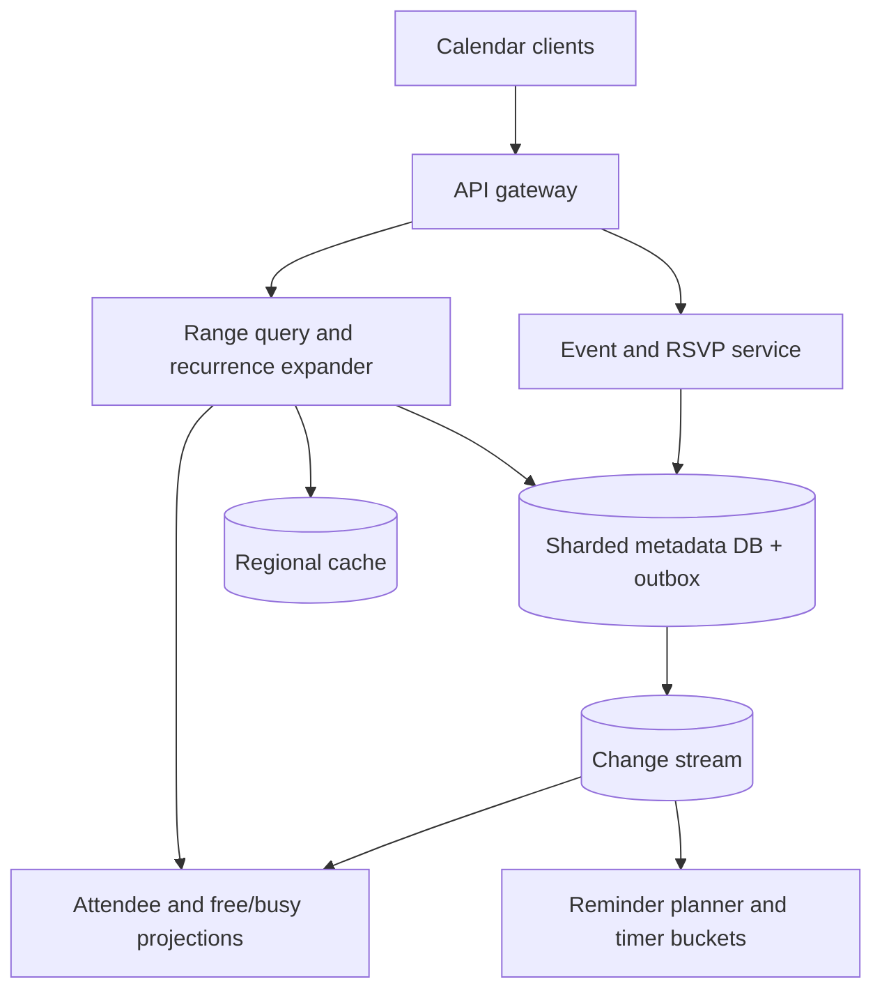
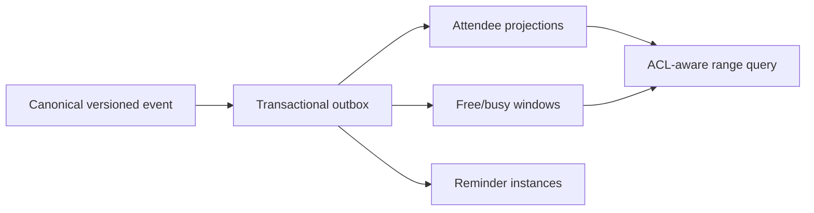

# Design a Global Calendar and Meeting Scheduling Service

**Difficulty:** Senior

**Primary themes:** recurring-event modeling, time zones and DST, consistency, fanout, interval queries, caching, delayed reminders, privacy, multi-region reliability

> **Interview-time note:** The pacing labels describe a 45-minute interview. This walkthrough is intentionally longer for study. In the interview, establish the time and consistency semantics, complete one create-and-read path, and then deepen recurrence and multi-participant updates.

This walkthrough uses the public [Hello Interview delivery framework](https://www.hellointerview.com/learn/system-design/in-a-hurry/delivery): requirements, core entities, interfaces, a simple complete design, and focused deep dives. The problem, assumptions, APIs, dialogue, and tradeoffs are original.

---

## Interviewer prompt

> Design a global calendar service. Users can own or share calendars, create one-time and recurring events, invite attendees, respond to invitations, view a time range, see free/busy information, and receive reminders. The product should work correctly across time zones, daylight-saving changes, concurrent edits, and regional failures.

The deceptively hard part is not storing a row with `start_time`. A weekly 9:00 AM New York meeting has a different UTC offset after a daylight-saving transition; an edited occurrence should not rewrite the whole series; and one organizer update must reach millions of attendee calendars without a global transaction.

## Targeted clarifying questions and assumed answers

**Candidate:** Are personal and shared calendars both in scope?

**Interviewer:** Yes. A calendar has an owner and ACL. Users may subscribe to multiple calendars with reader, writer, or owner permission.

**Candidate:** Which event operations matter most?

**Interviewer:** Create, update, delete, list by time range, invite/RSVP, recurring events with per-occurrence exceptions, free/busy, and reminders.

**Candidate:** What recurrence expressiveness is required?

**Interviewer:** Support common daily, weekly, monthly, count/until, and exclusion rules compatible with an RFC-5545-style recurrence rule. No arbitrary user code.

**Candidate:** What does “9:00 AM every Monday” mean across DST?

**Interviewer:** It remains 9:00 AM in the series time zone. Store the local wall-clock rule and IANA time-zone identifier, not only the first UTC instant.

**Candidate:** How large is the system?

**Interviewer:** Assume 500 million registered users, 50 million daily active users, 100 million event mutations/day, 5 billion calendar reads/day, and peaks 20 times the daily average. A meeting can have up to 10,000 normal invitees; rare broadcasts can reach millions but may use a restricted event type.

**Candidate:** Must attendee calendars update atomically with the organizer's event?

**Interviewer:** No. The organizer's canonical event must be strongly consistent. Attendee projections may converge within seconds, must be monotonic by event version, and must never invent conflicting event content.

**Candidate:** Does free/busy need to prevent double booking?

**Interviewer:** For people it is advisory and may be a few seconds stale. Reservable resources such as rooms need strongly consistent conflict prevention.

**Candidate:** Are external calendar federation and email delivery in scope?

**Interviewer:** Model outbound invitations as a consumer, but do not design full email or federation protocols.

**Candidate:** What reminder guarantees are expected?

**Interviewer:** Deliver within one minute of the configured time for 99.9% of reminders. Duplicates are preferable to omissions, but suppress user-visible duplicates with an idempotency key.

### Scope statement to say aloud

> “I will make the organizer's event series and each attendee's RSVP strongly consistent within their owning shards. Cross-calendar propagation is asynchronous and versioned. A recurring series stores its local-time rule plus time-zone identifier and sparse exceptions; reads expand only the requested window. A transactional outbox publishes changes to attendee projections, free/busy indexes, cache invalidation, and a rolling reminder scheduler. People may be double-booked, while reservable rooms use a separate strongly consistent reservation path.”

---

## 1. Requirements (~5 minutes)

### Core functional requirements

1. **Manage calendars and events.** Authorized users create, update, delete, and query one-time or recurring events, including “this occurrence,” “this and following,” and “entire series” edits.
2. **Coordinate participants.** Organizers invite users; attendees view invitations, RSVP, and query privacy-preserving free/busy. Shared resources can reject conflicting reservations.
3. **Notify reliably.** Users configure reminders; event mutations reschedule or cancel them, and delivery is timely and deduplicated.

### Out of scope

- Rich document editing in event descriptions
- Full email transport, video conferencing, or contact management
- Travel-time prediction and ML meeting recommendations
- Arbitrary recurrence scripts
- Perfect atomicity across every attendee calendar
- Legal retention and e-discovery implementation details

### Quantified non-functional requirements

| Requirement | Target | Design consequence |
|---|---:|---|
| Calendar reads | 5B/day, ~58K/s average, ~1.2M/s peak | Time-range indexes, regional replicas, occurrence-window caches |
| Event mutations | 100M/day, ~1.2K/s average, ~23K/s peak | Sharded transactional writes plus outbox |
| Latency | read p99 <300 ms; mutation p99 <500 ms | Local reads, bounded expansion, asynchronous fanout |
| Availability | reads 99.99%; writes 99.95% | Multi-zone shards, regional failover, honest write fencing |
| Propagation | 99.9% of attendee views/free-busy within 10 s | Durable event stream, lag SLO, reconciliation |
| Reminder timing | 99.9% within ±60 s | Rolling materialization, partitioned timer buckets, deduped delivery |
| Durability | acknowledged canonical events are not lost | Quorum replication, WAL/backups, outbox in same transaction |
| Privacy | unauthorized users learn no event details | ACL at query boundary; free/busy returns intervals only |

### Scale estimates that change design decisions

Five billion reads per day gives:

\[
5{,}000{,}000{,}000 / 86{,}400 \approx 58{,}000\text{ reads/s average}
\]

At a 20× peak, about 1.2 million reads/s makes a single relational primary impossible for the read path. Most users repeatedly open “this week” and “this month,” so regional read replicas plus cached expanded windows are justified.

One hundred million mutations/day gives about 1,160/s average and 23,000/s peak. Writes are far below reads, so we optimize for authoritative, transactional mutations and asynchronously derive read projections.

If a normal event averages four attendee projections, fanout is roughly 400 million projection updates/day. A celebrity or company-wide event can produce millions from one write. Therefore the synchronous organizer transaction must not update every attendee row.

Assume 50 million daily users receive two reminders/day: 100 million/day, about 1,160/s average. Morning and top-of-hour clustering may exceed 100,000/s. We need partitioned delayed work, not one database scan for `remind_at <= now`.

A naive system that materializes a forever-daily recurrence creates unbounded rows. Even a ten-year daily event produces 3,650 occurrences. Across 100 million series this is hundreds of billions of rows, mostly never read. Store the rule and materialize only a rolling horizon or requested window.

### Consistency and availability contract

- **Canonical event:** strongly consistent per `event_id`; updates use an expected version and return a conflict on concurrent edit.
- **Series semantics:** a series rule and its exception set are read from one authoritative shard snapshot.
- **Attendee projection:** eventually consistent, monotonic by `event_version`, target 10 seconds.
- **RSVP:** strongly consistent for one `(event_id, attendee_id)` response; duplicate requests are idempotent. Organizer summaries may lag.
- **Free/busy:** bounded-stale for people; contents hidden. Resource booking is strongly consistent and rejects overlaps.
- **Read-your-writes:** the writer receives a mutation token; subsequent reads may route to the primary or wait until a replica/projection has applied that version.
- **Reminders:** at-least-once scheduling and delivery with user-visible deduplication by `(event_id, occurrence_id, reminder_id, event_version)`.
- **Partition behavior:** serve cached/read-replica calendar views when safe; fence writes in a region without authoritative shard leadership rather than accept split histories.

### What to say aloud

> “The key distinction is canonical truth versus derived views. I need one ordered history per event, but I do not need a distributed transaction across thousands of attendee calendars, caches, free/busy indexes, and reminder queues.”

---

## 2. Core entities (~2 minutes)

- **Calendar** — owner, display settings, default time zone, and lifecycle.
- **CalendarMembership** — principal, role, visibility permissions, and version.
- **EventSeries** — canonical organizer-owned event, local start/end, time-zone ID, recurrence rule, participant policy, and version.
- **OccurrenceException** — cancellation or replacement fields for one recurrence key.
- **Participant** — invitee, role, RSVP status, comment, and response version.
- **AttendeeProjection** — versioned pointer/snapshot that makes an invited event visible in an attendee's calendar.
- **ResourceReservation** — strongly consistent interval claim for a room or other exclusive resource.
- **ReminderRule** — channel and offset, such as 10 minutes before.
- **ReminderInstance** — materialized near-term delivery for a concrete occurrence.
- **ChangeEvent** — durable outbox record used to update projections, indexes, caches, and reminders.

An **occurrence ID** should be stable. For a recurring series, derive it from `(event_id, original_local_start)` rather than the current UTC instant. If an occurrence moves, replies, reminder cancellation, and exceptions still refer to the same logical occurrence.

---

## 3. API and system interface (~5 minutes)

Identity, tenant, and roles come from authentication. The client never supplies an authoritative `owner_id` or `responder_id`.

### 3.1 Create an event series

```http
POST /v1/calendars/cal_42/events
Authorization: Bearer <token>
Idempotency-Key: editor-7:create-19
Content-Type: application/json

{
  "title": "Weekly design review",
  "local_start": "2026-11-02T09:00:00",
  "local_end": "2026-11-02T09:45:00",
  "time_zone": "America/New_York",
  "recurrence": "FREQ=WEEKLY;BYDAY=MO;UNTIL=20270301T140000Z",
  "participants": ["usr_9", "usr_17", "room_atlas"],
  "reminders": [{"channel": "PUSH", "offset_seconds": -600}]
}
```

```json
{
  "event_id": "evt_01K9...",
  "version": 1,
  "status": "CONFIRMED",
  "resource_reservations": [{"resource_id": "room_atlas", "status": "HELD"}],
  "mutation_token": "shard-18:991824"
}
```

The server validates the recurrence rule, calendar ACL, time zone, duration, attendee limit, and resource policy. The idempotency key is scoped to the authenticated actor and calendar.

### 3.2 Query a time range

```http
GET /v1/calendars/cal_42/events?start=2026-11-01T00:00:00Z&end=2026-12-01T00:00:00Z&page_size=200
Authorization: Bearer <token>
```

```json
{
  "items": [{
    "event_id": "evt_01K9...",
    "occurrence_id": "evt_01K9...:2026-11-02T09:00:00",
    "start": "2026-11-02T14:00:00Z",
    "end": "2026-11-02T14:45:00Z",
    "display_time_zone": "America/New_York",
    "title": "Weekly design review",
    "event_version": 1,
    "my_response": "NEEDS_ACTION"
  }],
  "next_page_token": null,
  "sync_token": "cal_42:7812"
}
```

The query uses half-open intervals `[start, end)` to avoid double-counting boundary events. Pagination tokens bind the calendar, range, ACL view, and snapshot position.

### 3.3 Update one occurrence

```http
PATCH /v1/events/evt_01K9.../occurrences/2026-11-09T09:00:00
Authorization: Bearer <token>
If-Match: "event-version-1"
Idempotency-Key: editor-7:move-occurrence-2

{
  "local_start": "2026-11-09T10:30:00",
  "local_end": "2026-11-09T11:15:00"
}
```

The recurrence key in the path is the original local start. The server writes an exception and increments the event version; it does not rewrite the recurrence rule.

For “this and following,” the server truncates the old series before the selected recurrence key and creates a successor series linked by `split_from_event_id`.

### 3.4 RSVP

```http
PUT /v1/events/evt_01K9.../participants/me/response
Authorization: Bearer <token>
Idempotency-Key: mobile-44:rsvp-8

{"status": "ACCEPTED", "scope": "SERIES"}
```

```json
{"event_id": "evt_01K9...", "participant_version": 4, "status": "ACCEPTED"}
```

The authenticated identity determines `me`. A response to one occurrence uses `scope: OCCURRENCE` plus the stable occurrence ID.

### 3.5 Query free/busy

```http
POST /v1/free-busy:query
Authorization: Bearer <token>

{
  "principals": ["usr_9", "usr_17", "room_atlas"],
  "start": "2026-11-02T13:00:00Z",
  "end": "2026-11-02T18:00:00Z"
}
```

```json
{
  "results": {
    "usr_9": [{"start": "2026-11-02T14:00:00Z", "end": "2026-11-02T14:45:00Z", "status": "BUSY"}],
    "usr_17": [{"start": "2026-11-02T15:00:00Z", "end": "2026-11-02T16:00:00Z", "status": "BUSY"}],
    "room_atlas": [{"start": "2026-11-02T14:00:00Z", "end": "2026-11-02T14:45:00Z", "status": "BUSY"}]
  },
  "as_of": "2026-10-20T08:01:44Z"
}
```

Free/busy returns no title, organizer, attendee list, or calendar name unless a separate permission allows it.

### API-to-requirement map

| Requirement | Interface |
|---|---|
| Manage events | create, range query, scoped patch/delete |
| Handle concurrency | `If-Match`, event version, idempotency key |
| Coordinate attendees | participant response and attendee projection |
| Schedule meetings | privacy-preserving free/busy query |
| Correct recurrence | local time, IANA zone, recurrence rule, stable occurrence key |

---

## 4. Data flow

1. The mutation API authenticates the caller, checks the calendar ACL, parses local time plus zone, validates recurrence, and resolves resource requests.
2. The event shard transaction writes the canonical event/version, sparse exceptions or participants, idempotency result, and outbox row.
3. The outbox relay publishes an ordered `EventChanged(event_id, version)` message.
4. Projection consumers update attendee calendar entries, free/busy intervals, occurrence-window cache invalidations, search, audit, and reminder planning.
5. Reads fetch one-time events and candidate recurring series, expand recurrence within the requested range, overlay exceptions, apply ACL redaction, merge attendee projections, and cache the result.
6. A rolling reminder planner expands only the next scheduling horizon and writes timer-bucket tasks. Dispatchers claim due tasks and call push/email/webhook adapters with idempotency keys.
7. Reconcilers compare canonical event versions to derived consumer checkpoints and repair missing projections or reminders.

---

## 5. High-level design (~10–15 minutes)



### Operation 1: create a one-time event

Start with the simplest complete path. Route a calendar to a home shard using `calendar_id`. In one database transaction:

1. verify write permission and idempotency;
2. write `EventSeries` with no recurrence rule;
3. write participant invitations owned by the event shard;
4. reserve exclusive resources or fail the transaction;
5. append an outbox record;
6. commit and return the new version.

```text
EventSeries(
  event_id, organizer_calendar_id,
  title_ciphertext, description_ref,
  local_start, local_end, time_zone_id,
  recurrence_rule, series_status,
  visibility, version,
  created_at, updated_at
)

Participant(
  event_id, principal_id, role,
  response_status, response_version,
  invited_at, responded_at
)
```

The outbox closes the database/broker dual-write gap. If publishing fails after commit, the relay retries. Consumers deduplicate by `(event_id, version, consumer_type)`.

For a room, keep a resource-partitioned reservation table with an exclusion constraint or serializable overlap check. A person may accept overlapping meetings; a room cannot be confirmed twice.

### Operation 2: make the event visible to attendees

An invitation consumer receives event version 1 and upserts:

```text
AttendeeProjection(
  attendee_calendar_id,
  event_id,
  source_event_version,
  organizer_calendar_id,
  response_status,
  visibility_snapshot,
  start_hint, end_hint,
  projection_status, updated_at
)
```

Partition by attendee calendar so time-range reads are local. An update with version 5 cannot be overwritten by a delayed version 4. For huge broadcast events, do not fan out millions of full copies. Store membership in a broadcast/subscription object and fan out a compact invalidation or use fanout-on-read for that special event type.

The projection contains enough time hints to find candidates, but canonical content is authoritative. Normal reads can serve a safe snapshot for speed; a details read can validate the version. Sensitive changes such as revocation should invalidate aggressively and fail closed if permission is uncertain.

### Operation 3: list a calendar window

Use two candidate indexes per calendar:

- one-time/moved occurrences indexed by `(calendar_id, start_instant)`;
- recurring series indexed by calendar and coarse active span, such as series start and optional until.

The range service:

1. fetches one-time candidates overlapping `[start, end)`;
2. fetches active recurring-series candidates;
3. expands each rule only inside the requested window;
4. maps local wall times through the event's time zone;
5. overlays cancellations and replacements keyed by original recurrence ID;
6. merges attendee projections and local events;
7. applies ACL and privacy redaction;
8. sorts and returns a snapshot/page token.

Cache expanded chunks such as calendar-week or calendar-month by:

```text
(calendar_id, window_start, window_end, acl_view_hash, calendar_version)
```

Mutation increments a calendar change version and publishes targeted invalidation. The cache is an optimization; a `mutation_token` lets a client demand read-your-writes from a sufficiently fresh replica.

### Operation 4: update a recurring event

Three operations have different semantics:

- **This occurrence:** add or replace one `OccurrenceException`.
- **Entire series:** update the rule/base fields and increment the version; preserve exceptions whose recurrence keys still exist, or explicitly report dropped ones.
- **This and following:** split. Add an `UNTIL` boundary to the original and create a successor series beginning at the selected local recurrence key.

```text
OccurrenceException(
  event_id,
  original_local_start,
  exception_type,          // CANCELLED or OVERRIDE
  replacement_local_start,
  replacement_local_end,
  replacement_fields,
  event_version
)
```

Splitting is easier to reason about than encoding several recurrence regimes in one row. A `series_lineage_id` lets the UI show continuity.

### Operation 5: RSVP and organizer summaries

Route the RSVP command to the event's authoritative participant record. Use an idempotency key and increment only that participant's response version. Emit `ParticipantResponded` through the outbox.

The attendee projection is updated immediately or asynchronously, and the organizer's accepted/declined counts are a derived summary. The organizer need not block on a transaction in the attendee's calendar shard.

If an organizer removes an attendee concurrently with that attendee accepting, event version and membership validation decide the result. A response against a removed membership returns `410 Gone` or a version conflict; it cannot resurrect the invitation.

### Operation 6: free/busy

Maintain a derived interval projection per principal and UTC time bucket. A change event expands relevant occurrences for a bounded horizon, converts them to instants, and upserts busy intervals tagged with source event/version.

At query time, fetch buckets for each permitted principal, merge adjacent/overlapping intervals, and return only `FREE`, `BUSY`, `TENTATIVE`, or `UNKNOWN`. Limit principal count and window size to prevent enumeration.

For dates beyond the projection horizon, expand canonical recurrence rules on demand or return a slower path. Resource calendars use the authoritative reservation index for booking, even if free/busy display is cached.

### Operation 7: schedule reminders

Do not enqueue infinite reminders when a series is created. A rolling planner materializes concrete `ReminderInstance`s for, say, the next 30 days and extends the horizon continuously.

```text
ReminderInstance(
  reminder_instance_id,
  user_id, event_id, occurrence_id,
  reminder_rule_id, event_version,
  due_at, timer_partition,
  state, lease_until, attempt_count
)
```

Hash by `user_id` or reminder ID into time buckets. Dispatchers claim due rows with leases, send via an adapter, and record delivery. A stale event version triggers cancellation or recomputation before send. The downstream idempotency key suppresses duplicate visible notifications.

---

## 6. Deep dives (~10–15 minutes)

### Deep dive A: recurrence, time zones, and DST

#### Where the baseline breaks

Storing only `2026-11-02T14:00:00Z + 7 days` is wrong for “Monday at 9 AM New York.” When the UTC offset changes, adding seven UTC days can display at 8 or 10 AM locally. Governments also change time-zone rules, so time zones are data, not fixed offsets.

#### Approaches

| Approach | Benefit | Failure mode |
|---|---|---|
| Store every occurrence | Simple reads | Unbounded writes, hard series edits |
| Store rule, expand on every read | Compact writes | Expensive hot reads and repeated computation |
| Store UTC start plus fixed duration | Easy ordering | Wrong wall time across DST |
| Rule plus sparse exceptions and bounded materialization | Compact and cacheable | More complex expansion/versioning |

#### Selection

Use the hybrid model:

- store `local_start`, local duration/end, recurrence rule, and IANA `time_zone_id`;
- compute instants for a bounded read or planning window;
- store exceptions by original local recurrence key;
- cache expanded windows with the event version and time-zone-data version;
- materialize free/busy and reminders only for a rolling horizon.

For an ambiguous local time during the fall-back hour, use an explicit policy such as the earlier offset and record a `fold` choice. For a nonexistent spring-forward time, shift forward by the DST gap or reject creation; choose one product rule and expose it. Never silently let different services decide differently.

All recurrence expansion must use the same versioned library and conformance corpus. Deploy a new time-zone database by shadow-expanding affected series, invalidating impacted windows, and recalculating future reminders. Historical occurrences should normally retain the instant that was previously realized unless product policy says future rule changes apply retroactively.

#### Interview dialogue

**Interviewer:** Why not convert the first meeting to UTC and add seven days?

**Candidate:** Because the user's invariant is 9 AM local time, not a fixed UTC offset. I store the wall-clock rule with `America/New_York`, then resolve each occurrence under the applicable zone rules.

**Interviewer:** How do you identify a moved occurrence?

**Candidate:** By its original local recurrence key. The replacement may move to another day or UTC instant, but the logical occurrence ID remains stable.

### Deep dive B: cross-calendar consistency without global transactions

#### Where the baseline breaks

A transaction that updates one organizer, 10,000 attendees, caches, free/busy, and reminders cannot remain fast or available. Retrying after a partial failure may duplicate invitations; out-of-order messages may restore old content; concurrent edits may overwrite one another.

#### Approaches

| Approach | Benefit | Cost |
|---|---|---|
| Distributed transaction across all calendars | Atomic visibility | Unavailable and operationally fragile at fanout scale |
| Store only one central event, join on every read | One truth | Hot events and expensive membership/time-range joins |
| Full fanout copies | Fast attendee reads | Write amplification and stale/conflicting copies |
| Canonical event plus versioned projections | Strong authority, scalable reads | Temporary lag and reconciliation complexity |

#### Selection

Use one canonical organizer-owned event with an ordered version, plus attendee projections. The organizer transaction writes an outbox event. Consumers apply versions monotonically. A projection remembers the last source version, so duplicate delivery is harmless and out-of-order delivery cannot regress it.

For read-your-writes, return a shard position in the mutation response. A client can include it on the next read; the router selects a replica at or beyond that position or temporarily reads the primary.

Use optimistic concurrency (`If-Match`) for human edits. If two editors update version 8, the first creates version 9 and the second receives `409 Conflict` with current data. Fields such as RSVP can have narrower participant-level versions to avoid conflicts with unrelated attendees.

Reconciliation is mandatory, not optional. Periodically scan event/change versions against consumer checkpoints, republish missing outbox records, and repair attendee projections whose `source_event_version` lags canonical state. Measure oldest lag by tenant and by high-fanout event.

Deletes are tombstones with a version and retention period. A late version-6 update cannot resurrect a version-7 deletion. Hard deletion happens only after all consumers have crossed the tombstone and retention policy permits it.

#### Failure examples

- **DB commits but broker publish fails:** outbox relay retries.
- **Projection applies version 12 before 11:** conditional upsert keeps 12; 11 becomes a no-op.
- **Consumer is down for hours:** stream retention plus checkpoint resumes; reconciliation detects gaps.
- **Organizer shard fails over:** lease/fencing prevents two leaders from accepting divergent versions.
- **Invitation delivery fails:** canonical participant remains; retry does not duplicate because the key is `(event_id, attendee_id)`.

### Deep dive C: hot reads, free/busy privacy, and reminder correctness

#### Hot calendars and cache strategy

A company holiday calendar or famous person's public calendar can be read millions of times. Cache immutable/versioned expanded windows at regional edges. Use request coalescing so one miss performs expansion while others wait briefly. Add TTL jitter to avoid synchronized expiry.

Cache keys must include ACL/redaction class. Never serve an owner's detailed cached view to a free/busy-only viewer. Sensitive revocation increments permission/calendar versions and pushes invalidation; authorization is checked before cache lookup or encoded in a trusted view token.

For large attendee lists, paginate participant details and store summary counts separately. Do not embed a million participants in every event payload.

#### Free/busy correctness and privacy

The derived index is allowed to be seconds stale for people, but it must not leak titles or identities. Return `UNKNOWN` when permissions or freshness cannot be established. Rate-limit broad queries, audit access, and cap ranges. Merge intervals server-side so callers cannot infer separate private events from adjacent fragments.

Room booking does not trust the derived free/busy cache. Route every reservation to the room's shard and atomically verify no overlapping confirmed interval. For recurring room requests, either reserve the bounded recurrence set transactionally per batch and report conflicts, or hold then finalize; define whether partial success is allowed.

#### Reminder reliability

A database scan every minute creates hotspots and loses precision. Timer buckets partition due work by time slice and hash. Workers lease, not delete, tasks before delivery. If a worker dies, the lease expires and another retries.

Before sending, compare the task's `event_version` to the latest reminder projection. If the occurrence moved or was cancelled, suppress the old task and schedule the new one. Delivery adapters accept a stable idempotency key. “Exactly once” is not promised because a process can crash after the provider accepts but before local acknowledgment.

Track:

- due-to-send and due-to-provider-ack latency percentiles;
- missed-deadline count by partition/channel;
- stale-version suppression rate;
- duplicate provider/user-visible delivery rate;
- planner horizon and timer-bucket backlog;
- event-change-to-reminder-replan lag.

---

## Reliability, observability, and security

### Critical invariants

1. One event ID has one authoritative, monotonically increasing canonical version.
2. An older projection or tombstone can never overwrite a newer one.
3. Occurrence identity is based on the original recurrence key, not its mutable displayed instant.
4. The series rule and its exceptions are expanded from a consistent snapshot.
5. Resource reservations cannot overlap when both are confirmed.
6. A reminder for a stale/cancelled occurrence is suppressed when detected.
7. Free/busy never exposes event details without separate permission.
8. An acknowledged mutation has a durable outbox record.

### Failure-mode table

| Failure | Safe behavior | Recovery |
|---|---|---|
| Event shard leader fails | fence writes until new leader has quorum | replay WAL; issue higher epoch |
| Outbox relay fails | canonical write remains durable | resume by outbox cursor |
| Duplicate/out-of-order change | conditional versioned no-op | acknowledge and continue |
| Attendee projection lags | show invitation as pending or read canonical on detail | stream catch-up and reconciliation |
| Recurrence expander bug | avoid mutating canonical rules | roll back library; invalidate/rebuild windows |
| Time-zone rules change | preserve canonical local rule | recompute future instances and reminders |
| Cache invalidation lost | bounded stale cache, permission recheck | TTL plus version check/read repair |
| Reminder worker crashes | leased task becomes visible again | retry with same idempotency key |
| Notification provider times out | outcome may be ambiguous | retry safely; dedupe downstream |
| Region loses authority | serve bounded-stale reads; reject/fence writes | fail over shard leadership |
| Room reservation races | serialize on resource/time index | one succeeds, other receives conflict |

### Observability

**User experience**

- mutation/read latency and errors by region
- calendar open latency by window size and series count
- read-your-writes fallback rate
- RSVP and invitation delivery lag
- reminder on-time and duplicate-visible rates

**Correctness**

- projection version lag and regression attempts
- recurrence expansion mismatches in shadow tests
- exception orphan count after series edits
- room overlap invariant violations
- stale reminder suppression and missed cancellation
- outbox age and reconciliation repair count

**Capacity**

- hot calendar/event QPS and cache hit ratio
- expansion CPU per series/window
- fanout backlog by event size
- free/busy bucket size and query fan-in
- timer-bucket skew, oldest due task, provider throttling

Trace with calendar, event, version, occurrence, consumer, and change IDs. Do not put titles, descriptions, attendee lists, or decrypted private content into general telemetry.

### Security and privacy

- authorize every calendar and event read; possession of an ID is not permission;
- encrypt event bodies at rest and use tenant-aware keys where required;
- keep ACL and redaction versioned and auditable;
- derive actor identity from authentication;
- protect idempotency keys from cross-user reuse;
- rate-limit free/busy enumeration and mass invitations;
- validate recurrence rules and cap expansion density/window size to prevent algorithmic abuse;
- sanitize links and rich text;
- audit sharing, exports, delegated access, and administrator reads;
- support tombstoning and downstream deletion propagation without allowing stale resurrection.

---

## 7. Final design

The final system separates authoritative event state from scalable derived views:

- Calendars are sharded by ID; events have a single organizer-owned canonical record and monotonically increasing version.
- Mutations use idempotency and optimistic concurrency, writing event state and an outbox record in one transaction.
- Recurring series store local wall time, an IANA zone, a recurrence rule, and sparse exceptions. Reads expand bounded windows; “this and following” splits the series.
- A durable stream builds versioned attendee projections, free/busy intervals, cache invalidations, and near-term reminder tasks.
- Regional range-query services merge one-time events, expanded series, exceptions, and attendee projections, with ACL-specific caches and read-your-writes tokens.
- Participant responses are strongly consistent per attendee and asynchronously update organizer summaries.
- Personal free/busy is bounded-stale and privacy-preserving; rooms use authoritative serialized reservations.
- A rolling planner places concrete reminders in partitioned timer buckets. Leases and idempotency make retries safe.
- Multi-zone replication, fenced regional leadership, tombstones, checkpoints, and reconciliation prevent loss, split histories, or stale resurrection.



### Requirements check

| Requirement | Design response |
|---|---|
| One-time and recurring events | local-time rule, zone, bounded expansion, sparse exceptions |
| Scoped series edits | exception, whole-series update, or series split |
| Attendee invitations/RSVP | canonical participant record and versioned projections |
| Fast time-range reads | per-calendar indexes, regional replicas, expanded-window cache |
| Time-zone correctness | IANA zone plus explicit DST ambiguity policy |
| Free/busy | privacy-preserving interval projection |
| No room double booking | authoritative resource interval transaction |
| Reliable reminders | rolling planning, timer buckets, leases, dedupe |
| Cross-region resilience | replicated shards, fenced leadership, stale-read policy |
| Repairability | immutable change versions, consumer checkpoints, reconciliation |

### Thirty-second closing statement

> “I keep one strongly consistent canonical history per event, but treat attendee calendars, free/busy, caches, and reminders as rebuildable versioned projections. Recurrence is represented in local wall time with an IANA zone and sparse exceptions, then expanded only for the requested or planning window. Organizer writes use optimistic concurrency and a transactional outbox; consumers apply versions monotonically. Personal availability can be briefly stale, while rooms use a serialized reservation index. Rolling timer buckets and idempotent delivery make reminders timely without materializing an infinite series.”

---

## Realistic interviewer follow-up questions and strong sample answers

### 1. Why not store every occurrence?

Infinite or long series create unbounded rows and expensive bulk edits. Store the rule and exceptions, then materialize bounded read, free/busy, and reminder windows.

### 2. Why store a time-zone ID instead of an offset?

An offset such as `-05:00` does not describe future DST or government rule changes. `America/New_York` plus local wall time preserves the user's intent.

### 3. What happens at a nonexistent local time during spring-forward?

Use one documented product policy—such as shifting forward by the DST gap—or reject and ask the user. Record the resolution and ensure every service uses the same versioned library.

### 4. How do you edit one occurrence?

Write a sparse exception keyed by the occurrence's original local recurrence start. It may cancel or override the concrete times and fields.

### 5. How do you edit “this and following”?

Truncate the original series immediately before that recurrence key and create a successor series linked by lineage. This keeps each recurrence rule internally coherent.

### 6. Why not update every attendee synchronously?

Fanout can involve thousands or millions of calendars and crosses shards. The organizer write would become slow and unavailable. Commit canonical truth once, then update versioned projections asynchronously.

### 7. Can an attendee see stale information?

Briefly, yes, under the stated 10-second target. Projections are monotonic, details can validate canonical version, and a mutation token provides read-your-writes for the editor.

### 8. How do you stop an out-of-order event from restoring old data?

Every derived record stores `source_event_version`; updates conditionally apply only if the incoming version is newer. Deletes are versioned tombstones.

### 9. How do RSVPs avoid conflicting with event edits?

RSVP has its own participant version but validates active membership/event status. Removing an attendee makes a later response fail; it cannot recreate membership.

### 10. How do you prevent room double booking?

Do not trust cached free/busy. Route to the room's authoritative shard and atomically insert only if no confirmed interval overlaps, using serializable logic or an interval exclusion constraint.

### 11. What does free/busy expose?

Only permitted interval states such as busy or tentative. It excludes title, organizer, attendees, and calendar names, rate-limits broad requests, and returns unknown when authorization is uncertain.

### 12. What is the cache key for calendar windows?

Calendar, time window, ACL/redaction view, and calendar/change version. Without the ACL dimension, a detailed owner's response could leak to a free/busy-only viewer.

### 13. How do reminders change when an event moves?

The change consumer cancels/supersedes old-version reminder instances and schedules new ones. Before sending, the dispatcher validates that its event version is current.

### 14. Are reminders exactly once?

No. Scheduling and dispatch are at least once. Leases recover crashes, while a stable idempotency key suppresses user-visible duplicates at the channel adapter.

### 15. How do you handle a million-person event?

Use a restricted broadcast event type, compact subscription/member representation, and fanout-on-read or grouped invalidation. Do not synchronously or eagerly write a million full copies.

### 16. How do time-zone database updates roll out?

Version the rules, shadow-expand affected future ranges, compare results, invalidate affected caches, and replan future reminders. Alert users or admins when a future occurrence's instant changes materially.

### 17. What if the projection stream loses a message?

The outbox is durable, consumers checkpoint offsets, and periodic reconciliation compares canonical versions with derived versions and republishes or repairs gaps.

### 18. How do you paginate while events are changing?

Bind the page token to a snapshot/change position and query parameters. New changes appear on a subsequent sync rather than reshuffling an in-progress traversal unpredictably.

### 19. How would incremental sync work for mobile?

Return a calendar sync token. The client later requests changes after that token and receives upserts/tombstones plus a new token. If retention expired, require a full range resync.

### 20. What metric would wake you first?

For correctness, projection lag and overdue reminders by percentile and partition. Aggregate API availability can be green while invitations or reminders are minutes late.

---

## Common pitfalls

1. Storing only UTC timestamps for recurring local-time events.
2. Treating a fixed UTC offset as a time zone.
3. Materializing an infinite series.
4. Re-expanding unlimited recurrence ranges on every request.
5. Using the moved start time as occurrence identity.
6. Mutating every generated occurrence for a one-item edit.
7. Encoding “this and following” as an opaque pile of exceptions instead of splitting.
8. Updating organizer and every attendee in one distributed transaction.
9. Treating attendee copies as independent canonical events.
10. Applying change events without version checks.
11. Deleting without a tombstone and allowing stale resurrection.
12. Claiming read-your-writes while always reading arbitrary replicas.
13. Using cached human free/busy to guarantee room reservations.
14. Returning private event details in free/busy.
15. Omitting ACL/redaction class from cache keys.
16. Enqueuing reminders for all future occurrences at series creation.
17. Deleting a reminder job before delivery succeeds.
18. Claiming exactly-once notifications.
19. Forgetting to replan reminders after moves/cancellations.
20. Letting a high-fanout event overload normal projection partitions.
21. Ignoring time-zone database updates and DST edge tests.
22. Logging private titles or attendees in general telemetry.

---

## Suggested 45-minute interview pacing

| Time | Focus |
|---:|---|
| 0–5 min | Scope, recurrence/time-zone semantics, scale, consistency contract |
| 5–7 min | Calendar, event series, exception, participant, projection, reminder |
| 7–12 min | Create, range query, scoped edit, RSVP, free/busy APIs |
| 12–25 min | Canonical write → outbox → attendee view → range expansion → reminders |
| 25–38 min | Recurrence/DST and cross-calendar consistency; reminders/privacy if time |
| 38–43 min | Failure modes, observability, regional behavior, security |
| 43–45 min | Requirements check and closing statement |

In the interview, avoid beginning with every recurrence edge case. State the local-time invariant, build a one-time event end to end, add recurrence as a rule-plus-exception layer, and then explain why derived attendee and reminder views are versioned and repairable.

---

## Public references

- [Hello Interview — System Design Delivery Framework](https://www.hellointerview.com/learn/system-design/in-a-hurry/delivery)
- [Hello Interview — API Design for System Design Interviews](https://www.hellointerview.com/learn/system-design/core-concepts/api-design)
- [Hello Interview — Data Modeling for System Design Interviews](https://www.hellointerview.com/learn/system-design/core-concepts/data-modeling)

The references are used for interview-delivery structure. The requirements, scale assumptions, recurrence model, APIs, dialogue, architecture, consistency contract, reminder design, and tradeoffs are original.
