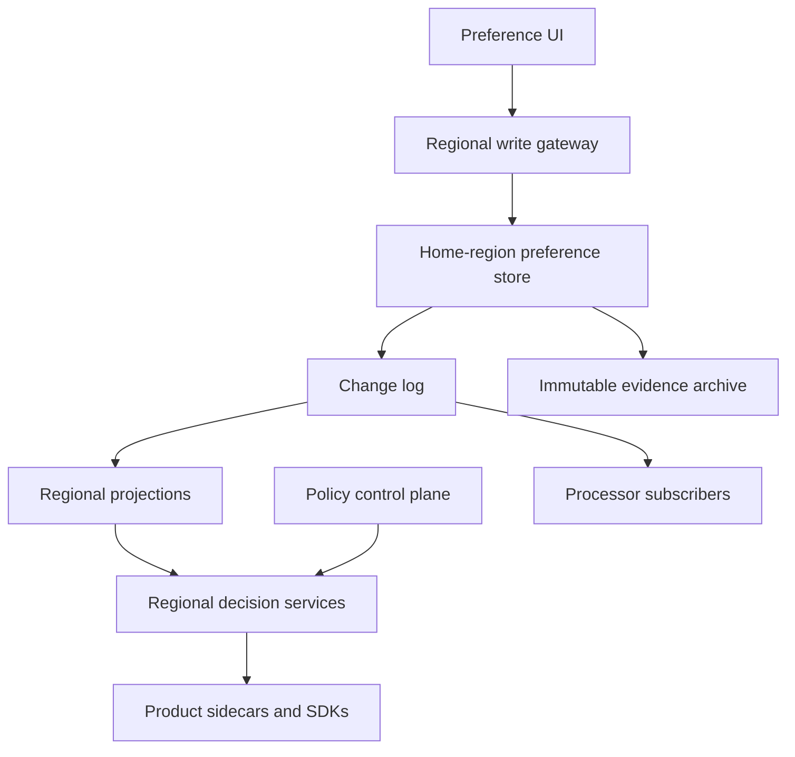
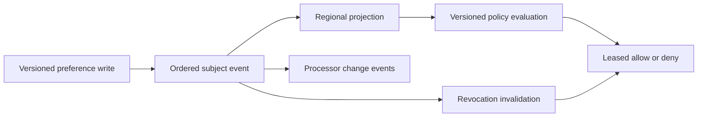

# Design a Global Consent and Privacy-Preference Service

**Difficulty:** Senior / Staff  
**Primary themes:** globally distributed state, low-latency authorization, cache invalidation, auditability, consistency, event fan-out  
**Interview time budget:** 45–50 minutes  
**Educational walkthrough:** intentionally more detailed than the spoken interview

This original walkthrough uses the requirements → entities → interfaces → high-level design → deep dives progression from Hello Interview's [System Design Delivery Framework](https://www.hellointerview.com/learn/system-design/in-a-hurry/delivery). The framework recommends establishing requirements, entities, and API contracts before evolving a complete design operation by operation.

---

## Interviewer prompt

> Design a global service that records users' privacy choices and lets product systems decide whether they may collect, use, or share personal data for a stated purpose. Users must be able to grant or withdraw consent, and the company must retain an auditable history of what the user saw and accepted.

## Targeted clarifying questions with assumed answers

**Candidate:** Which choices should we support?

**Interviewer:** Support opt-in or opt-out by purpose—such as personalized ads, analytics, recommendations, and third-party sharing—with optional data-category and region constraints.

**Candidate:** Is this only a settings page, or is it also a runtime enforcement service?

**Interviewer:** Both. The write path records choices. The read path must answer policy checks from ad, analytics, messaging, and recommendation systems.

**Candidate:** What scale and latency should I assume?

**Interviewer:** Two billion users, 30 billion active consent grants, 20 million preference writes per day, 5 million authorization checks per second globally, and bursts of 20 million checks per second. Runtime checks need p99 under 10 ms inside a region.

**Candidate:** What availability and consistency contract matters?

**Interviewer:** Runtime checks need 99.999% availability. A withdrawal must stop new affected processing within 60 seconds globally. Grants may propagate more conservatively—up to five minutes—and must never take effect before their effective time.

**Candidate:** Why are withdrawals stricter than grants?

**Interviewer:** A stale grant can cause prohibited processing. A stale non-grant merely delays a feature. When uncertain, fail closed for optional processing.

**Candidate:** Do product services send a user ID and receive one global yes/no?

**Interviewer:** No. Decisions depend on authenticated subject, purpose, data categories, jurisdiction, policy version, product, and time. The service should return a reason and decision version.

**Candidate:** Must we store the exact notice presented to the user?

**Interviewer:** Yes. Preserve an immutable notice/version reference, locale, capture source, actor, timestamp, and proof sufficient for audit.

**Candidate:** Are downstream deletion and data-subject requests in scope?

**Interviewer:** Not the deletion workflow itself. Emit events so downstream processors can stop future use and launch their own remediation. Focus on consent and preference enforcement.

**Candidate:** Do anonymous visitors count?

**Interviewer:** Yes. Support device- or browser-scoped subjects that may later be linked to an account, but do not merge identities casually.

### Scope statement to say aloud

> “I’ll design versioned preference writes, globally distributed purpose-aware checks, revocation propagation, immutable evidence, anonymous-to-account identity linking, and downstream change events. I’ll exclude deletion execution and the internals of legal-policy authoring.”

---

## 1. Requirements (~5 minutes)

### Core functional requirements

1. **Record and retrieve user choices.** Users or authorized systems can grant, deny, or withdraw consent for a purpose and scope, with exact notice provenance.
2. **Make runtime authorization decisions.** Product services ask whether a particular use of data is allowed and receive a low-latency, explainable, versioned answer.
3. **Propagate changes and preserve evidence.** Withdrawals invalidate caches quickly, produce durable downstream events, and retain tamper-evident history.

### Out of scope

- executing data deletion or model-unlearning workflows;
- drafting legal text or determining which jurisdictions require consent;
- authentication and identity proofing internals;
- preference UI design;
- enforcement inside third-party systems beyond emitting contracts and auditing acknowledgements.

### Quantified non-functional requirements

| Property | Target | Design consequence |
|---|---:|---|
| Authorization throughput | 5M checks/s average, 20M/s burst | regional caches and compiled policy evaluation |
| Authorization latency | p99 < 10 ms in-region | no cross-region calls on hot path |
| Read availability | 99.999% | multi-AZ replicas and explicit degraded-mode behavior |
| Withdrawal convergence | affected new processing stops globally < 60 s | high-priority invalidation and fail-closed staleness bounds |
| Grant convergence | < 5 min | asynchronous replication is acceptable |
| Write durability | acknowledged choices are never lost | quorum write plus immutable event/outbox |
| Auditability | reproduce every decision | notice, rule, preference, and evaluator versions |

### Scale estimates that change the design

Twenty million writes/day is:

\[
WPS_{avg} = \frac{20{,}000{,}000}{86{,}400} \approx 231
\]

At a 20× campaign or regulatory-update burst, writes are still only about **4,600/s**. Writes are modest compared with the 20 million authorization checks/s peak, so this is an extremely read-heavy system. The design should optimize for local reads and correct invalidation rather than shard writes prematurely.

At 5 million checks/s, even a compact 500-byte request and response consumes about 2.5 GB/s in each direction before protocol overhead. More importantly, if each check hits a central database, the database and network become impossible bottlenecks. We need in-process or host-local evaluation for most requests.

Suppose the active preference projection averages 600 bytes per user after compression and indexes. For two billion users, that is roughly 1.2 TB logical data, practical to replicate to regional distributed stores but too large to place in every process. A two-level cache works better: process-local hot subjects plus a regional authoritative projection.

If 0.1% of users change preferences on a busy day, that still affects two million cache keys. Invalidation must be stream-based and horizontally partitioned; a broadcast to every process per change would create an enormous fan-out.

### Consistency and availability contract

- The write region assigns each subject a monotonically increasing `preference_version`.
- A successful write durably stores both current projection and immutable evidence before acknowledgement.
- Read-your-writes is provided to the preference UI through a session/version token.
- Runtime consumers may use cached state only within a bounded freshness lease.
- Withdrawals are safety-dominant: newer withdrawal versions invalidate older grants, and uncertainty resolves to deny for optional uses.
- Grants are availability-conservative: stale denial may remain temporarily, but a grant is not assumed until the required version is locally visible.
- Decisions are deterministic for `(subject version, policy version, request context, time)`.
- The system records enough metadata to explain whether the decision came from explicit consent, a default, a legal/policy rule, or degraded-mode denial.

### Concise interview phrasing

> “I’ll use asymmetric consistency: withdrawals propagate urgently and stale state fails closed, while new grants may take longer because delaying a feature is safer than processing without permission.”

---

## 2. Core entities (~2 minutes)

| Entity | Purpose | Important fields |
|---|---|---|
| `Subject` | User, device, browser, or household identity | `subject_id`, `subject_type`, `home_region`, `status` |
| `Purpose` | Stable identifier for a data use | `purpose_id`, `name`, `parent_purpose`, `active` |
| `NoticeVersion` | Immutable disclosure shown during capture | `notice_id`, `version`, `locale`, `content_hash`, `effective_at` |
| `PreferenceEvent` | Append-only grant/deny/withdraw history | `subject_id`, `version`, `purpose_id`, `action`, `scope`, `notice_ref`, `actor`, `occurred_at` |
| `PreferenceProjection` | Current compact state used by reads | `subject_id`, `version`, `rules`, `updated_at`, `revocation_epoch` |
| `PolicyBundle` | Versioned rules combining preferences with context | `policy_version`, `jurisdiction`, `product`, `rules`, `effective_at` |
| `DecisionRecord` | Sampled or mandatory audit of a runtime check | `decision_id`, `subject_id`, `preference_version`, `policy_version`, `result`, `reason` |
| `IdentityLink` | Controlled relationship among subjects | `link_id`, `from_subject`, `to_subject`, `basis`, `effective_at`, `status` |
| `ProcessorSubscription` | Downstream consumer contract | `processor_id`, `purposes`, `regions`, `checkpoint`, `status` |

A preference is not simply a boolean. Its key may include purpose, data categories, processing product, jurisdiction, channel, and validity interval. However, unbounded arbitrary attributes make caching and policy reasoning impossible, so scopes use governed enumerations and versioned schemas.

### Say aloud

> “The source of truth is an ordered preference event stream per subject. A compact projection serves runtime checks, while immutable notice and policy versions make decisions reproducible.”

---

## 3. APIs and system interfaces (~5 minutes)

Subject identity comes from the authenticated session, service identity, or signed anonymous-subject token. Clients cannot write preferences for an arbitrary subject in the JSON body.

### 3.1 Record a preference

```http
PUT /v1/me/preferences/personalized_ads
Authorization: Bearer <user-token>
Idempotency-Key: settings-save-884
If-Match: "preference-version-42"
Content-Type: application/json

{
  "action": "WITHDRAW",
  "scope": {
    "data_categories": ["BROWSING_ACTIVITY", "LOCATION"],
    "products": ["CONSUMER_APP"]
  },
  "notice": {
    "notice_id": "privacy-center",
    "version": 19,
    "locale": "en-US"
  }
}
```

```json
{
  "preference_version": 43,
  "effective_at": "2026-10-20T17:56:11Z",
  "propagation_state": "IN_PROGRESS",
  "change_token": "pct_43_01K..."
}
```

`If-Match` prevents a stale browser tab from overwriting a more recent change. The service validates that notice version 19 was eligible and verifies its stored content hash.

### 3.2 Read settings with read-your-writes

```http
GET /v1/me/preferences
Authorization: Bearer <user-token>
X-Min-Preference-Version: 43
```

```json
{
  "preference_version": 43,
  "preferences": [
    {
      "purpose": "personalized_ads",
      "state": "WITHDRAWN",
      "effective_at": "2026-10-20T17:56:11Z"
    }
  ]
}
```

If the local replica has not reached version 43, the gateway may route to the subject's write region or wait briefly rather than show stale settings.

### 3.3 Runtime authorization check

Use an internal RPC rather than public REST for high-volume calls:

```protobuf
message CheckRequest {
  string purpose_id = 1;
  repeated string data_categories = 2;
  string product_id = 3;
  string jurisdiction = 4;
  int64 event_time_ms = 5;
  string resource_region = 6;
}

message CheckResponse {
  enum Result { ALLOW = 0; DENY = 1; UNKNOWN = 2; }
  Result result = 1;
  string reason_code = 2;
  int64 preference_version = 3;
  string policy_version = 4;
  int64 valid_until_ms = 5;
  string decision_token = 6;
}
```

The authenticated caller identifies the processor and constrains which purposes it may request. The authenticated user or signed subject context identifies the subject.

Example response:

```json
{
  "result": "DENY",
  "reason_code": "USER_WITHDRAWN",
  "preference_version": 43,
  "policy_version": "us-consumer-2026-10-18.2",
  "valid_until_ms": 1792528631000,
  "decision_token": "dt_eyJ..."
}
```

`valid_until` is a cache lease, not the preference expiry. Callers must recheck after it.

### 3.4 Batch check for analytics ingestion

```http
POST /internal/v1/consent:batchCheck
Authorization: Bearer <processor-workload-token>

{
  "purpose": "product_analytics",
  "data_category": "APP_USAGE",
  "subjects": ["sub_1", "sub_2", "sub_3"],
  "event_time": "2026-10-20T17:55:00Z"
}
```

Batch size is bounded. The response preserves request order and returns an individual versioned decision per subject.

### 3.5 Downstream change event

```json
{
  "event_type": "PREFERENCE_CHANGED",
  "event_id": "evt_01K...",
  "subject_id": "sub_91",
  "preference_version": 43,
  "change_kind": "WITHDRAWAL",
  "affected_purposes": ["personalized_ads"],
  "effective_at": "2026-10-20T17:56:11Z",
  "revocation_epoch": 12
}
```

Events contain no unnecessary notice text or private profile data.

### Say aloud

> “Writes use optimistic concurrency and immutable notice references. Runtime checks return not just yes or no, but the preference version, policy version, reason, and a bounded cache lease.”

---

## 4. Processing data flow

### Preference write

1. Gateway authenticates the subject and validates the governed purpose/scope.
2. Write service reads the current subject version and checks `If-Match` plus idempotency key.
3. In one transaction, it appends `PreferenceEvent`, updates `PreferenceProjection`, and writes an outbox record.
4. The response returns the new version after quorum durability.
5. Outbox relay publishes a high-priority withdrawal or normal-priority grant event.
6. Regional projection consumers apply only increasing subject versions.
7. Cache-invalidation services advance subject revocation epochs and evict affected hot entries.
8. Processor subscriptions consume changes and checkpoint acknowledgements.

### Runtime decision

1. Sidecar or SDK authenticates the processor and validates its allowed purpose.
2. It checks a tiny in-process decision cache.
3. On miss, a regional decision service reads the subject projection from regional cache/store.
4. A local compiled policy bundle combines explicit preferences, scope, jurisdiction, product, and time.
5. The service returns a versioned decision with `valid_until`; selected decisions are logged asynchronously for audit.

---

## 5. High-level design (~10–15 minutes)



### Operation 1: record an auditable preference

Each subject has a home write region chosen by consistent hashing plus residency constraints. Writes from any edge route to that region. This adds tens of milliseconds to a rare settings update but avoids concurrent multi-master conflicts for one subject.

The write transaction performs:

1. idempotency-key lookup;
2. compare expected and current `preference_version`;
3. append immutable `PreferenceEvent(version = current + 1)`;
4. update the compact `PreferenceProjection`;
5. append a change outbox row;
6. record or reference evidence such as notice hash, locale, capture source, actor, and client metadata allowed by retention policy.

The event history uses append-only storage partitioned by subject hash and time. The current projection is a strongly consistent key-value or relational record keyed by subject. Evidence objects may be in immutable object storage with retention locks and periodic Merkle-root anchoring to make later tampering detectable.

Why not reconstruct current state from the whole event log for every read? Audit history can contain many events and is optimized for evidence, not 10 ms authorization. The projection is a materialized current view whose version links back to history.

**Say aloud:**

> “I serialize writes per subject in a home region. That buys simple monotonic versions and conflict handling on the low-volume path, while reads remain fully regional.”

### Operation 2: distribute preference projections

The outbox publishes to a globally replicated log partitioned by `subject_id`. Per-subject order matters; global total order does not.

Regional consumers apply an event only if `incoming_version = local_version + 1`. Duplicate lower versions are ignored. A gap causes the consumer to fetch a snapshot from the home region before continuing. This prevents version 44 from applying without version 43 when the latter contains a broad withdrawal.

Withdrawals receive a separate high-priority channel and reserved bandwidth. Grants use the standard stream. Every region tracks:

- consumed log offset;
- oldest unapplied withdrawal age;
- per-subject projection version;
- source-to-region replication lag.

The regional store holds the latest projection for all subjects likely to be served there. A globally distributed KV database could replace explicit replication, but the logical contract remains: local reads, monotonic versions, bounded revocation lag, and failure isolation.

### Operation 3: make a low-latency decision

The decision service keeps immutable compiled policy bundles in memory. The policy control plane validates, signs, canaries, and distributes bundles but is not on the request path. If it is down, regions continue with the last verified bundle.

Decision evaluation follows precedence such as:

```text
if processor_not_authorized_for_purpose:
    DENY
elif policy_bundle_expired_or_projection_too_stale:
    DENY_OPTIONAL_USE
elif explicit_subject_withdrawal_matches_scope:
    DENY
elif jurisdiction_requires_opt_in and no_matching_grant:
    DENY
elif explicit_grant_matches_scope and is_effective:
    ALLOW
else:
    apply_versioned_default_policy
```

The result cache key includes:

```text
(subject_id,
 preference_version,
 revocation_epoch,
 policy_version,
 processor_id,
 purpose_id,
 normalized_scope_hash,
 jurisdiction,
 time_bucket)
```

Including versions makes cache entries immutable. A short `valid_until` bounds the harm if invalidation is delayed.

For the hottest path, product hosts run a sidecar or SDK cache. It caches signed decision tokens or compact subject decisions for seconds, not hours. The regional service remains the fallback. Critical processors may skip the sidecar cache for higher assurance.

### Operation 4: invalidate withdrawals quickly

Evicting a subject from millions of process caches directly does not scale. Use **revocation epochs** and bounded leases:

- The subject projection contains a `revocation_epoch` incremented on restrictive changes.
- Regional invalidation streams update a compact epoch cache in sidecars.
- A decision token is valid only when its embedded epoch equals the current known epoch and its lease has not expired.
- Sidecars that lose the invalidation stream shorten or reject cached allows after a heartbeat deadline.

This is a safety lease: cached `ALLOW` is valid only while the client can prove its revocation knowledge is fresh. Cached `DENY` may live longer because a stale denial is safer.

If the stream cannot reach one region, the maximum `ALLOW` lease must still be below the 60-second withdrawal SLO. The combination of push invalidation and lease expiry provides defense in depth.

### Operation 5: notify downstream processors

Some processors need more than future authorization checks. For example, an ads feature store may need to stop refreshing an existing profile. Each processor subscribes to purposes it handles.

Deliveries are at-least-once and keyed by `(processor_id, subject_id, preference_version)`. Consumers persist their highest applied version. Older or duplicate events become no-ops. A processor acknowledgement includes the applied checkpoint and optional remediation job ID.

The consent platform monitors delivery lag but does not claim downstream deletion is complete merely because an event was delivered. This preserves the boundary between consent truth and processor compliance workflows.

### Identity linking

Anonymous device preferences cannot be blindly overwritten when a user signs in. Possible conflicts include a device withdrawal and an account grant.

Use explicit, versioned `IdentityLink` records and a governed merge policy. A conservative baseline is:

- do not copy a grant from one subject to another without a valid basis;
- propagate restrictive choices when policy requires it;
- retain original evidence and subject scope;
- let runtime evaluation consider both account and device subjects and choose the most restrictive applicable result.

This avoids destructive merges and makes unlinking possible.

### Storage choices

| Need | Choice | Reason |
|---|---|---|
| Subject current projection | Strongly consistent regional KV/relational store | point reads and conditional versions |
| Preference events | Append-only distributed log/store | ordered history and replay |
| Evidence and notice bodies | Immutable object storage | retention, hashes, large localized content |
| Global change transport | Partitioned replicated log | ordered per-subject fan-out and replay |
| Decision/policy cache | In-process plus regional cache | p99 latency and load reduction |
| Policy bundles | Versioned object store with local compiled copies | deterministic evaluation and safe rollout |
| Processor acknowledgements | Relational/KV checkpoint store | lag monitoring and idempotency |
| Audit analytics | Stream to warehouse/lake | investigations without loading runtime stores |

---

## 6. Deep dives (~10–15 minutes)

### Deep dive A: global consistency with withdrawal-first semantics

#### Where the baseline breaks

A globally writable eventually consistent database may accept concurrent grant and withdrawal writes in different regions. Last-writer-wins based on wall-clock time is unsafe under clock skew. A network partition can also leave one region serving a stale `ALLOW` indefinitely.

#### Options

| Approach | Benefit | Problem |
|---|---|---|
| Synchronous global consensus for every write and read | strongest consistency | high latency and poor partition availability |
| Multi-master last-writer-wins | low write latency | ambiguous conflicts and clock dependence |
| Home-region serialized writes + regional projections | simple versions and local reads | cross-region write routing and bounded staleness |

Choose home-region serialization because writes are rare and reads dominate.

Each subject's monotonic version is a logical ordering token. Wall-clock time describes effectivity, not conflict order. A failover to a new home region requires a lease/epoch from a consensus-backed directory. The new writer accepts mutations only after fencing the old writer; otherwise split brain could issue the same next version twice.

Withdrawal events are prioritized. Nevertheless, push delivery alone cannot guarantee a bound during partitions, so `ALLOW` responses carry leases. If a regional projection's withdrawal-stream heartbeat exceeds, for example, 20 seconds, the service progressively fails closed before the 60-second contractual limit.

#### Failure modes

- **Home region unavailable:** serve reads; route writes to a fenced failover region or return retryable failure. Never accept an unfenced write.
- **Replication lag:** cached grants expire; optional processing denies once the staleness budget is exceeded.
- **Out-of-order event:** buffer briefly; snapshot on a version gap.
- **Clock skew:** use server-assigned versions and bounded time validation; do not order mutations solely by timestamps.
- **Duplicate events:** projection update is conditional on increasing version.

#### Observability

- p50/p95/p99 global withdrawal convergence;
- oldest unconsumed withdrawal by region;
- number of regions in fail-closed staleness mode;
- projection version gaps and snapshot repairs;
- write failover epoch changes;
- stale grant prevented versus stale denial served.

**Say aloud:**

> “I cannot promise a 60-second revocation bound with best-effort invalidation alone. The hard backstop is that cached allows are leases and become invalid when revocation knowledge is stale.”

### Deep dive B: cache hierarchy and 20 million checks per second

#### Where the baseline breaks

Calling a regional database for every check would overload it and miss the 10 ms p99 target. Caching only by subject is incorrect because decisions depend on purpose, processor, policy, scope, jurisdiction, and time. Long TTLs make withdrawal unsafe.

#### Selected hierarchy

1. **Caller-side microcache:** signed decision tokens, usually 1–30 seconds for `ALLOW`, longer for `DENY` when policy permits.
2. **Decision-service in-process cache:** hot projections and compiled decisions.
3. **Regional distributed cache:** subject projections keyed by version.
4. **Regional durable projection store:** authoritative regional read model.
5. **Home-region source:** repair path, not normal hot path.

At 5 million checks/s, a 99% caller/in-process hit rate reduces downstream reads to 50,000/s. A 95% hit rate would leave 250,000/s, which may still be feasible across many regional shards but costs much more. Cache hit rate therefore changes infrastructure sizing materially.

Use request coalescing so concurrent misses for the same subject fetch once. Protect the regional store with admission control and per-processor quotas. Batch APIs help analytics systems avoid one RPC per event.

#### Cache correctness

- Immutable version keys avoid in-place mutation races.
- `revocation_epoch` invalidates restrictive changes quickly.
- Policy bundle activation advances `policy_version`, naturally missing old decision keys.
- `valid_until` handles time-based rule changes and push failure.
- Negative/default decisions use shorter leases if future grants may change them.
- Sidecars must not extend leases locally during an outage.

To prevent cache explosion, normalize governed scopes into a stable hash and limit arbitrary combinations. Cache the subject projection separately from fully evaluated decisions when cardinality is high.

#### Degraded behavior

- If the in-process cache misses and regional cache is down, read the durable projection store.
- If all regional state paths fail, return `DENY` for optional processing and `UNKNOWN` for callers that must distinguish outage from explicit refusal.
- A caller may not convert `UNKNOWN` to `ALLOW` unless a separately approved policy explicitly permits that processing basis.

#### Observability

- p99 decision latency by cache level;
- allow/deny/unknown rates by processor and purpose;
- cache hit rate and coalesced misses;
- epoch-stream heartbeat age;
- stale lease rejection count;
- regional store QPS and hot-subject skew;
- policy evaluation time and bundle version distribution.

**Say aloud:**

> “The cache key includes every semantic input and immutable versions. Push invalidation reduces latency, but short safety leases enforce the correctness bound when push fails.”

### Deep dive C: auditability, policy evolution, and downstream accountability

#### Where the baseline breaks

Keeping only the latest boolean cannot answer what the user saw, which rules were active, or why a service was allowed to process data. Mutable notice text destroys evidence. Logging every one of five million checks per second synchronously would overload the system and create excessive personal-data retention.

#### Evidence model

Preference capture records:

- immutable notice/version and content hash;
- subject and actor type;
- purpose and governed scope;
- action and effective time;
- capture channel and locale;
- server timestamp and ordered subject version;
- idempotency key and authorized client identity;
- permitted proof metadata under data-minimization policy.

Notice bodies and policy bundles are immutable. Corrections create new versions. Evidence retention uses category-specific policy, encryption, legal holds, and controlled deletion when retention expires.

Periodic Merkle trees can make event batches tamper-evident: hash events into a tree, store the signed root separately, and retain inclusion proofs. This does not prevent deletion by itself, but it makes unauthorized modification detectable.

#### Decision audit strategy

Do not synchronously persist every check. Return a signed `decision_token` containing or referencing the inputs and versions. Persist:

- all high-risk sharing decisions if required;
- all `UNKNOWN` and degraded-mode results;
- policy-configured samples of ordinary decisions;
- aggregate counters for the remainder.

Processors attach the token or its hash to derived events, allowing later correlation. Sampling rules are themselves versioned.

#### Policy rollout

The control plane validates a typed policy bundle, replays it against historical cases, shadows it, and canaries by region or processor. It compares allow-rate deltas, reason-code changes, latency, and expected legal test cases. Only then does it move an active-version pointer.

Runtime decisions pin one bundle for their full evaluation. Emergency deny rules use a high-priority signed overlay and short expiry. A broken grant-expanding policy can be rolled back without rewriting preferences.

#### Downstream accountability

Processor subscriptions declare purposes and owners. The platform tracks:

- event delivery checkpoint;
- newest preference version applied;
- oldest unapplied withdrawal;
- remediation acknowledgement where applicable;
- processor heartbeat and on-call ownership.

A lagging processor can be quarantined by revoking its authorization credentials or forcing all checks to deny. The consent service should not silently mark compliance complete merely because Kafka acknowledged the event.

#### Observability and security

- audit every administrative read of preference evidence;
- separate policy authors from approvers;
- sign bundles and verify them in every evaluator;
- use workload identity and mTLS for processor checks;
- rate-limit subject enumeration and batch APIs;
- redact preference details from general logs;
- detect processors requesting undeclared purposes;
- monitor evidence archive hash verification and retention jobs.

**Say aloud:**

> “I retain immutable evidence for writes and versioned proof for reads, but I avoid logging every hot-path check synchronously. Processor checkpoints show propagation; they are not confused with completed remediation.”

---

## 7. Final design

Preference writes route to a subject's fenced home region, where one transaction appends an immutable event, advances the current projection version, and writes an outbox record. A globally replicated log distributes changes in per-subject order. Withdrawals use reserved priority lanes, and regional consumers repair version gaps from snapshots.

Runtime checks remain regional. Decision services combine cached subject projections with locally compiled immutable policy bundles. Two cache levels plus optional sidecars absorb millions of checks per second. Every `ALLOW` is a bounded lease tied to preference version, revocation epoch, policy version, processor, purpose, scope, jurisdiction, and time. Push invalidation makes withdrawals fast; lease expiry and fail-closed staleness enforce the upper bound during partitions.

Immutable notice versions, preference events, policy bundles, sampled decision records, and tamper-evident batch hashes provide auditability. At-least-once change events let downstream processors react idempotently, while subscription checkpoints expose lag without conflating delivery with remediation.



### Requirements check

| Requirement | Design response |
|---|---|
| Record grants and withdrawals | home-region conditional write and immutable event |
| Preserve proof | immutable notice references, evidence archive, ordered versions |
| Purpose-aware runtime check | compiled policy plus subject projection and request context |
| 20M checks/s burst | sidecars, in-process caches, regional projection stores |
| p99 under 10 ms | no cross-region hot-path dependency |
| Withdrawal under 60 s | priority stream, revocation epochs, bounded allow leases |
| 99.999% read availability | multi-AZ regional serving and explicit fail-closed mode |
| Read-your-writes | minimum-version token and home-region fallback |
| Explainability | reason code plus preference and policy versions |
| Downstream propagation | idempotent subscriptions and lag checkpoints |
| Anonymous identities | governed identity links without destructive merges |

---

## Realistic interviewer follow-up questions with strong sample answers

### 1. Why not store a single `consent=true/false` field?

> “Permission depends on purpose, data category, product, jurisdiction, notice, time, and sometimes subject type. A single boolean cannot represent scope or explain why a decision was made.”

### 2. Why serialize writes in a home region?

> “Writes are only hundreds per second on average, while reads are millions per second. Paying cross-region latency on rare writes gives monotonic per-subject versions and simple conflict handling without slowing regional reads.”

### 3. What happens if the home region fails?

> “Reads continue from regional projections. A directory grants a higher fencing epoch to a failover writer before it accepts mutations. Until fencing completes, writes return a retryable error rather than risk split brain.”

### 4. How does a user see a write immediately?

> “The write response returns version 43. Subsequent UI reads send `X-Min-Preference-Version: 43`; a stale edge waits briefly or routes to the home region. Runtime product traffic need not use that expensive path.”

### 5. Why are grants and withdrawals propagated differently?

> “A delayed grant withholds a feature, while a delayed withdrawal can permit prohibited processing. Withdrawals receive priority, increment a revocation epoch, and invalidate allows; grants wait for positive version visibility.”

### 6. Can a cached allow remain valid after withdrawal?

> “Only until its short lease expires, and normally less because the invalidation stream advances the subject epoch. If the sidecar loses revocation heartbeats, it rejects cached allows before the 60-second SLO.”

### 7. Why not broadcast every withdrawal to every process?

> “That fan-out grows with subjects times process count. Regional epoch streams and bounded leases distribute changes once per regional subscriber group, while process caches consume compact partitioned updates.”

### 8. How do you prevent one service from checking an undeclared purpose?

> “Workload identity maps the caller to a processor registration containing allowed purposes and data categories. The decision service denies mismatches before evaluating user state and audits repeated violations.”

### 9. What is the difference between `DENY` and `UNKNOWN`?

> “`DENY` is a policy result such as withdrawal or missing opt-in. `UNKNOWN` means the system could not establish a trustworthy decision. Optional processing must treat both as no permission, but operationally they need different reasons and alerts.”

### 10. Do you log every authorization check?

> “Not synchronously at five million per second. Return a signed decision token, persist high-risk and degraded decisions, sample ordinary decisions under a versioned policy, and retain aggregates. That balances auditability, latency, cost, and data minimization.”

### 11. How do you change the legal policy without rewriting user choices?

> “Preferences and policies are separate versioned inputs. Deploy a new immutable policy bundle that interprets existing preferences differently. Every decision records both versions, and rollout uses replay, shadowing, and canaries.”

### 12. What if the notice text changes?

> “Create a new immutable notice version. Old preference evidence keeps its original notice hash. Policy determines whether earlier grants remain valid or require fresh capture; the storage layer does not rewrite history.”

### 13. How do anonymous and logged-in preferences combine?

> “Keep them as separate subjects linked by versioned evidence. Runtime evaluation can consider both and conservatively choose the most restrictive applicable choice. Do not copy a device grant onto an account without a valid basis.”

### 14. How do downstream processors handle duplicates?

> “Each event has a stable ID and subject preference version. Consumers persist the highest applied version per subject or idempotency key. Older and repeated deliveries become no-ops.”

### 15. How do you know a withdrawal took effect globally?

> “Measure projection and invalidation application by region, sidecar heartbeat freshness, and processor checkpoints. The SLO is based on the 99th percentile end-to-end age, not broker publication time.”

### 16. Can the service be active-active for reads?

> “Yes. Every region serves reads from its local projection and policy cache. The only serialization is the low-volume per-subject write stream, with fenced regional failover.”

### 17. What if policy control plane is down?

> “Evaluators continue using the last verified, unexpired bundle. If a bundle exceeds its allowed staleness, optional processing fails closed. The control plane is never a synchronous request dependency.”

### 18. How would you support consent expiry?

> “Store validity intervals in preference events and projections. Decision cache keys include a time bucket and `valid_until` never exceeds the next expiry. An expiry scheduler emits changes for downstream consumers, but runtime time checks remain the correctness backstop.”

### 19. Could a product trust the signed decision token offline?

> “Yes, only until its embedded expiry and subject revocation epoch remain current. Completely offline verification cannot learn revocation, so the token must be short-lived or paired with a fresh epoch feed.”

### 20. What metric would page you first?

> “Oldest unapplied withdrawal and percentage of regional evaluators beyond the revocation-heartbeat budget. Average latency can look healthy while stale allows violate the core contract.”

---

## Common pitfalls

1. Modeling consent as one global boolean.
2. Accepting caller-supplied subject or tenant identity without authentication.
3. Using last-writer-wins wall-clock timestamps for grant/withdrawal conflicts.
4. Requiring a cross-region database call for every runtime check.
5. Caching decisions without purpose, scope, jurisdiction, or policy version.
6. Depending only on best-effort cache invalidation.
7. Giving grants and withdrawals identical propagation semantics.
8. Treating `UNKNOWN` as `ALLOW` during outages.
9. Mutating notice or policy content in place.
10. Keeping only current state and losing evidence history.
11. Logging every hot-path decision synchronously.
12. Broadcasting each change directly to every process.
13. Extending expired cache leases during a partition.
14. Applying version 44 after missing version 43 without repair.
15. Merging anonymous and account grants without a governed basis.
16. Confusing event delivery with downstream remediation completion.
17. Letting policy control-plane availability affect runtime checks.
18. Omitting caller authorization for purposes and data categories.
19. Ignoring time-based consent expiry in cache leases.
20. Measuring broker lag instead of end-to-end withdrawal convergence.

---

## Polished 60-second closing summary

> “I designed consent as an ordered, versioned state machine per subject rather than a boolean. Rare writes route to a fenced home region, where one transaction appends immutable evidence, advances the current projection, and publishes an outbox event. Regions consume those events in subject order and serve checks locally. Decision services combine cached projections with signed immutable policy bundles; cache keys include every semantic input and version. Withdrawals use priority propagation and increment a revocation epoch, while every cached allow is a short safety lease that fails closed if invalidation knowledge becomes stale. Grants may converge more slowly. Immutable notices, policy versions, preference history, signed decision tokens, and processor checkpoints provide auditability without logging every check synchronously.”

## Public references

- Hello Interview, [System Design Delivery Framework](https://www.hellointerview.com/learn/system-design/in-a-hurry/delivery)
- Hello Interview, [API Design for System Design Interviews](https://www.hellointerview.com/learn/system-design/core-concepts/api-design)
- Hello Interview, [Data Modeling for System Design Interviews](https://www.hellointerview.com/learn/system-design/core-concepts/data-modeling)

The references are used for interview-delivery structure. The prompt, requirements, estimates, APIs, consent model, architecture, dialogue, failure semantics, and tradeoffs are original.
