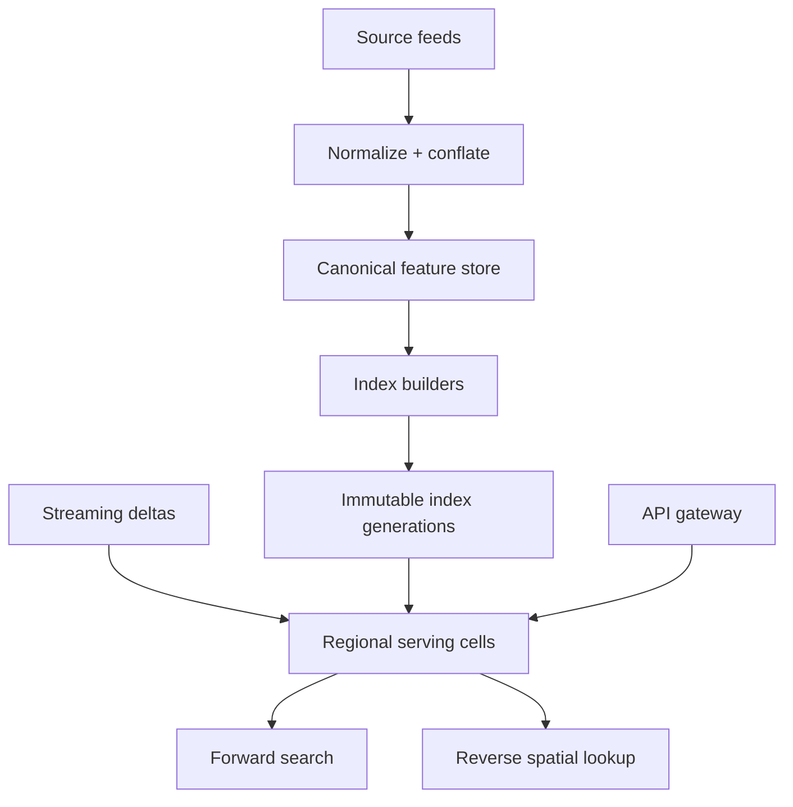
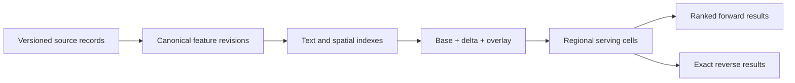

# Design a Global Geocoding and Reverse-Geocoding Service

**Difficulty:** Senior  
**Primary themes:** search indexes, geospatial indexing, caching, data ingestion, ranking, consistency, reliability  
**Interview time budget:** 45–50 minutes  
**Educational walkthrough:** intentionally more detailed than what you would say aloud

This original walkthrough follows the requirements → entities → interfaces → high-level design → deep dives progression described in Hello Interview's [System Design Delivery Framework](https://www.hellointerview.com/learn/system-design/in-a-hurry/delivery). It also follows the framework's advice to build the simplest complete system one operation at a time and connect each component to a stated requirement.

---

## Interviewer prompt

> Design a global geocoding service. Given a postal address or place query, return likely coordinates and canonical addresses. Given latitude and longitude, return the containing or nearest address and geographic hierarchy.

## Targeted clarifying questions with assumed answers

**Candidate:** What query types are required?

**Interviewer:** Forward geocoding for complete or partial addresses and named places; reverse geocoding for coordinates. Autocomplete is not required, though the index may support it later.

**Candidate:** Which data sources should we assume?

**Interviewer:** We ingest multiple licensed and public sources: road networks, address points, parcels, administrative boundaries, postal data, and points of interest. Source conflicts are expected.

**Candidate:** What does a result contain?

**Interviewer:** Coordinates, normalized address components, confidence, match type, place hierarchy, bounding box where appropriate, and provenance. Return multiple candidates for ambiguous forward queries.

**Candidate:** What scale should I design for?

**Interviewer:** One billion indexed geographic features, 100,000 data updates per second during bulk imports, 300,000 forward queries per second, and one million reverse queries per second at peak.

**Candidate:** What are the latency and availability targets?

**Interviewer:** Forward geocoding p95 under 150 ms, reverse geocoding p95 under 50 ms, and 99.99% API availability. Updates should be searchable within 15 minutes; emergency closures and corrections within one minute.

**Candidate:** How precise must the coordinates be?

**Interviewer:** Preserve the precision of the source and label it. A rooftop address point is different from an interpolated street position, parcel centroid, or city centroid.

**Candidate:** Should the service infer the user's location?

**Interviewer:** The caller may provide a bias region, language, or viewport. Do not silently use precise device location. Identity and allowed quota come from authentication.

**Candidate:** Is turn-by-turn routing in scope?

**Interviewer:** No. Return stable feature identifiers and coordinates that a routing service can consume.

### Scope statement to say aloud

> “I’ll design forward and reverse geocoding, multilingual normalization, candidate retrieval and ranking, spatial containment, incremental source ingestion, caching, and reproducible provenance. I’ll exclude routing, map rendering, live traffic, and the user-facing autocomplete UI.”

---

## 1. Requirements (~5 minutes)

### Core functional requirements

1. **Forward geocode.** Convert an address or place query into ranked geographic candidates with coordinates, normalized components, confidence, and precision.
2. **Reverse geocode.** Convert a coordinate into containing administrative areas and the nearest appropriate address, road, or place.
3. **Ingest and reconcile map data.** Normalize multiple source feeds, resolve conflicts, update indexes incrementally, and preserve provenance and versions.

### Non-functional requirements

| Property | Target | Design consequence |
|---|---:|---|
| Forward throughput | 300K QPS peak | horizontally partitioned text index and query fan-out limits |
| Reverse throughput | 1M QPS peak | hierarchical cell index and aggressive edge caching |
| Latency | forward p95 < 150 ms; reverse p95 < 50 ms | local regional indexes, bounded candidate sets |
| Availability | 99.99% | multi-AZ serving cells and immutable index snapshots |
| Freshness | normal < 15 min; emergency < 1 min | streaming delta layer over periodic base snapshots |
| Explainability | every result carries match type and data version | immutable feature revisions and provenance |

### Scale estimates that change design decisions

At one million reverse queries/s, even a small 300-byte request plus 1 KB response moves about 1.3 GB/s before protocol overhead. Queries must be served from many regional replicas and edge caches; a centralized spatial database is not viable.

Suppose one billion features average 700 bytes in the canonical store after geometry compression and metadata, or about 700 GB logical. Search and spatial indexes may add 1–3× overhead, and replication multiplies this further. This is large but practical as immutable sharded snapshots distributed to serving cells. It is not practical for every process to hold the whole world.

Forward queries frequently contain common city or street names. If retrieval fans out to every country shard, 300K client QPS becomes millions of internal queries. We need a directory that narrows searches by parsed country, viewport, language, or global popularity and caps fan-out.

One billion features distributed across a hierarchical spatial index can be skewed: a dense Manhattan cell may contain thousands of addresses while an ocean cell contains none. Fixed latitude/longitude tiles alone create hotspots. Use hierarchical cells plus adaptive subdivision and separate indexes by feature class.

At 100,000 update events/s during import, rewriting the primary search index per event would cause merge pressure and unstable query latency. Batch updates into immutable segments and maintain a small delta index.

### Consistency and availability contract

- A query pins one published dataset generation plus its compatible delta watermark; it must not combine arbitrary schema versions.
- Indexes are eventually consistent with source updates: 15 minutes normally, one minute for emergency overlays.
- Reads remain available from the last verified snapshot if ingestion or the control plane fails.
- A result's `feature_id`, `feature_revision`, `dataset_generation`, and provenance make it reproducible.
- Deletes and supersessions use tombstones so stale base-snapshot records cannot reappear.
- For ambiguous forward queries, return candidates and confidence rather than inventing certainty.
- Reverse geocoding distinguishes containment from nearest-neighbor inference.

### Concise interview phrasing

> “This is two related retrieval problems: text-to-feature ranking for forward geocoding and point-to-geometry containment or nearest-neighbor lookup for reverse geocoding. Both serve from immutable regional index generations with a small fresh delta.”

---

## 2. Core entities (~2 minutes)

| Entity | Purpose | Important fields |
|---|---|---|
| `Feature` | Stable real-world geographic object | `feature_id`, `type`, `status`, `current_revision` |
| `FeatureRevision` | Immutable version of geometry and attributes | `feature_id`, `revision`, `geometry`, `names`, `address`, `valid_time`, `provenance` |
| `Address` | Structured address representation | `house_number`, `road`, `locality`, `admin_areas`, `postal_code`, `country` |
| `NameVariant` | Localized or alternate searchable name | `text`, `language`, `script`, `kind`, `normalized_tokens` |
| `SpatialCellEntry` | Feature reference in a hierarchical cell | `cell_id`, `feature_id`, `feature_class`, `covering_level` |
| `SourceRecord` | Raw provider-specific input | `source_id`, `source_record_id`, `version`, `payload_ref`, `observed_at` |
| `ConflationDecision` | Evidence that records refer to one feature | `feature_id`, `source_records`, `score`, `rule_version` |
| `IndexGeneration` | Immutable serving snapshot | `generation_id`, `schema_version`, `shards`, `created_at`, `watermark` |
| `CorrectionOverlay` | Urgent bounded update | `feature_id`, `revision`, `priority`, `expires_at`, `reason` |

**Conflation** means deciding whether records from different sources describe the same real-world object. It is different from deduplicating identical bytes: names, shapes, coordinates, and update times may disagree.

### Say aloud

> “A stable feature has immutable revisions. Source records and conflation evidence remain separate so we can explain why one canonical address or geometry won.”

---

## 3. APIs and system interfaces (~5 minutes)

Caller identity, plan, allowed regions, and quota come from authentication. Geographic bias is explicit request context, not trusted identity.

### 3.1 Forward geocoding

```http
POST /v1/geocode
Authorization: Bearer <api-key>
Content-Type: application/json

{
  "query": "500 Boylston St, Boston MA",
  "language": "en",
  "country_filter": ["US"],
  "bias": {
    "viewport": [-71.10, 42.32, -70.98, 42.40]
  },
  "limit": 5
}
```

```json
{
  "candidates": [
    {
      "feature_id": "addr_us_8f31",
      "feature_revision": 12,
      "label": "500 Boylston Street, Boston, MA 02116, USA",
      "coordinates": {"lat": 42.3504, "lon": -71.0751},
      "precision": "ROOFTOP",
      "match_type": "EXACT_ADDRESS",
      "confidence": 0.98,
      "address": {
        "house_number": "500",
        "road": "Boylston Street",
        "locality": "Boston",
        "region": "MA",
        "postal_code": "02116",
        "country": "US"
      },
      "dataset_generation": "geo-2026-10-20-1540"
    }
  ]
}
```

Use POST because structured filters and viewports can outgrow a practical query string. Read semantics still allow caching using a canonical request hash.

### 3.2 Reverse geocoding

```http
GET /v1/reverse-geocode?lat=42.3504&lon=-71.0751&language=en&types=address,road,locality
Authorization: Bearer <api-key>
```

```json
{
  "containing": [
    {"type": "NEIGHBORHOOD", "name": "Back Bay", "feature_id": "nbh_71"},
    {"type": "CITY", "name": "Boston", "feature_id": "city_493"},
    {"type": "STATE", "name": "Massachusetts", "feature_id": "adm_25"}
  ],
  "nearest": {
    "feature_id": "addr_us_8f31",
    "distance_meters": 7.2,
    "precision": "ROOFTOP",
    "label": "500 Boylston Street, Boston, MA 02116, USA"
  },
  "dataset_generation": "geo-2026-10-20-1540"
}
```

The response separates polygons that contain the point from a nearby address inferred by distance.

### 3.3 Batch geocoding

```http
POST /v1/batch-geocode-jobs
Authorization: Bearer <api-key>
Idempotency-Key: customer-import-918

{
  "input_object": "tenant://uploads/addresses-918.jsonl",
  "language": "en",
  "country_filter": ["US", "CA"],
  "callback_url_id": "webhook_44"
}
```

```json
{
  "job_id": "bgj_18c",
  "status": "QUEUED",
  "status_url": "/v1/batch-geocode-jobs/bgj_18c"
}
```

Batch work uses separate capacity so it cannot starve interactive traffic.

### 3.4 Internal update event

```json
{
  "event_type": "FEATURE_REVISION_VALIDATED",
  "event_id": "evt_01K...",
  "feature_id": "road_us_481",
  "revision": 33,
  "affected_cells": ["892a100d2d7ffff", "892a100d2cfffff"],
  "affected_text_shards": ["us-ma-boston"],
  "priority": "NORMAL",
  "source_watermark": "src-18492011"
}
```

### Say aloud

> “The public responses explicitly separate exact, interpolated, centroid, containment, and nearest matches. That prevents downstream systems from treating every coordinate as rooftop-quality truth.”

---

## 4. Data flow

### Data ingestion

1. Source adapters capture immutable raw records and watermarks.
2. Format-specific parsers map inputs into a common feature schema.
3. Validators check geometry, address structure, language/script, and source integrity.
4. Normalization standardizes tokens without deleting original names.
5. Conflation groups source records believed to describe the same feature.
6. A canonicalizer selects geometry and attributes using source trust, recency, precision, and consistency.
7. Index builders emit text, address, and spatial segments.
8. A control plane verifies segments and atomically publishes a new generation manifest.
9. Streaming deltas and urgent overlays bridge the gap until the next base snapshot.

### Forward query

1. Normalize and parse the query into address/place components.
2. Choose likely geographic shards using filters, viewport, postal code, language, and popularity.
3. Retrieve a bounded candidate set from text/address indexes.
4. Fetch compact feature documents and compute ranking features.
5. Rank, deduplicate related candidates, calibrate confidence, and format localized responses.

### Reverse query

1. Encode the point into a hierarchical spatial cell.
2. Read candidates from that cell and progressively wider parents/rings if required.
3. Run exact point-in-polygon tests for containing features.
4. Compute nearest address/road distance using precise geometry.
5. Assemble the administrative hierarchy and localized label.

---

## 5. High-level design (~10–15 minutes)



### Operation 1: ingest and canonicalize features

Each source adapter writes raw input to object storage and a durable ingestion log. Raw retention is important: normalization rules improve, source providers issue corrections, and operators need replay without re-downloading everything.

Parsers produce typed candidates such as address points, road segments, postal areas, administrative boundaries, parcels, and places. Validators reject impossible coordinates, self-intersecting polygons beyond repair thresholds, invalid country/postal combinations, and abusive geometries with excessive vertices.

Normalization is locale-aware. It may standardize abbreviations for matching—`St` and `Street`—but keeps display names intact. Unicode normalization, transliteration, tokenization, house-number parsing, unit handling, and postal-code rules vary by language and country.

Conflation compares nearby source records using name similarity, address components, geometry overlap, topology, source reliability, and time. High-confidence matches update one stable feature. Ambiguous cases remain separate or enter human/data-quality review; a false merge is often worse than duplicate candidates.

The canonicalizer writes an immutable `FeatureRevision` and updates the feature's latest-revision pointer. Its decision retains contributing source IDs and rule/model versions.

**Say aloud:**

> “I never overwrite raw source truth. Canonical features are a versioned interpretation with provenance, which lets us replay when normalization or conflation improves.”

### Operation 2: build and publish indexes

Use two major index families:

- **Forward index:** tokens and structured address fields map to feature IDs. It supports exact fields, fuzzy terms, alternate names, language analyzers, and prefix-ready terms.
- **Reverse index:** hierarchical spatial cells map to candidate feature IDs or compact geometry references.

Index builders consume feature revisions and emit immutable segments partitioned geographically and by feature class. A generation manifest lists compatible segment versions, schema, dictionaries, and source watermark.

The publisher verifies checksums, canary-loads segments, runs golden queries, and atomically changes a signed active-generation pointer. Serving cells download new segments in the background, verify them, warm caches, then switch requests at a generation boundary. Old generations remain until in-flight queries drain and rollback windows expire.

Normal changes enter a small delta index within 15 minutes. Periodic compaction merges deltas into the next base generation. Emergency corrections enter a signed high-priority overlay within one minute. Query logic checks overlay → delta → base, with tombstones taking precedence.

### Operation 3: forward geocode an address

The request router first normalizes obvious structure and derives routing hints:

- explicit country or postal code;
- parsed region/locality;
- requested language;
- viewport or point bias;
- globally popular place names.

A shard directory selects a small number of likely shards. If the query is `Paris`, it may consult a global-place shard. If it contains `MA 02116`, it can route directly to a US regional shard. Fan-out is capped; missing hints do not justify querying the world.

Candidate retrieval combines:

- exact structured fields;
- token BM25 or similar text relevance;
- fuzzy edit-distance terms;
- alternate/transliterated names;
- house-number and postal constraints;
- address-range interpolation candidates.

Retrieve perhaps 100 lightweight candidates, then rank the best 5–10 using richer features:

```text
score = text_match
      + component_completeness
      + postal_consistency
      + viewport_distance
      + feature_popularity
      + source_quality
      + language_match
      - contradiction_penalties
```

Ranking rules and models are versioned. Confidence is calibrated from held-out labeled queries; it is not the raw ranking score. Results label precision as rooftop, parcel centroid, interpolated road, place centroid, or administrative centroid.

### Operation 4: reverse geocode a coordinate

Encode latitude/longitude into a hierarchical cell ID. The index stores:

- polygon coverings for administrative/postal/place containment;
- address points and road-segment references for nearest lookup;
- feature-class-specific offsets into compressed geometry segments.

Cell coverings are only a candidate filter. A polygon whose covering includes the cell may not contain the precise point. Fetch candidate geometries and run exact point-in-polygon tests.

For nearest address or road, search the leaf cell and expand to neighboring rings until the minimum possible distance to unexplored cells exceeds the best found candidate or a type-specific radius is reached. Dense areas terminate immediately; rural areas expand farther.

Return the most specific containing boundary per hierarchy level plus an independently computed nearest address. Ocean or remote queries may return only country/territory or no address, which is better than an implausibly distant street.

### Operation 5: cache and serve globally

Regional serving cells are complete for their assigned geographic partitions and replicated across availability zones. Global anycast or latency routing sends callers to the nearest healthy region.

Cache layers:

- CDN/edge cache for popular public reverse cells and normalized place queries;
- process cache for parsed query forms, shard-directory results, and feature documents;
- regional distributed cache for hot result sets;
- OS page cache/memory mapping for immutable index segments.

Forward cache keys include canonical query, language, filters, bias bucket, limit, and dataset generation. Reverse keys use a spatial cell at precision appropriate to the response plus language, requested types, and generation. Do not round coordinates so aggressively that two sides of a building or boundary share an incorrect result.

Immutable generation keys make cache invalidation simple. Emergency overlays carry an `overlay_epoch`; the epoch participates in cache keys or triggers targeted invalidation for affected cells and queries.

### Storage choices

| Need | Choice | Reason |
|---|---|---|
| Raw source data | Object storage + ingestion log | durable replay and large payloads |
| Canonical features/revisions | Sharded relational or distributed KV store | stable IDs, conditional current revision, provenance |
| Forward retrieval | Inverted search index | text, fields, fuzzy terms, ranking candidates |
| Reverse retrieval | Hierarchical cell postings + geometry segments | spatial pruning and compact regional serving |
| Base indexes | Immutable object-store segments | reproducible snapshots and safe distribution |
| Fresh updates | Regional delta index and signed overlay | bounded freshness without rebuilding the world |
| Query caches | In-process and regional cache | latency and hot-query protection |
| Analytics | Stream to warehouse/lake | quality evaluation and source monitoring |

---

## 6. Deep dives (~10–15 minutes)

### Deep dive A: forward retrieval and ranking ambiguous addresses

#### Where the baseline breaks

A simple full-text search treats an address as a bag of words. It may rank `Springfield Street` above the city `Springfield`, ignore house-number validity, or select the wrong country because it is globally popular. Strict structured matching has the opposite problem: formatting errors and missing components produce no results.

#### Options

| Approach | Benefit | Problem |
|---|---|---|
| Strict parsed-field lookup | precise and fast | brittle for incomplete or noisy input |
| Pure full-text search | flexible | weak address semantics |
| Hybrid structured + text retrieval, then rerank | robust and explainable | more index and ranking complexity |

Choose the hybrid approach.

The parser produces multiple interpretations rather than one irreversible parse. For `12 1/2 W 42 St NY`, candidate parses can preserve fractional house number, direction, road, and locality. Each interpretation retrieves candidates with a budget.

Hard filters should be rare. An explicit country filter is hard; viewport is usually a soft bias because users search outside the visible map. Postal contradiction is a strong penalty unless source quality suggests the code is stale.

House numbers need special handling. Exact address points outrank interpolation. If no point exists, locate a road segment with left/right numeric ranges and interpolate along geometry. The result must say `INTERPOLATED` and record its segment and range evidence.

Deduplicate candidates representing one feature across alternate names or sources. Do not collapse genuinely distinct units or entrances. Stable feature IDs and conflation groups help.

#### Quality measurement

- top-1 and top-5 accuracy on labeled queries;
- distance error for expected coordinates;
- component accuracy by country and language;
- no-result and low-confidence rate;
- calibration: among results labeled 0.9 confidence, roughly 90% should be correct under the definition;
- correction and abandonment signals, with privacy-safe aggregation;
- performance slices for rural regions and low-resource scripts.

#### Failure behavior

- Ranking model unavailable: fall back to a versioned deterministic ranker.
- One shard times out: return partial candidates with reduced confidence and diagnostics, if policy permits.
- Parser version regression: canary and compare interpretation/result deltas before rollout.

**Say aloud:**

> “I use structured address semantics to enforce coherence and text retrieval to tolerate noise. Ranking combines both, while calibrated confidence tells the caller when ambiguity remains.”

### Deep dive B: reverse geocoding with hierarchical spatial cells

#### Where the baseline breaks

Scanning all polygons or using only bounding boxes is too slow and inaccurate. A fixed tile resolution creates either huge postings in dense cities or excessive searches in sparse regions. Nearest-neighbor and containment are also different operations.

#### Selected design

Use a hierarchical spherical cell system such as an S2- or H3-like grid. The exact library is an implementation choice; the design needs cells with parent/child relationships, neighbor traversal, and geometry coverings.

For each polygon, generate a bounded covering at mixed levels. Large countries use coarse cells plus boundary refinement; small neighborhoods use finer cells. At query time:

1. compute point cell;
2. retrieve candidates from leaf and relevant parents;
3. test precise containment;
4. order containing features by governed hierarchy, not merely area.

For addresses and roads, store postings in adaptive fine cells. Dense cells subdivide or split postings by feature class. Very popular cells can be replicated or cached, but deterministic geographic partitioning keeps ownership clear.

#### Boundary correctness

Points near a political, postal, parcel, or timezone boundary are sensitive to rounding. Use full input precision for exact geometry tests. Cache keys may use cells, but boundary cells should either use finer precision or bypass coarse result caching.

Geometry revisions can alter boundaries. Responses include the generation and feature revisions so a caller can explain why yesterday's answer differs.

#### Nearest search termination

Expanding forever is wasteful and returns absurd results. Each feature class has a maximum radius. Search neighboring cells in increasing lower-bound distance. Stop when:

- the best candidate is closer than every unexplored cell's lower bound;
- the maximum radius is exceeded; or
- the request budget expires.

#### Observability

- candidates per cell and exact tests per query;
- ring expansions by density band;
- containment disagreement among sources;
- boundary-cell cache hit and error rate;
- empty-result rate by geography;
- geometry segment load and corruption failures.

**Say aloud:**

> “Cells prune candidates; they do not prove geometry. I always run exact containment, and I keep nearest-address search separate so a nearby building is never reported as containing the point.”

### Deep dive C: index freshness without sacrificing serving stability

#### Where the baseline breaks

Rebuilding and distributing a one-billion-feature index for each update cannot meet freshness. Mutating large live indexes in place causes fragmentation, merge spikes, hard rollbacks, and replicas serving different states. A delta-only system eventually becomes slow and inconsistent.

#### Options

1. **Mutable live index:** freshest, but operationally fragile and hard to reproduce.
2. **Periodic immutable snapshots:** stable and reproducible, but too stale alone.
3. **Immutable base + bounded deltas + emergency overlay:** combines stable serving with freshness.

Choose option 3.

The query stack checks layers in precedence order:

```text
emergency overlay
    > newest delta tombstone/revision
    > older delta
    > immutable base generation
```

Every item contains feature revision. The same feature is emitted once using the highest visible revision. Tombstones suppress older base records.

Delta builders micro-batch validated updates into immutable mini-segments, perhaps every minute. Serving nodes subscribe to manifests rather than individual records. This reduces write amplification and permits checksum verification.

When delta count or size exceeds a threshold, an offline compactor builds a new base snapshot. The control plane publishes it through:

1. schema and checksum validation;
2. golden forward/reverse queries;
3. shadow comparison against current generation;
4. canary regions;
5. gradual pointer rollout;
6. old-generation drain and retention.

Emergency overlays are intentionally small, signed, highly audited, and expiring. They can remove a dangerous wrong entrance or change a critical road/address immediately, but they are not a substitute for normal ingestion.

#### Failure modes

- **Ingestion outage:** queries serve last snapshot; freshness alarms rise.
- **Bad source batch:** quarantine before activation; existing data remains.
- **Corrupt segment:** checksum failure prevents load; node remains on old generation.
- **Bad generation:** pointer rollback is fast because old segments are immutable.
- **Delta gap:** node fetches missing manifest/segments or stays on prior coherent watermark.
- **Emergency overlay expires before base merge:** alert and extend only through audited action.

#### Observability

- source watermark-to-searchable latency;
- node generation and delta-watermark distribution;
- fraction of traffic on each generation;
- shadow result disagreements and quality regressions;
- delta lookup amplification and compaction backlog;
- emergency overlay age and merge status;
- cache hit rate by generation and geography.

**Say aloud:**

> “Immutable snapshots make serving reproducible and rollback cheap. Small immutable deltas provide freshness, and a tightly controlled overlay handles the exceptional one-minute correction path.”

---

## 7. Final design

Source adapters durably capture raw geographic records. Locale-aware parsers, validators, and conflation workers create stable features with immutable revisions and full provenance. Index builders publish compatible forward-text and reverse-spatial segments as signed immutable generations.

Regional serving cells load the active base generation, bounded delta segments, and a tiny emergency overlay. Forward queries use multiple structured interpretations, geographic shard routing, hybrid retrieval, and calibrated reranking. Reverse queries use hierarchical cell postings to prune candidates, followed by exact containment and bounded nearest-neighbor search.

Generation-aware process, regional, and edge caches absorb hot queries. Normal updates become searchable through delta manifests within 15 minutes; audited emergency overlays target one minute. If ingestion or control planes fail, serving continues from the last coherent verified generation.



### Requirements check

| Requirement | Design response |
|---|---|
| Forward geocoding | hybrid structured/text retrieval and reranking |
| Reverse geocoding | hierarchical cells, exact containment, bounded nearest search |
| Multiple sources | versioned normalization, conflation, and provenance |
| 1.3M total peak QPS | regional cells, sharding, edge and process caches |
| Forward p95 < 150 ms | targeted shard routing and bounded candidates |
| Reverse p95 < 50 ms | local cell index and cached geometry segments |
| 99.99% availability | multi-AZ cells and immutable rollback-safe indexes |
| Updates < 15 min | streaming immutable delta segments |
| Emergency updates < 1 min | signed high-priority overlay and targeted invalidation |
| Honest precision | rooftop/interpolated/centroid and containment/nearest labels |
| Reproducibility | feature revisions, dataset generation, and provenance |

---

## Realistic interviewer follow-up questions with strong sample answers

### 1. Why not use one relational database with a geospatial extension?

> “It is a reasonable initial implementation, but at one billion features and 1.3 million peak QPS, one mutable database becomes a serving and failure bottleneck. I use immutable distributed indexes for reads while a canonical store retains transactional feature metadata.”

### 2. How do you distinguish exact and interpolated addresses?

> “An exact result comes from an address point or verified parcel/entrance. Interpolation uses a road segment's numeric range and geometry. The response labels the precision and retains the evidence, so callers do not confuse them.”

### 3. Why is confidence not just the ranker's score?

> “Ranking scores order candidates but are not necessarily probabilities. I calibrate confidence against held-out labeled queries and slice calibration by country, query type, and precision class.”

### 4. What happens for `Paris` without context?

> “Query the global-place shard and return multiple candidates ranked by textual match, population or importance, language, and explicit caller bias. Do not silently assume the nearest Paris if no bias was supplied.”

### 5. How do you handle spelling mistakes?

> “Use normalized tokens, alternate names, transliteration, and bounded fuzzy retrieval. Structured component consistency and geographic evidence rerank the expanded candidates so fuzziness does not overwhelm exact results.”

### 6. How do you handle languages with multiple scripts?

> “Store native, localized, alternate, historical, and transliterated name variants with language and script tags. Query analysis can search compatible variants, while response formatting prefers the requested language with a local-name fallback.”

### 7. Why not use bounding boxes for reverse geocoding?

> “Bounding boxes only generate candidates; irregular polygons overlap their boxes heavily. Exact point-in-polygon evaluation is required before claiming containment.”

### 8. How do you find the nearest road efficiently?

> “Start with road references in the point's fine cell, expand neighboring cells in lower-bound distance order, calculate precise point-to-polyline distance, and stop when unexplored cells cannot beat the best result or the radius limit is reached.”

### 9. How do you avoid hot spatial cells?

> “Use adaptive subdivision, separate postings by feature class, split oversized postings, cache dense cells, and replicate immutable segments. Hierarchy lets sparse areas remain coarse while cities become fine-grained.”

### 10. What if two sources disagree on an address location?

> “Keep both source records, score trust, recency, precision, topology, and agreement, then create a versioned conflation/canonicalization decision. Low-confidence conflicts remain separate or enter review rather than being forcibly merged.”

### 11. How do deletes work with immutable snapshots?

> “A delta tombstone for the feature revision shadows the base entry. Compaction eventually removes it from the next base generation. Query deduplication always selects the highest visible revision or tombstone.”

### 12. How do you roll back a bad data import?

> “Stop publishing its delta manifest or repoint serving to the prior verified generation. Because segments are immutable, rollback does not require reconstructing overwritten index state.”

### 13. Can reverse-geocode results be cached by rounded coordinates?

> “Yes, through spatial cells chosen for the requested precision, but not blindly. Boundary cells and rooftop queries need finer keys or bypass coarse caches to avoid returning the wrong side of a parcel or jurisdiction.”

### 14. What should happen if one forward shard times out?

> “If enough high-quality candidates remain, return partial results with a diagnostic and conservative confidence. Otherwise return a retryable error. The router uses deadlines and does not let one speculative shard consume the entire latency budget.”

### 15. How do you prevent batch customers from hurting interactive users?

> “Use separate queues and worker pools, weighted quotas, and lower-priority index/cache access. Interactive serving has reserved CPU, memory, and I/O capacity.”

### 16. How do you measure freshness?

> “Track each source record's ingestion watermark through validation, canonical revision, index segment, regional load, and query visibility. The SLO measures source-to-searchable time, not merely queue publication.”

### 17. How do you test a new ranking model?

> “Offline labeled sets, historical replay, shadow traffic, and canary regions. Compare top-k accuracy, distance error, confidence calibration, no-result rate, latency, and geographic/language slices before expanding.”

### 18. How does the system support routing later?

> “Return stable feature and entrance IDs plus coordinates and precision. A routing service can map the chosen entrance to its road graph; geocoding should not embed routing topology or travel-time logic.”

### 19. What if a user supplies no country or viewport?

> “Use a capped global retrieval path based on place importance, language, and parsed evidence. Return ambiguity rather than fan out to every shard or infer precise location without consent.”

### 20. What metric would page you first?

> “Serving generation inconsistency or source-to-searchable freshness beyond SLO, followed by p99 latency and elevated empty-result rate. A fast service on corrupt or stale indexes is not healthy.”

---

## Common pitfalls

1. Treating all geographic results as equally precise.
2. Using pure full-text search without address-component semantics.
3. Applying strict parsing that returns nothing for noisy input.
4. Fanning every query out to every geographic shard.
5. Treating a viewport as a hard filter when it should be a bias.
6. Using bounding boxes as proof of polygon containment.
7. Mixing containment and nearest-neighbor results.
8. Using one fixed spatial-cell resolution globally.
9. Returning an implausibly distant address for an empty area.
10. Mutating production indexes in place without a rollback generation.
11. Rebuilding the entire world for each source update.
12. Letting delta layers grow without compaction.
13. Ignoring tombstone precedence over base records.
14. Caching without dataset generation, language, type, or bias.
15. Rounding boundary coordinates too aggressively in cache keys.
16. Discarding original localized names during normalization.
17. Merging source records aggressively without provenance.
18. Reporting raw rank score as calibrated confidence.
19. Allowing batch traffic to consume interactive capacity.
20. Measuring ingestion completion instead of query-visible freshness.

---

## Polished 60-second closing summary

> “I model the map as stable features with immutable revisions and preserved source provenance. A pipeline normalizes and conflates source records, then builds compatible forward text/address and reverse spatial indexes. Serving regions load an immutable base generation, bounded delta segments, and a tiny emergency overlay. Forward geocoding parses multiple address interpretations, routes to a small shard set, retrieves hybrid structured and fuzzy candidates, and returns calibrated ranked results with explicit precision. Reverse geocoding uses hierarchical cells only to prune candidates, then performs exact containment and bounded nearest-neighbor search. Generation-aware caches absorb hot traffic, and immutable publication makes rollback cheap. The design accepts bounded index staleness but never hides precision, ambiguity, provenance, or dataset version.”

## Public references

- Hello Interview, [System Design Delivery Framework](https://www.hellointerview.com/learn/system-design/in-a-hurry/delivery)
- Hello Interview, [API Design for System Design Interviews](https://www.hellointerview.com/learn/system-design/core-concepts/api-design)
- Hello Interview, [Data Modeling for System Design Interviews](https://www.hellointerview.com/learn/system-design/core-concepts/data-modeling)

The references are used for interview-delivery structure. The prompt, requirements, estimates, APIs, indexing design, ranking, data pipeline, dialogue, and tradeoffs are original.
