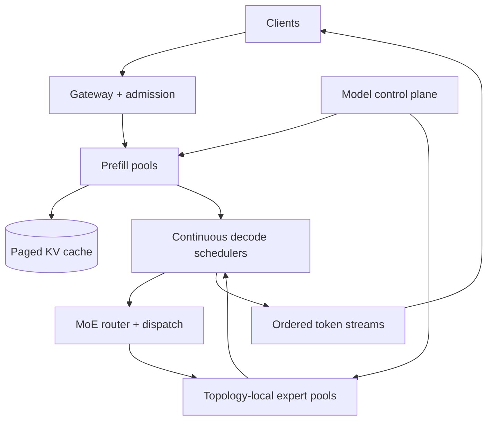
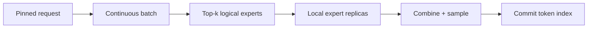

# Design a Distributed Mixture-of-Experts Inference Serving Platform

**Difficulty:** Staff

**Primary themes:** AI inference serving, expert parallelism, topology-aware routing, continuous batching, KV-cache management, admission control, hot-expert mitigation, reliability

> **Interview-time note:** The pacing labels describe a 45-minute interview. This walkthrough is intentionally more detailed for study. In an interview, first explain what changes when a dense model becomes sparse MoE, complete one token's path, and then deepen expert placement and scheduling.

This walkthrough follows the public [Hello Interview delivery framework](https://www.hellointerview.com/learn/system-design/in-a-hurry/delivery): requirements, core entities, interfaces, a simple complete design, and focused deep dives. The scenario, numbers, APIs, dialogue, and tradeoffs are original.

---

## Interviewer prompt

> Design a global inference platform for a large autoregressive mixture-of-experts language model. Each transformer layer has many experts, but a learned router sends each token to only a small subset. The platform must serve interactive streaming requests, batch efficiently, isolate tenants, meet latency targets, and survive accelerator or expert-replica failures.

The distinctive challenge is the data movement. A dense model executes the same weights for each token. In a sparse MoE model, token routing changes at every MoE layer, so workers repeatedly exchange token activations with expert replicas. A popular expert, slow link, or failed replica can stall an entire decode batch even though most model weights are idle.

## Targeted clarifying questions and assumed answers

**Candidate:** Are we designing training or inference?

**Interviewer:** Inference only. Model training produces immutable checkpoints and routing metadata.

**Candidate:** What model should I assume?

**Interviewer:** A decoder-only model with 64 routed experts in each MoE layer, top-2 routing per token, shared attention layers, and roughly one trillion total parameters. Only a fraction is active for each token.

**Candidate:** Which request types matter?

**Interviewer:** Interactive text generation with server streaming, plus lower-priority offline batch generation. Support deterministic decoding options, cancellation, and usage reporting.

**Candidate:** What scale and latency targets should I use?

**Interviewer:** Across the fleet, 500,000 prompt tokens/s and 2 million generated tokens/s at normal peak, with 100,000 concurrent sequences. Interactive p95 time-to-first-token below one second for prompts up to 2,000 tokens and p95 inter-token latency below 80 ms.

**Candidate:** How large are prompts and outputs?

**Interviewer:** Prompt p50 is 700 tokens, p99 is 16,000. Output p50 is 180 tokens and maximum is 8,000. Enforce tenant-specific limits.

**Candidate:** What availability is expected?

**Interviewer:** 99.95% successful admission for requests within quota when one zone is healthy. In-flight requests may be retried before the first token; after streaming begins, surface a resumable error rather than silently restarting with different output.

**Candidate:** Can a request mix model versions?

**Interviewer:** Never. A request is pinned to one model, tokenizer, routing, quantization, and sampling-policy revision for its lifetime.

**Candidate:** Must routing be deterministic?

**Interviewer:** Given the same hidden state and model revision, expert selection is deterministic. Sampling may be deterministic when the customer supplies a seed, but hardware numerics can still require an explicit reproducibility tier.

**Candidate:** Do we need prompt/KV caching?

**Interviewer:** Yes. Prefix reuse is valuable, but cache entries must be scoped by model revision, tenant-sharing policy, tokenizer, and exact token prefix.

**Candidate:** What happens if an expert is overloaded?

**Interviewer:** The platform should replicate hot experts, route within capacity, preserve model-defined overflow semantics, and never substitute an arbitrary expert merely to reduce latency.

### Scope statement to say aloud

> “I’ll separate a control plane that validates immutable model revisions and compiles topology-aware placement plans from a data plane that admits, batches, and streams requests. Each request pins one revision. Prefill builds KV state; decode uses continuous batches. At every MoE layer, a deterministic router groups token activations by chosen expert, dispatches them to version-matched replicas, and combines top-k outputs. Capacity-aware scheduling and replica placement reduce stragglers, while request checkpoints, fenced workers, and explicit streaming semantics handle failures without mixing versions.”

---

## 1. Requirements (~5 minutes)

### Core functional requirements

1. **Deploy and serve versioned MoE models.** Operators publish immutable model revisions and safely place shared layers and expert replicas across accelerator clusters.
2. **Generate text interactively.** Authenticated clients submit prompts, receive streamed tokens, cancel work, and obtain consistent usage/error metadata under tenant quotas.
3. **Route and schedule sparse computation reliably.** The platform continuously batches sequences, routes token activations to top-k expert replicas, manages KV cache, mitigates hot experts, and recovers from worker failure.

### Out of scope

- Model training and expert-learning algorithms
- Safety-policy model internals and product moderation decisions
- Image/audio preprocessing
- Fine-tuning pipelines
- Guaranteeing bitwise-identical floating-point output on every accelerator
- Cross-provider failover for the same in-flight token

### Quantified non-functional requirements

| Requirement | Target | Design consequence |
|---|---:|---|
| Prompt throughput | 500K tokens/s | parallel prefill, chunking, prefix cache |
| Decode throughput | 2M tokens/s | continuous batching and expert-parallel execution |
| Concurrency | 100K active sequences | paged KV allocation, admission by memory-time cost |
| TTFT | interactive p95 <1 s for ≤2K tokens | prefill capacity, bounded queueing, priority lanes |
| Inter-token latency | p95 <80 ms | topology-aware expert routing and straggler control |
| Availability | 99.95% admission/success within quota | multi-zone replicas, graceful draining, fallback policy |
| Isolation | tenant workload cannot starve others | hierarchical quotas and weighted token scheduling |
| Version consistency | no mixed weights/routing/tokenizer per request | immutable revision IDs in every lease and cache key |
| Streaming correctness | tokens are ordered and never silently rewritten | per-request token sequence and explicit resume/error contract |

### Scale estimates that change the design

If each expert has 12 billion parameters in BF16, one expert is approximately:

\[
12\text{B} \times 2\text{ bytes} = 24\text{ GB}
\]

Sixty-four experts require about 1.5 TB per MoE layer group before replicas and shared weights. No single accelerator holds the model. Expert parallelism and careful placement are mandatory.

At 2 million generated tokens/s and top-2 routing, each MoE layer executes 4 million expert-token assignments/s. With 16 MoE layers, that is 64 million expert assignments/s and repeated all-to-all activation exchange. Network topology and hot-expert distribution can dominate compute.

Suppose each routed activation is 8 KB after representation/transport encoding. One MoE layer moves roughly:

\[
2\text{M tokens/s} \times 2 \times 8\text{ KB} \approx 32\text{ GB/s}
\]

before return traffic and protocol overhead. Across many layers, we must keep most exchanges inside high-bandwidth accelerator fabrics and avoid arbitrary cross-region routing.

KV cache determines concurrency. If one sequence consumes an average of 300 MB across its active context, 100,000 sequences need 30 TB fleet-wide. We need paged allocation, block-level eviction, prefix sharing under strict policy, and admission based on current KV headroom—not only request QPS.

Average generated token demand is not sufficient for planning. Decode uses one token per active sequence per step, while prefill processes many prompt tokens in parallel and is compute-heavy. Separate capacity signals, queues, and possibly worker pools for prefill and decode.

### Consistency and availability contract

- **Model pinning:** one request uses exactly one `ModelRevision`, tokenizer revision, quantization profile, router weights, and sampling policy.
- **Expert correctness:** an activation is processed only by a replica of the selected expert and pinned revision. Overload cannot silently change expert identity.
- **Token order:** streamed output is monotonic by `token_index`; acknowledged tokens are never replaced.
- **Admission:** once admitted, capacity is reserved for minimum decode progress; overload rejects or queues before allocating unbounded KV state.
- **Cache correctness:** prefix/KV entries are content-addressed and revision-scoped. Cross-tenant reuse requires explicit privacy policy.
- **Failure before first token:** retry from prompt and seed on a healthy replica set.
- **Failure after streaming:** attempt checkpointed continuation only in a compatible reproducibility tier; otherwise return the last committed token index and an explicit retryable error.
- **Control availability:** an existing placement continues serving during control-plane outage; new deployments and major rebalances pause.

### What to say aloud

> “For MoE, the bottleneck is often the slowest selected expert and its network path, not total FLOPs. I will optimize the critical path of one decode step: gather active sequences, route tokens, exchange activations, run exact selected experts, combine outputs, sample, and stream.”

---

## 2. Core entities (~2 minutes)

- **ModelRevision** — immutable checkpoint, tokenizer, router, architecture, quantization, compatibility, and digest.
- **ExpertShard** — expert identity, layer group, weight digest, memory footprint, and kernel profile.
- **ExpertReplica** — concrete expert/version on a worker, health, locality, lease epoch, and capacity.
- **PlacementPlan** — versioned mapping of shared stages and expert replicas onto topology domains.
- **InferenceRequest** — tenant, model revision, prompt reference, sampling parameters, limits, priority, and state.
- **SequenceState** — current token index, RNG state, KV block table, assigned decode group, and checkpoint.
- **KVBlock** — model/version, token-range digest, tenant-sharing scope, location, reference count, and lease.
- **TokenBatch** — compatible sequence step, tokens, deadlines, and routing-plan revision.
- **RoutingDecision** — layer, token, selected experts, weights, replica destinations, and capacity outcome.
- **UsageRecord** — prompt/generated tokens, active experts, accelerator/network time, and billing dimensions.

The key boundary is between the logical **ExpertShard** and its replaceable **ExpertReplica** instances. Routing chooses the model-defined expert; scheduling chooses a healthy replica of that exact expert.

---

## 3. API and system interface (~5 minutes)

The gateway derives `tenant_id`, plan, allowed models, and quota from authentication. Clients cannot claim another tenant or internal priority.

### 3.1 Start streaming generation

```http
POST /v1/responses
Authorization: Bearer <tenant-token>
Idempotency-Key: chat-991:turn-18
Content-Type: application/json

{
  "model": "moe-reasoner-1",
  "input": [{"role": "user", "content": "Explain NUMA-aware inference scheduling."}],
  "max_output_tokens": 800,
  "temperature": 0.2,
  "seed": 4419,
  "stream": true,
  "service_tier": "interactive"
}
```

```text
event: response.created
data: {"request_id":"req_01K...","model_revision":"mr_7f31","queue_ms":18}

event: response.output_token
data: {"token_index":0,"text":"NUMA"}

event: response.completed
data: {"last_token_index":236,"usage":{"prompt_tokens":14,"output_tokens":237}}
```

The server resolves the model alias to an immutable revision at admission. Reusing the idempotency key with the same body returns or reconnects to the same logical request; a different body conflicts.

### 3.2 Read or reconnect to a request

```http
GET /v1/responses/req_01K.../events?after_token_index=127
Authorization: Bearer <tenant-token>
Accept: text/event-stream
```

The stream gateway retains a bounded replay buffer of committed output events. It never emits a replacement for an already committed index.

### 3.3 Cancel

```http
POST /v1/responses/req_01K...:cancel
Authorization: Bearer <tenant-token>
If-Match: "request-version-8"
```

Cancellation is idempotent. The coordinator marks the sequence cancelled, stops future scheduling, releases KV blocks after active kernels finish, and publishes final usage.

### 3.4 Publish a model revision

```http
POST /v1/models/moe-reasoner-1/revisions
Authorization: Bearer <model-operator-token>
Idempotency-Key: moe-reasoner-1-r42

{
  "checkpoint_manifest_digest": "sha256:8b4...",
  "tokenizer_digest": "sha256:31a...",
  "router_digest": "sha256:aa9...",
  "quantization_profile": "BF16_SHARED_INT8_EXPERTS",
  "expert_count": 64,
  "top_k": 2,
  "compatibility_test_suite": "suite_219"
}
```

Publishing validates signatures, manifests, tensor shapes, kernel support, router/expert mapping, golden prompts, numerical tolerances, and capacity estimates. Activation is a separate canary operation.

### 3.5 Internal decode-step contract

```protobuf
rpc ExecuteExpertBatch(ExpertBatch) returns (ExpertBatchResult);

message ExpertBatch {
  string model_revision = 1;
  string expert_id = 2;
  uint64 placement_epoch = 3;
  string batch_id = 4;
  repeated RoutedActivation activations = 5;
  int64 deadline_micros = 6;
}
```

Workers reject a mismatched model digest, expert ID, or stale placement epoch.

### API-to-requirement map

| Requirement | Interface |
|---|---|
| Interactive generation | response create and event stream |
| Retry/reconnect | idempotency key and token-index cursor |
| Resource cleanup | versioned cancel |
| Safe deployments | immutable revision publication/activation |
| Correct sparse execution | versioned expert-batch RPC |

---

## 4. Data flow

1. The gateway authenticates the tenant, tokenizes or validates token input, resolves a model alias to an immutable revision, estimates cost, and applies admission control.
2. Prefix-cache lookup reuses authorized KV blocks for the longest exact token prefix; remaining prompt tokens enter prefill.
3. Prefill workers compute shared layers and MoE layers in chunks, producing KV blocks and the first decode state.
4. The decode scheduler continuously forms batches from compatible active sequences using deadlines, tenant share, KV locality, and model revision.
5. At each MoE layer, router logits select top-k logical experts. A dispatch planner groups activations by expert and chooses healthy version-matched replicas within the placement plan.
6. Expert workers execute batches. The coordinator gathers weighted expert outputs, continues shared layers, samples the next token, and advances sequence/RNG/KV state.
7. The stream service commits and emits the token by index. Cancelled or finished sequences release KV blocks and produce usage records.
8. Telemetry feeds autoscaling, hot-expert detection, placement optimization, canary comparison, and SLO alerts.

---

## 5. High-level design (~10–15 minutes)



### Operation 1: publish and place a model revision

The registry stores immutable metadata:

```text
ModelRevision(
  model_revision_id, model_name,
  checkpoint_manifest_digest,
  tokenizer_digest, router_digest,
  architecture_digest,
  quantization_profile,
  expert_count, top_k,
  lifecycle_state,
  created_at
)
```

The placement compiler knows worker memory, accelerator type, fabric domain, interconnect bandwidth, failure domain, and supported kernels. It creates:

```text
PlacementPlan(
  plan_id, model_revision_id,
  placement_epoch,
  shared_stage_assignments,
  expert_replica_assignments,
  routing_directory_digest,
  effective_at, state
)
```

Frequently selected experts receive more replicas. Replicas of the same expert span hosts and zones, but the normal path keeps all experts needed by a decode group inside one high-bandwidth fabric domain. Cross-zone traffic is failover, not the per-token steady state.

Workers load content-addressed weights into host memory, verify checksums, transfer them to accelerator memory, warm kernels, and execute golden batches before becoming `READY`. Activation uses a new placement epoch; existing requests remain pinned to their old plan until drained.

### Operation 2: admit and pin a request

Admission estimates:

```text
estimated_cost =
  prompt_tokens × prefill_cost_per_token
  + max_output_tokens × decode_cost_per_token
  + projected_KV_bytes
```

It checks tenant token buckets, global model queue age, KV headroom, prefill/decode saturation, and requested tier. If healthy, it creates:

```text
InferenceRequest(
  request_id, tenant_id,
  model_revision_id, placement_epoch,
  prompt_digest, sampling_config_digest,
  max_output_tokens, service_tier,
  state, request_version,
  created_at, admitted_at
)
```

Reject with `429` and a retry hint before allocating KV if the tier has no safe capacity. Offline work queues durably and cannot consume the interactive reserved share.

### Operation 3: prefix lookup and prefill

The prefix-cache key includes:

```text
hash(model_revision, tokenizer_revision, adapter_revision,
     exact_token_prefix, position_encoding_config, tenant_scope)
```

A hit returns immutable KV block references for the longest verified prefix. Cross-tenant sharing is disabled by default because cache timing can reveal prompt existence; public system prefixes may be explicitly shareable.

Prefill is chunked so a 16K-token request does not monopolize an accelerator or block short interactive prompts. The scheduler interleaves prefill chunks with decode according to reserved budgets.

KV memory uses fixed-size logical blocks mapped through per-sequence block tables:

```text
SequenceState(
  request_id, token_index,
  rng_counter,
  kv_block_table,
  decode_group_id,
  last_committed_token,
  state, lease_epoch
)
```

Paged allocation reduces fragmentation and supports copy-on-write when sequences share a prefix and later diverge.

### Operation 4: continuously batch decode sequences

Unlike static batching, continuous batching removes a completed sequence and admits another between decode steps. A scheduler selects sequences compatible by model revision, execution profile, and locality.

It optimizes several objectives:

- earliest token deadline for interactive latency;
- weighted fair share across tenants;
- enough batch size for accelerator utilization;
- KV locality to avoid transfers;
- bounded prefill interference;
- expert-capacity forecast from recent routing distributions.

The batch is a scheduling unit, not a correctness boundary. Each sequence retains its own token index, RNG state, stop criteria, and usage.

### Operation 5: route one MoE layer

For hidden vector `h`, the model router produces scores. Top-2 selects logical experts `E7` and `E31` with weights `0.61` and `0.39`.

The dispatch stage:

1. computes deterministic logical expert choices;
2. groups batch activations by expert;
3. consults the pinned placement directory;
4. picks a healthy replica using queue depth, locality, and deadline;
5. sends one batched payload per destination;
6. waits for both results or declared model overflow behavior;
7. combines weighted outputs and resumes the layer.

```text
RoutingDecision(
  batch_id, layer_id, token_ref,
  selected_expert_ids,
  gating_weights,
  replica_ids,
  placement_epoch,
  dispatch_deadline
)
```

The router may have a model-defined capacity factor. When selected assignments exceed capacity, use the checkpoint's specified overflow/drop/shared-expert behavior. Serving infrastructure must not invent a nearest available expert because that changes the model.

### Operation 6: sample and stream a token

After the final layer, the sampler uses pinned decoding parameters and per-sequence RNG counter. The coordinator persists a lightweight commit record containing token index, token ID, RNG counter, and KV block-table generation before or atomically with publishing to the stream buffer.

The stream gateway emits only contiguous token indexes. Reconnect with `after_token_index` replays committed events. Backpressure from a slow client is bounded: retain a limited event buffer, then detach network streaming while inference either pauses within policy or completes to durable result storage.

### Operation 7: cancel and finish

Cancellation marks the logical sequence first. Active kernels are not force-killed mid-operation; their result is discarded if the sequence epoch/state no longer matches. The scheduler stops future steps, releases request-owned KV references, finalizes usage, and emits one terminal event.

---

## 6. Deep dives (~10–15 minutes)

### Deep dive A: expert placement and all-to-all communication

#### Where the baseline breaks

Randomly scattering experts across the fleet makes every layer cross slow network links. Placing one copy of each expert creates hot spots. Replicating every expert equally wastes expensive memory because router popularity is skewed and changes with workload.

#### Options

| Strategy | Benefit | Failure mode |
|---|---|---|
| One replica per expert | Minimum weight memory | hot experts and no failover |
| Equal replication | Simple | wastes memory on cold experts |
| Pure load-aware routing across fleet | balances queues | network path can dominate latency |
| Topology-aware adaptive replication | balances compute and communication | complex planning and migration |

#### Selection

Use topology-aware adaptive replication:

- form a decode group inside one high-bandwidth fabric domain;
- place at least one replica of every required expert within that domain;
- add replicas proportional to measured expert-token rate and service time;
- distribute replicas across hosts/failure domains;
- route to the nearest healthy replica unless deadline/load predicts a better local alternative;
- rebalance through versioned placement epochs and drain barriers.

The cost function should include queue delay, activation bytes over each link, kernel time, memory pressure, and correlated failure risk. Minimizing worker utilization alone can worsen inter-token latency by creating cross-fabric exchanges.

Collect router histograms by layer, model revision, prompt class, and time window without logging user text. Use exponential smoothing and headroom so placement does not oscillate. A hot expert first receives more batch capacity and replicas; if weights cannot fit, split its tensor across tightly connected accelerators.

#### Straggler control

Top-2 output waits for both experts. Detect queueing versus compute versus network stragglers separately. Possible responses:

- choose another healthy replica of the same expert before dispatch;
- hedge only when predicted deadline miss exceeds the cost threshold;
- shrink or split overloaded expert batches;
- temporarily reduce admission for affected model/tier;
- fail the step rather than use the wrong expert.

Hedged requests carry `(batch_id, token_ref, layer, expert_id)`; the first valid result wins and duplicates are discarded.

### Deep dive B: continuous batching, KV pressure, and tenant fairness

#### Where the baseline breaks

Maximizing batch size can destroy latency. Long prefills block decode, large-context sequences consume most KV memory, and one tenant's offline job can fill every slot. QPS-based quotas ignore that a 16K prompt with 8K output costs far more than a short request.

#### Scheduling approaches

| Approach | Advantage | Problem |
|---|---|---|
| FIFO requests | simple | head-of-line blocking |
| Largest possible batch | high throughput | deadline and fairness failures |
| Strict priority | protects interactive | batch starvation |
| Deadline + weighted cost fairness | SLO-aware and isolated | estimation complexity |

#### Selection

Use hierarchical scheduling:

1. reserve capacity between interactive and offline classes;
2. allocate tenant shares using weighted deficit tokens charged by measured GPU time, tokens, and KV-byte-seconds;
3. schedule earliest token deadlines within a tenant;
4. form locality-compatible batches;
5. cap consecutive prefill work so decode steps continue.

Admission considers KV memory as a first-class resource. Reserve at least initial prompt blocks plus a bounded output budget. If output grows, extend the reservation or stop at the contractual limit. Eviction priority is unused prefix cache first, then completed-result cache, never active sequence blocks without checkpoint/migration support.

Disaggregated prefill and decode pools can improve independent scaling and prevent prefill interference. The cost is transferring KV blocks. Select it when prefill/decode hardware profiles or traffic ratios differ enough to outweigh transfer latency. Keep a co-located fast path for short prompts; route long prompts through disaggregated prefill.

#### Overload behavior

- reject new low-priority requests before memory exhaustion;
- provide retry-after based on queue service rate;
- reduce offline concurrency;
- disable optional cross-request cache population, not cache correctness;
- preserve admitted interactive minimum progress;
- never silently reduce `max_output_tokens` or change model/expert routing.

### Deep dive C: failures, model versions, and streaming recovery

#### Where the baseline breaks

If one expert worker fails mid-layer, a decode step is incomplete. Restarting elsewhere requires the same model revision and sequence state. Retrying an entire streamed request may generate different text and duplicate already displayed tokens. A rolling deployment can accidentally mix expert versions within one request.

#### Version-safe deployment

Every batch and expert RPC includes model revision and placement epoch. Workers expose loaded weight digests. A request pinned to revision R never uses R+1. Deployment stages:

1. validate artifacts and golden outputs;
2. load an isolated shadow pool;
3. mirror sampled requests and compare router choices/logit tolerances;
4. canary new admissions by tenant-safe percentage;
5. expand while monitoring accuracy, TTFT, ITL, errors, expert skew, and cost;
6. stop new R admissions, drain R requests, then reclaim weights/KV.

#### Failure before the first token

The gateway can retry from the original prompt, sampling seed, and immutable revision. No user-visible token has committed, so this is straightforward. Bound attempts and exclude the failed topology domain.

#### Failure after streaming begins

Maintain small sequence checkpoints at token boundaries:

```text
SequenceCheckpoint(
  request_id, model_revision,
  last_committed_token,
  rng_counter,
  kv_manifest_or_rebuild_prefix,
  placement_epoch,
  checksum
)
```

Options:

- **No continuation:** return a resumable error and last token index. Safest baseline.
- **KV replication/checkpoint:** continue on a compatible decode group, with memory/network cost.
- **Recompute:** rebuild KV from committed prompt/output tokens, slower but storage-light.

Choose no transparent continuation for the baseline, plus recompute-based explicit resume for premium requests. If deterministic reproducibility cannot be guaranteed, label the continuation as a new branch rather than pretending it is identical.

#### Failure modes

- An expert replica fails before dispatch: choose another exact replica.
- It fails after ambiguous execution: resend the idempotent expert batch; no external side effect exists.
- A decode coordinator fails: recover sequence metadata and rebuild or fail explicitly.
- KV host fails: use replicated/checkpointed premium state or return resumable error.
- Control plane fails: current placement epochs continue; rebalancing pauses.
- A zone fails: route new requests to another complete model cell; do not stretch every token across zones.

---

## Reliability, observability, and security

### Critical invariants

1. A request never mixes model, tokenizer, router, quantization, or adapter revisions.
2. A routed activation executes only on the selected logical expert.
3. A stale placement or sequence lease cannot commit output.
4. Streamed token indexes are contiguous and immutable.
5. Active KV blocks are not evicted while referenced by a valid sequence lease.
6. Prefix-cache reuse requires exact revision, token prefix, and sharing scope.
7. Cancellation prevents future token commits even if an old kernel completes.
8. Usage is derived from executed/admitted work with idempotent finalization.

### Failure-mode table

| Failure | Detection | Safe behavior | Recovery |
|---|---|---|---|
| Expert replica crash | heartbeat/RPC failure | do not substitute expert | retry exact expert replica |
| Slow expert | stage deadline telemetry | bounded hedge or admission reduction | replace/drain unhealthy replica |
| Decode scheduler crash | lease expiry | stale scheduler cannot commit | recover checkpoint or explicit error |
| KV worker loss | block lease/checksum failure | stop affected sequences | recompute or premium replica restore |
| Stream connection drops | gateway disconnect | inference state remains bounded | replay after token index |
| Client remains slow | buffer watermark | detach/pause by policy | durable result or terminate explicitly |
| New revision is bad | canary divergence/SLO | halt admissions to revision | route new work to prior revision |
| Placement control outage | control health | current epoch serves | restore control plane; no unsafe rebalance |
| Hot expert saturation | expert queue/ITL | throttle affected admissions | replicate/replan exact expert |
| Accelerator memory pressure | KV/weight watermark | reject before OOM | evict safe cache, drain, rebalance |
| Zone failure | cell health | fail in-flight explicitly as required | admit new work in complete healthy cell |

### Observability

**User SLOs**

- admission latency and rejection reason
- queue time, TTFT, inter-token latency, completion latency
- stream disconnect/reconnect and resume success
- cancellation latency and tokens emitted after cancel request

**MoE critical path**

- router expert distribution and entropy by layer
- expert queue, batch size, kernel time, and utilization
- dispatch/gather bytes and latency by topology link
- top-k straggler gap and hedge rate
- overflow/drop/shared-expert behavior count

**Memory and scheduling**

- KV bytes, fragmentation, allocation failures, prefix hit rate
- KV-byte-seconds and accelerator-seconds by tenant/tier
- prefill versus decode budget and starvation age
- achieved fair share, admitted cost error, batch occupancy

**Correctness and rollout**

- worker weight-digest mismatch and stale epoch rejection
- shadow router-choice/logit divergence
- token sequence gaps/duplicate commit attempts
- cache-key mismatch/checksum failure
- checkpoint restore/recompute divergence

Trace request, sequence, model revision, placement epoch, decode step, batch, layer, expert, and replica IDs. Prompts, activations, and generated text are excluded from ordinary telemetry.

### Security and isolation

- authenticate every request and derive tenant/priority server-side;
- encrypt prompts, outputs, checkpoints, and KV spill in transit and at rest;
- isolate tenant adapters and prefix caches unless sharing is explicitly public;
- never expose expert routing details that reveal proprietary model structure unless policy allows;
- zero or cryptographically discard KV/activation buffers after release;
- sign model manifests and verify tensor digests on every load;
- use short-lived workload identity between schedulers and workers;
- cap input/output tokens, concurrent sequences, adapters, and stream buffers;
- audit deployments, model alias changes, quota changes, and privileged diagnostics;
- defend cache timing and error messages from cross-tenant prompt-existence leaks.

---

## 7. Final design

The final system uses complete topology-local model cells with version-pinned sparse execution:

- The model control plane validates immutable checkpoints and compiles placement epochs using accelerator memory, fabric topology, expert popularity, and failure domains.
- Gateways authenticate tenants, resolve model aliases, estimate token/KV cost, apply quotas, and pin admitted requests to one immutable revision.
- Prefix cache and chunked prefill build paged KV state without letting long prompts starve decode.
- Continuous schedulers select deadline-aware, tenant-fair, locality-compatible decode batches.
- Each MoE layer deterministically selects logical top-k experts; dispatch chooses healthy replicas of those exact experts inside the pinned placement plan.
- Topology-aware adaptive replication mitigates hot experts while model-defined capacity/overflow semantics preserve correctness.
- Sampling advances per-sequence RNG/KV state, and the stream commits immutable contiguous token indexes.
- Lease epochs reject stale schedulers/workers. Before first token, requests can retry; after streaming, baseline recovery is explicit and resumable, with premium checkpoint/recompute options.
- Stage-specific telemetry drives autoscaling and placement while tenant quotas account for tokens, accelerator time, and KV-byte-seconds.



### Requirements check

| Requirement | Design response |
|---|---|
| Version-safe serving | immutable model revision and placement epoch per request |
| Low TTFT | prefix reuse, chunked prefill, reserved interactive capacity |
| Low inter-token latency | topology-local expert pools and deadline scheduling |
| Sparse model correctness | deterministic logical experts; exact-replica enforcement |
| Hot-expert handling | adaptive replication, capacity forecasting, bounded hedging |
| High throughput | continuous batching and per-key expert grouping |
| Large concurrency | paged KV blocks, admission by KV headroom |
| Tenant isolation | weighted cost fairness and class reservations |
| Streaming correctness | immutable contiguous token indexes and replay cursor |
| Failure recovery | epochs, alternate expert replicas, checkpoints/recompute |
| Safe deployment | shadow, canary, pin, drain, and digest verification |

### Thirty-second closing statement

> “I organize capacity into topology-local cells that contain a complete serving placement for one immutable MoE revision. Admission reserves token and KV cost before work begins. Chunked prefill creates paged KV state; continuous decode forms deadline-aware, tenant-fair batches. At each MoE layer the model deterministically chooses logical experts, while the platform chooses healthy nearby replicas of those exact experts, groups activations, and gathers weighted results. Adaptive replication addresses hot experts without changing model semantics. Every token commit is indexed and version-fenced, so failure can retry before streaming or return an explicit resumable boundary afterward.”

---

## Realistic interviewer follow-up questions and strong sample answers

### 1. Why is MoE serving different from dense-model serving?

Each token selects a small expert subset, creating repeated all-to-all activation exchange and skewed expert load. Network topology and the slowest selected expert become part of every token's critical path.

### 2. What is the difference between expert selection and replica selection?

The learned router selects the logical experts required by the model. Infrastructure may only choose among replicas of each selected expert; it cannot replace the expert with a convenient one.

### 3. Why not put every expert on every worker?

The weights are too large. A 12B-parameter BF16 expert is about 24 GB; 64 experts exceed 1.5 TB before shared weights and replicas.

### 4. How do you place experts?

Keep a complete expert set within a high-bandwidth fabric domain, then replicate hot experts according to measured token rate, service time, memory, and failure-domain constraints.

### 5. How do you detect a hot expert?

Measure selected token rate, queue delay, batch occupancy, kernel time, and deadline misses by expert/layer/revision. Smooth the signal to avoid placement oscillation.

### 6. What if the selected expert is full?

Use another replica of the same expert or apply the model checkpoint's declared capacity/overflow behavior. Do not silently choose a different expert.

### 7. Why does top-2 amplify tail latency?

The layer cannot combine output until both selected experts return. One overloaded expert or slow network path holds the token step, so monitor the gap between first and last expert completion.

### 8. What is continuous batching?

Sequences join and leave between token steps instead of waiting for a fixed batch to finish. This keeps accelerators utilized while allowing short requests to complete promptly.

### 9. How do you prevent long prompts from hurting decode latency?

Chunk prefill, reserve separate scheduling budgets, and optionally use disaggregated prefill pools. Decode receives a minimum cadence even under large-prompt load.

### 10. Why is QPS a poor quota?

A request with 16K prompt and 8K output consumes far more compute and KV memory than a short request. Charge prompt/decode tokens, accelerator time, and KV-byte-seconds.

### 11. What is paged KV cache?

Sequence KV state is stored in fixed-size logical blocks mapped by a block table rather than one contiguous allocation. It reduces fragmentation and enables prefix sharing and copy-on-write.

### 12. When is cross-tenant prefix caching safe?

Only for explicitly public/shareable prefixes under policy. Otherwise isolate by tenant because cache timing can reveal whether another tenant used a prompt.

### 13. Can a request use a new model revision halfway through?

No. It remains pinned to model, tokenizer, router, quantization, adapter, and placement-compatible weights until completion or explicit failure.

### 14. How do you roll out a new revision?

Load and verify an isolated pool, run golden/shadow comparisons, canary new admissions, expand under SLO and numerical checks, stop new old-version admissions, then drain before reclaiming.

### 15. What happens if an expert replica crashes?

Retry that expert batch on another exact version-matched replica. Expert execution has no external side effect, and duplicate results are discarded by batch/token/layer/expert identity.

### 16. Can you resume after tokens were streamed?

Baseline behavior returns an explicit error and last committed token. A premium tier may restore replicated KV or recompute from committed tokens, provided revision and reproducibility constraints are met.

### 17. How do you handle a dropped client connection?

Keep a bounded committed-event replay buffer and inference grace period. The client reconnects after its last token index; beyond the grace policy, finish durably or cancel and release KV.

### 18. Would you span one decode step across zones?

Not normally. Cross-zone latency and correlated network failure would affect every token. Maintain complete model cells per zone and fail new requests over at admission boundaries.

### 19. What should autoscaling use?

Queued prefill tokens, active decode sequences, KV headroom, expert-specific queued token-seconds, inter-token deadline risk, weight-load time, and topology capacity—not average accelerator utilization alone.

### 20. What metric would page you first?

User p95 inter-token latency decomposed by router dispatch, network exchange, expert queue, expert kernel, and gather. Aggregate throughput can look healthy while one hot expert makes interactive output unusable.

---

## Common pitfalls

1. Treating MoE as a dense model with fewer FLOPs.
2. Ignoring activation-network cost between every MoE layer.
3. Randomly scattering experts across zones or slow links.
4. Creating only one replica of a popular expert.
5. Replicating all experts equally despite skew.
6. Letting infrastructure substitute a different logical expert under load.
7. Mixing model or routing revisions within a request.
8. Omitting placement epoch/digest validation from expert RPCs.
9. Scheduling only for accelerator utilization and ignoring token deadlines.
10. Allowing long prefill jobs to starve decode.
11. Using QPS rather than token, compute, and KV cost for quotas.
12. Admitting more sequences than KV memory can sustain.
13. Using contiguous KV allocations and suffering fragmentation.
14. Sharing prefix cache across tenants without privacy policy.
15. Evicting active KV blocks to recover memory.
16. Retrying a streamed request silently from token zero.
17. Re-emitting or replacing an acknowledged token index.
18. Killing active kernels without fencing late results.
19. Spanning steady-state token routing across distant regions.
20. Rebalancing experts without a versioned drain barrier.
21. Logging prompts, activations, or model outputs in general telemetry.
22. Watching aggregate GPU utilization instead of expert-level tail latency.

---

## Suggested 45-minute interview pacing

| Time | Focus |
|---:|---|
| 0–5 min | Model shape, traffic, TTFT/ITL, version and failure contracts |
| 5–7 min | Model revision, expert, replica, placement, request, sequence, KV block |
| 7–12 min | Generation, reconnect, cancel, deploy, expert RPC interfaces |
| 12–25 min | Admission → prefix/prefill → continuous decode → route → stream |
| 25–38 min | Expert placement and batching/KV; recovery if time |
| 38–43 min | Failures, observability, rollout, security |
| 43–45 min | Requirements check and closing statement |

In the interview, draw one token's critical path before discussing autoscaling. Keep repeating the semantic boundary: the model chooses the logical expert; the platform chooses only its replica.

---

## Public references

- [Hello Interview — System Design Delivery Framework](https://www.hellointerview.com/learn/system-design/in-a-hurry/delivery)
- [Hello Interview — API Design for System Design Interviews](https://www.hellointerview.com/learn/system-design/core-concepts/api-design)
- [Hello Interview — Data Modeling for System Design Interviews](https://www.hellointerview.com/learn/system-design/core-concepts/data-modeling)

The references are used for interview-delivery structure. The requirements, estimates, MoE placement model, APIs, dialogue, scheduling design, failure semantics, and tradeoffs are original.
