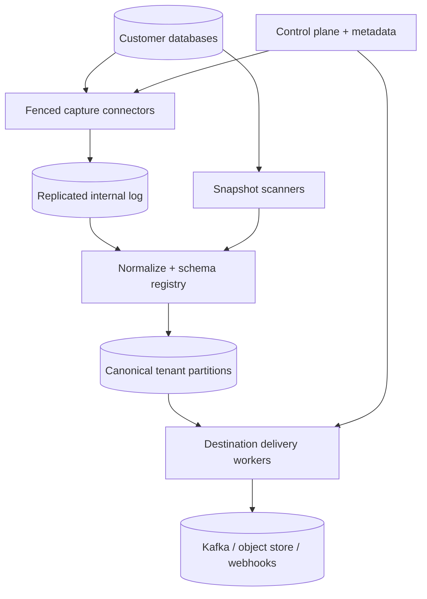
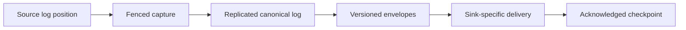

# Design a Multi-Tenant Change Data Capture Platform

**Difficulty:** Senior / Staff

**Primary themes:** database logs, consistent snapshots, ordered streams, schema evolution, durable queues, backpressure, idempotency, multi-tenant isolation, disaster recovery

> **Interview-time note:** The pacing labels describe a 45-minute interview. This is a longer educational walkthrough. In the interview, first define the source-position and delivery contracts, build one database-to-sink path, then deepen snapshot handoff, ordering, and backpressure.

This walkthrough follows the public [Hello Interview delivery framework](https://www.hellointerview.com/learn/system-design/in-a-hurry/delivery): requirements, entities, interfaces, a simple complete design, and focused deep dives. The scenario, estimates, APIs, dialogue, and tradeoffs are original.

---

## Interviewer prompt

> Design a managed, multi-tenant change data capture platform. Customers connect relational databases such as PostgreSQL and MySQL. The platform captures inserts, updates, and deletes with low latency and delivers them to destinations such as Kafka, object storage, and search-indexing pipelines. New subscriptions may need an initial snapshot followed by a continuous stream without gaps or duplicate logical effects.

This problem is not merely “poll a table.” A correct system must coordinate a consistent snapshot with a moving transaction log, preserve useful ordering, survive source and worker failures, handle schema changes, isolate noisy tenants, and expose enough position information for consumers to deduplicate or resume.

## Targeted clarifying questions and assumed answers

**Candidate:** Which sources are required?

**Interviewer:** Start with PostgreSQL and MySQL using their native logical/WAL or binlog mechanisms. The architecture should support additional log-based connectors.

**Candidate:** Which destinations matter?

**Interviewer:** Kafka-compatible brokers, object storage, and a generic webhook/streaming sink. Sink-specific transformations are limited.

**Candidate:** Do subscriptions require an initial snapshot?

**Interviewer:** Yes, optionally. A customer can request snapshot plus stream or stream from a supplied source position.

**Candidate:** What ordering must be preserved?

**Interviewer:** Preserve transaction commit order per source database and row-change order within a transaction. A scalable sink may partition by table and primary key, so global delivery order across partitions is not promised unless the customer pays for a single ordered stream.

**Candidate:** Is exactly-once delivery required?

**Interviewer:** The system must not lose acknowledged source changes. Delivery is at least once by default. For transactional sinks, provide exactly-once effects where supported; otherwise expose stable event IDs and checkpoints for idempotent consumers.

**Candidate:** What scale should I assume?

**Interviewer:** 100,000 source databases, 20,000 active subscriptions, 5 million row changes/s average, 25 million/s peak, and 5 GB/s average encoded ingress. One tenant may burst to 1 million changes/s.

**Candidate:** How fresh should events be?

**Interviewer:** Under healthy conditions, p99 source-commit-to-platform-durable latency below 2 seconds and source-commit-to-sink acknowledgment below 10 seconds. Snapshot jobs may take hours.

**Candidate:** What happens when a destination is unavailable?

**Interviewer:** Buffer durably within tenant quotas, apply backpressure before retention risk, and pause safely rather than silently discard. Alert the customer before the source log or platform retention window is threatened.

**Candidate:** How should schema changes behave?

**Interviewer:** Emit ordered schema-change records, version every row event with a schema ID, and pause only when a configured compatibility policy is violated.

**Candidate:** Are credentials and private-network connectivity in scope?

**Interviewer:** Yes at the design level: encrypted secrets, short-lived access, private connectors or agents, and tenant isolation. Do not design an entire VPN product.

### Scope statement to say aloud

> “I’ll separate the control plane from a partitioned data plane. Each source has one fenced capture owner that reads its native log and writes immutable, position-tagged records to a durable internal log before advancing the platform checkpoint. A snapshot coordinator records a log boundary, scans a consistent database snapshot, and merges buffered changes using source positions. Delivery workers transform records into versioned envelopes and checkpoint only after a sink-specific acknowledgment. The default is at least once with stable event IDs; transactional sinks can provide exactly-once effects.”

---

## 1. Requirements (~5 minutes)

### Core functional requirements

1. **Configure and bootstrap replication.** Authenticated tenants register sources/destinations, select tables and policies, validate connectivity, and start from a consistent snapshot or supplied log position.
2. **Capture and deliver changes.** Continuously capture inserts, updates, deletes, transaction boundaries, and schema changes, then deliver them with documented ordering and retry semantics.
3. **Operate subscriptions safely.** Pause/resume, monitor lag, handle backpressure, rotate credentials, replay from retained positions, and recover without gaps.

### Out of scope

- Arbitrary ETL code and complex joins
- Bidirectional replication or automatic conflict resolution
- Full database backup and point-in-time restore
- Supporting sources without stable change positions in the first version
- Guaranteeing exactly-once effects for arbitrary HTTP endpoints
- Cross-database transaction ordering

### Quantified non-functional requirements

| Requirement | Target | Design consequence |
|---|---:|---|
| Average capture | 5M changes/s, 5 GB/s | Partitioned durable internal log and horizontal connectors |
| Peak capture | 25M changes/s; 1M/s hot tenant | Tenant-aware partitions, quotas, isolated hot-source cells |
| Durability | no loss after platform durable acknowledgment | replicated log before source checkpoint advancement |
| Capture freshness | commit → internal durable p99 <2 s | streaming log readers, batching bounded by latency |
| Delivery freshness | commit → sink ack p99 <10 s when healthy | independent delivery pools and per-sink checkpoints |
| Availability | control API 99.99%; capture 99.95% | multi-zone metadata/log, fenced failover |
| Recovery | resume after worker loss in <60 s | leases, source positions, checkpointed ownership |
| Isolation | one tenant cannot exhaust shared queues/storage | admission limits, fair scheduling, per-tenant retention quota |
| Security | no cross-tenant data or secret access | tenant-scoped encryption, identity, networking, audit |

### Scale estimates that change the design

At 5 million changes/s and 1 KB average encoded record:

\[
5{,}000{,}000 \times 1\text{ KB} \approx 5\text{ GB/s}
\]

That is about 432 TB/day before replication and compression. Keeping seven days uncompressed would exceed 3 PB. We need compression, tiered object-storage segments, configurable retention, and prompt reclamation after all required consumers checkpoint.

At 25 million changes/s peak, sending one broker request per row is impossible. Connectors batch records by bytes and a short time bound, for example 1–8 MB or 50 ms, while retaining transaction metadata.

With 20,000 active subscriptions and an average of 250 changes/s, averages hide skew: a single source may emit 1 million/s. Static one-source-per-small-worker allocation wastes capacity for small tenants yet fails for whales. Use source ownership plus scalable downstream partitions; isolate hot sources in dedicated capture cells where the database protocol allows only one logical reader.

If each source keeps only 24 hours of replication logs and a sink is down for 20 hours, a naive connector that stops reading risks source-log deletion. Decouple source capture from sink delivery using the durable internal log. Platform storage buys recovery time without indefinitely pinning source WAL/binlog.

### Consistency and availability contract

- **Source position:** every captured transaction carries an authoritative source position, such as PostgreSQL LSN or MySQL binlog file/offset/GTID.
- **Capture durability:** the platform advances its durable source checkpoint only after the corresponding internal-log batch is replicated.
- **Ordering:** preserve source commit order in the canonical source stream and change order within a transaction. Partitioned sink streams preserve order per selected key, not globally.
- **Snapshot boundary:** snapshot rows and streaming changes form one logical history with no gap. Duplicates at the boundary are allowed internally but removed or made idempotent by position/key/version.
- **Delivery:** at least once by default. A stable `event_id` and `source_position` allow deduplication. Exactly-once effects require a sink transaction that atomically writes records and checkpoint.
- **Schema:** every data record references an immutable schema version; schema events are ordered before records that require them.
- **Read-your-operations:** control-plane state changes are linearizable per subscription. A pause response identifies the last accepted control revision, though already leased deliveries may finish.
- **Partition behavior:** an unfenced capture worker may not continue. Prefer temporary unavailability to two readers publishing competing histories.

### What to say aloud

> “Exactly once is not a property I can claim end to end without sink cooperation. My base contract is a lossless canonical stream plus at-least-once delivery, stable event IDs, and monotonic checkpoints. When the sink supports atomic transactions, I can atomically publish a batch and its checkpoint to achieve exactly-once effects.”

---

## 2. Core entities (~2 minutes)

- **Tenant** — quotas, encryption key references, region, and billing policy.
- **Source** — engine type, endpoint/agent, encrypted credential reference, and replication capabilities.
- **Destination** — sink type, endpoint, credentials, batching, and acknowledgment policy.
- **Subscription** — source, destination, table filters, snapshot mode, ordering mode, state, and control revision.
- **CaptureLease** — current worker, epoch/fencing token, expiry, and source checkpoint.
- **SourcePosition** — engine-specific resume location and transaction identity.
- **SchemaVersion** — immutable table schema, compatibility metadata, and source position.
- **ChangeEnvelope** — stable ID, operation, before/after values, schema ID, transaction metadata, and source position.
- **SnapshotTask** — table/range, consistent-snapshot token, scan cursor, and completion state.
- **DeliveryCheckpoint** — last canonical offset durably acknowledged by one destination partition.
- **DeadLetterRecord** — undeliverable record, error class, attempts, and replay status.

The central distinction is between the **source checkpoint**—what the platform has durably captured—and the **delivery checkpoint**—what a particular sink has acknowledged. Advancing one must never incorrectly advance the other.

---

## 3. API and system interface (~5 minutes)

Tenant and actor identity come from authentication. Callers provide resource IDs, not authoritative tenant IDs.

### 3.1 Register a source

```http
POST /v1/sources
Authorization: Bearer <tenant-admin-token>
Idempotency-Key: setup-postgres-orders-v1

{
  "name": "orders-primary",
  "engine": "POSTGRESQL",
  "region": "us-east-1",
  "connection": {
    "private_endpoint_id": "pe_72",
    "database": "orders",
    "secret_ref": "secret://tenant/orders-cdc"
  }
}
```

```json
{
  "source_id": "src_01K9...",
  "state": "VALIDATING",
  "checks_url": "/v1/sources/src_01K9.../checks"
}
```

Validation checks network reachability, engine version, replication privileges, logical replication/binlog configuration, primary keys, available log retention, and time skew. The platform stores only an encrypted secret reference; workers obtain short-lived scoped credentials.

### 3.2 Create a subscription

```http
POST /v1/subscriptions
Authorization: Bearer <tenant-admin-token>
Idempotency-Key: orders-to-kafka-v3

{
  "source_id": "src_01K9...",
  "destination_id": "dst_kafka_8",
  "tables": ["public.orders", "public.order_items"],
  "bootstrap": {"mode": "SNAPSHOT_THEN_STREAM"},
  "ordering": {"mode": "PARTITIONED", "key": "PRIMARY_KEY"},
  "schema_policy": "BACKWARD_COMPATIBLE",
  "include_before_image": true
}
```

```json
{
  "subscription_id": "sub_01KA...",
  "state": "BOOTSTRAPPING",
  "control_revision": 1,
  "status_url": "/v1/subscriptions/sub_01KA..."
}
```

### 3.3 Read health and lag

```http
GET /v1/subscriptions/sub_01KA...
Authorization: Bearer <tenant-operator-token>
```

```json
{
  "state": "STREAMING",
  "source_position": {"engine": "POSTGRESQL", "lsn": "0/7A42B118"},
  "capture_lag_ms": 830,
  "delivery_lag_ms": 2910,
  "buffered_bytes": 48318320,
  "schema_version": "sch_318",
  "last_checkpoint_at": "2026-10-20T10:02:14Z",
  "warnings": []
}
```

Lag is shown in time and bytes. A small time lag with a large byte backlog—or the reverse—has different operational implications.

### 3.4 Pause and resume

```http
POST /v1/subscriptions/sub_01KA...:pause
Authorization: Bearer <tenant-operator-token>
If-Match: "control-revision-4"

{"mode": "STOP_DELIVERY_KEEP_CAPTURING"}
```

Modes can stop delivery while retaining capture, or fully stop and release the source slot after recording a safe position. Resuming from an expired source position may require a fresh snapshot.

### 3.5 Replay a retained range

```http
POST /v1/subscriptions/sub_01KA.../replays
Authorization: Bearer <tenant-operator-token>
Idempotency-Key: incident-221-replay

{
  "from": {"canonical_offset": "p17:882190"},
  "to": {"canonical_offset": "p17:889001"},
  "destination_mode": "SAME_DESTINATION",
  "dedupe_namespace": "incident-221"
}
```

A replay is a separate auditable job. It does not silently rewind the live delivery checkpoint.

### 3.6 Change envelope

```json
{
  "event_id": "src_01K9:tx_8841:public.orders:pk_912:2",
  "source_id": "src_01K9...",
  "table": "public.orders",
  "operation": "UPDATE",
  "primary_key": {"order_id": 912},
  "before": {"status": "PAID"},
  "after": {"status": "SHIPPED"},
  "schema_id": "sch_318",
  "transaction": {"id": "tx_8841", "sequence": 2, "commit_time": "2026-10-20T10:02:13.440Z"},
  "source_position": {"lsn": "0/7A42B118"},
  "snapshot": false
}
```

Sensitive-column masking is applied according to the subscription's immutable policy revision, which is also recorded in the envelope metadata.

### API-to-requirement map

| Requirement | Interface |
|---|---|
| Configure replication | source and subscription creation |
| Bootstrap consistently | snapshot mode and status |
| Operate safely | health, lag, pause/resume |
| Recover/reprocess | explicit replay job |
| Deduplicate/order | event ID, transaction sequence, source/canonical positions |

---

## 4. Data flow

1. The control plane validates source and destination capabilities, stores an immutable subscription revision, and assigns a capture cell.
2. A fenced connector opens a replication stream at a known source position and publishes transaction-preserving batches to a replicated internal log.
3. For bootstrap, a coordinator records a log boundary and consistent database snapshot, starts buffering later log events, and schedules parallel table-range scans.
4. Snapshot scanners emit rows with snapshot metadata. The merge stage reconciles snapshot rows with buffered changes, then switches atomically to streaming.
5. A normalizer maps engine-specific records to versioned envelopes, registers schemas, applies filters/masking, and writes canonical partitioned records.
6. Delivery workers read canonical partitions, batch by sink, retry transient errors, quarantine permanent record errors, and advance delivery checkpoints only after acknowledgment.
7. Metrics and audit pipelines consume metadata. Reconcilers compare source, internal-log, and destination checkpoints and repair stalled ownership or delivery.

---

## 5. High-level design (~10–15 minutes)



### Operation 1: validate and start streaming from a position

The control plane owns desired state, not row data. It stores:

```text
Subscription(
  subscription_id, tenant_id,
  source_id, destination_id,
  table_filter, column_policy,
  bootstrap_mode, ordering_mode,
  schema_policy,
  desired_state, observed_state,
  control_revision,
  created_at, updated_at
)
```

A scheduler grants one capture worker a lease:

```text
CaptureLease(
  source_stream_id,
  worker_id,
  lease_epoch,
  lease_expires_at,
  durable_source_position,
  last_heartbeat_at
)
```

The worker presents the lease epoch when writing. The internal-log gateway rejects a stale epoch, preventing an isolated old worker from publishing after failover.

The connector reads native transaction-log records, retains transaction boundaries, and batches without splitting a transaction unless the engine exposes safe continuation metadata. It writes a batch to a quorum-replicated log, waits for durable acknowledgment, then advances `durable_source_position` using compare-and-set on the lease epoch.

This ordering matters. Checkpointing before the log write can lose data; writing before checkpointing can duplicate after a crash, which is acceptable because event IDs and positions are stable.

### Operation 2: bootstrap with snapshot plus stream

The hardest baseline workflow is avoiding a gap between table scan and live capture.

For PostgreSQL-like sources:

1. create a logical replication slot or equivalent at position `P0`;
2. export/acquire a consistent snapshot associated with that boundary;
3. begin reading and durably buffering log events after `P0`;
4. scan selected tables using the consistent snapshot;
5. emit snapshot rows tagged with snapshot ID and primary key;
6. after all ranges complete, merge buffered changes in source order;
7. publish a `SNAPSHOT_COMPLETE(P0, high_watermark)` barrier;
8. continue normal streaming.

```text
SnapshotJob(
  snapshot_id, subscription_id,
  source_boundary,
  consistent_snapshot_token,
  state, high_watermark,
  started_at, completed_at
)

SnapshotTask(
  snapshot_id, table_id,
  range_start, range_end,
  scan_cursor, state,
  rows_emitted, bytes_emitted
)
```

Range tables by stable primary-key boundaries. Avoid `OFFSET` pagination because concurrent changes and large offsets make it slow and inconsistent. Tables without stable keys require a slower engine-specific strategy or are rejected for update/delete correctness.

There are two valid downstream representations:

- deliver snapshot rows first, then changes after the barrier; or
- interleave, with per-key reconciliation so a later log change wins.

Choose the first for a simple contract, while buffering post-boundary changes durably. To limit buffer size on multi-hour snapshots, snapshot table ranges in a deterministic order and release buffered events for ranges proven complete if the engine semantics support it.

### Operation 3: normalize and version schemas

Native logs differ. The normalizer emits a common envelope but preserves engine-specific source position. A schema registry stores:

```text
SchemaVersion(
  schema_id, source_id, table_id,
  columns, primary_key,
  source_position,
  compatibility_class,
  fingerprint, created_at
)
```

When DDL appears, publish the immutable schema record first and then row records referencing it. Consumers can fetch schemas by ID. Do not reinterpret old records using the latest schema.

The subscription policy decides behavior:

- **permissive:** deliver any valid change with a new schema ID;
- **backward compatible:** allow nullable additions and compatible widening;
- **strict:** pause before delivering incompatible data.

If the source log does not fully describe a DDL change, the connector queries the catalog at the relevant safe point and records the observed source position.

### Operation 4: partition the canonical stream

The source stream has a total commit order, but a 1-million-event/s tenant cannot be served by one downstream partition forever. Offer two modes:

- **SOURCE_ORDERED:** one logical ordered partition per source; lower throughput.
- **PARTITIONED:** route by `(table_id, primary_key)` while attaching transaction ID, commit sequence, and source position.

Per-key partitioning ensures all updates for one row are ordered. A multi-row transaction may span partitions, so the sink cannot observe it atomically unless it supports a transaction assembly protocol. State this explicitly.

Canonical log partitions are tenant-aware. Large tenants receive dedicated partitions/cells; small tenants share weighted pools. A directory maps `(tenant_id, source_id, key_hash)` to partition epochs. Repartitioning uses a barrier: stop assignment at canonical offset X, drain, publish a new mapping epoch, then resume so one key never has two active writers.

### Operation 5: deliver to Kafka

Kafka delivery workers batch by destination topic/partition. The sink partition key mirrors the canonical key. For the default at-least-once path:

1. read after `DeliveryCheckpoint`;
2. produce a bounded batch with stable event IDs;
3. wait for broker acknowledgment;
4. conditionally advance the checkpoint;
5. retry on ambiguous failure.

When the broker supports producer transactions, publish the output records and a checkpoint record in the same sink transaction. Recovery reads the checkpoint topic and resumes after it, producing exactly-once effects in that Kafka domain.

### Operation 6: deliver to object storage and webhooks

For object storage, accumulate immutable files by tenant/table/time window, write to a temporary unique key, verify checksum, then publish a manifest that references the file and source-offset range. Consumers trust committed manifests, not partially uploaded objects.

For webhooks, send batches with a request idempotency key and require a 2xx acknowledgment. Timeouts are ambiguous: retry with the same key. If the endpoint does not deduplicate, delivery remains at least once and duplicates are possible.

Classify errors:

- transient transport/throttle: exponential backoff with jitter;
- authentication/configuration: pause destination and alert;
- record-specific serialization: quarantine to DLQ according to policy;
- quota exceeded: throttle/pause before unbounded storage growth.

### Operation 7: pause, replay, and recover

`STOP_DELIVERY_KEEP_CAPTURING` stops destination workers while canonical retention grows. `STOP_ALL` records a durable source position and releases the capture lease, but the customer may lose resumability if source logs expire.

A replay creates a new consumer group and checkpoint namespace. It reads retained canonical offsets without modifying the live checkpoint. Rate-limit replay so incident recovery cannot starve live capture.

After a worker crash, a new worker gets a higher lease epoch, opens from the last durable source position, and may reread records. Stable event IDs convert this uncertainty into safe duplicates rather than loss.

---

## 6. Deep dives (~10–15 minutes)

### Deep dive A: gapless snapshot-to-stream handoff

#### Where the baseline breaks

If we scan first and start the log afterward, writes during the scan are lost. If we start the log first and independently scan current rows, a row may appear in both forms or a later snapshot value may overwrite a newer streamed update.

#### Approaches

| Approach | Advantage | Failure mode |
|---|---|---|
| Stop application writes during snapshot | Simple | Unacceptable downtime |
| Scan, then begin log capture | Low complexity | Gap during scan |
| Log capture plus unconstrained live scan | No gap | Duplicate and temporal inversion risk |
| Consistent snapshot tied to log boundary | Correct, online | Engine-specific coordination and buffering |

#### Selection

Use a database-consistent snapshot tied to source position `P0`, while immediately capturing and durably buffering all later log records. Snapshot rows represent state as of `P0`; the post-`P0` stream represents every later transition.

For a record present in the snapshot and then updated twice, downstream sees:

```text
SNAPSHOT(order=912, status=NEW) @ P0
UPDATE(order=912, NEW→PAID) @ P1
UPDATE(order=912, PAID→SHIPPED) @ P2
```

If a row is inserted after `P0`, it appears only in the stream. If deleted after `P0`, the snapshot value followed by a delete is correct history.

The coordinator must keep the replication slot alive while scanning. Monitor retained WAL/binlog bytes and remaining snapshot work. If source disk risk rises, increase scan parallelism within safe limits, pause low-priority snapshots, or abort and cleanly restart. Never let the source database run out of disk to preserve a managed CDC job.

Snapshot scanners checkpoint range cursors. Replaying a range may duplicate snapshot rows, so snapshot event IDs include `(snapshot_id, table_id, primary_key)` and delivery is idempotent.

#### What to say aloud

> “The boundary is a source log position, not a wall-clock timestamp. I open a consistent database snapshot as of P0 and buffer every change after P0. Once the snapshot barrier is delivered, replaying the buffered log yields a complete ordered history.”

### Deep dive B: delivery semantics, transactions, and ordering

#### Where the baseline breaks

A worker can crash after the sink accepts a batch but before the platform stores its checkpoint. Retrying duplicates it. Checkpointing first loses it. Also, partitioning one source for throughput breaks global transaction adjacency.

#### Delivery choices

| Contract | Mechanism | Tradeoff |
|---|---|---|
| At most once | checkpoint before send | data loss on failure |
| At least once | send, ack, then checkpoint | duplicates on ambiguous failure |
| Exactly-once effect | atomic sink write + checkpoint | requires sink transaction/support |
| Consumer idempotency | stable event ID/upsert version | sink logic and state required |

#### Selection

Default to at least once. Event IDs are deterministic from source identity, transaction identity/position, table, key, and change sequence. Never generate a random ID on each retry.

For key-value/search sinks, use an external version derived from source position and apply only newer changes. A delete is a versioned tombstone. For append-only analytics, deduplicate by event ID during compaction or query.

For Kafka, a producer transaction can atomically publish records and the destination checkpoint. This is exactly-once within that sink, not across an arbitrary consumer's later database side effect.

Ordering modes must be explicit:

- `SOURCE_ORDERED` preserves one source's commit order but limits throughput;
- `PARTITIONED` preserves order per row key;
- transaction metadata lets sophisticated consumers buffer all parts until a `TX_COMMIT` marker, but cross-partition atomic visibility requires consumer cooperation.

Large transactions need special handling. Do not hold a 100-GB transaction entirely in memory. Spill encrypted transaction fragments to durable storage, enforce tenant limits, and publish only after the commit record. On rollback, discard staged fragments.

### Deep dive C: backpressure, retention, and noisy-neighbor isolation

#### Where the baseline breaks

When a sink slows, queues grow. If connectors stop immediately, source WAL/binlog accumulates and may fill the customer's disk. If connectors never stop, platform storage can grow without bound. A hot tenant can consume every delivery worker and retention byte.

#### Backpressure layers

1. **Sink adapter:** reduce concurrency/batch size under throttling and honor retry hints.
2. **Delivery scheduler:** allocate weighted tenant shares by bytes and records, not only message count.
3. **Canonical retention:** enforce per-subscription byte/time quotas and forecast exhaustion.
4. **Capture admission:** keep reading while safe platform capacity exists; throttle snapshot scans before live capture.
5. **Source protection:** alert on source-log retention headroom and, as a last resort, pause/fail the subscription explicitly rather than endanger the database.

Each subscription exposes three independent lags:

- source generation → captured position;
- captured position → normalized canonical offset;
- canonical offset → sink acknowledgment.

This locates the bottleneck. One end-to-end lag metric cannot distinguish a slow database, platform processing, or sink outage.

Use weighted deficit scheduling. Charge bytes, estimated serialization CPU, and sink requests. Reserve a minimum share for every healthy tenant, allow borrowing of idle capacity, and cap replay/snapshot traffic below live changes.

Retention state should forecast time to exhaustion:

\[
\text{hours remaining} = \frac{\text{quota bytes} - \text{buffered bytes}}{\max(\text{ingress B/s} - \text{egress B/s}, \epsilon)}
\]

Alert on projected exhaustion, not only when quota is already full. Customer-facing state transitions through `DEGRADED`, `RETENTION_AT_RISK`, and `PAUSED_QUOTA` with actionable positions and timestamps.

Hot sources can be moved to dedicated capture and canonical-log cells using a fenced handoff. Because most database protocols allow one logical stream owner, scale parsing and downstream delivery after the single reader rather than opening competing readers.

---

## Reliability, observability, and security

### Critical invariants

1. Only the current capture lease epoch may publish for a source stream.
2. A source checkpoint never advances past data durably replicated in the internal log.
3. A delivery checkpoint never advances past the sink's defined acknowledgment.
4. Snapshot plus post-boundary log contains every committed selected change.
5. Event IDs remain stable across retries, failover, and replay namespace rules.
6. Schema records precede data that references them.
7. An older source position cannot overwrite a newer sink state.
8. Tenant data, secrets, and encryption contexts never cross ownership boundaries.

### Failure-mode table

| Failure | Detection | Safe behavior | Recovery |
|---|---|---|---|
| Capture worker crashes | lease heartbeat expires | no new owner until fenced | resume from durable position; duplicates possible |
| Old worker returns | stale epoch at log gateway | reject writes/checkpoints | terminate session |
| Internal log replica fails | quorum health | continue if durability quorum exists | rebuild replica |
| Snapshot scanner crashes | task lease/cursor | completed ranges remain | resume range; dedupe snapshot IDs |
| Schema lookup fails | unresolved schema barrier | pause affected table partition | retry catalog query/register schema |
| Destination timeout | missing definitive ack | retry same batch/idempotency key | dedupe or accept at-least-once duplicate |
| Checkpoint store unavailable | write failure | do not claim progress | retry; reread after recovery |
| Destination credentials expire | auth error | pause destination, keep capture within quota | rotate secret and resume |
| Sink down for hours | delivery lag/retention forecast | buffer fairly; alert | catch up with bounded concurrency |
| Source log near disk limit | retention headroom | throttle snapshot, escalate | abort/rebootstrap if necessary |
| Poison record | repeat deterministic error | quarantine or pause by policy | inspect, patch mapping, explicit replay |
| Region loss | lease/control quorum | fail closed until new epoch | restore ownership from replicated checkpoints |

### Observability

**Freshness and throughput**

- source commit to capture-durable latency
- capture, normalization, and delivery records/s and bytes/s
- lag in time, bytes, source position, and canonical offsets
- transaction-size and batch-size distributions

**Correctness**

- source checkpoint versus last durable internal position
- event-ID duplicate rate and sink dedupe outcomes
- snapshot range coverage and boundary-buffer size
- schema barrier wait and incompatible DDL counts
- position regression attempts and stale lease rejections
- reconciliation mismatches between manifests/checkpoints

**Capacity and isolation**

- per-tenant buffered bytes and projected exhaustion time
- fair-share achieved versus configured
- hot partitions, spill bytes, queue age
- snapshot/replay work versus live-work allocation
- source WAL/binlog retention and database resource impact

**Reliability**

- lease failovers and recovery time
- sink error classification and retry age
- DLQ depth/oldest item
- internal-log quorum and tiering backlog
- credential expiry and private-network health

Trace by tenant, subscription, source, lease epoch, transaction, canonical partition, batch, and destination checkpoint. Payload values are excluded from normal logs; use hashes and restricted diagnostic sampling.

### Security

- encrypt credentials with tenant-scoped key references and deliver short-lived secrets only to assigned workers;
- support private endpoints or customer-deployed outbound agents;
- encrypt change payloads in transit and at rest with tenant context;
- isolate connector processes and network policies by tenant/risk class;
- apply column masking before shared downstream stages when possible;
- audit source/destination changes, replays, secret access, exports, and operator interventions;
- cap row size, transaction size, schema complexity, decompression, and transformation CPU;
- redact payloads and secrets from logs, metrics, DLQs, and error messages;
- delete retained segments only after all required checkpoints and legal-retention policy allow it.

---

## 7. Final design

The final platform has a strongly controlled capture path and independently scalable delivery paths:

- The control plane validates sources/destinations, stores immutable subscription revisions, and assigns fenced capture leases.
- One logical capture owner per source reads native transaction logs, writes position-tagged batches to a replicated internal log, then conditionally advances the durable source checkpoint.
- Snapshot bootstrap ties a consistent database snapshot to log position P0, buffers all later changes, scans primary-key ranges, publishes a completion barrier, and transitions to streaming without gaps.
- Normalizers preserve transaction metadata, register immutable schema versions, apply filters/masking, and write tenant-aware canonical partitions.
- Customers choose source-total ordering or scalable per-key ordering, with explicit transaction limitations.
- Destination workers batch, retry, DLQ poison records, and checkpoint only after sink acknowledgment. Stable event IDs support idempotency; transactional Kafka delivery can atomically commit records and checkpoint.
- Capture and delivery are decoupled so a sink outage does not immediately pin the customer's source log. Retention quotas, fair scheduling, forecasts, and explicit degraded states prevent unbounded buffering.
- Replays use separate checkpoint namespaces, and higher lease epochs make worker failover safe.



### Requirements check

| Requirement | Design response |
|---|---|
| Gapless bootstrap | consistent snapshot at P0 plus buffered post-P0 log |
| Lossless capture | replicate batch before source checkpoint |
| Low-latency stream | native log readers and bounded batching |
| Ordering | source-total or per-key mode with transaction metadata |
| Schema evolution | ordered immutable schema versions and compatibility policy |
| Worker recovery | lease epochs, durable positions, safe duplicate reread |
| Sink outage | decoupled canonical retention and explicit backpressure |
| Delivery correctness | stable IDs, ack-then-checkpoint, transactional sink option |
| Multi-tenancy | quotas, fair scheduling, dedicated hot-source cells |
| Replay | separate consumer/checkpoint namespace |
| Security | scoped secrets, private connectivity, tenant encryption, audit |

### Thirty-second closing statement

> “The key correctness boundary is the source position. A fenced connector reads one source history, replicates each transaction batch internally, and only then advances its capture checkpoint. Bootstrap binds a consistent snapshot to position P0 while buffering later changes, so the handoff has no gap. Canonical records carry stable IDs, source positions, transaction sequence, and schema IDs. Delivery is at least once by default and checkpoints only after acknowledgment; transactional sinks can atomically commit output and checkpoint. Separating capture from delivery lets us absorb sink outages while quotas, fair scheduling, and retention forecasts protect both the customer's database and other tenants.”

---

## Realistic interviewer follow-up questions and strong sample answers

### 1. Why not poll `updated_at` columns?

Polling misses hard deletes, depends on trustworthy timestamps, rereads ranges, and cannot preserve transactions reliably. Native logs provide ordered commit positions and operation types with lower source load.

### 2. Why keep an internal durable log?

It decouples fragile source retention from independently failing sinks, supports multiple subscriptions/replays, and provides the durability boundary before advancing the source checkpoint.

### 3. When may the source checkpoint advance?

Only after the corresponding batch is durably replicated in the internal log. Advancing earlier can lose changes after a crash.

### 4. How does snapshot plus streaming avoid gaps?

Acquire a consistent snapshot at source position P0, start buffering every post-P0 log event, scan state as of P0, publish a snapshot-complete barrier, then release buffered changes in source order.

### 5. Are duplicate records possible at the snapshot boundary?

Retries can duplicate snapshot or log deliveries, but deterministic snapshot/event IDs and source positions make them idempotent. The logical state/history remains correct.

### 6. Why require primary keys?

They provide stable range scans, partitioning, and identity for updates/deletes. Without a key, matching before/after rows and resuming scans becomes engine-specific and expensive.

### 7. Is the system exactly once?

The canonical capture is lossless and idempotent by source position. Default sink delivery is at least once. Exactly-once effects require atomic sink data and checkpoint commits or idempotent versioned writes.

### 8. What if the sink accepted a batch but the acknowledgment was lost?

Retry the same stable event IDs/idempotency key. A transactional or idempotent sink suppresses duplicates; otherwise the contract permits duplicates rather than risking loss.

### 9. How do you preserve ordering while scaling?

Offer explicit modes. A single source-ordered stream preserves commit order but caps throughput. Partitioning by table and primary key scales and preserves per-row order, while transaction metadata exposes cross-partition relationships.

### 10. How are large transactions handled?

Spill encrypted fragments to durable storage, retain sequence metadata, and publish only after the commit record. Enforce transaction limits and discard staged fragments on rollback.

### 11. What happens on a DDL change?

Register an immutable schema version at the corresponding source position and emit it before dependent rows. Continue or pause based on the subscription's compatibility policy.

### 12. Why not decode old records with the newest schema?

Columns may be renamed, dropped, or change types. Each record must reference the schema under which its bytes and semantics were captured.

### 13. How do you prevent split-brain connectors?

Capture ownership has an expiring lease and monotonically increasing epoch. Internal-log writes and checkpoint updates require the current epoch; stale workers are rejected.

### 14. What if a sink is down longer than platform retention?

Forecast quota exhaustion early, alert and throttle, offer retention expansion, or pause with an explicit recovery position. If retained data expires, the subscription must rebootstrap rather than silently skip.

### 15. Why keep capture running when delivery is paused?

It releases pressure from the customer's source logs and preserves resumability within platform storage quotas. Capture and delivery checkpoints are intentionally separate.

### 16. How do you protect the source database during snapshots?

Use bounded parallelism, key-range scans, replica reads where semantically safe, rate limits, statement timeouts, and monitor WAL/binlog retention and source CPU/I/O. Live capture has priority over scans.

### 17. How do replays avoid affecting live delivery?

Create a separate replay job, consumer group, and checkpoint namespace. Rate-limit it and label its dedupe namespace; never rewind the live checkpoint implicitly.

### 18. How do deletes reach an upsert sink?

Emit a versioned tombstone keyed by the primary key and source position. The sink applies it only if it is newer than the stored version.

### 19. How do you handle a tenant producing one million events/s?

Move it to a dedicated capture/canonical-log cell, batch aggressively within latency limits, and scale downstream key partitions. Keep one fenced source reader if the database protocol requires it.

### 20. Which alert is most important?

Projected time until source or platform retention exhaustion, together with stage-specific lag. Raw queue size alone does not show whether data loss risk is minutes or days away.

---

## Common pitfalls

1. Polling timestamp columns and calling it CDC.
2. Starting log capture only after a long snapshot finishes.
3. Using wall-clock time rather than a source log position as the boundary.
4. Advancing the source checkpoint before internal durability.
5. Advancing a destination checkpoint before sink acknowledgment.
6. Generating a new event ID on every retry.
7. Claiming exactly once without a sink transaction or idempotency mechanism.
8. Assuming global order after repartitioning by primary key.
9. Losing transaction metadata when normalizing.
10. Holding large transactions entirely in memory.
11. Interpreting old records with the newest schema.
12. Publishing data before its schema is discoverable.
13. Letting two capture workers publish without fencing epochs.
14. Tying sink failure directly to source-log retention.
15. Buffering indefinitely without quotas or exhaustion forecasts.
16. Treating all messages as equal cost in tenant scheduling.
17. Letting snapshots or replays starve live capture.
18. Rewinding a live checkpoint to perform a replay.
19. Using `OFFSET` pagination for huge mutable table scans.
20. Ignoring tables without stable keys.
21. Putting sensitive row values into logs or DLQs.
22. Reporting one aggregate lag instead of capture, processing, and delivery lag.

---

## Suggested 45-minute interview pacing

| Time | Focus |
|---:|---|
| 0–5 min | Sources/sinks, scale, positions, ordering, delivery contract |
| 5–7 min | Source, subscription, lease, position, schema, envelope, checkpoints |
| 7–12 min | Register, subscribe, status, pause, replay interfaces |
| 12–25 min | Log capture → durable stream → normalize → deliver → checkpoint |
| 25–38 min | Snapshot handoff and delivery semantics; backpressure if time |
| 38–43 min | Failures, observability, tenant isolation, security |
| 43–45 min | Requirements check and closing statement |

In the interview, do not begin by naming five brokers. First state when a source position is safe to checkpoint and how snapshot P0 joins the continuous log. Those invariants drive the storage, queue, retry, and recovery design.

---

## Public references

- [Hello Interview — System Design Delivery Framework](https://www.hellointerview.com/learn/system-design/in-a-hurry/delivery)
- [Hello Interview — API Design for System Design Interviews](https://www.hellointerview.com/learn/system-design/core-concepts/api-design)
- [Hello Interview — Data Modeling for System Design Interviews](https://www.hellointerview.com/learn/system-design/core-concepts/data-modeling)

The references are used for interview-delivery structure. The requirements, quantitative assumptions, CDC protocol, snapshot handoff, APIs, dialogue, delivery semantics, backpressure model, and tradeoffs are original.
