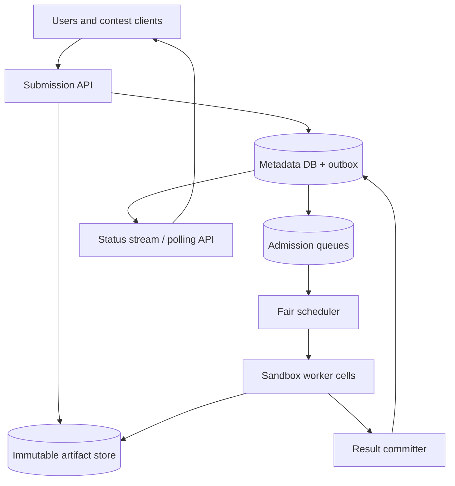
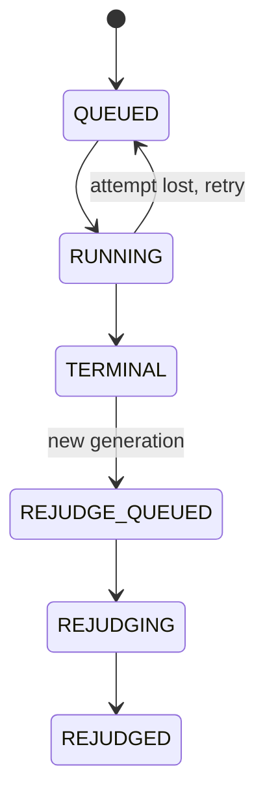
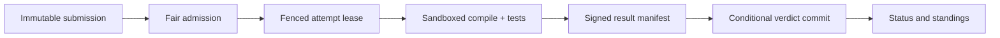

# Design a Multi-Tenant Online Code Judge

**Difficulty:** Senior  
**Primary themes:** sandboxed execution, durable queues, fair scheduling, caching, deterministic evaluation, security, reliability

> **Interview-time note:** The pacing labels describe a 45-minute interview. This walkthrough is deliberately more detailed for study; in an interview, state the safety and verdict invariants first, complete one submission end to end, then deepen scheduling and sandboxing.

This walkthrough follows the public [Hello Interview delivery framework](https://www.hellointerview.com/learn/system-design/in-a-hurry/delivery): requirements, core entities, interfaces, a simple complete design, and focused deep dives. The problem framing, scale assumptions, APIs, dialogue, and architecture are original.

---

## Interviewer prompt

> Design an online code-judging platform similar to the execution backend used by programming-practice and contest sites. Users submit source code in several languages, the platform compiles and runs it against hidden tests, and it returns an authoritative verdict such as Accepted, Wrong Answer, Time Limit Exceeded, or Runtime Error. The system must safely execute untrusted code and handle contest traffic spikes fairly.

This is not merely a worker queue. Submitted programs are actively hostile from the platform's perspective: they may fork endlessly, allocate memory, scan the network, exploit a compiler, read another submission's files, or print gigabytes. Meanwhile, a worker crash or duplicated queue message must not produce two conflicting final verdicts.

## Targeted clarifying questions and assumed answers

**Candidate:** Are we designing problem authoring too, or only submission evaluation?

**Interviewer:** Include problem/test-version publication and rejudging because they affect correctness. Rich authoring UX is out of scope.

**Candidate:** Which languages?

**Interviewer:** Start with C++20, Java 21, and Python 3. Add languages through versioned execution images.

**Candidate:** Is judging synchronous?

**Interviewer:** Submission creation returns quickly with `QUEUED`. Clients poll or subscribe for status. Ordinary submissions should finish within five seconds when capacity is healthy.

**Candidate:** What scale should I assume?

**Interviewer:** 10 million daily users, 2 million submissions/day, 200 submissions/s normally, and 20,000/s during the start or end of a major contest. A submission runs 20 tests on average, with a maximum of 200.

**Candidate:** Are tests independent?

**Interviewer:** Usually. Some problem types need sequential or interactive execution; support them as separate runner classes rather than forcing one model.

**Candidate:** What resource limits matter?

**Interviewer:** Typical limits are two seconds CPU, 256 MB memory, 64 KB output per test, no network, and a 15-second overall deadline. Limits are versioned with the problem.

**Candidate:** What does an accepted verdict mean?

**Interviewer:** The exact submitted source was evaluated under one immutable problem version, test bundle, checker, language toolchain, and runner policy, and every required test passed.

**Candidate:** Can users see hidden test data?

**Interviewer:** No. They may see safe test-group names and sanitized failure details, never hidden inputs or secrets.

**Candidate:** How should contests be isolated?

**Interviewer:** One contest or tenant must not monopolize capacity. During overload, interactive users and contest deadlines need predictable queues; batch rejudges can wait.

**Candidate:** Do we need exactly-once execution?

**Interviewer:** No, but there must be exactly one authoritative terminal result for a submission attempt. Duplicate executions must be safe and auditable.

### Scope statement to say aloud

> “I’ll make submission metadata and the final verdict strongly consistent, while execution is at least once. The API stores immutable source and pins a complete judge specification: problem version, test manifest, checker, toolchain image, and limits. A fair scheduler leases work to isolated runners. Each attempt executes in a disposable sandbox with no network, read-only inputs, strict cgroup and wall-clock limits, bounded output, and an external supervisor. Results include hashes and an attempt fencing token. Only the currently authorized attempt can atomically commit the terminal verdict; duplicate or expired attempts are retained for diagnostics but cannot overwrite it.”

---

## 1. Requirements (~5 minutes)

### Core functional requirements

1. **Submit and track code.** An authenticated user submits source for a problem/language, receives a submission ID quickly, and reads or streams queued, running, per-group, and terminal status.
2. **Evaluate deterministically and securely.** Compile and execute the pinned source against immutable tests/checkers under enforced resource and isolation policy, then produce one authoritative verdict.
3. **Publish judge versions and rejudge safely.** Authorized setters publish immutable problem/test/toolchain-compatible revisions, and operators can create bounded, auditable rejudge campaigns without overwriting historical results.

### Out of scope

- Problem-statement editing UX and plagiarism detection
- Live collaborative coding
- IDE language servers and code completion
- Payments and contest prize settlement
- Human review of subjective answers
- Hosting arbitrary long-running user services
- Proving the sandbox immune to every unknown hardware or kernel vulnerability

### Quantified non-functional requirements

| Requirement | Target | Design consequence |
|---|---:|---|
| Submission intake | 200/s normal, 20K/s burst | Lightweight durable intake; asynchronous execution and admission control. |
| Execution work | 20 tests average, up to 200 | Up to 400K test runs/s burst if expanded eagerly; stage and batch work. |
| Latency | create p99 <300 ms; healthy ordinary p95 <5 s | Prewarmed runners, cached toolchains, priority/fair scheduling. |
| Availability | intake/status 99.99%; accepted submission records are never lost | Replicated metadata plus immutable object storage and transactional outbox. |
| Correctness | one authoritative terminal verdict per judge generation | Attempt leases, fencing tokens, conditional finalization, immutable judge spec. |
| Security | no tenant escape, network access, cross-run residue, or hidden-test disclosure | Strong sandbox boundary, dedicated egress-free worker cells, encrypted inputs. |
| Fairness | no tenant/contest consumes all compute; batch rejudge cannot starve foreground work | Hierarchical quotas and deficit/weighted fair queues. |
| Reproducibility | a verdict can be replayed with pinned artifacts and policy | Content-addressed source, tests, checker, and signed runner images. |

### Scale estimates that change the design

Two million submissions/day average:

\[
2{,}000{,}000 / 86{,}400 \approx 23\text{ submissions/s}
\]

The provided normal peak of 200/s is already almost 9× the daily average, and a contest burst of 20,000/s is 100× the normal peak. Average traffic is useless for capacity planning; the queue must absorb bursts and contest capacity must be reserved or prewarmed.

If each submission averages 20 tests and a test consumes 250 ms of one CPU core:

\[
200 \times 20 \times 0.25 = 1{,}000\text{ CPU cores at normal peak}
\]

At 20,000 submissions/s the theoretical immediate demand is 100,000 cores. We will not scale from 1,000 to 100,000 instantly. The design needs a durable backlog, predictable degradation, early-stop policies, and pre-provisioned contest cells.

Suppose source plus logs and result metadata average 20 KB per submission:

\[
2{,}000{,}000 \times 20\text{ KB} = 40\text{ GB/day}
\]

That is manageable in object storage. Hidden test bundles may be large but are shared immutably across submissions. Cache them by digest on worker hosts rather than copying them from origin for every run.

If 20,000 submissions/s were immediately expanded into 20 individual queue messages, the system would enqueue 400,000 messages/s and amplify scheduling overhead. Instead, schedule a submission or test group first; the runner executes small tests locally or the orchestrator expands groups incrementally when parallelism is useful.

### Consistency and availability contract

- **Strongly consistent:** submission identity, pinned judge specification, generation, active attempt token, terminal verdict, and rejudge lineage.
- **Immutable artifacts:** source, test bundle, checker, toolchain image, and problem revision are addressed by digest and never changed in place.
- **At-least-once execution:** queue delivery and runner attempts may repeat. Duplicates cannot create conflicting terminal state.
- **One terminal result per generation:** terminal state is committed by compare-and-set using the active attempt's fencing token.
- **Monotonic status:** external status moves from `QUEUED` to `RUNNING` to terminal. Internal retries do not regress the public generation.
- **Fail closed on uncertainty:** a lost worker or ambiguous result retries; it is never interpreted as Accepted.
- **Availability during compute overload:** intake and status remain available while queue delay grows. The API reports an honest estimated wait and may reject low-priority batch work.
- **Rejudge semantics:** a rejudge creates a new generation/result linked to the old one; historical verdicts remain auditable.

### What to say aloud

> “I do not need exactly-once CPU execution. I need immutable inputs, safe duplicate attempts, and exactly one authoritative terminal commit per judge generation. That is a much more achievable correctness boundary.”

---

## 2. Core entities (~2 minutes)

- **ProblemVersion** — immutable statement metadata, judge type, limits, test manifest, checker, and allowed toolchains.
- **TestBundle** — encrypted/content-addressed hidden inputs, expected outputs or validator configuration, and group dependencies.
- **ToolchainVersion** — language, compiler/runtime image digest, compile flags, and runner ABI.
- **Submission** — user, source digest, language, pinned problem version, lifecycle state, and current generation.
- **JudgeGeneration** — immutable evaluation specification and terminal verdict for an original judge or rejudge.
- **ExecutionAttempt** — lease, fencing token, worker, timestamps, and stage outcome.
- **TestResult** — sanitized verdict, CPU/wall time, memory, output digest, checker result, and logs reference.
- **RejudgeCampaign** — scope, reason, target judge specification, priority, rate limit, and progress.

The most important boundary is between a logical `JudgeGeneration` and retryable `ExecutionAttempt`s. Attempts are replaceable work; the generation owns the authoritative result.

---

## 3. API and system interface (~5 minutes)

The service derives `user_id`, tenant, contest eligibility, and roles from authentication. The client does not submit another user's identity.

### 3.1 Create a submission

```http
POST /v1/problems/two-sum/submissions
Authorization: Bearer <user-token>
Idempotency-Key: editor-session-81:run-14
Content-Type: application/json

{
  "language": "CPP20",
  "source": "#include <bits/stdc++.h>\n...",
  "contest_id": "contest_2026_finals"
}
```

```json
{
  "submission_id": "sub_01K8...",
  "generation": 1,
  "status": "QUEUED",
  "problem_version": "pv_sha256_7b2...",
  "toolchain_version": "cpp20-clang-19-r4",
  "status_url": "/v1/submissions/sub_01K8..."
}
```

The server resolves the active contest-approved problem/toolchain revision, stores the source as an immutable blob, creates the generation and outbox record transactionally, and returns. Reusing the idempotency key with the same body returns the same submission; a different body returns a conflict.

### 3.2 Read status and results

```http
GET /v1/submissions/sub_01K8...
Authorization: Bearer <user-token>
```

```json
{
  "submission_id": "sub_01K8...",
  "generation": 1,
  "status": "WRONG_ANSWER",
  "progress": {"completed_groups": 3, "total_groups": 5},
  "verdict": {
    "code": "WRONG_ANSWER",
    "failed_group": "edge-cases",
    "cpu_ms": 384,
    "peak_memory_kb": 18420,
    "message": "Output differs on a hidden test"
  },
  "judged_at": "2026-10-20T06:01:22Z"
}
```

Hidden input, expected output, internal checker logs, host paths, and crash addresses are not returned.

### 3.3 Stream status

```http
GET /v1/submissions/sub_01K8.../events?after=evt_3
Accept: text/event-stream
Authorization: Bearer <user-token>
```

Events include `queued`, `compiling`, `running_group`, and `terminal`. The stream is a convenience; status remains durable in the API.

### 3.4 Publish a problem version

```http
POST /v1/problems/two-sum/versions
Authorization: Bearer <problem-setter-token>
Idempotency-Key: two-sum-v12

{
  "judge_type": "BATCH",
  "limits": {
    "cpu_ms": 2000,
    "wall_ms": 5000,
    "memory_mb": 256,
    "output_kb": 64
  },
  "test_manifest_digest": "sha256:ab91...",
  "checker_digest": "sha256:771c...",
  "allowed_toolchains": ["cpp20-clang-19-r4", "java21-r3", "python3.13-r2"]
}
```

Publication verifies artifact signatures, runs canary reference solutions and known-wrong solutions, then creates an immutable version. Activating it for a contest is a separate conditional operation.

### 3.5 Start a rejudge

```http
POST /v1/rejudge-campaigns
Authorization: Bearer <judge-admin-token>
Idempotency-Key: incident-944

{
  "reason": "checker bug fixed",
  "source": {"contest_id": "contest_2026_finals", "problem_id": "two-sum"},
  "target_problem_version": "pv_sha256_91e...",
  "max_submissions_per_second": 500,
  "priority": "BATCH"
}
```

The campaign creates new judge generations and never overwrites generation 1.

### 3.6 Internal worker lease contract

```protobuf
rpc LeaseWork(WorkerCapacity) returns (LeaseBatch);
rpc Heartbeat(AttemptHeartbeat) returns (LeaseDecision);
rpc CommitResult(AttemptResult) returns (CommitDecision);

message AttemptResult {
  string submission_id = 1;
  uint64 generation = 2;
  string attempt_id = 3;
  uint64 fencing_token = 4;
  string result_manifest_digest = 5;
  Verdict verdict = 6;
}
```

Workers are authenticated workloads. The scheduler, not the worker, defines tenant and priority.

### API-to-requirement map

| Requirement | Interface |
|---|---|
| Submit and track | submission POST, status GET, event stream |
| Pin judge inputs | response and generation manifest |
| Publish versions | problem-version API and activation step |
| Rejudge safely | rate-limited campaign API |
| Execute reliably | internal lease/heartbeat/commit RPC |

---

## 4. Data flow

1. Intake authenticates the user, validates contest/problem access, stores source by digest, pins the judge specification, and transactionally writes a submission plus outbox event.
2. The outbox relay publishes a lightweight scheduling item keyed by tenant, contest, language, and runner class.
3. The fair scheduler admits work, creates an execution attempt with a lease and increasing fencing token, and assigns it to a compatible prewarmed worker.
4. The worker fetches verified immutable artifacts, compiles inside a build sandbox, and stores or reuses an authorized compilation artifact.
5. A supervisor starts disposable test sandboxes with no network, read-only inputs, resource controls, bounded output, and independent wall-clock enforcement.
6. Test/group results are persisted under the attempt. Early-stop rules may skip later groups after a decisive failure.
7. The worker submits a signed result manifest. The result service conditionally finalizes only if the attempt token is still active.
8. Status events notify clients. Metrics/audit pipelines receive sanitized metadata, never source or hidden tests by default.

---

## 5. High-level design (~10–15 minutes)

### Architecture



The metadata database owns logical state and conditional transitions. Object storage holds immutable source, tests, compiled artifacts, and result manifests. The queue absorbs burst traffic. Worker cells are security and blast-radius boundaries.

### Operation 1: accept a submission

The API synchronously:

1. authenticates the user and checks contest/problem access;
2. validates language, maximum source size, and rate limits;
3. resolves the active immutable `ProblemVersion` and compatible `ToolchainVersion`;
4. hashes and stores source bytes in tenant-scoped object storage;
5. creates `Submission`, generation 1, idempotency record, and outbox row in one transaction;
6. returns `QUEUED`.

Relevant fields:

```text
Submission(
  submission_id, user_id, tenant_id,
  problem_id, contest_id,
  source_digest, language,
  current_generation,
  public_status,
  created_at, row_version
)

JudgeGeneration(
  submission_id, generation,
  problem_version_digest,
  test_manifest_digest,
  checker_digest,
  toolchain_digest,
  runner_policy_version,
  limits_digest,
  state, verdict,
  active_attempt_id,
  active_fencing_token,
  result_manifest_digest,
  created_at, finalized_at
)
```

Pinning avoids a race where a setter changes tests after the submission is queued. The verdict always names its exact evaluation universe.

The outbox solves the commit/publish gap. If the database commits and the queue publish fails, a relay retries. If publication duplicates, scheduling remains idempotent by `(submission_id, generation)`.

### Operation 2: schedule fairly

A single FIFO is insufficient: one contest's 20,000/s burst would delay every tenant, and a million-submission rejudge could starve interactive work.

The scheduler uses hierarchical admission:

1. global safety capacity;
2. runner class/language capacity;
3. priority class: live contest, interactive practice, background rejudge;
4. tenant/contest fair share;
5. FIFO or deadline order within that share.

Queue metadata:

```text
ScheduleItem(
  submission_id, generation,
  tenant_id, contest_id,
  runner_class, language,
  priority, estimated_cost,
  enqueue_time, deadline
)
```

Use deficit round robin or weighted fair queuing with `estimated_cost`, initially based on language, test count, and resource limits. Correct the estimate from observed runtime. A Python submission with 200 tests should consume more scheduling budget than a cached C++ compile with five tiny tests.

Workers periodically advertise capacity by runner image, CPU, memory, and interactive support. The scheduler creates an attempt:

```text
ExecutionAttempt(
  attempt_id, submission_id, generation,
  worker_id, worker_cell,
  fencing_token,
  lease_expires_at,
  state, started_at,
  heartbeat_at, finished_at
)
```

The generation transaction increments the fencing token and sets `active_attempt_id`. A worker crash lets the lease expire and a new attempt receive a higher token.

### Operation 3: compile reproducibly

The worker verifies the signed toolchain image digest and source digest, then creates a disposable compile sandbox. Compilation has separate CPU, memory, wall-time, file-count, and output-size limits.

The compile cache key is:

```text
hash(
  source_digest,
  toolchain_image_digest,
  compiler_flags_digest,
  runner_ABI,
  architecture
)
```

On a cache hit, verify artifact digest and authorization before use. The cache never keys only by source text or language name; compiler patch level and flags affect output. Caching is tenant-scoped by default to avoid cross-tenant existence leaks, with an optional trusted shared cache for public reference solutions.

Compiler stdout/stderr is truncated and sanitized. A compile failure produces `COMPILE_ERROR`; internal toolchain crashes produce `JUDGE_ERROR` and retry/escalation, not blame assigned to the user.

### Operation 4: execute hidden tests safely

For batch problems, the runner can execute tests sequentially inside fresh sandboxes or small isolated batches. Each sandbox receives:

- the compiled program or interpreted source;
- one encrypted/decrypted-in-memory test input mounted read-only;
- an empty writable scratch directory with quota;
- no network namespace routes;
- non-root UID, minimal filesystem, filtered syscalls, cgroup limits, and process-count limit;
- stdout/stderr pipes capped by the supervisor.

The external supervisor—not user code—measures wall time and terminates the sandbox. CPU time comes from cgroup/process accounting. Peak memory comes from the control group. Output is streamed through a cap so a program cannot fill disk before being marked `OUTPUT_LIMIT_EXCEEDED`.

Possible per-test outcomes:

```text
PASSED
WRONG_ANSWER
TIME_LIMIT_EXCEEDED
MEMORY_LIMIT_EXCEEDED
OUTPUT_LIMIT_EXCEEDED
RUNTIME_ERROR
JUDGE_ERROR
```

`JUDGE_ERROR` is never converted to `WRONG_ANSWER`. Infrastructure failure should retry or surface as an internal failure.

### Operation 5: run the checker and aggregate verdict

For exact-output problems, a trusted checker compares normalized bytes. For custom-checker problems, the checker itself runs in a separate trusted-but-contained sandbox with read-only access to input, expected output, and contestant output. Interactive problems use a runner class that supervises both contestant and interactor, caps bidirectional traffic, and records a safe transcript digest.

Test groups define dependencies and scoring:

```text
TestGroup(
  group_id, dependency_ids,
  test_digests,
  weight,
  stop_on_failure,
  visibility_policy
)
```

The baseline executes groups sequentially and stops after a decisive failure, saving compute. For latency-sensitive contests, independent groups may execute in parallel, but the orchestrator cancels remaining work after a terminal failure when policy permits.

Verdict precedence is explicit. For a pass/fail problem, compile error ends immediately; otherwise the first required failing group yields the public verdict, while infrastructure errors retry within budget.

### Operation 6: finalize exactly one authoritative result

The worker writes an immutable result manifest:

```text
ResultManifest(
  submission_id, generation,
  attempt_id, fencing_token,
  input_artifact_digests,
  per_group_result_digests,
  aggregate_verdict,
  total_cpu_ms, peak_memory_kb,
  runner_measurement,
  signature
)
```

The result committer verifies digests, worker identity, runner policy, and signature, then performs:

```text
UPDATE JudgeGeneration
SET state = TERMINAL,
    verdict = ?, result_manifest_digest = ?
WHERE submission_id = ?
  AND generation = ?
  AND state IN (QUEUED, RUNNING)
  AND active_attempt_id = ?
  AND active_fencing_token = ?
```

Only one attempt succeeds. A paused worker with token 8 cannot overwrite a retry with token 9. The losing manifest can remain in diagnostic storage, but it is not authoritative.

The same transaction updates public status and writes a status outbox event. A lost API response is harmless because result commit is idempotent.

### Operation 7: publish a new problem version and rejudge

Tests, checker, limits, and allowed toolchains are assembled into an immutable manifest. Before activation, run:

- reference solutions that must pass;
- known incorrect solutions that must fail expected groups;
- timeout and memory canaries;
- checker determinism runs;
- hidden-test access and output-redaction tests.

Activation uses compare-and-set on the problem's active version. Existing submissions remain pinned.

A rejudge campaign scans matching submissions by stable cursor and creates generation `N+1` pointing to the new manifest. Campaign tokens and per-tenant quotas feed a background scheduling class. Status may expose both original and current official verdicts according to contest policy, but history is never destroyed.

---

## 6. Deep dives (~10–15 minutes)

### Deep dive A: sandbox security and truthful resource enforcement

#### Where the baseline breaks

Running `subprocess` inside an ordinary container is not enough. Containers share a kernel. User code can fork-bomb, exploit syscalls, abuse `/proc`, attack a metadata endpoint, infer neighboring workloads, leave processes after timeout, or exploit the compiler itself.

#### Isolation options

| Boundary | Startup speed | Isolation | Tradeoff |
|---|---:|---:|---|
| Language process only | Excellent | Poor | Unsafe for untrusted code |
| Linux namespaces/seccomp/cgroups | Excellent | Medium | Shared-kernel escape risk |
| User-space kernel sandbox | Good | Stronger | Compatibility/performance overhead |
| MicroVM | Moderate | Strong | Higher startup and memory cost |
| Dedicated VM per run | Poor | Strong | Too slow and expensive at this scale |

#### Selection

Use prewarmed microVMs or a hardened user-space-kernel sandbox inside dedicated worker cells. The exact choice depends on threat model and latency target. A strong design layers controls rather than betting on one primitive:

1. immutable signed host and runner images;
2. dedicated, egress-free network segment with no cloud metadata route;
3. microVM/user-space-kernel boundary per attempt or small trusted batch;
4. unprivileged UID, read-only root, minimal mounts, private PID/user/network namespaces;
5. seccomp syscall allowlist and capability removal;
6. cgroup CPU, memory, process, and I/O limits;
7. external watchdog and output/file quotas;
8. destroy the sandbox and scratch volume after every run;
9. continuously patch, canary, and rotate worker hosts.

Compilers are also untrusted-input parsers, so compilation runs behind the same class of boundary. A compiler crash is not allowed to expose host diagnostics to users.

#### CPU versus wall time

CPU time measures actual scheduled computation; wall time catches sleeping, deadlock, blocking I/O, or process-tree escape. Enforce both. A submission might receive 2 seconds CPU but 5 seconds wall time. The supervisor kills the entire control group, waits for cleanup confirmation, then destroys the environment.

#### Memory accounting

Account the entire sandbox cgroup, including children and language runtime, not only the main process RSS. Decide whether file cache counts and keep that policy versioned. Java/Python may need language-specific multipliers or separate limits, but policy must be explicit and contest-consistent.

#### Hidden-test confidentiality

- store test objects encrypted under a judge-only key;
- issue short-lived, attempt-scoped download credentials to the host agent, not user code;
- mount one input read-only or pipe it through stdin;
- block network and ptrace;
- never include input in user-visible logs;
- wipe/destroy scratch storage and measure residue scans;
- ensure cache keys and error timing do not expose another tenant's artifacts.

#### Security response

If a sandbox escape is suspected, quarantine the cell, revoke its workload identity, preserve host evidence, stop leasing new work, and rejudge affected generations on clean capacity if integrity is uncertain. Do not mark them wrong because infrastructure trust failed.

### Deep dive B: fair scheduling under contest bursts

#### Where the baseline breaks

FIFO appears fair but is not. One tenant can enqueue a million rejudges before a live contest submission. Short work waits behind long work, one language image may saturate, and autoscaling arrives after the contest's decisive minutes.

#### Approaches

| Approach | Advantage | Failure mode |
|---|---|---|
| Global FIFO | Simple | Head-of-line blocking and tenant starvation |
| Strict priority | Protects contests | Background work can starve forever |
| Per-tenant queues | Isolation | Hard to use spare capacity globally |
| Hierarchical weighted fair scheduling | Isolation plus work conservation | More state and cost estimation |

#### Selection

Use hierarchical weighted deficit round robin:

- reserve a fraction for live contests;
- reserve interactive practice capacity;
- cap background rejudges;
- assign tenant/contest weights within each class;
- charge estimated CPU-memory-seconds, not one token per submission;
- allow unused reserved capacity to be borrowed but reclaim it gradually.

Deficit scheduling gives each queue credits. A job runs when its estimated cost fits its accumulated deficit. Large jobs wait longer but do not block small ones, and every active queue eventually earns service.

#### Contest admission and prewarming

Before a scheduled contest:

1. read registered participant and historical language mix;
2. reserve capacity across at least two zones;
3. pre-pull signed toolchain images and test bundles;
4. fill warm microVM pools by runner class;
5. run synthetic submissions through every problem;
6. establish per-contest burst limits and emergency capacity.

During severe overload, keep intake durable, expose queue estimates, protect already-running attempts, and reject or pause low-priority rejudge creation. Do not silently drop submissions.

#### Autoscaling signal

Queue length alone is misleading because jobs vary. Scale on queued estimated CPU-seconds and memory-seconds by runner class, oldest eligible job age, warm-pool depletion, and observed service rate. Maintain spare headroom because VM boot and image pull are too slow for a final-minute spike.

#### Stragglers and speculative attempts

Speculative execution can reduce tail latency for infrastructure stragglers, but duplicating every judge wastes compute. Launch a second attempt only when runtime exceeds a high percentile for the same language/problem class and the first worker appears unhealthy. Both attempts carry different tokens; only the current authorized result may finalize.

For deterministic judging, a large runtime difference itself is a signal of noisy hardware or policy drift. Keep host-class calibration and route contests to homogeneous pools.

### Deep dive C: deterministic verdicts, caching, and rejudging

#### Where the baseline breaks

“Run the code again” is not reproducibility. Compiler patches, CPU architecture, locale, environment variables, randomized hash seeds, checker versions, and changed tests can alter behavior. A cache can make this worse if its key omits one dependency.

#### Pinned execution manifest

Every generation records:

```text
JudgeSpec(
  source_digest,
  problem_version_digest,
  test_manifest_digest,
  checker_digest,
  toolchain_image_digest,
  compiler_flags_digest,
  runner_policy_version,
  architecture,
  environment_digest,
  resource_limits_digest
)
```

Images are signed and content-addressed. Set fixed locale/timezone, controlled environment variables, empty working directory, deterministic checker seed, and documented CPU architecture. Disable ambient host differences where practical.

#### Compilation cache

Compilation is safe to reuse only when the complete build input matches. Store the artifact with provenance and signature. On cache corruption or digest mismatch, evict and rebuild. Track hit ratio separately by tenant, language, and contest.

Do not cache final verdicts for arbitrary user code solely by source and problem name. A verdict depends on the complete `JudgeSpec`. A fully content-addressed result cache is possible for repeated identical submissions, but product policy may intentionally rerun to detect nondeterminism or prevent timing side channels.

#### Nondeterministic programs

User code may depend on undefined behavior, races, randomness, or wall clock. The platform guarantees execution under the pinned environment, not the same answer on all conceivable hardware. For official contests, use homogeneous worker classes and optionally rerun suspicious crashes/timeouts. If two valid attempts disagree, report `JUDGE_ERROR`/manual review rather than choosing the favorable result.

#### Checker correctness

A buggy checker can misjudge thousands of submissions. Treat checker publication like code deployment:

- signed immutable artifact;
- reference and adversarial corpus;
- resource sandbox;
- deterministic output contract;
- canary problem version;
- audit of who activated it;
- rapid rejudge tooling.

#### Rejudge state model



The old terminal result remains immutable. Contest standings choose an official generation by policy. A campaign can pause, resume by cursor, and rate-limit. Updating standings is idempotent by `(submission_id, generation)` and applies explicit changes.

---

## Reliability, observability, and security

### Critical invariants

1. A generation pins one complete immutable judge specification.
2. One generation has at most one authoritative terminal result.
3. Only the active attempt's fencing token may finalize.
4. `JUDGE_ERROR` is never reported as contestant failure.
5. Hidden tests and other users' artifacts never enter the contestant sandbox or public logs.
6. Sandbox cleanup destroys processes and writable state before reuse.
7. Queue retries and outbox duplicates do not create new logical submissions.
8. Rejudging creates a new generation and preserves history.

### Failure-mode table

| Failure | Detection | Safe behavior | Recovery |
|---|---|---|---|
| DB commits, queue publish fails | outbox age | submission remains `QUEUED` | relay republishes |
| Queue item duplicates | generation lookup | reuse or ignore active work | acknowledge duplicate |
| Worker dies during compile | lease expiry/heartbeat | no terminal verdict | create higher-token attempt |
| Worker finishes after lease expiry | fencing-token mismatch | reject stale commit | retain diagnostics only |
| Result commit succeeds, response lost | idempotent lookup | retry returns committed result | no re-execution required |
| Object/cache digest mismatch | verification | do not execute artifact | evict, refetch, alert |
| Compiler infrastructure crashes | exit classification | `JUDGE_ERROR`, not compile error | retry on clean worker |
| Sandbox cleanup fails | host agent health check | quarantine worker | drain and rebuild host |
| Hidden-test fetch unavailable | artifact error | do not guess verdict | retry within deadline |
| Scheduler unavailable | lease service health | running work continues; intake queues | fail over/rebuild from metadata |
| Queue overload | oldest-age and cost backlog | preserve intake, shed batch work | scale/prewarm, fair drain |
| Checker bug discovered | corpus/audit reports | freeze affected version | publish fixed version and rejudge |
| Zone loss | worker/queue replicas | retry lost attempts elsewhere | fenced rescheduling |

### Observability

**User experience**

- submission create latency and error rate
- queue wait, compile, run, checker, and finalization percentiles
- end-to-end time by language, problem, contest, and verdict
- status-stream disconnect and poll QPS

**Capacity and fairness**

- queued estimated CPU/memory-seconds by class
- oldest eligible work by tenant/contest
- achieved versus configured fair share
- warm sandbox availability, image-pull latency, host utilization
- borrowed/reserved capacity and batch throttling

**Correctness**

- stale fencing-token result attempts
- duplicate logical execution rate
- independent replay/verdict disagreement
- checker/reference-corpus failures
- cache digest mismatches and artifact provenance failures
- rejudge generation and standings-application lag

**Security**

- blocked syscalls, network attempts, process-limit hits, output-limit hits
- sandbox startup/teardown failures and residue-scan alarms
- worker image/signature drift
- suspicious host crashes grouped by source digest without exposing source broadly
- secret/test access outside active attempt scope

Logs and traces use submission, generation, attempt, worker cell, runner policy, and artifact digests. Raw source, hidden tests, contestant output, and compiler paths are access-controlled and excluded from ordinary telemetry.

### Security operations

- isolate worker cells from control-plane databases and cloud metadata
- use short-lived attempt-scoped workload credentials
- sign toolchain, checker, test-manifest, and runner images
- rotate hosts frequently and patch kernel/runtime aggressively
- separate setter/admin roles from worker operation
- audit problem activation and rejudge creation
- cap source, compiler output, runtime output, files, processes, CPU, memory, and I/O
- keep forensic evidence encrypted with restricted incident access
- red-team sandbox escapes and run synthetic hostile submissions continuously

---

## 7. Final design

The final platform uses a strongly consistent metadata plane and an at-least-once isolated execution plane:

- Intake authenticates the user, stores source immutably, pins a complete judge specification, and writes an outbox event transactionally.
- Hierarchical fair queues isolate tenants, contests, languages, and background rejudges while borrowing unused capacity.
- The scheduler leases work with increasing fencing tokens to compatible prewarmed worker cells.
- Signed toolchains compile in disposable sandboxes; complete content keys allow safe compilation caching.
- An external supervisor runs hidden tests in networkless, resource-bounded microVM or hardened sandbox environments and destroys state after every attempt.
- Trusted checkers run separately and classify contestant versus infrastructure failure explicitly.
- Workers publish signed result manifests; conditional finalization allows only the active attempt token to commit one terminal verdict.
- Status polling/streams expose safe progress. Immutable manifests make verdicts reproducible and auditable.
- Problem updates create immutable versions; rejudge campaigns create new generations, preserve old results, and consume throttled background capacity.



### Requirements check

| Requirement | Design response |
|---|---|
| Fast durable submission | metadata transaction, source blob, outbox |
| Safe untrusted execution | hardened disposable sandbox, no network, layered quotas |
| Deterministic judging | pinned content-addressed judge specification |
| One final verdict | attempt lease, fencing token, conditional commit |
| Handle worker failure | lease expiry and safe at-least-once retry |
| Contest burst capacity | durable queue, prewarming, cost-aware autoscaling |
| Multi-tenant fairness | hierarchical weighted deficit scheduling |
| Protect hidden tests | attempt-scoped retrieval, read-only mount, log redaction |
| Efficient execution | complete-key compilation cache, grouped tests, early stop |
| Safe rejudge | immutable new generation and throttled campaign |

### Thirty-second closing statement

> “The key is separating a logical judge generation from its retryable execution attempts. Intake pins immutable source, tests, checker, toolchain, limits, and runner policy. A fair scheduler grants a fenced lease to an isolated worker. Compilation and every test run behind a networkless, resource-bounded disposable sandbox supervised from outside. The worker produces a signed manifest, but only the active fencing token can atomically commit the verdict. That makes duplicate execution safe, preserves truthful infrastructure errors, and lets us scale bursty compute independently from durable submission and status APIs.”

---

## Realistic interviewer follow-up questions and strong answers

### 1. Why not judge synchronously in the API request?

Compilation and tests take seconds, traffic is bursty, and workers may fail. Synchronous judging ties API connections to scarce compute and makes overload contagious. Persist the submission quickly, queue it, and expose status.

### 2. Why is a container alone insufficient?

Containers share the host kernel. With adversarial code, a kernel or runtime escape has high impact. Use layered isolation: dedicated cells, microVM or hardened user-space kernel, namespaces, syscall filtering, non-root execution, cgroups, no network, and disposable state.

### 3. How do you enforce time limits accurately?

Measure cgroup CPU time for computation and independent monotonic wall time from an external supervisor. Kill the entire process cgroup on either limit. User code cannot be trusted to self-report or handle a signal correctly.

### 4. Is execution exactly once?

No. Attempts are at least once. A generation has one authoritative terminal result because only its current attempt and fencing token can conditionally finalize.

### 5. What happens if two workers finish the same submission?

Only the active token wins the compare-and-set. The stale result is rejected and may be kept for diagnostics. It cannot overwrite the verdict.

### 6. Why distinguish `JUDGE_ERROR` from `RUNTIME_ERROR`?

Runtime error means the contestant program failed under a healthy judge. Judge error means infrastructure, toolchain, checker, or artifact retrieval failed. Blaming the contestant corrupts correctness and contest fairness.

### 7. How do you keep hidden tests secret?

Encrypt them, issue short-lived attempt-scoped access to the trusted host agent, provide inputs read-only or via stdin, block network/ptrace, cap logs, destroy scratch state, and never return hidden data in errors.

### 8. How do you stop fork bombs?

PID namespace plus cgroup process limit, CPU and memory limits, syscall filtering, and an external supervisor that kills the entire cgroup. Per-process limits alone are insufficient.

### 9. How does compilation caching remain correct?

Key on source digest, exact signed toolchain image, flags, runner ABI, architecture, and relevant environment. Verify artifact digest and provenance on read. Any omitted dependency makes the cache unsafe.

### 10. Why not cache verdicts for identical source?

It is possible only against the complete judge-spec digest. Product policy may still rerun to detect nondeterminism or avoid cross-user timing leaks. Compilation caching offers most of the safe benefit.

### 11. How do you schedule fairly?

Use hierarchical weighted deficit round robin by priority, tenant/contest, and estimated resource cost. Reserve live-contest and interactive capacity, cap rejudges, and allow work-conserving borrowing.

### 12. What if runtime estimates are wrong?

Charge actual usage after completion and update estimators by language/problem class. Cap individual jobs by declared limits, and prevent a queue from going deeply negative so repeated underestimates cannot monopolize capacity.

### 13. How do interactive problems differ?

Run contestant and trusted interactor under a joint supervisor with separate resource limits, bounded pipes, deadlock/wall-time detection, no network, and a transcript digest. Use a dedicated runner class and scheduler pool.

### 14. What if a problem setter publishes bad tests?

Require reference/known-wrong canaries before activation, preserve the old immutable version, freeze the broken version, publish a corrected one, and rejudge affected submissions into new generations.

### 15. How do standings handle rejudging?

Standings consume versioned verdict changes keyed by submission and generation. Activating a newer official generation applies an explicit delta; duplicate events are idempotent and old results remain auditable.

### 16. How do you survive a scheduler outage?

Submission intake writes durable queue intent to metadata/outbox. Existing worker leases continue until expiry. A replacement scheduler reconstructs eligible work and leases from the database/queue, using fencing tokens to prevent split ownership.

### 17. What if a user prints infinite output?

The supervisor reads through a bounded pipe and stops the sandbox when the output limit is exceeded. Do not first write output to an unbounded file.

### 18. How do you detect sandbox escapes?

Preventive isolation is primary, but monitor forbidden syscall/network attempts, host integrity, unexpected child processes, kernel alerts, residue scans, and cross-run canaries. Quarantine the whole cell on suspicion and rejudge affected work.

### 19. Why store raw per-test results if users cannot see them?

They support audit, incident diagnosis, checker fixes, performance analysis, and rejudge comparison. Store them encrypted with strict access and return only policy-approved summaries.

### 20. What would you optimize first if p95 exceeds five seconds?

Break latency into queue, image/startup, compile, test, checker, and commit. If queue dominates, add/prewarm the constrained runner class and fix fairness. If startup dominates, warm pools and image locality. If compile dominates, improve safe cache hits. Avoid guessing from end-to-end latency alone.

---

## Common pitfalls

1. Running untrusted code as a normal subprocess.
2. Treating an ordinary container as a complete security boundary.
3. Allowing runner network access to metadata or control-plane services.
4. Enforcing limits only inside contestant code.
5. Measuring only wall time or only main-process memory.
6. Writing unbounded stdout to disk before checking its size.
7. Reusing writable sandbox state across users.
8. Sending hidden inputs or host crash details in public errors.
9. Treating compiler/checker failure as Wrong Answer.
10. Updating tests or toolchains in place.
11. Failing to pin the complete judge specification.
12. Promising exactly-once execution instead of idempotent attempts.
13. Letting a late worker overwrite a retried attempt.
14. Using a global FIFO across contests, tenants, and rejudges.
15. Charging every submission one scheduling token despite large cost differences.
16. Scaling only on queue length rather than queued resource-seconds and age.
17. Expanding every submission into hundreds of queue messages immediately.
18. Using an incomplete compilation-cache key.
19. Overwriting historical verdicts during rejudge.
20. Running a million-item rejudge at foreground priority.
21. Autoscaling after a scheduled contest starts instead of prewarming.
22. Logging source, hidden tests, or unsanitized compiler internals broadly.

---

## Suggested 45-minute interview pacing

| Time | Focus |
|---:|---|
| 0–5 min | Scope, languages, scale, security, verdict contract |
| 5–7 min | Problem version, submission, generation, attempt, result |
| 7–12 min | Submit, status, publish, rejudge, worker interfaces |
| 12–25 min | Intake → fair queue → lease → compile → tests → final commit |
| 25–38 min | Sandbox and scheduling; determinism/rejudge if time |
| 38–43 min | Failures, observability, security response, capacity |
| 43–45 min | Requirements check and closing statement |

In the interview, build a safe batch submission first. Mention interactive problems as a separate runner class rather than letting them derail the baseline. The two invariants to repeat are “one immutable judge specification” and “only the active fencing token may finalize.”

---

## Public references

- [Hello Interview — System Design Delivery Framework](https://www.hellointerview.com/learn/system-design/in-a-hurry/delivery)
- [Hello Interview — API Design for System Design Interviews](https://www.hellointerview.com/learn/system-design/core-concepts/api-design)
- [Hello Interview — Data Modeling for System Design Interviews](https://www.hellointerview.com/learn/system-design/core-concepts/data-modeling)

The references are used for interview-delivery structure. The requirements, quantitative assumptions, execution protocol, sandbox model, fair scheduler, APIs, dialogue, and tradeoffs are original.
