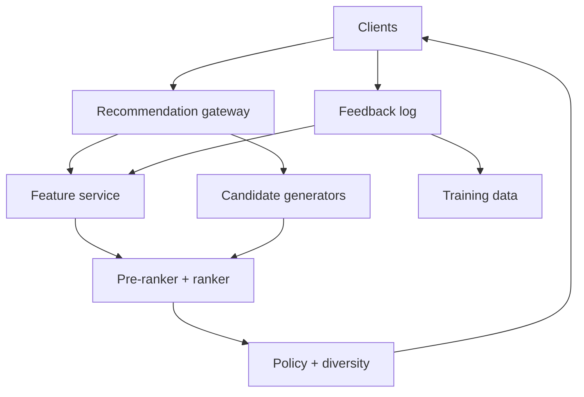
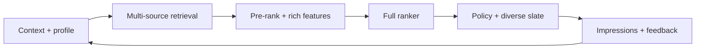

# Design a Real-Time Personalized Recommendation Platform

**Difficulty:** Senior / Staff  
**Primary themes:** candidate generation, ML ranking, streaming features, caching, feedback loops, experimentation, reliability  
**Interview time budget:** 45–50 minutes  
**Educational walkthrough:** intentionally more detailed than what you would say aloud

This original walkthrough uses the requirements → entities → interfaces → high-level design → deep dives sequence described in Hello Interview's [System Design Delivery Framework](https://www.hellointerview.com/learn/system-design/in-a-hurry/delivery). The design begins with the simplest complete recommendation path and then evolves it around latency, freshness, feedback, and reliability.

---

## Interviewer prompt

> Design a personalized recommendation platform for a large consumer application. Given a user and a page context, return a ranked, diverse list of items such as videos, products, or articles. Incorporate near-real-time behavior, support experiments, and learn from feedback.

## Targeted clarifying questions with assumed answers

**Candidate:** Which surface should I optimize for?

**Interviewer:** Design a reusable platform, but use a home feed of videos as the concrete example. The same user may request recommendations from mobile, web, or TV.

**Candidate:** What scale should I assume?

**Interviewer:** One billion registered users, 100 million daily active users, 500 million eligible items, 200,000 recommendation requests per second at peak, and five million feedback events per second.

**Candidate:** What latency and availability are required?

**Interviewer:** Recommendation serving should have p99 under 150 ms and 99.99% availability. User actions should influence recommendations within 30 seconds when practical.

**Candidate:** What is returned?

**Interviewer:** Twenty ranked items with stable IDs, reasons or source metadata, and an impression token. Avoid repeats, blocked content, unavailable items, and excessive similarity.

**Candidate:** What consistency is required?

**Interviewer:** Recommendations may be eventually consistent, but privacy blocks, legal removals, and item ineligibility must propagate within one minute. A user should not see the same item repeatedly because replicas disagree.

**Candidate:** Are model training and experimentation in scope?

**Interviewer:** Cover the data path, offline training interface, model publication, online inference, and A/B assignment. Do not derive every ML algorithm.

**Candidate:** Should we handle anonymous users and cold start?

**Interviewer:** Yes. Use session behavior, contextual signals, and popularity when long-term history is absent.

**Candidate:** Can recommendations be sponsored?

**Interviewer:** Exclude ad auctions. Organic policy constraints and diversity are in scope.

### Scope statement to say aloud

> “I’ll design candidate generation, online feature retrieval, ranking, policy filtering, diversity, feedback ingestion, model publication, and experimentation for a home feed. I’ll exclude media delivery, content upload, ad auctions, and detailed model architecture.”

---

## 1. Requirements (~5 minutes)

### Core functional requirements

1. **Serve recommendations.** Generate, score, filter, diversify, and return 20 personalized items for an authenticated user or anonymous session.
2. **Incorporate feedback.** Capture impressions, clicks, watch time, hides, likes, and blocks; update session and user features near real time and create durable training data.
3. **Operate models safely.** Publish versioned candidate generators and rankers, run experiments, monitor quality, and fall back during dependency failures.

### Non-functional requirements

| Property | Target | Design consequence |
|---|---:|---|
| Serving throughput | 200K QPS peak | regional cells, sharded stores, bounded parallel retrieval |
| Serving latency | p99 < 150 ms | strict stage budgets, online feature cache, precomputation |
| Availability | 99.99% | multi-AZ cells and progressively simpler fallbacks |
| Feedback throughput | 5M events/s | partitioned log, idempotent consumers, streaming aggregation |
| Behavioral freshness | < 30 s | session store and stream-updated online features |
| Safety freshness | blocks/removals < 1 min | authoritative deny overlay and cache invalidation |

### Scale estimates that change design decisions

At 200,000 requests/s and 20 returned items, the service creates four million item impressions per second before client retries. Impression logging must be asynchronous and batched. A synchronous analytics write on the serving path would violate availability.

Suppose each of eight candidate sources returns 500 IDs. That is 4,000 candidates/request, or 800 million candidate IDs/s before deduplication. Fetching rich features for all of them is wasteful. Use cheap retrieval and pre-ranking to reduce to roughly 500 before the expensive ranker.

If a full ranking request uses 500 candidates × 200 float features, it contains 100,000 feature values. At four bytes each, that is 400 KB/request before metadata, or 80 GB/s at peak. Keep common item features colocated or cached with the ranking fleet, fetch user features once, and use compact typed feature vectors.

Storing a precomputed list of 1,000 8-byte item IDs for one billion users is 8 TB before replicas and metadata. That is feasible for a subset of active users but wasteful for everyone. Precompute for active cohorts and use on-demand/session recommendations for the long tail.

Five million feedback events/s × 300 bytes is about 1.5 GB/s or 130 TB/day raw. Use short raw retention, compressed columnar storage, and aggregate features instead of retaining every event indefinitely.

### Consistency and availability contract

- Recommendation lists are eventually consistent and need not be identical across requests.
- Within one response, all ranked items use one model bundle, feature-schema version, experiment assignment, and eligibility snapshot watermark.
- Privacy blocks, legal removals, and hard ineligibility use a strongly prioritized deny path; false exclusion is preferable to serving prohibited content.
- Impression and feedback ingestion are at-least-once. Stable event IDs and impression tokens make downstream processing idempotent.
- Session updates should be visible within 30 seconds; durable long-term features may lag minutes.
- Experiment assignment is sticky by authenticated user ID or anonymous device/session ID.
- When personalized dependencies fail, return a safe contextual/popular list rather than an error, but mark the response mode for observability.

### Concise interview phrasing

> “I’ll use a funnel: retrieve thousands cheaply, pre-rank hundreds, rank tens precisely, then apply hard eligibility and diversity. The request pins one versioned bundle, while urgent deny rules sit outside eventually consistent personalization.”

---

## 2. Core entities (~2 minutes)

| Entity | Purpose | Important fields |
|---|---|---|
| `UserProfile` | Long-lived preference representation | `user_id`, `embedding`, interests, locale, maturity settings, version |
| `SessionState` | Recent anonymous or authenticated behavior | `session_id`, recent items/actions, session embedding, expiry |
| `Item` | Stable content identity | `item_id`, creator, type, publish time, availability, policy labels |
| `ItemFeatures` | Versioned ranking attributes | embedding, quality, freshness, popularity, language, schema version |
| `Candidate` | Retrieved item with source evidence | `item_id`, source, retrieval score, source rank |
| `RecommendationRequest` | Context for one decision | principal, surface, locale, device, request time, page token |
| `Impression` | Evidence of what was served | request ID, item IDs/positions, model bundle, experiment, timestamp |
| `FeedbackEvent` | User response to an impression | event ID, impression token, item ID, action, value, event time |
| `ModelBundle` | Compatible serving artifacts | generators, ranker, feature schema, calibration, bundle version |
| `ExperimentAssignment` | Sticky treatment | subject key, experiment, variant, assignment version |

### Say aloud

> “The impression is first-class because training needs to know not only what users chose, but what the system exposed and at which position under which model.”

---

## 3. APIs and system interfaces (~5 minutes)

User identity, tenant/application, and allowed maturity settings come from authentication. The body carries request context, not trusted identity.

### 3.1 Get recommendations

```http
POST /v1/recommendations/home
Authorization: Bearer <access-token>
Content-Type: application/json

{
  "session_id": "sess_82",
  "device": "mobile",
  "locale": "en-US",
  "recently_seen_item_ids": ["v_18", "v_71"],
  "limit": 20
}
```

```json
{
  "request_id": "rec_01K...",
  "items": [
    {
      "item_id": "v_902",
      "position": 1,
      "reason": "BECAUSE_YOU_WATCHED_TECH",
      "impression_token": "signed:rec_01K:v_902:1"
    }
  ],
  "next_page_token": "opaque:rec_01K:page2",
  "model_bundle_version": "home-184",
  "mode": "PERSONALIZED"
}
```

The page token pins the request context and exclusions for pagination. It is opaque and signed so clients cannot manipulate rank offsets or experiment variants.

### 3.2 Record feedback

```http
POST /v1/feedback:batch
Authorization: Bearer <access-token>
Idempotency-Key: device-7:batch-991

{
  "events": [
    {
      "event_id": "fb_01K...",
      "impression_token": "signed:rec_01K:v_902:1",
      "action": "WATCH",
      "watch_seconds": 143,
      "event_time": "2026-10-20T23:56:10Z"
    },
    {
      "event_id": "fb_01M...",
      "impression_token": "signed:rec_01K:v_117:2",
      "action": "HIDE",
      "event_time": "2026-10-20T23:57:02Z"
    }
  ]
}
```

```json
{"accepted": 2, "rejected": 0}
```

Feedback acknowledges durable collection, not completion of all feature and training updates.

### 3.3 Publish a model bundle

```http
POST /v1/model-bundles
Authorization: Bearer <ml-platform-token>

{
  "bundle_version": "home-185",
  "candidate_generators": {
    "two_tower": "artifact://cg/891",
    "co_watch": "artifact://cg/233"
  },
  "ranker": "artifact://ranker/1182",
  "feature_schema_version": 64,
  "eligibility_policy_version": 27,
  "validation_report": "artifact://reports/551"
}
```

Publication registers an immutable bundle. A separate rollout API advances serving percentages after validation.

### 3.4 Internal candidate-source interface

```protobuf
GetCandidates(
  subject_embedding,
  context,
  exclusions,
  max_candidates,
  deadline,
  generator_version
) -> repeated Candidate {
  item_id,
  source,
  retrieval_score,
  source_rank
}
```

### Say aloud

> “The recommendation response carries signed impression tokens and the exact bundle version. That gives feedback a trustworthy join key and makes offline evaluation reproducible.”

---

## 4. Data flow

### Online serving

1. Authenticate the principal and assign sticky experiments.
2. Load session, user, and request-context features.
3. Query candidate sources in parallel under individual deadlines.
4. Merge, deduplicate, enforce cheap exclusions, and pre-rank.
5. Fetch richer features for the reduced candidate set.
6. Run the ranker, hard eligibility checks, and diversity/repetition control.
7. Return items and asynchronously log the impression.

### Feedback and learning

1. Clients batch signed impression-linked actions to regional collectors.
2. A replicated log fans events to session updates, online feature aggregation, analytics, and training-data builders.
3. Stream processors update recent interest vectors, counters, and negative signals.
4. Offline jobs join impressions with outcomes, correct for position/exposure bias, and build versioned datasets.
5. Training pipelines produce artifacts and validation reports; approved model bundles roll out through shadow, canary, and experiment stages.

---

## 5. High-level design (~10–15 minutes)



### Operation 1: build a simple complete baseline

Start with a non-ML system that can always return results:

1. read popular items for the user's country, language, and surface;
2. remove blocked, unavailable, already-seen, or age-inappropriate items;
3. interleave categories and creators;
4. return 20 items and log impressions.

This baseline establishes the API, policy correctness, caches, feedback join, and fallback before introducing personalization. Popular lists are periodically materialized per coarse context and cached at every serving region.

**Say aloud:**

> “My first complete design is contextual popularity plus filtering and impression logging. It meets availability and gives us a fallback; then I add personalized candidate sources and ranking.”

### Operation 2: generate personalized candidates

No single retrieval method covers all useful signals, so use several bounded sources:

- **two-tower ANN:** retrieve items whose embeddings are near the user/session embedding;
- **item-to-item:** similar to or commonly consumed after recent items;
- **collaborative/co-watch:** items popular among behaviorally similar users;
- **followed creators/topics:** high-precision candidates from explicit relationships;
- **trending/contextual:** locale, time, device, and freshness-aware candidates;
- **exploration/new-item pool:** candidates with uncertainty or little exposure.

Each source returns IDs, a source score, and evidence. The orchestrator sends parallel requests with perhaps 20–30 ms deadlines and a total candidate budget. A slow source cannot consume the entire request deadline. Sources may return partial results.

ANN indexes are partitioned by item domain or locale and replicated regionally. Item embeddings are immutable per embedding-model version. New items enter a small fresh delta index immediately and merge into the next base generation.

Merge candidates by `item_id`, retain all source evidence, and calibrate source scores before combining them. Otherwise a source with arbitrary larger score ranges dominates.

### Operation 3: fetch online features

The feature service reads:

- long-term user embedding and preferences;
- session embedding and recent actions;
- item features such as quality, freshness, popularity, policy labels, and creator;
- cross features such as user-item similarity and prior creator exposure;
- request features such as device, locale, and time.

Online features are keyed by explicit feature-view and schema versions. Multi-get APIs batch hundreds of item keys. Hot immutable item features use process caches; user/session features use a regional online store. The request includes maximum feature age, and the response returns actual age and missingness.

Do not fetch expensive features for every raw candidate. Cheap source scores, freshness, and basic eligibility reduce perhaps 4,000 candidates to 500. Then fetch full features and rank.

### Operation 4: rank candidates

Use two ranking stages:

1. **Pre-ranker:** inexpensive linear, tree, or small neural model over source scores and common features; reduces thousands to hundreds.
2. **Full ranker:** richer model predicts multiple outcomes such as click, long watch, satisfaction, hide, or report.

A utility layer combines calibrated predictions:

```text
utility = w1 * P(long_watch)
        + w2 * P(like)
        + w3 * expected_watch_time
        - w4 * P(hide)
        - w5 * P(report)
```

Weights are product policy, versioned with the bundle. The ranker returns predictions, not the final list; post-ranking constraints enforce obligations the model should not learn around.

Inference runs in regional model-serving pools. Models and feature schemas are loaded as one validated bundle. Requests pin a bundle for the full operation. A small fallback ranker uses retrieval score, popularity, and freshness when the full ranker misses its deadline.

### Operation 5: enforce policy, repetition, and diversity

Apply hard eligibility twice: cheaply before expensive ranking and authoritatively before response. The final pass consults a versioned regional eligibility store plus a priority deny overlay for blocks and removals.

Then rerank for list-level quality. Techniques include maximal marginal relevance, constrained optimization, or greedy selection with penalties for repeated creator/topic and bonuses for novelty. Constraints can include:

- no duplicate item;
- creator cap per page;
- topic/language mix;
- recent-impression exclusion;
- minimum fresh/exploration slots;
- maturity and geographic availability.

The page token contains or references the session's exclusion set and model/experiment context so pagination does not repeat page one.

### Operation 6: capture feedback and update features

The response path emits an impression record asynchronously containing the ordered candidate list, positions, source evidence, model bundle, experiments, and request context. The signed token binds later feedback to that record.

Feedback collectors validate signatures, deduplicate event IDs, and append to a partitioned log. Separate consumers update:

- a low-latency session state, often within seconds;
- streaming user/topic/creator counters and embeddings;
- recently seen and negative-feedback sets;
- experiment metrics;
- immutable lake storage for training.

A hide or block has stronger, faster semantics than a weak positive click. It enters an immediate negative cache and eventually the durable profile. Session features expire; long-term features require enough evidence and governed retention.

### Operation 7: cache safely

Caching whole personalized responses has low reuse, but several layers help:

- contextual popular lists cached by locale/surface/time bucket;
- candidate lists cached briefly by user/session and generator version;
- item features cached by immutable item-feature version;
- user features cached with short TTL and revision;
- ANN query results cached for stable embeddings;
- precomputed recommendations stored for recently active users.

Whole-list cache keys include user/session revision, request context, experiment assignment, model bundle, eligibility epoch, and page state. Cache hits still pass final hard eligibility and repetition checks.

### Storage choices

| Need | Choice | Reason |
|---|---|---|
| User/session features | Sharded regional KV store | low-latency keyed multi-get and updates |
| Item metadata/features | KV store + process cache | high read fan-out, mostly immutable versions |
| Candidate indexes | ANN plus inverted/graph indexes | specialized high-recall retrieval |
| Feedback buffer | Partitioned replicated log | 5M events/s, fan-out, replay |
| Recent exclusions | TTL set or bitmap store | fast seen/block checks |
| Raw events/training sets | Columnar object storage | economical offline joins and scans |
| Models/configs | Immutable artifact store + relational registry | reproducible publication and rollouts |
| Experiments | Strongly consistent assignment/config store | sticky, auditable variants |

---

## 6. Deep dives (~10–15 minutes)

### Deep dive A: meet p99 latency with many candidate sources and models

#### Where the baseline breaks

Sequentially querying eight sources, fetching thousands of feature rows, and invoking a large ranker can easily exceed 150 ms. Tail latency compounds: even if each dependency is usually fast, the slowest parallel call controls the stage.

#### Stage budget

An illustrative 150 ms p99 budget:

| Stage | Budget |
|---|---:|
| Gateway, auth, experiment | 8 ms |
| User/session features | 12 ms |
| Parallel candidate retrieval | 30 ms |
| Merge, cheap filters, pre-rank | 15 ms |
| Rich item-feature multi-get | 20 ms |
| Full ranking | 35 ms |
| Policy/diversity/serialization | 15 ms |
| Network and safety margin | 15 ms |

Deadlines propagate to every RPC. Candidate sources have individual budgets and minimum useful result sizes. The orchestrator can hedge only idempotent reads after a tail threshold; uncontrolled hedging doubles load during incidents.

Feature retrieval avoids N+1 calls through colocated batch reads. Cache common item vectors in ranker processes or on the same host. User features are fetched once and broadcast across candidates. Compact binary vectors reduce serialization cost.

Precompute recommendations for highly active users when cost-effective. Precomputation is not the only path: it becomes stale, misses session intent, and wastes work for inactive users. At request time, blend the precomputed list with fresh session and trending candidates.

#### Graceful degradation ladder

1. all sources + full ranker;
2. available sources + full ranker;
3. available sources + fallback ranker;
4. cached/precomputed personalized list with fresh eligibility;
5. contextual popularity with fresh eligibility.

The response exposes mode internally. Availability should not hide that personalization quality degraded.

#### Observability

- latency and timeout by stage/source/model;
- candidates returned and surviving each funnel stage;
- feature cache hit, missingness, and age;
- fraction of traffic in each degraded mode;
- ranker batch size and inference queue time;
- empty or underfilled response rate.

**Say aloud:**

> “I budget latency by stage, query independent sources in parallel, reduce candidate count before rich feature fetches, and define a quality degradation ladder instead of letting one optional source fail the request.”

### Deep dive B: freshness, feedback loops, and training correctness

#### Where the baseline breaks

If training logs only clicks, the model cannot distinguish an ignored impression from an unseen item. Position bias makes top-ranked items appear better because they receive exposure. Recommending from stale history ignores a user's current session, while immediately treating every click as a permanent preference creates unstable feedback loops.

#### Impression-linked event model

For every served page, log the full ordered slate, source scores, ranker predictions, eligibility decisions, experiment assignment, and propensity/exploration probability where relevant. Feedback joins through signed impression tokens.

Training-data builders use event-time windows and wait for an outcome horizon. They distinguish:

- exposed and engaged;
- exposed and skipped;
- not exposed, which is not automatically negative;
- delayed outcomes;
- explicit negative actions;
- censored sessions where the client disconnected.

Exactly-once business results come from idempotent event IDs and versioned joins, not a claim that the entire distributed pipeline transports once.

#### Near-real-time adaptation

Stream processors update session state within seconds. Recent actions contribute more heavily through decay. Explicit hides/blocks update an immediate negative set. Long-term profiles update more conservatively and can require repeated evidence.

To prevent self-reinforcing popularity loops:

- reserve controlled exploration traffic;
- log selection propensity;
- cap creator/topic repetition;
- evaluate new models on randomized or debiased data;
- monitor exposure concentration and catalog coverage;
- keep a fresh-item candidate source.

Offline/online feature parity comes from shared versioned feature definitions. Training exports record feature timestamps and perform point-in-time joins so future information does not leak into past examples.

#### Failure modes and observability

- impression log missing but feedback arrives: quarantine and measure join failure;
- client retries feedback: stable event ID makes it a no-op;
- clock skew: use client event time with bounds plus collector time;
- stream lag: serve prior durable features and expose age;
- runaway negative update: bound per-event contribution and support replay;
- schema change: reject incompatible model bundle before rollout.

Monitor impression-to-feedback join rate, session-feature lag, point-in-time feature parity, propensity distribution, exposure Gini/concentration, repeat rate, and delayed-outcome maturity.

**Say aloud:**

> “The training unit is an impression with its slate and eventual outcomes, not an isolated click. Session updates are fast, durable profiles are conservative, and controlled exploration keeps the system from learning only from its own past choices.”

### Deep dive C: hard policy correctness, caching, and experiment isolation

#### Where the baseline breaks

A cached personalized list can contain an item removed seconds later. Eventually consistent item metadata can conflict across regions. Experiments may change retrieval and ranking together, making results impossible to attribute. If assignment changes between pages, users see inconsistent behavior and metrics become contaminated.

#### Eligibility architecture

Separate soft ranking features from hard eligibility. The authoritative eligibility projection contains item availability, geography, maturity, block lists, creator/user relationships, and policy labels. It is regionally replicated from an ordered change stream.

Urgent removals and privacy blocks advance an `eligibility_epoch` and enter a priority deny overlay. Serving nodes subscribe to invalidations. Cached candidate or response lists always pass a final deny check; a short maximum lease bounds exposure if invalidation fails. If the eligibility service is too stale, fail closed for uncertain items and use known-safe inventory.

User-level blocks may be too numerous to broadcast globally. Store them in a user-partitioned set fetched with the profile; recent blocks also sit in the session cache. Item-wide removals are efficient to broadcast.

#### Experiment isolation

Assignment hashes a stable subject key with experiment ID and assignment version. A mutually exclusive layer prevents incompatible experiments from overlapping. One request resolves an immutable `ServingPlan` containing:

- candidate-source versions and budgets;
- feature schema;
- pre-ranker and ranker;
- utility weights;
- diversity policy;
- eligibility policy;
- experiment variants.

Pagination retains this plan or intentionally starts a new request. Logs record assignment and plan versions. Shadow models receive copied requests but cannot affect user-visible results; canaries affect small governed traffic.

#### Cache correctness

- immutable model and item-feature version keys avoid in-place races;
- candidate-list cache keys include generator and user/session revision;
- response caches include experiment plan and eligibility epoch;
- final deny checks apply after every cache hit;
- recent-impression sets prevent repetition across replicas;
- negative caches for unavailable items use invalidation plus bounded TTL.

#### Observability

- deny-overlay and projection watermark age;
- removed-item exposure count;
- cross-page repetition rate;
- experiment assignment mismatch;
- traffic and metrics by serving-plan version;
- cache hits rejected by final eligibility;
- fallback use caused by stale policy data.

**Say aloud:**

> “Personalization can be eventually consistent; prohibition cannot. Every cache is advisory until a final regional deny check, and every request pins an immutable serving plan so experiments remain attributable.”

---

## 7. Final design

The recommendation gateway authenticates the subject, assigns sticky experiments, and resolves one immutable serving plan. It retrieves user and session features, queries diverse candidate sources in parallel, merges and cheaply filters thousands of IDs, pre-ranks them, fetches richer features for a smaller set, and invokes a full multi-objective ranker. A final policy and diversity stage removes prohibited or repeated items and constructs the slate.

Regional feature stores, candidate indexes, inference pools, and caches keep the p99 path below 150 ms. Precomputed lists accelerate active users but blend with fresh session and exploration candidates. A degradation ladder falls back through simpler rankers to contextual popularity without skipping final eligibility.

Signed impression tokens connect ordered exposure to at-least-once feedback. Streaming consumers update session features within seconds and durable profiles more conservatively, while offline builders create point-in-time-correct, versioned training data. Model bundles roll out through shadowing, canaries, and sticky experiments. Priority deny overlays and bounded cache leases propagate blocks and removals within one minute.



### Requirements check

| Requirement | Design response |
|---|---|
| Personalized ranked feed | multi-source retrieval, two-stage ranking, diversity |
| Anonymous/cold start | session/context features and popularity fallback |
| 200K QPS | regional cells, batching, caches, bounded fan-out |
| p99 < 150 ms | stage budgets, pre-ranking, colocated feature/model serving |
| 99.99% availability | independent source deadlines and degradation ladder |
| Feedback at 5M/s | replicated log and idempotent stream consumers |
| Behavior freshness < 30 s | stream-updated session and online features |
| Blocks/removals < 1 min | priority deny overlay, epochs, final check |
| Experimentation | sticky assignment and immutable serving plans |
| Training correctness | impression-linked outcomes and point-in-time joins |
| Avoid repeats | recent-impression store and page exclusion token |

---

## Realistic interviewer follow-up questions with strong sample answers

### 1. Why not score all 500 million items?

> “Full ranking is too expensive. Candidate generators use specialized approximate indexes and relationships to retrieve a few thousand high-recall items, then progressively more expensive stages reduce and score them.”

### 2. Why use multiple candidate sources?

> “Different sources capture complementary intent: long-term similarity, recent item transitions, explicit follows, context, popularity, and exploration. One embedding index tends to narrow the catalog and miss important rules or fresh inventory.”

### 3. How do you combine candidate-source scores?

> “Retain source identity and calibrate scores onto comparable scales. The pre-ranker learns from source scores and ranks, and an item retrieved by multiple sources gets cross-source evidence without being duplicated.”

### 4. Why two ranking stages?

> “Rich features and a large model over thousands of candidates exceed latency and compute budgets. A cheap pre-ranker preserves recall while reducing the set for the expensive multi-objective ranker.”

### 5. Why not let the ranker learn policy and diversity?

> “Hard eligibility must be deterministic and auditable, and diversity is a property of the full slate rather than one item. I keep those constraints explicit after item-level scoring.”

### 6. How do anonymous-user recommendations work?

> “Use session actions, page context, locale, device, and contextual popularity. A session embedding can update in seconds; if no behavior exists, return safe diversified popular and fresh items.”

### 7. How do new items get recommended?

> “Insert them into a fresh delta index, use metadata/content embeddings, reserve exploration capacity, and constrain exposure. Feedback gradually replaces cold-start priors.”

### 8. How do you avoid showing the same item repeatedly?

> “Fetch a recent-impression set, exclude it during retrieval/ranking, update it asynchronously but quickly, and carry page-level exclusions in the signed pagination token. Final selection checks again.”

### 9. What happens when one candidate source times out?

> “Its deadline expires independently. Continue with other sources if the candidate floor is met, record partial mode, and use popular/fresh candidates to fill shortages.”

### 10. What if the full ranker is unavailable?

> “Use a small local fallback ranker over retrieval score, popularity, freshness, and basic affinity. If features also fail, serve contextual popularity after hard eligibility.”

### 11. How does recent behavior affect results in 30 seconds?

> “Feedback streams update a regional session state and recent interest vector. The next request fetches the newer session revision and blends session-driven candidates with the long-term profile.”

### 12. Why log impressions, not only clicks?

> “A click without the exposed slate cannot distinguish preference from opportunity or position bias. Impressions supply the denominator, alternatives, position, model, and experiment context.”

### 13. How do you handle position bias?

> “Use randomized exploration where safe, log propensities, and apply debiasing or counterfactual evaluation. Pure historical clicks over-credit items placed high by the previous model.”

### 14. How do you ensure offline/online feature parity?

> “Use shared versioned feature definitions and point-in-time training joins. A model bundle declares its exact schema, and publication fails if online serving cannot provide compatible features.”

### 15. How do you cache personalized recommendations?

> “Cache short-lived candidate lists or precomputed lists for active users, keyed by profile/session revision and generator version. Whole-list hits still pass recent-impression and authoritative eligibility checks.”

### 16. How do urgent content removals work?

> “A priority deny overlay advances an eligibility epoch and broadcasts invalidation. Every final slate checks the regional deny data, and cached results have bounded safety leases.”

### 17. How do you keep experiments sticky?

> “Hash a stable authenticated or anonymous subject key with experiment and assignment versions. Record the resulting immutable serving plan on impressions and retain it through pagination.”

### 18. What metrics decide whether a new model wins?

> “Primary satisfaction metrics such as long watch or successful engagement, plus guardrails: hides, reports, latency, repeated items, creator/catalog concentration, fresh-item exposure, and subgroup quality.”

### 19. How do you prevent feedback loops?

> “Controlled exploration, propensity logging, exposure diversity, new-item capacity, debiased evaluation, and concentration monitoring. The model should not treat lack of exposure as negative preference.”

### 20. What metric would page you first?

> “Removed-item exposure and underfilled or empty slates are correctness failures. Operationally, I would also page on p99 latency and a sharp increase in degraded serving mode.”

---

## Common pitfalls

1. Scoring the entire catalog online.
2. Using one candidate source for every intent.
3. Comparing uncalibrated source scores directly.
4. Fetching rich features before reducing candidates.
5. Making optional source timeouts fail the request.
6. Omitting a non-personalized fallback.
7. Letting the model enforce hard legal or privacy policy.
8. Treating diversity as an item-level score only.
9. Caching lists without profile, model, experiment, or policy versions.
10. Returning cached content without a final eligibility check.
11. Failing to track recently seen items across replicas.
12. Logging clicks without impressions and positions.
13. Treating unexposed items as negative examples.
14. Ignoring position and selection bias.
15. Training with future feature values.
16. Updating permanent preferences from one accidental click.
17. Allowing arbitrary experiments to overlap.
18. Changing model and feature schema independently.
19. Reporting only engagement while ignoring hides, concentration, or safety.
20. Hiding fallback traffic inside aggregate success metrics.

---

## Polished 60-second closing summary

> “I designed the online path as a staged funnel. The gateway authenticates the user, assigns a sticky experiment, and pins one serving plan. Several candidate sources retrieve complementary high-recall sets in parallel. After merge, cheap filtering, and pre-ranking, the system fetches rich versioned features for a few hundred items and runs a full multi-objective ranker. An explicit final stage enforces hard eligibility, recent-impression exclusions, and slate diversity. Regional stores, bounded deadlines, caches, and precomputation meet the 150-millisecond p99, while a degradation ladder ends in contextual popularity. Signed impression tokens join ordered exposure to at-least-once feedback. Streams update session features within seconds and build point-in-time-correct offline training data. Model bundles roll out through sticky experiments, and a priority deny overlay keeps removals correct even when personalization and caches are eventually consistent.”

## Public references

- Hello Interview, [System Design Delivery Framework](https://www.hellointerview.com/learn/system-design/in-a-hurry/delivery)
- Hello Interview, [API Design for System Design Interviews](https://www.hellointerview.com/learn/system-design/core-concepts/api-design)
- Hello Interview, [Data Modeling for System Design Interviews](https://www.hellointerview.com/learn/system-design/core-concepts/data-modeling)

The references are used for interview-delivery structure. The prompt, requirements, estimates, APIs, recommendation architecture, feedback design, dialogue, failure semantics, and tradeoffs are original.
