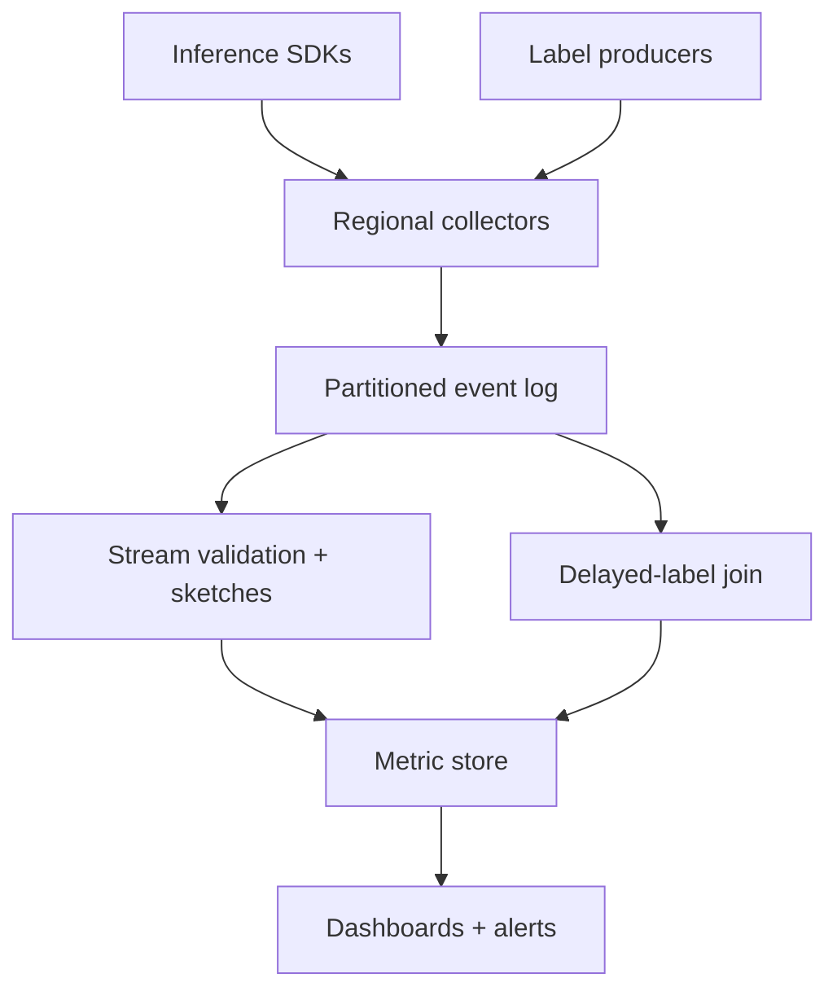
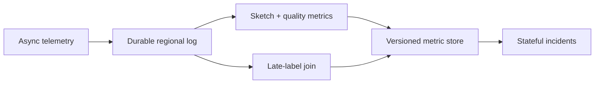

# Design a Real-Time ML Model Monitoring and Drift Detection Platform

**Difficulty:** Senior / Staff  
**Primary themes:** streaming pipelines, delayed joins, statistical sketches, time-series storage, alerting, reliability, privacy, consistency  
**Interview time budget:** 45–50 minutes  
**Educational walkthrough:** intentionally more detailed than what you would say aloud

This original walkthrough follows the requirements → entities → interfaces → high-level design → deep dives progression described in Hello Interview's [System Design Delivery Framework](https://www.hellointerview.com/learn/system-design/in-a-hurry/delivery). It also follows the framework's advice to identify a small set of functional requirements, connect APIs to them, and build the simplest complete system before deep-diving.

---

## Interviewer prompt

> Design a multi-tenant platform that monitors machine-learning models in production. It should ingest prediction telemetry and delayed ground-truth labels, detect data drift and model-quality degradation, expose dashboards, and send actionable alerts.

## Targeted clarifying questions with assumed answers

**Candidate:** Are we monitoring only online inference?

**Interviewer:** Support both online and batch predictions, but optimize the hot path for online inference. Monitoring must never block the prediction response.

**Candidate:** What kinds of models and features?

**Interviewer:** Binary classification is the first-class case. Features may be numeric, categorical, text-derived, or embeddings. Design extensibility for regression and ranking, but do not fully solve them.

**Candidate:** What scale should I assume?

**Interviewer:** Ten thousand active model versions, five million predictions per second at peak, roughly 100 features per prediction, and labels for about 30% of predictions. Labels can arrive seconds to 30 days later.

**Candidate:** What should the platform detect?

**Interviewer:** Schema violations, missingness changes, feature and prediction drift, data-quality failures, and model-performance degradation once labels arrive. Users configure windows, segments, thresholds, and alert routes.

**Candidate:** What are the freshness and reliability targets?

**Interviewer:** Data-quality and drift metrics should be visible within two minutes. Label-based quality metrics should update within five minutes of label arrival. Alert evaluation should be 99.99% available, with fewer than one lost accepted telemetry event per billion.

**Candidate:** Must every raw feature value be retained?

**Interviewer:** No. Sensitive raw values should generally not leave the inference environment. Support client-side aggregation, sampling, redaction, and retention policies.

**Candidate:** What is the alerting contract?

**Interviewer:** Alerts may be delivered more than once but must not silently disappear. Avoid flapping, attach evidence, and distinguish missing telemetry from healthy metrics.

**Candidate:** Is automatic rollback in scope?

**Interviewer:** The platform can publish a signed health signal to a deployment controller, but it does not directly roll back models.

### Scope statement to say aloud

> “I’ll design non-blocking telemetry ingestion, streaming validation and aggregation, reference-profile comparison, delayed label joins, dashboards, and reliable alerting. I’ll exclude model training, feature computation, inference serving, and the mechanics of deployment rollback.”

---

## 1. Requirements (~5 minutes)

### Core functional requirements

1. **Ingest prediction and label telemetry.** Accept model/version identity, request correlation, feature summaries, prediction outputs, segments, and delayed outcomes without adding synchronous inference dependency.
2. **Compute monitoring metrics.** Detect schema/data-quality failures, compare live distributions with versioned references, and compute label-based quality metrics over windows and segments.
3. **Explore and alert.** Serve dashboards and investigations, evaluate versioned alert rules, deliver durable notifications, and expose a health signal for automation.

### Non-functional requirements

| Property | Target | Design consequence |
|---|---:|---|
| Peak predictions | 5M/s | partitioned log, edge aggregation, backpressure and sampling |
| Feature observations | about 500M/s logical | sketches and partial aggregation; no row-per-feature central write |
| Freshness | drift < 2 min; quality < 5 min after label | event-time stream processing and incremental materialization |
| Ingestion durability | < 1 lost accepted event per billion | local spool, replicated log, explicit acknowledgements |
| Alert availability | 99.99% | independent evaluators, durable state, replayable rules |
| Cardinality control | bounded by tenant quota | governed segment dimensions and heavy-hitter detection |
| Privacy | tenant policy and regional residency | redaction/aggregation near source, encrypted regional storage |

### Scale estimates that change the design

Five million predictions/s × 100 features equals **500 million feature observations/s**. At even 16 bytes per encoded observation, that is 8 GB/s before envelopes, replication, or indexes. Centralizing every raw value would be expensive and risky. The design needs sampling plus mergeable summaries computed in SDKs, gateways, or regional stream workers.

If each prediction envelope averages 2 KB after selective logging, ingress is 10 GB/s and 864 TB/day before replication. A 1% raw sample is still 8.6 TB/day. Therefore raw samples need strict per-tenant budgets and short retention; long-term storage should contain aggregates and selected exemplars.

Ten thousand model versions × 100 features × 20 governed segments × 60 one-minute buckets already produce 1.2 billion metric points per hour if every combination is materialized. We must aggregate only configured or high-value slices, cap segment cardinality, and roll up old data.

Thirty percent label coverage means up to 1.5 million labels/s at peak, but labels can be 30 days late. Holding join state only in stream memory is unsafe and too large. Use a durable prediction index with expiry plus event-time correction.

### Consistency and availability contract

- Inference remains available even if monitoring is unavailable; telemetry is asynchronous and bounded by a local spool.
- Once a collector acknowledges an event, the event is durably replicated or recoverable from the collector spool.
- Metrics are **eventually consistent** and based on event time. Late events may revise unfinalized windows; dashboards expose completeness and finalization status.
- Every metric identifies `model_version`, `monitoring_config_version`, `reference_profile_version`, window, segment, and source watermark.
- Label joins are idempotent by `(tenant_id, prediction_id, label_definition_version)`; corrections supersede prior labels.
- Missing or stale telemetry is never interpreted as healthy. Health can be `HEALTHY`, `UNHEALTHY`, or `UNKNOWN`.
- Alerts are at-least-once; deduplication keys, incident state, and delivery receipts make retries safe.

### Concise interview phrasing

> “The core tension is that inference telemetry is enormous and labels are late. I’ll keep monitoring off the serving path, turn raw observations into mergeable summaries early, and preserve just enough keyed state to join outcomes later.”

---

## 2. Core entities (~2 minutes)

| Entity | Purpose | Important fields |
|---|---|---|
| `ModelVersion` | Deployed immutable model identity | `tenant_id`, `model_id`, `version`, `task_type`, `schema_id` |
| `MonitoringConfig` | Versioned contract and policy | feature specs, segments, windows, sample rates, retention |
| `PredictionEvent` | Correlatable inference observation | `prediction_id`, model version, event time, output, feature payload/sample, trace ID |
| `LabelEvent` | Ground truth or correction | `prediction_id`, `label`, `label_time`, `definition_version`, `revision` |
| `ReferenceProfile` | Baseline distribution and quality | feature sketches, output sketch, cohort, time range, version |
| `MetricPoint` | Windowed measured value | metric key, window, segment, value, count, completeness, versions |
| `Sketch` | Mergeable distribution summary | type, parameters, serialized state, count, min/max |
| `AlertRule` | Versioned evaluation policy | metric query, threshold, duration, burn rate, severity |
| `Incident` | Stateful alert lifecycle | dedupe key, state, evidence, first/last seen, acknowledgements |

A **sketch** is a compact, mergeable approximation. Examples include quantile sketches for numeric features, count-min sketches plus top-k lists for categorical values, and random-projection summaries for embeddings.

### Say aloud

> “The metric is not just a number. It is a number tied to a model, config, reference, event-time window, segment, and completeness watermark; otherwise investigations are not reproducible.”

---

## 3. APIs and system interfaces (~5 minutes)

Tenant, workload, and allowed model identities come from authenticated workload credentials. Callers cannot charge telemetry to an arbitrary tenant by sending `tenant_id` in the body.

### 3.1 Register monitoring configuration

```http
PUT /v1/models/fraud-score/versions/2026-10-20/monitoring-config
Authorization: Bearer <workload-token>
If-Match: "config-17"

{
  "schema_id": "fraud-input-v42",
  "features": {
    "amount": {"type": "numeric", "required": true},
    "merchant_country": {"type": "categorical", "max_categories": 500},
    "device_embedding": {"type": "embedding", "dimensions": 128, "raw_logging": false}
  },
  "segments": ["region", "client_platform"],
  "windows": ["5m", "1h", "24h"],
  "raw_sample_rate": 0.001,
  "reference_profile_id": "ref_92"
}
```

```json
{
  "config_version": 18,
  "effective_after": "2026-10-20T22:10:00Z",
  "collector_bundle_etag": "cb_18_a8f"
}
```

Conditional update prevents two operators from silently overwriting policy.

### 3.2 Emit predictions

The normal interface is an asynchronous SDK with batches. Conceptually:

```http
POST /v1/telemetry/predictions:batch
Authorization: Bearer <workload-token>
Idempotency-Key: collector-7:batch-88021

{
  "events": [
    {
      "prediction_id": "pred_01K...",
      "model_id": "fraud-score",
      "model_version": "2026-10-20",
      "event_time": "2026-10-20T22:05:14.821Z",
      "prediction": {"score": 0.93, "decision": "REVIEW"},
      "features": {"amount": 842.10, "merchant_country": "US"},
      "segments": {"region": "us-east", "client_platform": "ios"},
      "trace_id": "tr_71"
    }
  ]
}
```

```json
{"accepted": 1, "rejected": 0, "batch_id": "tb_88021"}
```

SDKs may instead send pre-aggregated sketches for sensitive features. The collector authenticates the model identity and rejects undeclared segment dimensions.

### 3.3 Emit labels

```http
POST /v1/telemetry/labels:batch
Authorization: Bearer <label-producer-token>

{
  "events": [
    {
      "prediction_id": "pred_01K...",
      "label_definition_version": "chargeback-v3",
      "label": 1,
      "label_time": "2026-10-27T16:30:00Z",
      "revision": 1
    }
  ]
}
```

### 3.4 Query metrics

```http
GET /v1/models/fraud-score/versions/2026-10-20/metrics?metric=auc&window=1h&segment=region:us-east&from=2026-10-20T20:00:00Z
Authorization: Bearer <user-token>
```

```json
{
  "series": [
    {
      "window_start": "2026-10-20T21:00:00Z",
      "value": 0.861,
      "labeled_count": 182044,
      "label_coverage": 0.29,
      "completeness": 0.997,
      "final": false,
      "config_version": 18,
      "reference_profile_version": 4
    }
  ]
}
```

### 3.5 Create an alert rule

```http
POST /v1/models/fraud-score/alert-rules
Authorization: Bearer <user-token>

{
  "name": "AUC regression",
  "query": "auc{region=*}",
  "condition": {"below": 0.84, "for": "15m"},
  "minimum_labeled_count": 10000,
  "minimum_completeness": 0.95,
  "routes": ["pagerduty:ml-risk", "slack:fraud-models"]
}
```

### Say aloud

> “Prediction IDs are opaque correlation keys, identity comes from authentication, and every query returns sample count and completeness. An AUC without coverage is easy to misread.”

---

## 4. Data flow

### Prediction telemetry

1. The inference SDK validates against a cached config, samples raw exemplars, and creates local sketch deltas.
2. A background sender batches and compresses events; a bounded encrypted spool absorbs collector outages.
3. Regional collectors authenticate, enforce quotas, assign ingestion metadata, and append to a replicated log.
4. Stream processors validate schema, deduplicate batches, update windowed sketches, and store join projections.
5. Metric materializers write time-series points and completeness watermarks.
6. Alert evaluators consume metric changes and evolve incident state.

### Delayed labels

1. A label producer submits an outcome with prediction ID and definition version.
2. The label stream is deduplicated and joined against the durable prediction projection.
3. Matched pairs update confusion matrices, calibration buckets, AUC histograms, and segment metrics.
4. Unmatched labels wait in a reverse index until the prediction arrives or retention expires.
5. Late labels revise open windows; compacted correction records update older rollups.

---

## 5. High-level design (~10–15 minutes)



### Operation 1: register a model contract and reference

The control plane stores immutable `MonitoringConfig` versions. It validates feature names and types, segment allowlists, privacy classifications, sketch algorithms, alert queries, and budget estimates. A signed collector bundle contains only what the data plane needs.

Reference profiles can come from a training dataset, a validated production period, or a champion model's traffic. They are immutable and record cohort filters, dataset/version, time range, sketch parameters, and sample count. Comparing sketches built with incompatible bins or projections is invalid, so compatibility is checked at configuration time.

Control-plane failure does not stop ingestion. Collectors use the last verified unexpired bundle and mark unknown model versions for quarantine rather than guessing a schema.

### Operation 2: collect predictions without harming inference

The SDK runs after or beside inference. It must have bounded CPU, memory, and queue capacity. It performs cheap checks, hashes or redacts sensitive categories, and aggregates high-volume features into small deltas. Sending happens on background threads or a sidecar.

If collectors are unreachable, the SDK writes to a bounded local encrypted spool. When the spool fills, policy chooses between more aggressive sampling and dropping oldest telemetry; it never blocks inference indefinitely. Dropped-event counters are sent through an independent low-volume health channel.

Regional collectors batch-ack only after a quorum-replicated log accepts the batch. Partition by `(tenant_id, model_id, model_version)` plus a hash bucket so one hot model spreads across partitions while per-key ordering remains adequate for dedupe. Quotas protect shared infrastructure.

**Say aloud:**

> “Monitoring is a side effect of inference, not a dependency. The SDK has a bounded spool and an explicit loss policy, and the platform monitors telemetry loss separately from model health.”

### Operation 3: compute schema, data-quality, and drift metrics

Stream workers validate declared type, range, dimensions, missingness, and category budgets. Invalid events go to a quarantine topic with sampled evidence; aggregate violation counters still update.

For each configured model/feature/segment/window, workers maintain mergeable state:

- numeric: count, missing count, moments, min/max, quantile sketch, fixed reference bins;
- categorical: top-k, approximate counts, unseen-category rate, entropy;
- predictions: score histogram, class rate, confidence distribution;
- embeddings: norms, centroid, random projections, and sampled nearest-neighbor analysis offline.

Partial aggregates are emitted every few seconds and merged hierarchically: process/collector → regional shard → global tenant view. Fixed reference bins allow population stability index or Jensen-Shannon divergence. Statistical tests are evidence, not universal truth; minimum sample sizes and multiple-testing controls matter.

The metric store uses a wide time-series key:

```text
(tenant, model, version, metric, feature, segment_hash,
 window_size, window_start, config_version, reference_version)
```

Recent fine-grained points live in a low-latency time-series database. Older points compact to hourly/daily columnar files in object storage.

### Operation 4: join labels and compute model quality

The prediction processor writes a compact join projection keyed by prediction ID: model version, event time, prediction/score, governed segments, and only features needed for configured analysis. A TTL covers the maximum label delay plus safety margin.

Labels and predictions can arrive in either order. The join service maintains two durable keyed stores or one table with independent sides. When both are present, it emits a stable `LabeledPrediction` event. The output ID includes label revision, so consumers can retract the old contribution before applying a correction.

Binary-classification aggregators maintain confusion matrices at configured thresholds, calibration buckets, score histograms by label for approximate AUC, log loss totals, and coverage. Exact AUC requires ordering all scores and is unsuitable for every streaming window; bucketed AUC is bounded and mergeable, with exact offline jobs for audits.

### Operation 5: dashboard and investigate

The query service reads recent materialized points, historical rollups, reference metadata, and selected exemplars. Queries are cached by immutable version and completed window. In-progress windows have short TTLs.

Dashboards show metric value alongside volume, label coverage, ingestion completeness, segment, reference, and rollout markers. An investigation links an alert to representative traces or redacted exemplars, but raw-value access is audited and permissioned.

### Operation 6: evaluate and deliver alerts

Alert evaluators consume metric updates and periodically rescan durable state. A rule includes minimum volume/completeness, consecutive-window duration, optional recovery threshold, and cooldown. This hysteresis prevents flapping: for example, fire below 0.84 for 15 minutes but resolve only above 0.86 for 20 minutes.

An incident state machine stores `PENDING → FIRING → ACKNOWLEDGED → RESOLVED`. A transactional outbox publishes notification attempts. Delivery workers retry with exponential backoff and stable dedupe keys; dead-letter queues and route-specific receipts expose failures.

The health API returns signed state with expiry. Deployment controllers may consume it, but `UNKNOWN` must not be silently treated as healthy.

### Storage choices

| Need | Choice | Reason |
|---|---|---|
| Ingestion buffer | Replicated partitioned log | burst absorption, replay, independent consumers |
| Active stream state | Embedded state store + replicated checkpoints | low-latency windows with recovery |
| Prediction-label join | Sharded durable KV/LSM store | 30-day keyed lookup and TTL |
| Recent metrics | Time-series/wide-column store | high write rate and range queries |
| Historical rollups | Columnar object storage | economical scans and offline recomputation |
| Raw samples | Encrypted object storage | short retention, audit, access control |
| Config/incidents | Relational database | conditional updates and state transitions |

---

## 6. Deep dives (~10–15 minutes)

### Deep dive A: scale drift detection without centralizing raw values

#### Where the baseline breaks

Sending every feature value creates hundreds of millions of observations per second, high cost, privacy exposure, and a cardinality explosion when users slice by arbitrary tags. Computing only averages misses distribution shifts such as bimodality or tail growth.

#### Options

| Approach | Benefit | Limitation |
|---|---|---|
| Store all raw observations | flexible retrospective analysis | cost, privacy, and write scale |
| Fixed histograms only | cheap and mergeable | poor for unknown ranges and tails |
| Mergeable sketches + governed samples | scalable with investigation evidence | approximate and configuration-sensitive |

Choose sketches plus small governed raw samples.

Numeric features use a quantile sketch for exploratory percentiles and counts in bins fixed by the reference profile for stable comparisons. Categorical features use exact counts for a bounded allowlist, top-k heavy hitters, and an approximate tail sketch. Embeddings should not log all coordinates; track norm, centroid, covariance approximations or fixed random projections, then run richer analysis on a privacy-approved sample.

Segment dimensions require registration. Values are normalized, capped, and mapped to `OTHER` after a budget. A heavy-hitter detector can propose important emergent slices without materializing every combination. Default dashboards include overall plus a small set of independently configured one-dimensional slices; arbitrary cross-products run as bounded offline jobs.

Reference comparison should report effect size, sample size, and confidence—not only a p-value. At massive volume, tiny harmless differences become statistically significant. Alert on a business-relevant divergence sustained over time.

#### Failure modes and observability

- incompatible sketch parameters: reject comparison and surface `UNKNOWN`;
- collector bundle lag: metric points carry config-version distribution;
- merge double-counting: aggregate batches have unique IDs and checkpointed offsets;
- abusive segment cardinality: quota, top-k reduction, and tenant isolation;
- source-side drops: track emitted, accepted, sampled, and dropped counts independently.

Key metrics include bytes/prediction, sketch compression ratio, segment cardinality, event lag, bundle-version skew, quarantine rate, and raw-sample budget consumption.

**Say aloud:**

> “I aggregate near the source with mergeable summaries, but retain a tiny governed sample for debugging. Segment dimensions are a schema, not arbitrary tags, so cost and alert multiplicity stay bounded.”

### Deep dive B: correct metrics with late and corrected labels

#### Where the baseline breaks

Joining labels in an in-memory stream window fails when outcomes arrive weeks later, processors restart, labels precede predictions, or a provisional label is corrected. Measuring only labeled examples can also be biased if label arrival depends on the outcome.

#### Selected design

Store a compact prediction projection in a sharded durable KV store for 31–35 days. Key by a tenant-scoped HMAC of prediction ID to reduce accidental disclosure. A label table keyed by the same value stores the highest accepted revision for each label definition.

When either side arrives, perform an idempotent conditional write and check the other side. Emit `LabeledPrediction(prediction_revision, label_revision)`. Downstream contribution records make corrections reversible:

```text
old label revision: subtract confusion/calibration contribution
new label revision: add new contribution
```

For current windows, stream state applies changes directly. For compacted historical windows, append correction deltas and schedule a bounded recomputation. Dashboards expose `final=false` until the label-lateness horizon or a configured completeness criterion passes.

Label coverage is itself a metric. Compare coverage by prediction band and segment; otherwise a model may appear better because hard cases are unlabeled. For censoring-sensitive outcomes, show cohort/vintage views: predictions from a fixed week mature as labels arrive, rather than mixing young and mature cohorts.

#### Consistency choices

- Prediction ingestion and metric updates are at-least-once; stable event IDs make consumers idempotent.
- Per-prediction label revisions are monotonic through conditional writes.
- Global windows are eventually consistent; no cross-region transaction is required.
- A finalized window can be reopened only by an explicit correction policy, with an audit event.

#### Failure modes and observability

- label after join TTL: record unmatched-late count and route to offline backfill;
- prediction never arrives: quarantine until expiry, never fabricate denominator;
- duplicate or reordered label: ignore lower revision;
- join-store hotspot: hash keys and batch lookups;
- regional residency conflict: keep joins regional and merge only aggregates globally.

Monitor match rate by label source, join latency, unmatched age, revision rate, TTL expiry, coverage by score bucket, and correction backlog.

**Say aloud:**

> “Labels are not merely late events; they are versioned facts. I use durable symmetric join state, reversible contributions, and cohort completeness so a changing label mix is not mistaken for model improvement.”

### Deep dive C: trustworthy alerting under missing data and noisy metrics

#### Where the baseline breaks

A threshold on every one-minute metric creates alert storms, duplicate pages, and flapping. Worse, a failed telemetry pipeline can produce no bad metric and look healthy. A dashboard system should not be the sole evaluator for an automated rollout gate.

#### Rule evaluation

Every evaluation checks four dimensions:

1. **Value:** did the metric cross its threshold or change budget?
2. **Evidence:** is sample size sufficient?
3. **Completeness:** have expected partitions and source heartbeats arrived?
4. **Duration:** is the breach sustained or consuming a multi-window error budget?

Use separate thresholds for firing and recovery, consecutive windows, cooldowns, and hierarchical dedupe. A parent incident for one model can group affected segments while preserving evidence. Multi-window burn-rate logic pages for rapid severe regressions and tickets slow degradation.

The evaluator stores its cursor and incident transition in one transaction or uses an outbox. A periodic scanner re-evaluates rules even if a metric-change event is lost. Two evaluator replicas use leases or partition ownership; duplicate transitions are safe because the incident dedupe key is stable.

#### Unknown health

Expected telemetry rate can be estimated from inference counters or heartbeats on a separate channel. If monitoring lag, completeness, config freshness, or label coverage falls below policy, health becomes `UNKNOWN`. Deployment automation decides whether to pause, not the monitor itself.

#### Delivery reliability

Incident transition and notification outbox are committed atomically. Route workers retry transient failures and record provider receipts. Permanent failures surface in a dead-letter dashboard and can fail over to a secondary route. User-facing notifications link immutable evidence snapshots so later metric revisions do not erase what triggered the page.

#### Observability

- rules evaluated late or skipped;
- incident transitions by severity;
- notification attempt and receipt latency;
- deduplicated and suppressed pages;
- time in `UNKNOWN` by model;
- alert precision from acknowledgement/resolution feedback;
- evaluator cursor lag and periodic-scan disagreement.

**Say aloud:**

> “No data is not good data. The health contract is three-valued, and every alert evaluates metric value, evidence, completeness, and duration before it pages.”

---

## 7. Final design

Inference SDKs validate against signed versioned configs, create bounded samples and mergeable sketch deltas, and send asynchronously through an encrypted local spool. Regional collectors authenticate workloads, enforce quotas, and acknowledge only after a replicated log accepts telemetry. Stream workers validate schema, aggregate event-time windows, compare against immutable references, and materialize recent metrics with completeness watermarks.

A durable TTL-based join store correlates predictions with labels arriving in either order. Versioned label corrections produce reversible metric contributions. Fine-grained recent metrics live in a time-series store; compacted historical rollups and controlled raw samples live in object storage.

Alert evaluators combine value, volume, completeness, and duration, persist a deduplicated incident state machine, and deliver through a transactional outbox. Dashboards and signed health APIs expose `HEALTHY`, `UNHEALTHY`, or `UNKNOWN`, with every result tied to exact config and reference versions.



### Requirements check

| Requirement | Design response |
|---|---|
| Non-blocking collection | background SDK/sidecar with bounded spool |
| 5M predictions/s | batching, partitioned logs, early aggregation |
| Drift under 2 minutes | event-time streaming sketches and incremental metrics |
| Quality after labels | durable symmetric join and reversible contributions |
| Schema/data quality | versioned contracts, quarantine, violation metrics |
| Privacy | redaction and aggregation near source, governed samples |
| Bounded cardinality | registered segments, quotas, heavy-hitter reduction |
| Reproducibility | model/config/reference/window/watermark on every metric |
| Reliable alerts | incident state machine, outbox, retries, receipts |
| Missing-data safety | completeness watermarks and `UNKNOWN` health |

---

## Realistic interviewer follow-up questions with strong sample answers

### 1. Why not log every raw feature to Kafka?

> “At five million predictions per second and 100 features, that is 500 million observations per second plus substantial privacy risk. I aggregate mergeable sketches near the source and retain only a governed raw sample.”

### 2. Does monitoring loss block predictions?

> “No. The SDK has bounded asynchronous queues and an encrypted spool. When its budget is exhausted it applies an explicit sampling/drop policy and emits independent loss counters; inference availability wins.”

### 3. How do you detect numeric drift?

> “Keep reference-compatible histogram bins plus a quantile sketch. Compute an effect-size metric such as Jensen-Shannon divergence or PSI, require minimum volume, and alert only on a sustained business-relevant change.”

### 4. Why are fixed reference bins useful?

> “Two independent adaptive histograms are hard to compare consistently. Reference bins make window-to-baseline counts mergeable and reproducible, while the quantile sketch preserves exploratory flexibility.”

### 5. How do you monitor categorical features with millions of values?

> “Exact counts for a bounded allowlist, top-k heavy hitters, an approximate tail sketch, unseen-category rate, and an `OTHER` bucket. I never create one time series per arbitrary value.”

### 6. How do you monitor embeddings?

> “Avoid logging all vectors. Track norms, centroids, covariance approximations or fixed random projections, and run richer nearest-neighbor or cluster analysis on a policy-approved sample.”

### 7. What if labels arrive before predictions?

> “The join is symmetric. Persist either side keyed by the tenant-scoped prediction identifier; arrival checks for its counterpart and emits exactly one logical labeled record per revision.”

### 8. What if a ground-truth label is corrected?

> “Accept only a higher label revision, emit a new labeled-record revision, subtract the prior contribution, and add the corrected one. Historical compacted windows receive correction deltas or recomputation.”

### 9. How do you compute streaming AUC?

> “Maintain positive and negative score histograms and derive an approximate AUC from bucket ordering. Exact AUC is an offline audit job because it requires sorting individual scores.”

### 10. Why show label coverage next to AUC?

> “The labeled subset may be biased or immature. Coverage overall and by score/segment tells users whether AUC represents production traffic or only easy-to-label cases.”

### 11. When is a window final?

> “After its configured allowed lateness and completeness criteria. Label-based cohort windows may remain provisional much longer. The API exposes `final` so consumers do not assume immutability.”

### 12. How do you prevent duplicate metric contributions?

> “Stable event and aggregate-batch IDs, checkpointed log offsets, idempotent writes, and a contribution identity containing prediction and label revisions. At-least-once transport does not imply double-counting.”

### 13. How do you avoid alert flapping?

> “Use minimum evidence, sustained windows, different fire/recover thresholds, cooldowns, and a persistent incident state machine rather than treating each bad point as a new alert.”

### 14. What happens if telemetry stops entirely?

> “Completeness and independent inference heartbeats fall below policy, so health becomes `UNKNOWN` and a pipeline incident fires. Missing data cannot resolve an existing model incident.”

### 15. Can the platform automatically roll back a model?

> “It publishes a signed, expiring health state with evidence. The deployment controller owns rollback policy because it understands rollout stage, blast radius, and business overrides.”

### 16. How do you support regional data residency?

> “Keep raw samples and keyed prediction-label joins inside the region. Merge privacy-approved sketches and aggregates globally. Configs declare which fields may cross boundaries.”

### 17. How do you choose a reference distribution?

> “Version a reference from training data or a known-good production cohort, record its filters and sample size, and let operators promote a new reference explicitly. Never mutate the baseline invisibly.”

### 18. What if a model version is emitted before its config reaches collectors?

> “Quarantine those events under the authenticated model identity, alert on control-plane lag, and replay after the signed bundle arrives. Do not parse them using a guessed prior schema.”

### 19. How would you backfill a new metric?

> “Run an offline job over retained columnar telemetry or samples, write under a new metric-definition version, and keep it separate from live points until validation. If raw data was not retained, the answer may be impossible; retention is a deliberate tradeoff.”

### 20. What metric would page you first?

> “Ingestion completeness or accepted-event lag, because every downstream health conclusion depends on trustworthy telemetry. A low drift score is meaningless when half the partitions are missing.”

---

## Common pitfalls

1. Putting monitoring synchronously on the inference path.
2. Centralizing every raw feature value without cost or privacy analysis.
3. Treating a mean as sufficient distribution monitoring.
4. Allowing arbitrary segment keys and cross-products.
5. Comparing incompatible sketch or bin versions.
6. Alerting on statistical significance without effect size.
7. Ignoring sample count and multiple testing.
8. Joining labels only in short-lived stream memory.
9. Assuming predictions always arrive before labels.
10. Ignoring label revisions and retractions.
11. Reporting AUC without label coverage or cohort maturity.
12. Treating processing time as prediction event time.
13. Calling in-progress windows final.
14. Confusing at-least-once delivery with double-counted metrics.
15. Interpreting missing telemetry as a healthy model.
16. Paging separately for every affected segment.
17. Sending alerts without immutable evidence and version context.
18. Letting dashboard availability gate alert evaluation.
19. Allowing control-plane failure to stop ingestion.
20. Giving monitoring permission to roll back models directly.

---

## Polished 60-second closing summary

> “I designed monitoring as an asynchronous, versioned streaming system. Inference SDKs use signed configs to validate, redact, sample, and aggregate, then send through bounded spools to regional collectors and a replicated log. Stream workers compute schema violations and mergeable distribution sketches in event-time windows, compare them with immutable references, and materialize metrics with completeness watermarks. A durable 30-day join store correlates predictions and labels arriving in either order; versioned corrections create reversible contributions. Time-series storage serves recent dashboards, while columnar rollups support history and backfills. Alert evaluators require value, evidence, completeness, and duration, then persist deduplicated incidents and deliver through an outbox. The key contracts are that monitoring never blocks inference, no data is not healthy data, and every result is reproducible from its model, config, reference, window, and watermark.”

## Public references

- Hello Interview, [System Design Delivery Framework](https://www.hellointerview.com/learn/system-design/in-a-hurry/delivery)
- Hello Interview, [API Design for System Design Interviews](https://www.hellointerview.com/learn/system-design/core-concepts/api-design)
- Hello Interview, [Data Modeling for System Design Interviews](https://www.hellointerview.com/learn/system-design/core-concepts/data-modeling)

The references are used for interview-delivery structure. The prompt, requirements, estimates, APIs, data model, streaming architecture, statistical monitoring choices, dialogue, failure semantics, and tradeoffs are original.
