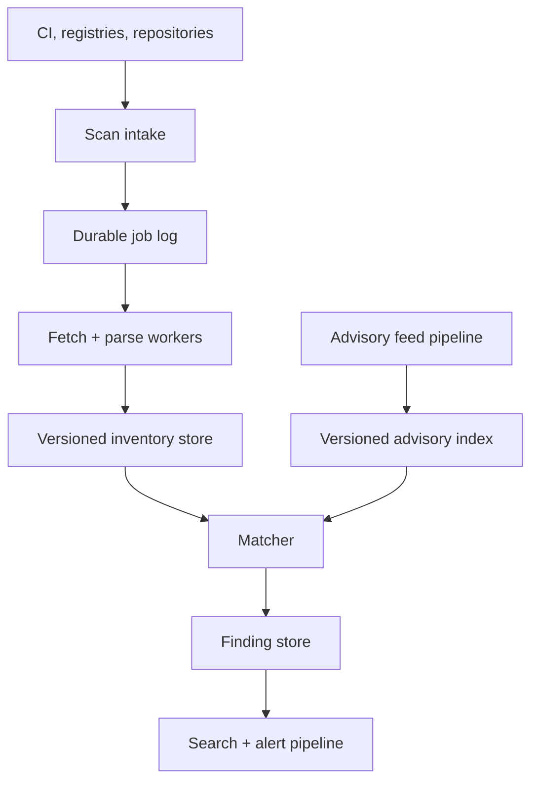
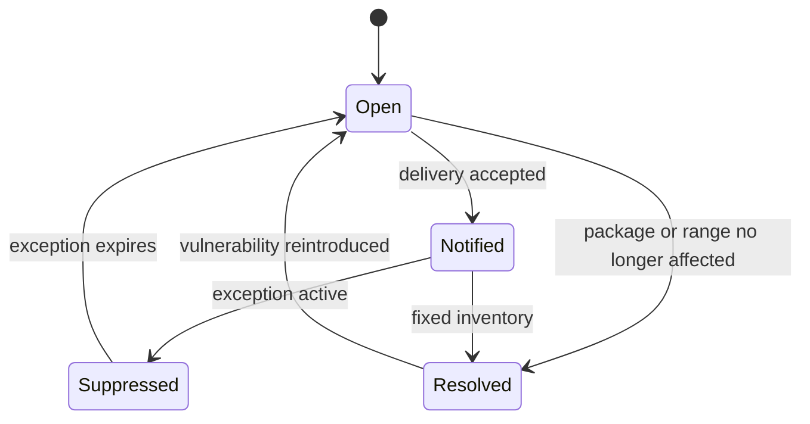
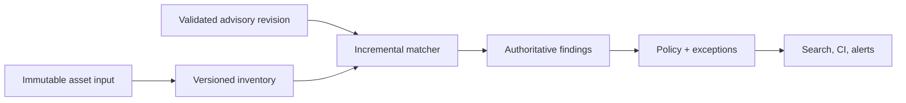

# Design a Software Supply-Chain Vulnerability Scanner

**Difficulty:** Senior / Staff  
**Primary themes:** dependency graphs, vulnerability-feed ingestion, queues, incremental recomputation, consistency, multi-tenancy  
**Interview time budget:** 45–50 minutes  
**Educational walkthrough:** intentionally more detailed than the spoken interview

This original walkthrough uses the requirements → entities → interfaces → high-level design → deep dives progression described by Hello Interview's [System Design Delivery Framework](https://www.hellointerview.com/learn/system-design/in-a-hurry/delivery). Hello Interview also recommends making APIs concrete and tracing state changes operation by operation; that guidance shapes the presentation below.

---

## Interviewer prompt

> Design a multi-tenant software supply-chain vulnerability scanner. Customers connect source repositories and container registries. The system discovers direct and transitive dependencies, matches them against continuously updated vulnerability feeds, shows affected assets, and alerts teams when risk changes.

## Targeted clarifying questions with assumed answers

**Candidate:** Which ecosystems and artifact types are in scope?

**Interviewer:** Support Maven, npm, PyPI, Go modules, and OCI container images. Accept uploaded SPDX and CycloneDX SBOMs. Native source parsing and image scanning should also work.

**Candidate:** Should we execute customer builds?

**Interviewer:** No. Parse lockfiles, manifests, and image metadata. Build execution and dynamic analysis are out of scope.

**Candidate:** Do we need only known-vulnerability matching, or malware and license policy too?

**Interviewer:** Focus on known vulnerabilities. Leave malicious-package detection and license compliance as extensions.

**Candidate:** What should happen when a vulnerability feed adds or edits an advisory?

**Interviewer:** Re-evaluate affected assets without rescanning every repository. Newly critical findings should normally appear within five minutes of validated feed ingestion.

**Candidate:** What scale should I assume?

**Interviewer:** 100,000 tenants, 50 million active assets, 20 billion package occurrences, 200 million distinct asset-package edges, 20 million scans/day, and 100,000 advisory updates/day during spikes.

**Candidate:** What correctness contract matters most?

**Interviewer:** Avoid silently missing known critical vulnerabilities. Every finding must explain the affected component, version, dependency path, advisory revision, and scanner version. False positives may be suppressed through audited exceptions.

**Candidate:** What latency and availability targets should I use?

**Interviewer:** Accept scan requests at 99.99% availability. Small repository scans should finish in under two minutes at p95; large images may take 15 minutes. Search and dashboards should respond in under 500 ms at p95. Critical advisory fan-out should finish within five minutes for 99% of known affected assets.

**Candidate:** May tenants share cached scan results?

**Interviewer:** They may share public package and advisory normalization data. Private source contents, asset topology, exceptions, and findings must remain tenant-isolated.

### Scope statement to say aloud

> “I’ll design durable source and image intake, deterministic SBOM normalization, direct and transitive dependency matching, incremental advisory fan-out, searchable findings, alerts, and audited exceptions. I’ll exclude build execution, runtime exploit detection, malware analysis, and license compliance.”

---

## 1. Requirements (~5 minutes)

### Core functional requirements

1. **Ingest and inventory software assets.** Scan repositories, images, or uploaded SBOMs; normalize components and dependency relationships.
2. **Match vulnerabilities and update incrementally.** Evaluate package versions against versioned advisories, show dependency paths, and recompute only affected assets when an advisory changes.
3. **Prioritize and communicate risk.** Serve dashboards and search, emit deduplicated alerts, and support time-bounded suppressions with an audit trail.

### Non-functional requirements

| Property | Target | Architectural consequence |
|---|---:|---|
| Intake availability | 99.99% | Persist scan intent before doing expensive work |
| Scan latency | small repositories p95 < 2 min; large images < 15 min | Parallel parsers and bounded stage queues |
| Query latency | dashboard/search p95 < 500 ms | Materialized finding index and summaries |
| Advisory freshness | critical changes reach 99% of affected assets < 5 min | Reverse package-to-asset index and priority fan-out |
| Durability | acknowledged scan jobs are not lost | Transactional job creation and durable log |
| Explainability | reproduce every finding | immutable input digest plus parser, advisory, and matcher versions |
| Isolation | no private cross-tenant disclosure | tenant-scoped authorization, encryption, and cache boundaries |

### Scale estimates that change design decisions

Twenty million scans per day gives:

\[
QPS_{avg} = \frac{20{,}000{,}000}{86{,}400} \approx 231
\]

At a 10× CI-driven peak, intake reaches roughly **2,300 scans/s**. QPS alone understates load: one monorepo may contain hundreds of manifests and one image may contain thousands of packages. Therefore admission and autoscaling should use estimated work units—bytes, files, layers, and dependency nodes—not request count alone.

Twenty billion package occurrences across 50 million assets averages 400 occurrences per asset. Storing a verbose 500-byte occurrence row would consume about 10 TB before indexes and replication. We should intern normalized package identities, compress occurrence columns, partition by tenant/asset, and keep large raw SBOMs in object storage.

The interviewer gives 200 million distinct asset-package edges, much lower than raw occurrences because layers, files, or repeated modules can reference the same package. That deduplicated edge set is the useful reverse index for advisory fan-out.

If one widely used package appears in 10 million assets, emitting one queue message per asset immediately creates a hot-key storm. Fan-out needs range-partitioned work, quotas, and priority tiers rather than a single producer loop.

### Consistency and availability contract

- A scan request becomes visible only after the job and immutable input reference are durable.
- Within one asset, the current inventory changes atomically from one `inventory_version` to the next. Readers never see half an SBOM.
- Findings are derived and eventually consistent with inventories and advisory revisions. Critical updates target five-minute convergence.
- Every finding pins `inventory_version`, `advisory_revision`, and `matcher_version`.
- An exception never deletes a finding. It changes effective status while preserving raw match evidence.
- During feed uncertainty, keep the last validated advisory snapshot and surface staleness. Do not ingest malformed updates merely to appear fresh.
- Search may lag the authoritative finding store by seconds. Direct finding reads and alert decisions use authoritative current state.

### Concise interview phrasing

> “The product is an incremental join between versioned asset inventories and versioned vulnerability knowledge. I need atomic inventory replacement, reproducible matches, and fast reverse fan-out when either side changes.”

---

## 2. Core entities (~2 minutes)

| Entity | Purpose | Important fields |
|---|---|---|
| `Tenant` | Security and quota boundary | `tenant_id`, `plan`, `region`, `kms_key_ref` |
| `Asset` | Repository, image, or uploaded SBOM target | `asset_id`, `tenant_id`, `type`, `source_ref`, `current_inventory_version` |
| `ScanJob` | Durable pipeline execution | `scan_id`, `asset_id`, `input_digest`, `status`, `priority`, `stage`, `attempt` |
| `Inventory` | Immutable normalized scan result | `asset_id`, `inventory_version`, `input_digest`, `parser_versions`, `created_at` |
| `Package` | Canonical package identity | `package_id`, `ecosystem`, `namespace`, `name`, `normalized_version`, `purl` |
| `DependencyEdge` | Direct or transitive relationship | `inventory_version`, `parent_package_id`, `child_package_id`, `scope`, `path_hash` |
| `Advisory` | Logical vulnerability | `advisory_id`, `aliases`, `severity`, `withdrawn` |
| `AdvisoryRevision` | Immutable normalized feed revision | `advisory_id`, `revision`, `affected_ranges`, `fixed_versions`, `source_versions` |
| `Finding` | Match between inventory and advisory | `finding_id`, `asset_id`, `package_id`, `advisory_id`, `state`, `evidence` |
| `Exception` | Audited suppression or acceptance | `exception_id`, `tenant_id`, `selector`, `reason`, `expires_at`, `approver` |
| `AlertDelivery` | Idempotent notification attempt | `finding_id`, `finding_version`, `channel`, `status` |

Package URL, or **purl**, is a standardized package coordinate that includes type, namespace, name, version, qualifiers, and subpath. Internally we still preserve ecosystem-specific raw identity because normalization mistakes are a major source of false results.

### Say aloud

> “I separate a logical advisory from its immutable revisions, and an asset from its immutable inventory versions. A finding records exactly which two versions were joined.”

---

## 3. APIs and system interfaces (~5 minutes)

Tenant and actor identities come from authenticated tokens. Callers never select an arbitrary `tenant_id` in the request body.

### 3.1 Request a scan

```http
POST /v1/assets/ast_42/scans
Authorization: Bearer <tenant-token>
Idempotency-Key: ci-run-9182
Content-Type: application/json

{
  "source": {
    "type": "OCI_IMAGE",
    "digest": "sha256:4d91...",
    "registry_ref": "registry.example.com/payments@sha256:4d91..."
  },
  "priority": "CI_BLOCKING"
}
```

```json
{
  "scan_id": "scn_7a1",
  "asset_id": "ast_42",
  "status": "QUEUED",
  "accepted_at": "2026-10-20T16:04:00Z"
}
```

The registry credential is referenced from a tenant secret store; it is not sent in the request or queue event. The immutable digest prevents a mutable image tag from changing while the job runs.

### 3.2 Upload an SBOM

Large uploads use a presigned object-store URL:

```http
POST /v1/assets/ast_42/sbom-uploads
Authorization: Bearer <tenant-token>

{"format": "SPDX_JSON", "sha256": "81be...", "size_bytes": 4839201}
```

After upload, the client finalizes it:

```http
POST /v1/assets/ast_42/sbom-uploads/upl_18:complete
Idempotency-Key: sbom-build-511

{"object_version": "v_3", "sha256": "81be..."}
```

### 3.3 Read findings

```http
GET /v1/assets/ast_42/findings?severity=CRITICAL&state=OPEN&limit=50&cursor=eyJ...
Authorization: Bearer <tenant-token>
```

```json
{
  "items": [
    {
      "finding_id": "fnd_91",
      "advisory_id": "GHSA-xxxx-yyyy-zzzz",
      "component": "pkg:maven/org.example/parser@2.4.1",
      "severity": "CRITICAL",
      "dependency_path": ["payments-service", "sdk:8.0", "parser:2.4.1"],
      "fixed_versions": ["2.4.4"],
      "inventory_version": 17,
      "advisory_revision": 6,
      "effective_state": "OPEN"
    }
  ],
  "next_cursor": "eyJ..."
}
```

Cursor pagination is stable across concurrent writes by including sort keys such as severity, first-seen time, and finding ID.

### 3.4 Create an exception

```http
POST /v1/findings/fnd_91/exceptions
Authorization: Bearer <tenant-token>
Idempotency-Key: risk-acceptance-224

{
  "reason": "Vulnerable parser path is unreachable in this deployment",
  "expires_at": "2026-11-03T00:00:00Z",
  "ticket_ref": "SEC-2241"
}
```

The authenticated actor becomes `created_by`. Higher-severity exceptions may require a second approver under tenant policy.

### 3.5 CI policy check

```http
GET /v1/scans/scn_7a1/policy-result
Authorization: Bearer <tenant-token>
```

```json
{
  "result": "FAIL",
  "inventory_version": 17,
  "blocking_findings": ["fnd_91"],
  "policy_version": "tenant-policy-12"
}
```

The system may offer webhook callbacks, but polling remains useful because webhook delivery is at-least-once.

### Event contract

```json
{
  "event_type": "ADVISORY_REVISION_ACTIVATED",
  "event_id": "evt_01K...",
  "advisory_id": "GHSA-xxxx-yyyy-zzzz",
  "revision": 6,
  "affected_package_keys": ["maven:org.example:parser"],
  "severity": "CRITICAL"
}
```

### Say aloud

> “The APIs expose asynchronous scans, immutable inputs, explainable findings, and auditable exceptions. Identity and tenant scope come from authentication, while idempotency keys make CI retries safe.”

---

## 4. Processing data flow

1. A connector, CI client, or registry webhook requests a scan using an immutable commit or image digest.
2. Intake authorizes the asset, deduplicates the request, persists `ScanJob`, and publishes `SCAN_REQUESTED` through an outbox.
3. Fetchers retrieve manifests, lockfiles, image layers, or an uploaded SBOM into encrypted temporary storage.
4. Ecosystem-specific parsers emit a canonical component graph plus warnings and provenance.
5. The inventory writer interns packages, stores dependency edges, and atomically advances `Asset.current_inventory_version`.
6. The matcher joins changed package coordinates against the active advisory index and creates, updates, or resolves findings.
7. Policy evaluation applies tenant exceptions and determines CI status and alert eligibility.
8. Search, dashboard summaries, webhooks, and notifications update asynchronously.
9. Separately, feed ingestors normalize external advisories into immutable revisions. Activation triggers reverse lookup of affected assets and targeted rematching.

---

## 5. High-level design (~10–15 minutes)



### Operation 1: accept and schedule a scan

The API validates authorization and resolves the asset. A relational job database enforces uniqueness on `(tenant_id, asset_id, input_digest, scanner_profile)`. If CI retries the same request, it receives the existing job.

The service commits the `ScanJob` and an outbox row in one transaction. A relay publishes to a partitioned job log. This avoids a dual-write hole in which the API acknowledges a scan that workers never see.

Jobs carry lightweight references, deadlines, priority, and estimated work. They do not contain repository archives or image layers. Separate queues isolate CI-blocking scans, background inventory refreshes, and bulk rescans. Within each tier, weighted fair scheduling prevents one tenant's monorepo flood from monopolizing workers.

**Say aloud:**

> “I make intake cheap and durable. The API stores an immutable input reference and job intent, while all expensive network and parsing work happens after the queue boundary.”

### Operation 2: fetch and normalize inventory

Fetcher workers use short-lived tenant-scoped credentials to obtain the exact commit or image digest. They enforce byte, file-count, archive-depth, and decompression-ratio limits to contain zip bombs and malicious images.

Parsing is split by ecosystem:

- Maven parses resolved dependency metadata or an SBOM;
- npm and PyPI prefer lockfiles because manifests alone do not determine exact transitive versions;
- Go modules use module paths and checksums;
- OCI scanning walks the merged filesystem view and package-manager databases while preserving layer provenance.

Each parser emits canonical packages, raw coordinates, scopes, evidence locations, and dependency edges. The normalizer maps coordinates into interned `Package` IDs. It never throws away the original coordinate, because ecosystems disagree about case, epochs, pre-releases, revisions, and name aliases.

Before publishing, the inventory writer validates graph limits and writes a complete immutable `Inventory`. It then conditionally changes the asset pointer from the prior inventory to the new one. Failed or partial scans never replace the last good inventory; they are visible as scan failures with coverage warnings.

Raw SBOMs and parser artifacts live in object storage. Normalized packages and edges use a sharded relational/wide-column store. The shard key begins with `tenant_id` to support isolation and deletion, while a separate global public-package dictionary avoids repeating package strings.

### Operation 3: match an inventory

The matching service needs two lookups:

1. package key → candidate advisory revisions;
2. asset inventory → package IDs and paths.

For each inventory package, retrieve candidate advisories by ecosystem, namespace, and package name. Then run an ecosystem-specific version comparator against affected ranges. A generic lexical comparison is incorrect: for example, Maven, Python, npm semver, and Go have different ordering and range semantics.

The matcher outputs evidence:

```text
package = pkg:maven/org.example/parser@2.4.1
advisory_revision = GHSA-...#6
matched_range = ">=2.0.0, <2.4.4"
dependency_path_hash = 7d11...
matcher_version = maven-range-4
```

Findings use a stable identity such as `(tenant_id, asset_id, package_instance, advisory_id)`. Repeated scans update `last_observed_inventory_version`; disappeared packages resolve findings. The immutable finding-event history records first seen, severity changes, exception changes, and resolution.

### Operation 4: ingest an advisory update

Independent feed adapters poll or stream from sources such as OSV-compatible feeds and vendor advisories. The raw payload is retained with source metadata and signature/hash where available.

Normalization resolves aliases, package identities, affected ranges, fixes, severity, references, withdrawal state, and source precedence. A validator rejects impossible ranges and quarantines suspicious changes such as a critical advisory suddenly losing all affected versions.

Only a validated immutable revision becomes active. Activation publishes the affected package keys. A reverse index maps those keys to range-partitioned lists of `(tenant_id, asset_id, inventory_version, package_id)`. Fan-out workers rematch only these occurrences.

For a package used by 10 million assets, the index stores chunks, for example 10,000 occurrences per segment. The coordinator enqueues segment IDs rather than 10 million individual messages. Workers checkpoint within segments and apply per-tenant quotas. Critical additions receive the highest priority; description-only edits need not recompute matches.

### Operation 5: serve findings and alerts

The authoritative finding store supports point reads and policy decisions. A change stream updates:

- a search index for filtering by package, severity, team, repository, and state;
- per-asset and per-tenant summary tables;
- an alert state machine;
- analytics storage.

Search is eventually consistent, but alerts are generated from authoritative finding transitions. Alert identity is `(tenant, finding, finding_version, channel)`. Repeated events cannot send duplicate notifications for the same state. A material severity increase creates a new finding version and may alert again.

The exception evaluator overlays matching tenant rules. It supports exact finding, advisory, package, and asset selectors, but broad wildcard exceptions require stronger authorization. An expiry scheduler re-evaluates affected findings when exceptions lapse.

### Storage summary

| Data | Storage | Why |
|---|---|---|
| Scan jobs and asset pointer | Relational DB | transactions, idempotency, conditional updates |
| Raw source/SBOM/advisories | Object storage | immutable large objects and retention policies |
| Package dictionary | Distributed KV/relational table | high-reuse canonical identities |
| Inventory occurrences and edges | Wide-column or sharded relational store | large tenant-partitioned datasets |
| Advisory revisions and range index | Relational + in-memory index | validation, versioning, fast candidates |
| Package-to-asset reverse index | Partitioned KV/wide-column store | high-cardinality incremental fan-out |
| Findings and exceptions | Sharded relational store | authoritative state and audit transactions |
| Dashboard/search | Search index + materialized summaries | flexible sub-500 ms queries |

---

## 6. Deep dives (~10–15 minutes)

### Deep dive A: correct package identity and version matching

#### Where the baseline breaks

A naive system concatenates package name and version, then compares strings. It will miss aliases, confuse ecosystems, mishandle pre-releases, and produce false positives from source packages that are present but not reachable in the shipped artifact.

#### Options

| Approach | Benefit | Problem |
|---|---|---|
| One universal version parser | Simple implementation | incorrect across ecosystems |
| Query an external vulnerability API per component | Low local complexity | latency, rate limits, feed drift, weak reproducibility |
| Normalize locally with ecosystem-specific matchers | Fast, reproducible, testable | more implementation and conformance work |

Choose local versioned matchers.

The canonical key includes ecosystem, namespace, and normalized name. Preserve raw values and qualifiers. Advisory ranges compile into an interval or event representation suitable for that ecosystem. Hot compiled ranges live in local caches keyed by `(advisory_id, revision, matcher_version)`.

Every matcher has golden tests drawn from real ecosystem semantics. A new matcher version runs in shadow against historical inventories. Differences are categorized before rollout rather than silently changing millions of findings.

Dependency evidence distinguishes:

- direct versus transitive;
- production versus development/test scope;
- discovered versus unresolved versions;
- installed image package versus merely declared source dependency;
- one representative shortest path versus all paths.

Storing every dependency path can explode combinatorially. Store edges and perhaps the shortest path or bounded path samples. Reconstruct additional paths on demand with depth and result limits.

#### Failure and observability

- Unknown version syntax produces `UNMATCHABLE`, not “safe.”
- Incomplete lockfiles create coverage warnings.
- Track unmatched-coordinate rate by ecosystem/parser version.
- Sample matcher results against an independent implementation.
- Monitor finding deltas during matcher or normalizer rollout.

**Say aloud:**

> “Package matching is a correctness boundary, not a string lookup. I preserve raw provenance, use ecosystem-specific version semantics, version the matcher, and represent uncertainty explicitly.”

### Deep dive B: advisory updates without full rescans

#### Where the baseline breaks

Rescanning 50 million assets after every feed update is wasteful and cannot meet the five-minute critical-update target. Conversely, storing one enormous posting list for a popular package creates a hot partition and difficult retries.

#### Candidate approaches

1. **Full periodic rescans:** simple but slow and expensive.
2. **Scan-time only matching:** misses new advisories until the next asset scan.
3. **Reverse index plus targeted rematching:** extra storage but low incremental work.

Choose option 3.

The reverse index key is a normalized package key plus hash bucket. Values are immutable or append-friendly occurrence segments. Inventory publication adds new occurrence records and tombstones the prior inventory's records asynchronously. Fan-out validates that each occurrence still matches the asset's current `inventory_version`, so stale index entries are harmless.

Advisory activation computes a semantic diff:

- affected-range addition or removal → rematch candidates;
- severity or exploitability change → update existing findings and policy;
- description/reference-only change → update display metadata without package fan-out;
- withdrawal → resolve or mark withdrawn matches.

A coordinator estimates fan-out size and creates shard tasks. Workers use checkpoints and idempotent writes. The scheduler reserves capacity for critical advisories and live CI scans, while lower-severity bulk work is rate-limited.

For the five-minute SLO, suppose a critical advisory affects 10 million asset occurrences. That requires about 33,000 evaluations/s for completion in five minutes. If one worker safely evaluates 1,000 cached candidates/s, roughly 34 workers cover pure matching; provision perhaps 100 to absorb reads, skew, retries, and concurrent advisories. This justifies pre-warmed emergency capacity and local advisory caches.

#### Correctness under races

An asset may rescan while advisory fan-out is in flight. The task carries `inventory_version`; finding writes verify the current asset version. If stale, the task stops because the normal scan pipeline will match the newer inventory. Advisory revisions similarly use compare-and-set on the active pointer.

#### Observability

- advisory activation-to-99%-evaluation latency;
- remaining occurrences by severity and shard;
- hot package partitions and retry rate;
- stale-inventory task ratio;
- match deltas per advisory revision;
- oldest active critical fan-out task.

**Say aloud:**

> “The reverse index converts a global rescan into a targeted incremental join. Segmenting popular packages avoids hot records, and inventory-version checks make stale work safe.”

### Deep dive C: multi-tenant reliability, caching, and alert correctness

#### Where the baseline breaks

Shared parsers and caches improve efficiency, but careless cache keys can leak private package names or results. A noisy tenant can starve everyone. Replayed finding events can spam alerts. A feed outage can make a healthy-looking dashboard stale.

#### Isolation model

- Authorize every asset and finding access using authenticated tenant context.
- Partition operational data by tenant and encrypt tenant-private objects with tenant-scoped keys.
- Share only immutable public data: normalized public package metadata and public advisory revisions.
- Cache a private scan result only under `(tenant_id, input_digest, scanner_profile)` unless the artifact is explicitly public.
- Use workload identity and short-lived registry/repository credentials.
- Sanitize logs; do not log source contents, credentials, or private dependency graphs.

Scheduler fairness uses per-tenant token buckets measured in work units. Global and per-stage concurrency caps stop archive decompression or a registry outage from consuming all workers. Circuit breakers isolate failing connectors and ecosystems.

#### Cache design

Useful caches include:

- compiled advisory ranges keyed by immutable revision;
- public package canonicalization;
- immutable layer scan output keyed by layer digest, parser version, and OS metadata;
- tenant-private full inventory keyed by input digest and scanner profile;
- current finding summaries with short TTL and event invalidation.

Immutable keys avoid complex invalidation. Never key scan results by mutable tags or branch names. Negative advisory candidate caches use short TTLs because a new advisory can turn yesterday's miss into today's critical hit.

#### Alert state machine



Each transition increments `finding_version`. The notifier inserts `AlertDelivery` with a unique constraint before calling a channel. Delivery is at-least-once; webhooks carry a stable event ID so customers can deduplicate too. Retries use exponential backoff and a dead-letter queue.

Alert aggregation reduces fatigue: group a burst by tenant, advisory, and repository while still preserving individual finding identities. Critical first-seen findings may bypass the digest. Exceptions affect effective state but do not erase raw evidence or advisory updates.

#### Degraded modes

- **Feed unavailable:** serve the last validated snapshot, show feed age, and page when freshness breaches the SLO.
- **Search unavailable:** authoritative finding API and CI policy checks remain available; dashboard filtering degrades.
- **Object storage unavailable:** retain queued jobs; do not mark scans successful.
- **One parser crashes repeatedly:** quarantine the artifact, keep the prior good inventory, emit a coverage failure.
- **Notification channel fails:** findings remain correct; delivery retries independently.

#### Observability

Monitor SLOs by tenant tier and ecosystem:

- queue age measured in work-seconds;
- scan success, coverage-warning, and stage latency;
- feed freshness and quarantine counts;
- authoritative-to-search lag;
- open-critical count and alert delivery delay;
- tenant throttling and fairness;
- cache hit rate without exposing tenant keys.

**Say aloud:**

> “I share immutable public knowledge but keep private inventories tenant-scoped. Finding correctness is independent of search and notification availability, and every alert is an idempotent state transition.”

---

## 7. Final design

The system durably accepts scans for immutable commits, image digests, or uploaded SBOMs. A partitioned job log feeds isolated fetch and ecosystem-parser pools. Parsers produce immutable, versioned inventories with canonical packages, raw provenance, dependency edges, and explicit coverage warnings. Publishing an inventory atomically advances the asset pointer.

A versioned advisory pipeline validates and normalizes external feeds. The matcher uses ecosystem-specific range semantics to join current inventory packages with active advisory revisions. A segmented package-to-asset reverse index allows advisory changes to rematch only affected inventories, with priority fan-out for critical updates.

Authoritative findings retain inventory, advisory, and matcher versions plus dependency evidence. Exceptions modify effective policy state without deleting raw matches. Change streams update search, summaries, CI results, and an idempotent alert state machine. Shared caches contain only immutable public data; private inventory caches remain tenant-scoped.



### Requirements check

| Requirement | Design response |
|---|---|
| Repository, image, and SBOM ingestion | connectors, immutable inputs, format-specific parsers |
| Direct/transitive inventory | versioned component graph and dependency edges |
| Known-vulnerability matching | ecosystem-specific, versioned range matchers |
| Fast advisory propagation | segmented reverse index and critical priority fan-out |
| Explainable findings | pinned inventory/advisory/matcher versions and path evidence |
| Search under 500 ms | derived search index and materialized summaries |
| Durable scan intake | transactional job plus outbox and durable log |
| Tenant isolation | tenant partitioning, scoped keys, credentials, and caches |
| Audited suppression | expiring exceptions overlay effective state |
| Reliable alerts | versioned state transitions and idempotent delivery |

---

## Realistic interviewer follow-ups and strong sample answers

### 1. Why do you prefer lockfiles over manifests?

> “A manifest often specifies ranges, not the exact transitive versions installed. A lockfile or generated SBOM is closer to the reproducible dependency graph. If only a manifest exists, I report lower coverage rather than pretending the inventory is exact.”

### 2. Why not call OSV or another provider for every component?

> “That couples scan latency and availability to an external API, creates rate-limit pressure, and makes past results hard to reproduce after feed edits. I ingest versioned data locally, while retaining source provenance and revisions.”

### 3. How do you handle advisory disagreements?

> “Preserve each source record, normalize aliases, and apply an explicit precedence or merge policy. The resulting advisory revision records its source versions. Ambiguous conflicts can be quarantined or displayed rather than silently choosing.”

### 4. What happens when an advisory is withdrawn?

> “Publish a new immutable revision marked withdrawn, trigger targeted fan-out, and transition affected findings with an auditable reason. Historical scan results still refer to the old revision.”

### 5. How do you avoid scanning unchanged container layers?

> “Cache immutable layer analysis by layer digest, scanner profile, parser version, and relevant base-OS metadata. Assemble the final filesystem and inventory carefully because whiteouts and later layers can remove or replace earlier files.”

### 6. Can tenants share layer cache entries?

> “Only if the layer is public or policy explicitly permits it. Private-layer results remain tenant-scoped because even a cache hit can reveal artifact existence.”

### 7. How do you model one package used along many paths?

> “Store the dependency graph once and associate the finding with a package occurrence. Precompute a representative shortest path for display, then reconstruct bounded additional paths on demand to avoid combinatorial storage.”

### 8. How do you update findings after a repository scan?

> “Publish the new inventory atomically, match it, upsert stable finding identities, and resolve findings absent from the new version. Every write checks the inventory version so late results from an older scan cannot overwrite current state.”

### 9. What if two scans of the same asset run concurrently?

> “Each has an immutable input and inventory version. Asset policy decides ordering—normally latest accepted commit or explicitly selected deployment wins. The pointer advances with compare-and-set, and stale jobs remain historical but cannot become current.”

### 10. What makes a finding stable across scans?

> “Use tenant, asset, logical package occurrence, and advisory identity rather than scan ID. Inventory versions become observations of that finding. If package topology changes materially, the occurrence identity can change while the advisory relationship remains linked.”

### 11. How do exceptions work safely?

> “They are separate audited policy objects with scope, reason, actor, approval, and expiry. They change effective state but never delete the raw finding. Expiry schedules reevaluation, and broad critical exceptions require stronger authorization.”

### 12. How do you prioritize exploitability?

> “Keep vulnerability truth separate from prioritization. Overlay signals such as reachability, runtime exposure, known exploitation, internet exposure, and asset criticality. Each signal has provenance and freshness; missing evidence does not mean not exploitable.”

### 13. How do you delete a tenant?

> “Tenant-prefixed storage enables enumerating assets, inventories, findings, exceptions, and private objects. Tombstone access immediately, run asynchronous deletion, and cryptographically erase tenant keys. Shared public package and advisory data remains because it contains no tenant ownership.”

### 14. What if the reverse index contains stale occurrences?

> “Fan-out tasks carry inventory versions and verify the current asset pointer before writing. Stale entries become harmless no-ops. Background compaction removes tombstoned occurrences.”

### 15. How do you prevent a popular package advisory from overwhelming the service?

> “Segment postings, estimate fan-out, reserve critical capacity, schedule shard tasks with per-tenant fairness, and checkpoint progress. Live CI retains reserved capacity so emergency recomputation does not halt ingestion.”

### 16. What would you page on first?

> “For correctness, feed freshness or oldest unevaluated critical advisory age. For scan health, p99 job age by priority. CPU utilization can look normal while critical security knowledge is stale.”

### 17. Would you block deployments if the scanner is unavailable?

> “That is a tenant policy choice. High-assurance tenants may fail closed for production. Others may allow with an explicit `UNKNOWN` result and follow-up scan. The platform must never return `PASS` when evaluation was incomplete.”

### 18. How would license compliance extend the design?

> “Reuse inventories and evidence, add versioned license facts and tenant policies, then generate separate policy findings. I would not overload vulnerability severity or exception semantics because legal approvals and propagation rules differ.”

---

## Common pitfalls

1. Comparing versions lexicographically across ecosystems.
2. Treating manifests as exact inventories without coverage warnings.
3. Rescanning every asset for every advisory update.
4. Building one giant posting list for a popular package.
5. Losing raw coordinates during normalization.
6. Overwriting advisory or inventory history instead of versioning it.
7. Allowing partial scans to replace the last complete inventory.
8. Claiming a package is safe when its version cannot be parsed.
9. Storing all possible dependency paths eagerly.
10. Keying cache entries by mutable tags or branch names.
11. Sharing private artifact caches across tenants.
12. Mixing authoritative finding state with an eventually consistent search index.
13. Deleting findings when suppressed.
14. Alerting directly from replayable events without delivery idempotency.
15. Measuring queue depth rather than queued work and age.
16. Letting bulk rescans starve CI-blocking jobs.
17. Ignoring advisory withdrawals and semantic edits.
18. Failing to version normalizers and matchers.
19. Logging private dependency graphs or repository credentials.
20. Reporting `PASS` when scanning or policy evaluation was incomplete.

---

## Polished 60-second closing summary

> “I designed the scanner as a versioned incremental join. Scan intake durably records an immutable commit, image digest, or SBOM, then ecosystem-specific workers produce a complete inventory version with package provenance and dependency edges. A validated advisory pipeline creates immutable revisions. Versioned matchers apply ecosystem-correct range semantics and write explainable findings. The key scaling structure is a segmented package-to-asset reverse index, so an advisory change rematches affected current inventories instead of rescanning all assets. Finding events feed derived search, summaries, CI policy, and idempotent alerts. Exceptions are audited overlays, not deletion. Tenant-private inputs and topology stay isolated, while immutable public advisory and package data can be shared. Under uncertainty the system reports unknown or stale—not safe.”

## Public references

- Hello Interview, [System Design Delivery Framework](https://www.hellointerview.com/learn/system-design/in-a-hurry/delivery)
- Hello Interview, [API Design for System Design Interviews](https://www.hellointerview.com/learn/system-design/core-concepts/api-design)
- Hello Interview, [Data Modeling for System Design Interviews](https://www.hellointerview.com/learn/system-design/core-concepts/data-modeling)
- SPDX, [Specification and project overview](https://spdx.dev/)
- OpenSSF, [OSV—Open Source Vulnerabilities](https://osv.dev/)

The public references support the delivery framework and interoperable vocabulary. The requirements, architecture, estimates, dialogue, matching design, failure semantics, and tradeoffs are original.
