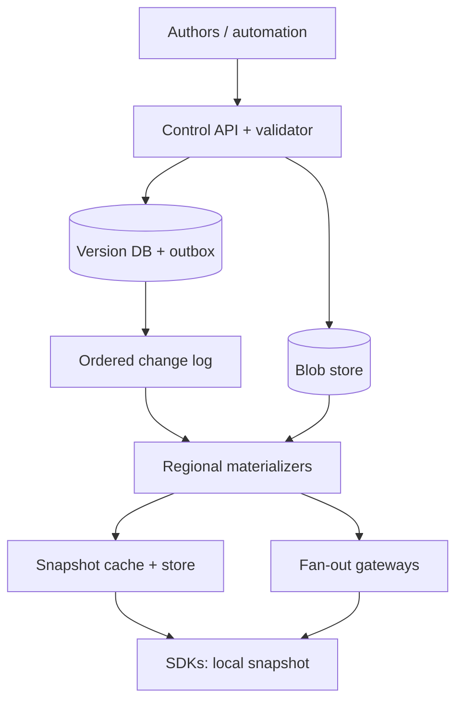
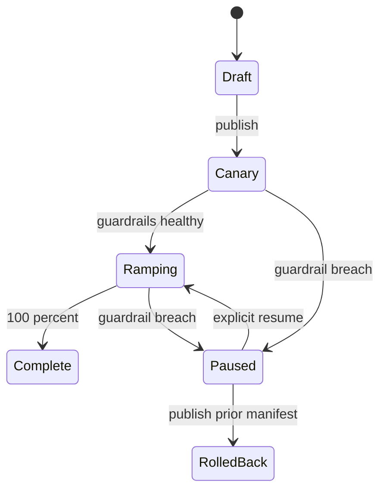

# Design a Global Dynamic Configuration Service

**Difficulty:** Senior / Staff  
**Primary themes:** versioned databases, cache invalidation, ordered streams, rollout safety, multi-region reliability, consistency  
**Interview time budget:** about 45 minutes. This document is deliberately more detailed so you can study the reasoning behind the concise interview version.

This walkthrough follows the public [Hello Interview system-design delivery framework](https://www.hellointerview.com/learn/system-design/in-a-hurry/delivery): requirements, core entities, API, high-level design, then focused deep dives. The design and dialogue below are original.

## Interviewer prompt

> Design a global dynamic configuration service used by backend services, mobile apps, and edge workers. Teams should be able to create versioned configuration, roll it out safely, and have clients observe changes quickly without redeploying.

## Targeted clarifying questions

**Candidate:** “Is this a typed key-value service, or must it support arbitrary files and secrets?”  
**Interviewer:** “Typed JSON values up to 64 KB. Secrets are out of scope; assume a separate secrets manager.”

**Candidate:** “Who writes and who reads?”  
**Interviewer:** “Authenticated engineers and deployment automation write. SDKs embedded in services read. Mobile clients receive only explicitly public keys through a separate edge endpoint.”

**Candidate:** “Do we need feature-flag targeting?”  
**Interviewer:** “Support deterministic percentage rollouts and targeting by stable attributes such as region, environment, or account tier. A full experimentation platform is out of scope.”

**Candidate:** “What scale and freshness should I design for?”  
**Interviewer:** “Ten million connected SDK instances, 100 million configuration evaluations per second, 10,000 writes per second at peak, and 99.9% of healthy connected clients should observe an emergency update within five seconds.”

**Candidate:** “What consistency guarantee matters most?”  
**Interviewer:** “A client must never move backward within a configuration scope. Authors need read-your-writes. Global convergence can be eventual, but an emergency disable should propagate fast. If the control plane is unavailable, clients should continue from their last known good snapshot.”

**Candidate:** “Should a multi-key release be atomic?”  
**Interviewer:** “Yes. A release may change several keys; clients must see the old release or the new release, never a mixture.”

**Candidate:** “What history and rollback behavior do we need?”  
**Interviewer:** “Keep an immutable audit history for one year and support rollback by publishing a new release that points to prior values. Do not rewrite history.”

**Candidate:** “Single cloud or multi-region?”  
**Interviewer:** “Three active read regions. A home region serializes writes for each configuration scope. Survive a regional read-plane failure and tolerate a control-plane failover with a brief write pause.”

### Scope assumptions

In scope: namespaces, typed keys, immutable releases, validation, percentage/attribute targeting, staged rollout, streaming or polling updates, SDK caching, audit, rollback, and emergency disable.

Out of scope: secret storage, arbitrary code execution in rules, statistical experiment analysis, human approval workflow implementation, and billing.

> **What I would say aloud:** “The load is overwhelmingly reads and evaluations, but correctness lives in a low-volume versioned write path. I’ll separate a strongly controlled publication plane from a highly available distribution and evaluation plane.”

## 1. Requirements (~5 minutes)

### Core functional requirements

1. **Author and publish configuration.** Create or update keys, validate a draft, and atomically publish an immutable multi-key release.
2. **Distribute and evaluate releases.** SDKs bootstrap a snapshot, receive deltas, and deterministically select the correct variant for a context.
3. **Operate safely.** Stage rollouts, monitor progress, pause or roll back, issue an emergency disable, and retain an audit trail.

### Quantified non-functional requirements

| Requirement | Target | Design consequence |
|---|---:|---|
| Evaluation capacity | 100M evaluations/s | Evaluation must be local in SDKs; no network call per decision |
| Connected clients | 10M | Persistent streams need regional fan-out tiers, not direct DB subscriptions |
| Write throughput | 10K mutations/s peak | Partition the control store by scope; batch drafts into releases |
| Update freshness | 99.9% within 5s; emergency p99 within 2s | Push invalidations/deltas, plus polling repair path |
| Availability | 99.99% evaluation; 99.9% authoring | Last-known-good client cache and separate failure domains |
| Monotonicity | Never apply a lower release sequence in one scope | Per-scope ordered versions and compare-before-apply |
| Atomicity | All keys in a release change together | Publish a manifest pointer atomically, not independent key writes |

### Consistency and availability contract

- A configuration **scope** is `(tenant, application, environment, namespace)`. All releases inside a scope receive a strictly increasing `release_seq` from one logical leader.
- Publishing is linearizable within a scope: after success, an author reading through the control-plane API sees that release.
- Distribution is eventually consistent, with bounded operational targets rather than a mathematical bound. Clients may temporarily remain on an older complete release.
- Each client applies releases monotonically and atomically: old complete snapshot → new complete snapshot. Gaps trigger snapshot repair.
- During a partition, the read plane chooses availability and serves the last known good release. The write plane chooses consistency and pauses publication if the scope leader cannot safely establish exclusive ownership.

This is more precise than saying “strong consistency” or “eventual consistency” for the whole system. Different paths need different contracts.

> **What I would say aloud:** “I’m choosing CP behavior for publication and AP behavior for evaluation. A stale feature setting is usually safer than either blocking every request or applying a torn release.”

## 2. Core entities (~2 minutes)

Start with nouns, not a full schema. This mirrors Hello Interview’s guidance to identify core entities before discovering fields during the design.

| Entity | Purpose |
|---|---|
| `Scope` | Isolation and ordering boundary for an application namespace |
| `ConfigKey` | Name, type, schema, visibility, and ownership metadata |
| `Draft` | Mutable candidate set of key values and rollout rules |
| `Release` | Immutable, atomically published configuration version |
| `ReleaseManifest` | Complete mapping from keys to content-addressed value/rule blobs |
| `Rollout` | Desired exposure, targeting constraints, state, and schedule |
| `ClientCursor` | Client’s last applied `release_seq` and stream position |
| `AuditEvent` | Immutable record of actor, action, reason, and before/after references |

> **What I would say aloud:** “The key entity is the release, not the individual key. Making releases immutable gives us atomic client snapshots, auditability, cache-safe identifiers, and rollback by republishing.”

## 3. API and system interface (~5 minutes)

Identity comes from the authentication layer. The server derives `actor_id`, tenant membership, roles, and permitted environments from the token; clients cannot choose an actor in the body.

### Create or update a draft

```http
PUT /v1/scopes/{scope_id}/drafts/{draft_id}/keys/search.timeout_ms
Authorization: Bearer <token>
If-Match: "draft-etag-41"
Idempotency-Key: 8d2217...
Content-Type: application/json

{
  "type": "integer",
  "value": 850,
  "constraints": {"min": 50, "max": 5000}
}
```

```json
{
  "draft_id": "dr_72",
  "etag": "draft-etag-42",
  "validation": "VALID"
}
```

`If-Match` prevents two authors from silently overwriting each other. The idempotency key makes network retries safe.

### Publish a release

```http
POST /v1/scopes/{scope_id}/releases
Authorization: Bearer <token>
Idempotency-Key: 48fa30...
Content-Type: application/json

{
  "draft_id": "dr_72",
  "expected_base_release_seq": 1184,
  "reason": "Reduce search timeout after dependency recovery",
  "rollout": {
    "percentage_bps": 1000,
    "stickiness_key": "account_id",
    "conditions": [{"attribute": "region", "op": "IN", "values": ["us-east"]}]
  }
}
```

```json
{
  "release_id": "rel_01J...",
  "release_seq": 1185,
  "status": "PUBLISHED",
  "manifest_hash": "sha256:ab71..."
}
```

The base sequence is optimistic concurrency control: if another release won, the caller gets `409 Conflict` and rebases deliberately.

### Bootstrap an SDK

```http
GET /v1/sdk/scopes/{scope_id}/snapshot?after_seq=1179
Authorization: Bearer <workload-identity-token>
```

```json
{
  "scope_id": "payments/prod/runtime",
  "release_seq": 1185,
  "manifest_hash": "sha256:ab71...",
  "expires_at": "2026-10-21T05:10:00Z",
  "keys": {
    "search.timeout_ms": {
      "type": "integer",
      "variants": {"control": 1000, "candidate": 850},
      "rule": {"percentage_bps": 1000, "salt": "f91d..."}
    }
  },
  "signature": "base64..."
}
```

The snapshot is signed so an SDK can reject corrupted or spoofed cached data.

### Watch for changes

```text
Watch(scope_id, after_release_seq=1185) -> stream Update

Update {
  release_seq: 1186,
  manifest_hash: "sha256:9c2e...",
  changed_blob_refs: [...],
  emergency: false
}
```

The stream is a notification mechanism, not the only source of truth. A reconnecting client resumes from its sequence; on a gap or expired retention window, it fetches a full snapshot.

### Evaluate locally

```text
value = sdk.get(
  key="search.timeout_ms",
  context={"account_id":"acct_91", "region":"us-east", "tier":"pro"}
)
```

The SDK performs type checks, rule matching, and deterministic bucketing without exposing the entire private rule set to public mobile clients.

### Roll back

```http
POST /v1/scopes/{scope_id}/releases/{bad_release_id}:rollback
Authorization: Bearer <token>
Idempotency-Key: c7506a...

{"reason":"Error rate exceeded guardrail"}
```

This creates release 1187 whose manifest reuses blobs from 1184. It does not decrement the sequence or mutate release 1186.

## 4. Data flow

The system has two coupled flows:

1. **Publication:** draft mutation → validation → immutable blobs and manifest → transactional head update → outbox event.
2. **Distribution:** outbox relay → partitioned change log → regional materializers → fan-out gateways → SDK atomic apply → telemetry.

The durable release is committed before notification. This avoids telling clients about data that does not exist. A transactional outbox stores the release row and its pending event in the same database transaction; a relay later publishes the event at least once.

## 5. High-level design (~10–15 minutes)

### Build operation 1: author and atomically publish

Begin with the simplest correct control plane.

- An API gateway authenticates the engineer or deployment job and rate-limits by tenant.
- The Configuration Service authorizes the scope and updates drafts in a relational control database.
- A Validator checks type schemas, key ownership, rule syntax, forbidden attributes, release size, and references.
- On publish, the service writes value/rule blobs to durable object storage keyed by SHA-256. Identical content is deduplicated.
- In one database transaction it locks the scope head, verifies `expected_base_release_seq`, increments the sequence, inserts the immutable release and manifest reference, updates the head pointer, and inserts an outbox row.

Relevant fields emerge here:

```text
Scope(scope_id, tenant_id, home_region, head_release_seq, fencing_epoch)
Release(scope_id, release_seq, release_id, manifest_hash, actor_id,
        created_at, reason, previous_release_seq, status)
Manifest(manifest_hash, object_uri, byte_size, schema_version)
Outbox(event_id, scope_id, release_seq, payload, published_at)
```

Why a relational database? The write rate is modest relative to the read rate, and transactions, uniqueness constraints, compare-and-set updates, and audit queries are valuable. Partition tables by `hash(scope_id)` and keep each scope’s writes in one partition. We can move a hot scope to a dedicated partition later.

### Build operation 2: distribute without putting reads on the database

The outbox relay publishes `ReleasePublished(scope_id, release_seq, manifest_hash)` to a durable log partitioned by `scope_id`. Partitioning preserves release order for a scope. Delivery is at least once; all consumers are idempotent on `(scope_id, release_seq)`.

Regional materializers consume the log, fetch and verify manifests and blobs, and populate:

- a regional snapshot store for durable read serving;
- a distributed cache keyed by `(scope_id, release_seq)` and `manifest_hash`;
- fan-out gateways that maintain subscriptions from SDKs.



### Build operation 3: bootstrap, watch, and evaluate

On startup, an SDK loads a signed snapshot from local disk so application startup is not coupled to the service. In parallel it authenticates to the nearest regional read plane and requests a snapshot newer than its cached sequence.

The snapshot endpoint checks the regional cache, falling back to the regional snapshot store—not the primary control database. It returns either `304 Not Modified`, a compact delta, or a full snapshot.

The SDK then opens a watch stream. A gateway groups subscribers by scope. One upstream scope subscription can feed many local client connections, avoiding ten million independent consumers on the durable log. Heartbeats detect dead connections; reconnects use jittered exponential backoff.

For every update, the SDK:

1. rejects `release_seq <= applied_seq`;
2. detects a gap if `release_seq > applied_seq + 1` and requests repair;
3. downloads missing immutable blobs, verifies hashes and signature;
4. builds a new snapshot off the request path;
5. atomically swaps one pointer to the new snapshot;
6. persists it as last known good and reports an acknowledgment asynchronously.

Application threads only read the immutable in-memory pointer, so evaluation is microseconds and lock-free in common implementations.

### Build operation 4: deterministic rollout and rollback

For percentage rollout, use a stable pseudorandom bucket:

```text
bucket = uint64(HMAC-SHA256(release_salt, stickiness_value)) mod 10_000
candidate = bucket < percentage_bps
```

HMAC prevents users from choosing identifiers to manipulate assignment. A stable `stickiness_value` such as account ID keeps a user in the same cohort as exposure increases. Store a stable rule salt when cohort continuity across releases is desired; rotate it when reshuffling is intentional.

Rules are evaluated in a deterministic order and compiled into a safe intermediate representation. Unknown attributes make a condition false; an invalid snapshot is rejected wholesale. Rollback publishes a newer release, preserving monotonicity.

### Scale estimates that change the design

**Local evaluation:** 100M evaluations/s cannot traverse a network. At even 1 ms per remote call, cost and failure coupling are unacceptable. This forces SDK-side evaluation.

**Connections:** 10M persistent clients across three regions is roughly 3.3M per region. If one gateway safely handles 25,000 mostly idle streams, the baseline is about 132 gateways per region; provisioning 200 provides headroom and maintenance capacity.

**Fan-out bandwidth:** assume an average compressed delta of 2 KB and 2M subscribed clients for a very hot global scope. A naive broadcast is 4 TB of egress for one update. Scope-level aggregation does not remove last-mile bytes, so we add hierarchical gateways, delta encoding, blob deduplication, and randomized pull for non-urgent large updates. Emergency messages stay tiny—typically a head pointer plus a few inline kill-switch values.

**Writes:** 10K mutations/s × 86,400 ≈ 864M draft mutations/day at peak if sustained, but published releases are likely much lower. Coalescing draft edits and storing only published immutable releases in the hot distribution path keeps the log manageable.

## 6. Deep dives (~10–15 minutes)

### Deep dive A: atomic releases and monotonic clients

#### Where the baseline breaks

Writing each key separately creates torn configuration: service A may see a new endpoint with an old credential mode, or one process may see incompatible limits. Multi-region writers can also create split-brain sequence assignments. Finally, an old delayed message can overwrite a newer client snapshot.

#### Plausible approaches

| Approach | Strength | Failure or cost |
|---|---|---|
| Update keys independently | Simple writes | Torn releases and hard rollback |
| Distributed transaction across all regional stores | Strong global visibility | High latency, low availability, operational complexity |
| Immutable manifest plus atomic head pointer | Atomic scope release; cheap rollback | Clients may temporarily lag |

#### Selection and evolution

Choose the immutable manifest and atomic head. One home-region leader serializes a scope. It assigns `release_seq` under a database transaction. The manifest refers only to immutable, content-addressed blobs already durably stored. Publication becomes one small atomic metadata change.

Leader failover uses a lease with a monotonically increasing `fencing_epoch`. Every publish transaction includes the epoch; an old leader cannot write after a newer epoch is installed. Promotion pauses writes until the replica has caught up and exclusive leadership is established. Reads continue from cached snapshots.

Clients compare sequences before swap. They never reconstruct a release by merging arbitrary deltas: a delta says how to obtain a complete manifest, and the SDK validates the resulting manifest hash before installation.

**Failure modes and controls**

- Blob upload succeeds but DB transaction fails: unreferenced blobs are garbage-collected after a safety window.
- DB commit succeeds but log publish fails: the outbox relay retries until `published_at` is recorded.
- Duplicate events: materializers and clients ignore already applied sequences.
- Missing event: sequence-gap detection triggers snapshot repair.
- Corrupt cache entry: hash/signature verification rejects it and falls back to the durable snapshot store.

**Observability:** publish transaction latency, outbox age, maximum replication lag, sequence gaps, snapshot verification failures, and count of scopes with conflicting leader epochs.

> **What I would say aloud:** “The atomic unit is a manifest pointer. I spend strong consistency only on advancing that pointer; immutable content and idempotent propagation let the rest of the system scale.”

### Deep dive B: five-second global propagation without a thundering herd

#### Where the baseline breaks

Polling every five seconds means 10M / 5 = 2M requests/s even when nothing changes. Directly attaching every SDK to the log overwhelms brokers and exposes internal retention semantics. Broadcasting a large snapshot to all clients simultaneously overloads gateways, cache, and network.

#### Plausible approaches

| Approach | Freshness | Cost and behavior |
|---|---|---|
| Periodic polling | Bounded by interval | Simple but constant load and synchronized bursts |
| One push stream per client from log | Fast | Broker connection explosion; weak isolation |
| Hierarchical push plus repair polling | Fast common path | More gateway state, but bounded backend fan-out |

#### Selection and evolution

Use hierarchical push. Durable log consumers feed regional scope hubs. Hubs forward small notifications to gateway shards; gateways multiplex them to clients. Clients pull immutable content from cache or an object/CDN endpoint, so the stream path does not carry every large value.

Partition gateway ownership by rendezvous hashing on `(scope_id, client_id)` to spread a hot scope. Cap per-tenant connections and bytes. For ordinary updates, add up to a few seconds of deterministic jitter derived from client ID. This flattens downloads while meeting the five-second objective. Emergency updates bypass most jitter and may inline a tiny signed override.

Backpressure is explicit:

- Each connection has a small coalescing buffer containing only the newest release per scope.
- If a client is slow, intermediate notifications are dropped; the newest sequence is enough because snapshots are complete.
- If gateway memory crosses a threshold, shed unauthenticated or low-priority public clients first and instruct them to poll.
- A reconnect token carries the last applied sequence, not an unbounded message offset.

The repair path polls with ETags every few minutes and immediately after stream health degrades. Thus a dropped notification does not become permanent divergence.

**Regional failure:** DNS or anycast directs new bootstrap and watch connections to another region. SDKs retain their last known good snapshot during failover. Cross-region caches may be cold, so use request coalescing and per-key single-flight fetches to stop a cache stampede.

**Observability:** publish-to-materialize latency, materialize-to-gateway latency, gateway-to-ack latency, percentage of active clients by release sequence, reconnect rate, dropped/coalesced notifications, cache hit rate, and emergency SLO compliance. Use histograms by region and SDK version; a global average can hide a broken cohort.

> **What I would say aloud:** “Push gives freshness, but push is only an invalidation hint. Immutable snapshots and periodic reconciliation make correctness independent of any single long-lived connection.”

### Deep dive C: safe rollouts, targeting, and fail-safe behavior

#### Where the baseline breaks

Central evaluation cannot handle the read volume. Shipping arbitrary expressions to clients risks inconsistent implementations or code execution. Percentage assignment can churn if hashing inputs or salts change. A bad release can also spread faster than humans can react.

#### Plausible approaches

| Approach | Benefit | Tradeoff |
|---|---|---|
| Server-side evaluation | Central policy and instant changes | Network latency, availability coupling, enormous QPS |
| Client-side arbitrary rules | Flexible and fast | Security and cross-language semantic drift |
| Compiled restricted rules in signed snapshots | Fast, deterministic, auditable | SDK/version governance required |

#### Selection and evolution

Use a restricted rule language compiled by the control plane to a versioned intermediate representation. It supports equality, set membership, numeric comparison, semantic-version comparison, boolean composition, and deterministic bucket operations—no loops, I/O, regex backtracking, or user code. Golden test vectors run against every supported SDK to guarantee identical semantics.

Rollout state is a small state machine:



A rollout controller consumes service health metrics and client acknowledgments. It may recommend or automatically pause exposure, but it cannot mutate history; every percentage change is a new signed release. Guardrail inputs are delayed and imperfect, so emergency disable remains a separate authorized action.

Define behavior for missing and stale data:

- Each key has a typed code default embedded by the application.
- The SDK prefers last known good configuration over the code default when the snapshot signature and maximum-staleness policy remain valid.
- Safety-critical kill switches may be fail-closed or fail-open, chosen per key and reviewed at creation.
- Public mobile snapshots expose only allowlisted keys and omit private targeting logic. Sensitive decisions are evaluated by trusted backend SDKs.

Audit events include actor identity, authorization decision, request ID, base and new sequence, manifest hashes, reason, and rollout policy. Write them to immutable retention storage through a separate consumer; alert if audit lag grows, but do not make distribution depend on the analytics sink.

**Observability:** evaluation errors by key and SDK, unknown rule opcodes, default/fallback rate, cohort distribution, rollout guardrail state, stale-snapshot age, rollback time, and unauthorized publish attempts.

> **What I would say aloud:** “I constrain the rule language so all SDKs can produce the same answer. Rollout safety is not only percentage bucketing—it is stable assignment, guardrails, explicit defaults, and a fast monotonic rollback.”

## 7. Final design

The final system separates concerns cleanly:

- A home-region control plane authenticates authors, validates drafts, and atomically advances a per-scope release head in a relational database.
- Releases and manifests are immutable; large values and rules are content-addressed blobs.
- A transactional outbox publishes ordered per-scope events to a durable log.
- Regional materializers build durable snapshot replicas and warm caches.
- Hierarchical fan-out gateways push small notifications; polling and full snapshots repair missed events.
- SDKs verify, atomically install, persist, and locally evaluate signed snapshots. Sequence checks prevent rollback to an older version.
- Deterministic bucketing, a restricted rule IR, guardrails, audit events, and rollback-as-new-release make changes safe.

### Requirements check

| Requirement | How the design satisfies it |
|---|---|
| Author and publish | Optimistic drafts, validation, RBAC, transactional immutable release |
| Atomic multi-key changes | One manifest and atomic head pointer |
| 100M evaluations/s | Lock-free local SDK evaluation |
| 10M connected clients | Regional hierarchical stream fan-out |
| Fast propagation | Push notifications, warm regional caches, emergency priority path |
| Monotonic clients | Per-scope sequence and compare-before-apply |
| Availability | Local last-known-good snapshot and independent read regions |
| Rollout and rollback | Stable bucketing, staged releases, guardrails, new monotonic rollback release |
| Auditability | Immutable releases plus actor-rich audit events |

### A crisp two-minute closing statement

> “I designed the system around immutable, versioned releases. A strongly consistent home-region transaction advances one scope’s manifest pointer and writes an outbox event. Ordered events populate regional snapshot stores and caches, while hierarchical gateways notify ten million SDKs. SDKs evaluate locally, apply only complete signed releases with increasing sequence numbers, and continue from last known good state during outages. Deterministic bucketing and a restricted rule language provide consistent targeting; staged releases, health guardrails, and rollback-as-a-new-release limit blast radius. The key tradeoff is temporary staleness in exchange for a highly available request path, while publication remains consistent.”

## Realistic interviewer follow-ups with strong sample answers

### 1. Why not use the configuration database directly from every service?

“It would couple application availability and latency to the database and could not sustain 100 million evaluations per second. The database is the publication authority; SDK memory is the evaluation plane.”

### 2. How do you prevent a rollback from violating monotonicity?

“Rollback publishes a new sequence whose manifest reuses old content. Semantic values revert, but protocol version always advances.”

### 3. What if release 1186 arrives before 1185?

“The client sees a gap and fetches the complete current snapshot. It never tries to merge out-of-order partial state.”

### 4. Is exactly-once delivery required?

“No. The log and stream are at least once. Immutable identities and sequence checks make consumers idempotent; correctness comes from snapshots, not delivery magic.”

### 5. How would you move a scope to another home region?

“Pause new publications, replicate through the latest committed sequence, acquire a higher fencing epoch in the destination, update routing metadata, then resume. Old leaders cannot commit with the stale epoch.”

### 6. What is the cache key?

“Immutable objects use content hash; complete snapshots use `(scope_id, release_seq, manifest_hash)`. I avoid a mutable `scope_id -> bytes` cache entry except as a short-lived head pointer.”

### 7. How do clients authenticate without ten million expensive token checks?

“Gateways verify short-lived signed workload tokens locally using cached public keys, then authorize a bounded set of scopes. Revocation uses short TTLs and an emergency denylist stream.”

### 8. How do you handle a hot tenant?

“Partition gateway connections across many shards, aggregate one upstream scope subscription, enforce tenant byte and connection quotas, cache immutable blobs, and isolate the tenant into dedicated capacity if needed.”

### 9. Why not globally synchronous replication?

“The requirement permits brief staleness but needs high evaluation availability. Synchronous global commits would slow and reduce availability of publication without improving the already local request path.”

### 10. How do you delete a key safely?

“Deprecate it first, measure client SDK access telemetry, then publish a tombstone. Old releases retain historical references; current snapshots omit the key and SDKs use their typed default.”

### 11. What if the SDK cannot understand a new rule opcode?

“Snapshots declare a minimum evaluator version. The control plane blocks incompatible publication for known fleets; an old SDK rejects the snapshot and retains last known good rather than guessing.”

### 12. How do you prove two languages bucket users identically?

“Specify canonical UTF-8 encoding, HMAC algorithm, integer endianness, and modulo behavior, then run shared golden vectors in every SDK release.”

### 13. Can the change stream be the database?

“It is the distribution history, not the sole source of truth. We need transactional validation, current heads, audit queries, and snapshot repair. The log may be compacted or have finite retention.”

### 14. What if a client is offline for months?

“Its cursor will fall outside delta retention. It presents its sequence, receives a full current snapshot, verifies it, and resumes watching from the returned sequence.”

### 15. How would mobile delivery differ?

“Use an allowlisted public projection through CDN-friendly polling or platform push hints. Never ship private targeting rules or internal keys. Mobile release uptake is slower, so defaults and schema compatibility matter more.”

### 16. How do you avoid cache stampedes after a region fails?

“Warm popular scopes continuously, use single-flight request coalescing, stale-while-revalidate for validated snapshots, rate-limit origin fetches, and add reconnect jitter.”

### 17. Would acknowledgments be strongly consistent?

“No. They are sampled, aggregated telemetry. Requiring every client ack in the release transaction would destroy availability. We use them to estimate propagation and detect cohorts stuck on old versions.”

### 18. How do you enforce multi-tenancy?

“Tenant appears in every scope key and authorization decision. Storage partitions, encryption keys, quotas, log headers, cache namespaces, metrics, and audit queries preserve that boundary.”

### 19. What is your disaster-recovery objective?

“For evaluation, RTO is effectively zero because clients retain last known good. For publication, target RPO near zero through replicated WAL and RTO of minutes while a new fenced leader is established.”

### 20. What would you simplify for an MVP?

“One write region, two read regions, full snapshots plus long polling, a relational DB and object store, deterministic percentage rules, and manual rollback. I would add hierarchical streams and automated guardrails once scale proves the need.”

## Common pitfalls

- Treating individual key writes as the atomic unit and creating torn releases.
- Saying “eventual consistency” without promising monotonic clients or atomic snapshots.
- Putting a network call on every application evaluation.
- Assuming WebSockets or gRPC streams never drop, with no polling repair path.
- Requiring exactly-once messaging instead of designing idempotent consumers.
- Mutating or deleting old releases, which breaks audit and cache safety.
- Decrementing a version on rollback.
- Ignoring stable bucketing and causing cohort churn during a ramp.
- Sending arbitrary executable rule code to SDKs.
- Letting all reconnecting clients hit origin simultaneously after an outage.
- Forgetting public-client data exposure and shipping private rules to mobile apps.
- Describing caches without keys, invalidation, cold-start behavior, or stale policy.
- Using a global consensus transaction for every read despite a stale-tolerant contract.
- Monitoring average propagation latency without per-region, tenant, and SDK-version breakdowns.
- Drawing many boxes before stating the consistency and failure contract.

## Practice cadence

In a 45-minute interview, aim for:

- 5 minutes: clarify scope, numbers, and consistency contract.
- 2 minutes: name the core entities.
- 5 minutes: define publish, bootstrap/watch, evaluate, and rollback interfaces.
- 10–15 minutes: build publication, distribution, and SDK evaluation paths.
- 10–15 minutes: deep-dive on atomic versioning, fan-out/backpressure, and safe rollout.
- Final 2 minutes: check requirements and summarize tradeoffs.

The educational walkthrough is longer because it explains alternatives, arithmetic, and failure handling. In the live interview, say the bold decisions, draw the compact architecture, and let the interviewer choose which deep dive to expand.
