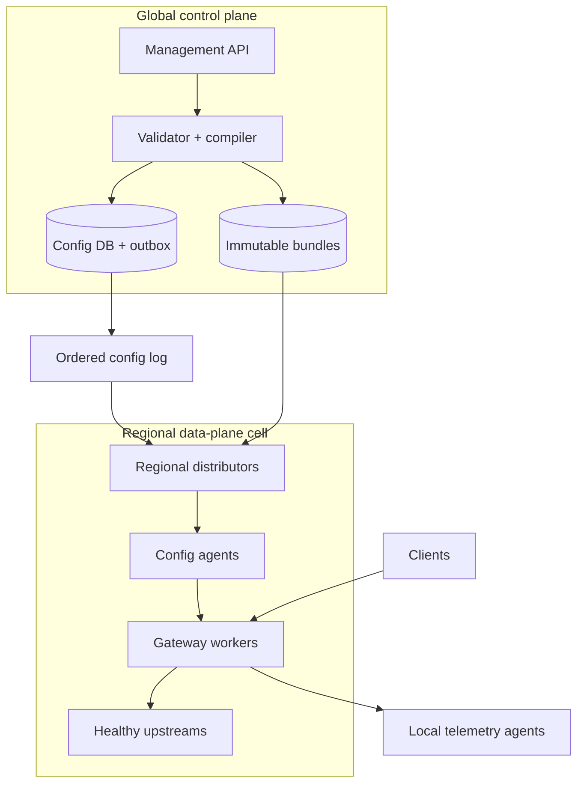

# Design a Global Multi-Tenant API Gateway

**Difficulty:** Senior / Staff  
**Primary themes:** edge routing, control/data-plane separation, caching, ordered configuration streams, overload protection, reliability, consistency, observability  
**Interview time budget:** roughly 45 minutes. This educational walkthrough is intentionally longer so the reasoning, alternatives, calculations, and failure modes are explicit.

This walkthrough uses the public [Hello Interview delivery framework](https://www.hellointerview.com/learn/system-design/in-a-hurry/delivery): establish requirements, name core entities, define interfaces, build a complete high-level design, and then deepen the important bottlenecks. It also follows their guidance to keep the API portion practical and short and to introduce data-model fields beside the components that use them ([API design](https://www.hellointerview.com/learn/system-design/core-concepts/api-design), [data modeling](https://www.hellointerview.com/learn/system-design/core-concepts/data-modeling)). The gateway problem, numbers, architecture, dialogue, protocols, and tradeoffs below are original.

---

## Interviewer prompt

> Design a global, multi-tenant API gateway for a cloud platform. Customers should publish routes and policies, and clients should send HTTP or gRPC traffic through the gateway to customer services. The gateway must authenticate requests, enforce quotas, route safely, survive regional failures, and let configuration changes take effect quickly without interrupting traffic.

## Targeted clarifying questions with assumed answers

**Candidate:** “Is this an application-layer gateway or a general layer-4 load balancer?”  
**Interviewer:** “Application layer. Support HTTP/1.1, HTTP/2, WebSocket upgrades, and gRPC. TLS termination, routing, authentication, rate limits, retries, and basic transformations are in scope.”

**Candidate:** “Who are the tenants and what do they configure?”  
**Interviewer:** “About 50,000 organizations. They configure domains, certificates, routes, upstream service pools, authentication policies, quotas, timeouts, retry rules, and limited header or URL transformations.”

**Candidate:** “What traffic scale and latency should I target?”  
**Interviewer:** “Five million requests per second globally at peak, with ten million concurrent connections. The gateway should add under 10 ms p99 processing latency, excluding time spent in the customer’s upstream.”

**Candidate:** “What availability and configuration freshness do we need?”  
**Interviewer:** “99.999% proxy availability. Normal configuration should reach 99.9% of healthy gateways within five seconds. Emergency certificate revocations or route disables should reach them within one second.”

**Candidate:** “What consistency semantics should config changes have?”  
**Interviewer:** “A route bundle should be atomic: a gateway must use either the old complete bundle or the new complete bundle. A gateway must never go backward. Global convergence may be eventual. The management API needs read-your-writes.”

**Candidate:** “Should requests continue during control-plane outages?”  
**Interviewer:** “Yes. Gateways should use their last known good configuration. New configuration and some new tenant onboarding may pause, but existing traffic should continue.”

**Candidate:** “Where do upstream services run?”  
**Interviewer:** “They may be in multiple cloud regions or private networks. Assume registered endpoints have health signals and geographic metadata. The gateway should prefer a healthy nearby region and fail over according to policy.”

**Candidate:** “Do we need arbitrary customer plug-ins?”  
**Interviewer:** “No arbitrary native code. Allow a small, bounded policy language and optionally sandboxed WebAssembly later. Design the first version without general plug-ins.”

**Candidate:** “What is out of scope?”  
**Interviewer:** “Full CDN object caching, DDoS scrubbing below layer 7, service discovery internals, billing implementation, and a general API marketplace.”

### Scope statement

In scope:

- domain and certificate attachment;
- versioned routes and upstream pools;
- TLS termination and protocol handling;
- API-key, JWT, and mTLS authentication;
- tenant and consumer quotas;
- request routing, bounded retries, circuit breaking, and timeouts;
- safe configuration rollout, rollback, and emergency disable;
- regional failover, audit, metrics, and trace correlation.

Out of scope:

- authoritative DNS implementation;
- layer-3/4 volumetric attack absorption;
- full response-body caching;
- arbitrary customer code in the request process;
- upstream application correctness.

> **What I would say aloud:** “The essential split is a consistent publication plane and an extremely available request plane. I’ll keep configuration off the synchronous request path, compile it into immutable local snapshots, and make every per-request decision from memory.”

---

## 1. Requirements (~5 minutes)

### Core functional requirements

1. **Publish gateway configuration.** A tenant creates domains, routes, upstream pools, authentication, quota, timeout, retry, and transformation policies, validates them, and atomically activates a version.
2. **Process client traffic.** The gateway terminates TLS, identifies the tenant and route, authenticates the caller, enforces policy, selects a healthy upstream, proxies the request, and returns the response.
3. **Operate safely.** The platform supports staged configuration rollout, rollback, emergency revocation, health-based failover, tenant isolation, audit, and debuggable request telemetry.

### Quantified non-functional requirements

| Requirement | Target | Design consequence |
|---|---:|---|
| Peak throughput | 5M requests/s globally | horizontally scaled regional data planes; no database call per request |
| Concurrent connections | 10M | event-driven connection handling and connection-aware load balancing |
| Gateway overhead | p99 < 10 ms | compiled in-memory routing/policy and bounded filters |
| Proxy availability | 99.999% | independent regional cells and last-known-good configuration |
| Config propagation | 99.9% < 5 s | ordered push stream plus snapshot repair |
| Emergency propagation | 99.9% < 1 s | priority revocation channel with tiny messages |
| Atomicity | no mixed route bundle | immutable bundle and atomic pointer swap |
| Monotonicity | no version rollback at a gateway | per-scope sequence and compare-before-apply |
| Tenant isolation | one tenant cannot exhaust shared capacity | hierarchical quotas, fair queues, and cell limits |

### Consistency and availability contract

Define a **gateway scope** as `(tenant_id, environment, gateway_id)`. Each scope has a strictly increasing `config_seq` and an immutable configuration bundle.

- Publishing is linearizable within one gateway scope. Once `activate` succeeds, the management API reads the new head version.
- Distribution is eventually consistent with an operational freshness SLO. Gateways may briefly run different versions, but each gateway uses one complete bundle and advances monotonically.
- The proxy path favors availability during a partition and serves the last known good bundle.
- Security-critical revocations use a separate, tiny, monotonic denylist epoch. A disconnected gateway can continue ordinary routing, but policies may specify a maximum offline age for high-risk credentials.
- Quota enforcement is exact only within a local enforcement cell. Global quotas are bounded-overshoot rather than globally linearizable; the allowed overshoot is stated and monitored.
- A request already accepted under version `N` completes under version `N`; a configuration swap affects newly admitted requests. This avoids changing semantics halfway through a stream.

> **What I would say aloud:** “I’m not claiming the entire product is strongly consistent. Publication is strongly ordered per gateway scope, propagation is eventual and monotonic, and the request path remains available from cached state. Global quota is approximate by design because a cross-region consensus call would violate the latency and availability goals.”

---

## 2. Core entities (~2 minutes)

Name the important nouns before drawing storage tables.

| Entity | Purpose |
|---|---|
| `Tenant` | ownership, plan, limits, and isolation boundary |
| `GatewayScope` | ordered configuration boundary for one tenant environment |
| `Domain` | hostname, TLS mode, and certificate reference |
| `Route` | host/path/method/header match and ordered priority |
| `UpstreamPool` | endpoints, region, protocol, load-balancing and health policy |
| `Policy` | authentication, authorization, quota, timeout, retry, and transformation rules |
| `ConfigBundle` | immutable compiled snapshot of a complete gateway scope |
| `ConfigHead` | current sequence and bundle digest for a scope |
| `QuotaLease` | bounded token allocation from a regional allocator to a gateway cell |
| `RequestRecord` | sampled access result and diagnostic identifiers, not the payload by default |
| `AuditEvent` | actor, operation, reason, and old/new bundle reference |

> **What I would say aloud:** “The publishable unit is a complete config bundle, not a route row. That gives us atomic activation, cache-safe identifiers, reproducible debugging, and rollback by advancing to a new sequence that references an older bundle.”

---

## 3. API and system interface (~5 minutes)

The management API is REST because it is resource-oriented. Internal data-plane protocols use streaming RPC because they need efficient, long-lived bidirectional communication. Identity always comes from the authenticated principal; request bodies cannot assert `actor_id` or tenant ownership.

### Create or update a draft route

```http
PUT /v1/gateways/gw_prod/drafts/dr_91/routes/orders-create
Authorization: Bearer <management-token>
If-Match: "draft-etag-17"
Idempotency-Key: 973c1b...
Content-Type: application/json

{
  "priority": 120,
  "match": {
    "hosts": ["api.example.com"],
    "path_prefix": "/v1/orders",
    "methods": ["POST"]
  },
  "upstream_pool_id": "pool_orders_v3",
  "policy_ids": ["jwt_customer", "quota_orders_write"],
  "timeout_ms": 2000,
  "retry": {"max_attempts": 2, "retry_on": ["connect-failure"]}
}
```

```json
{
  "draft_id": "dr_91",
  "etag": "draft-etag-18",
  "validation": "VALID"
}
```

`If-Match` prevents silent concurrent edits. The idempotency key deduplicates retries of the same mutation. If the same key is reused with a different body hash, the server returns `409 Conflict`.

### Validate a complete draft

```http
POST /v1/gateways/gw_prod/drafts/dr_91:validate
Authorization: Bearer <management-token>
```

```json
{
  "status": "VALID",
  "warnings": [
    {"code": "RETRY_NON_IDEMPOTENT", "route_id": "orders-create"}
  ],
  "estimated_compiled_bytes": 1874321
}
```

Validation detects ambiguous route precedence, missing pools, certificate mismatch, unsupported policy opcodes, unsafe retry combinations, quota hierarchy errors, excessive regex cost, and size limits.

### Atomically activate configuration

```http
POST /v1/gateways/gw_prod/config-versions
Authorization: Bearer <management-token>
Idempotency-Key: a71b9e...
Content-Type: application/json

{
  "draft_id": "dr_91",
  "expected_base_seq": 4812,
  "reason": "Route order writes to orders-v3",
  "rollout": {"mode": "CANARY", "percent": 5}
}
```

```json
{
  "config_seq": 4813,
  "bundle_digest": "sha256:9f01...",
  "status": "ACTIVATING",
  "rollout_id": "ro_723"
}
```

`expected_base_seq` is optimistic concurrency control. If another activation won, the caller rebases instead of overwriting it.

### Inspect rollout status

```http
GET /v1/gateways/gw_prod/config-versions/4813/status
Authorization: Bearer <management-token>
```

```json
{
  "target_seq": 4813,
  "healthy_gateways": 8421,
  "applied": 8388,
  "rejected": 3,
  "p99_propagation_ms": 740,
  "rollout_state": "CANARY"
}
```

Acknowledgments are telemetry, not part of the activation transaction. The publish API does not wait for every gateway.

### Roll back

```http
POST /v1/gateways/gw_prod/config-versions/4813:rollback
Authorization: Bearer <management-token>
Idempotency-Key: f83a90...

{"reason":"Upstream 5xx exceeded guardrail"}
```

Rollback creates sequence `4814` whose bundle reuses the known-good content of `4812`. Sequence numbers never decrease.

### Data-plane request contract

External callers use their normal API:

```http
POST /v1/orders HTTP/2
Host: api.example.com
Authorization: Bearer <caller-token>
Idempotency-Key: order-7f2...
Traceparent: 00-4bf92f...-00f067...-01
```

The gateway returns the upstream response and diagnostic headers that do not leak topology:

```http
HTTP/2 201 Created
X-Request-Id: req_01J...
X-RateLimit-Remaining: 392
```

The client’s idempotency key belongs to the upstream operation. The gateway forwards it but does not assume that two semantically identical requests are duplicates. For gateway-generated retries, it retries only operations classified safe, or operations carrying an upstream-supported idempotency key.

### Internal configuration watch

```text
WatchConfig(cell_id, subscriptions[{scope_id, applied_seq}])
  -> stream ConfigNotice

ConfigNotice {
  scope_id,
  config_seq,
  bundle_digest,
  rollout_selector,
  emergency_epoch
}
```

A notice is a hint to fetch immutable content. On a gap, digest mismatch, or expired delta window, the gateway fetches a complete snapshot.

---

## 4. Data flow

This design has four distinct flows:

1. **Publication:** draft → validation and compilation → immutable bundle → transactional head and outbox.
2. **Distribution:** outbox → ordered scope log → regional distributors → gateway cell → atomic apply.
3. **Request:** connection admission → TLS → tenant/route match → auth → quota → upstream selection → bounded proxy → response.
4. **Telemetry:** local counters and sampled records → regional collectors → metrics, logs, traces, billing aggregates, and anomaly detection.

Separating these flows matters. Configuration storage, telemetry pipelines, and billing must never sit on the synchronous request path.

---

## 5. High-level design (~10–15 minutes)

### Architecture



The data plane is deployed as many independent **cells**. A cell contains gateway workers, a local configuration agent tier, endpoint-health cache, quota enforcers, and telemetry agents. A tenant is assigned to several cells so one software fault or overload event has a bounded blast radius.

### Operation 1: publish an immutable configuration bundle

The management load balancer authenticates an engineer, CI/CD workload, or infrastructure controller. Authorization derives the tenant and permitted environments from the token. The API stores mutable drafts in a relational database.

On validation, the compiler:

1. canonicalizes hostnames, paths, headers, and policy expressions;
2. builds deterministic route precedence;
3. verifies every reference and tenant boundary;
4. rejects unbounded regular expressions and filter graphs;
5. compiles routing tables and policies into a versioned intermediate representation;
6. runs static safety checks for retries, timeouts, and transformations;
7. signs a manifest containing component digests.

The compiled components are content-addressed and uploaded before publication. In one database transaction, the service locks the scope head, verifies the expected base sequence, increments `config_seq`, inserts the immutable version, updates the head pointer, records an audit event, and inserts an outbox record.

Fields emerge beside the component that needs them:

```text
GatewayScope(scope_id, tenant_id, environment, home_region,
             head_config_seq, writer_epoch)

ConfigVersion(scope_id, config_seq, version_id, bundle_digest,
              created_at, actor_id, reason, previous_seq, status)

Bundle(bundle_digest, manifest_uri, compiler_version,
       min_runtime_version, byte_size, signature)

Outbox(event_id, scope_id, config_seq, bundle_digest,
       priority, published_at)
```

A relational or consensus-backed database fits the modest control-plane write rate and provides transactions, uniqueness, audit queries, and compare-and-set semantics. Partition by `hash(scope_id)` so all writes for one scope serialize on one partition.

> **Say aloud:** “I upload immutable content first, then atomically move a small head pointer and outbox row. Orphaned content is cheap to garbage-collect; publishing a pointer to missing content would be much harder to recover from.”

### Operation 2: distribute configuration to gateway cells

An outbox relay publishes `ConfigActivated(scope_id, seq, digest)` to a durable log partitioned by `scope_id`. The relay is at least once. Consumers deduplicate on `(scope_id, config_seq)`.

Regional distributors read the log and materialize bundles used in their region. They verify signatures, compiler versions, and content digests, then place immutable components in a regional store and cache. Each gateway cell has a small number of config agents with upstream subscriptions. Workers subscribe locally to these agents rather than creating millions of direct broker subscriptions.

On notice, a worker:

1. rejects `seq <= applied_seq`;
2. downloads missing content by digest from its local agent or regional cache;
3. verifies signature, hash, runtime compatibility, and memory limits;
4. constructs routing and policy structures off-thread;
5. executes local semantic smoke tests;
6. atomically swaps an immutable root pointer;
7. keeps the prior bundle for rapid rollback and in-flight streams;
8. asynchronously acknowledges success or rejection.

If sequence 4815 arrives while the worker has 4813, it does not blindly merge partial deltas. It asks for the complete current manifest or a verified chain. Correctness comes from immutable snapshots, not from perfect message delivery.

Canary rollout uses a deterministic selector over `cell_id` and `worker_id`. The rollout controller first targets internal and canary cells, compares error, latency, and rejection guardrails, then publishes a larger selector. The bundle itself is immutable; rollout targeting is versioned metadata.

> **Say aloud:** “The stream carries small invalidations, not the entire configuration. A gateway only installs a fully verified snapshot and swaps one pointer, so requests never observe half an update.”

### Operation 3: accept a connection and route a request

Geo-aware DNS or anycast sends the client to a nearby healthy edge region. A regional layer-4 balancer selects a cell and then a gateway worker. For long-lived HTTP/2 or WebSocket connections, load balancing accounts for active connections and bytes, not only new connection rate.

The gateway worker processes a request in a strict bounded pipeline:

1. **Connection admission.** Enforce per-IP, per-tenant, and cell connection limits before expensive work.
2. **TLS.** Select the certificate by SNI, negotiate ALPN, and optionally validate client certificates. Private keys stay in an HSM-backed or isolated key service with short-lived worker material.
3. **Tenant and route match.** Resolve the host to a gateway scope; match method, path, and bounded header predicates using compiled tries and exact-match tables.
4. **Authentication and authorization.** Verify API key, JWT, or mTLS identity locally using cached key material. Derive `consumer_id`; never trust a caller-supplied consumer header.
5. **Quota and overload checks.** Spend local tokens, enforce concurrency limits, and reject early with `429` or `503` when necessary.
6. **Transform.** Apply a bounded allowlisted header/path transformation. Strip hop-by-hop and spoofable identity headers.
7. **Upstream selection.** Filter by health, locality, protocol, and policy, then choose an endpoint using power-of-two choices, least outstanding requests, or consistent hashing for affinity.
8. **Proxy.** Apply connect, per-try, and overall deadlines. Reuse pooled upstream connections.
9. **Retry if safe.** Retry only eligible failures, within a retry budget and remaining deadline.
10. **Return and record.** Stream the response with backpressure; update local counters and emit a sampled record.

The hot path reads immutable memory and local counters. It does not synchronously call the config database, policy database, certificate database, global quota service, log pipeline, or billing system.

### Operation 4: maintain endpoint health and fail over

Upstream endpoint state combines:

- active probes from each serving region;
- passive success, latency, and connection-failure observations;
- service-discovery membership and drain state;
- outlier-ejection state local to a cell.

One failed probe does not globally remove an endpoint. Local passive failures can eject it quickly from one cell, while aggregate health prevents a single noisy observer from causing a global outage.

For a multi-region pool, the gateway prefers the nearest healthy priority group. If the group is unavailable or overloaded, it spills to the next region according to tenant policy. A failover has a bounded concurrency ramp so every gateway does not stampede the recovery region.

Long-lived streams remain pinned unless the connection fails. New requests use the latest health and configuration snapshot.

### Operation 5: observe without overwhelming the platform

At 5M requests/s, writing one 1 KB access event per request would produce 5 GB/s, or about 432 TB/day before replication and indexing. That calculation changes the design.

Each worker maintains in-memory counters and histograms keyed by bounded dimensions such as tenant, route, status class, and upstream region. A local agent aggregates them every few seconds. Full request records are sampled adaptively:

- always retain errors and policy rejections within a capped budget;
- sample a small fraction of successes;
- raise sampling for a route during an incident;
- remove or hash sensitive fields before export.

Metrics go to a time-series system, sampled logs to a partitioned log and object storage, and traces to a trace backend. Billing consumes durable aggregates with reconciliation; it is not derived solely from lossy observability samples.

### Scale estimates that affect concrete choices

**Gateway fleet.** If a worker host safely processes 25,000 mixed requests/s after TLS and policy work, 5M / 25K = 200 hosts is the theoretical global minimum. Provision roughly 2× for regional skew, maintenance, failover, and headroom: about 400 equivalent hosts, divided across independent cells. Real sizing is governed by CPU per filter, connection memory, and network bandwidth, so load tests determine the final instance shape.

**Network.** At an average of 4 KB request plus 8 KB response, 5M requests/s moves roughly 60 GB/s of application payload before protocol overhead. Network capacity and TLS offload can become limiting before request count. Large-body routes need streaming, backpressure, and separate bandwidth quotas.

**Connections.** Ten million connections across 20 active cells averages 500,000 per cell. At even 20 KB of gateway-side state per connection, that is about 10 GB per cell before buffers. Buffer limits and streaming backpressure are first-class capacity controls.

**Configuration.** One million routes at an average 2 KB source representation is roughly 2 GB, too large to broadcast to every worker. Compile and shard subscriptions by assigned tenant/scope; share immutable components within a cell; cap per-tenant route and bundle size. A worker should hold only the scopes it serves, commonly tens to hundreds of MB, not the whole global catalog.

**Quota.** A globally consistent counter at 5M RPS would add a remote dependency to every request. Regional token leases reduce that to periodic allocations. If 100 regions/cells each hold a 1,000-token lease, worst-case crash/partition overshoot is bounded near 100,000 tokens; lease size is chosen from the business tolerance, not arbitrarily.

---

## 6. Deep dives (~10–15 minutes)

## Deep dive A: atomic, monotonic configuration distribution

### Where the baseline breaks

If workers query mutable route rows, one worker may observe a new route with an old authentication policy. Polling the database every second creates load proportional to the fleet even when nothing changes. Direct broker subscription from every worker creates a connection and fan-out bottleneck. Applying deltas in arrival order allows delayed messages to move a worker backward. A malformed configuration can crash the entire fleet if compilation happens in the request process.

### Approaches

| Approach | Advantage | Main limitation |
|---|---|---|
| Workers read mutable database rows | simple source of truth | torn views, database coupling, request-plane outage risk |
| Push individual route deltas | small messages | order/gap handling and partial-state complexity |
| Immutable compiled bundle + atomic head | atomic, cacheable, auditable | bundle build and distribution machinery |

Choose immutable compiled bundles with hierarchical push.

### Publication and ordering

Each gateway scope has one logical writer in its home region. Publication uses a transaction and unique `(scope_id, config_seq)`. Failover grants a higher `writer_epoch`; every commit checks that epoch so a partitioned former leader is fenced.

The bundle manifest resembles:

```text
BundleManifest {
  scope_id,
  config_seq,
  compiler_version,
  min_runtime_version,
  route_table_digest,
  policy_graph_digest,
  upstream_pool_digest,
  certificate_ref_digest,
  emergency_epoch,
  signature
}
```

Components are content-addressed, so a small policy change does not require redownloading an unchanged route table. The manifest is the atomic unit: all referenced components must validate before installation.

### Distribution and repair

The outbox closes the database/log dual-write gap. If the database transaction commits and broker publication fails, the relay retries. Duplicate events are harmless. Regional distributors checkpoint their consumed sequence and retain recent manifests.

Workers persist the last known good bundle to disk. On restart they can serve immediately, then reconcile. The watch stream carries `(seq, digest)`; an ETag-based snapshot endpoint is the repair path. Periodic reconciliation detects silently lost notifications.

### Safe application

Compilation occurs in the control plane, but the runtime still validates defensively. It builds the candidate snapshot outside the hot path, limits memory and rule complexity, runs synthetic route tests, then swaps an atomic pointer. Epoch-based reclamation or reference counting keeps the previous snapshot alive for in-flight requests.

If a bundle is rejected, the worker continues with its last good version and reports a structured error. The rollout controller halts expansion when rejection or request-error guardrails trip.

### Emergency changes

A one-second certificate or credential revocation cannot wait behind a large ordinary bundle. Use a priority channel carrying a compact signed revocation set with a monotonically increasing `emergency_epoch`. Workers apply it as an overlay that can only make access more restrictive. The next full bundle incorporates the overlay.

This overlay must remain deliberately small; otherwise it becomes a second uncontrolled configuration system.

### Failure modes and observability

- **Blob uploaded, transaction fails:** garbage-collect unreferenced blobs after a safety interval.
- **Transaction commits, event missing:** outbox relay republishes.
- **Duplicate/out-of-order event:** compare `config_seq`; ignore stale notices.
- **Gap:** fetch full manifest.
- **Corrupt regional cache:** digest verification fails; fetch another replica.
- **Bad compiler release:** canary by compiler/runtime version; retain previous compiled bundles.
- **Control-plane region loss:** existing proxy traffic continues; establish a higher writer epoch before resuming publication.

Measure publish latency, outbox age, regional materialization lag, gateway applied-version distribution, reject reason, snapshot build time, stale-bundle age, emergency-epoch lag, and control/data-plane dependency violations.

> **What I would say aloud:** “I spend consensus on one small per-scope head update. Immutable content, ordered sequence numbers, digest checks, and snapshot repair let distribution be at least once while every gateway remains atomic and monotonic.”

## Deep dive B: quotas, overload protection, retries, and fairness

### Where the baseline breaks

A single global quota counter adds network latency and becomes an availability bottleneck. Purely local counters allow unbounded global overshoot. Unrestricted queues convert overload into huge latency and memory exhaustion. Naive retries multiply a partial outage: if 10% of five million requests retry twice, the platform creates another one million attempts per second exactly when upstreams are unhealthy.

### Quota hierarchy

Enforce several layers, from cheapest to most specific:

1. edge abuse limits by source/network reputation;
2. tenant connection and bandwidth limits;
3. tenant request-rate and concurrency limits;
4. consumer or API-key limits;
5. route-specific limits;
6. upstream-protection limits.

Use token buckets for request rates because they allow a controlled burst. Use concurrency limiters for expensive operations because request rate alone ignores duration. Use byte-rate buckets for uploads/downloads.

### Regional token leases

A global quota allocator owns the logical budget per window but grants bounded token leases to regional cells. The request path spends tokens locally. A cell requests another lease before exhaustion and returns unused capacity opportunistically.

Tradeoffs:

| Strategy | Accuracy | Availability and latency |
|---|---|---|
| Global counter per request | strongest | unacceptable cross-region dependency |
| Independent regional split | bounded but inflexible | excellent; unused capacity may strand |
| Adaptive regional leases | bounded overshoot and good utilization | allocator complexity |

Choose adaptive leases. Bound worst-case overshoot by maximum outstanding leases and lease TTL. High-value APIs can use smaller leases or regional hard partitions; ordinary APIs use larger leases for efficiency.

When the allocator is unavailable, policy chooses fail-open with a local cap or fail-closed. Authentication and purchase APIs may fail closed; a public read API may continue at a conservative local rate.

### Overload admission and fair queuing

Every cell has hard limits on connections, request memory, CPU, active upstream requests, and queued work. Reject before expensive authentication when a trusted early key is available, but do not trust spoofable tenant headers before SNI/token verification.

Use per-tenant queues with deficit round-robin or weighted fair queuing. A noisy tenant consumes its own queue and concurrency budget instead of filling one global FIFO. Queues are short and deadline-aware; expired work is dropped rather than forwarded late.

Adaptive concurrency control observes latency and error signals per upstream pool. When latency rises beyond the healthy operating point, reduce admitted concurrency. Circuit breakers stop new attempts when failure thresholds are crossed and probe recovery with a limited half-open budget.

### Retry safety

Retries are a budget, not a default checkbox.

- Retry only connect failures, resets before request commitment, or explicitly retryable statuses.
- Do not retry a non-idempotent method unless the upstream supports the passed idempotency key.
- Respect the original request deadline; each retry receives only remaining time.
- Cap attempts, use exponential backoff with jitter, and avoid retrying the same failed endpoint.
- Limit retry attempts to a small percentage of original traffic per upstream, such as 5–10%.
- Never retry because the client disconnected.

Hedged requests can reduce tail latency for idempotent reads, but they duplicate load. Launch a hedge only after a percentile delay, only when spare capacity exists, and include hedges in the retry budget.

### Backpressure

For uploads and streaming responses, propagate downstream slowness to upstream reads. Bound per-stream and per-connection buffers. HTTP/2 flow control prevents one large stream from consuming all connection memory, but implementation limits are still required. If a client is too slow, terminate according to policy instead of buffering indefinitely.

### Failure modes and observability

- **Quota allocator partition:** use remaining lease, then configured fail-open cap or fail-closed behavior.
- **Cell restart:** unspent leased tokens may be temporarily lost; allocator expires leases.
- **Hot tenant:** isolate via fair queue and optional dedicated cells.
- **Retry storm:** retry budget and circuit breaker clamp amplification.
- **Slow upstream:** adaptive concurrency falls; short queues shed load.
- **Telemetry outage:** proxying continues; local aggregates buffer within a fixed disk/memory quota.

Monitor admitted/rejected traffic by reason, lease utilization and overshoot, queue depth and age, active concurrency, circuit state, retry amplification, hedge wins, per-tenant fairness, dropped bytes, and requests that exceeded their deadline before proxying.

> **What I would say aloud:** “The gateway must fail cheaply. I spend quota tokens locally, bound global error with leases, isolate tenants with fair queues, and treat retries as a limited percentage of original traffic so an upstream incident does not become a gateway-created outage.”

## Deep dive C: global routing, tail latency, and failure isolation

### Where the baseline breaks

Sending every request to the geographically nearest region ignores upstream locality and capacity. Global active health can react too slowly, while a single worker’s passive failure signal can overreact. Instant failover of an entire region can overload the backup. A monolithic worldwide gateway fleet lets one bad configuration, certificate library bug, or tenant traffic spike affect everyone.

### Cell-based architecture

Divide each region into independent cells with separate worker pools, local config agents, quota-enforcement capacity, and telemetry buffers. Assign each tenant to multiple cells using deterministic placement plus capacity constraints. The edge director knows only coarse cell health and load; it does not execute detailed route policy.

Cell benefits:

- bounded software and overload blast radius;
- incremental binary and configuration rollout;
- easier capacity accounting;
- evacuation of one cell without draining an entire region.

The cost is some stranded capacity and more operational objects. For a five-nines service, that tradeoff is worthwhile.

### Two-stage routing

1. **Client to edge region/cell.** Anycast or geo-aware DNS chooses a nearby healthy region, then a layer-4 director selects a cell using connection load and tenant placement.
2. **Gateway to upstream endpoint.** The worker uses tenant policy, endpoint health, region priority, latency estimates, and outstanding requests.

The first stage optimizes client-to-gateway latency and failure containment. The second optimizes gateway-to-service behavior. Combining them into one global decision would require too much rapidly changing state at the edge director.

### Load-balancing algorithm

Round robin ignores different request costs and outstanding work. Least-connections can herd when observations are stale. Power of two choices—sample two healthy endpoints and select the one with lower outstanding work—performs well with small state. For session affinity, use consistent hashing with bounded-load fallback so a hot key cannot overload one endpoint.

Locality has a cost function rather than an absolute rule:

```text
score = network_latency
      + outstanding_request_penalty
      + health_penalty
      + cross_region_cost
      + failover_priority_penalty
```

Weights are policy-controlled and tested, not tuned per request by a remote service.

### Health and outlier ejection

Active probes answer “can I connect and get a valid health response?” Passive observations answer “are real requests succeeding?” Keep them separate.

- Eject an endpoint locally after statistically meaningful consecutive or rate failures.
- Cap the fraction of a pool that one worker/cell may eject.
- Aggregate health across cells before changing global membership.
- Use half-open probes to reintroduce endpoints gradually.
- Respect explicit drain state for deploys.

### Regional failover

On regional upstream failure, gateways shift a small fraction to the next priority group and watch latency/error guardrails. They ramp geometrically rather than moving all traffic instantly. Reserve failover headroom or enforce load shedding; failover cannot create capacity that does not exist.

If the edge region itself fails, route new connections elsewhere. Existing TCP connections will break and clients must reconnect. Idempotent client retry guidance and request identifiers make recovery predictable.

### Security and privacy

- TLS private keys are isolated and rotated; certificate references, not raw keys, live in config bundles.
- Management and data-plane identities use separate trust domains.
- JWT keys are cached with issuer/audience constraints and bounded stale policy.
- The gateway strips caller-supplied identity headers and injects signed internal identity context.
- Header/path transformations use a safe bounded language.
- Request bodies are not logged by default; sensitive headers are redacted before sampling.
- Tenant-specific metrics labels are cardinality-limited and access-controlled.
- Configuration bundles and emergency messages are signed and audit-linked.

### Observability and SLOs

Break gateway latency into connection accept, TLS, route match, authentication, quota, queue, upstream connect, upstream time, and response streaming. Record histograms by region, cell, runtime version, tenant tier, route, and upstream pool—within cardinality budgets.

Key alerts:

- gateway-generated 5xx and rejection rate;
- p99 gateway overhead excluding upstream time;
- cell saturation and queue age;
- regional spillover and failover headroom;
- endpoint ejection percentage and flapping;
- configuration-version skew;
- emergency-revocation lag;
- retry amplification;
- authentication fallback or stale-key use.

Use synthetic probes through real public routes and continuous shadow validation of new binaries/config compilers. A global average is insufficient; five nines can be lost in one tenant or region while the fleet average looks healthy.

> **What I would say aloud:** “I use cells to contain faults, two-stage routing to separate client locality from upstream policy, and gradual failover because routing traffic to an unhealthy region is bad, but instantly overwhelming the backup is just a second outage.”

---

## 7. Final design

The completed system has a small consistent control plane and many isolated, availability-first data-plane cells.

The management API stores drafts, validates bounded policies, and compiles deterministic immutable bundles. One fenced writer per gateway scope atomically advances a sequence and writes an outbox event. An ordered log feeds regional distributors, which cache signed content-addressed components. Cell-local agents fan notices to gateway workers. Workers build a candidate snapshot off-thread, verify it, and atomically swap one pointer while retaining the prior last-known-good version.

Clients reach a nearby healthy cell through geo-aware routing and a layer-4 director. A worker performs TLS, compiled route matching, local authentication, hierarchical quota checks, bounded transformations, health-aware upstream selection, deadline-aware proxying, and safe budgeted retries. The hot path reads local immutable state; management stores, quota allocators, and telemetry systems are not synchronous dependencies.

Regional token leases provide bounded global-quota overshoot. Short per-tenant fair queues, adaptive concurrency, circuit breakers, retry budgets, streaming backpressure, and cell limits prevent overload from cascading. Two-stage routing and gradual regional failover balance locality with capacity. Aggregated metrics and sampled logs preserve debuggability without emitting a full high-cardinality record for every request.


### Requirements check

| Requirement | Design response |
|---|---|
| Publish routes and policies | validated drafts, compiled immutable bundle, atomic head |
| 5M requests/s | horizontally scaled cell data planes and local decisions |
| 10M connections | event-driven workers, bounded buffers, connection-aware balancing |
| p99 overhead < 10 ms | compiled in-memory match/policy; no remote hot-path calls |
| 99.999% proxy availability | independent cells, regional failover, last known good config |
| Atomic configuration | verified manifest and atomic pointer swap |
| Monotonic configuration | per-scope sequence and compare-before-apply |
| Fast propagation | hierarchical push, regional cache, repair snapshots |
| Emergency revocation | signed priority overlay with monotonic emergency epoch |
| Tenant isolation | quota hierarchy, fair queues, concurrency and cell limits |
| Upstream resilience | health-aware balancing, deadlines, circuit breakers, bounded retries |
| Audit and debugging | immutable version history, audit events, metrics, sampled logs, traces |

### Polished 90-second closing summary

> “I separate a strongly ordered configuration plane from an availability-first proxy plane. Tenants edit drafts that are validated and compiled into immutable content-addressed bundles. A fenced per-scope transaction advances the config sequence and writes an outbox event; ordered regional distribution lets gateway workers verify a complete snapshot and atomically swap one pointer, while last-known-good state keeps traffic alive during control-plane outages. Clients enter a nearby independent cell. Each request uses only local state for TLS, route matching, auth, quota, transformations, health-aware balancing, and proxying. Regional token leases bound global quota overshoot without a remote counter on every request. Fair queues, adaptive concurrency, circuit breakers, retry budgets, and bounded streaming buffers make overload fail cheaply. Two-stage routing separates edge locality from upstream policy, and failover ramps gradually into reserved capacity. Finally, local aggregation and adaptive sampling make five million requests per second observable without turning telemetry into the bottleneck.”

---

## Realistic interviewer follow-up questions with strong sample answers

### 1. Why separate the control plane and data plane?

> “Their availability and consistency needs differ. Publication needs validation and ordered atomic updates; proxying must continue through management outages. The data plane therefore consumes immutable snapshots and has no synchronous dependency on the control database.”

### 2. What is the atomic unit of configuration?

> “A signed manifest for one gateway scope. It references immutable compiled components. A worker installs all of them and swaps one root pointer, or rejects the whole version.”

### 3. Why not push individual route changes?

> “Individual deltas create ordering, gap, and torn-state problems. I may transfer components incrementally by digest, but correctness is defined by a complete manifest.”

### 4. Is exactly-once delivery required for configuration?

> “No. The log is at least once. Scope sequence numbers, immutable digests, and idempotent consumers handle duplicates. Gap detection and snapshot repair handle loss.”

### 5. What happens if the control plane is down for an hour?

> “Existing gateways continue using persisted last-known-good bundles. Proxy traffic and local enforcement continue. New publications pause, and high-risk policies may fail closed after their configured maximum offline age.”

### 6. How does rollback work without decreasing the version?

> “Publish a new sequence whose manifest points to the previous known-good component digests. Semantics revert, but protocol ordering stays monotonic.”

### 7. How do you propagate a certificate revocation within one second?

> “Use a separate priority stream with a compact signed denylist overlay and monotonic emergency epoch. It can only restrict access, and the next full bundle absorbs it.”

### 8. How do you keep a bad configuration from taking down the fleet?

> “Static validation, deterministic compilation, runtime defensive validation, local smoke tests, canary cells, rollout guardrails, bundle rejection with last-good fallback, and rapid monotonic rollback.”

### 9. Why is global rate limiting approximate?

> “A globally linearizable counter per request violates the latency and availability targets. Regional leases bound overshoot. Lease size and TTL make the error explicit and tunable.”

### 10. How do you calculate worst-case quota overshoot?

> “Sum the maximum unreported or outstanding leases across enforcement cells, plus in-flight local requests. Smaller leases reduce overshoot but increase allocator traffic.”

### 11. What if the quota allocator fails?

> “Cells spend remaining leases. At exhaustion, each policy chooses fail-closed or a conservative fail-open cap. Leases expire so a restarted cell cannot spend them forever.”

### 12. When may the gateway retry a request?

> “Only for explicitly eligible failures, within the original deadline and retry budget. Non-idempotent operations require an upstream-supported idempotency key; otherwise the gateway does not retry them.”

### 13. Does the same idempotency key guarantee the same response body?

> “Not inherently at the gateway. It identifies one upstream operation. The upstream should store the first operation result or resource reference and return it for a matching key and payload hash. Reusing the key with a different payload should conflict.”

### 14. How do you prevent retry storms?

> “Cap retries as a percentage of original traffic, use circuit breakers and adaptive concurrency, respect deadlines, add jitter, and avoid retrying the same failed endpoint.”

### 15. How do you choose an upstream endpoint?

> “Filter by pool membership, locality, health, and policy, then use power-of-two choices on outstanding work. For affinity, use consistent hashing with bounded-load fallback.”

### 16. What if active health says healthy but real traffic fails?

> “Passive outlier detection ejects the endpoint locally. I cap ejection fraction and combine multiple observers before changing global membership, then reintroduce through half-open probes.”

### 17. Why use cells instead of one regional pool?

> “Cells bound failures and noisy-neighbor impact, support staged binary/config rollout, and make evacuation manageable. The cost is some duplicated and stranded capacity.”

### 18. How do long-lived WebSocket and gRPC streams affect design?

> “Balance on active connections and bytes, not only request rate; cap per-connection memory; apply flow control; pin an established stream to its config and endpoint; drain gradually during deploys.”

### 19. How do you avoid logging sensitive data?

> “Bodies are off by default, sensitive headers are removed before export, tenants get allowlisted logging fields, sampling is bounded, and logs are encrypted with tenant-aware access control.”

### 20. How do you keep metrics cardinality under control?

> “Use a fixed label schema, aggregate locally, bound tenant/route dimensions, reject arbitrary header values as labels, and send high-cardinality request IDs only to sampled logs or traces.”

### 21. What if a regional failover overloads the backup?

> “Fail over gradually using concurrency ramps and live guardrails. Reserve headroom, enforce priority shedding, and prefer partial availability over moving all traffic into a second collapse.”

### 22. Where would you use consistent hashing?

> “For optional session or cache affinity, and possibly for stable tenant-to-cell placement. I would not use it blindly for general upstream balancing because endpoint load can be uneven.”

### 23. How are JWT signing keys handled?

> “Fetch and validate issuer key sets outside the hot path, cache by key ID with refresh and bounded staleness, constrain issuer and audience per route, and use a priority revocation path for compromised keys.”

### 24. What would you simplify for an MVP?

> “Start with one control region, two data regions, full immutable bundles, long-poll or streaming config notices, JWT/API-key auth, local token buckets with static regional quota splits, round robin over healthy endpoints, manual rollback, and sampled access logs. Add adaptive leases, cells, and automated rollout guardrails as scale demands.”

---

## Common pitfalls

1. Putting a configuration database lookup on every request.
2. Treating route rows as independently publishable and allowing torn policy state.
3. Claiming “eventual consistency” without atomic snapshots or monotonic gateways.
4. Requiring every gateway acknowledgment before activation returns.
5. Depending on exactly-once delivery rather than idempotent consumers and repair.
6. Broadcasting the entire global route catalog to every worker.
7. Compiling arbitrary customer expressions in the request process.
8. Allowing unbounded regex, transformations, plug-ins, or filter chains.
9. Using one global quota counter synchronously at multi-million RPS.
10. Describing approximate quotas without bounding overshoot.
11. Using one global FIFO queue and letting a noisy tenant starve others.
12. Retrying all 5xx responses, especially non-idempotent requests.
13. Giving retries fresh deadlines instead of using remaining request time.
14. Ignoring retry amplification during upstream failure.
15. Buffering slow uploads or responses without memory limits and backpressure.
16. Treating one failed health probe as global endpoint failure.
17. Failing over an entire region instantly without backup headroom.
18. Balancing only new connection counts while ignoring long-lived streams and bytes.
19. Logging every request synchronously or indexing every high-cardinality field.
20. Storing raw bodies, tokens, or private keys in routine gateway logs/config.
21. Making billing, tracing, or telemetry a proxy-path dependency.
22. Rolling out a new compiler or runtime globally without canary cells.
23. Mutating old configuration versions instead of publishing a new sequence.
24. Forgetting that in-flight requests need the old snapshot to remain alive.

---

## Practice cadence

In a 45-minute interview:

- **0–5 minutes:** clarify application-layer scope, scale, latency, availability, and consistency.
- **5–7 minutes:** name the configuration and request-path entities.
- **7–12 minutes:** define management APIs, data-plane contract, idempotency, and config watch.
- **12–25 minutes:** build publication, distribution, request proxying, health/failover, and telemetry one operation at a time.
- **25–40 minutes:** deep-dive on atomic configuration, overload/retries, and cell-based global routing.
- **40–45 minutes:** check requirements, state tradeoffs, and deliver the closing summary.

The live answer should fit that schedule. This longer walkthrough is for study: it makes the consistency boundaries, calculations, alternatives, and failure behavior explicit so you can choose what to expand when the interviewer directs the conversation.

## Public references

- Hello Interview, [System Design Delivery Framework](https://www.hellointerview.com/learn/system-design/in-a-hurry/delivery)
- Hello Interview, [API Design for System Design Interviews](https://www.hellointerview.com/learn/system-design/core-concepts/api-design)
- Hello Interview, [Data Modeling for System Design Interviews](https://www.hellointerview.com/learn/system-design/core-concepts/data-modeling)

These references support the interview-delivery structure. The prompt, scale, configuration protocol, cell architecture, quota leasing, overload controls, routing design, dialogue, and tradeoffs are original.
