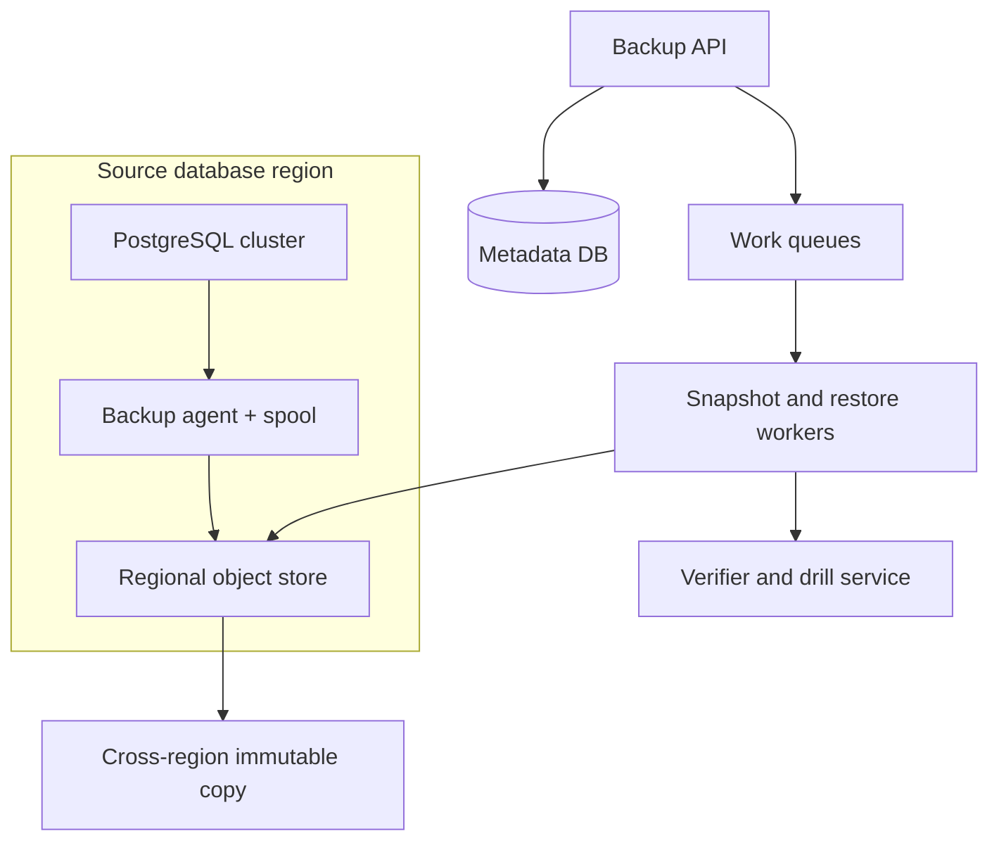
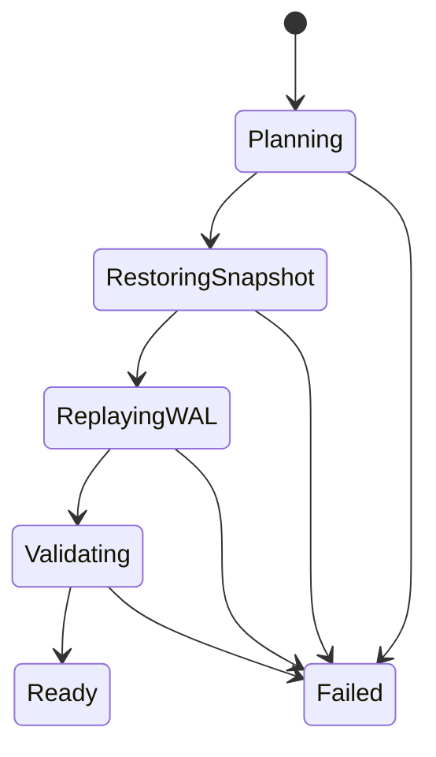
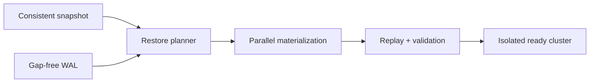

# Design a Multi-Region Database Backup and Point-in-Time Recovery Platform

**Difficulty:** Senior / Staff  
**Primary themes:** databases, consistent snapshots, write-ahead logs, object storage, queues, caching, reliability, consistency, security, observability  
**Interview time budget:** about 45 minutes. This educational walkthrough is deliberately longer so the calculations, alternatives, failure modes, and interview language are explicit.

This walkthrough follows the public [Hello Interview system-design delivery framework](https://www.hellointerview.com/learn/system-design/in-a-hurry/delivery): clarify requirements, identify core entities, define interfaces, build a complete design, and then deepen the load-bearing decisions. It also follows their guidance to keep the API section practical and brief and to introduce data-model details near the components that need them ([API design](https://www.hellointerview.com/learn/system-design/core-concepts/api-design), [data modeling](https://www.hellointerview.com/learn/system-design/core-concepts/data-modeling)). The problem, numbers, architecture, dialogue, protocols, and tradeoffs below are original.

---

## Interviewer prompt

> Design a managed backup and point-in-time recovery platform for relational databases. Customers should be able to protect databases running in multiple regions, choose retention policies, restore a full database to a chosen point in time, and verify that backups are actually recoverable. The service must tolerate regional failures and accidental deletion while controlling storage and restore cost.

## Targeted clarifying questions with assumed answers

**Candidate:** “Which database engines and deployment models are in scope?”  
**Interviewer:** “Start with managed PostgreSQL-compatible clusters. The database service exposes snapshot and write-ahead-log APIs. Later we may add MySQL. Do not design the database engine itself.”

**Candidate:** “What recovery guarantees should we target?”  
**Interviewer:** “For the premium tier, recovery point objective, or RPO, is under five minutes and recovery time objective, or RTO, is under 30 minutes for a 5 TB database. Standard tier may have a one-hour RPO and four-hour RTO.”

**Candidate:** “How much scale?”  
**Interviewer:** “Protect 100,000 database clusters. The median database is 500 GB, the 99th percentile is 20 TB, and total logical protected data is 100 PB. Across all databases, change logs arrive at 20 GB/s average and 60 GB/s peak.”

**Candidate:** “Must a backup be transactionally consistent?”  
**Interviewer:** “Yes. A restore must correspond to a valid database state. Cross-database transactions are out of scope; consistency is per database cluster.”

**Candidate:** “Can backup work affect production traffic?”  
**Interviewer:** “Minimally. Do not pause writes for a full snapshot. Backup CPU, I/O, and network usage must be throttled, and the system should prefer replicas where possible.”

**Candidate:** “What failures must we survive?”  
**Interviewer:** “Worker crashes, duplicate events, corrupted objects, loss of one availability zone, and loss of the source region. A tenant administrator accidentally deleting the source database or backup must not immediately destroy all recovery copies.”

**Candidate:** “What restore operations are required?”  
**Interviewer:** “Restore to a new isolated cluster at a timestamp or named recovery point. In-place restore is out of scope for the first version. Customers need progress, cancellation before cutover, and an auditable final result.”

**Candidate:** “Are backup search, analytics, and cross-engine migration in scope?”  
**Interviewer:** “No. Also exclude arbitrary table-level restore, continuous active-active replication, and application-consistency hooks for external systems.”

### Scope statement

In scope:

- scheduled and on-demand full or incremental backups;
- continuous write-ahead-log, or WAL, archival for point-in-time recovery;
- policy-based retention and legal hold;
- encrypted, immutable, cross-region backup storage;
- restore planning, execution, validation, and cutover to a new cluster;
- automated recovery drills, audit, metrics, and cost controls.

Out of scope:

- implementing PostgreSQL replication or WAL semantics;
- cross-database atomic snapshots;
- table-level logical export/import;
- active-active disaster recovery;
- application data correctness beyond database recovery.

> **What I would say aloud:** “I’ll separate the durable backup data plane from the orchestration control plane. The key correctness rule is that every recovery point must have a consistent base snapshot plus a gap-free WAL chain up to the requested timestamp.”

---

## 1. Requirements (~5 minutes)

### Core functional requirements

1. **Protect a database.** A tenant attaches a backup policy; the platform schedules consistent snapshots, continuously archives WAL, encrypts and replicates objects, and enforces retention.
2. **Restore to a point in time.** A tenant chooses a database and timestamp; the platform proves recoverability, provisions a new cluster, restores a base snapshot, replays WAL to the target, validates it, and returns connection information.
3. **Operate and prove safety.** The platform verifies checksums and WAL continuity, runs automated restore drills, supports legal holds and delayed deletion, isolates tenants, and exposes audit and progress.

### Quantified non-functional requirements

| Requirement | Target | Design consequence |
|---|---:|---|
| Protected clusters | 100,000 | partitioned metadata and horizontally scaled schedulers |
| Logical protected data | 100 PB | incremental snapshots, deduplication where safe, lifecycle tiers |
| WAL ingest | 20 GB/s average, 60 GB/s peak | direct multipart upload, regional buffers, partitioned manifests |
| Premium RPO | p99 under 5 minutes | continuous WAL archival and lag alarms |
| Premium RTO | p99 under 30 minutes for 5 TB | parallel restore, regional staging, pre-provisioned capacity |
| Control-plane availability | 99.99% | multi-AZ metadata and idempotent orchestration |
| Stored-data durability | at least 11 nines per region plus independent copy | erasure-coded object storage, cross-region replication, scrub |
| Restore correctness | no acknowledged unrecoverable recovery point | gap checks, hashes, signed manifests, regular drills |
| Deletion protection | 7-day minimum recovery window | immutable object lock and two-phase tombstones |

### Consistency and availability contract

- Policy mutations and restore-job creation are linearizable per protected database. The API provides read-your-writes.
- Backup creation is asynchronous. A recovery point becomes `AVAILABLE` only after its snapshot manifest, required WAL range, checksums, encryption metadata, and replication policy are durably committed.
- The data path uses at-least-once upload and messaging. Objects are immutable and named by stable IDs or content digests, so retries are idempotent.
- WAL visibility may lag, but the service never advertises a recoverable timestamp beyond the last contiguous, verified log sequence number.
- During a control-plane outage, agents continue spooling and uploading WAL with cached credentials. New policies and restores may pause; existing protection continues within bounded local capacity.
- Deletion is intentionally not immediately consistent. A logical tombstone hides a backup, while object-lock retention prevents physical deletion until the safety window and legal holds expire.

**Definitions:** RPO is the maximum data loss measured backward from a failure. RTO is the target time to make the restored system usable. A write-ahead log records changes before data pages are considered committed; replaying it after a snapshot reconstructs later database states.

> **What I would say aloud:** “Availability cannot mean lying about durability. Upload and cataloging are asynchronous, but `AVAILABLE` is a strong promise: the manifest is durable, the WAL interval is gap-free, and every referenced object is verified.”

---

## 2. Core entities (~2 minutes)

| Entity | Purpose |
|---|---|
| `Tenant` | ownership, quota, keys, billing, and isolation boundary |
| `ProtectedDatabase` | source cluster identity, engine, topology, and current protection state |
| `BackupPolicy` | frequency, retention, regions, tier, bandwidth cap, and legal-hold rules |
| `Snapshot` | consistent base image with engine checkpoint and immutable manifest |
| `Chunk` | encrypted data object referenced by a snapshot |
| `WALSegment` | immutable log interval with start/end LSN and time bounds |
| `RecoveryWindow` | contiguous recoverable range derived from snapshot and WAL coverage |
| `RestoreJob` | requested target, state machine, progress, leases, and result |
| `VerificationRun` | checksum, continuity, or full restore-drill outcome |
| `DeletionTombstone` | requested deletion, grace deadline, approvals, and hold state |
| `AuditEvent` | actor, action, reason, and immutable resource references |

An LSN, or log sequence number, is a monotonically increasing position in PostgreSQL’s WAL. It is more reliable than wall-clock time for proving continuity. Timestamp-to-LSN mapping is stored as indexed metadata, but restore correctness is expressed in LSN ranges.

> **What I would say aloud:** “The manifest is the unit of truth. It pins a database checkpoint and every immutable chunk required to materialize it. A recovery window then combines that snapshot with a contiguous WAL interval.”

---

## 3. API and system interface (~5 minutes)

Identity and `tenant_id` come from the authenticated principal, never from a trusted request-body field.

### Create a protection policy

```http
POST /v1/protected-databases/db_7/policies
Authorization: Bearer <token>
Idempotency-Key: 7cb9...
Content-Type: application/json

{
  "tier": "PREMIUM",
  "snapshot_interval_hours": 6,
  "retention_days": 35,
  "replica_regions": ["us-west-2"],
  "max_source_mib_per_sec": 200,
  "deletion_grace_days": 7
}
```

```json
{
  "policy_id": "bp_91",
  "version": 1,
  "effective_at": "2026-10-23T06:00:00Z"
}
```

The idempotency record stores `(tenant, key, request_hash, response)`. Reusing a key with a different body returns `409 Conflict`.

### Create an on-demand recovery point

```http
POST /v1/protected-databases/db_7/recovery-points
Authorization: Bearer <token>
Idempotency-Key: 60f1...

{"label":"before-schema-migration"}
```

```json
{
  "recovery_point_id": "rp_804",
  "state": "CAPTURING",
  "operation_id": "op_552"
}
```

This does not block until terabytes are copied. It records a durable intent and returns an operation resource.

### Query recoverability

```http
GET /v1/protected-databases/db_7/recovery-window
Authorization: Bearer <token>
```

```json
{
  "earliest_time": "2026-09-18T02:00:00Z",
  "latest_verified_time": "2026-10-23T05:41:12Z",
  "rpo_lag_seconds": 78,
  "gaps": []
}
```

The API reports the latest **verified contiguous** point, not merely the latest object received.

### Start a point-in-time restore

```http
POST /v1/restores
Authorization: Bearer <token>
Idempotency-Key: d882...
Content-Type: application/json

{
  "source_database_id": "db_7",
  "target_time": "2026-10-23T05:30:00Z",
  "target_region": "us-east-2",
  "target_shape": "db.r8g.16xlarge",
  "network_id": "net_44",
  "validation": "FULL"
}
```

```json
{
  "restore_id": "rst_301",
  "state": "PLANNING",
  "estimated_source_bytes": 5368709120000
}
```

### Inspect progress

```http
GET /v1/restores/rst_301
Authorization: Bearer <token>
```

```json
{
  "state": "REPLAYING_LOG",
  "base_snapshot_id": "snap_188",
  "bytes_restored": 5368709120000,
  "wal_replayed_through": "0/9A34F210",
  "target_lsn": "0/9C118A00",
  "estimated_seconds_remaining": 246,
  "cancelable": true
}
```

### Internal agent protocol

```text
BeginSnapshot(database_id, snapshot_id, checkpoint_lsn, policy_version)
UploadChunk(snapshot_id, chunk_id, digest, ciphertext_length, part_etags)
CommitSnapshot(snapshot_id, signed_manifest_digest)
ArchiveWAL(database_id, timeline_id, start_lsn, end_lsn,
           min_commit_time, max_commit_time, digest, object_uri)
Heartbeat(database_id, durable_lsn, uploaded_lsn, local_spool_bytes)
```

The agent receives short-lived, database-scoped upload credentials. It cannot list or delete another tenant’s objects.

---

## 4. Data flow

1. **Snapshot flow:** scheduler leases work → database produces checkpoint metadata → agent reads pages or storage blocks → chunker compresses/encrypts → object store → manifest commit → verifier.
2. **Continuous log flow:** database emits WAL → local durable spool → multipart object upload → segment catalog → continuity aggregator → recovery-window index.
3. **Restore flow:** request → restore planner → capacity reservation → parallel snapshot download → database bootstrap → ordered WAL replay → validation → isolated cluster handoff.
4. **Lifecycle flow:** policy evaluator marks expired references → grace-period tombstone → reference and hold checks → asynchronous object deletion → deletion proof.

The queues coordinate work; they do not define truth. Durable job state, manifests, leases, and object existence are the source of truth, so redelivery is safe.

---

## 5. High-level design (~10–15 minutes)

### Architecture



The control plane is multi-AZ and stores small metadata. Bulk data bypasses it and moves directly between agents, restore workers, and object storage.

### Operation 1: continuously archive WAL

The database service streams completed WAL segments to a host-local backup agent. The agent first writes each segment to a bounded durable spool, computes a plaintext digest, compresses it, encrypts it with a fresh data-encryption key, and uploads it using multipart upload. The data key is wrapped by the tenant’s key-encryption key.

The object key includes stable identity but not customer-controlled text:

```text
wal/<tenant_hash>/<database_id>/<timeline_id>/<start_lsn>-<end_lsn>/<digest>
```

After object storage acknowledges durability, the agent calls `ArchiveWAL`. The catalog uses a uniqueness constraint on `(database_id, timeline_id, start_lsn, end_lsn)`. A retry with the same digest is a no-op; a different digest for the same range is quarantined as corruption.

Relevant metadata:

```text
WALSegment(database_id, timeline_id, start_lsn, end_lsn,
           min_commit_time, max_commit_time, object_uri,
           plaintext_digest, ciphertext_digest, key_version,
           primary_state, replica_state, created_at)

AgentCursor(database_id, timeline_id, durable_lsn, uploaded_lsn,
            cataloged_lsn, local_spool_bytes, heartbeat_at)
```

A continuity service consumes catalog events partitioned by database. It advances `continuous_through_lsn` only when the next segment starts exactly where the current interval ends. Out-of-order segments wait in a small interval index. A timestamp index maps commit-time ranges to LSNs for user queries.

If the network fails, the agent continues spooling. When the spool approaches its quota, the database service alerts and may throttle low-priority writes or mark the RPO at risk according to policy. It must not silently discard required WAL.

> **Say aloud:** “The latest uploaded LSN and latest recoverable LSN are different. I advertise only the greatest contiguous verified prefix; one missing segment creates a real recovery gap.”

### Operation 2: create a transactionally consistent snapshot

The scheduler scans a sharded due-time index and acquires a renewable lease. A lease contains `job_id`, `owner`, and `fencing_token`; every state change must present the current token so a paused worker cannot commit after reassignment.

The snapshot coordinator asks PostgreSQL for a backup checkpoint and `checkpoint_lsn`. The engine briefly establishes a consistent boundary but does not stop writes for the copy duration. The agent preferably reads from a replica or storage snapshot.

Two implementation options are valid:

| Approach | Strength | Weakness |
|---|---|---|
| Engine-native physical base backup | portable and engine-aware | reads all bytes unless engine supports incrementals |
| Storage-level copy-on-write snapshot | fast boundary, low source I/O | tied to storage system; still needs engine metadata |
| Incremental block snapshot | lower transfer/storage | change tracking and restore-chain complexity |

Choose storage-level snapshots plus periodic compacted full manifests when the managed storage layer supports them. Fall back to engine-native physical backups. In both cases, the manifest records the engine checkpoint and enough metadata to replay WAL safely.

The agent chunks data, compresses before encryption, and uploads immutable objects. Cross-tenant deduplication is avoided because it leaks equality and complicates keys and deletion. Within one tenant and encryption domain, deterministic chunk IDs may reuse identical encrypted chunks if policy permits.

```text
Snapshot(snapshot_id, database_id, checkpoint_lsn, timeline_id,
         started_at, completed_at, state, manifest_digest,
         logical_bytes, stored_bytes, policy_version, fencing_token)

SnapshotChunk(snapshot_id, ordinal, chunk_id, object_uri,
              plaintext_digest, ciphertext_digest, size, key_version)

Manifest(snapshot_id, engine_version, page_size, checkpoint_lsn,
         ordered_chunk_root, required_wal_start_lsn, signature)
```

The coordinator commits in this order:

1. Upload all chunks.
2. Upload and sign the immutable manifest.
3. Verify referenced objects, sizes, and hashes.
4. Transactionally mark the snapshot `AVAILABLE` and write an outbox event.
5. Replicate the manifest and chunks according to policy.

Unreferenced chunks from failed attempts are garbage-collected only after a long safety interval.

### Operation 3: derive and expose recovery windows

A recovery-window aggregator joins available snapshots with contiguous WAL coverage. For a snapshot at LSN `S`, any target LSN from `S` through the verified WAL prefix is recoverable, subject to retention and timeline rules.

It writes a compact read model:

```text
RecoveryWindow(database_id, timeline_id, base_snapshot_id,
               earliest_time, latest_verified_time,
               start_lsn, continuous_through_lsn,
               verification_level, computed_at)
```

This read model is cached by `(database_id, policy_version)` for dashboard traffic. Cache entries have short TTLs and event-driven invalidation. The restore planner still revalidates against authoritative snapshot and WAL rows inside its planning transaction; the cache is never trusted for destructive or expensive work.

Named recovery points are lightweight labels over a timestamp/LSN and do not duplicate data.

### Operation 4: restore to a target time

The restore planner authenticates the caller, verifies network and key access, converts the requested timestamp to a target LSN, selects the newest verified snapshot at or before the target, and proves a gap-free WAL chain to the target.

It estimates bytes, bandwidth, worker count, replay volume, and cost. It then reserves target compute and restore bandwidth before moving data. This prevents hundreds of urgent restores from starting with no capacity.

The restore state machine is:



Workers download chunks in parallel from the nearest valid copy, verify ciphertext before decryption and plaintext after decryption, and write to target volumes. The database starts in recovery mode and replays WAL sequentially per database timeline until the target transaction boundary.

Validation has levels:

- `BASIC`: engine starts, reaches target LSN, system catalogs are readable.
- `FULL`: basic checks plus sampled page checks, row-count sketches, constraint checks, and customer-provided read-only smoke queries.
- `DRILL`: isolated full restore with measured RTO; cluster is destroyed after evidence is retained.

The platform never automatically swaps application DNS in version one. It returns an isolated endpoint and evidence; the customer explicitly approves cutover.

> **Say aloud:** “Restore is not ‘download some files.’ Planning proves the chain first, then the system reserves capacity, materializes the snapshot in parallel, replays WAL in engine order, and validates before handing over an endpoint.”

### Operation 5: retention and safe deletion

Retention evaluation marks snapshots and WAL intervals eligible for deletion. Physical deletion is separated from logical expiration.

1. Create a tombstone with `not_before = now + grace_period`.
2. Check legal holds, minimum recovery window, replica state, and restore references.
3. Hide the recovery point from normal selection but allow privileged undelete.
4. After object-lock expiry, decrement tenant-local chunk references transactionally.
5. Delete objects whose reference count is zero in all required regions.
6. Write an immutable deletion proof.

WAL cannot be deleted merely because it is old: it may still connect the oldest retained snapshot to a later recovery window. The lifecycle planner computes reachability from retained snapshots and holds.

Control-plane administrators cannot bypass object-store retention. Break-glass actions require separate credentials, multiple approvals, and an audit trail.

### Operation 6: verify continuously

Checksums only prove that bytes have not changed; they do not prove that the manifest is complete or that the engine can recover. Verification is layered:

- on upload: object length and ciphertext/plaintext hashes;
- continuously: WAL interval continuity and timeline validity;
- daily: manifest-reference sampling and cross-region copy comparison;
- periodically: full restore drills, weighted toward high-value and never-tested databases;
- after software changes: canary restores across engine versions and snapshot formats.

The service calculates a **recoverability confidence** from the strongest completed evidence, but the label never replaces raw facts such as last drill time and verified LSN.

### Scale estimates that change decisions

**WAL bandwidth.** At 20 GB/s average, WAL is about 1.7 PB/day before compression and replication. At 2:1 compression and two regions, storage ingress remains roughly 1.7 PB/day. WAL segmentation, lifecycle compaction, and direct-to-object-store transfer are mandatory; routing bytes through the control plane is impossible.

**Snapshot traffic.** If 100 PB is snapshotted every six hours without incrementals, the system reads about 400 PB/day. Evenly spread, that is roughly 4.6 TB/s before overhead. Therefore, storage-level incrementals and change tracking are a concrete requirement, not an optional optimization. If daily changed data is 5%, the snapshot delta is about 5 PB/day instead.

**Metadata cardinality.** With 64 MB chunks, 100 PB contains roughly 1.6 billion chunk references. Storing every reference in one transactional table is costly. Use partitioned manifest files in object storage plus compact metadata summaries; keep only job and manifest headers in the relational catalog. Restore workers stream manifest partitions.

**Restore throughput.** Restoring 5 TB in 30 minutes requires about 2.8 GB/s of sustained end-to-end data throughput, excluding WAL replay and validation. A single worker or volume is insufficient. Use parallel readers, multiple target volumes, nearby replicas, and reserved network capacity. The target database may become replay-bound, so frequent snapshots limit WAL replay length.

**Scheduler load.** At one snapshot every six hours for 100,000 clusters, average initiation rate is only about 4.6 jobs/s, but top-of-hour policies can cause a thundering herd. Add deterministic jitter and per-region admission budgets.

---

## 6. Deep dives (~10–15 minutes)

## Deep dive A: snapshot/WAL consistency and exactly what `AVAILABLE` means

### Where the baseline breaks

A file copy taken while pages are changing may contain incompatible page versions. A snapshot without its checkpoint LSN cannot identify the required WAL. Cataloging segments by arrival time can hide gaps. Marking a backup complete before its manifest or replica is durable creates false confidence. Clock skew makes timestamp-only continuity unsafe.

### Selected approach

Use an engine-coordinated checkpoint, immutable signed manifest, and LSN-indexed WAL chain. The platform uses at-least-once mechanics but exposes a strong availability state.

Snapshot state progression:

```text
REQUESTED -> CAPTURING -> UPLOADED -> VERIFYING
          -> AVAILABLE | FAILED | QUARANTINED
```

`AVAILABLE` requires:

- checkpoint and timeline metadata are valid;
- every required manifest partition is durable;
- every referenced chunk passes length and digest checks;
- WAL begins no later than the manifest’s required start LSN;
- the configured regional-copy requirement is met, or the state explicitly says `LOCAL_ONLY` and policy permits it;
- encryption keys are enabled and restorable;
- the catalog transaction and outbox event are committed.

Exactly-once delivery is unnecessary. Every command has a stable job ID, each worker transition is compare-and-set, leases use fencing tokens, and immutable object writes are conditional. Duplicate uploads waste temporary bandwidth but do not corrupt state.

### Timeline changes and failover

PostgreSQL promotion creates a new timeline. The catalog stores timeline ancestry. A recovery plan can follow a valid parent-to-child history but may not splice unrelated segments. After source failover, the agent registers the new timeline and the continuity service computes windows separately until ancestry is proven.

### Failure modes

- **Agent dies after object upload but before catalog write:** retry discovers the immutable object by ID/digest and catalogs it.
- **Catalog write succeeds but event publish fails:** transactional outbox republishes.
- **Two workers own one snapshot:** higher fencing token wins; stale commits fail.
- **Manifest references a missing chunk:** snapshot is quarantined, not available.
- **One WAL segment is late:** verified prefix stops before the gap; later segments remain indexed but unadvertised.
- **Object corruption:** scrubber retrieves another region, repairs the bad copy, and records evidence.
- **Lost encryption-key version:** affected recovery points are immediately marked at risk; key durability is part of backup durability.

### Observability

Track checkpoint-to-available latency, latest generated/uploaded/cataloged/contiguous LSN, gap age, spool fill, snapshot bytes and dedupe ratio, verification failures, timeline forks, cross-region replication lag, and databases with no recent drill.

> **What I would say aloud:** “I use LSNs for correctness and timestamps for the user interface. The advertised recovery window is derived from a verified snapshot and the contiguous WAL prefix, never from the newest object name.”

## Deep dive B: meeting restore RTO under regional disaster

### Where the baseline breaks

A restore that begins provisioning after the incident may wait tens of minutes for capacity. Serial chunk download cannot meet a 30-minute target. Restoring from a remote region may saturate links. Hundreds of databases can compete during a disaster. Parallel download alone does not speed single-threaded WAL replay.

### Approaches

| Approach | Benefit | Cost or limitation |
|---|---|---|
| Restore on demand from cold archive | cheapest | unpredictable multi-hour retrieval |
| Keep regional hot copy | low RTO | higher storage cost |
| Pre-provision full standby | lowest RTO/RPO | approaches replication cost, not backup cost |
| Tiered copies by policy | aligns cost with objective | more planner complexity |

Choose tiered copies. Premium keeps recent snapshot chunks and WAL in warm storage in the failover region plus reserved restore capacity. Standard can use cooler storage and weaker RTO. Archive tier is explicitly not a 30-minute service.

### Restore planner

The planner uses a cost model:

```text
estimated_time = capacity_wait
               + max(snapshot_bytes / parallel_read_bandwidth,
                     snapshot_bytes / target_write_bandwidth)
               + wal_bytes / measured_replay_rate
               + validation_time
```

It chooses the newest suitable base snapshot because a slightly larger snapshot can still beat an older small snapshot with hours of WAL replay. Measurements by engine version and target shape feed the model.

### Fairness and disaster mode

Restore queues are partitioned by region and priority. Weighted fair queuing prevents one tenant from consuming all workers. Disaster declarations unlock reserved pools but also apply policy priorities: system catalogs and critical production databases before development copies. Admission control returns an honest queued estimate instead of starting everything.

Workers checkpoint completed manifest partitions. A retry can resume without trusting partially written files; it revalidates the last boundary. Cancellation stops before endpoint handoff, while cleanup is asynchronous and idempotent.

### Failure modes

- **Target region has no capacity:** planner uses an allowed alternate or reports that RTO is at risk; it does not silently change jurisdiction.
- **Regional backup copy is incomplete:** use another verified copy and update the estimate.
- **Cold object retrieval is slow:** surface retrieval state; premium policies should not depend on cold objects within their RTO window.
- **Worker failure:** lease expires; replacement resumes from durable partition checkpoints.
- **WAL replay error:** quarantine the suspect segment, attempt verified replica, and fail without exposing a writable endpoint.
- **Validation fails:** keep cluster isolated for diagnosis, never label it ready.

### Observability

Measure queue delay, capacity-reservation failures, bytes/s by source and target, per-part retry rate, restore phase duration, replay MB/s, target-LSN error, validation outcome, total RTO, and RTO budget remaining.

> **What I would say aloud:** “RTO is a capacity promise as much as a software promise. Premium backups need a warm regional copy and reserved restore bandwidth; otherwise ‘30 minutes’ is only wishful arithmetic.”

## Deep dive C: deletion safety, ransomware resistance, and cost

### Where the baseline breaks

If the same credentials can delete the source and backups, a compromised administrator destroys recovery. Immediate lifecycle deletion makes mistakes irreversible. Global deduplication couples tenants and can reveal shared content. Keeping every incremental forever makes storage and restore chains unbounded.

### Immutability and key separation

- Object-lock retention is enforced by the storage system, not only application code.
- Backup writer credentials can create objects but cannot shorten retention or delete them.
- Lifecycle deleters use separate identities and become valid only after a tombstone matures.
- Metadata audit logs are append-only and copied to a security account.
- Customer-managed keys are supported, but policy warns that deleting the key destroys recoverability. Optional escrow or delayed key deletion aligns with the backup grace period.

### Retention and compaction

Incremental chains save write cost but increase restore dependencies. Periodically create a **synthetic full**: a new manifest that references existing verified chunks without rereading the source. It shortens logical chains while avoiding full transfer. Reference counts are maintained per tenant/encryption domain.

Retention commonly uses grandfather-father-son tiers: frequent recent points, daily points for weeks, monthly points for longer periods. The reachability graph protects WAL needed by any retained point. Legal hold pins manifests, chunks, WAL, and key versions.

### Cost controls

- compress before encryption;
- tenant-local chunk reuse;
- warm recent data, cooler older snapshots, archive only outside strict RTO windows;
- rate-limit verification reads while guaranteeing a minimum sample;
- give customers estimated monthly storage and restore egress before policy activation;
- record logical bytes, physical bytes, replication factor, and retrieval class separately.

### Failure modes and observability

- **Malicious delete request:** tombstone plus object lock preserves data; alert on unusual scope.
- **Lifecycle bug:** deletion planner emits a dry-run reachability proof and requires delayed execution.
- **Reference-count drift:** periodic mark-and-sweep from manifests repairs counts; deletion requires both count zero and no reachability.
- **Key disabled:** alert immediately and block expiry of the last otherwise-valid recovery point until policy resolves it.
- **Region compromised:** independent account and key hierarchy protect the replica.

Monitor deletion requests by actor, tombstones nearing execution, hold conflicts, object-lock coverage, key health, unreferenced bytes, lifecycle backlog, physical/logical storage ratio, and costs per protected GB.

> **What I would say aloud:** “A backup is only ransomware-resistant if its deletion authority is independent. Application tombstones improve UX, but storage-enforced retention and separate credentials provide the real safety boundary.”

---

## 7. Final design

The system has a small transactional control plane and a high-throughput regional backup data plane. Policies, jobs, manifests, recovery windows, and audits live in partitioned metadata storage. Database-local agents continuously spool and upload WAL and create engine-coordinated snapshots without sending bulk bytes through the control plane.

Snapshots are immutable signed manifests over encrypted chunks and an engine checkpoint LSN. WAL segments are cataloged by timeline and LSN. A continuity service advertises only the verified gap-free prefix. Cross-region immutable copies, separated credentials, object lock, delayed deletion, key protection, checksums, scrub, and full restore drills make recoverability an evidenced property rather than an assumption.

For restore, a planner proves the snapshot-plus-WAL chain, reserves capacity, chooses the best regional copy, downloads chunks in parallel, replays WAL to the exact target, validates the isolated database, and only then marks it ready. Premium RTO is supported with warm regional copies and reserved throughput; lower tiers trade recovery speed for cost.



### Requirements check

| Requirement | Design response |
|---|---|
| Consistent backups | engine checkpoint plus immutable signed manifest |
| Point-in-time restore | snapshot plus contiguous LSN-indexed WAL replay |
| RPO under 5 minutes | continuous archive, local spool, lag and gap alarms |
| 5 TB restore under 30 minutes | warm regional data, capacity reservation, parallel restore |
| Minimal source impact | replicas/storage snapshots, throttling, deterministic jitter |
| Regional failure | independent cross-region copy and metadata replication |
| Worker/message duplication | idempotent objects, compare-and-set jobs, fenced leases |
| Corruption resistance | dual hashes, manifests, scrub, alternate copy repair |
| Accidental/malicious deletion | tombstones, grace period, object lock, separate authority |
| Provable recoverability | continuity checks and scheduled full restore drills |
| Cost control | incrementals, synthetic fulls, tiering, tenant-local reuse |

### Polished 90-second closing summary

> “I model recoverability as a consistent base snapshot plus a gap-free WAL chain. A database-local agent creates an engine checkpoint, uploads encrypted immutable chunks directly to object storage, and continuously archives WAL through a durable local spool. A signed manifest pins the snapshot to a checkpoint LSN, and a continuity service advances the advertised recovery window only across verified adjacent WAL ranges. The transactional control plane manages policies, jobs, leases, manifests, and audits, while bulk bytes bypass it. A restore planner first proves the chain and reserves capacity, then parallelizes snapshot materialization, replays WAL in timeline order to the target transaction, validates the isolated cluster, and exposes it only when ready. Premium RTO requires warm cross-region copies and reserved bandwidth; cheaper tiers use colder storage. Finally, object lock, separate delete credentials, delayed tombstones, key protection, integrity scrubs, and periodic full restore drills ensure that a backup is not merely present but actually recoverable.”

---

## Realistic interviewer follow-up questions with strong sample answers

### 1. Why do we need both snapshots and WAL?

> “A snapshot bounds restore work and provides a consistent base. WAL captures changes after that boundary. WAL alone would require replay from database creation; snapshots alone would limit recovery to coarse capture times.”

### 2. Why use LSNs instead of timestamps for correctness?

> “Clocks can skew and timestamps do not prove adjacency. LSNs define the database’s ordered log positions. I translate the user’s timestamp to a target LSN, then prove continuous coverage.”

### 3. Can you guarantee zero data loss?

> “Not with asynchronous archival during every regional catastrophe. I promise a measured RPO: the latest contiguous durable LSN. Synchronous remote commit could approach zero RPO, but that is database replication and adds write latency.”

### 4. What exactly makes a snapshot consistent while writes continue?

> “The engine records a checkpoint/backup boundary and the manifest stores that LSN. Copied pages may reflect ongoing writes, but engine recovery uses WAL from the required start position to produce a valid state.”

### 5. Why not mark the newest uploaded WAL timestamp as recoverable?

> “A middle segment may be missing. I maintain intervals and advance only the contiguous prefix from a valid base. Later out-of-order segments cannot bridge a gap by themselves.”

### 6. Do we need exactly-once queues?

> “No. Stable IDs, immutable conditional writes, uniqueness constraints, compare-and-set state transitions, and fencing tokens make duplicate delivery harmless.”

### 7. What is a fencing token?

> “It is a monotonically increasing lease generation. Every commit includes it. Once a job is reassigned with token 42, a paused worker holding token 41 cannot commit stale results.”

### 8. Why keep a local WAL spool?

> “It decouples database log production from network or object-store outages. It must be durable, bounded, monitored, and sized from the tolerated outage duration and WAL generation rate.”

### 9. What happens when the spool fills?

> “Raise an urgent RPO-risk alert and follow database policy: expand spill capacity, throttle noncritical workload, or eventually fail protection visibly. Silently dropping WAL is unacceptable.”

### 10. How do you meet a 30-minute restore for 5 TB?

> “The arithmetic requires about 2.8 GB/s before replay and validation. I keep premium data warm nearby, reserve capacity, download and write partitions in parallel, and snapshot often enough to limit serial WAL replay.”

### 11. Why can’t archive storage meet the same RTO?

> “Archive retrieval has variable startup and throughput. If it is on the critical path, a strict 30-minute RTO is not credible. Storage class must match the policy.”

### 12. How do you choose the base snapshot?

> “Among verified snapshots at or before the target, minimize estimated total completion time, not simply age. The model considers snapshot bytes, locality, retrieval class, and WAL replay volume.”

### 13. What if a restore worker dies halfway through?

> “Its lease expires. Another worker resumes from durable manifest-partition checkpoints, revalidates the last completed boundary, and continues. All transitions and writes are idempotent.”

### 14. How do you know a backup is truly usable?

> “Checksums and continuity are necessary but insufficient. I also perform full isolated restore drills, start the engine, verify the target LSN, run catalog and sampled data checks, and retain measured evidence.”

### 15. How frequently should restore drills run?

> “Based on risk and budget: more often for premium, high-change, newly upgraded, or never-tested databases. The scheduler maximizes risk coverage rather than using uniform random selection.”

### 16. How do you protect against ransomware or compromised admins?

> “Separate writer and deleter authority, storage-enforced object lock, cross-account/region copies, delayed tombstones, multi-party break-glass approval, immutable audit logs, and protected key lifecycle.”

### 17. Why avoid cross-tenant deduplication?

> “It leaks equality, couples tenant deletion and encryption domains, and complicates isolation. Tenant-local reuse captures much of the savings with a cleaner security boundary.”

### 18. How does retention avoid deleting needed WAL?

> “Lifecycle computes reachability from every retained snapshot and recovery point. A WAL segment is deletable only if no retained chain, legal hold, restore, or replica requirement references it.”

### 19. What is a synthetic full backup?

> “It is a new full manifest assembled from already verified chunks. It shortens logical incremental chains without rereading the production database or duplicating unchanged bytes.”

### 20. What if a customer deletes their encryption key?

> “The data becomes unrecoverable even if objects remain. Key state is part of backup health; we warn, delay deletion where possible, support escrow by policy, and immediately mark affected recovery points at risk.”

### 21. How do you add MySQL later?

> “Keep orchestration, storage, retention, and job abstractions engine-neutral. Add an engine adapter that defines consistent snapshot boundaries, ordered log coordinates, timestamp mapping, replay, and validation.”

### 22. What would you build first?

> “One region plus one independent replica region, engine-native full snapshots, continuous WAL archive, a relational catalog with outbox, basic point-in-time restore, hashes, seven-day deletion grace, and manual restore drills. Then add storage incrementals, synthetic fulls, automated drills, tiering, and reserved disaster capacity.”

---

## Common pitfalls

1. Treating “object exists” as proof that a backup is recoverable.
2. Copying live data files without an engine checkpoint or WAL boundary.
3. Using timestamps rather than log positions to prove continuity.
4. Advertising the newest received WAL despite a gap.
5. Sending backup bytes through the control plane.
6. Requiring exactly-once queues instead of idempotent state machines.
7. Using leases without fencing tokens.
8. Marking a snapshot complete before its manifest and references are verified.
9. Ignoring database timeline changes after promotion.
10. Assuming checksums replace full restore drills.
11. Claiming a 30-minute RTO without bandwidth and capacity arithmetic.
12. Depending on cold archive inside a strict RTO window.
13. Starting every disaster restore simultaneously without admission control.
14. Parallelizing download but ignoring serial WAL replay.
15. Deleting WAL based only on age rather than retained-chain reachability.
16. Giving backup writers permission to delete or shorten retention.
17. Treating application soft deletion as ransomware protection.
18. Forgetting that encryption-key loss is backup loss.
19. Using global cross-tenant deduplication without discussing leakage and lifecycle coupling.
20. Running snapshots at the top of the hour with no jitter or source throttling.
21. Storing billions of chunk rows in one unpartitioned transactional table.
22. Restoring directly over the production database in the first version.

---

## Practice cadence

In a 45-minute interview:

- **0–5 minutes:** clarify engines, scale, RPO/RTO, consistency, and failure scope.
- **5–7 minutes:** identify policy, snapshot, chunk, WAL, recovery-window, restore, and verification entities.
- **7–12 minutes:** define protection, recovery-window, restore, progress, and agent interfaces.
- **12–25 minutes:** build WAL archival, snapshots, recovery indexing, restore, lifecycle, and verification.
- **25–40 minutes:** deep-dive on snapshot/WAL correctness, disaster RTO, and deletion safety.
- **40–45 minutes:** check requirements, state tradeoffs, and give the closing summary.

The educational walkthrough is longer than the interview budget. In the live interview, state the consistency contract, draw the compact architecture, do the RPO/RTO arithmetic, and let the interviewer choose which deep dive to expand.

## Public references

- Hello Interview, [System Design Delivery Framework](https://www.hellointerview.com/learn/system-design/in-a-hurry/delivery)
- Hello Interview, [API Design for System Design Interviews](https://www.hellointerview.com/learn/system-design/core-concepts/api-design)
- Hello Interview, [Data Modeling for System Design Interviews](https://www.hellointerview.com/learn/system-design/core-concepts/data-modeling)

These references support the interview-delivery structure. The backup protocol, scale assumptions, recovery contracts, calculations, architecture, dialogue, and tradeoffs are original.
