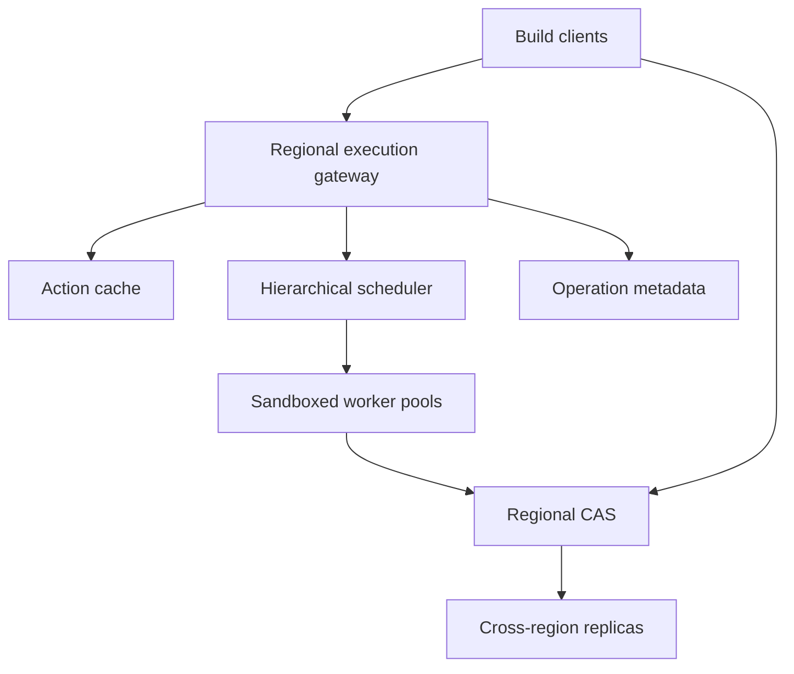
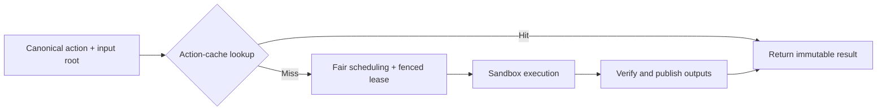

# Design a Multi-Tenant Remote Build Execution and Content-Addressed Cache Platform

**Difficulty:** Senior / Staff  
**Primary themes:** distributed scheduling, content-addressed storage, caching, queues, consistency, isolation, reliability, observability  
**Interview time budget:** about 45 minutes. This study walkthrough is intentionally longer so the design reasoning, calculations, alternatives, and failure modes are explicit.

This walkthrough uses the public [Hello Interview delivery framework](https://www.hellointerview.com/learn/system-design/in-a-hurry/delivery): clarify requirements, identify core entities, define interfaces, build a complete design, and then deepen the load-bearing decisions. It also follows their guidance to keep APIs practical and to introduce key schema fields beside the components that use them ([API design](https://www.hellointerview.com/learn/system-design/core-concepts/api-design), [data modeling](https://www.hellointerview.com/learn/system-design/core-concepts/data-modeling)). The prompt, numbers, protocols, architecture, dialogue, and tradeoffs below are original.

---

## Interviewer prompt

> Design a remote build platform for a large engineering organization. Developers and CI systems submit build actions such as compiling a source file or linking a binary. The platform should execute actions on remote workers, reuse previous results safely, isolate untrusted builds, and remain useful during failures. Think of the core capabilities behind a service such as Bazel Remote Execution.

## Targeted clarifying questions with assumed answers

**Candidate:** “Are we designing the build tool or the remote execution service?”  
**Interviewer:** “The client already constructs a deterministic action graph. Design the remote service: upload inputs, look up cached results, schedule misses, execute them, and return output references.”

**Candidate:** “Which workloads and platforms?”  
**Interviewer:** “Linux CPU builds first, with several x86-64 toolchain images. Actions range from small compiles to 30-minute links and tests. GPU and macOS workers are future extensions.”

**Candidate:** “What scale should I use?”  
**Interviewer:** “At peak, 500,000 action submissions per second across 20,000 tenants. About 85% are cache hits. Misses consume 2 million concurrent worker slots. The content store holds 5 PB of unique compressed blobs.”

**Candidate:** “What correctness guarantee does a cache hit need?”  
**Interviewer:** “Never return a result for a different action. A false miss is acceptable because it only causes recomputation. A false hit can ship the wrong binary and is unacceptable.”

**Candidate:** “Are build actions trusted?”  
**Interviewer:** “No. Treat tenant code, build scripts, and declared outputs as untrusted. Tenants must not read one another’s private inputs or influence another tenant’s result.”

**Candidate:** “What latency targets matter?”  
**Interviewer:** “Cache lookup p99 below 30 ms within a region. A ready action should normally start within 2 seconds; premium interactive builds need p99 queueing below 5 seconds. Stream logs while an action runs.”

**Candidate:** “Must actions execute exactly once?”  
**Interviewer:** “No. At-least-once execution is acceptable if duplicate work cannot publish inconsistent results. Clients need an operation ID and should be able to reconnect after a timeout.”

**Candidate:** “How global is the service?”  
**Interviewer:** “Three active regions. Execute close to inputs and available compatible workers. A regional outage should not lose durable inputs or completed results. We can temporarily sacrifice hit rate during failover.”

**Candidate:** “What is out of scope?”  
**Interviewer:** “Parsing build files, dependency discovery, source control, artifact release signing, and deploying the built binary.”

### Scope statement

In scope:

- upload and retrieve immutable input/output blobs;
- cache action results by a cryptographic action digest;
- queue and schedule cache misses onto compatible workers;
- sandbox untrusted execution and stream logs/status;
- safely publish outputs, retry lost work, cancel operations, and enforce quotas;
- replicate, evict, repair, and observe content and metadata.

Out of scope:

- constructing the build dependency graph;
- deciding whether a compiler invocation is deterministic;
- source-control hosting and package resolution;
- release promotion, signing, and deployment;
- arbitrary interactive development environments.

> **What I would say aloud:** “I’ll treat an action as a pure function of its command, environment, platform, and input-root digest. The service may execute that function more than once, but it publishes only immutable content and a result bound to the exact action digest.”

---

## 1. Requirements (~5 minutes)

### Core functional requirements

1. **Submit and execute an action.** A client uploads missing inputs, submits an action, receives a durable operation ID, streams progress, and obtains references to outputs.
2. **Reuse work safely.** The service checks an action cache before execution and stores immutable blobs in a content-addressed store, or CAS. A hit must be for the exact action definition and policy scope.
3. **Operate a fair, isolated fleet.** The platform matches actions to compatible workers, balances locality and queueing delay, enforces tenant quotas, sandboxes code, retries lost work, and survives zonal or regional failures.

### Quantified non-functional requirements

| Requirement | Target | Design consequence |
|---|---:|---|
| Peak submissions | 500,000 actions/s | regional front doors, partitioned lookup path, admission control |
| Cache-hit rate | about 85% | cache lookup is the dominant hot path |
| Cache lookup latency | p99 < 30 ms in-region | memory metadata tier, locality-aware CAS, no synchronous cross-region lookup |
| Concurrent execution | up to 2 million slots | hierarchical scheduling and worker pools |
| Start latency | p99 < 5 s for admitted premium interactive work | reservations, fair queues, prewarmed workers |
| Unique compressed content | 5 PB | sharded object storage, tiering, approximate access accounting |
| Metadata availability | 99.99% | multi-AZ replicas and idempotent state machines |
| Blob durability | at least 11 nines for durable results | erasure coding plus asynchronous cross-region copy |
| Tenant isolation | no cross-tenant unauthorized read or execution influence | scoped namespaces, encryption, sandboxing, identity-bound capabilities |
| Result correctness | zero known false hits | canonical serialization, cryptographic hashes, complete action keys |

### Consistency and availability contract

- Blobs are immutable and addressed by `(digest_function, hash, size)`. A successful `FindMissingBlobs` followed by upload is eventually visible in the local region; a committed action result is not served until all referenced blobs are durably readable.
- The action cache provides strong read-after-write within its home region. Across regions, replication is asynchronous. A region may return a false miss and recompute, but it must never return a result under the wrong digest.
- Operation creation is linearizable per client idempotency key. Operation status is durable and monotonic, though log delivery may be at least once.
- Execution is at least once. Leases expire, so a lost or partitioned worker’s action may run again. Result publication uses compare-and-set and immutable references.
- Cancellation is best effort: it prevents new leases and asks the current worker to stop. If the worker is unreachable, its lease expires; already published immutable outputs remain eligible for garbage collection.
- During regional isolation, existing local uploads, lookups, and execution continue if local dependencies are present. Cross-region cache hit rate may fall, but builds do not block on global consensus.

**Definitions:** A content-addressed store names bytes by their cryptographic digest, so identical bytes share an identity and modified bytes get a different identity. An action cache maps the digest of a complete action description to output digests and execution metadata; it does not store the output bytes themselves.

> **What I would say aloud:** “My safety preference is asymmetric: false misses cost compute, but false hits corrupt builds. Therefore regional replication is allowed to lag, while key construction, result binding, and referenced-blob validation are strict.”

---

## 2. Core entities (~2 minutes)

| Entity | Purpose |
|---|---|
| `Tenant` | identity, namespace, quotas, billing, keys, and trust policy |
| `Blob` | immutable bytes identified by digest and size |
| `Directory` | canonical Merkle-tree node listing files, symlinks, and child directories |
| `Command` | executable, arguments, declared environment, working directory, and outputs |
| `Action` | command digest, input-root digest, platform constraints, timeout, cache policy |
| `ActionResult` | output digests, exit code, stdout/stderr digests, and execution metadata |
| `Operation` | durable client-visible state for one requested execution |
| `QueueEntry` | scheduling class, tenant, resource request, locality hints, priority, enqueue time |
| `Worker` | pool, platform properties, capacity, health, cached-content summary |
| `ExecutionLease` | operation, worker, attempt, fencing token, and expiration |
| `UsageRecord` | CPU/memory/bytes charged to tenant and project |

The input tree is a **Merkle tree**: every directory digest depends on its children’s names and digests. Changing one source file changes the digests of its ancestors and therefore the action digest, without rereading unrelated subtrees on the server.

> **What I would say aloud:** “I’ll keep the distinction crisp: CAS stores immutable bytes, the action cache stores a mapping from action digest to result metadata, and the operation store tracks a particular execution request.”

---

## 3. API and system interface (~5 minutes)

The gateway derives `tenant_id`, project, roles, and quota class from mutual TLS or an authenticated token. It never trusts a tenant identifier in a request body.

The external protocol is gRPC because clients stream large batches and logs; HTTP/JSON can wrap administrative APIs.

### Discover missing inputs

```protobuf
rpc FindMissingBlobs(FindMissingBlobsRequest)
    returns (FindMissingBlobsResponse);

message FindMissingBlobsRequest {
  repeated Digest digests = 1;
}

message Digest {
  string hash = 1;
  int64 size_bytes = 2;
  string function = 3; // SHA-256 initially
}
```

The request is limited by count and serialized size. Responses list only absent digests; they do not reveal whether another tenant owns identical private content unless that sharing policy is explicitly enabled.

### Upload blobs

```text
ByteStream.Write(
  resource_name = uploads/<upload_id>/blobs/<hash>/<size>,
  write_offset,
  data,
  finish_write
) -> committed_size
```

`upload_id` makes retries resumable. The server verifies size and digest before atomically making the blob visible. A mismatch returns `INVALID_ARGUMENT` and quarantines the temporary object.

### Submit an action

```protobuf
rpc Execute(ExecuteRequest) returns (stream Operation);

message ExecuteRequest {
  Digest action_digest = 1;
  bool skip_cache_lookup = 2;
  string request_id = 3; // client-generated idempotency key
  ExecutionPolicy policy = 4;
}
```

Example streamed states:

```json
{"operation_id":"op_901","stage":"CACHE_CHECK"}
{"operation_id":"op_901","stage":"QUEUED","queue_position_hint":18}
{"operation_id":"op_901","stage":"EXECUTING","attempt":1}
{"operation_id":"op_901","stage":"COMPLETED","action_result_digest":"a91..."}
```

The server loads the `Action` blob by digest, validates the command and input-root references, and computes the policy-scoped internal key. It does not accept the action’s fields separately from the digest because that creates ambiguity.

### Reconnect and cancel

```http
GET /v1/operations/op_901
Authorization: Bearer <token>
```

```http
POST /v1/operations/op_901:cancel
Authorization: Bearer <token>
Idempotency-Key: cancel-901
```

### Worker control stream

```text
RegisterWorker(worker_id, pool, platform, capacity, image_set)
PollLease(worker_id, free_resources, local_cache_summary)
AcceptLease(lease_id, fencing_token)
Heartbeat(lease_id, fencing_token, phase, usage, log_cursor)
CompleteLease(lease_id, fencing_token, result, output_digests)
RejectLease(lease_id, reason)
```

Workers use short-lived workload identities and capability tokens scoped to the exact input digests for the lease. They cannot enumerate a tenant’s CAS.

---

## 4. Data flow

1. **Client preparation:** build tool canonicalizes the command and input Merkle tree, hashes them, and calls `FindMissingBlobs`.
2. **Upload:** client streams only missing nodes and file blobs; CAS verifies them and publishes immutable references.
3. **Lookup:** execution gateway resolves the action, constructs the internal cache key, and checks L1 metadata then authoritative action-cache storage.
4. **Hit:** service validates result policy and blob availability, records usage, and immediately returns the `ActionResult`.
5. **Miss:** scheduler enqueues the operation by tenant, priority, platform, resource shape, and locality.
6. **Execution:** a compatible worker accepts a fenced lease, downloads inputs, runs in a sandbox, uploads outputs, and proposes a result.
7. **Commit:** control plane verifies references, atomically marks the attempt complete, populates the action cache if eligible, and finalizes the operation.
8. **Maintenance:** replication, integrity scrub, popularity aggregation, eviction, and garbage collection run asynchronously.

Queues coordinate work; durable operation state and leases define truth. A queue message may be delivered more than once without creating multiple client operations.

---

## 5. High-level design (~10–15 minutes)

### Architecture



Bulk bytes move directly between clients/workers and CAS. Gateways and schedulers handle small metadata and never proxy multi-gigabyte artifacts.

### Operation 1: upload an input tree

The client walks its workspace, applies ignore rules, hashes file bytes, and constructs canonical `Directory` messages. Each directory sorts entries by normalized byte name and includes type, executable bit, digest, and symlink target. Permissions not relevant to execution are excluded; relevant metadata is explicit.

The client batches `FindMissingBlobs` requests, commonly 1,000–10,000 digests per RPC. The server partitions keys by a prefix of `HMAC(tenant_dedup_domain, digest)` rather than raw digest when tenants must be isolated. This supports deduplication inside an authorized organization without exposing global presence.

Small blobs can be uploaded inline in a batch. Large blobs use resumable multipart streams directly to CAS storage. Temporary parts are keyed by `(tenant, upload_id, digest)` and are not visible to readers. On finish:

1. verify total size;
2. hash the complete plaintext stream;
3. compare it with the declared digest;
4. encrypt and durably commit the object;
5. conditionally create the metadata row;
6. acknowledge success.

Relevant metadata:

```text
BlobIndex(namespace, digest, size, storage_class,
          primary_locations, replica_state, created_at,
          integrity_state, encryption_key_version)

UploadSession(namespace, upload_id, digest, committed_offset,
              expires_at, state)
```

The blob index is sharded by the keyed digest. Object storage holds bytes; a distributed key-value store holds compact location and integrity metadata. Upload acknowledgment means at least the policy-required local erasure-coded durability. Cross-region replication can follow asynchronously.

> **Say aloud:** “The contents are immutable, but upload is a two-phase visibility process: bytes may exist temporarily while hashing, yet the digest becomes readable only after full verification and an atomic metadata commit.”

### Operation 2: check the action cache

The client stores the canonical `Command` and `Action` messages in CAS. A simplified action is:

```text
Action(command_digest, input_root_digest, platform_properties,
       timeout, output_paths, do_not_cache, schema_version)
```

The public action digest protects the serialized action. The service derives an internal lookup key:

```text
cache_key = H(
  namespace || action_digest || execution_policy_version ||
  worker_abi || toolchain_trust_domain
)
```

The extra scope prevents unsafe reuse across tenants, incompatible worker ABIs, or policy changes. Ideally all semantically relevant fields are already in `Action`; the server-side scope is defense in depth and supports controlled invalidation.

Lookup has two metadata tiers:

- L1: regional in-memory cache of positive entries and short-lived negative entries;
- L2: authoritative, partitioned action-cache database replicated across zones.

The value is compact:

```text
ActionCacheEntry(cache_key, result_digest, output_root_digest,
                 exit_code, created_at, last_access_bucket,
                 producer_platform, policy_version, validation_state)
```

On a candidate hit, the gateway verifies that the entry is valid and that its result manifest’s required blobs are believed present locally. For high-confidence recent entries, a generation marker avoids one metadata lookup per output. If any reference is missing or corrupt, the entry is invalidated and treated as a miss. A miss is never upgraded to a hit using approximate structures.

Negative caching is brief—hundreds of milliseconds to a few seconds—because a concurrent build may publish the result soon. Single-flight suppression coalesces identical local cache misses, but waiters have deadlines and may break away if the producer is slow.

### Operation 3: enqueue a miss fairly

The execution gateway creates an operation transactionally with an outbox record:

```text
Operation(operation_id, tenant_id, request_id, action_digest,
          cache_key, stage, priority_class, created_at,
          current_attempt, result_digest, version)

UNIQUE(tenant_id, request_id)
```

An outbox publisher sends a compact queue event. Redelivery loads the operation and is harmless if its state has advanced.

A single global FIFO would let a large tenant starve everyone and mix incompatible workers. Use hierarchical scheduling:

1. **Region:** choose a region based on input availability, legal constraints, worker headroom, and estimated start time.
2. **Platform pool:** separate by architecture, image/toolchain set, isolation level, and special hardware.
3. **Tenant fair queue:** use weighted deficit round robin or start-time fair queuing; enforce concurrency and CPU-minute budgets.
4. **Shape queue:** match CPU, memory, disk, and expected duration to reduce fragmentation.
5. **Worker choice:** prefer workers with needed image and input locality, but cap locality waiting.

Priority applies within an entitled tenant share. An “urgent” flag cannot bypass global admission control. Reserved interactive capacity protects developer builds, while batch CI borrows it when idle and can be preempted before execution or, for explicitly retryable tasks, during execution.

```text
QueueEntry(operation_id, tenant_id, platform_pool,
           cpu_millis, memory_bytes, disk_bytes,
           priority, enqueue_time, virtual_finish,
           locality_hints, deadline)
```

The scheduler is split into many pool schedulers. A lightweight regional broker assigns tenant shards and pool ownership using leases. It does not make every placement through one leader.

### Operation 4: lease and execute safely

A worker maintains a bidirectional control stream. When it reports free resources, the pool scheduler offers a lease with an increasing fencing token. The worker must accept quickly or the offer is reassigned.

Before running, the worker:

1. verifies the signed lease and capability token;
2. prepares a fresh microVM or hardened container;
3. materializes the input Merkle tree into a read-only filesystem;
4. mounts a writable scratch/output volume;
5. applies CPU, memory, disk, process, network, and wall-clock limits;
6. starts the declared command with a minimal environment.

Network is disabled by default. If policy allows dependencies, traffic goes through an authenticated egress proxy with allowlists and auditable package-cache access. Host devices, metadata services, control sockets, and other tenants’ paths are inaccessible.

The worker streams stdout/stderr chunks to a log service and periodically checkpoints usage and phase. The canonical stdout/stderr blobs are uploaded to CAS at completion. Live logs are best effort and may contain duplicate chunks; sequence numbers let clients deduplicate.

Worker-local caches store popular CAS blobs and unpacked toolchain images. They are untrusted accelerators: every blob is rechecked by digest, and a local corruption triggers eviction and remote refetch.

### Operation 5: publish a result

After the command exits, the worker hashes declared outputs and uploads them to CAS. It creates an `ActionResult` containing output file/tree digests, exit code, stdout/stderr digests, and execution metadata. The result itself is serialized canonically and stored in CAS.

The worker calls `CompleteLease` with the lease ID and fencing token. The control plane:

1. checks that the token matches the current attempt;
2. validates output paths, sizes, count limits, digests, and required blob visibility;
3. commits the operation result with compare-and-set;
4. conditionally writes the action-cache entry if the action is cacheable;
5. writes usage and completion events through an outbox;
6. acknowledges the worker.

If two attempts finish, the first valid commit completes the operation. A later valid result for a deterministic action should have identical logical outputs; divergence is a serious nondeterminism signal. The losing result is retained briefly for diagnosis but is not substituted into the completed operation.

Failed actions may be cached only under explicit policy. Deterministic compile failures can save work, but transient infrastructure failures, timeouts, out-of-memory kills, and unavailable dependencies must not poison the cache.

> **Say aloud:** “Exactly-once execution is neither required nor realistic. I need exactly-one visible operation result, enforced by fenced leases, compare-and-set publication, and immutable content.”

### Operation 6: reconnect, retry, and cancel

If the client disconnects, execution continues according to policy. It reconnects using `operation_id` or the original `(tenant, request_id)`. Operation stages only move forward except for explicit retry sub-states recorded as new attempts.

The scheduler retries when:

- a worker rejects before starting;
- heartbeats stop and the lease expires;
- the worker reports an infrastructure error;
- CAS download fails because a replica is temporarily unavailable.

It does not automatically retry deterministic user exit codes. Retry count and consumed compute are bounded. Long actions can emit optional application-transparent checkpoints only if the tool supports them; arbitrary process memory checkpointing is not assumed.

Cancellation sets `cancel_requested` transactionally and publishes a control event. Schedulers issue no new attempt. The active worker gets a signed kill request, terminates the sandbox, uploads final logs if possible, and reports `CANCELLED`. If partitioned, its lease expires and stale completion fails the fencing check.

### Scale estimates that change decisions

**Lookup load.** At 500,000 submissions/s and an 85% hit rate, about 425,000 requests/s complete primarily through the action-cache path. If every lookup hit a relational database, it would dominate the system. Partitioned KV metadata plus an in-memory L1 is necessary. At 90% L1 hit rate, authoritative reads fall to roughly 50,000/s.

**Miss/execution rate.** Fifteen percent misses means 75,000 new executions/s at peak. Two million concurrent slots imply a rough mean service time of `2,000,000 / 75,000 ≈ 27 seconds` at saturation. Because real durations are heavy-tailed, queues need separate size/duration classes; one 30-minute link must not create head-of-line blocking for one-second compiles.

**Scheduler state.** If a compact queued/running record is 1 KB, two million running actions occupy about 2 GB before indexes and replication—small enough to shard in memory, but not on one scheduler. With 1,000 pool schedulers, the mean is about 2,000 active leases each, leaving margin for queues.

**CAS bandwidth.** Suppose the average miss reads 20 MB of inputs not already local and writes 5 MB of outputs. At 75,000 misses/s, naive remote traffic is 1.5 TB/s read and 375 GB/s write. Worker-local caching, toolchain images, regional locality, and direct storage access are fundamental. Scheduling purely for fairness while ignoring locality would be unaffordable.

**Metadata cardinality.** Five PB at a 1 MB mean blob size is about 5 billion blobs. Per-read synchronous last-access updates would create a write storm. Aggregate access into time buckets using sampled events or approximate frequency sketches, then update eviction scores asynchronously.

**Digest collision risk.** A modern 256-bit digest makes accidental collisions negligible at this scale, but the system still includes size, digest-function version, and canonical encoding. Security-sensitive tenants can use tenant-keyed namespaces to prevent cross-tenant probing; collision or mismatch evidence quarantines both objects for investigation.

---

## 6. Deep dives (~10–15 minutes)

## Deep dive A: cache correctness and hermeticity

### Where the baseline breaks

Hashing only the command string is insufficient. Results also depend on source files, compiler binary, implicit system headers, environment variables, locale, time zone, working directory, architecture, kernel/ABI behavior, and sometimes network responses. If one influence is missing from the key, the platform can return a logically wrong result under a technically matching key.

### Plausible approaches

| Approach | Benefit | Problem |
|---|---|---|
| Trust caller-provided arbitrary key | simple and fast | key may omit dependencies; unsafe across callers |
| Hash canonical action plus Merkle input root | deterministic and auditable | requires hermetic action construction |
| Observe filesystem/network accesses dynamically | catches hidden inputs | overhead and incomplete for nondeterministic sources |
| Disable cross-build caching | safest fallback | destroys most value |

### Selected approach

Use a canonical action model and enforce hermetic execution. The key covers:

- command digest, including arguments and declared environment;
- complete input-root Merkle digest;
- declared outputs and working directory;
- platform and resource semantics that can change results;
- immutable toolchain/container-image digest;
- action schema and execution-policy versions;
- tenant or organization cache namespace.

The sandbox exposes only declared inputs, deterministic virtual paths, a controlled clock policy, fixed locale/time zone, and either no network or declared network dependencies represented by immutable digests. Toolchain images are addressed by digest, never mutable tags.

For migration, clients advertise supported digest and action schema versions. Cache entries are not blindly reinterpreted across versions. Dual-read/dual-write can warm a new namespace, but correctness never depends on fallback between incompatible keys.

### Cache publication and incomplete results

An action-cache row is visible only after its result manifest and all required output blobs meet local durability policy. Blob reference verification uses a manifest generation:

```text
ResultManifest(result_digest, required_blob_count,
               required_total_bytes, blob_set_root,
               durability_generation, validation_state)
```

The CAS lifecycle service may later discover loss or corruption. It marks the generation unhealthy and invalidates dependent action entries asynchronously. The read path also treats a missing required blob as a miss, repairs from another replica when possible, and never returns a partial result.

### Stampede and concurrent identical actions

When thousands of clients miss the same new action, naïvely executing all of them wastes capacity. Maintain a **single-flight** table keyed by cache key:

```text
InFlight(cache_key, producer_operation, lease_expiry,
         waiter_count, expected_finish_bucket)
```

The first request becomes producer; later requests subscribe as waiters. This is an optimization, not a correctness lock. A waiter may launch a hedged execution when its deadline is near, the producer is slow, or the action is cheap. Producer failure releases the cohort. Completed clients all reference the same immutable result.

### Nondeterminism detection

Sample cache hits for shadow re-execution and compare logical output Merkle roots. Also compare duplicate attempts created by failover. Divergence can arise from undeclared inputs, timestamps, randomness, data races, or platform differences.

Responses include a reproducibility record:

```text
Provenance(action_digest, toolchain_digest, platform_fingerprint,
           worker_image_digest, result_digest, attempt_id)
```

Repeated divergence disables caching for that action pattern or target until owners fix it. The system must not choose whichever nondeterministic output arrived first and call that reproducible.

### Failure modes and observability

- **Corrupt client upload:** digest verification rejects it before visibility.
- **Mutable toolchain tag:** resolve to and key on immutable image digest.
- **Missing hidden input:** sandbox denies the access; failure points to undeclared dependency.
- **CAS object lost after publication:** hit becomes a miss; repair from replica; invalidate entry if unrecoverable.
- **Bad negative cache:** short TTL limits extra misses; negative entries never cause false hits.
- **Hash-library bug:** version digest implementations, cross-check samples with an independent implementation, and quarantine mismatches.

Track cache hit rate by target and tenant, false-miss causes, broken-result references, digest mismatches, shadow divergence, single-flight cohort size, duplicate execution cost, and entries disabled for nondeterminism.

> **What I would say aloud:** “Cryptographic hashing guarantees that the bytes named by a digest did not change; it does not guarantee the action key included every semantic input. Hermetic execution and canonical action construction close that gap.”

## Deep dive B: scheduling fairness, locality, and tail latency

### Where the baseline breaks

FIFO scheduling creates head-of-line blocking. Pure shortest-job-first can starve large links. Pure locality scheduling leaves scarce workers idle or traps tenants behind hot shards. Strict per-tenant quotas strand capacity. One centralized scheduler cannot process tens of thousands of placements per second while tracking two million leases.

### Alternatives

| Policy | Strength | Weakness |
|---|---|---|
| Global FIFO | simple | unfair and severe head-of-line blocking |
| Strict priority | good urgent latency | starvation and priority abuse |
| Dominant-resource fairness | fair across CPU/memory shapes | locality and deadlines need extensions |
| Work stealing | balances pools | can move work away from data |
| Hierarchical fair queues | scalable policy boundaries | more operational complexity |

### Selected approach

Use decentralized hierarchical fair scheduling with bounded locality preference.

At admission, each tenant receives a weighted share and burst bucket measured in dominant resources, commonly max of CPU share, memory share, and scarce-slot share. Idle capacity is borrowable. Debt accumulates when a tenant bursts and lowers its near-term scheduling weight, but hard caps protect the fleet.

Within a tenant, interactive and batch classes use separate queues. Estimated duration comes from historical `(action mnemonic, target, input-size bucket, toolchain)` data. Predictions influence queue choice but not correctness. Unknown jobs begin in a medium class; aging prevents starvation.

The placement score can be described as:

```text
score = queue_delay_cost
      + data_transfer_cost
      + cold_image_cost
      + fragmentation_cost
      + preemption_risk
```

The scheduler waits briefly for a local worker when transfer savings exceed the delay budget. After `locality_wait_ms`, it expands the candidate set. Large input roots justify longer locality waits than tiny compiles.

Workers pull leases from their pool scheduler, which avoids pushing work to dead workers and naturally communicates free capacity. Cross-pool stealing occurs only among compatible pools and uses rate limits to prevent oscillation.

### Long and short actions

Separate queues by resource shape and expected duration, then apply aging. For interactive actions, reserve a small capacity fraction and allow batch jobs to borrow it with reclaim rules. Avoid killing expensive near-complete work: preemption policy considers sunk time and checkpoint support. Often it is better to stop leasing new batch work and let current actions drain.

For extremely long links, speculative execution is generally wasteful. For short actions with high tail variance, a hedge may start after the historical p95 if spare capacity exists. The first valid result wins; hedge budgets cap amplification.

### Scheduler failure

Pool schedulers hold soft queue indexes in memory but persist operation truth and lease state in a sharded store. On failure:

1. ownership lease expires;
2. replacement rebuilds queue indexes from operations in `QUEUED` state;
3. active workers reconnect and present signed lease IDs;
4. valid leases continue; ambiguous expired leases are retried;
5. fencing prevents old scheduler/worker completions from overriding newer attempts.

Regional brokers use versioned pool assignments. A scheduler partition does not grant two owners the same fencing epoch.

### Observability

Measure queue delay by tenant/class/pool, admitted versus rejected load, dominant-resource share, borrowed capacity, worker utilization, locality hit rate, bytes avoided, cold-image starts, prediction error, starvation age, preemption waste, hedge amplification, and lease-expiry retries.

> **What I would say aloud:** “I balance three competing goals explicitly: fairness decides who deserves the next slot, compatibility decides where the action may run, and a bounded locality score decides which eligible worker is cheapest without violating the queueing SLO.”

## Deep dive C: CAS durability, eviction, and regional failure

### Where the baseline breaks

At 5 PB, keeping every blob forever is too expensive. Updating `last_access_time` on every read creates hundreds of thousands of metadata writes per second. LRU alone can evict a large but expensive-to-recompute artifact too aggressively. Reference counts are difficult because clients can hold digests without registering durable references. Synchronous global replication would hurt upload latency and availability.

### Storage tiers and lifecycle

Use three conceptual classes:

- **hot regional cache:** replicated SSD/object cache for popular blobs and low lookup latency;
- **durable CAS:** erasure-coded object storage for committed outputs and inputs within retention policy;
- **optional cold tier:** old, expensive-to-recompute content with looser retrieval SLO.

CAS is not necessarily permanent artifact storage. Clients that require indefinite retention pin a result through a separate artifact or lease API with explicit billing and authorization. Normal build-cache content is evictable.

Popularity is approximated. Read servers emit sampled access events into a stream. Aggregators maintain count-min sketches or time-bucketed counters. Eviction score considers:

```text
value = estimated_reuse_probability * recompute_cost
        / (storage_bytes * replica_cost)
```

Age, tenant budget, provenance importance, and legal/pin state modify the score. Exact LRU order is unnecessary.

### Safe garbage collection

There are two reference classes:

1. **Server-known roots:** action-cache results, active operations, upload sessions, explicit pins, and replication tasks.
2. **Unregistered client digests:** safe to evict under the published cache-retention contract; the client must be able to re-upload or recompute.

GC uses mark-and-sweep generations:

1. snapshot known roots;
2. traverse result manifests and Merkle trees into a probabilistic or partitioned mark set;
3. identify unmarked blobs older than a safety horizon;
4. write deletion tombstones;
5. recheck roots and generation before physical deletion;
6. delete replicas asynchronously and record proof.

The safety horizon covers delayed events, clock skew, and in-flight publication. Newly uploaded blobs are never collected immediately. Explicit pins use transactional lease expiry and renewal.

### Regional replication

Metadata is multi-AZ synchronously within a region. Blob replication to another region is asynchronous and prioritized:

- action results and manifests first;
- small, popular blobs next;
- large inputs based on reuse and disaster policy;
- ephemeral failed-attempt outputs last or never.

An action result advertises a durability state such as `REGIONAL` or `MULTI_REGION`. Standard builds can complete at regional durability; release-critical policy may wait for an independent copy.

During regional loss, DNS/control routing sends new clients to another region. The surviving region:

- serves replicated hits;
- treats absent metadata or blobs as misses;
- accepts re-uploads from clients;
- reschedules durable operations according to policy;
- rate-limits recovery traffic so replica restoration does not starve active builds.

The system never assumes an action-cache row implies every referenced blob replicated successfully. Replica completeness belongs to the result manifest’s durability generation.

### Repair and integrity

Background scrubbers sample and eventually cover all stored shards. They verify ciphertext checksums, reconstruct erasure-coded fragments, decrypt authorized samples, and verify content digests. Corruption is repaired from parity or another region. A digest mismatch at two independent sources escalates as a software or security incident.

### Failure modes and observability

- **Metadata says present, object missing:** return miss, alert, attempt replica repair.
- **GC races publication:** generation and safety horizon preserve new references; publisher can repopulate a tombstoned key before deletion.
- **Popularity stream lags:** eviction quality declines, not correctness.
- **Region outage:** hit rate drops; admission control protects surviving workers and storage.
- **Replication backlog grows:** prioritize manifests/popular data, expose durability lag, and block only policies that require multi-region completion.
- **Hot digest overload:** replicate hot blobs across more cache nodes and use request coalescing; consistent hashing alone is insufficient for a single hot key.

Track bytes by tier and tenant, eviction/re-upload rate, recompute cost after eviction, GC candidate and deletion counts, pinned-byte growth, replication lag, under-replicated result manifests, scrub coverage, repair count, and regional failover hit-rate loss.

> **What I would say aloud:** “CAS immutability simplifies correctness, but not lifecycle. I make retention an explicit contract, derive roots from server-known state, delay deletion through generations, and accept a lower hit rate rather than make every build depend on synchronous global replication.”

---

## 7. Final design

The platform has regional execution gateways, a two-tier action cache, a sharded content-addressed store, durable operation metadata, hierarchical pool schedulers, and hardened worker fleets. Clients create canonical action and Merkle-tree inputs, upload only missing blobs, and submit an action digest with an idempotency key.

The gateway first checks a policy-scoped cache key. A valid hit returns an immutable result whose referenced blobs are locally durable. A miss becomes a durable operation and enters tenant-fair, platform-specific queues. Pool schedulers use resource fairness, bounded data locality, duration classes, and worker-pull leases. Workers run untrusted code in isolated sandboxes, upload immutable outputs, and propose a result under a fenced lease. Compare-and-set publication gives one visible operation result even if execution occurs more than once.

CAS metadata and bytes are independently scalable. Worker-local and regional caches reduce petabyte-scale traffic; cryptographic verification makes those caches untrusted accelerators. Asynchronous cross-region replication favors result manifests and popular blobs. Lifecycle management uses approximate popularity, explicit pins, generational mark-and-sweep, repair, and integrity scrub. Regional failure may reduce cache hit rate but does not introduce false hits or require global consensus on the build hot path.



### Requirements check

| Requirement | Design response |
|---|---|
| Remote execution | durable operations, compatible pool scheduling, sandboxed workers |
| Safe cache reuse | canonical full action key, hermeticity, immutable result manifests |
| 500,000 submissions/s | regional gateways, L1 metadata cache, sharded L2 and CAS |
| 2 million slots | decentralized pool schedulers and worker-pull leases |
| Fair multi-tenancy | weighted dominant-resource shares, burst debt, class queues, aging |
| Low start latency | reserved interactive capacity, prewarmed images, bounded locality wait |
| At-least-once execution | fencing tokens, attempt IDs, compare-and-set result publication |
| Tenant isolation | scoped namespaces/capabilities, encryption, microVM/container sandbox |
| Large data volume | content addressing, dedupe domains, tiering, approximate access accounting |
| Regional failure | async replicas, false-miss/recompute behavior, admission-controlled failover |
| Corruption defense | digest/size verification, manifests, scrub, repair, quarantine |
| Reconnect/cancel | durable operation ID, monotonic state, best-effort fenced cancellation |

### Polished 90-second closing summary

> “I model each build action as a pure function of a canonical command, immutable toolchain, platform semantics, and a Merkle-tree input root. Clients upload only missing blobs to a content-addressed store and submit the action digest with an idempotency key. The gateway checks a policy-scoped action cache; a valid hit returns an immutable result manifest only when all referenced blobs are durable. A miss becomes a durable operation in hierarchical fair queues. Pool schedulers combine tenant resource shares, priority classes, resource shape, and bounded data locality, then lease work to compatible workers using fencing tokens. Workers execute untrusted code inside network-restricted sandboxes, hash and upload outputs, and publish through compare-and-set, so execution may be at least once while only one result becomes visible. Regional and worker-local caches reduce CAS traffic but are always verified by digest. Finally, asynchronous replication, integrity scrub, explicit pins, approximate popularity, and generational garbage collection control five petabytes of content. During regional failure I accept more cache misses and recomputation rather than put global consensus in the hot path or risk a false hit.”

---

## Realistic interviewer follow-up questions with strong sample answers

### 1. What is the difference between CAS and the action cache?

> “CAS maps a content digest to immutable bytes. The action cache maps a complete action key to an `ActionResult`, which contains output digests. Deleting an action-cache entry loses reuse metadata; deleting a referenced CAS blob can break a result.”

### 2. Why use a Merkle tree for inputs?

> “A directory digest recursively commits to names, metadata, and child digests. One file change updates only its ancestor path, so clients can compare and upload subtrees incrementally while the root still identifies the complete input state.”

### 3. Does SHA-256 make the build correct?

> “It binds a name to bytes with negligible collision risk. It does not prove the action key included every semantic input. Correct reuse also requires canonical serialization, an immutable toolchain, declared environment/platform semantics, and hermetic execution.”

### 4. Why is a false miss acceptable but a false hit not?

> “A false miss repeats work and affects cost or latency. A false hit can return the wrong object code under a trusted action key and ship an invalid binary. I therefore prefer recomputation whenever metadata or blob completeness is uncertain.”

### 5. Why not use one global action-cache database?

> “Synchronous cross-region access would add latency and reduce availability. Regional caches replicate asynchronously. A lagging region can safely miss and recompute; correctness does not require a globally fresh hit.”

### 6. How do you prevent cache poisoning?

> “Workers cannot choose an arbitrary cache key: the control plane binds the lease to the submitted digest. Outputs are hashed, referenced blobs are verified, publication is fenced, namespaces are policy-scoped, and untrusted failures are not broadly cached.”

### 7. What happens if two workers execute the same action?

> “Both may upload immutable bytes. The first valid fenced compare-and-set completes the operation. I compare duplicate output roots; disagreement signals nondeterminism. The stale attempt cannot overwrite the visible result.”

### 8. Why not require exactly-once execution?

> “A partition makes it impossible to know immediately whether a worker stopped. Waiting indefinitely hurts availability. Expiring the lease and retrying is practical; immutable outputs and fenced publication make duplicates safe.”

### 9. What is a fencing token?

> “It is a monotonically increasing lease generation. Every heartbeat and completion includes it. After reassignment to generation 12, a delayed worker holding generation 11 cannot commit.”

### 10. How do you stop a noisy tenant from monopolizing workers?

> “Admission budgets and weighted dominant-resource fairness bound each tenant’s share. Idle capacity is borrowable, but burst debt and hard caps preserve other tenants’ latency. Priorities only apply inside an entitled share.”

### 11. Why not schedule only where inputs are cached?

> “That can leave compute idle and violate latency SLOs. I price transfer savings against queue delay, wait for locality only within a budget, then widen placement. Large actions get a larger locality budget than tiny ones.”

### 12. How do you schedule unknown-duration actions?

> “Start with historical features when available and a medium/default class otherwise. Feed observed duration back into estimates, use separate shape queues, and apply aging so prediction mistakes do not starve work.”

### 13. How is untrusted code isolated?

> “Fresh microVMs or hardened containers, read-only declared inputs, writable scratch only, cgroup/resource limits, minimal identity, blocked host devices and metadata, default-deny networking, and digest-scoped CAS capabilities.”

### 14. Can two tenants deduplicate the same private blob?

> “Only if policy puts them in the same trusted deduplication domain. Otherwise I derive storage keys with a tenant/domain secret so presence cannot be probed across tenants. The storage savings do not justify an isolation leak.”

### 15. How do you prevent a cache stampede?

> “Use a short-lived single-flight record so one operation produces the result and others wait. Let deadline-sensitive waiters hedge under a budget, because single-flight is an optimization and must not become a new availability dependency.”

### 16. Should failed actions be cached?

> “Only deterministic user failures under explicit policy. Infrastructure errors, timeouts, OOM kills, preemption, and unavailable dependencies are not cacheable because they would poison later requests.”

### 17. How do you detect non-hermetic builds?

> “Sandbox undeclared access, shadow-execute a sample of hits, and compare outputs from duplicate attempts. Persist provenance and disable caching for patterns with repeated divergence until dependencies or nondeterminism are fixed.”

### 18. Why not update `last_access_time` for every CAS read?

> “At hundreds of thousands of reads per second that becomes a metadata write storm. Sample access events, aggregate time buckets or frequency sketches, and accept approximate eviction ordering because it affects cost, not correctness.”

### 19. How does garbage collection avoid deleting active content?

> “Mark server-known roots by generation, traverse manifests, require an age safety horizon, write a tombstone, then recheck the root generation before physical deletion. Active operations, uploads, pins, and replication jobs are roots.”

### 20. What happens in a regional outage?

> “Route to a surviving region, serve whatever was replicated, treat missing entries as misses, let clients re-upload, and reschedule durable operations. Admission-control recovery traffic. Hit rate and cost worsen, but false hits do not appear.”

### 21. How would you support macOS later?

> “Add platform-specific pools and include the OS, architecture, SDK/toolchain image, and relevant ABI semantics in the action key. macOS licensing and worker provisioning change capacity planning, but operation and CAS abstractions remain.”

### 22. How do you stream logs reliably?

> “Use sequenced chunks on an at-least-once stream for live viewing and upload canonical stdout/stderr blobs to CAS at completion. Clients deduplicate sequence numbers; reconnect reads from a cursor. Live display is not the durable record.”

### 23. How do you handle a hot blob?

> “Replicate it across cache nodes, coalesce concurrent backend reads, and push it into worker-local caches. Plain consistent hashing maps a hot key to too few owners, so popularity must influence replication.”

### 24. What would you build first?

> “One region, multi-AZ operation metadata, one Linux worker pool, SHA-256 CAS on object storage, a partitioned action cache, basic fair tenant queues, container isolation, fenced leases, resumable uploads, and explicit retention. Then add worker-local caching, microVMs, duration-aware scheduling, cross-region replication, shadow reproducibility checks, and advanced GC scoring.”

---

## Common pitfalls

1. Hashing only the command and omitting inputs, toolchain, environment, or platform.
2. Treating a cryptographic digest as proof of build hermeticity.
3. Using mutable container tags in action keys.
4. Trusting a worker-local cache without re-verifying the digest.
5. Returning an action-cache hit before all referenced blobs are readable.
6. Putting large artifact bytes through the scheduler or API gateway.
7. Requiring synchronous global cache replication.
8. Demanding exactly-once execution instead of idempotent, fenced publication.
9. Using leases without fencing tokens.
10. Caching infrastructure failures and poisoning future builds.
11. Using one global FIFO across tenants and resource shapes.
12. Letting user-supplied priority bypass tenant quotas.
13. Optimizing only for locality and ignoring queueing delay.
14. Optimizing only for fairness and causing petabyte-scale transfers.
15. Mixing 30-minute links with one-second compiles in one FIFO.
16. Allowing arbitrary network access from build sandboxes.
17. Giving workers broad ability to list tenant CAS content.
18. Deduplicating across private tenants without discussing presence leakage.
19. Updating exact access timestamps on every blob read.
20. Assuming CAS is permanent artifact storage without pins or retention contracts.
21. Deleting unreferenced blobs immediately without a safety generation.
22. Assuming an action-cache row proves replica completeness.
23. Ignoring nondeterministic duplicate results.
24. Retrying deterministic compiler failures as infrastructure errors.
25. Making live log streaming the only durable execution record.

---

## Practice cadence

In a 45-minute interview:

- **0–5 minutes:** clarify the action model, scale, correctness asymmetry, isolation, and latency.
- **5–7 minutes:** identify blobs, Merkle directories, actions, results, operations, queues, workers, and leases.
- **7–12 minutes:** define missing-blob, upload, execute, status, cancel, and worker-control interfaces.
- **12–25 minutes:** build upload, cache lookup, fair scheduling, sandbox execution, result publication, and retry one operation at a time.
- **25–40 minutes:** deep-dive on cache correctness/hermeticity, scheduling locality/fairness, and CAS lifecycle/regional failure.
- **40–45 minutes:** check requirements, state tradeoffs, and deliver the closing summary.

The educational walkthrough is longer than the interview budget. In the live answer, establish the action-key invariant, draw the compact architecture, do the hit/miss and bandwidth arithmetic, and let the interviewer choose the deep dive.

## Public references

- Hello Interview, [System Design Delivery Framework](https://www.hellointerview.com/learn/system-design/in-a-hurry/delivery)
- Hello Interview, [API Design for System Design Interviews](https://www.hellointerview.com/learn/system-design/core-concepts/api-design)
- Hello Interview, [Data Modeling for System Design Interviews](https://www.hellointerview.com/learn/system-design/core-concepts/data-modeling)

These references support the interview-delivery structure. The remote-execution prompt, scale assumptions, action protocol, scheduling policy, storage lifecycle, dialogue, calculations, and tradeoffs are original.
