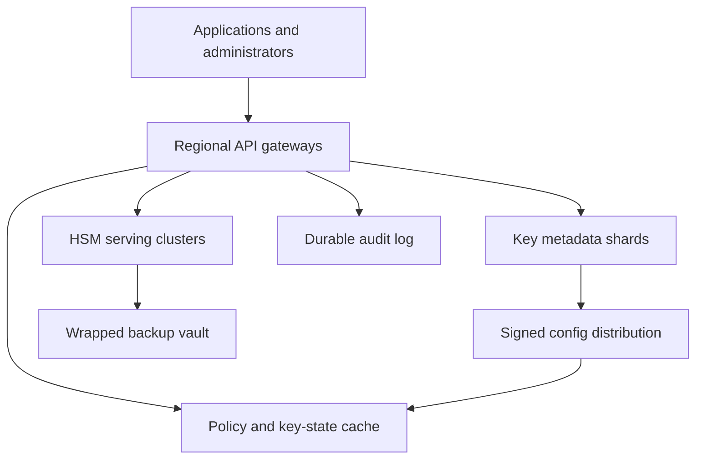
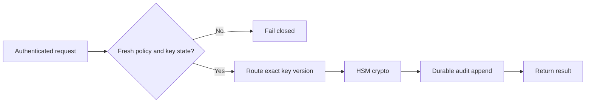

# Design a Global HSM-Backed Key Management Service

**Difficulty:** Senior / Staff  
**Primary themes:** cryptographic isolation, high availability, consistency, caching, multi-tenancy, disaster recovery, auditability  
**Interview time budget:** about 45 minutes. This educational walkthrough is intentionally longer so the reasoning, calculations, failure semantics, and tradeoffs are explicit.

This walkthrough follows the public [Hello Interview system-design delivery framework](https://www.hellointerview.com/learn/system-design/in-a-hurry/delivery): clarify requirements, name the essential entities, define concrete interfaces, build a complete design one operation at a time, and then deepen the load-bearing decisions. The API and entity sections also follow their public guidance on [API design](https://www.hellointerview.com/learn/system-design/core-concepts/api-design) and [data modeling](https://www.hellointerview.com/learn/system-design/core-concepts/data-modeling). The prompt, scale, protocols, dialogue, architecture, and tradeoffs below are original.

---

## Interviewer prompt

> Design a global, multi-tenant key management service similar in product shape to a cloud KMS. Applications should create cryptographic keys, encrypt or decrypt small payloads, generate envelope-encryption data keys, rotate keys, manage aliases and policies, disable or schedule deletion of keys, and obtain a complete audit trail. Master key material must remain inside hardware security modules, or HSMs, and the service must remain highly available without allowing stale authorization or unsafe key reuse.

## Targeted clarifying questions with assumed answers

**Candidate:** “Are customers storing arbitrary secrets in this service?”  
**Interviewer:** “No. Direct encrypt/decrypt supports payloads up to 4 KiB. Large data uses envelope encryption: KMS generates or unwraps a data-encryption key, while the application encrypts bulk data locally.”

**Candidate:** “Which algorithms are in scope?”  
**Interviewer:** “Start with symmetric AES-256 keys for encrypt/decrypt and data-key generation. Mention how asymmetric signing keys would fit, but do not design every algorithm.”

**Candidate:** “Can plaintext key material ever leave an HSM?”  
**Interviewer:** “Customer master-key material cannot. For GenerateDataKey, a short-lived plaintext data key may be returned over an authenticated encrypted channel, but it must not be persisted by KMS.”

**Candidate:** “What scale should I assume?”  
**Interviewer:** “Two million cryptographic requests per second globally, 50,000 control-plane mutations per second, 100 million customer keys, and 20 regions. Traffic is bursty and one tenant may reach 100,000 requests per second.”

**Candidate:** “What latency and availability matter?”  
**Interviewer:** “For a warm regional symmetric decrypt, target p99 below 15 ms and 99.999% monthly availability. Control-plane changes can take a few hundred milliseconds, but disabling a compromised key must stop new cryptographic use globally within 5 seconds.”

**Candidate:** “What is the consistency contract?”  
**Interviewer:** “Key creation and version changes are linearizable in the key’s home region. Crypto requests must never use a disabled, deleted, unauthorized, or wrong key version. Availability may be sacrificed briefly when authorization or revocation freshness is uncertain.”

**Candidate:** “Are keys region-specific?”  
**Interviewer:** “Support regional keys first. Optionally, a customer may create a multi-region logical key whose independently protected replicas share a logical identity. Residency policy may forbid replication.”

**Candidate:** “How should deletion work?”  
**Interviewer:** “Deletion is delayed by 7–30 days and cancelable during that window. Once the final key material is destroyed, ciphertext may become permanently unrecoverable.”

**Candidate:** “What is out of scope?”  
**Interviewer:** “Building the HSM hardware, TLS PKI, customer secret storage, bulk object encryption, and end-user identity providers.”

### Scope statement

In scope:

- create symmetric keys and immutable key versions;
- encrypt/decrypt small payloads and generate envelope data keys;
- aliases, policies, grants, rotation, disable/enable, and delayed deletion;
- tenant isolation, quotas, idempotency, auditing, and abuse resistance;
- regional crypto serving, HSM fleet management, replication, failover, and disaster recovery.

Out of scope:

- storing arbitrary application secrets;
- moving plaintext customer master keys outside HSM security boundaries;
- encrypting multi-gigabyte objects through KMS;
- implementing identity providers, certificate authorities, or the HSM firmware;
- application-level backup of ciphertext whose key was intentionally destroyed.

> **What I would say aloud:** “I’ll separate a strongly consistent key-control plane from a low-latency cryptographic data plane. The invariant is that key material stays inside HSMs, while every crypto operation is authorized against a sufficiently fresh key state. When freshness is uncertain, I fail closed rather than risk using revoked authority.”

---

## 1. Requirements (~5 minutes)

### Core functional requirements

1. **Manage key lifecycle.** Authenticated tenants create keys, attach policies and aliases, rotate to new versions, disable or re-enable keys, and schedule cancelable deletion.
2. **Perform cryptographic operations.** Applications encrypt/decrypt payloads up to 4 KiB and generate envelope-encryption data keys without exposing customer master-key material.
3. **Operate securely at global scale.** The service enforces identity and context-aware authorization, isolates tenants, emits durable audit records, survives failures, and propagates emergency revocation quickly.

### Quantified non-functional requirements

| Requirement | Target | Design consequence |
|---|---:|---|
| Crypto traffic | 2 million requests/s globally | regional stateless gateways, HSM sharding, batching where safe |
| Control mutations | 50,000/s | partitioned metadata consensus groups and idempotency |
| Key count | 100 million | shard metadata and HSM object indexes by stable key ID |
| Crypto latency | warm symmetric decrypt p99 < 15 ms | in-region HSMs, bounded policy caches, no cross-region hot-path consensus |
| Availability | 99.999% for eligible crypto operations | multi-AZ cells, redundant HSMs, load shedding, tested failover |
| Emergency disable | globally enforced within 5 s | push invalidation, revocation epochs, freshness deadline, fail closed |
| Durability | no loss of committed key versions | quorum metadata plus HSM-wrapped backups in independent failure domains |
| Isolation | zero cross-tenant key use | auth-derived tenant, opaque handles, HSM domains, policy enforcement |
| Audit | every accepted or denied operation attributable | append-only durable audit pipeline with local fail-safe buffering |

### Consistency and availability contract

- Each key has a stable logical `key_id` and immutable versions. One version is `PRIMARY` for new encryption; older enabled versions remain decrypt-only.
- Key creation, version promotion, disable, policy change, and deletion scheduling are linearizable within the key’s home metadata shard.
- An encrypt request uses the current primary version chosen by the service. A decrypt request uses the exact version embedded in the ciphertext header; it never guesses or silently falls back.
- A crypto cell may cache positive authorization and enabled-state data only until a signed freshness deadline. Disable, policy tightening, grant revocation, or deletion increments a revocation epoch and is pushed globally. If a cell cannot prove freshness after the deadline, it rejects the operation.
- Successful encrypt/decrypt is exactly one response, not exactly one computation. Retrying deterministic decryption is safe. Retrying randomized encryption may produce different valid ciphertext, so idempotency is optional and bounded.
- Audit delivery is at least once. Every record carries a stable request ID so the analytics pipeline can deduplicate; security investigations preserve the raw append-only stream.
- Multi-region keys converge through an explicit replication workflow. A replica may serve only after its key version, policy epoch, and activation certificate are installed. Regional keys never fail over outside allowed residency.

> **What I would say aloud:** “The availability contract is conditional: we provide five nines when the cell can prove the key is enabled and the caller is authorized. During a revocation-partition ambiguity, safety wins and that key becomes temporarily unavailable.”

---

## 2. Core entities (~2 minutes)

| Entity | Essential fields and purpose |
|---|---|
| `Tenant` | tenant ID, residency, quotas, billing and isolation domain |
| `Key` | stable key ID, tenant, region scope, purpose, algorithm, state, primary version, policy epoch |
| `KeyVersion` | immutable version number, HSM object handle, creation time, state, origin and replica set |
| `Alias` | mutable tenant-scoped name pointing to a key, with version for compare-and-set |
| `Policy` | versioned authorization statements over principals, operations, resources and context |
| `Grant` | narrow, optional delegated capability with constraints and expiry |
| `CryptoRequest` | request ID, principal, operation, key/version, context hash and result class |
| `DeletionSchedule` | key, earliest destruction time, approval state and cancellation metadata |
| `AuditEvent` | immutable event ID, actor, decision, key/version, region, timestamps and reason |
| `HsmSlot` | HSM cluster, partition/domain, object handle, health and replication generation |
| `RevocationEpoch` | monotonically increasing tenant/key authorization generation |

Do not put plaintext key bytes in the metadata model. Metadata stores only HSM object handles and wrapped backup references. The HSM enforces that a handle is usable only inside its assigned cryptographic domain.

> **What I would say aloud:** “I’ll model the logical key separately from immutable key versions. Rotation changes which version encrypts; it does not rewrite ciphertext or mutate the old version.”

---

## 3. API and system interface (~5 minutes)

Identity comes from mutual TLS or a signed workload token. The gateway derives `tenant_id`, principal, roles, region and authentication strength; it never trusts those fields in the request body.

### Create a key

```http
POST /v1/keys
Authorization: Bearer <token>
Idempotency-Key: create-orders-key-2026

{
  "description": "orders envelope key",
  "algorithm": "AES_256_GCM",
  "usage": ["ENCRYPT", "DECRYPT", "GENERATE_DATA_KEY"],
  "region_scope": {"type": "MULTI_REGION", "regions": ["us-east", "us-west"]},
  "rotation": {"period_days": 90},
  "policy": {
    "statements": [{
      "effect": "ALLOW",
      "principal": "workload:payments",
      "actions": ["Encrypt", "Decrypt", "GenerateDataKey"],
      "conditions": {"environment": "prod"}
    }]
  }
}
```

Response:

```json
{
  "key_id": "key_01JZ8R...",
  "state": "ENABLED",
  "primary_version": 1,
  "policy_epoch": 1,
  "replica_state": "CREATING"
}
```

The same idempotency key with the same request hash returns the original result. Reuse with a different body returns `409 Conflict`.

### Encrypt a small payload

```http
POST /v1/keys/key_01JZ8R:encrypt
Authorization: Bearer <token>
X-Request-ID: req_7f2

{
  "plaintext_b64": "...",
  "encryption_context": {
    "tenant_record": "order_4381",
    "purpose": "payment-token"
  }
}
```

Response:

```json
{
  "ciphertext_b64": "...",
  "key_id": "key_01JZ8R...",
  "key_version": 7,
  "algorithm": "AES_256_GCM"
}
```

The service binds a canonical hash of the encryption context as authenticated additional data. Decrypt requires the same context, preventing ciphertext copied from one logical record from being accepted in another.

### Generate an envelope data key

```http
POST /v1/keys/key_01JZ8R:dataKeys
Authorization: Bearer <token>

{
  "key_spec": "AES_256",
  "encryption_context": {"object_id": "obj_99", "purpose": "backup"}
}
```

Response:

```json
{
  "plaintext_data_key_b64": "...",
  "encrypted_data_key_b64": "...",
  "master_key_version": 7,
  "expires_at": "2026-10-25T04:00:10Z"
}
```

The plaintext data key is returned once over TLS and never logged or persisted. The application encrypts the large object locally, stores only the encrypted data key beside it, and zeroizes the plaintext key from memory.

### Decrypt

```http
POST /v1/decrypt
Authorization: Bearer <token>

{
  "ciphertext_b64": "...",
  "encryption_context": {
    "tenant_record": "order_4381",
    "purpose": "payment-token"
  }
}
```

The ciphertext header identifies the service, tenant-bound key ID, version and algorithm. The gateway still authorizes the caller; possession of ciphertext is not permission to decrypt.

### Rotate, alias and disable

```http
POST /v1/keys/key_01JZ8R:rotate
Idempotency-Key: rotate-key_01JZ8R-2026Q4
```

```http
PUT /v1/aliases/orders-current
If-Match: "alias-version-12"

{"key_id": "key_01JZ8R..."}
```

```http
POST /v1/keys/key_01JZ8R:disable
Idempotency-Key: incident-884-disable
{"reason": "suspected compromise"}
```

Disable returns the committed policy epoch and a propagation status endpoint. The call is acknowledged after authoritative metadata commits; global enforcement completes asynchronously but must meet the 5-second SLO.

### Schedule deletion

```http
POST /v1/keys/key_01JZ8R:ScheduleDeletion

{"waiting_period_days": 14, "change_ticket": "SEC-1942"}
```

A separate cancel endpoint is idempotent. Final destruction requires the waiting period and, for high-impact keys, dual approval.

---

## 4. Data flow

### Encrypt or generate a data key

1. Client authenticates to the nearest permitted regional crypto gateway.
2. Gateway resolves alias if present, canonicalizes the request and derives tenant/principal from authentication.
3. Authorization layer checks policy, grants, operation, region and encryption context against a bounded-fresh signed snapshot.
4. Router selects a healthy HSM shard holding the current primary version.
5. HSM performs authenticated encryption or creates a random data key and wraps it under the master-key version.
6. Gateway packages a versioned ciphertext header, emits an audit event, zeroizes sensitive buffers and returns.
7. Audit events append to a replicated regional log and replicate to immutable retention.

### Decrypt

1. Gateway parses and authenticates the ciphertext header before using any embedded identifier.
2. It loads the exact key version and current authorization state.
3. It verifies enabled state, caller policy, context hash, algorithm and residency.
4. HSM unwraps/decrypts using the exact version.
5. Gateway records success or a non-sensitive failure class and returns plaintext over the authenticated channel.

### Control-plane mutation

1. Management API validates identity, permissions, idempotency and request schema.
2. Home metadata shard commits the new state and increments `policy_epoch` or `key_epoch`.
3. Transactional outbox publishes invalidation and replication work.
4. Regional control distributors push signed delta bundles to crypto cells.
5. Each cell applies only monotonically increasing epochs and acknowledges.
6. The status API reports regional convergence; cells that exceed their freshness lease fail closed.

---

## 5. High-level design (~10–15 minutes)

### Compact architecture



The control plane handles comparatively rare mutations. The crypto data plane handles millions of operations per second and depends only on regional metadata snapshots plus HSMs. Audit is off the response-critical path after a durable local append, but never silently discarded.

### Operation 1: create a key

The management gateway routes a new key to its home region and metadata shard using `hash(tenant_id, key_id)`. In one metadata transaction it creates:

```text
Key(key_id, tenant_id, home_region, region_scope, algorithm,
    usage, state=CREATING, primary_version=null,
    policy_id, policy_epoch=1, key_epoch=1, created_at)

Idempotency(tenant_id, idempotency_key, request_hash,
            resource_id, response_hash, expires_at)

Outbox(event_id, aggregate_id, event_type, payload_hash, state)
```

A key-provisioning worker requests generation inside the assigned HSM quorum/domain. The HSM creates random AES-256 material internally and returns only an opaque object handle plus a wrapped backup blob encrypted under an HSM-resident domain backup key.

The workflow verifies a second HSM replica or restorable backup, then commits `KeyVersion(version=1, state=ENABLED, hsm_generation=...)` and promotes it to primary. A failed workflow is retried by state, not restarted blindly. The client may observe `CREATING`; crypto is rejected until `ENABLED`.

Why not generate key material in an application server and import it? That expands the plaintext trust boundary to process memory, crash dumps, tracing and operators. Native generation inside HSM is the secure default. Customer-imported keys can be an extension using an HSM-to-HSM wrapping ceremony.

### Operation 2: encrypt

The data-plane gateway validates the payload-size limit before expensive work. Alias resolution uses a tenant-scoped cache, but the resolved value includes alias version and key ID. For encryption, the service then retrieves a signed key snapshot:

```text
KeySnapshot(key_id, tenant_id, state, primary_version,
            policy_hash, policy_epoch, key_epoch,
            not_after, allowed_regions, signature)
```

`not_after` is the freshness lease. A snapshot might be valid for 2 seconds for high-risk keys and up to 30 seconds for ordinary keys, but the 5-second emergency-disable SLO caps worst-case use. Push invalidation normally acts faster; expiration is the safety net.

Authorization evaluates explicit deny before allow. Conditions may include principal, workload attestation, source network, region, purpose and canonical encryption-context keys. The cache stores compiled policy bytecode, not final decisions across arbitrary contexts.

The HSM router maps `(tenant isolation domain, key_id, version)` to several replicas. It uses power-of-two choices among healthy candidates and bounded queues. The request contains an opaque handle, operation, plaintext, authenticated context hash and request nonce. HSM returns ciphertext and tag. The gateway emits a self-describing envelope:

```text
magic | format_version | tenant_domain | key_id | key_version |
algorithm | nonce | context_hash | ciphertext | auth_tag
```

The header is authenticated, not secret. It enables deterministic routing on decrypt and allows algorithms to evolve.

### Operation 3: envelope encryption

For a 1 GB object, sending bytes through KMS would consume network, HSM bandwidth and latency for work ordinary AES libraries can do efficiently. Envelope encryption limits KMS to protecting a small random data-encryption key, or DEK.

The HSM generates a DEK, returns:

- plaintext DEK through protected HSM-to-gateway memory and TLS to the caller;
- the same DEK wrapped by the selected key version;
- version and context metadata.

The gateway never persists the plaintext. It uses locked memory where supported, disables core dumps, avoids serialization frameworks that copy buffers, zeroizes temporary memory, and excludes sensitive fields from logs and traces. These controls reduce exposure, but the honest boundary is that plaintext DEK exists briefly in the client and gateway processes. A stricter option is client-side attested encryption or HSM-integrated compute.

> **Say aloud:** “Envelope encryption is both a security and scale decision. The master key never leaves the HSM; KMS protects a tiny data key, while applications encrypt bulk data locally.”

### Operation 4: decrypt an old ciphertext after rotation

The gateway parses the exact `key_version` from the authenticated envelope. Rotation does not change it. Current policy and key state still apply, but the HSM uses the historical enabled version.

Key versions have states:

```text
PENDING -> PRIMARY -> DECRYPT_ONLY -> DISABLED -> PENDING_DELETION -> DESTROYED
```

Only one version is primary for encryption. Several may be decrypt-only. A version cannot move backward from `DESTROYED`, and no operation uses a pending or destroyed version.

This distinction prevents a common mistake: rotating a key should not make terabytes of existing ciphertext immediately unreadable. Re-encryption is a separate background migration with its own progress and rollback controls.

### Operation 5: disable or tighten policy

Disable is an emergency path, not an ordinary eventual-consistency update.

1. Home shard commits `state=DISABLED` and increments `key_epoch`.
2. It publishes a high-priority signed revocation message to every allowed region.
3. Regional distributors push it over existing streams to crypto cells.
4. Cells install a negative revocation entry before acknowledging.
5. HSM routers reject new work for epochs below the revocation floor.
6. Any cell disconnected beyond its freshness lease fails closed for the affected tenant/key.

The control plane tracks acknowledgements by region and cell generation. “Disable accepted” means committed; “disable enforced globally” is a separate status. The SLO is measured from commit to last eligible cell enforcement.

Positive caches may be stale for performance, but negative revocations are monotonic and cannot be evicted while an older positive entry exists. If a key is re-enabled, it receives a higher epoch and a new signed activation; cells never infer re-enable from expiration.

### Operation 6: rotate

Automatic rotation is a durable workflow:

1. allocate version `N+1`;
2. generate it inside HSMs;
3. establish required regional replicas/backups;
4. canary encrypt/decrypt using synthetic plaintext;
5. atomically set `primary_version=N+1`;
6. distribute the new snapshot;
7. mark version `N` decrypt-only;
8. retain old versions according to policy.

Concurrent manual and automatic rotation use compare-and-set on `key_epoch`. If both race, one wins and the other reloads. The workflow is idempotent by `(key_id, target_version)`.

Aliases are not part of cryptographic identity. They are mutable convenience names. The ciphertext always records stable key ID and version so an alias move cannot redirect old decrypts to a different key.

### Operation 7: schedule and execute deletion

Scheduling deletion changes the key to `PENDING_DELETION`, disables new use, records `delete_after`, and triggers warnings. Cancellation before the deadline creates a higher epoch and restores the prior eligible state after approval.

At the deadline, a destruction coordinator:

1. re-reads authoritative state and approvals;
2. checks legal hold and replication inventory;
3. places a destruction fence in all serving regions;
4. waits for cell acknowledgement or administratively removes unreachable cells;
5. commands every HSM replica to destroy its object;
6. destroys or cryptographically erases all wrapped backups;
7. records signed destruction receipts;
8. commits `DESTROYED`.

Metadata and audit records remain, but material is gone. Destroying one replica while another remains is not completion. This workflow chooses caution over speed because accidental deletion is irreversible.

### Scale estimates that change design choices

**Crypto load.** Two million operations/s across 20 regions averages 100,000/s per region; plan for 4× regional skew, or 400,000/s. If one HSM partition sustains 20,000 symmetric operations/s at target latency, a hot region needs at least 20 active partitions before failover headroom. At 50% maximum planned utilization, provision roughly 40, then spread them across three zones.

**Latency budget.** A 15 ms p99 might allocate 2 ms to edge/authentication, 2 ms to metadata and policy cache, 7 ms to queue plus HSM, 2 ms to durable local audit append, and 2 ms network/serialization margin. A cross-region metadata read would consume the budget, so bounded-fresh signed snapshots are necessary.

**Metadata size.** Suppose key and version metadata averages 4 KiB including indexes and policy references. One hundred million keys require about 400 GB raw; with three replicas and indexes, a few terabytes. This is manageable in partitioned strongly consistent stores, but too large for every crypto process. Cache only active working sets.

**Audit volume.** At two million requests/s and a compact 500-byte event, raw audit ingress is about 1 GB/s, or 86 TB/day before compression. This requires a partitioned log, columnar archival and tiered retention. Synchronously inserting each event into a relational audit table is not viable.

**Revocation fan-out.** If 10,000 crypto processes subscribe globally, one disable is only 10,000 small deliveries, but an incident disabling 100,000 keys creates a billion logical invalidations. Distribute tenant/key epoch ranges and signed compact revocation bundles rather than one RPC per key per process.

**Hot tenant.** A tenant at 100,000 requests/s must not map to one HSM handle on one partition. Replicate its active key versions across several partitions, apply per-tenant token buckets at gateways and HSM queues, and bill reserved capacity for sustained hotspots.

---

## 6. Deep dives (~10–15 minutes)

## Deep dive A: HSM partitioning, replication and high availability

### Where the baseline breaks

A single HSM is secure but becomes a throughput, availability and maintenance bottleneck. Naive replication is also dangerous: exporting plaintext key material violates the central boundary, while copying opaque vendor blobs without controlled domain keys may be unrestorable or portable to the wrong environment.

### Plausible approaches

| Approach | Advantage | Failure |
|---|---|---|
| One HSM cluster per region | simple boundary | capacity bottleneck and large blast radius |
| Software keys encrypted at rest | cheap and scalable | plaintext master keys appear in server memory |
| HSM-generated keys with wrapped backups | strong boundary and recoverability | operationally complex ceremonies |
| Active HSM replicas per key | low latency and availability | replication cost and larger key footprint |
| Remote call to one home-region HSM | one authoritative copy | latency and region dependency |

### Selected approach

Use cell-based regional HSM fleets. Each cell contains stateless gateways, policy caches, several HSM partitions and a small routing/index service. Keys are placed with rendezvous hashing plus capacity and tenant-isolation constraints. Important or hot keys have multiple active HSM replicas across zones.

Replication occurs inside a cryptographic domain:

1. source HSM wraps a key under a domain replication key or establishes an authenticated HSM-to-HSM channel;
2. destination HSM verifies attestation, domain and version;
3. destination imports directly into protected memory;
4. both sides produce signed receipts bound to logical key/version and generation;
5. metadata activates the replica only after verification.

Wrapped backups are useless without quorum-controlled backup-domain HSMs. Recovery requires dual control, audited break-glass credentials and an approved runbook. No operator can dump raw keys.

### Cell and HSM failure

Gateways keep per-HSM health, queue depth and error rate. They stop assigning new work to an unhealthy partition, but do not retry blindly after every timeout. For decrypt, retrying another replica is safe. For randomized encrypt, a timed-out HSM may have completed; a retry can produce a second valid ciphertext. Because encrypt has no external side effect beyond the returned bytes, this is acceptable unless the caller requested idempotency.

Circuit breakers isolate failing partitions. Bulkheads reserve capacity for decrypt and emergency administrative operations so a burst of data-key generation cannot starve recovery. Maintenance drains traffic before firmware changes.

If an entire region fails:

- regional keys are unavailable outside allowed regions unless the customer configured a replica;
- multi-region keys route to an activated replica whose policy/key epoch is current;
- aliases and metadata use the replica’s last signed generation, but the cell must contact an authority before serving if its freshness lease expired;
- recovery does not create a new logical version merely because traffic moved.

### Failure modes

- **HSM returns inconsistent results:** quarantine it, compare signed health evidence, and do not automatically rejoin.
- **Replica missing a new version:** encryption routes only to activated replicas; decrypt may route by version availability.
- **Backup cannot restore:** continuous restore drills catch this before disaster.
- **Attestation root expires:** staged root rotation with overlap; never bypass verification.
- **Hot key overloads partitions:** increase replicas, use per-key admission and isolate tenant capacity.
- **Vendor-wide HSM flaw:** support algorithm/provider migration through new versions; do not pretend transparent migration is risk-free.

### Observability

Measure operations and latency by algorithm/HSM/cell, queue depth, throttle rate, replica count, version-placement lag, backup age, restore-drill success, attestation expiry, HSM error codes, failover duration and per-tenant saturation. Logs must identify handles and versions without exposing plaintext, ciphertext bodies or sensitive context values.

> **What I would say aloud:** “The HSM is not just a faster crypto library. It defines the plaintext boundary. Scaling must preserve that boundary through attested HSM-to-HSM replication, opaque handles, dual-control backup recovery, and cell-level blast-radius limits.”

## Deep dive B: revocation, caching and the consistency/availability tradeoff

### Where the baseline breaks

Calling the home metadata leader for every decrypt would provide fresh state but would miss the 15 ms target and couple every region to WAN availability. Caching indefinitely gives excellent availability but may continue using a compromised or unauthorized key. Ordinary TTL caches also allow an old positive entry to reappear after a newer disable.

### Options

| Model | Latency/availability | Safety |
|---|---|---|
| Synchronous home-region check | poor during WAN issues | strongest freshness |
| Long TTL cache | excellent | unacceptable revocation lag |
| Push invalidation only | fast normally | disconnected subscriber can miss revoke |
| Short signed leases plus push revocation | good | bounded lag and fail-closed safety |

### Selected approach: signed freshness leases plus monotonic epochs

The authoritative shard issues signed snapshots with:

- key and policy epochs;
- enabled state and primary version;
- allowed operations and regions;
- `issued_at` and `not_after`;
- control-plane signing-key ID.

Cells accept only higher epochs. They maintain a revocation floor per key or tenant. A positive snapshot below the floor is invalid even if its time lease has not expired.

Push streams give subsecond normal propagation. Short leases bound missed-update risk. A cell renews snapshots in batches; popular keys renew proactively, cold keys on demand. During a control-plane partition:

- already cached snapshots work only until `not_after`;
- afterward, the key fails closed;
- explicitly low-risk keys could have longer leases, but emergency-disable requirements still cap them;
- cached denies may remain longer because they cannot grant authority.

Policy evaluation uses request context, so do not cache a blanket “principal P can decrypt key K” if conditions depend on environment, resource tags or encryption context. Cache compiled policies and optionally exact decision tuples with short TTLs.

### Tightening versus loosening

Policy tightening and disable use urgent revocation. Policy loosening and re-enable can propagate eventually because delay only denies valid work. This asymmetry is useful:

- stale allow is dangerous;
- stale deny is inconvenient but safe.

For a large tenant incident, publish a tenant epoch bump rather than millions of key messages. Cells compare a key snapshot’s tenant epoch to the local floor.

### Clock safety

Leases use time, so clock failure matters. Cells run monitored time synchronization and compare monotonic elapsed time from receipt rather than trusting wall clock alone. Snapshots include conservative skew allowance. A cell with excessive clock uncertainty rejects security-sensitive operations.

### Failure modes and observability

- **Invalidation stream disconnected:** freshness lease expires and cell fails closed.
- **Old process restarts with disk cache:** signed snapshot may load, but epoch floor and expiry are checked before use.
- **Re-enable races disable:** higher epoch wins; states never use wall-clock ordering.
- **Control signing key compromised:** rotate trust bundle using an offline/root-approved chain and reject ambiguous signatures.
- **Revocation storm:** compact range/tenant epochs, priority channels and protected control bandwidth.
- **Cache stampede at lease expiry:** jitter renewal and single-flight per key, but never extend locally without authority.

Measure commit-to-enforcement latency, oldest acknowledged epoch, snapshot age, renewal failures, fail-closed rejects, stale-positive preventions, push-stream lag, policy evaluation latency and incident fan-out completion.

> **What I would say aloud:** “I combine push for speed with leases for a hard bound. Epochs prevent rollback, and the system treats stale allow and stale deny differently. That makes the safety/availability choice explicit instead of hiding it in a cache TTL.”

## Deep dive C: rotation, deletion, audit and disaster recovery

### Where the baseline breaks

“Rotate the key” sounds like replacing bytes, but applications may hold petabytes of ciphertext under older versions. Deleting too early causes permanent data loss. Keeping every version forever weakens compromise response and raises HSM cost. Meanwhile, an audit pipeline that can drop events during overload undermines the service’s core security value.

### Rotation semantics

Automatic rotation creates a new primary version for future encryption. Old versions remain decrypt-only. The API exposes version inventory and age so customers can launch re-encryption jobs. Re-encryption should be:

- rate limited;
- checkpointed by object/range;
- idempotent;
- verified before deleting the old copy;
- observable by remaining ciphertext version counts where applications report them.

KMS cannot prove no ciphertext exists under a version because customers may store blobs anywhere. Therefore destruction requires explicit customer intent and warnings, not inferred inactivity.

### Deletion safety

Use a state machine and two barriers:

1. **Control barrier:** every serving cell installs a destruction fence.
2. **Material barrier:** every active replica and backup copy returns a signed destruction receipt.

If a region is unreachable, final deletion pauses unless administrators deliberately remove that region’s hardware from service and complete a physical/security procedure. A metadata flag alone is not cryptographic erasure.

High-value keys support dual authorization by different principals, time-delayed execution and out-of-band notifications. Canceling deletion before destruction is ordinary; after destruction it is impossible by design.

### Audit pipeline

The gateway creates an audit record before returning. To avoid coupling the response to a distant analytics system, it appends to a replicated regional log or tamper-evident local WAL. An acknowledgement means the record is durable in the region.

Audit events include:

```text
event_id, request_id, tenant_id, principal_id, authn_strength,
operation, key_id, key_version, decision, reason_code,
policy_epoch, key_epoch, source_region, hsm_id,
received_at, completed_at, client_network_hash
```

Never log plaintext, plaintext data keys, raw ciphertext, authorization tokens or unredacted context values. A context schema can mark safe keys for audit; values are hashed or omitted.

Stream processors copy events to immutable object storage, build searchable indexes for recent data and construct hash-chained checkpoints signed by an audit key. Delivery is at least once. Raw storage preserves duplicates; query views deduplicate by event ID.

If the durable regional audit append is unavailable, choose by policy:

- reject high-risk operations;
- allow a tiny bounded emergency buffer for ordinary decrypt;
- stop when the buffer fills;
- never continue indefinitely without audit.

This is a business/security contract, not merely an implementation detail.

### Disaster recovery

Metadata uses multi-AZ consensus and asynchronous encrypted backup to an independent region. HSM material uses wrapped backups and/or activated HSM replicas. Recovery objectives might be:

- metadata RPO near zero within region and under one minute for regional disaster;
- crypto-serving RTO under 15 minutes for configured multi-region keys;
- no failover for keys whose residency forbids another region.

Run restore drills that rebuild metadata, restore or locate HSM objects, verify version/handle bindings, install current policy epochs and execute canary crypto. A backup file that has never been restored is not evidence of recoverability.

### Observability

Track rotation age, workflows stuck by phase, decrypt traffic by old version, pending-deletion inventory, cancellation rate, destruction receipts, unreachable replicas, audit append latency, buffer occupancy, duplicate/gap detection, archival lag, restore-drill RPO/RTO and break-glass actions.

> **What I would say aloud:** “KMS cannot know every place a customer stored ciphertext, so deletion is an explicit irreversible contract. I fence serving first, destroy all material copies second, retain signed receipts, and keep metadata and audit evidence after the key bytes are gone.”

---

## 7. Final design

The service separates a strongly consistent control plane from regional crypto-serving cells. The control plane owns logical keys, immutable versions, policies, aliases, epochs, rotation and deletion workflows. Key material is created inside HSMs and represented elsewhere only by opaque handles or domain-wrapped backups.

Regional gateways authenticate callers, derive tenant identity, enforce quotas, evaluate compiled policies against signed bounded-fresh snapshots, and route eligible operations to HSM replicas. Encryption uses the current primary version; ciphertext records the stable key ID and exact version so decryption remains deterministic after rotation. Envelope encryption limits HSM work to generating and wrapping short data keys while applications encrypt bulk data locally.

Push invalidation provides fast revocation, short signed leases bound missed invalidations, and monotonic tenant/key epochs prevent rollback. Cells fail closed when authorization freshness is uncertain. HSM cells span zones, replicate keys only through attested cryptographic domains, reserve capacity for decrypt and control operations, and recover from wrapped backups through dual-control procedures.

Rotation is an idempotent workflow that promotes a new version while retaining older decrypt-only versions. Deletion uses a waiting period, dual approval, global serving fences and signed destruction receipts from every replica and backup domain. Every decision appends a privacy-safe audit event to a durable regional log and immutable archive.



### Requirements check

| Requirement | Design response |
|---|---|
| Create/manage keys | sharded metadata, HSM-native generation, durable workflows |
| Encrypt/decrypt | regional gateways, exact version routing, authenticated envelopes |
| Envelope encryption | HSM-generated DEK, wrapped DEK, no KMS bulk-data path |
| 2M crypto ops/s | cell architecture, HSM sharding/replication, bounded caches |
| p99 < 15 ms | in-region HSMs and signed local snapshots |
| Five-nines eligible availability | multi-AZ cells, replicas, circuit breakers, capacity headroom |
| Fast disable | urgent push, revocation epochs, leases, fail closed within 5 s |
| Rotation | new primary for encrypt, old versions decrypt-only |
| Safe deletion | waiting period, approval, fences, receipts, backup erasure |
| Tenant isolation | auth-derived tenant, opaque handles, domains, quotas |
| Multi-region | explicit replicas, activation certificates, residency enforcement |
| Auditability | durable append, immutable archive, stable event IDs, no secret logging |
| Disaster recovery | quorum metadata, wrapped backups, activated replicas, restore drills |

### Polished 90-second closing summary

> “I split KMS into a strongly consistent control plane and regional cryptographic cells. The control plane owns stable key IDs, immutable versions, policies, aliases, rotation and deletion. Master key material is generated in HSMs and never enters application memory; other services see only opaque handles or wrapped backups. On the data path, the gateway authenticates the workload, derives the tenant, evaluates a compiled policy against a signed bounded-fresh key snapshot, and routes the exact key version to a healthy HSM. New encryption uses the current primary; old ciphertext carries its version and remains decryptable after rotation. Large payloads use envelope encryption so KMS only generates and wraps a short data key. Push invalidation gives fast disable, leases bound a missed update, and monotonic epochs prevent rollback; if freshness is uncertain, the cell fails closed. HSM replicas span zones and copy keys only through attested cryptographic domains. Rotation is idempotent, while deletion is deliberately slow and requires serving fences plus signed destruction receipts from every replica and backup domain. Finally, every allow and deny is durably audited without logging secrets. The main tradeoff is explicit: during a revocation ambiguity, I sacrifice availability for cryptographic safety.”

---

## Realistic interviewer follow-up questions with strong sample answers

### 1. Why not encrypt large files directly through KMS?

> “HSM throughput and KMS network bandwidth are scarce. Generate a random DEK, wrap it under the master key, encrypt bulk data locally with an authenticated cipher, and store the wrapped DEK beside the object.”

### 2. What exactly leaves the HSM?

> “Ciphertext, signatures, opaque handles, attestation and domain-wrapped backup blobs may leave. Customer master-key plaintext does not. A generated plaintext DEK may briefly leave for envelope encryption because that API explicitly returns it.”

### 3. Why does ciphertext include a key version?

> “Rotation changes the primary for new encryption. Decryption must route to the exact historical version; trying versions is slow, ambiguous and can hide corruption or policy mistakes.”

### 4. Is an alias cryptographic identity?

> “No. It is a mutable tenant-scoped pointer for operator convenience. Ciphertext records immutable key ID and version, so moving an alias cannot redirect old decrypts.”

### 5. How do you meet low latency without stale authorization?

> “Use signed local snapshots, push invalidation and short freshness leases. Epochs stop rollback. After lease expiry a disconnected cell rejects rather than extending authority locally.”

### 6. Why not cache final authorization decisions?

> “Policies may depend on request-specific context such as environment, attestation, operation or encryption context. Cache compiled policy and exact bounded decision tuples, not an overbroad principal-key allow.”

### 7. What is the difference between rotation and re-encryption?

> “Rotation changes the version used for future encryption. Re-encryption reads existing ciphertext, decrypts it under an old version and writes new ciphertext under the new primary. It is a separate, potentially massive migration.”

### 8. Can the service safely retry encrypt?

> “A retry may produce a different nonce and different valid ciphertext. That is usually acceptable because encrypt has no durable side effect in KMS. If a caller requires replay stability, support a bounded idempotency record, but do not reuse nonces.”

### 9. What happens if decrypt times out?

> “Retrying the exact ciphertext and version at another authorized replica is safe. The client should use a stable request ID so audit and metrics can correlate duplicates.”

### 10. How do you prevent nonce reuse?

> “Prefer HSM-managed random nonces with a sufficiently large space and validated firmware. Never derive a nonce from a request ID unless the full scheme proves uniqueness. A key/version’s algorithm metadata fixes the nonce rules.”

### 11. How do you handle a hot key?

> “Replicate that version across several HSM partitions, route with load awareness, reserve tenant capacity and apply per-key/tenant quotas. Consistent hashing alone leaves one hot object on too few partitions.”

### 12. What if the policy service is down?

> “Cells continue only with signed snapshots inside their freshness leases. Renewal failure eventually causes fail-closed rejects. This bounds stale authorization instead of making the remote policy service synchronous on every request.”

### 13. How does emergency disable work globally?

> “Commit a higher key or tenant epoch, push a high-priority signed revocation bundle, install negative floors in each cell and expire any missed positive snapshot within the 5-second bound.”

### 14. Can an operator recover a deleted key?

> “Not after final cryptographic destruction. That irreversibility is the product guarantee. Before the deadline, deletion is cancelable; afterward only metadata and audit evidence remain.”

### 15. How do you know every copy was destroyed?

> “Maintain an authoritative replica and backup inventory. Fence serving, command destruction, collect signed receipts from each HSM/domain and commit `DESTROYED` only when the inventory is closed.”

### 16. What if one region is unreachable during deletion?

> “Pause final destruction. Proceeding requires an explicit procedure that removes that region’s hardware from eligible service and resolves its material custody. Availability pressure must not silently weaken deletion semantics.”

### 17. How do multi-region keys preserve identity?

> “One logical key/version has activated HSM replicas in approved regions. Replication uses attested HSM-to-HSM wrapping, and each region serves only after metadata epoch and activation certificates match.”

### 18. How do you prevent cross-tenant use?

> “Tenant comes from authentication, not request data. Policies, aliases, quotas and handles are tenant-scoped. HSM domains and routing metadata add defense in depth, and ciphertext headers bind the tenant isolation domain.”

### 19. Why audit denied operations?

> “Denies reveal probing, misconfiguration and incident impact. The event records identity and reason without secrets; high-volume abuse is rate limited but not made invisible.”

### 20. What if the audit pipeline is unavailable?

> “Append to a replicated regional log or bounded tamper-evident WAL. High-risk operations fail immediately; lower-risk operations may use a small approved buffer, but stop when it fills. Never run indefinitely unaudited.”

### 21. How would asymmetric signing fit?

> “Add key usage `SIGN/VERIFY`, algorithm parameters and message-digest rules. Private signing remains inside HSM. Verification can use exported public keys and scale separately; signing retains authorization, quotas and audit.”

### 22. How do imported customer keys fit?

> “Use an attested wrapping ceremony so plaintext moves from the customer-controlled HSM or client enclave directly into our HSM domain. Mark origin and import limits; never accept raw plaintext over an ordinary management API.”

### 23. How do you rotate the HSM domain backup key?

> “Create a new domain wrapping generation and rewrap protected key objects inside trusted HSM boundaries. Keep old wrapping generations until every object is migrated and restore-tested.”

### 24. How do you test disaster recovery without exposing material?

> “Restore into an isolated approved HSM domain, validate handle/version bindings, run synthetic encrypt/decrypt canaries, compare signed receipts, then destroy the drill environment under audit.”

### 25. What would you build first?

> “One region with three zones, symmetric keys, HSM-native generation, create/encrypt/decrypt/data-key APIs, stable key versions, policy snapshots with short leases, durable audit, manual rotation and delayed deletion. Then add automatic rotation, multi-region replication, customer-imported keys and asymmetric algorithms.”

---

## Common pitfalls

1. Storing master-key plaintext in a normal database or application memory.
2. Sending large payloads through KMS instead of using envelope encryption.
3. Treating alias names as immutable key identity.
4. Omitting key version from ciphertext.
5. Rotation that immediately disables old decrypt versions.
6. Assuming rotation automatically re-encrypts customer data.
7. Caching authorization without a revocation bound.
8. Using push invalidation without an expiry safety net.
9. Using TTLs without monotonic epochs, allowing state rollback.
10. Choosing availability over safety during a disable ambiguity without saying so.
11. Replicating keys by exporting plaintext from an HSM.
12. Backing up wrapped material without testing restore.
13. Mapping a hot key to one HSM partition.
14. Letting one tenant fill shared HSM queues.
15. Retrying randomized encryption while promising identical ciphertext.
16. Reusing an AES-GCM nonce under the same key.
17. Logging plaintext, data keys, tokens, ciphertext bodies or sensitive context.
18. Making remote policy or audit analytics synchronous on every crypto call.
19. Dropping audit events silently during overload.
20. Treating a metadata `DELETED` flag as proof that all material is destroyed.
21. Deleting immediately without a waiting period and approval.
22. Forgetting wrapped backups during destruction.
23. Failing to separate regional keys from multi-region keys and residency rules.
24. Using wall-clock timestamps rather than epochs to order revocation.
25. Failing to test HSM firmware, attestation-root and vendor-wide failure scenarios.

---

## Practice cadence

In a 45-minute interview:

- **0–5 minutes:** clarify direct versus envelope encryption, scale, HSM boundary, revocation and regional semantics.
- **5–7 minutes:** identify logical keys, immutable versions, aliases, policies, grants, HSM handles and audit events.
- **7–12 minutes:** define create, encrypt, decrypt, data-key, rotate, disable and deletion interfaces.
- **12–25 minutes:** build key creation, encrypt/decrypt, rotation and disable one operation at a time.
- **25–40 minutes:** deep-dive on HSM replication, bounded-fresh authorization, and deletion/audit recovery.
- **40–45 minutes:** check requirements, state the safety/availability tradeoff and deliver the closing summary.

The written walkthrough is intentionally longer than the interview budget. In the live interview, establish three invariants early: master keys stay in HSMs, ciphertext names the exact version, and stale authorization fails closed. Then draw the compact architecture, do the HSM and audit-volume arithmetic, and let the interviewer choose the deep dive.

## Public references

- Hello Interview, [System Design Delivery Framework](https://www.hellointerview.com/learn/system-design/in-a-hurry/delivery)
- Hello Interview, [API Design for System Design Interviews](https://www.hellointerview.com/learn/system-design/core-concepts/api-design)
- Hello Interview, [Data Modeling for System Design Interviews](https://www.hellointerview.com/learn/system-design/core-concepts/data-modeling)

These references support the interview-delivery structure. The KMS prompt, scale assumptions, cryptographic protocol, consistency contract, dialogue, architecture, calculations and tradeoffs are original.
