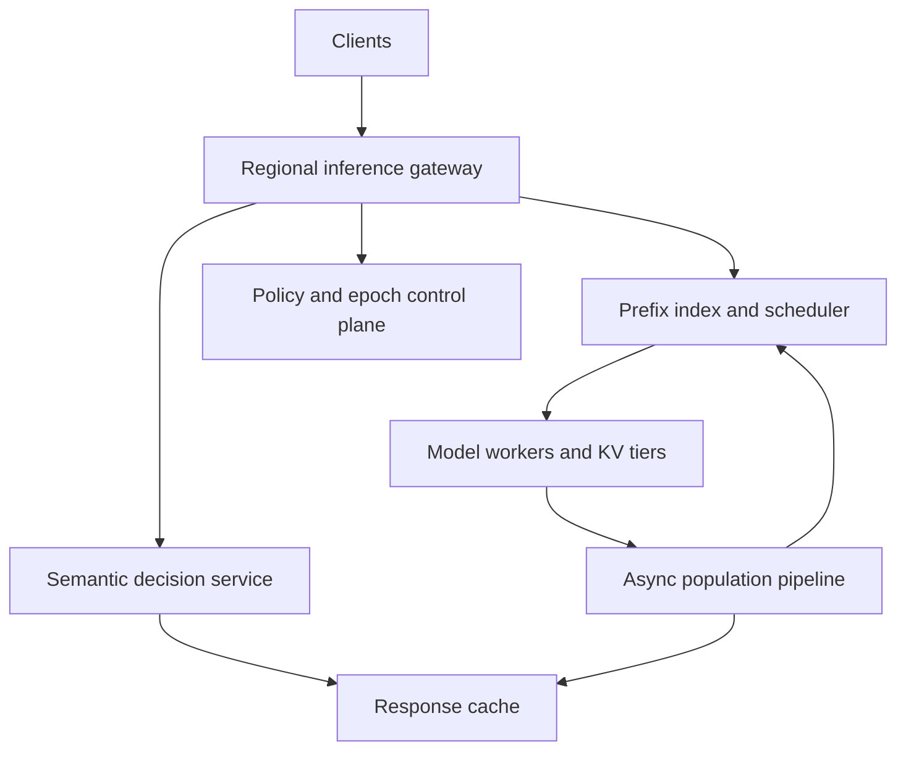
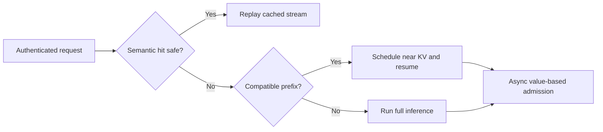

# Design a Multi-Tenant LLM Inference Cache Platform

**Difficulty:** Senior / Staff  
**Primary themes:** AI inference serving, semantic caching, prefix/KV caching, multi-tenancy, consistency, admission control, reliability, privacy  
**Interview time budget:** about 45 minutes. This educational walkthrough is intentionally longer so the reasoning, calculations, failure semantics, and tradeoffs are explicit.

This walkthrough uses the public [Hello Interview system-design delivery framework](https://www.hellointerview.com/learn/system-design/in-a-hurry/delivery): clarify requirements, identify the core entities, define concrete interfaces, build the simplest complete design one operation at a time, and then deepen the decisions that carry the most risk. The API and entity sections also use their public guidance on [API design](https://www.hellointerview.com/learn/system-design/core-concepts/api-design) and [data modeling](https://www.hellointerview.com/learn/system-design/core-concepts/data-modeling). The problem, protocols, calculations, dialogue, and tradeoffs below are original.

---

## Interviewer prompt

> Design a global, multi-tenant caching platform in front of an LLM inference fleet. It should accelerate repeated requests through two mechanisms: exact prefix/KV-cache reuse and optional semantic response caching. It must preserve model correctness, tenant isolation, streaming behavior, and safety-policy semantics while reducing time to first token and inference cost.

## Targeted clarifying questions with assumed interviewer answers

**Candidate:** “Are we caching final responses, intermediate model state, or both?”  
**Interviewer:** “Both. Exact prefix reuse stores model KV state for token-identical prefixes. Semantic caching may return a previous completed response for a sufficiently similar request, but only where the tenant opts in.”

**Candidate:** “Which request fields affect correctness?”  
**Interviewer:** “Model and weight version, tokenizer, adapter, system prompt, ordered messages, tool definitions, response format, sampling parameters, safety-policy version, tenant scope, and some authorization context. You should decide which fields permit exact reuse.”

**Candidate:** “Can one tenant reuse another tenant’s cache?”  
**Interviewer:** “Not by default. Cross-tenant reuse is allowed only for provider-owned public prefixes explicitly marked shareable. Customer prompts and responses must remain tenant-isolated.”

**Candidate:** “What scale should I assume?”  
**Interviewer:** “One million inference requests per second globally at peak, 20 regions, 20,000 tenants, 40 billion input tokens per minute, and 8 billion output tokens per minute. The fleet serves roughly 200 model or adapter versions.”

**Candidate:** “What latency targets matter?”  
**Interviewer:** “The cache-decision path should add under 5 ms p99. A semantic response hit should begin streaming within 30 ms p99. An exact KV hit should reduce time to first token without delaying a miss by more than 5 ms.”

**Candidate:** “What hit-rate target should we design for?”  
**Interviewer:** “Assume 30% of input tokens are reusable exact prefixes and 8% of eligible requests can use semantic responses. The design should remain correct if hit rates are lower.”

**Candidate:** “What consistency contract is required?”  
**Interviewer:** “Never reuse state across incompatible model execution contexts, tenants, or safety policies. Deletion and opt-out must stop new cache hits within 60 seconds. Cache population may be eventually consistent; a miss or stale negative only costs performance.”

**Candidate:** “Do we need exactly-once inference?”  
**Interviewer:** “No. Clients may retry. We need stable request identity, bounded duplicate work, and no duplicate cache publication that corrupts state.”

**Candidate:** “How should streaming work on a semantic hit?”  
**Interviewer:** “Replay the cached token or byte stream through the same protocol, preserve cancellation and accounting, and clearly mark the internal result as cached. The external product may or may not expose that fact.”

**Candidate:** “What is out of scope?”  
**Interviewer:** “Training models, choosing model architecture, implementing GPU kernels, and designing the base inference engine. Focus on the cache platform and its integration with schedulers and model servers.”

### Scope statement

In scope:

- canonicalize requests and compute compatibility-safe cache keys;
- exact prefix/KV reuse at block granularity;
- opt-in semantic response caching with confidence thresholds;
- multi-tier memory, local SSD, regional, and optional object-storage backing;
- admission, eviction, invalidation, deletion, quotas, accounting, and observability;
- miss coalescing, partial failures, model rollout, regional failover, and abuse resistance.

Out of scope:

- training or fine-tuning models;
- model kernel implementation;
- arbitrary reuse across tenants;
- promising byte-identical outputs for uncached stochastic inference;
- using the semantic cache for requests with side-effecting tools;
- retaining customer content beyond its configured policy.

> **What I would say aloud:** “I’ll treat these as two related but different caches. Prefix caching reuses deterministic intermediate state for an exact compatible token prefix; semantic caching may skip inference and therefore needs a much stricter product and safety contract. The core invariant is that a hit must be at least as authorized and execution-compatible as a miss.”

---

## 1. Requirements (~5 minutes)

### Core functional requirements

1. **Reuse exact prefixes safely.** For compatible requests, find the longest cached token prefix, attach its KV blocks to the inference job, and compute only the remaining prefill and decode work.
2. **Serve eligible semantic response hits.** For opted-in, side-effect-free requests, retrieve a sufficiently similar prior response, revalidate current policy, and stream it without model execution.
3. **Manage cache lifecycle at multi-tenant scale.** Admit valuable entries, evict under pressure, enforce quotas and retention, invalidate incompatible generations, honor deletion/opt-out, and expose trustworthy metrics and audit records.

### Quantified non-functional requirements

| Requirement | Target | Design consequence |
|---|---:|---|
| Peak requests | 1 million requests/s globally | regional cells, partitioned indexes, no global lookup on hot path |
| Input traffic | 40 billion tokens/minute | block-granular prefix keys and value-aware admission |
| Output traffic | 8 billion tokens/minute | compressed response objects and streaming replay |
| Cache decision overhead | p99 < 5 ms | colocated L1 metadata, bounded candidate search, asynchronous writes |
| Semantic-hit start | p99 < 30 ms | precomputed embeddings, regional vector index, local response store |
| Availability | 99.99% for cache service; cache failures must not block ordinary inference | fail open to inference on lookup/population failure |
| Isolation | zero unauthorized cross-tenant hits | auth-derived namespace, encryption, scoped keys, provider-public exception only |
| Invalidation | opt-out/deletion/policy revocation enforced globally within 60 s | epoch push, short leases, tombstones, fail closed for uncertain semantic hits |
| Durability | cache data is disposable; deletion intent is durable | metadata/tombstones durable, cache values reconstructible |
| Cost objective | reduce prefill compute by at least 20% without >2% extra infrastructure cost per served token | selective admission and tiering, not cache everything |

### Consistency and availability contract

- A prefix hit is valid only when its **execution fingerprint** matches: model weights, tokenizer, adapter, KV layout, numerical format, attention configuration, relevant runtime features, and tenant/public namespace.
- A semantic response hit additionally requires a matching **behavior fingerprint**: system/developer instructions, tools, response schema, safety-policy generation, sampling class, locale, and any context that can change the answer.
- Cache population is eventually consistent. Missing a newly populated entry is safe and only wastes compute.
- Invalidation is asymmetric. A stale miss is safe; a stale positive may violate correctness or privacy. Deletion, policy tightening, or tenant opt-out installs a higher namespace epoch and tombstone. A cell that cannot prove semantic-cache freshness after its lease expires bypasses semantic hits.
- Prefix-cache failure fails open to normal inference because the model can recompute prefill. Semantic-cache uncertainty also falls back to inference, not to an unverified cached answer.
- Cache values are not the system of record. Durable metadata stores policies, generations, deletion tombstones, and accounting checkpoints; cache entries may be lost.
- A client retry may cause duplicate inference. Single-flight coalescing reduces duplicate work, but correctness does not depend on exactly-once execution.

> **What I would say aloud:** “I’m making availability conditional on the action. A failed prefix lookup becomes a miss. A semantic hit is more dangerous because it bypasses current inference, so if policy or deletion freshness is uncertain I bypass the cache and run the model.”

---

## 2. Core entities (~2 minutes)

| Entity | Essential fields and purpose |
|---|---|
| `TenantCachePolicy` | tenant, enabled cache modes, sharing scope, retention, quotas, semantic thresholds, content restrictions, epoch |
| `ExecutionFingerprint` | model, weights, tokenizer, adapter, KV schema, precision, attention/runtime compatibility |
| `BehaviorFingerprint` | normalized instructions, tools, response format, safety generation, sampling class, locale |
| `PrefixBlock` | namespace, parent digest, token-block digest, depth, KV object reference, size, generation, expiry |
| `ResponseEntry` | namespace, semantic partition, request embedding reference, exact request digest, response object, policy metadata, expiry |
| `CacheNamespace` | tenant-private or provider-public scope, encryption key, epoch, residency, retention |
| `LookupDecision` | request ID, mode, hit/miss reason, chosen prefix depth or response entry, confidence, policy epoch |
| `PopulationLease` | cache key, owner request, expiry, generation; used for single-flight work |
| `Tombstone` | namespace/key range, minimum valid epoch, deletion reason, effective time |
| `UsageRecord` | tenant, request, cached tokens/bytes, compute avoided, billable class |
| `CacheObject` | tier, checksum, encrypted payload, compression, reference count or reachability metadata |

The two fingerprints are separate deliberately. KV compatibility asks, “Can these tensors be consumed correctly by this runtime?” Semantic response compatibility asks, “Would returning this old answer preserve the current product behavior?” The second set is broader.

> **What I would say aloud:** “I’ll key reuse from canonical execution and behavior fingerprints rather than a raw JSON request. That makes every compatibility decision explicit and gives model rollout or policy change a clean generation boundary.”

---

## 3. API and system interface (~5 minutes)

External identity comes from mTLS or a signed workload token. The gateway derives `tenant_id`, entitlement, region, cache policy, and data classification; request bodies cannot choose another tenant’s namespace.

### Submit a streaming inference request

```http
POST /v1/responses
Authorization: Bearer <workload-token>
Idempotency-Key: chat-turn-891
Accept: text/event-stream

{
  "model": "reasoner-70b@2026-10-24",
  "messages": [
    {"role":"system", "content":"Answer as a concise database tutor."},
    {"role":"user", "content":"Explain snapshot isolation with an example."}
  ],
  "tools": [],
  "response_format": {"type":"text"},
  "temperature": 0.1,
  "max_output_tokens": 700,
  "cache": {
    "prefix": "ALLOW",
    "semantic_response": "ALLOW",
    "scope": "TENANT_PRIVATE",
    "max_age_seconds": 3600
  }
}
```

The gateway ignores any client-supplied tenant identifier. It may reduce, but never expand, caching permitted by the tenant policy. For example, a request can say `BYPASS`, but cannot enable semantic caching if the tenant disabled it.

Streaming response:

```text
event: response.started
data: {"request_id":"req_01K...","model":"reasoner-70b@2026-10-24"}

event: response.delta
data: {"text":"Snapshot isolation lets each transaction..."}

event: response.completed
data: {"input_tokens":182,"output_tokens":318,"cached_prefix_tokens":128}
```

The public API need not reveal internal cache keys. Internal observability records whether the result was a prefix hit, semantic hit, or miss.

### Internal prefix lookup

```protobuf
rpc LookupPrefix(LookupPrefixRequest) returns (LookupPrefixResponse);

message LookupPrefixRequest {
  string request_id = 1;
  string namespace_id = 2;
  bytes execution_fingerprint = 3;
  repeated bytes token_block_digests = 4;
  uint64 minimum_namespace_epoch = 5;
  string target_worker_capability = 6;
}

message LookupPrefixResponse {
  uint32 matched_blocks = 1;
  uint32 matched_tokens = 2;
  repeated CacheObjectRef kv_objects = 3;
  uint64 namespace_epoch = 4;
  string placement_hint = 5;
}
```

The inference scheduler calls this after tokenization and before worker placement. The response may suggest a worker or cache host that already has the KV blocks.

### Internal semantic lookup

```protobuf
rpc LookupSemantic(LookupSemanticRequest) returns (LookupSemanticResponse);

message LookupSemanticRequest {
  string request_id = 1;
  string namespace_id = 2;
  bytes behavior_fingerprint = 3;
  repeated float query_embedding = 4;
  bytes exact_request_digest = 5;
  uint64 minimum_policy_epoch = 6;
  float required_similarity = 7;
}
```

Response includes a bounded candidate list, similarity score, answer metadata, current-policy evidence, and response-object reference. The gateway, not the vector index, makes the final acceptance decision.

### Explicit invalidation and opt-out

```http
POST /v1/cache/invalidations
Authorization: Bearer <tenant-admin-token>
Idempotency-Key: incident-442-purge

{
  "scope": {"type":"TENANT_ALL"},
  "modes": ["PREFIX", "SEMANTIC_RESPONSE"],
  "reason": "prompt contained regulated data"
}
```

Response:

```json
{
  "invalidation_id":"inv_01K...",
  "committed_epoch":84,
  "state":"PROPAGATING",
  "enforcement_deadline":"2026-10-26T06:03:00Z"
}
```

The request commits an epoch/tombstone first. Physical deletion follows asynchronously. New hits below epoch 84 are rejected immediately when cells receive the update and no later than the freshness deadline.

### Cache policy update

```http
PUT /v1/cache/policy
Authorization: Bearer <tenant-admin-token>
If-Match: "policy-version-17"

{
  "prefix_cache":"ENABLED",
  "semantic_response_cache":"ENABLED",
  "semantic_similarity_threshold":0.94,
  "max_retention_seconds":86400,
  "allowed_data_classes":["PUBLIC","INTERNAL"],
  "residency_regions":["us-east","us-west"]
}
```

Policy tightening increments the epoch and uses urgent propagation. Loosening may propagate normally because stale state merely misses an optimization.

---

## 4. Data flow

### Request decision flow

1. Gateway authenticates the workload, derives tenant and loads a bounded-fresh cache policy.
2. Request normalizer canonicalizes behavior-affecting fields and strips transport-only fields such as request ID.
3. Tokenizer service uses the pinned tokenizer version and produces token IDs and fixed-size token blocks.
4. If semantic caching is eligible, an embedding service produces a cache-query embedding and searches only the tenant’s semantic partition.
5. A candidate passes exact metadata checks, similarity threshold, current safety validation, freshness, and side-effect rules before replay.
6. If no semantic hit is accepted, prefix lookup finds the longest compatible cached block chain.
7. Scheduler chooses a worker using both compute availability and KV-data locality.
8. Worker attaches cached KV blocks, computes the remaining prefill, decodes tokens, and streams normally.
9. Asynchronously, the population pipeline admits useful prefix blocks and possibly the completed response.
10. Usage, hit/miss reasons, saved tokens, latency, and policy evidence enter the accounting and audit streams.

### Invalidation flow

1. Policy or deletion service commits a higher namespace epoch plus a tombstone.
2. An outbox publishes a signed invalidation to every serving region.
3. Regional cache controllers update their minimum valid epoch before acknowledging.
4. Gateways and cache nodes reject older entries even if bytes remain present.
5. A scrubber deletes indexes and objects, then records completion by tier and region.
6. The status endpoint distinguishes logical enforcement from physical erasure.

---

## 5. High-level design (~10–15 minutes)

### Compact architecture



The request path is regional. The global control plane distributes tenant policies, model compatibility generations, and invalidation epochs. The cache is an acceleration layer; inference remains the authoritative fallback.

### Operation 1: canonicalize and decide eligibility

The gateway builds two hashes.

```text
execution_fingerprint = H(
  model_weight_digest,
  tokenizer_digest,
  adapter_digest,
  kv_schema_version,
  attention_config,
  positional_encoding_config,
  numeric_format,
  runtime_compatibility_generation
)

behavior_fingerprint = H(
  execution_fingerprint,
  canonical_system_and_developer_messages,
  tool_schema_digest,
  response_format_digest,
  safety_policy_generation,
  sampling_class,
  locale,
  tenant_policy_generation
)
```

Canonicalization must be deterministic. JSON objects have sorted keys; Unicode uses a defined normalization; tool schemas drop irrelevant formatting but preserve semantics; message order is never changed. The raw prompt is not itself used as a global key because that could reveal equality across tenants.

Eligibility rules reject semantic caching when:

- the request can call side-effecting tools;
- temperature or sampling policy is outside a configured deterministic class;
- current time, user identity, private retrieval context, or noncanonical external state materially affects the answer;
- prompt data classification forbids retention;
- tenant policy disables it;
- the safety policy requires fresh model evaluation;
- the requested response is personalized in a way not fully represented in the key.

Prefix caching is more broadly eligible because it does not return an old answer; it merely avoids recomputing deterministic prefill. Still, it must not cross an incompatible execution fingerprint or isolation namespace.

> **Say aloud:** “Semantic similarity is not compatibility. I first create a strict behavior partition; only then do I run approximate nearest-neighbor search inside that partition.”

### Operation 2: exact prefix lookup

Tokenize the request and divide it into blocks, for example 64 tokens. Each block receives a chained digest:

```text
block_key[0] = H(namespace, execution_fingerprint, tokens[0:64])
block_key[i] = H(block_key[i-1], tokens[i*64:(i+1)*64])
```

Chaining means the same token block at different prefix positions does not collide semantically. The index maps each block key to a KV object reference, compatible worker formats, size, epoch, expiry, and placement.

The lookup probes from the deepest candidate toward the root, or traverses a compact prefix trie/radix index. A match is accepted only if every referenced block is present and its checksum, epoch, and execution generation are valid. If the last block is partial, the worker replays the partial tokens or uses a smaller sub-block scheme; the baseline can simply cache full blocks.

The scheduler then makes a joint decision:

- worker A has an idle accelerator but would fetch 8 GB of KV over the network;
- worker B is slightly busier but already owns those blocks;
- worker C can reconstruct from regional SSD.

Choose the placement minimizing estimated completion time, not just queue length. A simple score is:

```text
score = predicted_queue_ms + kv_transfer_ms + remaining_prefill_ms + decode_ms
```

This is an estimate; cap locality preference so hot cache nodes do not become permanent scheduling hotspots.

### Operation 3: semantic response lookup

The semantic path starts only after strict eligibility and behavior partitioning. It computes an embedding from the normalized user intent. The vector index is partitioned by:

```text
(namespace_id, behavior_fingerprint, language, response_schema_class)
```

Approximate nearest-neighbor search returns perhaps 10 candidates. A reranker then evaluates the normalized current request and cached request. Acceptance requires:

- similarity above the tenant/model-specific threshold;
- no negation, entity, numeric, time-window, or locale mismatch detected by guards;
- exact equality for tool set, schema, model behavior generation, and policy generation;
- response still within TTL and namespace epoch;
- optional lightweight safety recheck of the cached response;
- no active tombstone.

The vector database never directly returns a response to the client. It suggests candidates; the decision service applies deterministic gates.

On a hit, the gateway streams the stored response through the same SSE or gRPC framing as live inference. It honors client backpressure and cancellation. Usage records distinguish input validation work, cached output bytes, and compute avoided.

Why not cache every semantically similar question? Because a plausible but wrong reused answer is worse than a miss. Thresholds should start conservative, be evaluated offline by domain, and be adjustable per tenant. Financial, medical, rapidly changing, or user-specific domains may disable semantic reuse entirely.

### Operation 4: miss, single-flight, and inference

If semantic and prefix lookup miss, the request proceeds normally. Before expensive prefill, the gateway may acquire a short population lease for the exact request or prefix root:

```text
PopulationLease(namespace, exact_digest, owner_request_id,
                generation, expires_at)
```

Concurrent identical requests have three options:

1. **Join the live stream** if authentication, response visibility, and cancellation semantics permit.
2. **Wait briefly** for the first request to publish, then consume the cache entry.
3. **Run independently** if the deadline is tight or the first request is stochastic.

The baseline joins only exact, tenant-private, deterministic requests with no tools. Waiters have independent deadlines and can detach without canceling the owner. The owner lease expires so a crashed producer cannot block progress.

This is request coalescing, not exactly-once inference. A timeout race may produce duplicate work, but only a generation-checked publish becomes the canonical entry.

### Operation 5: populate prefix blocks

During prefill, the model worker produces KV tensors per layer and token block. Copying every tensor to remote storage would saturate interconnects, so population is selective.

The worker reports candidate metadata:

```text
PrefixCandidate(block_key, token_count, kv_bytes,
                compute_ms_saved, observed_frequency,
                namespace, expiry, worker_format)
```

An admission controller estimates value:

```text
value_density = expected_reuse_count * compute_ms_saved / kv_bytes
```

High-value blocks remain in worker memory. Medium-value blocks spill to host memory or local NVMe. Regionally popular, expensive prefixes may be replicated to cache hosts. Low-value one-off blocks are never admitted.

Publication order is data before index:

1. write encrypted KV object to the target tier;
2. verify checksum and format metadata;
3. publish the index entry with generation and expiry;
4. release the population lease.

If the process crashes before step 3, the object is unreachable and later garbage-collected. Publishing index first could create a false hit to missing or partial data.

### Operation 6: populate semantic responses

Only completed, policy-eligible responses are candidates. Partial streams and failed tool calls are never published. The pipeline stores:

```text
ResponseEntry(
  entry_id, namespace_id, behavior_fingerprint,
  exact_request_digest, request_embedding,
  normalized_request_features, response_object_ref,
  model_generation, safety_generation, policy_epoch,
  created_at, expires_at, quality_score, checksum
)
```

The response object contains the canonical output plus replay boundaries or token chunks. It is encrypted under the namespace key. Sensitive raw prompts need not be stored if normalized features and exact digest suffice, although offline quality evaluation may require explicitly authorized samples.

The admission controller considers observed repetition, response cost, age sensitivity, size, and risk class. A 20,000-token reasoning response repeated thousands of times is valuable; a personalized two-token answer is not.

### Operation 7: evict and tier

Use separate budgets for prefix KV and semantic responses because their sizes and risks differ. Within each namespace, combine:

- frequency sketch for admission, similar to TinyLFU;
- recency for eviction among admitted entries;
- size/cost weighting so one giant prefix cannot evict thousands of more valuable entries;
- tenant quota and minimum reserved share;
- hard TTL and policy retention cap.

Suggested tiers:

| Tier | Contents | Typical latency | Role |
|---|---|---:|---|
| Worker accelerator memory | currently hot KV blocks | microseconds | fastest reuse, scarce |
| Worker host memory | hot/warm KV | sub-millisecond | fast attach or DMA |
| Local NVMe | warm KV and response chunks | 1–3 ms | capacity tier within cell |
| Regional cache hosts | replicated popular KV/responses | 2–10 ms | cross-worker reuse |
| Object storage | optional cold response objects, not latency-critical KV | tens of ms | reconstructible backing or analytics |

Do not automatically place KV in object storage merely because it is cheap. If transfer and deserialization cost exceeds recomputing prefill, it is negative-value caching.

### Operation 8: invalidate model and policy generations

A model rollout creates a new execution generation. New workers write only the new generation; old entries remain readable only by old compatible workers during the drain window. After rollout completion, the old generation is bulk-evicted asynchronously.

A safety-policy change creates a new behavior generation. Semantic responses from the old generation stop hitting immediately after epoch propagation. Prefix KV may remain valid if the policy affects only output filtering and not model input; if system instructions or model execution change, prefix entries also become incompatible.

This distinction avoids unnecessarily flushing expensive KV while preserving behavior correctness.

### Scale estimates that change design decisions

**Requests per region.** One million requests/s over 20 regions averages 50,000/s. Plan for 4× skew, or 200,000/s in a hot region. At 5 ms allowed cache overhead, the decision services need bounded local work and enough replicas to keep queueing negligible.

**Token volume.** Forty billion input tokens/minute is about 667 million tokens/s. If 30% are reusable prefixes, the cache avoids prefill for about 200 million tokens/s. Even a modest per-token prefill cost makes prefix reuse economically significant.

**KV size.** Assume a representative model uses 256 KiB of KV per token after layout and precision choices. A 2,000-token prefix is about 512 MiB. Caching just one million such prefixes would require roughly 512 TiB, before replication. Therefore “cache every request” is impossible; block sharing, admission, compression/quantization where compatible, and short retention are first-order design requirements.

**Index size.** If a region tracks 500 million prefix blocks and each compact index record is 64 bytes, the raw index is about 32 GB. With overhead and replication, it fits in a distributed in-memory index but not comfortably inside every gateway. Gateways keep only a small L1 of hottest keys.

**Semantic search load.** If only 25% of requests are eligible for semantic caching, a hot region sees 50,000 semantic queries/s. With 20,000 tenants, indexes should be partitioned and small tenants may share physical shards while remaining logically isolated. Large tenants receive dedicated shards.

**Response storage.** At 8 billion output tokens/minute, retaining all outputs is absurd. If average encoded output is 4 bytes/token, raw output is about 32 GB/minute or 46 TB/day before metadata. An 8% hit opportunity does not justify writing 100%; admit only repeatable, expensive, permitted responses.

**Transfer versus recompute.** Suppose loading a 512 MiB KV prefix across a 100 Gbit/s link takes at least 41 ms at line rate, before contention and deserialization. If recomputing that prefix takes 20 ms on an idle worker, remote reuse loses. The scheduler needs measured transfer and recompute costs, not a rule that every cache hit is good.

> **What I would say aloud:** “The KV arithmetic changes the architecture. KV is hundreds of kilobytes per token for large models, so capacity and movement dominate. I admit by compute saved per byte and let the scheduler decline a technically valid hit when recomputation is faster.”

---

## 6. Deep dives (~10–15 minutes)

## Deep dive A: cache-key correctness and tenant isolation

### Where the baseline breaks

Hashing only prompt text is incorrect. Two identical prompts can require different outputs because of model version, system instructions, tools, adapter, safety policy, retrieval context, locale, sampling, or authorization. A global content hash can also reveal that two tenants submitted the same confidential prompt. Finally, a semantic vector index can return a plausible neighbor from the wrong behavior domain.

### Plausible approaches

| Approach | Advantage | Failure |
|---|---|---|
| Raw prompt hash | simple and fast | misses execution context and leaks equality |
| Full serialized request hash | safer exactness | transport noise lowers hit rate; still no semantic policy |
| Global semantic index | highest theoretical hit rate | unacceptable privacy and behavior mixing |
| Tenant namespace plus strict fingerprints | safe and explainable | lower hit rate and more metadata |
| Provider-public namespace for approved prefixes | useful cross-tenant reuse | requires explicit provenance and review |

### Selected approach

Use tenant-private namespaces by default. Namespace identity is derived from authentication, residency, retention policy, and a tenant encryption key. Cache keys use keyed hashing or HMAC under the namespace key so identical prompts across tenants do not share observable digests.

Provider-owned public prefixes—such as an immutable system prompt shipped with a model—may live in a separate reviewed namespace. A manifest lists the exact bytes, model compatibility generation, intended audience, and approval. Customer content cannot be promoted into this namespace through an API flag.

Exact prefix compatibility uses the execution fingerprint. Semantic reuse uses the broader behavior fingerprint and candidate guards. Relevant retrieval results must either be included in the exact behavior digest or make the request ineligible; merely including the retrieval query is insufficient because the underlying corpus can change.

Sampling deserves an explicit contract:

- greedy or deterministic decoding can use exact response caching;
- low-temperature responses may use semantic caching only if the product accepts reuse;
- requests asking for diversity or a random seed bypass final-response caching;
- prefix KV remains valid because it precedes sampling, provided the prefix execution is deterministic.

### Authorization and encryption

- The gateway derives the namespace and passes a short-lived signed capability to cache services.
- Cache nodes verify capability scope, mode, region, epoch, and expiry.
- Values are encrypted per namespace; storage operators see object sizes and opaque identifiers.
- Index services never return entries across namespace boundaries.
- Decryption keys are available only in permitted regions.
- Logs record digests and reason codes, not prompt or response bodies.

### Collision and corruption handling

Use a cryptographic digest, but do not rely on collision resistance alone for object integrity. Each object stores length, format, generation, and checksum; workers validate these before attaching KV. A corrupted or incompatible object is quarantined and treated as a miss. Never feed malformed KV into a model runtime and hope for an error.

### Failure modes

- **Tokenizer silently changes:** tokenizer digest changes the execution fingerprint.
- **Adapter rollout reuses old base-model cache:** adapter digest prevents the hit.
- **Safety policy tightens:** higher behavior generation invalidates semantic entries.
- **Tenant ID supplied in body:** ignored; identity comes from authentication.
- **Vector index bug crosses partitions:** final decision verifies namespace and signed metadata; alert and quarantine shard.
- **Shared public prefix accidentally contains tenant data:** manifests are immutable and provider-controlled; customer APIs cannot publish there.
- **Deletion message is missed:** short epoch lease expires; semantic hits bypass until refreshed.

### Observability

Track hit rejections by fingerprint field, namespace-crossing attempts, generation mismatches, corrupted-object checksums, stale-epoch prevents, public-namespace publications, authorization failures, deletion enforcement lag, and sampled correctness audits. High hit rate is not a success metric if rejection and quality signals degrade.

> **What I would say aloud:** “Isolation is part of the key, not a filter applied after lookup. I use tenant-keyed digests, strict execution and behavior generations, and an explicit provider-public namespace that customers cannot write into.”

## Deep dive B: admission, eviction, locality, and stampede control

### Where the baseline breaks

KV entries are enormous. LRU alone admits one-hit wonders, lets large objects evict valuable small ones, and ignores how much compute an entry saves. A globally popular prefix can overload the few workers holding it. When a cache expires, thousands of identical requests may simultaneously recompute and repopulate it.

### Options

| Policy | Strength | Weakness |
|---|---|---|
| LRU | simple recency | scan pollution and no cost awareness |
| LFU | captures popularity | slow to adapt; metadata overhead |
| Size-aware LRU | protects capacity | still ignores compute value |
| TinyLFU admission + cost-aware eviction | filters one-hit entries | more estimation and tuning |
| Pin all common prefixes | predictable | wastes memory and creates hotspots |

### Selected approach

Use a frequency sketch to decide whether a candidate deserves admission, then evict using a score based on expected future compute saved per byte:

```text
entry_value = decayed_frequency
              * estimated_prefill_ms_saved
              * reuse_probability
              / (resident_bytes * replication_factor)
```

Apply hard tenant quotas first, then value-based decisions within the tenant’s budget. Maintain a small protected pool for provider-public prefixes and a separate pool for semantic responses so huge KV blocks cannot evict the entire response cache.

Frequency is decayed so yesterday’s viral prompt does not occupy memory forever. Entries with regulatory TTLs expire regardless of value. A tenant can purchase reserved cache capacity, but cannot exceed shared I/O or queue limits.

### Locality-aware scheduling

Maintain a placement directory mapping hot block keys to workers/cache hosts. The scheduler predicts:

- queue time;
- remaining prefill compute;
- KV transfer time and interconnect congestion;
- cost of materializing/attaching blocks;
- decode capacity and deadline.

It may choose:

- **move compute to data** for large hot prefixes already on a lightly loaded worker;
- **move data to compute** for small prefixes or idle workers;
- **recompute** when transfer is slower;
- **replicate** after sustained multi-worker demand.

Replication is reactive but bounded. A popularity controller adds replicas gradually and removes them after decay. Per-key and per-tenant admission limits stop a single viral prefix from consuming every cache host.

### Stampede control

For an exact deterministic request, acquire a short lease and expose a live-flight registry. Followers can attach to the producer stream only when they have equivalent authorization and response visibility. Otherwise they wait for publication or run independently.

Use jittered soft and hard expiry:

- before soft expiry, serve normally;
- between soft and hard expiry, one owner refreshes while others may use the existing safe entry;
- after hard expiry or policy invalidation, nobody uses it.

This technique is allowed only when age staleness is semantically safe. It never extends a security epoch or deletion deadline.

### Backpressure

Population is lower priority than serving inference. When interconnect or storage queues rise:

1. stop remote replication;
2. reject low-value admissions;
3. keep only worker-local hot KV;
4. bypass semantic writes;
5. continue lookups where cheap;
6. fall back to inference on cache-service overload.

Bound every queue. An overloaded cache must not amplify latency across the inference fleet.

### Failure modes

- **Lease owner dies:** lease expires; a follower takes over.
- **Two owners publish:** compare generation and content checksum; one entry wins, duplicates are garbage-collected.
- **Placement directory is stale:** worker reports missing block; scheduler retries another source or recomputes.
- **Hot prefix pins traffic to one worker:** cap locality bonus and replicate based on demand.
- **NVMe is slow:** circuit-break that tier and treat entries as misses.
- **Frequency sketch is polluted by attackers:** count only authenticated, rate-limited requests and cap contribution per tenant/key.
- **Population saturates network:** separate queues and bandwidth budgets from inference traffic.

### Observability

Measure admission rate, eviction cause, value density, reuse count before eviction, bytes by tier/tenant/model, transfer-versus-recompute decisions, locality hit rate, coalesced waiters, duplicate work, lease expiry, queue depth, network bandwidth, SSD tail latency, and cache-caused inference delay. The key business metric is compute cost avoided net of cache cost.

> **What I would say aloud:** “A KV cache is not a normal web cache. I optimize expected prefill compute saved per byte, and the scheduler can reject a hit when moving the state costs more than recomputing it.”

## Deep dive C: semantic-cache quality, invalidation, and safe failure

### Where the baseline breaks

Cosine similarity is not answer equivalence. “Can I take ibuprofen?” and “Can’t I take ibuprofen?” may embed closely. So can questions with different account IDs, dates, units, or jurisdictions. Cached answers can become stale after policy, knowledge, or tool-state changes. A semantic hit also bypasses model-side safety logic unless revalidated.

### Candidate strategies

| Strategy | Latency/cost | Quality risk |
|---|---|---|
| Vector threshold only | lowest | high; similarity is not equivalence |
| Vector search plus deterministic guards | low | moderate and explainable |
| Cross-encoder rerank | higher | better semantic precision |
| Small verifier model | higher and operationally complex | better on nuanced mismatches |
| Exact response cache only | safest | much lower hit rate |

### Selected approach

Start with exact response caching and a conservative semantic mode. The semantic decision pipeline is:

1. strict eligibility and behavior partition;
2. ANN retrieval for top candidates;
3. deterministic guards for entities, numbers, units, negation, dates, locale, and requested format;
4. cross-encoder or small verifier for high-value domains;
5. threshold calibrated per model, tenant, language, and domain;
6. current safety-policy check on cached output;
7. bounded-fresh epoch validation;
8. replay only if every stage passes.

The system stores why a hit was accepted. That evidence enables offline analysis and incident response.

### Quality evaluation

Use shadow evaluation before enabling semantic hits:

- retrieve and score candidates but still run inference;
- compare cached candidate with fresh output using task-specific metrics and human review;
- estimate false-hit rate, not just hit rate;
- choose thresholds to meet a strict bad-reuse budget;
- enable by tenant/domain gradually.

Online, sample a tiny fraction of would-be hits for shadow inference. Do not show both outputs to the user. Compare factuality, policy, format, and task success, then adjust thresholds. Sensitive tenants may prohibit sampling or content retention.

### Freshness and invalidation

Different causes use different generations:

- model weights or adapter change: execution generation changes;
- system prompt or tool schema change: behavior generation changes;
- safety policy tightens: policy epoch changes urgently;
- tenant opts out or requests deletion: namespace epoch changes urgently;
- knowledge corpus changes: retrieval snapshot digest changes or semantic cache is bypassed;
- time-sensitive answer ages: short TTL or no semantic caching.

Logical invalidation precedes physical deletion. Once a tombstone is committed and propagated, old entries cannot hit even if indexes or blobs remain. Scrubbers then remove vectors, objects, replicas, and backups according to the deletion SLA.

### Regional failure

Each region has an independent cache cell. Cache values need not synchronously replicate worldwide. Provider-public entries may replicate asynchronously. Tenant-private entries remain within allowed residency regions.

If a cache region fails:

- traffic routes to inference in another permitted region;
- missing cache state causes cold performance, not incorrect answers;
- semantic hits remain disabled until the destination has fresh policy/epoch state;
- the system avoids copying private cache objects to a disallowed region merely to improve hit rate.

### Safe failure behavior

- **Vector index unavailable:** skip semantic cache and continue to prefix/inference.
- **Policy service unavailable:** use signed policy only inside lease; afterward bypass semantic hits.
- **Response object missing:** record a dangling index, delete it asynchronously, and infer normally.
- **Verifier times out:** treat as miss.
- **Safety check times out:** treat as miss for semantic response; prefix reuse may still proceed if independently valid.
- **Accounting stream unavailable:** use a bounded durable local log; if billing correctness requires it, stop granting discounted cache billing but do not silently lose usage.
- **Deletion propagation exceeds SLO:** disable semantic caching for the affected namespace/region and page operators.

### Observability

Track semantic candidate rate, accepted hit rate, false-hit estimate, shadow disagreement, guard rejection by reason, policy recheck failures, answer age, threshold distribution, stale-generation blocks, invalidation commit-to-enforcement latency, physical deletion lag, replay latency, and user-reported bad reuse. Break down all metrics by model, tenant class, language, and domain.

> **What I would say aloud:** “The semantic cache is a decision system, not just a vector database. A vector match proposes a candidate; strict compatibility, deterministic guards, a verifier where justified, current safety policy, and a fresh epoch decide whether it can be returned.”

---

## 7. Final design

The platform places regional cache cells beside the inference fleet. A gateway authenticates the workload, derives a tenant-private namespace, loads a signed bounded-fresh policy, canonicalizes the request, and builds separate execution and behavior fingerprints.

For eligible requests, the semantic decision service searches only within the exact behavior partition, reranks candidates, applies mismatch guards, checks the current safety generation and namespace epoch, and replays a cached response only when confidence is high. Otherwise the prefix index finds the longest chain of compatible token blocks. The scheduler jointly considers queue time, KV locality, transfer cost, remaining prefill, and decode capacity; a valid cache hit may still be declined when recomputation is faster.

Workers attach cached KV, compute the remaining prefill, and decode normally. An asynchronous population pipeline admits entries based on expected compute saved per byte, writes data before publishing indexes, and separates worker memory, host memory, NVMe, regional cache hosts, and optional cold response storage. Tenant quotas, frequency sketches, cost-aware eviction, bounded replication, and single-flight leases protect capacity and prevent stampedes.

Model, tokenizer, adapter, runtime, prompt, tool, schema, safety, and tenant-policy changes advance explicit generations. Urgent deletion or opt-out commits a higher namespace epoch and tombstone, invalidating hits before physical erasure. Cache failures fail open to ordinary inference; uncertain semantic hits never fail open to stale cached answers.



### Requirements check

| Requirement | Design response |
|---|---|
| Exact prefix reuse | chained token-block keys plus execution fingerprint |
| Semantic response reuse | strict partition, ANN candidates, guards, verifier, policy recheck |
| Tenant isolation | auth-derived namespaces, keyed digests, per-namespace encryption and quotas |
| Low lookup latency | regional cells, L1 metadata, bounded candidate counts |
| Streaming | cached replay uses the same framed protocol and backpressure |
| Model rollout safety | explicit execution and behavior generations |
| Deletion/opt-out | durable epoch/tombstone, push invalidation, short leases, async scrub |
| Cache stampede | population leases, exact-request coalescing, soft/hard expiry |
| Capacity efficiency | compute-saved-per-byte admission and multi-tier eviction |
| Locality | scheduler compares transfer, recompute, queue, and decode costs |
| Reliability | cache failure becomes miss; bounded queues and circuit breakers |
| Multi-region | independent regional cells with residency-aware replication |
| Observability | hit reasons, saved compute, false-hit estimates, epoch and deletion lag |

### Polished 90-second closing summary

> “I split the design into two caches with different safety contracts. Exact prefix caching reuses KV only when a tenant-scoped execution fingerprint matches the model weights, tokenizer, adapter, KV layout, numerical format, and runtime generation. Semantic caching can skip inference, so it is opt-in and stricter: requests first enter an exact behavior partition, ANN search proposes candidates, and deterministic guards, optional reranking, current safety policy, and a fresh namespace epoch decide whether a response can be replayed. On a miss, prefix lookup returns the longest compatible block chain and the scheduler chooses between moving state, moving compute, or recomputing based on predicted completion time. Because KV can be hundreds of kilobytes per token, I do not cache everything; an asynchronous pipeline admits entries by expected prefill compute saved per byte across accelerator memory, host memory, NVMe, and regional cache hosts. Tenant quotas, cost-aware eviction, bounded replication, and single-flight leases control hotspots and stampedes. Model and policy changes advance explicit generations. Deletion and opt-out commit tombstones and higher epochs before physical erasure. Finally, all cache failures degrade to ordinary inference, while any uncertainty about a semantic hit becomes a miss. That preserves correctness and isolation even when the optimization layer is unhealthy.”

---

## Realistic interviewer follow-up questions with strong sample answers

### 1. Why are prefix caching and semantic caching different systems?

> “Prefix caching reuses deterministic intermediate state and still runs the model for the remainder. Semantic caching returns an old answer and bypasses current inference, so it has a broader compatibility key and a higher false-hit and policy risk.”

### 2. What fields belong in the prefix key?

> “Tenant/public namespace, model-weight digest, tokenizer, adapter, KV schema, attention and positional configuration, numerical format, runtime compatibility generation, and the chained token prefix.”

### 3. Why not hash the raw request JSON?

> “Transport-only fields reduce hits, semantically identical JSON can serialize differently, and raw JSON still may omit server-side policy or execution versions. Canonicalize behavior fields and hash explicit fingerprints.”

### 4. Why use chained block hashes?

> “A token block’s KV depends on all preceding tokens. Chaining binds each block to its full prefix position while allowing block-granular lookup and sharing.”

### 5. Can two tenants share the same system-prompt KV?

> “Only if it is provider-owned, immutable, reviewed, and published in an explicit public namespace. Customer content is private by default and cannot be promoted by a request flag.”

### 6. What happens when a model version changes?

> “A new execution generation produces different keys. Old workers may drain using old entries, new workers use the new generation, and old objects are bulk-evicted asynchronously.”

### 7. Can different numerical precision reuse the same KV?

> “Only if the inference runtime explicitly declares the layouts and semantics compatible. Otherwise precision and KV format are part of the execution fingerprint.”

### 8. How do you find the longest prefix quickly?

> “Tokenize into fixed blocks, compute chained digests, and probe the deepest digest downward or traverse a partitioned prefix/radix index. Gateways keep a small L1 for very hot prefixes.”

### 9. What if loading KV is slower than recomputing it?

> “The scheduler declines the hit. It compares queue, transfer, attach, remaining prefill, and decode time. A cache hit is useful only if it improves completion time or cost.”

### 10. Why not use LRU?

> “KV size and compute value vary enormously. LRU admits one-hit scans and ignores size. I filter admission by frequency and evict using expected compute saved per resident byte.”

### 11. How do you prevent a cache stampede?

> “Use short population leases and a live-flight registry for exact deterministic requests. Compatible followers can join, wait briefly, or run independently. Leases expire if the owner dies.”

### 12. Is single-flight exactly-once inference?

> “No. Failures and deadlines can still create duplicate execution. It is a cost optimization; generation-checked publication prevents duplicates from corrupting the cache.”

### 13. Why is vector similarity alone insufficient?

> “Similar embeddings can hide negation, numbers, dates, entities, locale, or authorization differences. ANN only proposes candidates inside a strict behavior partition; guards and possibly a verifier make the final decision.”

### 14. How do you choose the similarity threshold?

> “Calibrate per model, language, tenant, and domain using shadow traffic and task-specific quality review. Optimize against a false-hit budget, not maximum hit rate.”

### 15. How do you handle time-sensitive questions?

> “Usually disable semantic response caching or use a very short TTL and include a time bucket and data-snapshot version in the behavior fingerprint. Prefix KV can still be reused if the prefix itself is compatible.”

### 16. Can tool-using requests be cached?

> “Not as final responses when tools may have side effects or changing results. Deterministic read-only tool outputs could be incorporated with exact tool-result digests, but the safe baseline bypasses semantic response caching.”

### 17. What happens when the semantic index is down?

> “Skip it and continue to prefix lookup and ordinary inference. Cache availability must not become inference availability.”

### 18. What if the policy service is unreachable?

> “Use signed cached policy only inside its lease. After expiry, semantic hits are bypassed. Prefix reuse may continue if its independent execution and isolation checks remain valid.”

### 19. How do you honor deletion quickly if physical blobs remain?

> “Commit a higher namespace epoch and tombstone first. Cells reject lower-epoch entries, then scrub indexes and blobs asynchronously. Logical non-use precedes physical erasure.”

### 20. Could old cache data return after a node restart?

> “A node validates the current epoch floor before indexing or serving disk entries. Tombstones and signed generations prevent stale local bytes from becoming live.”

### 21. How do you bill a semantic hit?

> “Record input validation, cache lookup, stored-output replay, and model compute avoided separately. Product pricing is a business choice, but accounting must not pretend cached output consumed decode compute.”

### 22. How do you protect against cache-probing attacks?

> “Use tenant-scoped keyed hashes, do not expose hit timing or keys unnecessarily, pad or normalize responses where justified, rate limit lookups, and never search across private namespaces.”

### 23. How do you avoid one tenant taking all memory?

> “Enforce hard namespace quotas, reserved and burst shares, per-tenant admission budgets, and I/O rate limits before value-based eviction.”

### 24. How do you decide replication count?

> “Use decayed demand across workers, object size, transfer congestion, and failure-domain needs. Add replicas gradually, cap them, and remove them when popularity falls.”

### 25. What would you build first?

> “Tenant-private exact prefix caching for one model generation, worker-memory and local-NVMe tiers, chained block keys, locality-aware scheduling, quotas, epochs, and miss fallback. Then add regional cache hosts, single-flight, exact final-response caching, and only afterward conservative semantic reuse with shadow evaluation.”

---

## Common pitfalls

1. Treating semantic similarity as proof of answer equivalence.
2. Hashing only prompt text and ignoring model, tokenizer, adapter, tools, safety, or runtime.
3. Sharing private prompt equality across tenants through a global content hash.
4. Allowing clients to choose another tenant’s cache namespace.
5. Returning vector-search results without a final policy and metadata check.
6. Semantic-caching side-effecting tool calls.
7. Caching personalized or time-sensitive answers without including changing context.
8. Assuming a valid KV hit is always faster than recomputation.
9. Caching every KV block despite enormous bytes per token.
10. Using plain LRU without frequency, size, or compute-value awareness.
11. Publishing an index entry before its cache object is durable and verified.
12. Letting cache population compete with inference for unbounded bandwidth.
13. Using unbounded queues in lookup, transfer, or population services.
14. Pinning a hot prefix to one worker and creating a locality hotspot.
15. Calling request coalescing “exactly once.”
16. Letting one waiter cancel the shared producer for everyone.
17. Reusing partial or failed streamed responses.
18. Treating model name as equivalent to an immutable weight digest.
19. Reusing KV across incompatible precision or layout without runtime proof.
20. Flushing all prefix KV for a safety change that affects only final-output filtering, without reasoning about compatibility.
21. Keeping semantic hits active when policy freshness is uncertain.
22. Deleting blobs without first installing a logical tombstone.
23. Restoring disk cache after restart without checking the current epoch floor.
24. Measuring only hit rate instead of latency saved, compute saved, cost, and false-hit risk.
25. Logging raw prompts or responses in cache metrics and traces.

---

## Practice cadence

In a 45-minute interview:

- **0–5 minutes:** clarify prefix versus semantic caching, correctness fields, sharing scope, scale, latency, and invalidation.
- **5–7 minutes:** name policies, fingerprints, prefix blocks, response entries, namespaces, leases, and tombstones.
- **7–12 minutes:** define streaming inference, internal prefix/semantic lookup, invalidation, and policy interfaces.
- **12–25 minutes:** build canonicalization, semantic decision, prefix lookup, locality-aware scheduling, miss execution, and async population.
- **25–40 minutes:** deep-dive on compatibility/isolation, admission/locality/stampedes, and semantic quality/invalidation.
- **40–45 minutes:** check requirements, state failure behavior, and deliver the closing summary.

The written walkthrough is intentionally longer than the interview budget. In a live answer, establish three invariants early: private namespaces never cross, every hit carries an explicit compatibility generation, and cache uncertainty becomes ordinary inference. Draw the compact architecture, do the KV-size and transfer-versus-recompute arithmetic, and let the interviewer choose the deep dive.

## Public references

- Hello Interview, [System Design Delivery Framework](https://www.hellointerview.com/learn/system-design/in-a-hurry/delivery)
- Hello Interview, [API Design for System Design Interviews](https://www.hellointerview.com/learn/system-design/core-concepts/api-design)
- Hello Interview, [Data Modeling for System Design Interviews](https://www.hellointerview.com/learn/system-design/core-concepts/data-modeling)

These references support the interview-delivery structure. The LLM cache prompt, fingerprints, protocols, cache hierarchy, scale assumptions, dialogue, calculations, failure semantics, and tradeoffs are original.
