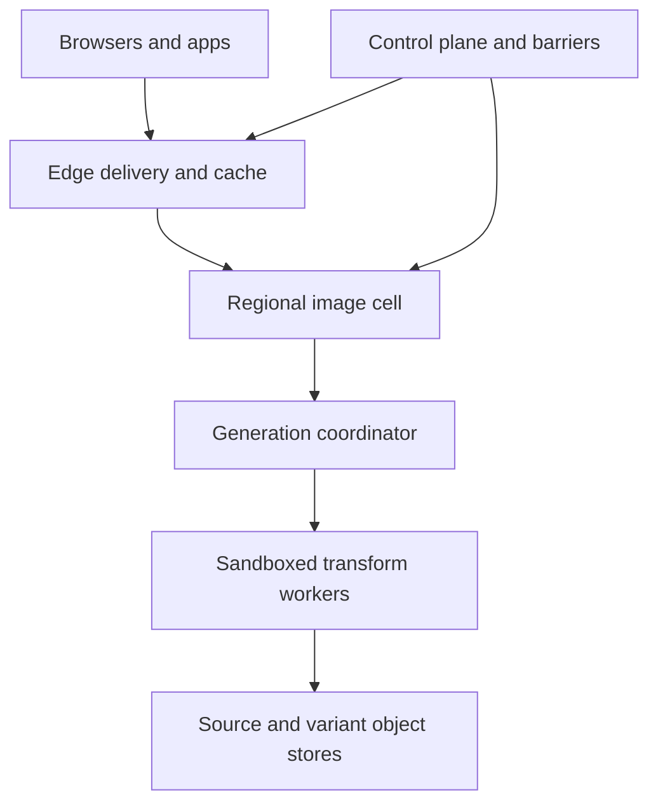
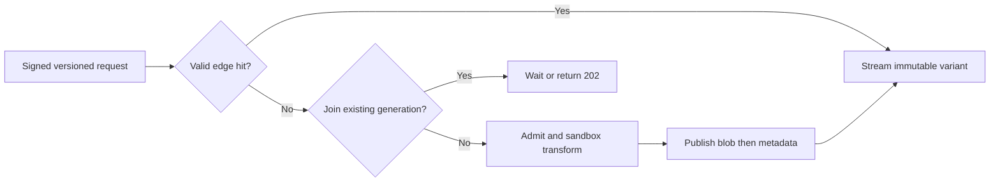

# System Design Interview Practice: Global Image Transformation and Optimization Service

**Difficulty:** Advanced  
**Primary themes:** content-addressed caching, queues, multi-region reliability, consistency, overload control, secure media processing  
**Interview budget:** 45 minutes  
**Educational walkthrough:** intentionally more detailed than what you would say live

## Interviewer prompt

> Design a global image transformation service like the image pipeline behind a large CDN or commerce platform. Customers register source images, then request derived variants such as resized, cropped, watermarked, reformatted, or quality-adjusted images through a URL. The service should generate missing variants on demand, cache them near users, support invalidation and policy changes, and remain reliable during traffic spikes.

The goal is not to implement JPEG, AVIF, or WebP codecs. Design the distributed system around origin access, transformation, caching, queues, consistency, security, and operations.

## Targeted clarifying questions and assumed interviewer answers

**Candidate:** “Who are the clients: end users, customer backends, or both?”  
**Interviewer:** “Customers configure assets through authenticated control-plane APIs. Browsers and mobile apps fetch transformed images from public or signed delivery URLs.”

**Candidate:** “Does the service store original images, or can it fetch from a customer origin?”  
**Interviewer:** “Support both. A customer may upload an immutable source object to us or register an allow-listed HTTPS origin. Origin credentials must never reach the public delivery path.”

**Candidate:** “Which transformations are required?”  
**Interviewer:** “Resize, crop, rotate, quality adjustment, format negotiation, metadata stripping, and a versioned watermark. Arbitrary user code is out of scope.”

**Candidate:** “Are transformations synchronous?”  
**Interviewer:** “On a cache miss, common variants should normally be generated inline. Expensive transformations may be queued, and customers may prewarm variants asynchronously.”

**Candidate:** “What scale should I assume?”  
**Interviewer:** “Five million delivery requests per second globally at peak, 95% served from an edge cache. A hot region may see 500,000 requests per second. Across the fleet, up to 250,000 variant misses per second may require cache lookup or coalescing, and up to 40,000 transformations per second may actually execute after coalescing.”

**Candidate:** “What latency and availability targets matter?”  
**Interviewer:** “Cached delivery should have p99 time to first byte under 50 ms. For a normal miss, p99 time to first byte should be under 2 seconds. Delivery availability is 99.99%. Control-plane availability can be 99.9%.”

**Candidate:** “How large can images be?”  
**Interviewer:** “The normal source is under 20 MB and 50 megapixels. Enforce hard byte, pixel, frame, and decode-memory limits. Very large or animated inputs may use an asynchronous path.”

**Candidate:** “What consistency do customers expect after replacing or deleting an image?”  
**Interviewer:** “Sources should be immutable by version. A newly published version can be eventually visible for up to 30 seconds. A delete, credential revocation, or legal takedown must stop new deliveries globally within 60 seconds. Physical cache deletion may finish later.”

**Candidate:** “Can stale images be served when an origin or transformer is down?”  
**Interviewer:** “Yes for an ordinary freshness expiry if the tenant permits stale-while-revalidate. No after a security revocation, takedown, delete barrier, or incompatible transformation-policy change.”

**Candidate:** “Do identical images from different tenants share storage?”  
**Interviewer:** “Physical encrypted blobs may be deduplicated only under an explicitly approved policy. Authorization, cache indexes, URLs, purge state, and usage accounting remain tenant-scoped.”

**Candidate:** “What is out of scope?”  
**Interviewer:** “Video transcoding, arbitrary filters, customer-supplied executable code, editing source pixels in place, and designing codec internals.”

### Scope statement

In scope:

- upload or register versioned image sources;
- validate and safely fetch sources;
- canonicalize transformation specifications;
- synchronously generate common variants and asynchronously generate expensive/prewarmed variants;
- edge, regional, and object-store caching;
- format negotiation without cache-key ambiguity;
- request coalescing, admission, quotas, prioritization, and backpressure;
- version publication, deletion barriers, purges, and stale-serving rules;
- multi-region operation, observability, accounting, and abuse resistance.

Out of scope:

- implementing image codecs;
- video or audio processing;
- arbitrary customer code or shader execution;
- a full digital-asset-management product;
- editing a source version after publication;
- guaranteeing that every client immediately observes a newly published version.

> **What I would say aloud:** “I’ll separate the immutable data path from the mutable control plane. Delivery URLs resolve to a source version and a canonical transformation version. That lets normal cache population be eventually consistent while deletes and revocations use a stronger barrier that every serving layer must honor.”

---

## 1. Requirements (~5 minutes)

### Core functional requirements

1. **Register immutable sources.** A customer can upload an original image or register an allow-listed origin, validate it, and publish an immutable source version.
2. **Deliver transformed variants.** Given an authenticated tenant context or signed public URL, the service canonicalizes the transformation, negotiates an output format, serves a cached result, or safely generates and caches the missing variant.
3. **Control lifecycle and policy.** Customers can publish a new source or watermark version, prewarm variants, invalidate or delete assets, and observe job and delivery status.

### Quantified non-functional requirements

| Requirement | Target | Design consequence |
|---|---:|---|
| Global peak delivery | 5 million requests/s | edge termination; no control-plane/database call on every hit |
| Edge hit rate | at least 95% | immutable variant URLs, long TTLs, deterministic keys |
| Hot-region traffic | 500,000 requests/s | regional cells and partitioned coalescing/index services |
| Executed transforms | up to 40,000/s globally | elastic worker pools, admission control, bounded queues |
| Cached TTFB | p99 < 50 ms | CDN edge cache and local authorization/purge snapshot |
| Normal miss TTFB | p99 < 2 s | regional source/variant cache, single-flight, inline fast lane |
| Delivery availability | 99.99% | multi-region routing, stale-safe fallback, cache-as-data-plane |
| Control-plane availability | 99.9% | delivery uses signed/versioned manifests rather than synchronous control calls |
| Delete/revocation enforcement | globally within 60 s | durable barrier, push propagation, short safety leases, fail closed after lease expiry |
| Data durability | 11 nines for customer-uploaded sources; variants reconstructible | replicated object store for sources; variants are cacheable derivatives |
| Isolation | zero cross-tenant unauthorized deliveries | auth-derived namespace, scoped signatures, tenant policy checks |
| Cost protection | no tenant may consume unbounded decode/transform capacity | quotas, complexity estimates, fair queues, byte/pixel/frame limits |

### Consistency and availability contract

- A `source_version` is immutable. Publishing changed pixels creates a new version and therefore new variant keys.
- A `transform_policy_version` captures behavior that changes output: codec library generation, watermark version, metadata policy, color-management rules, and canonicalization version.
- A normal cache miss or temporarily stale cache index only costs latency. Variant publication may be eventually consistent.
- New versions become visible within 30 seconds. Clients that require immediate read-after-publish use the returned immutable version URL rather than a mutable alias.
- Mutable aliases such as `/products/shoe/hero` may lag. The edge resolves them through a short-lived manifest cache, then redirects or internally maps to an immutable source version.
- Delete, takedown, credential revocation, or signature-key compromise creates a monotonic **delivery barrier**. A response is legal only if its namespace and source epochs meet the current barrier.
- Stale-while-revalidate is allowed only for ordinary freshness expiry and only within tenant policy. It never crosses a delivery barrier or incompatible policy version.
- If a transformation worker fails, cached delivery remains available. If an uncached transform cannot safely complete, return a bounded error or asynchronous job—not an unvalidated partial image.
- The service guarantees at-least-once job execution. Idempotent, content-addressed publication makes duplicate work harmless.

> **What I would say aloud:** “I want immutable versions to carry the normal workload because immutability turns cache consistency into a naming problem. The hard consistency path is narrow: deletion and revocation advance a barrier, and any server that cannot prove a fresh barrier after its lease expires stops serving the affected namespace.”

---

## 2. Core entities (~2 minutes)

| Entity | Essential fields and purpose |
|---|---|
| `Tenant` | tenant ID, plan, residency, quotas, signing-key set, stale policy |
| `Asset` | stable logical asset ID, tenant ID, current version, state, alias metadata |
| `SourceVersion` | asset ID, immutable version, source object/origin reference, source digest, media facts, epoch, state |
| `TransformSpec` | canonical operations, dimensions, crop mode, output format class, quality, canonicalization version |
| `TransformPolicy` | codec generation, watermark version, metadata/color policy, safety limits, policy version |
| `Variant` | variant key, source digest, canonical transform digest, policy version, object reference, size, checksum, state |
| `DeliveryManifest` | alias-to-version mapping, minimum epoch, allowed transformations, signing-key generation, expiry |
| `TransformJob` | job ID, variant key, priority, state, attempt, lease, deadline, cost estimate, result reference |
| `GenerationLease` | variant key, owner, generation, expiry; supports single-flight generation |
| `DeliveryBarrier` | tenant/asset scope, minimum valid epoch, reason, committed time, enforcement deadline |
| `UsageEvent` | tenant, request, cache tier, bytes, transform units, outcome, timestamp |
| `Blob` | content digest, encryption scope, object-store location, checksum, lifecycle state |

The important distinction is between a logical `Asset`, an immutable `SourceVersion`, and a deterministic `Variant`. The asset changes over time; the source version does not; a variant is a pure function of the source bytes, canonical transformation, and transformation policy.

```text
variant_key = H(
  tenant_cache_namespace,
  source_digest,
  canonical_transform_digest,
  transform_policy_version,
  negotiated_output_representation
)
```

> **What I would say aloud:** “I’ll name the derived object by every input that can change its bytes. If two requests compute the same variant key, duplicate generation is safe because they must publish identical bytes or trigger a determinism alarm.”

---

## 3. API and system interface (~5 minutes)

Customer identity comes from OAuth/JWT or mTLS. The API gateway derives `tenant_id`, roles, plan, residency, and quotas. A request body cannot select another tenant’s namespace.

Public delivery uses a signed URL or a public asset policy. The signature binds the tenant, asset/source version, transformation constraints, expiry, and key generation.

### Register an uploaded source

First request a presigned upload:

```http
POST /v1/assets
Authorization: Bearer <customer-token>
Idempotency-Key: catalog-image-482-create

{
  "name": "catalog/shoe-482/hero",
  "source": {
    "type": "UPLOAD",
    "content_type": "image/jpeg",
    "content_length": 4831021,
    "sha256": "1f8a..."
  },
  "delivery_policy": {
    "visibility": "SIGNED",
    "allowed_widths": [320, 640, 1280, 1920],
    "allow_auto_format": true,
    "max_age_seconds": 31536000
  }
}
```

Response:

```json
{
  "asset_id": "ast_01K...",
  "source_version": 1,
  "state": "AWAITING_UPLOAD",
  "upload": {
    "url": "https://uploads.example.net/...",
    "headers": {"x-checksum-sha256": "1f8a..."},
    "expires_at": "2026-10-27T04:20:00Z"
  }
}
```

The client uploads directly to object storage. A finalization event validates checksum, type, dimensions, frame count, and decode limits before the version becomes `ACTIVE`.

### Register a remote origin

```http
POST /v1/assets
Authorization: Bearer <customer-token>
Idempotency-Key: press-logo-origin-v1

{
  "name": "press/logo",
  "source": {
    "type": "ORIGIN",
    "origin_id": "org_77",
    "path": "/brand/logo.png",
    "expected_etag": "\"9d41...\""
  },
  "delivery_policy": {"visibility": "PUBLIC"}
}
```

The stored origin configuration—not a caller-supplied arbitrary URL—defines scheme, host, port, DNS/IP policy, authentication, redirect rules, and residency.

### Fetch a transformed image

```http
GET /i/ast_01K/v1/w_640,h_640,fit_cover,q_82,f_auto/wm_12
Accept: image/avif,image/webp,image/*
Authorization: ImageSig key=k_19,exp=1793077200,sig=...
```

Successful response:

```http
HTTP/1.1 200 OK
Content-Type: image/avif
Content-Length: 68421
ETag: "v-7a31..."
Cache-Control: public, max-age=31536000, immutable
Vary: Accept
X-Content-Digest: sha256=7a31...
```

The raw `Accept` header is not placed blindly in the cache key. The gateway maps it to a small supported representation class such as `AVIF`, `WEBP`, or `JPEG`, then includes that class in the variant key.

For a generation accepted asynchronously:

```http
HTTP/1.1 202 Accepted
Retry-After: 2
Content-Type: application/json

{
  "job_id": "job_01K...",
  "state": "QUEUED",
  "status_url": "/v1/transform-jobs/job_01K..."
}
```

### Prewarm variants

```http
POST /v1/assets/ast_01K/versions/1/prewarm-jobs
Authorization: Bearer <customer-token>
Idempotency-Key: holiday-launch-prewarm-7

{
  "variants": [
    {"width": 320, "height": 320, "fit": "COVER", "format": "AUTO", "quality": 78},
    {"width": 640, "height": 640, "fit": "COVER", "format": "AUTO", "quality": 82},
    {"width": 1280, "height": 1280, "fit": "CONTAIN", "format": "WEBP", "quality": 85}
  ],
  "target_regions": ["us-east", "eu-west"],
  "priority": "BULK"
}
```

Prewarm is a resource-creation API, not an instruction to synchronously transform every variant. The response returns a job group and per-variant status.

### Publish a replacement version

```http
POST /v1/assets/ast_01K/versions
Authorization: Bearer <customer-token>
Idempotency-Key: shoe-482-retouch-v2
If-Match: "asset-revision-11"

{
  "source": {"type": "UPLOAD", "content_type": "image/jpeg", "content_length": 5019288},
  "publish_mode": "AFTER_VALIDATION"
}
```

The old immutable URLs continue to identify old bytes unless policy says otherwise. The mutable alias advances only after validation and manifest publication.

### Delete or revoke delivery

```http
DELETE /v1/assets/ast_01K
Authorization: Bearer <tenant-admin-token>
Idempotency-Key: legal-takedown-991

{
  "reason": "LEGAL_TAKEDOWN",
  "scope": "ALL_VERSIONS"
}
```

Response:

```json
{
  "barrier_id": "bar_01K...",
  "committed_epoch": 148,
  "state": "PROPAGATING",
  "enforcement_deadline": "2026-10-27T04:11:00Z"
}
```

The barrier makes the asset logically undeliverable before background workers remove cached and stored bytes.

### Internal transform contract

```protobuf
rpc GenerateVariant(GenerateVariantRequest) returns (GenerateVariantResponse);

message GenerateVariantRequest {
  string request_id = 1;
  string tenant_id = 2;
  string variant_key = 3;
  SourceRef source = 4;
  CanonicalTransform transform = 5;
  string policy_version = 6;
  uint64 minimum_delivery_epoch = 7;
  int64 deadline_unix_ms = 8;
}
```

Workers receive a scoped capability for exactly one source and output prefix. They do not receive general tenant object-store or origin credentials.

---

## 4. Data flow

### Delivery hit or miss

1. Anycast/DNS routes the request to a nearby edge point of presence.
2. Edge verifies the signature or public policy using a bounded-fresh tenant key and barrier snapshot.
3. Edge parses the URL, canonicalizes the transform, negotiates one supported output representation, and computes the variant key.
4. If the edge has a valid object whose epoch and policy version pass checks, it streams the image.
5. On an edge miss, the request goes to the regional image cell. A regional cache is checked.
6. On a regional miss, the generation coordinator acquires or joins a lease for the variant key.
7. The owner loads the validated source from the regional source cache or approved origin, checks safety limits, and schedules an inline or asynchronous transform.
8. A sandboxed worker decodes, transforms, encodes, validates the output, and writes the variant blob.
9. After the blob is durable, the coordinator atomically publishes variant metadata and completes the lease.
10. Waiters stream the published object; edge caches fill asynchronously.
11. Usage and decision events flow to metering and observability pipelines.

### Version publication

1. Upload or origin fetch lands in quarantine.
2. Validator checks checksum, magic bytes, media structure, dimensions, frames, decompression bounds, and policy.
3. Source bytes are copied to durable object storage and assigned an immutable digest/version.
4. The manifest service commits the new source version and emits a publication event through an outbox.
5. Regional manifest caches update; mutable aliases begin resolving to the new version.
6. Optional prewarm jobs run at bulk priority.

### Delete or revocation

1. Control plane commits a higher delivery epoch and durable barrier.
2. A signed urgent event is fanned out to regions and edges.
3. Each serving layer updates its minimum valid epoch before acknowledging.
4. Requests for older epochs return `404` or `410` according to policy, even if bytes remain cached.
5. Purge workers remove edge entries, regional metadata, variants, sources, and encryption-key access as required.
6. Audit status distinguishes **logically blocked** from **physically erased**.

---

## 5. High-level design (~10–15 minutes)

### Compact architecture



The edge path is optimized for immutable reads and must not depend synchronously on the control-plane database. The regional cell owns misses, coalescing, source fetch, transformation, and publication. The control plane owns assets, versions, tenant policy, signatures, quotas, manifests, and delivery barriers.

### Operation 1: register and validate a source

The asset service stores small relational metadata in a strongly consistent SQL database:

```text
Asset(
  tenant_id, asset_id, logical_name, current_version,
  revision, visibility, state, created_at, updated_at
)

SourceVersion(
  tenant_id, asset_id, version, source_digest,
  source_type, source_ref, media_type, width, height,
  frame_count, byte_length, epoch, state, created_at
)
```

The unique key `(tenant_id, logical_name)` prevents ambiguous aliases. `(tenant_id, asset_id, version)` is the immutable version key. `revision` supports optimistic concurrency when two administrators publish concurrently.

Uploaded bytes go directly to a quarantine bucket through a short-lived presigned URL. The finalizer verifies the expected checksum before parsing. It does not trust file extensions or client-provided MIME type.

Remote origins are preconfigured resources. The fetcher receives `origin_id + relative_path`, not an arbitrary URL. It resolves DNS through a controlled resolver, blocks private/link-local/metadata IP ranges, pins the validated destination for the request, limits redirects, enforces TLS, and caps response bytes and time. This prevents the service from becoming an SSRF proxy.

Validation is asynchronous because parsing and malware/media checks can be expensive. The source is invisible to delivery until validation succeeds. Once active, its digest and bytes never change.

### Operation 2: canonicalize the delivery request

Equivalent requests must produce exactly one cache key. The canonicalizer:

- parses a strict grammar; unknown operations fail instead of being ignored;
- normalizes integers, enums, operation order, defaults, and color notation;
- clamps values only when the API contract explicitly says so;
- rejects dimensions or quality outside policy;
- resolves `f_auto` to a small representation class based on supported client formats;
- inserts the canonicalizer and transformation-policy versions;
- binds the tenant namespace and immutable source digest.

For example:

```text
w=0640&h=640&fit=crop&q=82&format=auto
width=640,height=640,fit=COVER,quality=82,format=AUTO
```

may canonicalize to:

```json
{
  "width": 640,
  "height": 640,
  "fit": "COVER",
  "quality": 82,
  "representation": "AVIF",
  "canonicalizer_version": 4,
  "policy_version": "img-2026.10.3"
}
```

The output representation is explicit in the final key. This avoids cache poisoning where a browser that supports AVIF populates a path later served as JPEG to another client.

> **Say aloud:** “The URL is an API, and canonicalization is part of correctness. I reject unknown transformations, collapse equivalent syntax, and include the negotiated representation and policy generation in the key.”

### Operation 3: serve an edge hit

The edge performs only bounded work:

1. verify URL signature or public policy;
2. check expiry, allowed transform envelope, signing-key generation, and cached barrier floor;
3. derive the canonical variant key;
4. find an object in the local content cache;
5. validate its stored source epoch/policy generation;
6. stream with immutable cache headers.

Edge metadata contains:

```text
EdgeVariant(
  variant_key, object_ref, content_type, byte_length,
  etag, source_epoch, policy_version, expires_at
)
```

The edge does not call SQL. Tenant manifests and barriers are signed snapshots pushed from the control plane. Ordinary snapshots may live for minutes; security-sensitive barrier leases are shorter, for example 30 seconds. If the edge cannot refresh a barrier lease after expiry, it fails closed only for affected signed namespaces rather than disabling unrelated public content.

### Operation 4: handle a regional miss with single-flight

The edge forwards misses to a region selected by latency, residency, and health. The regional cache may already contain the blob even when this edge does not.

If both caches miss, the generation coordinator performs a conditional write:

```text
put_if_absent(
  key = variant_key,
  value = {owner_request_id, generation, lease_expiry, state=GENERATING}
)
```

The winner owns generation. Followers join the in-flight record rather than executing the same work. A follower may:

- wait for the owner within its deadline;
- subscribe to completion and then stream the object;
- receive `202 Accepted` for an expensive variant;
- take over after lease expiry if the owner died.

Waiters never cancel the shared owner. Their own disconnect only removes their subscription. The owner periodically renews the lease but cannot renew past a hard execution deadline.

For a safe stale object between soft and hard expiry, followers may receive stale bytes while one owner refreshes. This is prohibited after a delivery barrier, signature revocation, or policy incompatibility.

### Operation 5: classify and schedule transformation work

Before scheduling, estimate cost from source metadata and requested operations:

```text
estimated_units = decoded_pixels
                  * frame_count
                  * operation_factor
                  * output_codec_factor
```

This is not billing-perfect; it is a protective admission estimate. Requests fall into lanes:

| Lane | Example | Deadline | Behavior |
|---|---|---:|---|
| Interactive fast | resize 2 MP JPEG to thumbnail | < 2 s | reserved capacity, inline response |
| Interactive heavy | large AVIF encode or animated input | seconds | small bounded queue; may return 202 |
| Prewarm | customer launch variants | minutes | lower priority, region-aware |
| Bulk/backfill | policy or watermark regeneration | hours | cheapest capacity, aggressively throttled |

Queues are partitioned by region and capability, then fairly scheduled by tenant. A weighted deficit round-robin scheduler gives each tenant service proportional to plan weight without allowing one large job to block small jobs. Per-tenant token buckets cap requests and transform units.

Workers advertise codec and resource capabilities. A scheduler chooses a pool based on media type, output codec, memory estimate, accelerator availability if present, and data locality. Common resize/encode work may use CPU workers; specialized hardware is an optimization, not a correctness dependency.

### Operation 6: transform inside a sandbox

The worker receives a one-job capability. It reads the validated source through a source cache and runs a hardened transformation process with:

- no general network access;
- read-only codec/runtime image;
- CPU, memory, wall-clock, file-descriptor, and output-byte limits;
- bounded decoded pixels and frames;
- cancellation at safe checkpoints;
- seccomp/container or microVM isolation depending on threat model;
- patched, version-pinned codec libraries.

The pipeline decodes, applies ordered canonical operations, strips or preserves metadata according to policy, converts color profiles, encodes, and validates the output. It computes a checksum and records the exact codec build.

Partial output is never published. If a streaming inline transform fails after headers would have been sent, retries become difficult, so the baseline buffers small results until validation. Large results can be written to temporary object storage and streamed only after a committed header/checksum is available.

### Operation 7: publish data before metadata

Publication order prevents false hits:

1. write output to a temporary object key;
2. verify byte length, media type, checksum, and policy limits;
3. atomically promote or copy to a content-addressed blob key;
4. conditionally publish the `Variant` record for the lease generation;
5. mark the job complete and notify waiters;
6. asynchronously fill regional and edge caches.

```text
Variant(
  tenant_id, variant_key, source_digest,
  transform_digest, policy_version, output_representation,
  blob_ref, checksum, byte_length, source_epoch,
  state, created_at, last_access_bucket
)
```

If a worker crashes before metadata publication, the temporary blob is garbage-collected. If two owners race after a lease timeout, only the current generation can publish. If their checksums differ for the same deterministic key, quarantine both results and page the codec/platform owner; silently picking one hides nondeterminism.

### Operation 8: cache and evict variants

Use multiple tiers:

| Tier | Typical contents | Role |
|---|---|---|
| Browser/device | immutable public variant | removes network work entirely |
| CDN edge | locally popular variants | sub-50 ms global delivery |
| Regional memory/SSD | regional hot variants and metadata | shields object store and transforms |
| Variant object store | admitted derived blobs | durable enough for reuse; reconstructible |
| Source object store | immutable originals | authoritative durable data |

Do not retain every derived variant forever. Admission value can be estimated as:

```text
value = decayed_request_frequency
        * expected_transform_cost_avoided
        / (variant_bytes * replication_count)
```

Tiny thumbnails may be cheap to store and popular. A 40 MB one-off high-quality derivative may be cheaper to regenerate. Tenant retention policy and residency apply before the value score.

Edges use normal CDN admission and eviction. Regional caches use frequency plus recency and size. The object-store lifecycle moves cold admitted variants to cheaper storage or deletes them. Sources are not evicted while the asset is active.

### Operation 9: publish versions and invalidate safely

For ordinary replacement, create `SourceVersion v2`, validate it, then atomically advance the asset’s `current_version`. New immutable URLs contain `/v2/`; old `/v1/` URLs remain valid unless explicitly revoked. No global purge is required, which is why versioned URLs scale.

Mutable alias caches may return v1 for up to 30 seconds. Customers needing read-after-write use the v2 URL returned by the API.

For a watermark or codec-policy change, advance `transform_policy_version`. New requests produce new variant keys. Whether old variants remain deliverable depends on policy:

- quality improvement only: old immutable variants may remain until TTL;
- mandatory watermark or metadata removal: advance a delivery barrier so old variants stop immediately;
- codec implementation change with byte-compatible semantics: new keys support rollback and controlled adoption.

For deletion, commit the barrier first. Physical purge is asynchronous and idempotent. Edges reject stale epochs even before their local bytes are removed.

### Scale estimates that change the design

**Edge versus origin traffic.** At 5 million requests/s and a 95% edge hit rate, 250,000 requests/s reach regional cells. If the regional cache hits on 80% of those, only 50,000/s reach the coordinator. Coalescing and prewarming bring actual transformations near the stated 40,000/s. This arithmetic justifies edge and regional tiers; a central transform service could not absorb raw delivery traffic.

**Bandwidth.** If the average delivered variant is 120 KB, peak egress is about:

```text
5,000,000 requests/s * 120 KB ≈ 600 GB/s ≈ 4.8 Tb/s
```

That traffic must be served from geographically distributed edges. Pulling every image from a regional object store is economically and operationally unrealistic.

**Transform compute.** Suppose the average executed transform consumes 80 ms of one CPU core. At 40,000 transforms/s:

```text
40,000 * 0.080 core-seconds/s = 3,200 continuously busy cores
```

At 50% target utilization to preserve burst capacity and p99 latency, provision roughly 6,400 equivalent cores globally, before redundancy. This drives per-lane autoscaling and prewarm throttling.

**Decoded-memory risk.** A compressed 20 MB image can decode far larger. A 50-megapixel RGBA frame is about 200 MB. Ten frames are about 2 GB before intermediate buffers. Therefore byte size alone is not a safe admission rule; pixel, frame, bit-depth, operation, and memory bounds are mandatory.

**Variant explosion.** If 100 million active sources allowed arbitrary width, height, quality, crop, format, and watermark combinations, the key space is effectively unbounded. Restrict public policies to approved widths or dimension buckets, clamp plan-specific maximums, and avoid pre-generating the Cartesian product. On-demand generation plus admission stores only requested valuable variants.

**Coordinator state.** If 50,000 new variant keys/s enter generation and average work lasts 1 second, about 50,000 live leases exist globally, perhaps 10,000 in a hot region. A partitioned strongly consistent key-value store can handle this. It does not require one global lock service.

> **What I would say aloud:** “The dominant numbers are egress and decoded pixels, not metadata rows. Five million 120 KB responses per second is multi-terabit traffic, so edge caching is mandatory. A 20 MB compressed input may decode to gigabytes, so admission must estimate decoded work before a codec gets memory.”

---

## 6. Deep dives (~10–15 minutes)

## Deep dive A: deterministic cache keys, versioning, and invalidation

### Where the baseline breaks

A naive cache key such as `hash(source_url + query_string)` fails in several ways:

- equivalent query strings create duplicate variants;
- parameter order or ignored fields create cache fragmentation;
- `format=auto` returns different bytes to different clients;
- an origin URL can change bytes without changing its name;
- a watermark, codec, metadata, or color-policy change can leave old bytes under a valid key;
- replacing an image forces a global purge race;
- a purge may delete an edge object but allow a stale regional copy to refill it;
- different tenants can leak equality or authorization through shared indexes.

### Plausible approaches

| Approach | Benefit | Problem |
|---|---|---|
| Raw URL + raw query | trivial | unstable, poisonable, misses behavior versions |
| Purge mutable paths on every change | familiar | expensive global race; stale refill risk |
| Short TTL everywhere | simple freshness | destroys hit rate and increases origin load |
| Immutable source/variant versions | deterministic and cache-friendly | callers must manage versioned URLs or aliases |
| Content-addressed variants + barrier epochs | safe reuse and strong revocation | more metadata and control-plane machinery |

### Selected approach

Use immutable source versions and deterministic variant keys. Mutable aliases are convenience pointers, not cache identity. Every output-affecting input is explicit:

```text
variant_key = HMAC(namespace_key,
  source_digest ||
  canonical_transform ||
  negotiated_representation ||
  canonicalizer_version ||
  codec_generation ||
  watermark_version ||
  metadata_policy_version ||
  color_policy_version
)
```

Use a tenant-scoped HMAC for logical indexes so one tenant cannot test whether another tenant has the same private source. Physical blob deduplication, if enabled, is below the authorization boundary and never changes who can resolve a variant.

The `Variant` metadata records `source_epoch`. Serving requires:

```text
variant.source_epoch >= barrier.minimum_valid_epoch
AND variant.policy_version is allowed
AND signature.key_generation is allowed
```

A deletion commits a barrier to a strongly consistent regional/global metadata service, then distributes it. Every cache tier checks the barrier floor before serving. Purge workers remove bytes later. This prevents a stale lower tier from repopulating an edge after deletion.

### Why not physically purge first?

There may be millions of edge and regional replicas. Physical deletion is not atomic. If authorization depends on completing deletion everywhere, the system either violates the deadline or becomes unavailable. A small durable barrier is cheap to propagate and turns all old bytes into unreachable garbage immediately.

### Failure modes

- **Alias cache lags:** immutable version URL still provides read-after-publish; alias converges within 30 seconds.
- **Purge event is lost:** barrier lease expires; affected delivery fails closed until refreshed.
- **Old regional object refills edge:** epoch check rejects it.
- **Canonicalizer rollout changes keys:** include canonicalizer version; canary both versions and retire old entries gradually.
- **`Accept` varies wildly:** map it to a bounded representation enum; set `Vary: Accept` where applicable.
- **Codec patch changes bytes:** advance codec generation; never overwrite bytes behind an immutable key.
- **Signing key compromised:** revoke its generation through the same urgent barrier channel.
- **Clock skew affects URL expiry:** validate within a small skew allowance, use trusted edge time, and keep key-generation revocation independent of expiry.

### Observability

Track canonicalization failures, equivalent-request deduplication, variants per source, cache-key cardinality, representation mix, epoch-rejection counts, barrier propagation lag, stale-refill attempts, purge completion by tier, signing-key generation, and checksum divergence for the same key.

> **What I would say aloud:** “I avoid making a global purge the normal update mechanism. Versioned names handle ordinary replacement; a monotonic barrier handles the rare case where old bytes must become illegal immediately.”

## Deep dive B: miss storms, fair queueing, and overload control

### Where the baseline breaks

The baseline works under average load but collapses when a celebrity product image or news event creates millions of simultaneous requests for one uncached variant. Without coalescing, every miss fetches the source and transforms it. Without bounded queues, latency grows until all requests time out while work continues. A tenant can submit many expensive unique variants and starve small interactive requests. Autoscaling alone reacts too slowly and may amplify origin load.

### Plausible approaches

| Approach | Strength | Weakness |
|---|---|---|
| Transform every miss | simplest | catastrophic duplicate work |
| Global lock per key | strong coalescing | cross-region latency and availability coupling |
| Regional single-flight | local, fast, failure-contained | duplicate work across regions |
| Precompute every combination | fast reads | combinatorial storage and wasted compute |
| Unbounded FIFO | no immediate rejection | latency collapse and tenant starvation |
| Bounded fair queues + admission | predictable overload | some requests receive 202/429/503 |

### Selected approach

Use **regional single-flight** keyed by variant. Cross-region duplicate generation is acceptable because variant publication is idempotent and a global lock would put a consensus round trip on the miss path. Popular prewarmed variants replicate asynchronously.

Each in-flight record includes owner, generation, lease expiry, state, and subscriber count. The coordinator caps subscribers and response fan-out per process; extremely hot waiters are redirected to a temporary regional object once published rather than all being streamed through the owner.

Use admission before queueing:

1. authenticate and validate transform envelope;
2. reject known-invalid or over-quota work;
3. estimate decoded memory and transform units;
4. reserve tenant and lane tokens;
5. acquire/join single-flight;
6. enqueue only the owner;
7. enforce a maximum queue wait relative to request deadline.

The scheduler uses separate interactive, heavy, prewarm, and bulk lanes. Within a lane, weighted fair scheduling prevents a single tenant from monopolizing workers. Small-job aging avoids starvation but does not let bulk work invade reserved interactive capacity.

### Backpressure and degradation sequence

When worker utilization, queue age, memory pressure, or source latency rises:

1. stop speculative regional replication;
2. throttle bulk and prewarm lanes;
3. serve policy-allowed stale variants during soft expiry;
4. lower per-tenant burst tokens;
5. return `202` for eligible heavy transformations;
6. reject low-priority unique work with `429` or `503` plus `Retry-After`;
7. preserve edge hits and already-generated regional hits;
8. never bypass safety limits or delivery barriers.

Queue length alone is not enough. Alert on oldest queued age, predicted deadline miss, transform-unit backlog, and memory reservation. Autoscaling should follow a combination of arrival rate, service time, lane backlog, and warm-start time.

### Origin protection

Source fetches have their own single-flight and cache. Per-origin concurrency and bandwidth limits prevent our miss storm from taking down a customer origin. Circuit breakers open on elevated timeout/error rates. If a validated cached source exists, generation can continue. Otherwise requests fail or become asynchronous; the service never retries an unhealthy origin without bounds.

Use exponential backoff with jitter for asynchronous retries. Interactive requests get at most a small bounded retry budget because a retry that completes after the user deadline wastes capacity.

### Failure modes

- **Owner crashes:** lease expires; one follower takes over.
- **Owner is slow but alive:** hard deadline ends renewal; new generation may supersede it.
- **Two owners publish:** generation fencing accepts one; identical duplicate blob is harmless.
- **Waiter disconnects:** detach it without canceling shared work.
- **Queue broker unavailable:** serve cache hits; use a small local fast-lane buffer or return bounded errors, never unbounded memory queues.
- **Autoscaler creates cold workers:** keep a warm floor for interactive pools and pre-load codec/runtime images.
- **One tenant sends random dimensions:** transformation envelope and token bucket bound cardinality and work.
- **One origin becomes slow:** per-origin breaker isolates it from other tenants.
- **Retry storm follows recovery:** jitter, retry budgets, and gradual breaker half-open probes.

### Observability

Measure edge/regional hit rate, unique versus coalesced misses, waiters per flight, duplicate transforms, lease takeovers, queue age by lane/tenant, rejected transform units, worker saturation, decode memory high-water mark, origin concurrency, breaker state, stale serves, 202 rate, and p99 by cache outcome. Track **compute per delivered image**, not only request latency.

> **What I would say aloud:** “The owner is the only request that enters the transform queue; followers wait on the variant key. Then I protect interactive capacity with bounded fair queues. During overload I shed new expensive work before I sacrifice cached delivery.”

## Deep dive C: secure media processing and multi-region reliability

### Where the baseline breaks

Images are untrusted structured inputs. A tiny compressed file can expand into huge memory, malformed files can trigger codec vulnerabilities, and a remote-source feature can become an SSRF primitive. Meanwhile, a region failure should not make globally cached images unavailable or cause private sources to cross residency boundaries.

### Threat and failure model

Assume:

- malicious users control source bytes and transformation parameters;
- codecs may contain unknown vulnerabilities;
- customer origins may redirect or change DNS answers;
- workers, queues, caches, object stores, and entire regions can fail;
- control-plane updates can be delayed or duplicated;
- private assets must remain within allowed residency regions;
- logs must not expose signed URLs, origin credentials, or private image content.

### Input and origin defenses

Validation happens before a source becomes active, but workers still enforce runtime limits because metadata parsers can be wrong.

- inspect magic bytes and container structure, not extension;
- cap source bytes, decoded pixels, dimensions, bit depth, frames, metadata length, and nesting;
- reject unsupported or ambiguous polyglot inputs;
- set decode memory and wall-clock budgets;
- strip active/unneeded metadata and normalize orientation explicitly;
- fuzz and continuously patch codec libraries;
- run workers without ambient network or cloud metadata access;
- issue one-job, one-source, one-output capabilities;
- malware scanning may complement, but not replace, sandboxing.

For remote origins:

- only pre-registered HTTPS origins;
- validate DNS and destination IP on every connection;
- block private, loopback, link-local, multicast, and cloud metadata ranges;
- pin the resolved IP for the request while preserving TLS host verification;
- limit redirects and revalidate every redirect target;
- cap response bytes, transfer time, and decompression;
- store credentials in a secret manager and inject only into the fetcher.

### Multi-region topology

Each allowed region is a mostly independent image cell with coordinator, source cache, variant cache, queues, and workers. Global services distribute tenant manifests, signing keys, and barrier epochs. Customer-uploaded sources replicate only to residency-approved regions. Variants follow the same or stricter policy.

Routing prefers the nearest healthy permitted region. A region may generate the same variant as another region; content-addressed publication makes this safe. This favors availability and latency over globally exactly-once transformation.

### Region failure behavior

- Edge hits continue if barrier leases remain valid.
- New misses route to another residency-approved healthy region.
- If the destination lacks a source replica and origin access is permitted, it fetches safely; otherwise return a bounded error.
- Prewarm and bulk work pause before interactive work.
- Semantic control-plane operations may be unavailable, but immutable delivery continues from signed snapshots.
- After barrier lease expiry, affected content fails closed if the region cannot refresh revocation state.
- When the failed region recovers, it does not blindly serve disk cache; it first loads current barrier floors and key generations.

### Data-store choices and durability

- **SQL control database:** assets, versions, policies, barriers, idempotency records. Multi-AZ strong consistency per home region; global publication via log/outbox.
- **Object storage:** immutable sources with cross-AZ and approved cross-region replication. Source durability is authoritative.
- **Distributed key-value store:** regional leases, job state, hot variant metadata. Conditional writes and TTLs.
- **Queue/log:** at-least-once transform jobs, partitioned by capability/region; dead-letter after bounded attempts.
- **CDN/regional caches:** disposable acceleration state.

At-least-once delivery is deliberate. Exactly-once execution across worker crashes is costly and unnecessary. The invariant is exactly-one accepted publication per variant generation, not exactly-one attempt.

### Observability and incident response

Use structured reason codes and trace IDs from edge to coordinator to worker, but redact query signatures and origin credentials. Important signals include:

- decoder crashes and sandbox violations by codec build;
- rejected decompression ratios, pixel counts, frames, and memory estimates;
- SSRF block reasons and origin redirect anomalies;
- regional source-replication lag and residency violations;
- barrier/key propagation and lease freshness;
- recovered-node stale-cache rejection;
- output checksum divergence;
- dead-letter jobs and retry exhaustion;
- per-tenant transform-unit anomalies.

Automatically quarantine a codec build after a crash-rate or checksum-divergence threshold. Keep a rapid policy switch that disables a vulnerable input format or output codec. Because policy version is in the key, safe rollback does not corrupt existing variants.

> **What I would say aloud:** “I assume every image is hostile and every codec can fail. The worker has no network, receives a one-job capability, and is bounded by decoded work—not just compressed bytes. Regionally, I accept duplicate generation but require fenced publication and fresh revocation state.”

---

## 7. Final design

The service uses immutable, versioned sources and deterministic, content-addressed variants. Customers upload to quarantine or register controlled HTTPS origins. A validation pipeline checks checksums, media structure, decoded-work limits, and policy before publishing a source version to durable object storage.

Delivery enters through a global edge. The edge validates a signed URL or public policy, checks a bounded-fresh delivery barrier, canonicalizes the requested transformation, resolves format negotiation to a small representation class, and derives a variant key containing the source digest and every output-affecting policy generation. A valid edge hit streams immediately. A miss reaches a residency-approved regional cell and checks a regional cache.

The regional coordinator uses per-variant generation leases so only one owner enters a bounded, fair transform queue. It estimates decoded work before admission and separates interactive, heavy, prewarm, and bulk lanes. Sandboxed workers with no general network access fetch a validated source through a scoped capability, transform under CPU/memory/time/output limits, validate the result, write the blob, and only then publish fenced variant metadata. Duplicate execution is safe; nondeterministic checksums for one key are quarantined.

Variants populate regional and edge caches according to frequency, transform cost avoided, bytes, replication, tenant retention, and residency. Ordinary replacement publishes a new immutable source version, avoiding global purge. Security deletion, takedown, policy revocation, or signing-key compromise commits a monotonic delivery barrier that every serving layer checks before bytes are physically removed. Stale-while-revalidate is allowed only for ordinary freshness expiry.

Each region is an independent failure cell. Cached delivery continues through control-plane or worker outages, misses fail over only to residency-approved regions, and overloaded cells shed bulk and new expensive work before affecting cache hits. Source objects are durable; derived variants and caches are reconstructible.



### Requirements check

| Requirement | Design response |
|---|---|
| Register sources | direct upload or controlled origin; quarantine and validation |
| On-demand transformations | canonical spec, regional single-flight, sandboxed worker |
| Prewarm expensive variants | asynchronous bulk lane with per-tenant fairness |
| Global low-latency delivery | immutable URLs and CDN edge cache |
| Normal miss under 2 s | regional source/variant cache and reserved interactive workers |
| 99.99% delivery | independent regional cells; cache hits survive worker/control outages |
| Correct format negotiation | bounded representation class included in variant key |
| Prevent variant explosion | allowed transformation envelope, dimension buckets, on-demand admission |
| Prevent miss storms | per-variant leases and follower coalescing |
| Tenant fairness | transform-unit quotas and weighted fair queues |
| Safe untrusted inputs | decode limits, isolated workers, no ambient network |
| Origin security | registered origins, DNS/IP validation, redirect and byte limits |
| Version consistency | immutable source versions and short-lived mutable aliases |
| Delete/revoke within 60 s | durable monotonic barrier before physical purge |
| Multi-region residency | route and replicate only among approved regional cells |
| Observability | cache-outcome latency, queue age, transform units, codec and barrier signals |

### Polished 90-second closing summary

> “I designed the image service around immutable source versions and deterministic variants. Customers upload to quarantine or register a controlled origin; we validate checksums, structure, dimensions, frames, and decoded-memory bounds before publishing. A delivery request reaches the edge, where a signed policy is checked, the transform is canonicalized, `format=auto` becomes an explicit representation class, and the variant key includes the source digest plus every output-affecting policy generation. Edge and regional hits stream directly. On a miss, a regional single-flight lease ensures only one owner enters a bounded fair queue; followers wait or receive a 202. Sandboxed workers have no general network, use one-job capabilities, and enforce CPU, memory, pixel, frame, time, and output limits. They publish the blob before fenced metadata, so partial results never become hits and duplicate attempts are harmless. Variants are admitted by popularity and transform cost saved per byte across edge, regional, and object-store tiers. Ordinary changes create new immutable versions rather than global purges. Deletes, takedowns, mandatory watermark changes, and key revocations advance a monotonic delivery barrier, so old cached bytes become immediately ineligible before physical erasure. Regional cells are independent, residency-aware failure domains, and overload control sacrifices prewarm and unique expensive misses before cached delivery.”

---

## Realistic interviewer follow-up questions with strong sample answers

### 1. Why not use the source URL and query string as the cache key?

> “The source URL can change bytes, equivalent query syntax fragments the cache, and query parameters omit codec, watermark, metadata, and canonicalizer generations. I key from an immutable source digest plus canonical transform and policy versions.”

### 2. Why make source versions immutable?

> “Immutability lets us use year-long cache TTLs safely and turns ordinary update consistency into selecting a new name. We reserve global invalidation for deletion or security policy.”

### 3. How does `format=auto` work with caching?

> “The edge maps client capability to a small output enum such as AVIF, WebP, or JPEG. That representation becomes part of the variant key, and the response varies on `Accept` where the URL is shared.”

### 4. What if two syntactically different transforms are equivalent?

> “A versioned canonicalizer normalizes defaults, enums, operation order, and numeric representation. Unknown or ambiguous fields fail rather than silently changing the key.”

### 5. Why use regional rather than global single-flight?

> “A global lock adds cross-region consensus and couples availability. Regional duplicate work is bounded and harmless because publication is content-addressed and fenced.”

### 6. Is transformation exactly once?

> “No. Jobs are at least once. Lease expiry and crashes can duplicate attempts. The important guarantee is one accepted publication for a variant generation.”

### 7. What if duplicate workers produce different checksums?

> “For the same deterministic key, that indicates codec or platform nondeterminism. I quarantine both, fail the variant, and alert rather than silently choosing bytes.”

### 8. How do you prevent a cache stampede?

> “The first regional miss acquires a generation lease. Followers subscribe to the same in-flight key and do not enter the worker queue. A short lease plus generation fencing handles owner failure.”

### 9. What if a waiter disconnects?

> “Its subscription is removed, but the shared owner continues for remaining waiters and future cache value. One client cannot cancel shared work.”

### 10. How do you stop arbitrary dimension attacks?

> “Tenant delivery policy defines allowed widths, buckets, maximum dimensions, and operations. We reject requests outside the signed envelope before cache lookup or queueing.”

### 11. Why estimate decoded work before scheduling?

> “Compressed byte size is misleading. A small input may expand into hundreds of megabytes or many frames. Pixel, frame, bit-depth, and operation estimates protect memory and CPU.”

### 12. How do you isolate tenants in the queue?

> “Charge estimated transform units to per-tenant token buckets, use weighted fair scheduling inside priority lanes, and enforce concurrency and byte quotas.”

### 13. Would you use GPUs?

> “Only where measured codec or batch throughput justifies them. The scheduler can route by capability, but CPU pools remain the correctness baseline and may be better for diverse small requests.”

### 14. How do you protect customer origins?

> “Use registered origins, per-origin single-flight, source caching, concurrency and bandwidth caps, circuit breakers, and bounded retries. Never fetch arbitrary request URLs.”

### 15. How do you prevent SSRF?

> “Resolve only registered HTTPS origins through a controlled resolver, reject private and metadata ranges, pin the destination, revalidate redirects, restrict ports, and keep transform workers networkless.”

### 16. When may you serve stale content?

> “Only after ordinary soft expiry when tenant policy permits it. Never after a delete barrier, takedown, key revocation, or incompatible mandatory policy.”

### 17. Why use a barrier instead of deleting every cache entry synchronously?

> “Physical replicas are numerous and deletion is not atomic. A small monotonic barrier makes all old entries ineligible quickly; background purge handles storage cleanup.”

### 18. What if an edge misses the barrier event?

> “Its short safety lease expires. It must refresh the minimum epoch before continuing to serve the affected namespace, so a lost push cannot create indefinite exposure.”

### 19. How do you roll out a new watermark?

> “Create a new watermark/policy version and therefore new variant keys. If the watermark is mandatory, advance the delivery barrier for old policy versions and optionally prewarm hot variants.”

### 20. What happens during a regional outage?

> “Edge hits continue while barrier leases are valid. Misses route to another residency-approved region. Bulk work pauses first. If no permitted region has the source or origin access, return a bounded failure.”

### 21. Which data is durable?

> “Customer-uploaded source versions, policies, barriers, and publication metadata are durable. Derived variants, leases, and caches are reconstructible.”

### 22. How do you choose which variants to retain?

> “Use decayed frequency times transform cost avoided divided by bytes and replication, after tenant retention and residency rules. Do not keep one-off giant variants indefinitely.”

### 23. How do you make retries safe?

> “Control-plane creates use idempotency keys. Transform work is identified by the variant key, and generation-fenced publication makes duplicate attempts safe.”

### 24. Why buffer transformed output before streaming?

> “If we send headers or bytes before validation, a worker failure leaves a corrupt partial response that cannot be retried cleanly. Buffer small outputs or stage large outputs before publication.”

### 25. What would you build first?

> “One region with uploaded immutable sources, a strict transform grammar, object storage, regional single-flight, bounded CPU workers, and a CDN. Then add origin fetching, fairness, multi-region barriers, prewarming, and specialized hardware.”

---

## Common pitfalls

1. Using raw URL plus query string as the variant key.
2. Treating mutable origin URLs as immutable source identity.
3. Omitting codec, watermark, metadata, color, or canonicalizer versions from the key.
4. Handling `format=auto` without varying the cache representation.
5. Accepting arbitrary transformation dimensions and creating unbounded cardinality.
6. Pre-generating the full Cartesian product of possible variants.
7. Transforming every miss without single-flight coalescing.
8. Using one global lock service on the cross-region miss path.
9. Allowing one waiter to cancel shared generation.
10. Using unbounded FIFO queues.
11. Mixing interactive requests and bulk prewarm in one capacity pool.
12. Autoscaling without admission, retry budgets, or queue-age limits.
13. Checking compressed bytes but not decoded pixels, frames, or memory.
14. Trusting file extensions or caller-provided MIME types.
15. Letting transform workers access arbitrary networks or cloud metadata.
16. Fetching caller-supplied arbitrary origin URLs.
17. Failing to revalidate DNS/IP policy after redirects.
18. Publishing metadata before the output blob is complete and verified.
19. Calling at-least-once job execution “exactly once.”
20. Silently accepting different output checksums for the same deterministic key.
21. Purging physical caches before committing a logical delete barrier.
22. Allowing a stale lower tier to refill an edge after deletion.
23. Serving recovered disk caches before refreshing epoch and key-generation floors.
24. Replicating private sources outside approved residency regions during failover.
25. Measuring hit rate without transform cost, queue age, stale safety, and tenant fairness.
26. Logging full signed URLs, origin credentials, or private image contents.

---

## Practice cadence

In a 45-minute interview:

- **0–5 minutes:** clarify clients, source ownership, transform set, sync versus async, scale, latency, and delete semantics.
- **5–7 minutes:** name tenant, asset, source version, transform spec/policy, variant, job, lease, manifest, and barrier.
- **7–12 minutes:** define source registration, delivery, prewarm, version publication, deletion, and internal transform interfaces.
- **12–25 minutes:** build immutable naming, edge/regional caches, single-flight miss handling, scheduling, sandboxed transformation, and data-before-metadata publication.
- **25–40 minutes:** deep-dive on cache correctness/invalidation, miss storms/fairness, and secure multi-region processing.
- **40–45 minutes:** check requirements, state failure behavior, and give the 90-second closing summary.

The written walkthrough is deliberately longer than the live interview. On the whiteboard, keep the first design simple and complete: edge cache, regional coordinator, worker pool, object store, and control-plane barriers. Introduce fields beside the component that needs them. Do the edge-hit, bandwidth, compute, and decoded-memory arithmetic only because each calculation changes a concrete design decision.

## Public references

- Hello Interview, [System Design Delivery Framework](https://www.hellointerview.com/learn/system-design/in-a-hurry/delivery) — used for the sequence of focused requirements, core entities, interfaces, a simplest complete design, and targeted deep dives.
- Hello Interview, [API Design for System Design Interviews](https://www.hellointerview.com/learn/system-design/core-concepts/api-design) — used for resource-oriented external APIs, retry/idempotency considerations, and performance-oriented internal RPCs.
- Hello Interview, [Data Modeling for System Design Interviews](https://www.hellointerview.com/learn/system-design/core-concepts/data-modeling) — used for introducing only the essential entities early and tying fields, keys, and indexes to access patterns and consistency needs.

These references support the delivery structure. The image-service prompt, dialogue, requirements, architecture, protocols, scale assumptions, calculations, cache keys, failure behavior, and tradeoffs are original.
