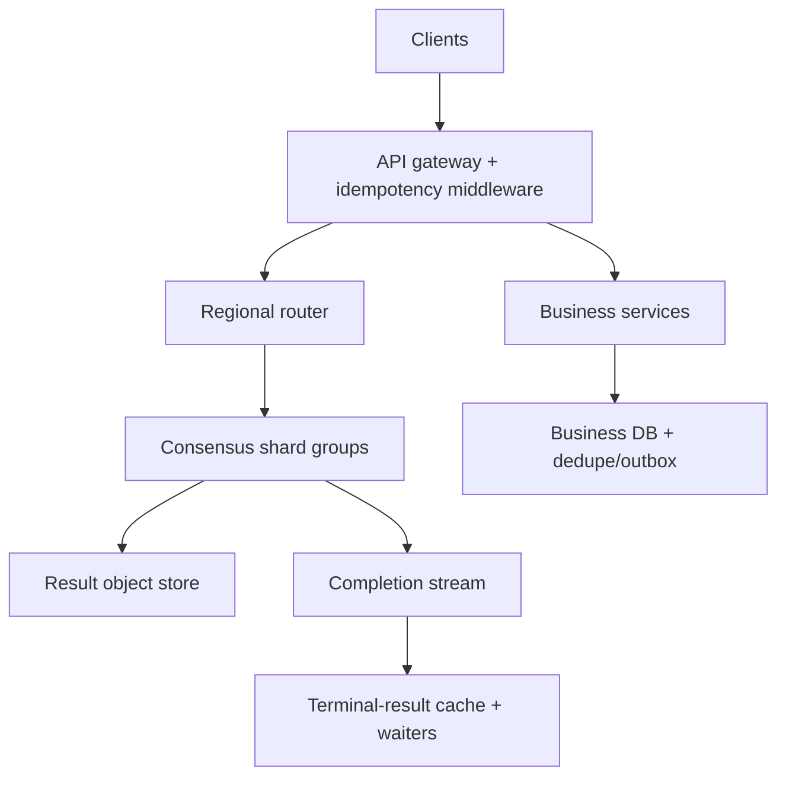

# System Design Interview Practice: Global Idempotency and Request-Deduplication Service

**Difficulty:** Senior / Staff  
**Primary themes:** strong consistency, sharded databases, caching, queues, leases, fencing tokens, multi-region reliability  
**Interview time budget:** about 45 minutes  
**Educational walkthrough:** intentionally more detailed than what you would say in 45 minutes

This is an original walkthrough organized using the broad interview-delivery sequence described in Hello Interview's public guidance: clarify requirements, identify core entities, define interfaces, build a simple end-to-end design, and then deepen the design around the hardest constraints. The time boxes are interview pacing targets, not limits on the explanation below.

---

## Interviewer prompt

> Design a global idempotency and request-deduplication service for mutating APIs such as payments, order creation, and deployment starts. A client supplies an idempotency key when it sends a retryable request. Concurrent or later retries with the same logical request must not start a second operation, and should receive the original result or current status. The system must handle timeouts, process crashes, regional failures, long-running operations, and key expiry.

The interesting part is not merely storing a key in Redis. It is defining exactly what “once” means when clients, networks, workers, databases, and regions can all fail independently.

## Targeted clarifying questions and assumed answers

**Candidate:** “Is this a general platform used by many internal services, or should I design idempotency for one payment API?”

**Interviewer:** “Design a reusable platform and middleware contract. You may use payments as a concrete example.”

**Candidate:** “What identity scopes a key? Is `abc123` globally unique?”

**Interviewer:** “No. A key is unique within the authenticated tenant, authenticated principal or application, and operation name. Never trust a tenant ID sent in the request body.”

**Candidate:** “What should happen if a caller reuses a key with a different payload?”

**Interviewer:** “Reject it as a conflict. The platform should compare a canonical request fingerprint.”

**Candidate:** “What scale and latency should I design for?”

**Interviewer:** “Assume 60,000 requests per second on average and 300,000 at peak worldwide. About 30% are retries or duplicates. The idempotency decision should add less than 20 ms at p99 within the home region.”

**Candidate:** “How long do keys and results live?”

**Interviewer:** “Twenty-four hours by default, configurable up to seven days. Store small responses inline; responses over 64 KiB may be stored in object storage.”

**Candidate:** “Are operations synchronous?”

**Interviewer:** “Both. Most complete in under two seconds, but jobs such as deployments may run for hours.”

**Candidate:** “During a network partition, should we favor availability or preventing two executions?”

**Interviewer:** “Prevent two accepted owners. If the service cannot prove ownership, fail closed for new claims. It may continue serving safely cached terminal results.”

**Candidate:** “Must this platform guarantee exactly-once changes in an arbitrary downstream database?”

**Interviewer:** “No magic distributed transaction is assumed. Explain the cooperation required from downstream services.”

**Candidate:** “Should a failed business request be replayed?”

**Interviewer:** “A deterministic terminal failure, such as an insufficient-funds response, is replayed. A transport or infrastructure failure before the business outcome is known is recoverable rather than automatically terminal.”

**Candidate:** “Do we need analytics and administration?”

**Interviewer:** “Yes, but they can be eventually consistent. Operators need inspection, conflict counts, hot-key detection, and audit history.”

### What I would say aloud

> “The key product decision is the failure contract. I’ll make the claim operation linearizable for each scoped key and fail closed if ownership is ambiguous. I’ll separately explain why that prevents duplicate owners but does not, by itself, make an arbitrary downstream side effect exactly once.”

---

## 1. Requirements (~5 minutes)

### Core functional requirements

1. **Claim one logical operation.** For a scoped idempotency key and request fingerprint, exactly one caller receives permission to begin the operation. Concurrent duplicates receive `IN_PROGRESS`, wait, or replay a completed result.
2. **Replay and protect the result.** Store the terminal status and response so matching retries receive the same outcome. Reject the same key with a different fingerprint.
3. **Recover and inspect long-running work.** Workers can renew ownership, complete an operation with a fencing token, and recover an abandoned operation. Callers can query status; operators can audit conflicts and failure recovery.

### Quantified non-functional requirements

| Requirement | Target | Design consequence |
|---|---:|---|
| Peak traffic | 300,000 decisions/s worldwide | Partition the authoritative store into many independent consensus shards. |
| Duplicate share | 30% | Cache terminal results and coalesce hot-key reads, but never let cache ownership create a claim. |
| Decision latency | p99 < 20 ms in the key’s home region | Route directly to the home shard; avoid synchronous cross-ocean quorum writes. |
| Availability | 99.99% for reads/replays; correctness over availability for new claims | Serve proven terminal results during some outages, but fail closed when a new owner cannot be established. |
| Durability and retention | Terminal outcome durable across an AZ loss; 24 hours default, 7 days maximum | Three-AZ replication, tiered result storage, time-bucketed expiry, and tombstone grace periods. |
| Tenant isolation | Per-tenant quotas, encryption, auditability | Auth-derived scope, HMACed storage keys, rate limits, and redacted logs. |

### Scope

**In scope**

- Authenticated, tenant-scoped idempotency keys.
- Claim, heartbeat, completion, replay, polling, expiry, and recovery.
- Synchronous and asynchronous mutations.
- Regional routing and regional disaster recovery.
- A downstream integration contract for deduplication.

**Out of scope**

- Generating idempotency keys on behalf of clients.
- Making non-cooperating third-party side effects exactly once.
- General workflow orchestration, billing, or business authorization.
- Permanent archival of every response.

### Consistency and availability contract

For the identity

```text
(authenticated_tenant, authenticated_principal, operation_name, idempotency_key)
```

the claim is **linearizable**: all concurrent callers behave as though their claim requests happened in one total order, and at most one committed owner generation exists at a time. “Linearizable” here means that once a claim succeeds, every later claim routed to the authoritative shard observes it.

The record state is monotonic within a generation:

```text
ABSENT → IN_PROGRESS → SUCCEEDED | FAILED_FINAL
                    ↘ RECOVERING → IN_PROGRESS (new generation)
```

A duplicate may temporarily see `IN_PROGRESS` even if completion is being committed, but it must never be granted a second active generation. Administrative search and aggregate metrics are eventually consistent.

During a partition, the quorum side can continue accepting claims. A side without quorum does not grant ownership. This is a deliberate **consistency-over-availability** decision for new mutations. Terminal-result caches may continue replaying cryptographically or version-verified results.

### One sentence that prevents overclaiming

> “The platform guarantees one accepted execution owner per scoped key; exactly-once business effect additionally requires an atomic local transaction or downstream deduplication using the stable operation ID and fencing token.”

---

## 2. Core entities (~2 minutes)

Identify entities before choosing tables. The minimum useful model is:

| Entity | Purpose | Important fields |
|---|---|---|
| `TenantPolicy` | Tenant limits and retention policy | `tenant_id`, `default_ttl`, `max_ttl`, `qps_limit`, `inline_result_limit` |
| `IdempotencyRecord` | Authoritative state for one scoped key | `record_id`, `scope_hash`, `request_fingerprint`, `state`, `operation_id`, `generation`, `lease_until`, `result_ref`, `expires_at`, `version` |
| `Attempt` | Audit and recovery history | `operation_id`, `generation`, `worker_id`, `started_at`, `heartbeat_at`, `ended_at`, `failure_class` |
| `ResultBlob` | Large or sensitive terminal response | `result_ref`, `content_hash`, `status_code`, `storage_uri`, `encryption_key_id`, `expires_at` |
| `CompletionEvent` | Reliable notification to waiters and analytics | `event_id`, `operation_id`, `generation`, `terminal_state`, `committed_at` |
| `ShardAssignment` | Maps a scope hash to a home shard/region | `hash_range`, `shard_id`, `home_region`, `epoch` |

The database key should not expose a raw client key. Compute a tenant-scoped HMAC:

```text
scope_hash = HMAC(tenant_secret,
                  principal_id || operation_name || idempotency_key)
```

The request fingerprint is a hash of a canonical representation of the semantically relevant request fields. Headers such as tracing IDs and request timestamps are excluded; currency, amount, destination, and API version are included.

### What I would say aloud

> “I’m separating the logical operation from its attempts. `operation_id` stays stable across recovery, while `generation` increases whenever ownership moves to a new worker. That distinction becomes important when we discuss fencing.”

---

## 3. API and system interface (~5 minutes)

The public business API can expose a normal mutation. Middleware translates it into the internal idempotency protocol.

### Example public request

```http
POST /v1/payments HTTP/1.1
Authorization: Bearer <token>
Idempotency-Key: pay_01JCE8...
Content-Type: application/json

{
  "source_account_id": "acct_123",
  "destination_account_id": "acct_987",
  "amount_minor": 2500,
  "currency": "USD"
}
```

The authentication layer derives `tenant_id` and `principal_id`. The caller does not get to override them in the JSON body.

### Internal claim

```http
POST /internal/v1/idempotency/claims
Authorization: Service <workload-identity>
Content-Type: application/json

{
  "operation": "payments.create:v2",
  "idempotency_key": "pay_01JCE8...",
  "request_fingerprint": "sha256:8d43...",
  "requested_ttl_seconds": 86400,
  "execution_deadline_seconds": 30,
  "result_mode": "INLINE_UP_TO_64K"
}
```

Possible response for the winner:

```json
{
  "action": "EXECUTE",
  "operation_id": "op_92f4",
  "generation": 1,
  "fencing_token": 88410231,
  "lease_until": "2026-10-28T14:02:30Z"
}
```

Possible response for a concurrent duplicate:

```json
{
  "action": "WAIT_OR_POLL",
  "operation_id": "op_92f4",
  "state": "IN_PROGRESS",
  "retry_after_ms": 250,
  "watch_token": "watch_7e21"
}
```

Possible response after completion:

```json
{
  "action": "REPLAY",
  "operation_id": "op_92f4",
  "state": "SUCCEEDED",
  "http_status": 201,
  "response": {
    "payment_id": "pmt_4401",
    "status": "accepted"
  },
  "result_hash": "sha256:1f9a..."
}
```

If the key matches but the fingerprint differs:

```http
HTTP/1.1 409 Conflict

{
  "code": "IDEMPOTENCY_KEY_REUSED",
  "operation_id": "op_92f4"
}
```

Do not echo the original request or fingerprint details; that could leak information across buggy callers.

### Lease renewal

```http
POST /internal/v1/idempotency/operations/op_92f4/renew

{
  "generation": 1,
  "fencing_token": 88410231,
  "extend_by_seconds": 30
}
```

### Complete an operation

```http
PUT /internal/v1/idempotency/operations/op_92f4/result

{
  "generation": 1,
  "fencing_token": 88410231,
  "terminal_state": "SUCCEEDED",
  "http_status": 201,
  "response": {
    "payment_id": "pmt_4401",
    "status": "accepted"
  }
}
```

Completion is conditional on the current generation and token. An old worker receives `409 STALE_GENERATION` rather than overwriting a newer result.

### Query status

```http
GET /v1/operations/op_92f4
Authorization: Bearer <token>
```

The service verifies that the authenticated caller owns or may view the operation. A long-running mutation can initially return:

```http
HTTP/1.1 202 Accepted
Location: /v1/operations/op_92f4

{
  "operation_id": "op_92f4",
  "state": "IN_PROGRESS",
  "retry_after_ms": 1000
}
```

### Interface-to-requirement mapping

| Functional requirement | Interface |
|---|---|
| One winner | `POST /claims` returns `EXECUTE` to one generation only. |
| Replay or reject misuse | Claim returns `REPLAY`, `WAIT_OR_POLL`, or `409`. |
| Long-running recovery | `renew`, conditional `result`, and `GET /operations/{id}`. |

### What I would say aloud

> “I use an action-oriented claim response because it keeps the business middleware simple: execute, replay, wait, or reject. Authentication supplies the tenant and principal, so a malicious body cannot escape its idempotency namespace.”

---

## 4. Data flow

### New synchronous request

1. The gateway authenticates the caller and passes immutable identity claims to business middleware.
2. Middleware canonicalizes relevant request fields and computes the fingerprint.
3. The idempotency router hashes the scope to a home shard.
4. The shard conditionally inserts `IN_PROGRESS`, generation 1, an `operation_id`, fencing token, and lease.
5. The winner calls the business handler with `operation_id` and fencing token.
6. The business service commits its effect using a downstream dedupe record or a same-database transaction.
7. Middleware conditionally records the terminal result and returns it.
8. An outbox event wakes waiters and updates non-authoritative caches and analytics.

### Duplicate request

1. It reaches the same home shard by deterministic hashing.
2. Matching fingerprint plus `IN_PROGRESS` returns a bounded wait/poll response.
3. Matching fingerprint plus terminal state returns the original status and result.
4. Different fingerprint returns a conflict.

### Abandoned execution

1. The lease expires because heartbeats stopped.
2. A recovery coordinator first checks downstream state using the stable `operation_id`.
3. If the business effect exists, it reconstructs and commits the result.
4. If the effect is proven absent and retry is safe, it creates generation 2 with a larger fencing token.
5. The old generation can no longer complete or mutate a cooperating downstream resource.

---

## 5. High-level design (~10–15 minutes)

Build the simplest complete system one operation at a time.



### Operation 1: claim a new key

The router computes `scope_hash` and consults a versioned shard map. Each shard is a three-replica consensus group spread across availability zones in one home region. The leader serializes changes for keys in its range.

Conceptually, the transaction is:

```sql
INSERT INTO idempotency_records (
  scope_hash, request_fingerprint, state, operation_id,
  generation, fencing_token, lease_until, expires_at, version
)
VALUES (..., 'IN_PROGRESS', ..., 1, next_fence(), ..., ..., 1)
ON CONFLICT (scope_hash) DO NOTHING;
```

If the insert wins, return `EXECUTE`. If not, read the existing record in the same linearizable transaction and return conflict, wait, or replay.

The physical store could be a custom Raft-backed KV store or a managed strongly consistent distributed database. The important property is not the product name; it is a conditional create evaluated by one authoritative consensus group.

### Operation 2: execute the business mutation

The middleware passes these values to the business service:

```text
operation_id = op_92f4
generation = 1
fencing_token = 88410231
```

The preferred integration, when the business and dedupe record share a database, is one local transaction:

```sql
BEGIN;
INSERT INTO processed_operations(operation_id, fingerprint)
  VALUES ('op_92f4', 'sha256:8d43...')
  ON CONFLICT DO NOTHING;

-- Execute only if this transaction inserted the operation marker.
INSERT INTO payments(...);
INSERT INTO outbox(operation_id, event_type, payload) VALUES (...);
COMMIT;
```

This closes the crash window between “business effect committed” and “operation remembered” within that database.

When the platform and business data cannot share a transaction, the downstream service must still dedupe by `operation_id`, persist its outcome, and expose a reconciliation lookup. A global two-phase commit across arbitrary services is not the default.

### Operation 3: store and replay the result

On success or deterministic final failure, middleware calls `PUT /result`. The shard verifies generation and fencing token, then moves the record to a terminal state.

Small response bodies are stored inline. A body over 64 KiB is encrypted in object storage; the record stores `result_ref`, `content_hash`, and status code. The object is written before the terminal pointer is committed. If the pointer commit fails, the object is an unreferenced blob removed later by garbage collection. This ordering prevents a terminal record from pointing at a missing object.

The shard writes a completion event through an outbox tied to the state transition. Consumers populate the terminal-result cache, notify bounded waiters, and feed analytics. Event delivery is at least once, so consumers dedupe by `(operation_id, generation, event_type)`.

### Operation 4: serve a duplicate

Terminal results are immutable, so they are safe to cache by `(scope_hash, record_version)`. A cache hit can replay the result without contacting the shard if the signed/versioned entry has not expired.

`IN_PROGRESS` entries may be cached for only a very short time as hints. They are not authoritative: a stale in-progress cache entry may delay a caller, while a stale “absent” entry could create a second owner. Therefore:

- Never authorize execution from a cache miss.
- Never negative-cache absence for claim decisions.
- Never extend a lease from cache.
- Cache terminal outcomes aggressively because they are immutable.

### Operation 5: support long-running work

For an asynchronous operation, the winner transactionally enqueues a job through the business outbox and returns `202`. A worker renews its lease periodically. The queue may deliver the job more than once; every worker still claims or verifies the same `operation_id` and generation.

The lease is a liveness mechanism, not proof that an old worker stopped. The fencing token supplies safety. Any protected downstream write either:

- rejects a token lower than the last accepted token, or
- deduplicates the stable `operation_id` and returns the already-created resource.

### Operation 6: expire data

`expires_at` controls client-visible retention. Expiry is processed in coarse time buckets rather than one timer per key. After expiry, keep a short tombstone containing the scope hash and terminal fingerprint hash. The grace period prevents replica lag, cache lag, or delayed retries from immediately resurrecting a recently removed key.

Large result objects expire after the metadata tombstone becomes durable. Deletion is asynchronous and idempotent.

### Scale estimates that change the design

Assume:

- 60,000 decisions/s average, 300,000/s peak.
- 30% are duplicates, so new records average `60,000 × 0.70 = 42,000/s` and peak at `210,000/s`.
- Default retention is 86,400 seconds.
- Each live metadata record averages 250 bytes before replication and storage-engine overhead.

Average live records:

```text
42,000 new records/s × 86,400 s ≈ 3.63 billion records
```

Logical metadata:

```text
3.63 billion × 250 bytes ≈ 0.91 TB
```

With three replicas and roughly 2× LSM/index overhead, plan for about 5.5 TB of hot metadata. This rules out one relational primary and makes sharding plus time-aware compaction a concrete requirement.

If one consensus shard sustains 4,000 committed writes/s at the latency target:

```text
210,000 peak new claims/s ÷ 4,000 ≈ 53 shards
```

Use at least 64 write shards, then add headroom for completion writes, lease renewals, rebalancing, and uneven tenants—practically 96 or 128 shards. Lease renewal traffic is reduced by choosing a lease much longer than the heartbeat interval and by not renewing short synchronous operations.

Response bodies dominate storage. If every average new operation stored even 1 KiB for 24 hours, that would be about 3.6 TB logical per day. Therefore only small, necessary replay data remains inline; larger bodies use compressed object storage, and services may store a deterministic response reference instead of the whole representation.

### What I would say aloud

> “The arithmetic changes two choices: billions of live keys require horizontal partitioning and time-aware expiry, while response bytes—not keys—dominate capacity, so I split small inline metadata from large object-backed results.”

---

## 6. Deep dives (~10–15 minutes)

In a real interview, choose two deep dives based on interviewer interest. Three are included here for practice.

### Deep dive A: linearizable claims, leases, and fencing

#### Where the baseline breaks

A naive implementation might run:

```text
if cache.get(key) is null:
    cache.set(key, in_progress)
    execute()
```

Two callers can both observe absence. Even `SETNX` on a single Redis primary has unresolved failure questions: Was the write replicated before failover? Did the client time out before or after success? Can an old owner keep running after its lock expires?

#### Plausible approaches

| Approach | Strength | Failure or tradeoff |
|---|---|---|
| SQL unique constraint | Simple and correct within one primary | One primary becomes a bottleneck; cross-region latency or failover ambiguity remains. |
| Redis `SET NX` with TTL | Very fast and operationally familiar | TTL is a lease, not execution safety; asynchronous failover may lose acknowledged ownership depending on configuration. |
| Active-active CRDT set | Highly available across regions | Concurrent first-writer claims can both be accepted before merge; conflict resolution is too late. |
| Home-sharded consensus KV | Linearizable conditional create, scalable by key range | New claims lose availability without shard quorum; routing and rebalancing are more complex. |

#### Selection

Use home-sharded consensus groups. The idempotency identity hashes to exactly one authoritative shard. The leader commits a conditional create to a quorum before returning `EXECUTE`.

This chooses safety during partitions. If a region is isolated from a quorum, callers receive `503 IDEMPOTENCY_OWNERSHIP_UNAVAILABLE` with a retry hint; the middleware must not “helpfully” bypass idempotency.

#### Why a lease is insufficient

Suppose worker A pauses for garbage collection, its lease expires, and worker B acquires generation 2. Worker A resumes. Time alone cannot revoke its CPU or network access.

The solution is a monotonically increasing fencing token:

```text
generation 1 → token 88410231
generation 2 → token 88410409
```

A cooperating downstream resource remembers the highest token and rejects lower ones. If the downstream API cannot fence, it must at least enforce a unique `operation_id` so both generations converge on the same business object.

#### Recovery decision

When a lease expires, do not immediately rerun the mutation. The recovery coordinator asks the downstream service:

```text
GET /internal/operations/op_92f4/result
```

- If the effect and result exist, finalize the idempotency record.
- If absence is authoritative, start a new generation.
- If state is unknown, keep `RECOVERING` and retry investigation. Correctness beats speculative execution.

#### Failure modes and observability

| Failure | Behavior | Signal |
|---|---|---|
| Leader dies before quorum commit | Client retries; no committed owner exists | claim timeout and leader-election latency |
| Leader dies after commit but before response | Retry reads the committed `IN_PROGRESS` record | ambiguous-response recovery count |
| Old worker resumes | Downstream rejects stale token or replays `operation_id` | stale-fence rejection count |
| Shard loses quorum | New claims fail closed; terminal cache may replay | quorum-unavailable SLO burn |
| Clock skew | Leases use server/quorum time and conservative margins | lease-expiry anomaly count |

Key metrics include claim p50/p99, conditional-create conflicts, stale-token rejections, ambiguous timeouts, recovery age, shard leader changes, and the number of `RECOVERING` records older than a threshold. Trace IDs must connect the client request, claim, business transaction, and completion.

### Deep dive B: closing the business-effect crash windows

#### Where the baseline breaks

Even with a perfect claim store, this sequence is unsafe:

1. Mark `IN_PROGRESS`.
2. Charge a card.
3. Process crashes before storing `SUCCEEDED`.
4. Lease expires.
5. New worker charges again.

The idempotency service knows only that the outcome is ambiguous.

#### Plausible approaches

| Approach | Benefit | Cost |
|---|---|---|
| Distributed two-phase commit | Atomic decision across participants | Coordinator blocking, poor availability, broad protocol support, and operational complexity. |
| Put idempotency row in the business DB | One local transaction gives the strongest simple guarantee | Not a universal centralized service; each business store implements the pattern. |
| Downstream dedupe by `operation_id` | Works across service boundaries | Every side-effecting dependency must cooperate and retain dedupe state. |
| Saga/outbox plus reconciliation | Handles long workflows and crash recovery | Temporary ambiguity; compensations may not perfectly reverse external effects. |

#### Selection

Use a layered contract:

1. **Best case:** the business service writes its processed-operation marker, business rows, result, and outbox event in one local transaction.
2. **Cross-service case:** every command carries a stable `operation_id`; the receiving service performs its own local dedupe transaction.
3. **External provider case:** pass `operation_id` as the provider’s idempotency key when supported. Otherwise persist intent before the call, persist provider reference afterward, and reconcile ambiguous attempts by querying the provider before retrying.
4. **Long workflow:** use an at-least-once queue and idempotent steps. The workflow state machine records step outcome by operation/step ID.

The central service guarantees one current owner, while the business boundary guarantees repeated delivery converges on one effect.

#### Terminal versus retryable failure

Classify outcomes deliberately:

- `FAILED_FINAL`: validated business rejection such as insufficient funds. Replay it.
- `IN_PROGRESS/RECOVERING`: network timeout after sending a downstream command. Investigate; do not convert uncertainty into a final failure.
- `FAILED_RETRYABLE`: optional internal state indicating no effect was attempted or authoritative absence was proven. A new generation may retry.

Never return a retryable infrastructure error as a stored business result unless the product contract wants every later retry to receive that same error.

#### Response reconstruction

If a payment committed but central completion did not, the downstream dedupe row should include enough information to reconstruct the response:

```text
operation_id, business_resource_id, terminal_status,
response_version, response_hash, committed_at
```

Recovery reads this row and safely finalizes the central record.

#### Reliability and observability

Monitor the “claim-to-business-commit” and “business-commit-to-central-completion” latency separately. A rising second interval reveals completion-path failures even while business operations succeed. Reconciliation backlog age is a correctness metric, not merely an operational metric.

Audit logs should record state transitions and hashes, not raw sensitive payloads. Encrypt result blobs with tenant-aware keys and enforce deletion after retention.

### Deep dive C: hot keys, caching, expiry, and regional failure

#### Where the baseline breaks

Normal hashing spreads distinct keys evenly, but one client can retry the same key 100,000 times per second after a timeout. Every request hashes to one shard and one row. Adding more shards does not split that hot key.

#### Evolving the read path

Use three layers:

1. **Request coalescing in middleware.** Concurrent local requests for the same scope hash share one in-flight lookup.
2. **Regional terminal cache.** Immutable completed results are cached with their record version, result hash, and expiry.
3. **Bounded waiter fan-out.** One watcher per service instance subscribes or long-polls; thousands of client connections do not become thousands of database polls.

For `IN_PROGRESS`, return exponential backoff with jitter. Cap the number of server-held waiters per key and degrade to polling. The completion stream is an optimization; if it loses an event, polling the authoritative store still converges.

#### Preventing cache mistakes

A terminal cache entry is safe because the state never moves back to executable. An absent cache entry is unsafe for ownership. An in-progress entry is only a delay hint. Cache entries carry:

```text
scope_hash, operation_id, terminal_state, record_version,
result_hash, expires_at, shard_epoch
```

On shard migration, an epoch prevents old routing or cache state from authorizing writes. Again, the cache never grants `EXECUTE`.

#### Multi-region routing

Assign each hash range a home region and replicate durable snapshots/logs to a disaster-recovery region. Normal claims go to the home region to keep the quorum local and latency low.

On home-region loss:

1. Control plane verifies the old quorum cannot continue or fences its storage/network identity.
2. Promote the DR replica with a higher shard epoch.
3. Routers refresh signed shard maps.
4. New leaders recover committed records before serving claims.

This may produce minutes of write unavailability, which is preferable to split-brain execution. Existing terminal results can be served from replicated caches or object storage if their versions are verifiable.

#### Storage lifecycle

Group records by expiry time inside each hash shard or maintain an expiry index partitioned by hour. Background compaction removes expired terminal rows in batches. Keep tombstones beyond the maximum routing/cache lag.

Tenant policy limits prevent one tenant from choosing seven-day retention for unbounded traffic. Large results are compressed, encrypted, and deleted asynchronously. An object lifecycle rule is a backup safety net, not the sole deletion mechanism.

#### Overload policy

Protect correctness under load:

- Enforce per-tenant token buckets before the claim store.
- Prioritize completions and lease renewals over new low-priority claims; starving completion increases ambiguity.
- Serve terminal cache hits while shedding uncached new claims.
- Return explicit `429` or `503`; never fail open and execute without a claim.
- Apply backpressure to async producers when queue age threatens lease or retention assumptions.

#### Observability

Dashboard by tenant, operation, region, and shard:

- new claims, duplicates, conflicts, and terminal replay ratio;
- cache hit ratio and hot-key top-K using sampled/HMACed identifiers;
- in-progress age distribution and expired-lease recoveries;
- completion-stream lag and waiter counts;
- shard CPU, log-commit latency, quorum state, and rebalancing progress;
- metadata bytes, blob bytes, expiry lag, and orphan-blob count;
- downstream dedupe hits and reconciliation backlog.

Alert on symptoms tied to the contract: two accepted generations for one operation, stale-fence acceptance, prolonged ambiguous outcomes, or an inability to complete already-started work.

---

## 7. Final design

### Concise architecture

- Authentication derives tenant and principal; middleware derives operation name and canonical fingerprint.
- A deterministic router sends each scoped key to one home-region consensus shard.
- The shard performs a linearizable conditional create and returns one of `EXECUTE`, `WAIT_OR_POLL`, `REPLAY`, or `CONFLICT`.
- Each ownership generation has a lease and monotonically increasing fencing token.
- Business services dedupe the stable `operation_id` in their own local transaction and publish outcomes through an outbox.
- Completion conditionally writes an immutable terminal result. Small results are inline; large ones are encrypted object blobs.
- An at-least-once completion stream fills terminal caches, wakes bounded waiters, and powers analytics.
- Recovery queries downstream state before creating a new generation.
- Time-bucketed expiry and tombstone grace safely remove billions of records.
- A region without authoritative quorum fails closed for new claims; disaster recovery promotes a fenced replica with a higher shard epoch.

### Requirements check

| Requirement | How the design satisfies it |
|---|---|
| One accepted owner | Linearizable conditional insert on one consensus shard. |
| Concurrent duplicate handling | Existing `IN_PROGRESS` returns wait/poll; coalescing absorbs hot retries. |
| Same-result replay | Immutable inline/blob result with terminal cache. |
| Key misuse detection | Auth-derived namespace plus canonical request fingerprint; mismatch returns 409. |
| Long-running operations | Leases, heartbeats, stable operation ID, generations, fencing, and status API. |
| Crash recovery | Downstream dedupe record, outbox, result lookup, and reconciliation before retry. |
| 300k peak decisions/s | Hash-sharded consensus groups; capacity estimate starts at 64 write shards and adds headroom. |
| p99 < 20 ms in-region | Local home-region quorum and direct shard routing. |
| Partition safety | Non-quorum side fails closed; no active-active first-writer conflict. |
| Retention and deletion | TTL policy, bucketed expiry, tombstone grace, and object lifecycle cleanup. |

### 90-second candidate summary

> “I scope each idempotency key by authenticated tenant, principal, and operation, then hash a canonical request fingerprint. A regional router sends the scope to one home consensus shard. That shard uses a linearizable conditional insert, so one caller gets `EXECUTE`; duplicates get `WAIT`, `REPLAY`, or `CONFLICT`. The winner receives a stable operation ID plus a lease generation and fencing token. The business service must commit its effect together with a local dedupe record, or otherwise dedupe that operation ID, because the central claim alone cannot make an arbitrary remote side effect exactly once. Completion conditionally stores an immutable result and emits an outbox event to populate caches and wake waiters. Expired leases trigger reconciliation before re-execution. Terminal outcomes are safe to cache, but cache misses never authorize execution. We shard because the 24-hour live set is billions of records, tier large responses to object storage, and fail closed during ambiguous partitions or regional promotion.”

---

## Realistic interviewer follow-up questions and strong sample answers

### 1. Why not just use Redis `SETNX`?

**Candidate:** “It can be appropriate for a lower-stakes single-region service, but I need to define failover and stale-owner behavior. A TTL only grants a lease; it cannot stop an old worker after expiry. At this correctness target I want a quorum-committed conditional create and fencing or downstream operation dedupe.”

### 2. What if the client times out after its claim succeeded?

**Candidate:** “It retries with the same key. The shard finds the committed record and returns in-progress or the terminal result. An ambiguous client response is exactly why idempotency exists.”

### 3. What if the same key is sent with a different JSON field order?

**Candidate:** “The middleware fingerprints a canonical semantic representation, not raw bytes. It sorts object keys, normalizes types according to the API schema, excludes irrelevant headers, and includes the API version.”

### 4. What if the first request never reaches the business service?

**Candidate:** “After its lease expires, recovery checks for downstream state. If authoritative absence is proven, it starts a new generation. The stable operation ID remains the same, while the fencing token increases.”

### 5. Why preserve the operation ID across generations?

**Candidate:** “It represents the logical business action. Keeping it stable lets downstream dedupe converge even if the execution worker changes. The generation identifies the current attempt owner.”

### 6. Can two generations overlap in wall-clock time?

**Candidate:** “Yes—an old worker may pause and resume. Safety comes from fencing or downstream uniqueness, not the assumption that an expired lease killed the old process.”

### 7. What if the business effect committed but storing the central result failed?

**Candidate:** “The business service’s processed-operation row contains the resource ID and reconstructable outcome. Recovery queries it, then finalizes the central record. Until then the record remains recovering rather than speculatively re-executing.”

### 8. Would you cache `IN_PROGRESS`?

**Candidate:** “Only briefly as a load-shedding hint. It may delay a retry but cannot authorize work. I cache immutable terminal results aggressively and never use negative cache state to grant a claim.”

### 9. How do waiters learn about completion?

**Candidate:** “A completion outbox feeds a regional stream. Service instances coalesce local waiters and subscribe once per hot key. Polling the authoritative shard remains the fallback, so event loss does not affect correctness.”

### 10. How do you handle a hot key?

**Candidate:** “Horizontal sharding cannot split one key. I use in-process request coalescing, terminal-result caching, bounded waiter fan-out, exponential backoff, and per-tenant rate limits. The one authoritative row still serializes state changes.”

### 11. Why not make the store globally active-active?

**Candidate:** “A CRDT can merge concurrent claims but cannot retroactively prevent both sides from executing. I prefer one home quorum per key. Region failover requires fencing the old epoch before promotion.”

### 12. How does region failover avoid split brain?

**Candidate:** “Promotion is controlled: establish that the old quorum cannot serve, fence its identity, promote a sufficiently caught-up replica with a higher shard epoch, and require routers and writes to present that epoch. We accept write unavailability during uncertainty.”

### 13. What happens after TTL expiry if the client retries?

**Candidate:** “The public contract says the guarantee lasts for the retention window. A short tombstone grace prevents accidental immediate resurrection during cleanup, but after the published window the request may be treated as new. Clients needing longer protection must select a longer permitted TTL or rely on business-level uniqueness.”

### 14. Could the idempotency key contain sensitive data?

**Candidate:** “Clients should use opaque random keys. I store a tenant-scoped HMAC rather than the raw key, redact values from logs, encrypt results, and restrict operator views. HMAC also prevents offline guessing from leaked storage.”

### 15. How do you rebalance shards?

**Candidate:** “Move a hash range using a snapshot plus replicated log, then cut over with a higher shard-map epoch. During cutover the old owner forwards or rejects stale-epoch writes; only one group can commit claims for the range.”

### 16. How do you ensure a completion event is not lost?

**Candidate:** “Commit the state transition and an outbox row in the same shard transaction. A publisher retries until the event is acknowledged. Consumers are idempotent because delivery is at least once.”

### 17. Which requests should not be retried with idempotency?

**Candidate:** “Pure reads do not need this service, and streaming or inherently non-repeatable operations may need a different protocol. For mutations, the API owner must define the canonical request and whether failures are terminal.”

### 18. Can cancellation reuse the create key?

**Candidate:** “No. Cancellation is a separate operation such as `payments.cancel:v1` with its own idempotency key. It references the original operation or resource but has an independent outcome.”

### 19. What is your most important correctness invariant?

**Candidate:** “For a scoped key, no two claim generations are concurrently accepted by the authoritative store, and no stale generation can commit a terminal result or a cooperating downstream mutation.”

### 20. What would you simplify for a startup?

**Candidate:** “Start with a single-region relational database, a unique composite key, and business-local processed-operation rows. Preserve the interface and invariants. Add shard routing, consensus groups, and regional DR only when throughput and availability justify them.”

---

## Common pitfalls

1. Saying “exactly once” without defining whether it refers to claim acceptance, handler invocation, or business effect.
2. Trusting `tenant_id` or `user_id` from the request body instead of authentication.
3. Treating the raw idempotency key as globally unique.
4. Not fingerprinting the request, so accidental key reuse silently replays the wrong result.
5. Hashing raw JSON bytes, making whitespace or field order look like a different request.
6. Using check-then-set instead of an atomic conditional create.
7. Assuming a TTL lock stops the old worker.
8. Retrying immediately after lease expiry without reconciling an ambiguous downstream outcome.
9. Granting execution because a cache says the key is absent.
10. Caching a mutable state as though it were authoritative.
11. Making a central claim but giving the downstream service no operation ID or dedupe contract.
12. Using a queue and calling it exactly once; queues commonly redeliver.
13. Storing a terminal pointer before a large result blob is durable.
14. Publishing completion outside an outbox and losing wake-up events on crash.
15. Letting analytics or search sit on the claim path.
16. Ignoring hot-key retry storms because aggregate QPS looks safe.
17. Favoring availability during a partition and accidentally allowing two regional owners.
18. Using client clocks for lease decisions.
19. Expiring records with millions of individual timers instead of bucketed cleanup.
20. Deleting metadata before result blobs or tombstone grace makes deletion safe.
21. Logging raw keys, fingerprints, or full payment responses.
22. Performing capacity math without connecting it to sharding, storage tiering, or expiry.
23. Designing every advanced component before showing one complete claim-to-result flow.

---

## A practical interview delivery plan

| Time | What to cover |
|---:|---|
| 0–5 min | Clarify scope, three functional requirements, quantified NFRs, and the fail-closed consistency contract. |
| 5–7 min | Name entities: record, attempt, result, policy, completion event, shard assignment. |
| 7–12 min | Define claim, renew, complete, and status interfaces; emphasize auth-derived identity. |
| 12–25 min | Draw the high-level design and trace new request, duplicate, completion, and long-running recovery. |
| 25–38 min | Deep dive on linearizable claims/fencing and business-effect crash windows. Add hot keys or regional failover if prompted. |
| 38–43 min | Review failures, observability, security, and scale-driven sharding/storage choices. |
| 43–45 min | Summarize the final design and check every requirement. |

### Final speaking advice

- State the invariant before naming technologies.
- Keep the claim guarantee separate from the business-effect guarantee.
- Draw the simple path first, then introduce recovery generations, fencing, caching, and disaster recovery.
- When comparing options, name the failure that disqualifies an option rather than declaring one technology “more scalable.”
- Use the scale estimate only where it changes the architecture.

---

## Public references

The organization and pacing borrow only the general delivery method from Hello Interview; the problem, numbers, APIs, dialogue, tradeoffs, and solution above are original.

- [Hello Interview — Delivery Framework](https://www.hellointerview.com/learn/system-design/in-a-hurry/delivery)
- [Hello Interview — API Design](https://www.hellointerview.com/learn/system-design/in-a-hurry/api-design)
- [Hello Interview — Core Entities](https://www.hellointerview.com/learn/system-design/in-a-hurry/core-entities)

