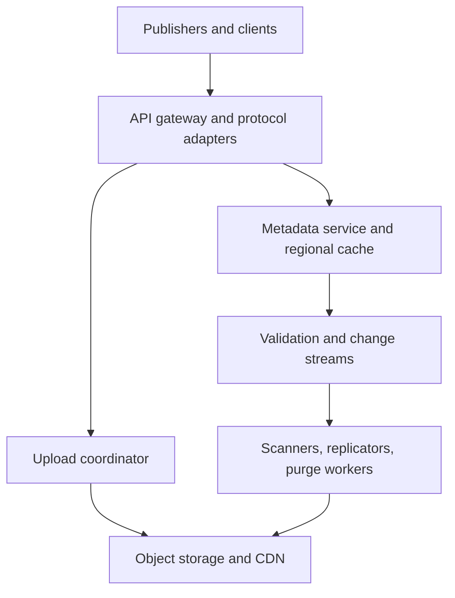

# System Design Interview Practice: Global Package and Artifact Registry

**Difficulty:** Senior / Staff  
**Primary themes:** immutable content-addressed storage, transactional metadata, CDN caching, asynchronous validation, queues, consistency, multi-region replication, supply-chain security, deletion semantics  
**Interview time budget:** about 45 minutes  
**Educational walkthrough:** intentionally more detailed than what you would say in 45 minutes

This is an original walkthrough organized with the broad sequence in Hello Interview's public delivery guidance: clarify requirements, name only the essential entities, define the interface, build one complete operation at a time, and then deepen the design around the hardest non-functional requirements. The time boxes are speaking targets, not limits on the study material below.

---

## Interviewer prompt

> Design a global package and artifact registry used by software teams to publish and download versioned packages, container layers, model files, and build artifacts. The registry must support immutable versions, mutable aliases such as `latest`, very high download traffic, safe publishing, malware and policy checks, regional failures, retention, and deletion or quarantine.

The central tension is that artifact bytes should be immutable and cached almost forever, while package names, aliases, permissions, policy decisions, and deletion barriers are mutable and sometimes security-critical.

## Targeted clarifying questions and assumed interviewer answers

**Candidate:** “Are we building one protocol such as npm, or a common backend for several artifact types?”

**Interviewer:** “Build a common registry backend. Use a generic package API and mention protocol adapters for npm, Maven, OCI, Python, and ML artifacts.”

**Candidate:** “Are package versions immutable after publication?”

**Interviewer:** “Yes. A namespace may forbid reusing a version. Mutable aliases such as `latest`, channels, or tags may move between immutable versions.”

**Candidate:** “Can users download an artifact before scanning finishes?”

**Interviewer:** “New public releases require mandatory validation before they become visible. Private namespaces may choose either blocking validation or a clearly marked provisional state, but quarantined content must never be served.”

**Candidate:** “What scale should I design for?”

**Interviewer:** “Assume 50 million packages and 5 billion immutable blobs, 20 million downloads per minute at peak, 20,000 publishes per minute, and artifacts from a few kilobytes to 20 GiB. Download bandwidth is far more important than request count.”

**Candidate:** “What latency and availability are expected?”

**Interviewer:** “Metadata lookup should be under 100 ms at p99 from a nearby region. Cached downloads should start in under 200 ms at p99. Downloads should be 99.99% available; publishing may be 99.9% available.”

**Candidate:** “Should a delete immediately remove every physical copy?”

**Interviewer:** “Logical unavailability must happen globally within 60 seconds for quarantine and within five minutes for an ordinary delete. Physical erasure may be asynchronous, subject to legal hold and cache purge completion.”

**Candidate:** “What consistency do aliases need?”

**Interviewer:** “A publisher must get read-your-writes. Ordinary alias readers may be eventually consistent within five seconds. Security quarantine and deletion use a stronger barrier: a region that cannot prove freshness must fail closed for affected content.”

**Candidate:** “Do we need resumable upload and download?”

**Interviewer:** “Yes. Uploads over 64 MiB should be multipart and resumable. Downloads support byte ranges and integrity verification.”

**Candidate:** “Do we handle dependency resolution?”

**Interviewer:** “Store package manifests and expose version metadata. Full language-specific dependency solving belongs in clients or protocol adapters.”

**Candidate:** “Do we need provenance and signing?”

**Interviewer:** “Yes. Preserve checksums, signatures, build provenance, scanner results, and an append-only audit history. Explain the trust boundary.”

### What I would say aloud

> “I see two planes. The byte plane is immutable, content-addressed, and cache-heavy. The metadata plane owns names, versions, aliases, authorization, validation state, and security barriers. I’ll make version publication atomic, allow bounded staleness for ordinary aliases, and fail closed when deletion or quarantine freshness is uncertain.”

---

## 1. Requirements (~5 minutes)

### Core functional requirements

1. **Publish an immutable version safely.** An authenticated publisher uploads one or more blobs, a manifest, checksums, signatures, and provenance. The system validates them and atomically exposes the new package version without partial visibility.
2. **Resolve and download efficiently.** An authorized client resolves a package version or alias, receives immutable blob descriptors and short-lived download authorization, then downloads blobs with range requests and end-to-end integrity checks.
3. **Control mutable metadata and unsafe content.** Authorized users move aliases, inspect validation status, deprecate versions, and delete or quarantine content. Security-critical state must override caches quickly and audibly.

### Quantified non-functional requirements

| Requirement | Target | Concrete design consequence |
|---|---:|---|
| Peak downloads | 20 million/minute, about 333,000/s | Keep application servers off the byte path; use CDN and object storage with immutable keys. |
| Publish rate | 20,000/minute, about 333/s | A transactional metadata store is sufficient, but blob uploads and scanners must scale independently. |
| Artifact size | KiB to 20 GiB | Multipart upload, range download, chunk checksums, resumability, and streaming validation. |
| Metadata latency | p99 < 100 ms regionally | Regional read replicas/caches and compact manifests; avoid object-listing on the lookup path. |
| Availability | 99.99% download; 99.9% publish | Serve immutable cached bytes during many control-plane failures, but block new publication when commit authority is unavailable. |
| Alias freshness | <= 5 seconds normally | Ordered change stream plus versioned cache entries. |
| Quarantine/delete enforcement | <= 60 seconds / <= 5 minutes | Monotonic security epochs, push invalidation, short safety leases, and fail-closed behavior. |
| Durability | 11-nines-like object durability; no acknowledged published version lost after an AZ failure | Multi-AZ metadata quorum, replicated object storage, checksum scrubbing, and disaster recovery. |

### Scope

**In scope**

- Tenant namespaces, authentication, authorization, and quotas.
- Immutable package versions and blobs.
- Mutable aliases/tags/channels.
- Multipart uploads, range downloads, checksums, and resumability.
- Validation pipelines: structural checks, malware scanning, signatures, provenance, license/policy gates.
- CDN/object caching, regional replication, quarantine, deletion, retention, and audit.
- Protocol adapters that translate ecosystem requests into the common model.

**Out of scope**

- Implementing every language's dependency solver.
- Building compilers or build systems.
- Vulnerability research itself; scanners consume external advisory feeds.
- General source-code hosting.
- Billing internals beyond usage events and quota enforcement.

### Consistency and availability contract

The registry exposes three different contracts rather than pretending all data needs the same consistency:

1. **Immutable blob by digest:** strong identity. If `sha256:D` resolves, every byte returned must hash to `D`. A blob key never changes meaning.
2. **Version publication:** linearizable within a tenant/package. A version is either invisible or references a complete, validated manifest; clients never observe half the files.
3. **Alias lookup:** bounded eventual consistency, normally within five seconds. A publisher receives a write token that provides read-your-writes when supplied on a subsequent read.
4. **Quarantine and delete barrier:** monotonic and safety-critical. A serving tier may use cached content only while it holds a fresh lease proving its minimum security epoch is current. If it cannot refresh, it stops serving affected content.

During a metadata partition, existing non-quarantined immutable downloads may continue while their security lease remains valid. New publishes, version claims, alias writes, and policy changes require the authoritative quorum. This explicitly favors availability for already-proven immutable bytes and consistency for namespace mutations.

### What I would say aloud

> “I’m not choosing one blanket consistency model. Digest identity and version publication are strong, normal aliases are bounded-stale, and security barriers are monotonic and fail closed. That gives the high-volume read path availability without allowing stale caches to bypass quarantine.”

---

## 2. Core entities (~2 minutes)

Name the nouns first; add fields only when a component needs them.

| Entity | Purpose | Important fields introduced later |
|---|---|---|
| `Namespace` | Tenant-owned naming and policy boundary | `namespace_id`, `tenant_id`, `visibility`, `policy_id`, `security_epoch` |
| `Package` | Stable package identity | `package_id`, `namespace_id`, `name`, `type`, `next_sequence` |
| `PackageVersion` | Immutable published release | `version_id`, `package_id`, `version`, `manifest_digest`, `state`, `published_at`, `sequence` |
| `Manifest` | Immutable list of artifact files and metadata | `manifest_digest`, `entries[]`, `dependency_metadata`, `provenance_ref` |
| `Blob` | Immutable content-addressed bytes | `digest`, `size`, `media_type`, `storage_class`, `region_set`, `ref_count_hint` |
| `UploadSession` | Resumable staging state | `session_id`, `principal_id`, `parts`, `expected_digest`, `expires_at`, `state` |
| `Alias` | Mutable name pointing to a version | `package_id`, `alias`, `version_id`, `revision` |
| `ValidationRun` | Scanner and policy result | `run_id`, `subject_digest`, `policy_version`, `checks`, `decision` |
| `Barrier` | Global minimum safe state | `namespace_id`, `security_epoch`, `blocked_digests`, `reason`, `committed_at` |
| `AuditEvent` | Append-only evidence | `event_id`, `actor`, `action`, `subject`, `old_hash`, `new_hash`, `timestamp` |

The distinction between `PackageVersion` and `Blob` is foundational. Many versions may reference the same blob, and one version may contain many blobs. Version deletion therefore removes reachability first; it does not immediately delete shared bytes.

### What I would say aloud

> “A version is named metadata; a blob is content-addressed bytes. That separation enables deduplication and permanent cache keys, but it also means deletion must reason about reachability rather than blindly removing the blob.”

---

## 3. API and system interface (~5 minutes)

Use REST for external resource operations and efficient internal RPC for scheduling and authorization. Identity always comes from the authenticated token or workload identity; the client never chooses `tenant_id` in a body.

### Start a publish session

```http
POST /v1/namespaces/acme/packages/payments-sdk/versions
Authorization: Bearer <publisher-token>
Idempotency-Key: pub_01J...
Content-Type: application/json

{
  "version": "4.2.0",
  "package_type": "generic",
  "files": [
    {
      "path": "payments-sdk.tar.zst",
      "size": 734003200,
      "sha256": "8e2d..."
    }
  ],
  "provenance": {
    "builder": "ci/acme-release",
    "source_commit": "6bf9...",
    "statement_digest": "sha256:91a4..."
  }
}
```

The service derives `tenant_id`, `principal_id`, scopes, and allowed namespace from authentication. It reserves the version name and returns upload instructions:

```json
{
  "publish_id": "pub_7821",
  "version_state": "UPLOADING",
  "files": [
    {
      "digest": "sha256:8e2d...",
      "action": "MULTIPART_UPLOAD",
      "upload_id": "up_4402",
      "part_size_bytes": 67108864,
      "part_urls": ["https://upload.example/..."],
      "expires_at": "2026-10-29T09:30:00Z"
    }
  ]
}
```

If a verified blob already exists and the publisher is authorized to attach it, `action` may be `REUSE`. The API does not reveal cross-tenant blob existence before authorization because that would create a content-presence oracle.

### Complete uploaded parts

```http
POST /v1/uploads/up_4402/completion
Authorization: Bearer <publisher-token>

{
  "parts": [
    {"number": 1, "etag": "...", "sha256": "..."},
    {"number": 2, "etag": "...", "sha256": "..."}
  ],
  "whole_sha256": "8e2d..."
}
```

Response:

```json
{
  "digest": "sha256:8e2d...",
  "state": "STAGED",
  "verified_size": 734003200
}
```

### Request publication

```http
POST /v1/publishes/pub_7821/completion
Authorization: Bearer <publisher-token>

{
  "signature_bundle": "base64:...",
  "requested_alias_updates": {
    "latest": "4.2.0",
    "stable": "4.2.0"
  }
}
```

Response while validation is running:

```http
HTTP/1.1 202 Accepted
Location: /v1/publishes/pub_7821

{
  "publish_id": "pub_7821",
  "state": "VALIDATING",
  "retry_after_ms": 2000
}
```

After success, the same status resource returns:

```json
{
  "publish_id": "pub_7821",
  "state": "PUBLISHED",
  "package": "acme/payments-sdk",
  "version": "4.2.0",
  "manifest_digest": "sha256:b017...",
  "publication_sequence": 918,
  "write_token": "wt:918:..."
}
```

### Resolve a version or alias

```http
GET /v1/namespaces/acme/packages/payments-sdk/versions/stable
Authorization: Bearer <reader-token>
X-Min-Publication-Sequence: 918
```

Response:

```json
{
  "package": "acme/payments-sdk",
  "resolved_version": "4.2.0",
  "alias_revision": 44,
  "manifest_digest": "sha256:b017...",
  "security_epoch": 1337,
  "files": [
    {
      "path": "payments-sdk.tar.zst",
      "digest": "sha256:8e2d...",
      "size": 734003200,
      "media_type": "application/zstd",
      "download_url": "https://cdn.example/blobs/sha256/8e/2d...",
      "authorization": "short-lived-signed-token"
    }
  ]
}
```

The optional minimum sequence provides read-your-writes: a replica that has not reached sequence 918 forwards to the leader or waits briefly rather than returning an older alias.

### Download immutable content

```http
GET /blobs/sha256/8e/2d...
Authorization: Artifact <short-lived-signed-token>
Range: bytes=134217728-201326591
```

Response includes `ETag: "sha256:8e2d..."`, `Content-Range`, immutable cache headers, and a signed security epoch. The client verifies the whole-file digest after reassembly and may verify per-chunk hashes while streaming.

### Move an alias conditionally

```http
PUT /v1/namespaces/acme/packages/payments-sdk/aliases/stable
Authorization: Bearer <release-manager-token>
If-Match: "alias-revision:44"

{
  "version": "4.2.1"
}
```

The compare-and-set header prevents two release jobs from silently overwriting each other. A stale revision returns `412 Precondition Failed`.

### Quarantine a version

```http
POST /internal/v1/quarantines
Authorization: Service <security-workload-identity>

{
  "namespace": "acme",
  "package": "payments-sdk",
  "version": "4.2.0",
  "reason_code": "MALWARE_CONFIRMED",
  "evidence_ref": "case_771"
}
```

The caller identity must have the security role. The system commits a higher security epoch before it begins physical cache purge.

### Interface-to-requirement mapping

| Functional requirement | Primary interface |
|---|---|
| Safe immutable publication | Create version, multipart completion, publish completion/status |
| Resolve and download | Version/alias lookup plus digest-addressed range GET |
| Mutable control and unsafe-content response | Conditional alias PUT, quarantine/delete resources, audit lookup |

### What I would say aloud

> “The API separates upload from publication. Upload can be long and retryable; publication is the small atomic metadata decision. Downloads use signed, digest-bound authorization so application servers authorize access without proxying hundreds of gigabytes.”

---

## 4. Data flow

### Publish flow

1. Authenticate the publisher and authorize package/version creation.
2. Reserve `(namespace, package, version)` with an idempotency key.
3. Return direct multipart upload URLs for missing blobs; do not proxy bytes through the metadata service.
4. Object storage assembles staged parts; an integrity worker streams the object and verifies length, whole digest, and media-format limits.
5. Create an immutable manifest referring only to verified staged blobs.
6. Enqueue validation tasks for signature, provenance, malware, license, and policy checks.
7. Aggregate results under the exact manifest digest and policy version.
8. In one metadata transaction, mark the version `PUBLISHED`, attach the manifest, apply requested alias compare-and-set updates, append an outbox event, and consume the version reservation.
9. Replication and cache consumers distribute metadata and prewarm selected blobs.

### Download flow

1. Authenticate the client and authorize the namespace/package.
2. Resolve an exact version or alias from a regional metadata cache/replica.
3. Check the namespace security epoch and version state.
4. Return a compact manifest plus short-lived authorization bound to tenant, digest, expiry, and minimum security epoch.
5. The client downloads from the nearest CDN. On a miss, the CDN fetches from a regional object replica or origin.
6. Each tier validates the digest/size metadata; the client validates the final content.
7. Emit sampled usage events asynchronously; never put analytics on the byte path.

### Quarantine flow

1. Security service commits a `QUARANTINED` state and increments the namespace security epoch in one transaction.
2. An outbox publishes the new barrier to every region and CDN control plane.
3. Serving components reject blocked versions/digests once they observe the epoch.
4. Short safety leases ensure a component that misses the push must refresh before serving again.
5. Purge jobs remove cached copies and revoke download tokens; object bytes move to an isolated evidence/retention class rather than being immediately destroyed.

---

## 5. High-level design (~10–15 minutes)

Build the simplest complete system one operation at a time.



### Operation 1: reserve and upload a version

The metadata service owns a uniqueness constraint on:

```text
(namespace_id, normalized_package_name, normalized_version)
```

Name normalization is protocol-specific and versioned. Without a versioned canonicalizer, visually or semantically equivalent names could bypass uniqueness rules.

The reservation record includes:

```text
publish_id, package_id, version, principal_id, idempotency_key,
expected_manifest_hash, state, created_at, expires_at
```

Blob bytes bypass the API fleet. The upload coordinator issues short-lived URLs restricted to a staging prefix, exact part numbers, maximum sizes, and the authenticated publish session. Staging objects are not downloadable through the registry.

For small files, use one upload. For files over 64 MiB, use fixed-size multipart chunks—64 MiB is a reasonable starting point. Parts carry checksums and may be retried independently. Completion is idempotent: the same ordered part list either produces the same staged object or returns a conflict.

### Operation 2: verify and validate

After upload completion, a verifier streams bytes once to compute the authoritative digest. Trusting only a caller-provided digest would let corrupt or malicious storage enter the namespace. For very large objects, the verifier also checks a Merkle-style list of chunk hashes so range repair and partial corruption detection are possible.

The validation coordinator publishes tasks to separate queues:

- structural parser and archive-bomb checks;
- malware and secret scanning;
- signature and certificate-chain verification;
- provenance verification against trusted builders;
- license and tenant policy evaluation;
- optional vulnerability inventory generation.

Each task key is:

```text
(subject_digest, scanner_name, scanner_version, policy_version)
```

That makes results reusable when multiple versions reference identical content, while still invalidating results after a scanner or policy upgrade. Queue delivery is at least once, so result upserts are idempotent on that key.

The validation aggregator never treats “queue empty” as success. It evaluates an explicit required-check set from the pinned policy version. A result is `PASS`, `FAIL`, or `INCONCLUSIVE`; timeouts become `INCONCLUSIVE`, not implicit passes.

### Operation 3: atomically publish

The baseline metadata store can be a strongly consistent relational database partitioned by `namespace_id` or `package_id`. The publish transaction touches a small amount of metadata:

```sql
BEGIN;

SELECT state
FROM publish_sessions
WHERE publish_id = :publish_id
FOR UPDATE;

-- Verify every required validation result is PASS for the pinned policy.

INSERT INTO package_versions(
  package_id, version, manifest_digest, state,
  publication_sequence, published_at
) VALUES (..., 'PUBLISHED', next_package_sequence(), now());

UPDATE aliases
SET version_id = :new_version_id, revision = revision + 1
WHERE package_id = :package_id
  AND alias = :alias
  AND revision = :expected_revision;

INSERT INTO outbox(event_id, aggregate_id, sequence, payload) VALUES (...);
UPDATE publish_sessions SET state = 'PUBLISHED' WHERE publish_id = :publish_id;

COMMIT;
```

If any requested alias compare-and-set fails, either fail the transaction or publish the version without the alias according to the API contract. For a release API, failing the whole transaction is easier to reason about.

The transaction makes the version visible only after every referenced blob is verified and every required check passed. Clients never discover a manifest whose files are still uploading.

### Operation 4: resolve metadata

Exact version metadata is immutable after publication, so cache it aggressively by:

```text
(namespace_id, package_id, version, publication_sequence)
```

Aliases are mutable, so cache them by `(package_id, alias, alias_revision)` with a short TTL and update them through an ordered per-package change stream. The regional resolver maintains the highest applied package sequence. A request with `X-Min-Publication-Sequence` waits or forwards if the regional replica is behind.

Authorization is evaluated before returning a manifest or signed download token. Public packages can use a public cache key. Private entries include the tenant/entitlement class in the authorization decision; never cache a positive private authorization globally without the relevant policy version and expiry.

### Operation 5: serve bytes

Blob URLs contain the digest, not package/version names. Therefore one blob can be reused across versions and protocols, and a cached URL never changes meaning.

The path is:

```text
client -> edge CDN -> regional cache/origin shield -> regional object replica -> primary object store
```

The signed token binds:

```text
principal or entitlement class, digest, allowed byte range,
expiry, namespace_id, minimum_security_epoch
```

The edge verifies the token and its current leased security epoch. It may serve cached bytes only if the token is valid, the digest is not blocked, and its epoch lease is fresh. This prevents a stale edge from continuing to serve quarantined private content indefinitely.

Range requests allow download resumption. The CDN caches aligned chunks for giant blobs, avoiding a separate full-object cache entry for every partial request. Small blobs may be cached whole.

### Operation 6: replicate globally

Metadata changes replicate as an ordered log per package or namespace. Exact-version reads may use local replicas once they reach the required publication sequence. Writes route to the package's home region to avoid cross-ocean consensus on every publish.

Blob replication is asynchronous and policy-aware:

- public hot content replicates broadly and is CDN-cached;
- private content follows residency rules;
- cold content may live in fewer regions and fetch on first access;
- newly published high-priority releases can be prewarmed before alias promotion.

The manifest records a durability state separately from visibility. Publication requires at least the configured durable region/AZ set, not necessarily every global region.

### Operation 7: delete safely

Deleting a version performs a metadata transaction first:

1. mark the version `DELETED` or `QUARANTINED`;
2. increment the namespace security epoch when immediate serving denial is required;
3. remove or conditionally move aliases;
4. append audit and purge events.

Physical cleanup happens later. A reachability scanner determines whether any live version, legal hold, retention rule, or evidence record still references each blob. Because asynchronous reference counts can drift under retries, treat a refcount as a hint. Before deletion, perform a mark-and-sweep or authoritative reference query and hold the candidate through a grace period.

### Scale estimates that change the design

Assume peak downloads are 20 million/minute:

```text
20,000,000 / 60 ≈ 333,000 download starts/s
```

If the average downloaded artifact is 40 MiB:

```text
333,000 × 40 MiB ≈ 13.3 million MiB/s
                     ≈ 13 TiB/s
                     ≈ 106 Tb/s
```

Even if the average is much smaller and clients reuse local caches, the order of magnitude makes one decision unavoidable: application servers cannot proxy downloads. A CDN plus regional object caches must carry the byte plane.

Suppose the CDN hit ratio is 97% by bytes:

```text
106 Tb/s × 3% ≈ 3.2 Tb/s reaching shields/origins
```

That is still substantial, so use regional origin shields, prewarming for hot releases, request coalescing on misses, and bandwidth-aware replication.

For 5 billion blobs with 300 bytes of metadata each:

```text
5,000,000,000 × 300 bytes ≈ 1.5 TB logical metadata
```

Indexes, replication, validation pointers, and storage-engine overhead can multiply that several times. Blob metadata therefore needs sharding and lifecycle compaction, but the publish rate of roughly 333/s does not require an exotic write architecture. The design should optimize read bandwidth and metadata fan-out, not overengineer publish QPS.

If 20,000 publishes/minute each trigger five checks:

```text
333 publishes/s × 5 ≈ 1,665 validation tasks/s average at peak
```

Large blobs make scanner-byte throughput more important than task count. Separate fast metadata/signature checks from expensive byte scanners and schedule by estimated bytes and decompression cost.

### What I would say aloud

> “The bandwidth estimate, not the request count, forces the CDN/object-store byte plane. Conversely, only a few hundred publishes per second means a partitioned relational metadata store is entirely reasonable. I would not choose a globally writable NoSQL database just because the blob count is large.”

---

## 6. Deep dives (~10–15 minutes)

In a real interview, choose two based on the interviewer's interest. Three are included for practice.

### Deep dive A: publish atomicity, deduplication, and integrity

#### Where the baseline breaks

A naive flow might write package metadata first and upload files afterward. Readers can then receive manifests with missing blobs. Retrying publication may also create duplicate versions, and trusting the client checksum can permanently attach corrupt bytes to an immutable digest.

#### Plausible approaches

| Approach | Benefit | Failure or tradeoff |
|---|---|---|
| Proxy upload through API servers | Simple authorization and streaming | Expensive scaling, long-lived connections, and double bandwidth through compute. |
| Direct object upload then metadata insert | Scalable byte path | Needs staging isolation, verification, cleanup, and an atomic final metadata commit. |
| Cross-store distributed transaction | Conceptually atomic object plus metadata | Object stores rarely participate; blocking and operationally complex. |
| Content-addressed staging plus metadata commit | Immutable identity, natural dedupe, simple final transaction | Requires orphan cleanup and careful authorization against content-presence leaks. |

#### Selection

Use direct content-addressed staging and a small metadata commit. The object is durable and verified before the manifest can reference it. Publication atomically changes only metadata. If the metadata transaction fails, staged bytes are unreachable and a lifecycle job removes them later.

#### Dedupe without a privacy oracle

Global digest dedupe is attractive, but telling an arbitrary caller “that blob already exists” reveals that another tenant stored known content. Safer choices are:

- dedupe only within a tenant or trust domain;
- accept the upload and dedupe internally after verification;
- allow cross-tenant reuse only for public content;
- require proof of possession, such as random chunk challenges, before skipping upload.

Physical storage may still deduplicate encrypted chunks internally, but the API response must not reveal unauthorized presence.

#### Integrity hierarchy

Use several checks because each catches a different failure:

1. TLS protects transport in flight.
2. Per-part checksum detects retry or transfer corruption.
3. Whole-blob digest defines immutable identity.
4. Manifest digest binds paths, media types, sizes, and blob digests.
5. Publisher signature binds the release identity to the manifest.
6. Provenance statement describes how the artifact was built.

A signature does not prove bytes are safe; it proves who signed them. Malware/policy validation remains separate.

#### Nondeterministic scanners

Scanner results are versioned and auditable. Publication pins the policy and scanner result set used for its decision. Later intelligence may find that an earlier `PASS` is unsafe; that creates a new decision and can trigger quarantine. Do not mutate historical evidence.

#### Failure modes and observability

| Failure | Behavior | Signal |
|---|---|---|
| Client loses completion response | Retry with idempotency key returns same publish session/state | idempotency replay count |
| Part uploaded but session expires | Part remains staging-only and is garbage-collected after grace | orphan staging bytes and age |
| Verifier crashes midstream | Queue redelivers; result key makes retry idempotent | verification retries and bytes reread |
| One required scanner is unavailable | Version remains `VALIDATING` or fails by policy; never implicit pass | validation age by required check |
| Metadata commits but event publisher crashes | Transactional outbox republishes | outbox lag and oldest event |
| Same digest yields different bytes | Treat as critical corruption/security incident | digest-collision/corruption alarm |

Trace `publish_id` through upload, verification, validation, commit, replication, and alias promotion. The most useful latency breakdown is upload-complete to verified, verified to checks-complete, and checks-complete to visible.

### Deep dive B: cache correctness, aliases, quarantine, and deletion

#### Where the baseline breaks

Immutable digest caching is easy until package aliases and deletion enter the picture. If a CDN caches `/packages/acme/sdk/latest`, it may serve an old version after alias movement. Worse, if it caches raw bytes with a year-long TTL, ordinary purge is not a reliable security mechanism across thousands of edge nodes.

#### Plausible approaches

| Approach | Benefit | Failure or tradeoff |
|---|---|---|
| Cache package URLs directly | Simple client URLs | Mutable names poison long TTLs and complicate invalidation. |
| Short TTL everywhere | Simple freshness bound | Destroys hit ratio and still does not give immediate quarantine. |
| Purge every physical cache synchronously | Intuitive delete semantics | Fan-out is slow, partial, and cannot be one atomic global action. |
| Immutable digest URLs plus epoch barrier | High hit ratio and fast logical revocation | Requires epoch distribution and fail-closed leases. |

#### Selection

Separate name resolution from byte delivery:

```text
package alias -> immutable version -> immutable manifest -> immutable blob digests
```

Only the first mapping is frequently mutable. Cache exact versions and blobs for long periods. Alias entries use a short TTL plus an ordered update stream.

For quarantine, commit a monotonic `security_epoch` and blocked subject before attempting physical purge. Each edge holds a short lease such as 30 seconds stating:

```text
namespace_id, minimum_epoch, lease_expiry, signed_by_control_plane
```

The edge may serve private/sensitive content only if its local epoch is at least the token's required epoch and its lease is valid. A missed push therefore causes at most the lease duration of exposure. If the control plane is unreachable after expiry, affected requests fail closed.

Public content may use a global blocked-digest structure distributed to edges. False positives in a Bloom filter are acceptable only as temporary denial followed by authoritative lookup; false negatives are not acceptable for confirmed quarantine.

#### Alias consistency

Assign every package metadata mutation an increasing sequence. Regional consumers apply events in order and store the last sequence. A publisher gets a signed write token containing the commit sequence. On a subsequent read:

- local sequence >= token sequence: serve locally;
- local sequence behind but likely to catch up: wait briefly;
- excessive lag: route to home region;
- home unavailable: return an explicit consistency error rather than pretend read-your-writes.

Ordinary readers without a token accept the five-second bounded-staleness contract.

#### Deletion lifecycle

Distinguish:

- **deprecate:** version remains downloadable but clients see a warning;
- **yank:** version is hidden from new resolution but existing locked builds may fetch it by exact digest, depending on policy;
- **delete:** version becomes unavailable and enters retention cleanup;
- **quarantine:** urgent denial plus evidence preservation;
- **legal hold:** prevents physical deletion even if user-visible reachability is removed.

This vocabulary avoids the common mistake of treating every removal as the same operation.

#### Preventing stale refill

Every lower cache tier must carry the security epoch and blocked status. An origin shield with stale content cannot refill an edge after quarantine because the edge compares the response epoch with its current minimum. On process restart, a cache must refresh the epoch floor before serving recovered disk entries.

#### Observability

Track alias propagation p50/p99/max, security epoch lag by region/POP, expired edge leases, blocked requests, purge completion percent, stale-refill rejections, and bytes still physically retained after logical deletion. Run synthetic quarantine drills and verify the global enforcement objective.

### Deep dive C: multi-region availability, hot releases, and fair validation

#### Where the baseline breaks

A major release can send millions of clients to one new digest within seconds. The artifact may not exist in every region yet, causing a cache-miss stampede and saturating the primary object's egress. Meanwhile a few 20 GiB archives can monopolize scanners and delay thousands of small releases.

#### Architecture options

| Problem | Simple option | Scaled option | Chosen direction |
|---|---|---|---|
| Global metadata writes | Multi-leader active-active | Home-region leader per package | Home leader; conflicts are rare and safety is clearer. |
| Blob placement | Replicate everything everywhere | Demand-based, policy-aware placement | Demand-based with prewarm hints and residency constraints. |
| Miss storm | Every cache fetches origin | Origin shield plus single-flight | One fetch per digest/region; waiters share it. |
| Scanner scheduling | FIFO tasks | Cost-aware fair queues | Tenant-weighted fair scheduling by bytes/decompression estimate. |

#### Hot release handling

When an alias promotion is expected to be large:

1. publisher optionally marks a release as high-impact;
2. registry estimates demand from prior versions and subscribed fleets;
3. replicator places blobs in selected regions;
4. origin shields verify availability;
5. alias promotion occurs only after a configurable prewarm threshold;
6. CDN uses request coalescing so concurrent misses for one digest share one origin fetch.

Prewarming is an optimization, not a publication correctness requirement unless the tenant explicitly requests an availability gate.

#### Fair validation

Compressed size is a poor cost estimate. A small archive may expand into millions of files. Admission computes estimated work from:

```text
compressed bytes, declared/uncompressed bytes, file count,
media type, archive depth, scanner set, historical throughput
```

Use separate lanes for interactive releases, bulk rescans, and emergency security rescans. Within a lane, apply per-tenant weighted fair queuing and byte/concurrency quotas. Emergency rescans can preempt ordinary backlog but must not starve publication indefinitely.

Archive extraction happens in a sandbox with strict CPU, memory, file-count, nesting-depth, disk, and wall-clock limits. Network is disabled. A zip bomb fails validation without harming the worker fleet.

#### Regional failure

If a metadata read region fails, clients route to another region that has applied at least the required security epoch. Exact immutable downloads continue from CDN caches and replicated object storage while leases are valid.

If a package's home metadata region fails:

1. downloads continue from sufficiently fresh replicas/caches;
2. new publishes and alias writes pause initially;
3. control plane fences the old leader epoch;
4. promote a caught-up DR replica with a higher term;
5. routers refresh the package-range map;
6. reconcilers resume outbox and incomplete publish sessions.

Accepting temporary publish unavailability is preferable to two leaders claiming the same version or moving an alias in conflicting directions.

#### Backpressure and overload

- Reject new low-priority validation work before scanner queues exceed their age SLO.
- Preserve capacity for completion, quarantine, and security-epoch distribution.
- Return `429` with retry hints for tenant quota exhaustion.
- Let uploads finish into staging even if validation is delayed, within storage quotas.
- Shed analytics first; do not drop audit or security events.
- Cap origin concurrency per digest and per storage region.

#### Observability

Dashboard by tenant, package type, region, and storage class:

- download starts, byte throughput, range request ratio, CDN hit ratio by bytes;
- origin-shield single-flight waiters and origin egress;
- publish stages and age percentiles;
- scanner queue age, estimated versus actual cost, sandbox failures;
- replication lag, missing-region blobs, and prewarm completion;
- alias event lag and security epoch lag;
- metadata quorum health and failover term;
- object checksum scrub failures and repair backlog;
- tenant quota rejections and fairness share.

Alert on contract violations, not just infrastructure utilization: published manifest with an unavailable required blob, stale edge serving after the security objective, two published meanings for one immutable version, or a checksum mismatch for a digest.

---

## 7. Final design

### Concise architecture

- Protocol adapters normalize ecosystem requests into tenant-scoped packages, immutable versions, manifests, and content-addressed blobs.
- Authentication derives tenant, principal, and roles; bodies cannot select another tenant.
- The upload coordinator issues restricted multipart URLs into isolated staging storage.
- Verifiers compute authoritative digests and enforce archive/resource limits.
- At-least-once queues run versioned signature, provenance, malware, license, and policy checks; an explicit aggregator requires every mandated result.
- A partitioned, strongly consistent metadata store atomically publishes the complete version, requested alias changes, audit record, and outbox event.
- Regional metadata caches serve exact versions aggressively and aliases with bounded staleness; write tokens provide publisher read-your-writes.
- Clients download immutable digest URLs directly from a CDN/object-storage hierarchy with range support and integrity verification.
- Blob placement is demand-based and residency-aware; origin shields and single-flight protect storage during hot releases.
- Monotonic security epochs and short serving leases make quarantine/delete barriers effective before physical purge finishes.
- Cleanup removes named reachability first, then uses authoritative reachability plus grace periods before erasing unreferenced shared blobs.
- Regional outages preserve verified immutable reads where safe, while publication and alias writes fail closed until a higher-term metadata leader is established.

### Requirements check

| Requirement | How the design satisfies it |
|---|---|
| Safe publish | Staging, authoritative digest verification, explicit validation set, and one metadata transaction. |
| Immutable versions | Unique normalized package/version key and digest-addressed manifest/blobs. |
| High-volume downloads | CDN, regional shields, object storage, range requests, and application servers off the byte path. |
| Mutable aliases | Conditional writes, revisions, ordered events, bounded-stale regional caches, and read-your-writes token. |
| Resumability | Multipart part retries for upload and HTTP byte ranges for download. |
| Supply-chain evidence | Signatures, provenance, versioned scanner results, and append-only audit events. |
| Quarantine/delete | Monotonic barrier, epoch leases, blocked digests, purge workflow, and stale-refill prevention. |
| Multi-region reliability | Home-region metadata authority, replicated reads/blobs, fenced DR promotion, and policy-aware placement. |
| Tenant isolation | Auth-derived identity, namespace authorization, quotas, encryption, and presence-oracle protection. |
| Cost control | Deduplication, lifecycle tiers, demand-based replication, and fair cost-aware scanning. |

### 90-second candidate summary

> “I separate immutable bytes from mutable naming and policy. Publishers reserve a version, upload directly to isolated multipart staging, and the registry independently verifies size and digest. Versioned scanners evaluate the exact manifest under a pinned policy. One metadata transaction then exposes the immutable version, applies conditional alias updates, writes audit state, and emits an outbox event, so readers never see partial releases. Resolution is a small regional metadata operation; downloads use digest-bound signed tokens and flow through CDN, origin shields, and object storage with ranges and end-to-end checksums. Exact versions and blobs cache for a long time, while aliases use revisions and ordered propagation. For quarantine, a monotonic security epoch and short edge lease make old cache entries ineligible before physical purge completes. We route package writes to a home region, replicate metadata and blobs according to demand and residency, and use fenced failover. The bandwidth math—not publish QPS—drives the architecture, so application servers stay off the byte path.”

---

## Realistic interviewer follow-up questions and strong sample answers

### 1. Why content-address blobs?

**Candidate:** “The digest gives immutable identity, deduplication, integrity checking, and permanent cache keys. Package names and aliases can change without changing what a blob URL means.”

### 2. Why not put package metadata in object storage too?

**Candidate:** “Object storage is excellent for immutable bytes but awkward for uniqueness, conditional alias updates, transactions, and ordered publication. I keep small mutable metadata in a transactional store and large immutable objects in blob storage.”

### 3. How do you prevent a partially uploaded release from appearing?

**Candidate:** “Uploads land in a non-downloadable staging area. Publication references only verified blobs and happens in one metadata transaction after required validation succeeds.”

### 4. What if the client retries version creation?

**Candidate:** “The idempotency key maps to the same publish session. Reusing the key with a different normalized version or manifest intent returns a conflict.”

### 5. Can a package version be overwritten?

**Candidate:** “No. A version identifier maps to one immutable manifest. Corrections publish a new version. Mutable aliases may move with compare-and-set.”

### 6. Why use an alias revision?

**Candidate:** “It prevents two release pipelines from silently losing updates. Each writer states the revision it observed; a stale update gets a precondition failure.”

### 7. How does a publisher read its alias immediately?

**Candidate:** “The commit returns a minimum publication sequence. The publisher includes it on the read, and a lagging replica waits or forwards to the authority.”

### 8. How do normal clients see alias changes?

**Candidate:** “Regional caches consume ordered per-package events and also have a short TTL. The contract allows up to five seconds of staleness.”

### 9. Why not use the same short TTL for blob bytes?

**Candidate:** “A digest-addressed blob never changes meaning, so revalidation wastes bandwidth. I cache it long-term and use a separate security barrier for revocation.”

### 10. How can quarantine beat a year-long CDN TTL?

**Candidate:** “The TTL no longer grants unconditional eligibility. Edges need a fresh signed security-epoch lease and reject blocked digests. Logical revocation happens through the barrier; purge handles physical cleanup.”

### 11. What if an edge misses the quarantine event?

**Candidate:** “Its short epoch lease expires. It must refresh before serving affected content, so a lost push cannot cause indefinite exposure.”

### 12. What if the barrier service is down?

**Candidate:** “Existing content can be served only until the safety lease expires. After that, affected private or security-sensitive requests fail closed. The outage policy is explicit rather than silently serving stale state.”

### 13. Why is physical deletion delayed?

**Candidate:** “Blobs are shared across versions, caches are distributed, and legal/evidence holds may apply. I remove reachability first, then prove no live references remain and wait through a grace period before erasure.”

### 14. Is a reference count enough for garbage collection?

**Candidate:** “Not as the sole authority. At-least-once events can temporarily over- or under-count. I use counts to find candidates, then verify authoritative reachability or run mark-and-sweep before deletion.”

### 15. How do you stop a cross-tenant dedupe side channel?

**Candidate:** “Do not reveal blob existence before authorization. Dedupe within a tenant, accept and dedupe after upload, or require proof of possession. Public blobs can be reused openly.”

### 16. How do you scan a 20 GiB artifact?

**Candidate:** “Stream it in a sandbox, schedule by estimated bytes and expansion cost, checkpoint scanner progress where supported, and avoid loading it into memory. Expensive scans have separate capacity from fast signature checks.”

### 17. What about zip bombs?

**Candidate:** “Enforce declared and observed expansion ratio, file count, nesting depth, CPU, memory, disk, and wall-clock limits in a networkless sandbox. Exceeding a limit fails validation.”

### 18. Are scanner results immutable?

**Candidate:** “Historical results are append-only and keyed by scanner and policy version. New intelligence creates a new result and may trigger quarantine; it does not rewrite the evidence used for the original decision.”

### 19. Why at-least-once validation queues?

**Candidate:** “Exactly-once physical execution is unnecessary. Idempotent result keys make retries safe, while durable redelivery prevents lost work.”

### 20. How do you protect origin storage during a hot release?

**Candidate:** “Use regional origin shields, one in-flight fetch per digest per region, request coalescing, demand-based prewarming, and egress/concurrency budgets.”

### 21. Would you replicate every artifact to every region?

**Candidate:** “No. That wastes storage and may violate residency. Replicate by durability policy, residency, heat, and predicted demand; cold content can fetch through a permitted region.”

### 22. What continues during the metadata home-region outage?

**Candidate:** “Exact-version resolution and immutable downloads continue from sufficiently fresh replicas and caches while security leases are valid. New version claims and alias writes pause until fenced DR promotion.”

### 23. Why not active-active alias writes?

**Candidate:** “Conflicting alias moves need a winner and read-your-writes semantics. One home leader per package is simpler and the write rate is low; availability gains do not justify conflict complexity.”

### 24. How do you verify a range download?

**Candidate:** “The whole digest is checked after complete reassembly. For early per-range verification, the manifest can include authenticated chunk hashes or a Merkle root.”

### 25. Where do protocol-specific behaviors live?

**Candidate:** “Adapters normalize names, versions, manifests, and response shapes. The backend preserves common invariants: immutable version identity, digest integrity, authorization, and policy state.”

### 26. How do you meter usage without slowing downloads?

**Candidate:** “Edges emit sampled or aggregated signed usage events asynchronously. Quota-critical admission can use reserved bandwidth tokens, but detailed analytics never sits on the byte path.”

### 27. Which data is durable versus reconstructible?

**Candidate:** “Published metadata, manifests, required blobs, validation evidence, provenance, barriers, and audit are durable. CDN entries, regional byte caches, and most search projections are reconstructible.”

### 28. What is your most important invariant?

**Candidate:** “A visible package version references one immutable manifest whose required blobs are durable, verified, authorized, and passed the pinned publication policy; a serving tier never returns content below its required security epoch.”

### 29. What would you build first?

**Candidate:** “One region with a relational metadata database, direct object uploads, digest verification, a small required scanner set, one CDN, and immutable versions. Then add aliases, regional replicas, fair scanning, prewarming, security epochs, and fenced DR.”

### 30. Where would you use a cache, and where would you not?

**Candidate:** “Cache exact versions, manifests, public authorization results, and immutable blob bytes. Cache aliases briefly with revisions. Never let a cache create a version, authorize a publish, or override a newer quarantine barrier.”

---

## Common pitfalls

1. Proxying multi-gigabyte uploads and downloads through application servers.
2. Treating package name/version paths as immutable blob cache keys.
3. Allowing a version identifier to be overwritten.
4. Publishing metadata before every referenced blob is verified and durable.
5. Trusting caller-provided checksums without server-side verification.
6. Treating a valid signature as proof that content is safe.
7. Considering missing or timed-out scanner results a pass.
8. Not pinning scanner and policy versions to the publication decision.
9. Using a queue and claiming exactly-once execution.
10. Forgetting idempotency on publish creation and upload completion.
11. Updating `latest` without compare-and-set.
12. Giving publishers no read-your-writes mechanism for regional replicas.
13. Using long TTLs on mutable aliases.
14. Using short TTLs on immutable blobs and destroying cache efficiency.
15. Relying only on CDN purge for emergency quarantine.
16. Serving recovered disk caches before refreshing the security epoch floor.
17. Letting a stale origin shield refill an edge after quarantine.
18. Deleting shared blobs from an eventually consistent reference count alone.
19. Revealing cross-tenant blob existence through dedupe responses.
20. Ignoring archive expansion, file count, nesting, and decompression CPU.
21. Scheduling validation only by task count rather than bytes/cost.
22. Allowing bulk rescans to starve interactive releases.
23. Replicating all private artifacts globally without residency checks.
24. Making all metadata globally synchronous despite low write rates and latency costs.
25. Allowing two regions to publish the same version during failover.
26. Dropping audit/security events under overload before optional analytics.
27. Logging signed URLs, package credentials, secrets found by scanners, or private artifact contents.
28. Measuring request hit rate while ignoring hit rate by bytes and origin egress.
29. Doing scale arithmetic without tying it to CDN, sharding, scanner capacity, or replication choices.
30. Drawing every scanner and cache before first showing one complete publish and download.

---

## Practical interview delivery plan

| Time | What to cover |
|---:|---|
| 0–5 min | Clarify artifact types, immutability, validation visibility, scale, alias freshness, and quarantine semantics. |
| 5–7 min | Name namespace, package, version, manifest, blob, upload, alias, validation, barrier, and audit entities. |
| 7–12 min | Define create/upload/complete, resolve/download, alias update, and quarantine interfaces; emphasize auth-derived identity. |
| 12–25 min | Build staging, verification, validation, atomic publication, metadata resolution, and CDN download end to end. |
| 25–38 min | Deep dive on publish atomicity and cache/quarantine correctness; add hot releases or multi-region failover if prompted. |
| 38–43 min | Cover failure modes, fairness, observability, security, retention, and scale-driven choices. |
| 43–45 min | Check requirements and give the 90-second summary. |

The written walkthrough is deliberately longer than a live interview. On the whiteboard, first draw the metadata service, object storage/CDN, validation queue/workers, and regional resolver. Trace one publish and one download before introducing epoch barriers, dedupe privacy, scanner fairness, or disaster recovery.

---

## Public references

The structure and pacing use only the general interview-delivery method from Hello Interview; the registry prompt, dialogue, numbers, APIs, invariants, scale estimates, failure modes, and tradeoffs are original.

- [Hello Interview — System Design Delivery Framework](https://www.hellointerview.com/learn/system-design/in-a-hurry/delivery) — requirements, core entities, interface, high-level design, and deep-dive sequence.
- [Hello Interview — API Design](https://www.hellointerview.com/learn/system-design/core-concepts/api-design) — resource-oriented external APIs, protocol choice, authentication, pagination/versioning, and idempotency considerations.
- [Hello Interview — System Design in a Hurry](https://www.hellointerview.com/learn/system-design/in-a-hurry/introduction) — prioritizing the important constraints and delivering a complete working system before adding depth.
