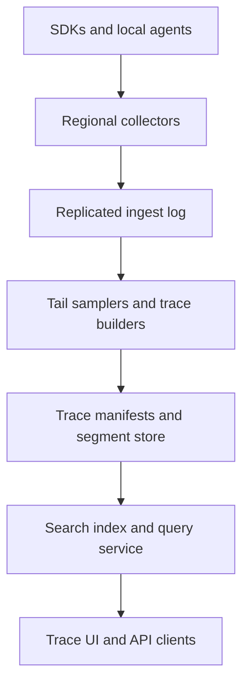

# System Design Interview Practice: Global Distributed Tracing Platform

**Difficulty:** Senior / Staff  
**Primary themes:** high-throughput telemetry ingestion, distributed queues, tail-based sampling, time-series and columnar storage, inverted indexes, caching, backpressure, multi-region reliability, eventual consistency, privacy, and cost control  
**Interview time budget:** about 45 minutes  
**Educational walkthrough:** intentionally more detailed than what you would say in 45 minutes

This walkthrough uses the public [Hello Interview delivery framework](https://www.hellointerview.com/learn/system-design/in-a-hurry/delivery): clarify requirements, identify core entities, define interfaces, build the simplest complete design operation by operation, and then harden the load-bearing decisions. It also follows Hello Interview's guidance that core entities should precede a detailed schema and that public APIs should stay practical rather than consuming the interview ([API design](https://www.hellointerview.com/learn/system-design/core-concepts/api-design), [data modeling](https://www.hellointerview.com/learn/system-design/core-concepts/data-modeling)). The prompt, assumptions, dialogue, calculations, architecture, and tradeoffs below are original.

---

## Interviewer prompt

> Design a multi-tenant distributed tracing platform similar in product shape to Jaeger, Zipkin, or a managed cloud tracing service. Applications emit spans from thousands of services across many regions. Engineers should be able to find a trace by ID, search traces by service, operation, time, duration, status, and selected attributes, inspect the end-to-end critical path, and configure head or tail sampling. The platform must absorb traffic bursts without slowing production applications, protect sensitive data, and control storage cost.

## Targeted clarifying questions with assumed interviewer answers

**Candidate:** “Should the platform provide instrumentation libraries, or can I assume applications emit a standard protocol?”

**Interviewer:** “Assume applications use OpenTelemetry-compatible SDKs and send OTLP over gRPC or HTTP to local agents or regional collectors. Design the managed ingestion, processing, storage, query, and sampling platform.”

**Candidate:** “What is the scale?”

**Interviewer:** “At peak, receive 50 million spans per second globally. A normal trace has 20 spans, but some have thousands. The average compressed span is 500 bytes before storage overhead. There are 10,000 tenants and several million distinct services and operations.”

**Candidate:** “Do we retain every span?”

**Interviewer:** “No. Tenants configure sampling and retention. A typical tenant keeps 5% of ordinary traces, 100% of errors, and 100% of traces slower than a threshold. Unsampled data may be dropped after the tail-sampling decision. Retain searchable trace data for 7 days by default and archived trace blobs for up to 30 days.”

**Candidate:** “What query latency is expected?”

**Interviewer:** “Trace-by-ID should be under 2 seconds at p99 for recent retained traces. Common searches over the last hour should return the first page in under 5 seconds at p99. Queries over days may take up to 30 seconds.”

**Candidate:** “How quickly should a completed trace become searchable?”

**Interviewer:** “Within 30 seconds at p99 after its sampling decision. Trace-by-ID may become available sooner than secondary search indexes.”

**Candidate:** “What availability do we need?”

**Interviewer:** “Ingestion should be 99.99% available and must never create backpressure that takes down an application. Query availability can be 99.9%. Losing a small amount of best-effort telemetry during a region-wide disaster is acceptable, but acknowledged spans within a healthy region should survive an availability-zone failure.”

**Candidate:** “What ordering and completeness guarantees exist?”

**Interviewer:** “Spans can arrive late, out of order, duplicated, or never arrive. A trace is not a transaction. The UI must expose whether a trace may be incomplete. Within a trace, parent/child IDs and timestamps define the graph; transport arrival order is irrelevant.”

**Candidate:** “How long can tail sampling wait for late spans?”

**Interviewer:** “Use a configurable decision window, 30 seconds by default and up to two minutes for selected tenants. Extremely late spans may be attached later to retained traces but must not silently reverse a final drop decision.”

**Candidate:** “Which attributes are searchable?”

**Interviewer:** “Service, operation, status, duration, region, deployment version, and explicitly allowlisted attributes. Do not index every arbitrary tag by default; cardinality and sensitive data are major concerns.”

**Candidate:** “Should searches be strongly consistent?”

**Interviewer:** “No. Ingestion acknowledgement means durable acceptance, not immediate searchability. Search is eventually consistent within the 30-second objective. Trace-by-ID should provide monotonic reads once the trace is visible.”

**Candidate:** “What privacy controls matter?”

**Interviewer:** “Tenant isolation, encryption, residency, attribute allowlists, redaction, deletion, access audit, and retention enforcement. Raw request bodies, authorization headers, and secrets must never be indexed.”

**Candidate:** “Do we need live streaming in the UI?”

**Interviewer:** “A tenant may watch recent matching traces, but it is optional. Prioritize durable ingestion, sampling, storage, and search.”

### What I would say aloud

> “I’ll separate the write-optimized telemetry plane from the query plane. Local agents batch and shed safely, regional collectors durably append spans to a partitioned log, and stateful processors group spans by trace for tail sampling. Retained traces are compacted into immutable trace blobs, while a controlled secondary index supports search. Trace-by-ID is the authoritative read path; search is an eventually consistent projection. I’ll deep-dive on tail sampling under late and out-of-order arrival, high-cardinality indexing and storage, and overload plus multi-region reliability.”

---

## 1. Requirements (~5 minutes)

### Core functional requirements

1. **Ingest spans without harming applications.** Accept batched OpenTelemetry spans through local agents and regional collectors, validate tenant identity and quotas, durably buffer accepted data, and tolerate duplicates, late arrival, and partial traces.
2. **Make policy-driven sampling decisions and retain traces.** Support deterministic head sampling plus stateful tail rules such as keep errors, keep high latency, keep selected customers, and probabilistically sample the remainder.
3. **Retrieve and search traces.** Fetch a retained trace by ID and search by bounded indexed dimensions, time, duration, and status; reconstruct its span graph and critical path while exposing completeness and sampling metadata.

### Quantified non-functional requirements

| Requirement | Target | Concrete design consequence |
|---|---:|---|
| Peak ingestion | 50 million spans/s globally | Regional collectors, batching, partitioned durable logs, zero synchronous indexing on the ingest path. |
| Average compressed ingress | 500 bytes/span | About 25 GB/s or 200 Gb/s globally before replication; traffic must remain regional and horizontally partitioned. |
| Typical sampling | 5% ordinary plus all errors/slow traces | Tail samplers need bounded per-trace state; storage must be sized by retained bytes, not raw span count alone. |
| Ingest availability | 99.99% | Stateless collector fleets across AZs, local bounded spools, quorum-replicated logs, explicit load-shedding contract. |
| Query availability | 99.9% | Replicated indexes and trace blobs; degrade advanced search before trace-by-ID. |
| Trace-by-ID latency | p99 < 2 s for recent retained traces | Digest-like direct routing by tenant and trace ID; no full index scan. |
| Common search latency | p99 < 5 s for first page over one hour | Time-partitioned indexes, selective dimensions, pruning metadata, result limits, and caching. |
| Search freshness | p99 ≤ 30 s after sampling decision | Asynchronous index pipeline with measurable watermarks. |
| Durability | Accepted spans survive one AZ loss | Three-AZ replicated log before acknowledgement; downstream stores are replayable. |
| Default retention | 7 days searchable, 30 days archive | Hot/warm columnar storage, immutable object archive, lifecycle deletion, and encryption-key retirement. |
| Tenant isolation | No cross-tenant data or timing leakage | Auth-derived tenant scope, tenant-prefixed partitions and keys, per-tenant quotas, audited authorization. |

### Scope

**In scope**

- OTLP-compatible batch ingestion through agents and collectors.
- Tenant authentication, quotas, redaction, attribute normalization, and schema limits.
- Head sampling metadata and tail-based sampling.
- Durable buffering, deduplication, late spans, and partial traces.
- Trace-by-ID storage, secondary search indexes, pagination, caching, and archive.
- Multi-region routing, availability-zone failure, region disaster policy, backpressure, and load shedding.
- Retention, deletion, residency, encryption, audit, and observability.

**Out of scope**

- Implementing language-specific instrumentation or automatic bytecode injection.
- Metrics and log storage, except derived service-health aggregates used to operate the tracing platform.
- Full application performance management, incident management, or alerting products.
- Arbitrary SQL over all span attributes.
- Guaranteeing that an application emitted every span.
- Exactly-once span transport or globally ordered telemetry.

### Consistency and availability contract

The platform uses different contracts for different paths:

1. **Ingestion acknowledgement:** an accepted batch is durably replicated within the ingest region. It may still be dropped later by the tenant's sampling policy. A retry may create duplicates; stable span identity makes processing idempotent.
2. **Tail-sampling decision:** final and monotonic for a `(tenant_id, trace_id, policy_version)`. `KEEP` or `DROP` is recorded with a decision epoch. A late span cannot flip a final `DROP` into `KEEP`; policies that need longer evidence must use a longer decision window.
3. **Trace-by-ID:** once a retained trace version is visible, later reads are monotonic. Late spans may produce a higher trace revision, never rewrite the same immutable revision.
4. **Secondary search:** eventually consistent. Each result includes an index watermark and trace revision. A trace may be retrievable by ID before it appears in search.
5. **Deletion:** authorization denial and query invisibility must propagate within five minutes; physical object erasure may finish asynchronously within the retention/deletion SLO.

During overload, the platform preserves application health over telemetry completeness. Agents may drop low-priority spans after bounded buffering, collectors may reject over-quota tenants with retry hints, and the system records loss counters. It must not silently claim complete observability.

### What I would say aloud

> “The core semantic boundary is that accepted does not mean retained or immediately searchable. It means durably buffered for the sampling pipeline. Search is a projection with a watermark, while trace-by-ID is the authoritative retained representation. Under overload, we lose declared telemetry before we endanger production traffic.”

---

## 2. Core entities (~2 minutes)

Start with the nouns; introduce fields as components require them.

| Entity | Purpose | Important fields introduced later |
|---|---|---|
| `Tenant` | Isolation, quota, residency, and retention boundary | `tenant_id`, `home_regions`, `quota_profile`, `encryption_key_ref` |
| `Span` | One timed operation in a distributed request | `trace_id`, `span_id`, `parent_span_id`, `start_ns`, `duration_ns`, `status`, `attributes` |
| `Trace` | Graph of related spans | `tenant_id`, `trace_id`, `revision`, `root_service`, `start_time`, `duration`, `completeness` |
| `IngestBatch` | Retry and acknowledgement unit from an agent | `batch_id`, `agent_id`, `sequence`, `compressed_bytes`, `received_at` |
| `SamplingPolicy` | Versioned head/tail decision rules | `policy_id`, `version`, `rules`, `decision_window`, `effective_at` |
| `SamplingDecision` | Final outcome for one trace under one policy | `trace_id`, `policy_version`, `decision`, `reason`, `decision_epoch`, `decided_at` |
| `TraceManifest` | Immutable metadata pointing to span segments | `trace_id`, `revision`, `segment_refs`, `span_count`, `checksum`, `index_state` |
| `IndexDocument` | Controlled searchable projection | `trace_id`, `revision`, `service_set`, `operation_set`, `status`, `duration`, `indexed_attributes` |
| `QueryCursor` | Stable continuation state | `query_hash`, `index_snapshot`, `last_sort_key`, `expires_at` |
| `DeletionTombstone` | Deny and cleanup state | `tenant_id`, `subject`, `tombstone_epoch`, `requested_at`, `purge_state` |

The key separation is `TraceManifest` versus `IndexDocument`. The manifest is the authoritative retained trace locator. The index document is a rebuildable projection optimized for finding trace IDs. If they disagree, trace-by-ID follows the manifest and repair rebuilds the index.

### What I would say aloud

> “A span is an event; a trace is a graph assembled from events. The retained trace manifest is authoritative, while search indexes are projections. That lets me acknowledge and store safely without coupling ingestion correctness to an expensive distributed index update.”

---

## 3. API and system interface (~5 minutes)

External telemetry uses OTLP-compatible gRPC or HTTP. Product queries use REST for clarity. Internal processor and storage calls may use gRPC. Identity comes from mTLS workload identity or an API token at the agent/collector boundary; clients never provide an authoritative `tenant_id` in a span attribute.

### Export a batch of spans

Conceptually, the OpenTelemetry-compatible call is:

```proto
rpc Export(ExportTraceServiceRequest) returns (ExportTraceServiceResponse);
```

Transport metadata:

```text
authorization: Bearer <agent-token>
x-agent-id: agent_us_east_1_1842
x-batch-id: 01K9...
x-agent-sequence: 88142
content-encoding: zstd
```

Simplified payload:

```json
{
  "resource_spans": [
    {
      "resource": {
        "service.name": "checkout",
        "deployment.environment": "prod",
        "cloud.region": "us-east-1"
      },
      "spans": [
        {
          "trace_id": "4bf92f3577b34da6a3ce929d0e0e4736",
          "span_id": "00f067aa0ba902b7",
          "parent_span_id": "",
          "name": "POST /checkout",
          "start_time_unix_nano": "1793328000000000000",
          "end_time_unix_nano": "1793328000240000000",
          "status": "ERROR",
          "attributes": {
            "http.route": "/checkout",
            "deployment.version": "2026.10.30",
            "customer.tier": "enterprise"
          }
        }
      ]
    }
  ]
}
```

Response:

```json
{
  "accepted_spans": 512,
  "rejected_spans": 3,
  "partial_success": {
    "reason": "ATTRIBUTE_LIMIT_EXCEEDED"
  },
  "collector_watermark": "ingest:use1:8843912"
}
```

The collector authenticates the agent, derives the tenant, validates timestamps and limits, applies redaction, and acknowledges only after the batch is replicated to the regional log. Partial rejection is explicit so SDKs and agents can count loss without retrying permanently invalid spans.

### Put a versioned sampling policy

```http
PUT /v1/projects/payments/sampling-policy
Authorization: Bearer <admin-token>
If-Match: "policy-revision:41"
Content-Type: application/json

{
  "head_probability": 0.10,
  "decision_window_seconds": 30,
  "tail_rules": [
    {"name": "keep-errors", "when": {"status": "ERROR"}, "action": "KEEP"},
    {"name": "keep-slow", "when": {"duration_ms_gte": 1500}, "action": "KEEP"},
    {
      "name": "keep-enterprise",
      "when": {"attribute": "customer.tier", "in": ["enterprise"]},
      "action": "KEEP"
    }
  ],
  "default_tail_probability": 0.05
}
```

Response:

```json
{
  "policy_id": "sp_72",
  "version": 42,
  "effective_at": "2026-10-30T04:05:00Z",
  "config_etag": "policy-revision:42"
}
```

Conditional update prevents two administrators from silently overwriting policy. Agents receive compact signed head-sampling configuration; collectors stamp the effective tail policy version onto accepted spans.

### Get a trace by ID

```http
GET /v1/projects/payments/traces/4bf92f3577b34da6a3ce929d0e0e4736
Authorization: Bearer <reader-token>
```

Response:

```json
{
  "trace_id": "4bf92f3577b34da6a3ce929d0e0e4736",
  "revision": 3,
  "start_time": "2026-10-30T04:00:00Z",
  "duration_ms": 1842,
  "span_count": 47,
  "completeness": {
    "state": "LATE_SPANS_POSSIBLE",
    "decision_window_closed": true,
    "last_span_received_at": "2026-10-30T04:00:34Z"
  },
  "sampling": {
    "policy_version": 42,
    "decision": "KEEP",
    "reason": "keep-errors"
  },
  "spans": ["..."],
  "critical_path_span_ids": ["..."],
  "index_state": "INDEXED"
}
```

Authorization is checked against the authenticated principal's project grants and policy version. A cache key includes `(tenant_id, trace_id, revision, authz_class)`; private results are never globally cached by trace ID alone.

### Search traces

```http
POST /v1/projects/payments/trace-searches
Authorization: Bearer <reader-token>
Content-Type: application/json

{
  "time_range": {
    "start": "2026-10-30T03:00:00Z",
    "end": "2026-10-30T04:00:00Z"
  },
  "filter": {
    "service": "checkout",
    "operation": "POST /checkout",
    "status": "ERROR",
    "duration_ms_gte": 1000,
    "attributes": {
      "deployment.version": "2026.10.30"
    }
  },
  "sort": [{"field": "start_time", "direction": "desc"}],
  "limit": 100
}
```

Response:

```json
{
  "results": [
    {
      "trace_id": "4bf92f3577b34da6a3ce929d0e0e4736",
      "revision": 3,
      "start_time": "2026-10-30T04:00:00Z",
      "duration_ms": 1842,
      "root_service": "checkout",
      "status": "ERROR",
      "matched_services": ["checkout", "payments"]
    }
  ],
  "next_cursor": "opaque:...",
  "index_watermark": "2026-10-30T03:59:42Z",
  "partial": false
}
```

Use a POST resource because the filter can be structured and sensitive. The cursor pins an index snapshot and last sort key; it is not an offset, which would become slow and unstable as new traces arrive.

### Request deletion

```http
POST /v1/projects/payments/deletion-requests
Authorization: Bearer <privacy-admin-token>
Idempotency-Key: del_01K9...

{
  "selector": {
    "attribute": "end_user.id_hash",
    "value": "sha256:..."
  },
  "reason": "USER_ERASURE"
}
```

The selector is restricted to privacy-indexed fields; arbitrary full scans are not offered synchronously. The response returns a durable job ID and a tombstone epoch that query tiers must honor before physical purge completes.

### Interface-to-requirement mapping

| Functional requirement | Primary interface |
|---|---|
| Ingest spans | OTLP `Export` batch call with auth-derived tenancy and explicit partial success |
| Configure retention/sampling | Conditional sampling-policy resource |
| Retrieve and search | Trace GET and structured search resource with watermark/cursor |
| Privacy and lifecycle | Deletion-request resource and status lookup |

### What I would say aloud

> “The write interface is a batched standard telemetry protocol, not one HTTP request per span. Query APIs expose the consistency boundary: trace-by-ID returns an authoritative revision, while search returns an index watermark. Tenant identity always comes from credentials, never from untrusted span tags.”

---

## 4. Data flow

### Ingestion and sampling flow

1. Instrumented processes create spans and send them to a node-local or sidecar agent.
2. The agent applies signed head-sampling rules, redacts known sensitive attributes, batches, compresses, and writes temporarily to a bounded disk spool when the network is unavailable.
3. A regional collector authenticates the agent, derives the tenant, enforces byte/span/attribute quotas, normalizes resource attributes, and rejects malformed spans.
4. The collector appends the accepted batch to a three-AZ replicated ingest log partitioned by `(tenant_id, hash(trace_id))`; only then does it acknowledge.
5. Tail-sampling workers consume partitions so all spans for a trace reach one logical state owner. They deduplicate span IDs, maintain bounded state, evaluate early-keep rules, and wait until the decision deadline.
6. On `KEEP`, workers emit the trace's spans plus the sampling decision to a retained-trace stream. On `DROP`, they persist a compact decision record and discard buffered span bodies.
7. Trace builders sort and validate spans, compute summary fields and critical-path hints, write immutable trace segments to object/columnar storage, and commit a `TraceManifest` revision.
8. An outbox/change stream publishes the committed manifest to indexers, which create controlled search documents and advance per-shard watermarks.

### Query flow

1. The gateway authenticates the user and resolves tenant/project authorization.
2. Trace-by-ID hashes `(tenant_id, trace_id)` to a manifest shard, checks tombstones, and loads the latest visible revision.
3. Segment reads are coalesced and cached; the query service reconstructs the graph, flags missing parents/cycles, computes or loads the critical path, and returns the trace.
4. Search validates the filter against the allowlisted index schema, selects time and tenant shards, prunes segments using metadata, and fans out bounded subqueries.
5. Coordinators merge top results, enforce time/scan budgets, and return trace summaries, a stable cursor, an index watermark, and a `partial` flag.
6. Opening a result follows trace-by-ID, so stale index summaries cannot fabricate trace content.

### Deletion and retention flow

1. A privacy request commits a tombstone before asynchronous physical deletion.
2. Query gateways and caches reject matches at or below the tombstone epoch.
3. A durable job resolves affected trace IDs from privacy indexes, deletes index documents, writes new denied manifests or erasure markers, and purges hot/warm segments.
4. Archive lifecycle workers remove object segments and cryptographic references; legal holds override physical removal but not necessarily user-visible access.
5. Reconciliation proves completion across manifests, indexes, caches, archive inventories, and derived datasets.

---

## 5. High-level design (~10–15 minutes)

Build one complete path before adding optimizations.



### Operation 1: safely accept spans

Start with an agent and regional collector rather than sending every application span directly to a global endpoint.

The agent provides:

- connection reuse and batching;
- zstd or gzip compression;
- signed head-sampling configuration;
- attribute redaction and size limits;
- a bounded memory/disk queue;
- retry with jitter;
- explicit counters for dropped spans and bytes.

The collector is stateless except for short-lived connection and batch-dedup caches. It authenticates the agent through mTLS workload identity or an API token, then derives:

```text
tenant_id, project_id, allowed_regions, quota_profile, redaction_policy_version
```

Each accepted span is normalized into an envelope:

```text
tenant_id, project_id, trace_id, span_id, parent_span_id,
start_ns, end_ns, service_id, operation_id, status,
normalized_attributes, policy_version, received_at,
agent_id, batch_id, source_region
```

Invalid timestamps, negative duration, excessive attributes, oversized events, disallowed attribute keys, and invalid IDs are rejected before the durable log. Sensitive known keys such as `authorization`, `cookie`, `db.statement`, and request bodies are dropped or transformed according to policy.

Collectors append batches to a replicated log. The partition key is:

```text
tenant_id || hash(trace_id)
```

This ensures all spans for a trace are ordered within one partition while distributing a tenant's traces. There is no useful global order. Large tenants receive multiple virtual partitions; a directory maps virtual partitions to physical log partitions.

Acknowledgement occurs after quorum replication across three availability zones. If the same `batch_id` is retried, duplicate spans may still reach the log after cache eviction, so downstream deduplication uses `(tenant_id, trace_id, span_id)` rather than relying on exactly-once transport.

### Operation 2: group spans and make a tail decision

Tail sampling needs evidence from across the trace. A stateful sampler consumes one or more trace partitions and maintains:

```text
TraceState(
  tenant_id, trace_id, policy_version,
  first_seen_at, max_observed_end_time, decision_deadline,
  span_ids, error_seen, root_seen, max_duration_hint,
  matched_rule_bits, buffered_segment_refs, bytes_buffered,
  decision, decision_epoch
)
```

Do not keep every span body in heap memory. Write span bodies into append-only local/state-store segments and keep compact summaries in memory. The state backend checkpoints to replicated storage so another worker can restore after failure.

Decision logic:

1. If a monotonic keep rule fires—such as any span has `ERROR`—record `KEEP` early and stream later spans directly to retained processing.
2. If the rule needs end-to-end duration or root completion, wait for a root span plus grace period or the decision deadline.
3. At the deadline, evaluate the pinned policy version and deterministic probability using a hash of `(tenant_id, trace_id, policy_version)`.
4. Persist the final decision before releasing buffered state.
5. `KEEP` emits buffered spans; `DROP` emits only a compact decision/audit record.

Deterministic probability prevents different workers from making different retry decisions.

### Operation 3: build and commit a retained trace

The builder consumes kept spans and groups them by trace until a finalize deadline. It:

- deduplicates by span ID and deterministic conflict rule;
- sorts by start time for storage locality, not semantics;
- validates parent references and detects cycles;
- computes trace start/end, root candidates, service set, error state, and duration;
- computes critical-path hints;
- writes compressed immutable span segments;
- commits a manifest only after every segment is durable.

A manifest might contain:

```text
tenant_id, trace_id, revision, policy_version, decision_reason,
trace_start, trace_end, span_count, service_set, status_summary,
segment_refs[], segment_checksums[], completeness_state,
last_span_received_at, created_at, tombstone_epoch
```

Use a strongly consistent metadata store partitioned by `(tenant_id, hash(trace_id))` for latest manifest pointers and revisions. Span bodies live in cheap columnar/object storage. The manifest transaction also writes an outbox event:

```sql
BEGIN;
  INSERT trace_manifests (..., revision = :next_revision, ...);
  UPDATE trace_heads
     SET latest_revision = :next_revision
   WHERE tenant_id = :tenant AND trace_id = :trace
     AND latest_revision = :expected_revision;
  INSERT outbox(event_id, tenant_id, trace_id, revision, payload);
COMMIT;
```

If late spans arrive after revision 1, the builder can create revision 2 until the late-span horizon closes. Revisions are immutable; caches and indexes use the revision in their keys.

### Operation 4: retrieve by trace ID

Trace-by-ID does not need the search index. Hashing tenant and trace ID finds the manifest shard. The service reads the latest allowed revision, checks deletion tombstones and authorization, then fetches segment ranges in parallel.

Use two cache layers:

- metadata cache for `trace_head` and manifest, seconds to minutes;
- compressed segment cache for recently viewed traces, keyed by tenant, trace, revision, and segment checksum.

Negative caching is short because a trace may still be in the sampling or indexing pipeline. Cache `NOT_FOUND_FINAL` longer only after the maximum late/retention horizon proves it cannot appear.

The UI reconstruction is defensive. Missing parents do not reject the trace; they create orphan roots and mark completeness. Clock skew can make a child appear outside its parent interval, so critical-path analysis should use causal edges plus bounded clock-skew correction rather than blindly summing wall-clock durations.

### Operation 5: build controlled search indexes

An indexer consumes manifest outbox events. It loads summary metadata and creates one trace-level search document, not one global document for every arbitrary span attribute.

Default indexed fields:

```text
tenant_id, time_bucket, trace_id, revision,
trace_start, duration, status,
root_service, root_operation,
service_ids[], operation_ids[], region_ids[], deployment_versions[],
allowlisted_attribute_pairs[], tombstone_epoch
```

Partition physically by tenant class and time bucket, then shard large tenants further by hash. Time partitioning lets retention drop whole segments and lets common queries prune old data.

The index can be an inverted-index engine or a purpose-built columnar store with bitmap/posting indexes. Large text search is not required; exact and range filters dominate. Store postings for selective fields and min/max plus Bloom filters per immutable segment. A query planner chooses the most selective postings and intersects them before loading summaries.

Indexing every key/value pair would create unbounded cost and privacy risk. Tenants explicitly register searchable attributes with type, cardinality budget, redaction class, and effective time. High-cardinality values may use a hash index for exact equality but not aggregations.

### Operation 6: search and paginate

The query coordinator:

1. authorizes the filter fields;
2. converts time range to index partitions;
3. obtains an index snapshot/watermark;
4. sends bounded subqueries to relevant shards;
5. merges top results by `(start_time, trace_id)`;
6. returns a signed cursor containing snapshot and last sort key.

Avoid offset pagination. New traces arriving between pages would shift offsets and create duplicates or misses. A cursor pins a stable snapshot, expires quickly, and contains no plaintext sensitive filter values.

Queries have budgets:

```text
max time range, max shards, max posting bytes,
max candidate traces, max wall time, max returned rows
```

If a budget expires, return partial results plus failed shard IDs and the watermark rather than pretending completeness. Common dashboard queries may be cached by `(tenant, authz_class, normalized_query_hash, time_bucket, watermark)`.

### Operation 7: lifecycle and multi-region operation

Each tenant has one or more permitted ingest regions. Agents choose the nearest healthy region from signed configuration. A trace should normally stay in one region; cross-region trace fragments are possible when services run globally.

Two options exist:

- **Route all spans by trace ID to a home region:** simplifies tail sampling but adds cross-region latency and egress to production telemetry.
- **Sample regionally and merge summaries globally:** preserves locality but can make inconsistent decisions when a trace spans regions.

Choose a hybrid. The SDK propagates a `trace_home_region` in trace state. Agents send locally, regional collectors durably ingest, and the log router forwards cross-home spans asynchronously to the trace's home sampling region. If the home region is unavailable, a fenced failover epoch assigns a backup. During partition ambiguity, conservative policy may `KEEP` in both regions and deduplicate later; duplicate retention costs money but is safer than losing an error trace.

Hot searchable data is replicated across AZs within its region. Cross-region disaster replicas may lag. Immutable trace segments archive to residency-approved object storage. Query traffic normally stays within the tenant's data boundary.

### Scale estimates that change the design

At 50 million spans/s and 500 compressed bytes/span:

```text
50,000,000 × 500 bytes = 25 GB/s ingress
25 GB/s × 8 = 200 Gb/s
```

With three-AZ replication, internal log write traffic is roughly 75 GB/s before protocol overhead. This rules out a single global ingestion cluster and synchronous per-span database writes. Regional batching and partitioned logs are mandatory.

Raw daily volume would be:

```text
25 GB/s × 86,400 s ≈ 2.16 PB/day
```

If 5% of ordinary traffic is retained and errors/slow traces raise effective retention to 8%:

```text
2.16 PB/day × 8% ≈ 173 TB/day of compressed span payload
```

Adding indexes, manifests, replication, and storage encoding could make hot logical footprint 1.5–2.5 times payload. Seven searchable days therefore require multiple petabytes. Sampling and index discipline are product requirements, not afterthoughts.

At 20 spans per normal trace:

```text
50,000,000 / 20 = 2.5 million new traces/s
```

With a 30-second tail window:

```text
2.5 million × 30 ≈ 75 million concurrently open traces globally
```

If compact sampler metadata averages 300 bytes per open trace:

```text
75 million × 300 bytes ≈ 22.5 GB
```

That metadata is manageable across a large stateful fleet, but buffering every 500-byte span plus storage overhead in heap is not. Spill span bodies to append-only state segments and keep only summaries in memory.

A tenant with a 10,000-span trace can create a hot key. At 500 bytes per span, one trace is 5 MB before overhead—not huge—but thousands of concurrent giant traces can skew one partition. Detect heavy traces and split body storage by `(trace_id, segment_no)` while keeping a single ordered decision owner for compact state.

### What I would say aloud

> “The arithmetic gives me three non-negotiable choices: regional ingestion, durable partitioned logs, and aggressive policy-driven retention. Seventy-five million open tail-sampling states are feasible if state is compact, but not if every span body lives in heap. I therefore separate decision summaries from append-only body segments.”

---

## 6. Deep dives (~10–15 minutes)

In a live interview, choose two based on the interviewer's signals. Three are included here for study.

### Deep dive A: correct tail sampling with late, missing, duplicate, and cross-region spans

#### Where the baseline breaks

A naive sampler waits until it sees a root span end, evaluates the trace, and drops state. That fails because the root may arrive first, child errors may arrive later, spans can be duplicated, clocks differ, and globally distributed services may send fragments through different regions. Waiting forever is impossible; deciding too early loses the very anomalies tail sampling exists to preserve.

#### Plausible approaches

| Approach | Benefit | Failure or tradeoff |
|---|---|---|
| Head sampling in SDK only | No server-side trace state; cheap | Cannot keep a trace because a later span errored or was slow. |
| Wait for root span completion | Low average delay | Root arrival does not prove all descendants arrived. |
| Fixed inactivity timeout | Adapts somewhat to trace length | Chatty traces extend state; sparse late spans still miss. |
| Fixed decision deadline from first seen | Bounded state and predictable cost | Some long traces are decided incomplete. |
| Completion protocol from every service | Better completeness evidence | Impractical in dynamic distributed call graphs. |
| Hybrid early-keep plus bounded deadline | Saves obvious errors early and bounds state | Must expose incompleteness and late-span policy. |

#### Selection

Use hybrid early-keep plus a bounded deadline. Stamp every span with the policy version selected at acceptance. Compact state tracks monotonic evidence:

```text
error_seen, selected_attribute_seen, root_seen,
max_observed_end, span_count, service_set,
decision_deadline, bytes_buffered
```

Rules are classified:

- **monotonic keep:** once true, always true—error, security marker, selected customer. Decide `KEEP` immediately.
- **deadline keep/drop:** latency threshold, span count, or default probability. Evaluate at root-plus-grace or deadline.
- **unsupported non-monotonic rule:** anything whose truth can be invalidated by later spans. Reject or define exact deadline semantics.

The final decision record uses conditional creation:

```text
key: tenant_id + trace_id + policy_version
value: decision, reason, decision_epoch, owner_term, decided_at
```

Only the current fenced owner term can commit. After commit, redelivery returns the same decision.

#### Late spans

Late span behavior is explicit:

- after `KEEP`: append to a new immutable trace revision until the late-span horizon expires;
- after `DROP`: discard body and increment `late_after_drop`; do not reverse the decision;
- before final decision but after worker migration: restore state from checkpoint and deduplicate by span ID;
- after retention expiry: reject or count without resurrecting the trace.

Why not reverse `DROP`? Reversal requires the platform to retain all dropped bodies or retrieve them from nowhere. It also makes cost and query semantics unpredictable. A tenant needing stronger capture increases the decision window or uses head keep for critical traffic.

#### Cross-region traces

The propagated trace context includes a home-region hint and sampling seed. Regional collectors never trust arbitrary region values without validating the signed/structured context and tenant policy.

If a non-home region receives a span:

1. durably accept locally;
2. asynchronously forward to the home region with the original stable span ID;
3. retain locally until home acknowledgement or forwarding TTL;
4. on home failure, consult a strongly consistent failover epoch;
5. fence the old owner before the backup decides.

When fencing cannot be established quickly, duplicate `KEEP` is safer than conflicting drop. Builders later deduplicate by trace/span identity.

#### Memory and skew protection

- Cap spans, attributes, and buffered bytes per trace.
- On limit, apply policy: force keep with truncation, force drop, or preserve only summaries.
- Detect hot trace IDs and isolate them from ordinary partitions.
- Use hierarchical timing wheels for millions of deadlines rather than one timer per trace.
- Checkpoint state incrementally; do not synchronously snapshot an entire partition on every span.

#### Failure modes and observability

| Failure | Behavior | Signal |
|---|---|---|
| Sampler crashes before decision | Log redelivers; restore checkpoint; stable IDs deduplicate | restoration time and replay lag |
| Crash after decision before output | Decision store returns final outcome; outbox/reconciler republishes kept trace | decision-without-output count |
| Duplicate spans | Upsert by span ID; deterministic winner on payload conflict | duplicate and conflicting-span rate |
| Root never arrives | Decide at deadline and mark missing root | traces without root by service |
| Late error after drop | Count and discard under explicit contract | `late_error_after_drop` rate |
| Home region partition | Fenced failover or conservative duplicate keep | cross-region forward lag and dual-keep rate |
| Giant trace | Segment bodies, cap state, mark truncated | truncated traces and hot-key bytes |

Track decision latency, open traces, bytes buffered, checkpoint age, rule match rates, dropped-versus-kept bytes, late spans by lateness bucket, and estimated sampling bias. Sampling correctness needs synthetic traces with deliberately reordered, duplicated, missing, and cross-region spans.

### Deep dive B: searchable storage without a cardinality or cost explosion

#### Where the baseline breaks

The simplest design writes every span into a search engine and indexes every attribute. At 50 million spans/s, this creates enormous write amplification. User IDs, URLs, SQL statements, UUIDs, and error messages produce billions of terms. Sensitive values become searchable by accident, retention deletes become expensive, and one tenant can destabilize a shared cluster.

#### Plausible approaches

| Approach | Benefit | Failure or tradeoff |
|---|---|---|
| Search engine document per span | Flexible span-level queries | Extreme indexing cost and cross-span trace assembly. |
| Search engine document per trace | Lower document count; natural result unit | Must summarize multi-valued span fields and handle revisions. |
| Columnar scan only | Cheap storage and flexible analytics | Slow interactive search without aggressive pruning. |
| Trace index plus immutable span segments | Fast discovery and cheap bodies | Two stores and eventual-consistency repair. |

#### Selection

Use one controlled index document per retained trace plus immutable compressed span segments. Search returns trace IDs and summaries; trace-by-ID loads authoritative bodies.

Why trace-level indexing works:

- the product result is a trace, not an isolated span;
- repeated service/operation values compress well as sets or dictionary IDs;
- one revision event updates one trace document;
- retention and deletion operate on trace identity;
- search cost follows retained traces, not all raw spans.

#### Attribute governance

Each tenant registers an index definition:

```text
attribute_name, type, match_modes,
cardinality_budget, sensitive_class,
retention, effective_at, status
```

The platform validates values during ingestion but only indexers materialize approved fields. Controls include:

- exact equality for high-cardinality hashes;
- range indexes only for numeric fields;
- prefix/full-text disabled unless explicitly supported;
- per-tenant term and posting-byte budgets;
- top-cardinality reports and automatic quarantine of runaway fields;
- tokenization or irreversible hashing for privacy selectors;
- separate encryption and access policy for sensitive searchable attributes.

Do not silently start indexing a newly seen key. Schema-on-read for bodies is acceptable; indexing is schema-on-write and governed.

#### Physical layout

Store immutable span segments in object or columnar storage sorted approximately by:

```text
tenant_id, time_bucket, hash(trace_id), trace_id, span_start
```

Use dictionary encoding for service/operation/attribute keys, delta encoding for timestamps, and compression for repeated resource attributes. Separate large events/stack traces into optional side blobs so ordinary trace reads do not pay their cost.

Index partitions use:

```text
tenant_group, hour_or_day_bucket, shard_id, generation
```

Immutable segments have min/max times, service dictionaries, Bloom filters, posting statistics, and tombstone epochs. Background compaction merges small segments and applies deletions. Do not compact so aggressively that it competes with fresh indexing; use separate resource pools and debt budgets.

#### Query planning

Estimate selectivity from segment statistics:

1. prune by tenant and time;
2. choose the rarest indexed predicate, such as `status=ERROR` plus service;
3. intersect postings or bitmaps;
4. apply duration range and remaining filters;
5. fetch only trace summaries for top candidates;
6. stop after the page plus safety margin.

Queries with no selective predicate over a long range are asynchronous jobs or rejected with guidance. An interactive tracing system should not promise arbitrary scans over petabytes.

#### Revisions and consistency

Index keys include `(tenant_id, trace_id)`, and the document carries `revision`. An indexer applies only a revision greater than the current one. Search may return revision 2 while the manifest head is revision 3; opening the trace loads revision 3. Repair consumers compare manifest and index revision watermarks.

An index watermark means: all eligible manifest events with event time at or before `W` have been applied for the listed shards. Watermarks are not based only on wall-clock time; they account for partition offsets and known gaps.

#### Caching

Good cache candidates:

- service/operation dictionaries and index schemas;
- recent trace manifests and compressed segments;
- normalized frequent queries for closed time buckets;
- posting lists for very common, bounded recent filters.

Poor cache candidates:

- arbitrary user query results over a moving “last 15 minutes” window;
- authorization decisions without policy version and expiry;
- negative trace lookups during the freshness window;
- raw sensitive attributes in a shared cache.

#### Failure modes and observability

| Failure | Behavior | Signal |
|---|---|---|
| Index pipeline lags | Trace-by-ID remains available; search watermark exposes lag | index lag by tenant/shard |
| Index document corrupt | Skip shard/result, mark partial, rebuild from manifests | corrupt segment count |
| Cardinality explosion | Stop materializing offending field, preserve trace body, alert tenant | unique terms and posting bytes |
| Compaction backlog | Query more segments with higher latency; throttle low-priority indexing | compaction debt and segment count |
| Stale index revision | Opening result reads latest manifest; repair catches mismatch | revision gap distribution |
| Tombstone missed | Gateway epoch blocks response; reconciler repairs physical index | tombstone lag and denied stale hits |

### Deep dive C: overload, backpressure, tenant fairness, and multi-region reliability

#### Where the baseline breaks

Telemetry traffic is correlated with incidents. A retry storm or outage can multiply error spans exactly when the platform is degraded. If collectors block application threads, observability becomes a cause of the outage. If every tenant shares FIFO queues, one high-volume customer can delay everyone. If the system drops blindly, it may discard rare errors and retain routine successes.

#### Layered overload contract

Apply pressure in this order:

1. **SDK/agent:** non-blocking bounded queue; batch and compress; drop lowest-priority spans when full; never block critical application work indefinitely.
2. **Collector admission:** per-tenant byte and span token buckets, connection limits, payload limits, and regional capacity guardrails.
3. **Durable log:** partition quotas and reserved capacity for control/tombstone events; reject before quorum saturation.
4. **Sampler:** tenant-weighted fair scheduling by bytes and open-state cost, not message count.
5. **Builder/indexer:** prioritize trace finalization over index freshness; delay archive copies and compaction before manifests.
6. **Query:** concurrency pools, scan budgets, cancellation, and admission queues separated from ingestion.

Every drop/rejection includes a reason counter. Agents export self-observability metrics through a separate low-volume path, so “no traces” is not mistaken for “healthy.”

#### Priority-aware shedding

Head sampling and SDK hints classify:

- forced keep: security, audit, or explicit diagnostic traces;
- error/slow candidates;
- ordinary sampled traces;
- known low-value health checks and background noise.

Agents do not know final tail outcome, so hints cannot be trusted as an authorization mechanism. Collectors validate policy and reserve only bounded capacity for high priority. A malicious tenant cannot mark every span forced keep beyond its quota.

When sampler state is near capacity:

- early-decide monotonic keep traces;
- shorten ordinary decision windows within documented emergency policy;
- reduce default sample probability deterministically;
- preserve error rule capacity;
- truncate excessive events/attributes before dropping entire traces;
- emit a `sampling_degraded` epoch visible in query metadata.

#### Tenant fairness

Use hierarchical quotas:

```text
global -> region -> tenant -> project -> priority class
```

Admission is byte-based because one span can be much larger than another. Sampler fairness also charges open-trace state-seconds to prevent workloads with very long traces from occupying memory cheaply. Allow burst credits but cap sustained debt.

Dedicated partitions or cells isolate the largest tenants. Small tenants share cells with weighted fairness. A cell directory is versioned, cached, and updated through fenced migrations.

#### Regional failure

Normal path stays regional. On AZ loss, replicated logs and metadata quorum continue. On full-region loss:

- agents route new batches to an approved backup region from signed config;
- unacknowledged local spool data retries to backup;
- already acknowledged data depends on asynchronous cross-region disaster replication and may fall under the documented disaster-loss allowance;
- a higher failover term assigns tail-sampling ownership for trace-home ranges;
- old owners are fenced before committing decisions;
- query routers use the newest available manifest/index generation and expose stale watermarks.

Cross-region replication prioritizes sampling decisions and manifests before bulky span segments. A manifest must never claim a segment durable in a disaster region until that segment is actually readable there.

#### Reconciliation

A durable queue is not proof of end-to-end completion. Reconcilers detect:

- accepted log batches with no sampler progress;
- `KEEP` decisions with no retained-trace output;
- durable segments with no committed manifest;
- manifests whose segment checksums are missing;
- manifests not indexed past the freshness SLO;
- tombstones not applied to every tier;
- archive inventory differing from manifests.

Repairs are idempotent and rate-limited so they do not amplify an incident.

#### Platform observability

Track service-level indicators by region, tenant class, and stage:

- accepted/rejected/dropped spans and bytes;
- agent spool fill, oldest item, retry count, and application-thread blocking time;
- collector auth, validation, quota, and append latency;
- log quorum health, partition skew, consumer lag, and storage saturation;
- open traces, state bytes, timer backlog, decision latency, keep reasons, late spans, and truncation;
- builder lag, manifest commit latency, missing segments, and revision count;
- index freshness watermark, posting bytes, cardinality, compaction debt, and repair lag;
- trace-by-ID and search p50/p95/p99, scanned bytes, partial results, cache hit rate, and cancellations;
- deletion epoch propagation and physical purge completion;
- cross-region forward lag, failover term, and disaster-replica RPO.

Alert on user-visible invariants: accepted data not progressing, kept decisions without retrievable traces, a query tier serving below the tombstone epoch, index watermark missing the 30-second objective, or a tenant exceeding its isolation boundary.

### What I would say aloud

> “Observability traffic peaks during incidents, so overload behavior is part of correctness. I isolate ingestion from query, meter bytes and state-seconds per tenant, preserve error capacity, and make every drop visible. A durable log is necessary but insufficient; reconcilers prove that accepted spans reached a terminal sampling decision and that kept traces became retrievable.”

---

## 7. Final design

### Concise architecture

- OpenTelemetry SDKs send to local agents that apply signed head sampling, redaction, batching, compression, bounded spooling, and explicit loss accounting.
- Regional stateless collectors authenticate workloads, derive tenant scope, validate limits, normalize attributes, and append accepted batches to a three-AZ replicated log before acknowledgement.
- Log partitions use tenant plus trace hash so all spans for a trace reach one logical sampling owner without requiring global order.
- Stateful tail samplers keep compact per-trace summaries, spill bodies to append-only state segments, use early monotonic keep rules, and commit one fenced final decision under a pinned policy version.
- Trace builders deduplicate spans, validate the graph, compute summaries and critical-path hints, write immutable compressed segments, and transactionally commit versioned trace manifests plus outbox events.
- Trace-by-ID hashes directly to the authoritative manifest shard and reads immutable segments; it remains independent of search indexing.
- Indexers build one governed search document per retained trace, using time-partitioned inverted/columnar indexes and explicit attribute schemas, cardinality budgets, and watermarks.
- Query coordinators authorize fields, prune shards, enforce scan budgets, merge top results, use stable cursors, and declare partial results and freshness.
- Metadata and segment caches include tenant, revision, authorization class, policy/tombstone epoch, and expiry.
- Tombstones deny access before asynchronous index, cache, hot-store, and archive erasure; reconcilers prove propagation and cleanup.
- Multi-region routing keeps ingestion local but forwards cross-home trace fragments durably; fenced failover owns decisions after a region loss, with conservative duplicate keep when safety is uncertain.
- Layered backpressure sheds declared low-priority telemetry before harming applications, isolates tenants with hierarchical quotas/cells, and degrades indexing/query before durable ingest.

### Requirements check

| Requirement | How the design satisfies it |
|---|---|
| High-volume ingest | Agents, compression, regional collectors, batching, partitioned replicated logs, and no synchronous indexing. |
| Application safety | Non-blocking bounded SDK/agent queues and explicit priority-aware shedding. |
| Tail sampling | Partition affinity, compact state, spill segments, pinned policies, deadlines, deterministic probability, and fenced decisions. |
| Trace-by-ID | Direct manifest routing, immutable revisions, parallel segment reads, and revision-aware caches. |
| Search | Trace-level controlled index, time partitioning, selective postings, budgets, watermarks, and stable cursors. |
| Late/duplicate spans | Span-ID dedupe, immutable higher revisions after keep, explicit discard after final drop. |
| Availability | Multi-AZ collectors/logs, replayable pipelines, independent query plane, regional failover policy. |
| Consistency | Durable acceptance, monotonic sampling decisions, authoritative manifests, eventual indexes with watermarks. |
| Tenant isolation | Auth-derived scope, quotas/cells, tenant-prefixed keys, encryption, residency, and audited access. |
| Privacy and deletion | Redaction, governed attributes, sensitive-field policy, tombstone epochs, physical purge, reconciliation. |
| Cost control | Head/tail sampling, trace-level indexing, hot/warm/archive tiers, lifecycle drops, and per-tenant byte budgets. |

### 90-second candidate summary

> “I separate durable telemetry ingestion from sampling, storage, and search. SDKs send to local agents that batch, compress, redact, spool within a bound, and never block production indefinitely. Regional collectors authenticate the workload, derive tenant scope, enforce quotas, and acknowledge only after a three-AZ log append. The log is partitioned by tenant and trace ID, so stateful workers can assemble each trace, deduplicate spans, and make a fenced tail-sampling decision under a pinned policy. Early error rules keep traces immediately; other rules finalize at a bounded deadline. Kept spans are compacted into immutable segments, and a small transactional store commits versioned trace manifests. Trace-by-ID reads manifests directly. Separately, indexers create one governed search document per trace using time partitions and allowlisted attributes; searches return a watermark and may lag the authoritative trace. Layered quotas and priority-aware shedding protect applications during incident bursts, while reconciliation proves accepted data reaches a decision and kept traces become retrievable. Tombstone epochs handle privacy deletion before physical purge, and fenced regional failover prevents two samplers from committing conflicting decisions.”

---

## Realistic interviewer follow-up questions with strong sample answers

### 1. Why not send spans directly from every process to the backend?

**Candidate:** “Agents amortize connections, batch and compress, distribute signed config, redact, and provide a bounded local spool. They also create one place to enforce the rule that tracing must not block production indefinitely.”

### 2. What exactly does ingestion acknowledgement mean?

**Candidate:** “The regional replicated log durably accepted the batch. It does not mean the trace will be retained or is already searchable. Sampling may drop it later.”

### 3. Why accept at-least-once delivery?

**Candidate:** “Retries across ambiguous timeouts naturally duplicate. Exactly-once transport is costly and still would not prove the application emitted once. Stable span IDs make downstream deduplication straightforward.”

### 4. Why partition by trace ID?

**Candidate:** “Tail sampling needs all spans for a trace at one logical state owner. Hashing trace ID provides affinity without a global coordinator.”

### 5. Does partition order define span order?

**Candidate:** “No. Arrival order is transport behavior. Parent/child IDs and timestamps define the trace graph, and timestamps may have clock skew.”

### 6. How do you know a trace is complete?

**Candidate:** “Usually I do not know with certainty. I use a root-plus-grace heuristic and a hard decision deadline, then expose completeness metadata. Distributed tracing is observational, not transactional.”

### 7. Why not wait indefinitely for late spans?

**Candidate:** “Open-state cost would be unbounded and decisions would never finalize. The tenant chooses a bounded window; late behavior is explicit.”

### 8. Why can an error rule decide early?

**Candidate:** “It is a monotonic keep rule. Once any span has an error, later spans cannot make that fact false.”

### 9. Can a late error reverse a drop?

**Candidate:** “No. A final drop is monotonic. Otherwise I would need to retain all dropped bodies and make cost unpredictable. I count late errors so tenants can tune their window.”

### 10. What if a sampler crashes after deciding keep but before emitting spans?

**Candidate:** “The decision is durable and paired with an outbox or reconciliation record. On replay, the worker observes the same final decision and republishes the buffered trace idempotently.”

### 11. How do you prevent an old sampler from deciding after failover?

**Candidate:** “Sampling ownership has a term or fencing token. The decision store accepts commits only from the current term.”

### 12. Why not put all span bodies in sampler memory?

**Candidate:** “Tens of millions of concurrent traces and giant traces make heap state unsafe. I keep compact summaries in memory and spill bodies to append-only state segments.”

### 13. How do you handle a trace with 100,000 spans?

**Candidate:** “Segment the bodies, cap state and attributes, isolate the hot trace, and apply a tenant policy such as keep-with-truncation. One trace cannot monopolize a partition.”

### 14. Why one search document per trace instead of per span?

**Candidate:** “Users search for traces, and trace-level summaries reduce document count and write amplification dramatically. Span bodies remain available after discovery.”

### 15. How can users search for a service that appears only in a child span?

**Candidate:** “The builder materializes a deduplicated service and operation set into the trace index document.”

### 16. Why not index every attribute?

**Candidate:** “Unbounded cardinality creates cost and privacy risk. Attributes must be registered with type, match mode, sensitivity, and budget.”

### 17. How do you search a high-cardinality user identifier?

**Candidate:** “Use an approved, normalized or hashed exact-match field with strict access control. Do not enable aggregations or free-text indexing by default.”

### 18. Why can a trace be retrievable but not searchable?

**Candidate:** “The manifest commit is authoritative and precedes asynchronous indexing. Search exposes a watermark so this lag is visible.”

### 19. What is an index watermark?

**Candidate:** “For the relevant shards, it is the event-time boundary through which all known manifest events have been applied. It derives from partition progress, not only wall clock.”

### 20. Why use cursor pagination rather than offsets?

**Candidate:** “Offsets become slow and unstable as new traces arrive. The cursor pins a snapshot and last sort key.”

### 21. How do you calculate a critical path with clock skew?

**Candidate:** “Use causal parent/child relationships, bounded clock-skew correction, and interval overlap analysis. I flag suspicious timing rather than trusting wall clocks blindly.”

### 22. What is the cache key for a trace?

**Candidate:** “At minimum tenant, trace ID, immutable revision, authorization class or policy version, and tombstone epoch. Trace ID alone would violate isolation and deletion.”

### 23. How do you handle negative caching?

**Candidate:** “Use a short TTL during the sampling/index freshness window. A trace can appear later. Longer negative caching is safe only after a final drop or retention boundary is authoritative.”

### 24. What happens when the platform is overloaded?

**Candidate:** “Agents shed low priority within bounded queues, collectors enforce byte quotas, samplers use weighted fairness, and indexing/query degrade before durable ingest. Every loss is counted and labeled.”

### 25. Why measure quota in bytes rather than spans?

**Candidate:** “Span sizes vary enormously because of events, stack traces, and attributes. Byte and state-time cost tracks actual resource use better than count.”

### 26. How do you preserve rare errors during shedding?

**Candidate:** “Reserve bounded high-priority capacity for policy-validated error candidates and reduce ordinary deterministic sample probability first. Tenants cannot self-declare unlimited priority.”

### 27. How do globally distributed traces reach one sampler?

**Candidate:** “Trace context carries a home-region hint. Regions accept locally and durably forward non-home fragments. A fenced failover epoch assigns a backup if home fails.”

### 28. What if the home region and backup both keep the trace?

**Candidate:** “That is a safe cost duplication. Stable trace/span IDs let the builder deduplicate. Conflicting drop would be worse because data could be lost.”

### 29. What does a region-wide disaster lose?

**Candidate:** “Acknowledged spans are AZ durable. Cross-region RPO depends on disaster replication; the contract permits a small telemetry loss. Sampling decisions and manifests replicate ahead of bulky bodies.”

### 30. Why is a queue not enough for reliability?

**Candidate:** “A message can be durable yet stuck or fail after consumption. Reconcilers verify accepted batches progressed, keep decisions produced manifests, manifests reference readable segments, and indexes reached their SLO.”

### 31. How do you delete a user's trace data?

**Candidate:** “Commit a tombstone epoch first so query and caches deny access, resolve affected trace IDs through privacy indexes, purge indexes and segments asynchronously, and reconcile archive deletion.”

### 32. How do legal holds interact with deletion?

**Candidate:** “A hold may retain encrypted evidence physically, but access can still be denied. The audit records the policy basis and completion state.”

### 33. Which store is authoritative?

**Candidate:** “The latest allowed trace manifest is authoritative for retained content. Search indexes and caches are rebuildable projections.”

### 34. What would you build first?

**Candidate:** “One region: agents, collectors, replicated log, deterministic head sampling, simple bounded tail sampling, object segments, manifest store, trace-by-ID, and a small trace-level index. Then add governed attributes, revisions, cells, cross-region forwarding, and advanced compaction.”

### 35. What is the most important invariant?

**Candidate:** “Every acknowledged span batch either reaches a declared terminal sampling outcome or remains visibly pending; every kept trace manifest references durable verified segments; and no query serves data below the tenant's authorization or tombstone epoch.”

---

## Common pitfalls

1. Sending one network request per span instead of batching through an agent.
2. Letting telemetry block application request threads indefinitely.
3. Acknowledging before the regional durable log replicates.
4. Claiming exactly-once ingestion when retries can duplicate batches.
5. Using arrival order as trace order.
6. Assuming seeing the root span means every child arrived.
7. Waiting forever for completeness.
8. Allowing a late span to reverse a final drop decision.
9. Evaluating a trace under whichever policy version happens to be current later.
10. Keeping every open trace body in sampler heap.
11. Creating one timer object per open trace instead of scalable deadline buckets.
12. Letting giant traces monopolize one partition.
13. Failing to fence old samplers after rebalance or regional failover.
14. Updating mutable trace blobs in place rather than creating immutable revisions.
15. Making trace-by-ID depend on the secondary search index.
16. Indexing every arbitrary attribute.
17. Indexing sensitive headers, request bodies, SQL, or secrets.
18. Creating one search-engine document per raw span at full ingest scale without cost analysis.
19. Offering arbitrary long-range interactive scans with no query budget.
20. Using offset pagination over a changing index.
21. Returning search results without freshness watermarks or partial-result flags.
22. Negative-caching a trace for too long while it is still in flight.
23. Caching private traces by trace ID alone.
24. Treating clock timestamps as perfectly synchronized for critical-path calculation.
25. Measuring ingestion span count while ignoring bytes, attribute size, and state-seconds.
26. Letting one tenant consume shared sampler memory or query concurrency.
27. Shedding all traffic uniformly and losing rare errors before routine successes.
28. Trusting tenant-provided priority without quota enforcement.
29. Letting query or compaction failures backpressure application ingestion.
30. Assuming a durable log eliminates the need for reconciliation.
31. Replicating a manifest before its referenced segments are readable in the target region.
32. Allowing two regions to commit sampling decisions without fencing.
33. Hiding dropped-spans counters, making missing telemetry look healthy.
34. Treating search deletion as complete while trace segments or caches remain accessible.
35. Physically erasing first without a tombstone barrier.
36. Logging raw sensitive span payloads in the tracing platform's own logs.
37. Performing scale arithmetic without tying it to regionalization, sampling, storage, and index design.
38. Drawing every storage tier before tracing one span batch from agent to a retrievable trace.

---

## Practical interview delivery plan

| Time | What to cover |
|---:|---|
| 0–5 min | Clarify scale, retention, sampling, freshness, completeness, availability, and searchable fields. |
| 5–7 min | Name tenant, span, trace, batch, policy, decision, manifest, index document, and tombstone. |
| 7–12 min | Define batched OTLP ingestion, policy update, trace GET, and structured search; state auth-derived identity. |
| 12–25 min | Build agent → collector → log → sampler → builder → manifest → index → query end to end. |
| 25–38 min | Deep-dive on tail sampling and storage/indexing; add overload or regional failover if prompted. |
| 38–43 min | Cover failure modes, reconciliation, privacy, deletion, observability, and scale-driven choices. |
| 43–45 min | Check requirements and deliver the 90-second summary. |

The written walkthrough is deliberately longer than a live interview. On the whiteboard, first draw the agent, regional collector, replicated log, tail sampler, trace store, and query/index service. Trace one batch to one retained trace before adding cardinality governance, cross-region ownership, compaction, or deletion workflows.

---

## Public references

- [Hello Interview — System Design Delivery Framework](https://www.hellointerview.com/learn/system-design/in-a-hurry/delivery) — the requirements, entities, interface, high-level-design, and deep-dive sequence used here.
- [Hello Interview — API Design](https://www.hellointerview.com/learn/system-design/core-concepts/api-design) — guidance for keeping the interface step resource-oriented and bounded.
- [Hello Interview — Data Modeling](https://www.hellointerview.com/learn/system-design/core-concepts/data-modeling) — guidance to name core entities first and introduce fields with the design.
- [OpenTelemetry — Traces](https://opentelemetry.io/docs/concepts/signals/traces/) — public background on traces, spans, parent relationships, attributes, events, links, and status.
- [OpenTelemetry Protocol Specification](https://opentelemetry.io/docs/specs/otlp/) — public background on OTLP transports and export semantics.
- [OpenTelemetry Collector — Tail Sampling Processor](https://github.com/open-telemetry/opentelemetry-collector-contrib/tree/main/processor/tailsamplingprocessor) — public background on policy-driven tail sampling and the operational need to route a trace's spans consistently.
